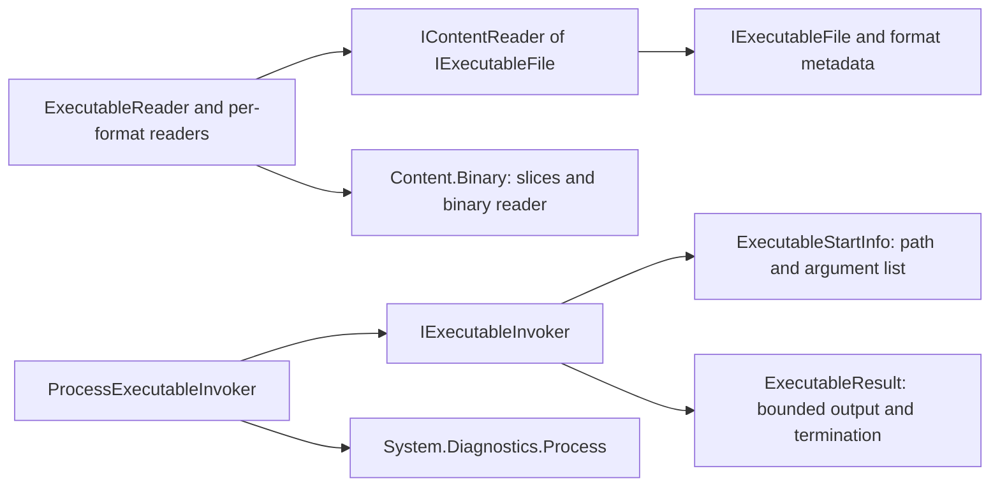

# Assimalign.Cohesion.Content.Exe — Design

## Decision and purpose

Owner decision **O-C1, 2026-10-16**: "Keep process invocation in Content.Exe, separated from
inspection, with timeout, cancellation and process-tree cleanup."

Inspection describes bytes without executing them. Invocation launches a caller-selected executable
path without parsing its format. Keeping both in this package gives content consumers a small,
platform-neutral contract while separating trust decisions from parsing. An inspected file is not
thereby trusted, loadable on this machine, or authorized to execute.

The two families reference their own contracts; inspection alone uses binary parsing primitives.

## Retained inspection scope (#476)

| Family | Retained structures | Governing specification | Deferred structures |
| --- | --- | --- | --- |
| PE/COFF | DOS header/signature and `e_lfanew`; PE signature; embedded COFF machine, characteristics and raw timestamp; PE32/PE32+ optional-header subsystem, entry-point RVA, image base, DLL characteristics, alignment and size fields; data directories; section headers; managed-image indication from nonempty CLI directory 14 | [Microsoft PE and COFF specification](https://learn.microsoft.com/en-us/windows/win32/debug/pe-format), File Headers, Optional Header, Section Table | Import/export decoding, resources, version information, CLI metadata/IL, symbols/relocations, standalone COFF objects and archives |
| ELF | `e_ident` class, data encoding, OS ABI and ABI version; 32/64-bit headers in either byte order; raw type and machine, entry point, flags; program headers and `PT_INTERP`; section headers and names from the section-name string table, including extended table numbering | [System V ELF gABI: ELF header](https://gabi.xinuos.com/elf/02-eheader.html), [sections](https://gabi.xinuos.com/elf/03-sheader.html), [program headers](https://gabi.xinuos.com/elf/07-pheader.html) | Dynamic-section interpretation, symbols and relocations |
| Mach-O | Thin 32/64-bit headers in either byte order; CPU type/subtype, file type and flags; load-command identifiers and sizes; universal/fat 32/64-bit architecture tables with offsets, sizes and alignment | [Apple Mach-O File Format Reference](https://developer.apple.com/library/archive/documentation/DeveloperTools/Conceptual/MachORuntime/Reference/reference.html); maintained [loader.h](https://github.com/apple-oss-distributions/xnu/blob/main/EXTERNAL_HEADERS/mach-o/loader.h) and [fat.h](https://github.com/apple-oss-distributions/xnu/blob/main/EXTERNAL_HEADERS/mach-o/fat.h) wire definitions | Load-command payloads, entry-point decoding and recursive inspection of universal members |

Detection returns `ContentFormat.Unknown` for unrecognized prefixes, including scripts, WebAssembly
and Java class files; inspecting these reports `Unsupported`. PE detection recognizes `MZ` and
inspection validates the PE signature. Standalone COFF lacks a distinctive magic and is outside
this retained PE-image scope. Java shares `CAFEBABE` with universal Mach-O: the probe also checks
the universal count and first CPU field when distinguishing that signature. Short prefixes that
cannot identify a format return unknown; explicit per-format readers report truncation. Detection
is a routing hint, not full validation.

## Inspection contract and bounds

`IExecutableFile` replaces the placeholder invocation-bearing `IBinaryFile` subtype with a detached
inspection snapshot: format, raw machine identifier, bitness, byte order, kind, optional entry point,
and exactly one of `PeMetadata`, `ElfMetadata` and `MachOMetadata`. No source handle is retained.
Kinds include executable, library, object, core and unknown; ELF `ET_DYN` maps to library even when
it is a position-independent executable. Universal Mach-O has no single machine or bitness (zero),
kind unknown and no entry point. PE entry points are RVAs; ELF entry points are virtual addresses;
Mach-O entry points are null because their load-command decoding is deferred.

`ExecutableReader` detects and dispatches; `PeExecutableReader`, `ElfExecutableReader` and
`MachOExecutableReader` implement the existing `IContentReader<IExecutableFile>` contract directly.
Each per-format reader exposes a shared `ContentFormat`. Readers have public parameterless
constructors and concrete-returning `Create(options)` factories (decisions 59/61). Common mechanics
are internal; a public abstract base would add no stronger contract here.

All readers require a readable **seekable** source, beginning at its current position, and leave it
open. PE section access and ELF section-name access need random reads; the common entry point uses
the same requirement for predictable ownership and bounds. Non-seekable input fails with
`ContentFormatException(Unsupported)` at the known origin (zero when unavailable), without buffering
the source. A `ContentSliceStream` bounds reads; `BinaryContentReader` interprets buffered headers
with the absolute slice origin. No payload is loaded just to inspect headers.

`ExecutableReaderOptions` caps table entries (65,536 by default) and buffered metadata (16 MiB by
default). Counts, offsets, table products and variable string sizes are checked before allocation or
seeking. Names also consume the metadata budget, preventing overlapping string references from
amplifying memory. Declared ranges are checked using subtraction/division before conversion or
multiplication. Unknown enum/flag values remain raw metadata where structurally valid.

Malformed input reports `ContentFormatException` with `Truncated`, `InvalidStructure`, `InvalidValue`,
`LimitExceeded` or `Unsupported` and an absolute byte position. Caller argument errors and source
I/O failures retain their framework exceptions. This is a metadata inspector, not a loader, linker,
signature verifier or executable writer.

## Invocation lifecycle (#477)

`IExecutableInvoker.InvokeAsync(ExecutableStartInfo, CancellationToken)` returns
`ValueTask<ExecutableResult>`. `ProcessExecutableInvoker` is stateless and owns a local `Process`
for each call. Start information contains a path, an argument list, optional working directory,
environment overrides (null removes a variable), optional UTF-8 standard input, byte capture limits
per stream and optional timeout. Path syntax/resolution belongs to the platform process API;
this package defines no portable path grammar. Caller collections are copied before launch.

`UseShellExecute` is false; each argument is added to `ProcessStartInfo.ArgumentList`. There is no
shell command-string overload. Standard input is closed after writing, including when no content
was provided. Both output pipes drain concurrently from launch using pooled byte buffers. Capture
retains at most the configured bytes (1 MiB per stream by default); excess is discarded while
draining continues. Returned strings are UTF-8 with replacement for malformed or cutoff multibyte
sequences. Each stream has its own truncation flag.

Completion reasons are `Exited`, `TimedOut`, `Canceled`, `FailedToStart`. Cancellation returns a
canceled result **after cleanup**. A pre-canceled call and zero timeout do not launch anything.
OS launch failures (including missing/non-executable files) return `FailedToStart` with null exit
code and empty output; invalid caller options throw before launch. Results carry nullable exit code,
captured output, flags, UTC start/end timestamps and duration. Start is the invocation attempt, not
an OS process-metadata query. A completion already observed wins a cancellation race; otherwise
cancellation takes precedence over timeout when both tokens are signaled.

Timeout, cancellation and exceptional exits call `Kill(entireProcessTree: true)` while the root is
alive, await root exit without the canceled token, finish/cancel pipe I/O, and dispose handles and
return pooled buffers before returning or propagating an unexpected error. No live process handle
escapes. Cleanup failure propagates rather than claiming successful termination. This uses platform
process-tree semantics; it is not a sandbox or containment for hostile programs that detach/reparent
themselves. Normal exit requires the launched program to own and close inherited pipe handles;
callers should supply a timeout for untrusted lifecycles.

Executing in-memory bytes is out of scope. Writing bytes to a temporary executable and running it
is a security decision left to callers. Credentials, elevation, OS jobs/containers, sandbox policy
and service orchestration belong above this package.

## Extension and AOT posture

A future platform package implements `IContentReader<IExecutableFile>` with its own format
descriptor and metadata adapter, or implements `IExecutableInvoker` for platform lifecycle policy.
It references Content.Exe; this package never references its extensions. Extensions can implement
richer inspection interfaces alongside the base snapshot contract. The built-in detector has a fixed
format set; a registry belongs to the separate Content detection work item.

Inspection uses spans, pooled buffers and explicit integer decoding. Invocation uses
`System.Diagnostics.Process`, compatible with NativeAOT. Neither family uses reflection, dynamic
code, runtime serialization or assembly loading. The runtime PE corpus uses the framework assembly
already loaded by the test process, without loading or invoking the inspected file.

## Verification coverage (#478)

Specification-built headers cover PE widths, ELF widths/byte orders, thin and universal Mach-O.
The runtime's `typeof(object).Assembly.Location` supplies a real managed PE. The linked Binary
truncation corpus and mutated offsets/counts cover hostile input and absolute positions. A source-built,
non-packable console fixture supplies arguments, stdin, concurrent stdout/stderr, exit, sleep and
descendant modes. Lifecycle tests cover bounded output, launch failure, timeout/cancellation and a
grandchild's disappearance; they invoke the current `dotnet` host, need no downloaded binaries,
and have bounded watchdogs and cleanup.

`ExecutableMetadataTests` covers header fields and kind mapping; `ExecutableCorpusTests` maps PE
directories/sections, ELF names/interpreters/extended numbering and Mach-O command/architecture
tables to the specifications above. It applies the shared `TruncationCorpus` to every prefix of seven
complete fixtures, synchronously and asynchronously. `ExecutableMalformedInputTests` checks
hostile offset/count/size fields with nested absolute origins, configured limits and exact boundaries,
1,000 deterministic mutations, non-seekable rejection and a synthetic 40 GiB sparse source.
`ExecutableInvocationTests` covers argument round-trips, stdin closure, environment/removals,
directory selection, exact/overflow capture limits, concurrent heavy stdout/stderr with blocked stdin,
exit codes, failed start, pre-cancellation, timeout and child/grandchild cleanup.

The test host is built by a `ReferenceOutputAssembly=false` project reference and copied using its
resolved target path. Its atomic PID-file handshake avoids races between Windows file writers and
readers. It is a non-packable fixture, so it is intentionally absent from the release inventory and
CI matrix; the Content.Exe test build supplies it on every OS. The required real runtime PE test
locally suppresses IL3000: VSTest uses a file-backed runtime assembly, and this corpus is not a
single-file published test harness. The library's NativeAOT settings remain enabled.
