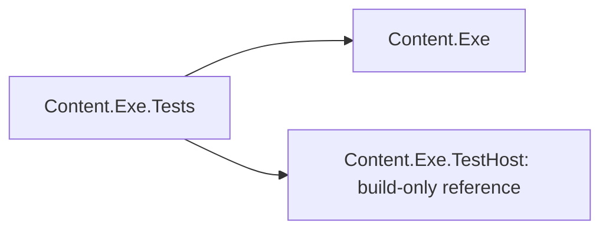

# Executable test host — Design

The test project references this harness with `ReferenceOutputAssembly=false`, then copies its
resolved DLL, runtime configuration and dependency manifest under the test output's `TestHost/`.
The path is independent of configuration and working directory. The harness has no package or
Content assembly references; its protocol is deliberately plain arguments and bytes.

The test project depends on both the library and this independent harness.

Each harness has a 15-second watchdog. Tree parents wait for their children and kill/wait in
`finally`; the grandchild sleeps for at most 12 seconds. Tests cancel their invocation in `finally`
and track only PIDs written into their unique temporary directory, so emergency cleanup cannot
target another session's processes. Parent/child/grandchild PID files provide a readiness handshake;
tests do not assume a fixed process-start latency. Output uses raw streams for byte-count tests and
base64 lines for unambiguous argument round-trips. Nothing is packed or added to the CI matrix.
