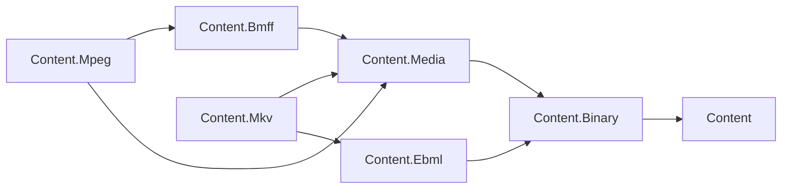

# Assimalign.Cohesion.Content.Media — Design

## Intent and boundary

Content.Media is the shared vocabulary for encoded presentations, tracks, exact time, lazy sample
locations, and seek ranges. Services can locate bytes for streaming, thumbnails, and segment planning
without referencing container packages. The MP4 and Matroska profiles implement these contracts.
This assembly neither parses containers nor interprets codec bitstreams.

The mapping follows [ISO/IEC 14496-12](https://www.iso.org/obp/ui#iso:std:iso-iec:14496:-12:ed-8:v1:en)
(track/sample tables, edits, fragments) and [RFC 9559](https://www.rfc-editor.org/rfc/rfc9559.html)
(tracks, blocks, laces, timestamps, cues). The tables distinguish native fields from derived behavior
and source capabilities; missing metadata is not permission to invent a value.

## Family and dependencies

Media references Binary only, and Binary references Content. BMFF references Media.
The MP4 profile references BMFF and Media; Matroska references EBML and Media. EBML remains
format-generic. All arrows below are integrated direct project references.

| Package | Role |
| --- | --- |
| Assimalign.Cohesion.Content | Source identity, ownership, composition, reader/writer contracts |
| Assimalign.Cohesion.Content.Binary | BinarySegment, bounded streams, binary primitives |
| Assimalign.Cohesion.Content.Media | Shared contracts and value objects |
| Assimalign.Cohesion.Content.Bmff / Content.Ebml | Container readers, writers, editable documents |
| Assimalign.Cohesion.Content.Mpeg / Content.Mkv | Implemented adapters over native structures |

## Why this shape

- **Interfaces and one guided base.** Profiles supply file/track views. MediaSampleIndex contributes
  cancellation and capability checks, with no whole-track fallback for random operations. File/track
  bases would only repeat properties and impose an unnecessary inheritance chain.
- **Track classification replaces file classification.** MediaTrackKind replaces MediaFileKind;
  mixed presentations contain several kinds. Text includes bitmap subtitles. Still-image items belong
  to their future profile, not this timed-track vocabulary. IMediaFile.Kind is removed.
- **IBinaryFile remains; mandatory IComposableContent does not.** Interleaved track payloads are not
  independently serialized IContent items. Tracks are typed descriptors. Profiles may independently
  implement composition for actual child content. The empty IMediaFileComponent is removed.
- **Native strings and opaque bytes.** CodecId is the native identifier, not an RFC 6381/MIME codec
  string. CodecPrivateData is a borrowed BinarySegment. Language prefers a native BCP 47 field,
  preserving legacy codes otherwise. No new string grammar or codec parsing is introduced.
- **Unknown means unknown.** Missing DTS is null, not copied PTS. IsDefault is nullable: generic BMFF
  has no direct FlagDefault counterpart; a profile may derive selection eligibility or leave it unknown.
  Unknown duration and IsLive are independent.
- **Live is shared; fragmentation is native.** IsLive describes producer/source state. Finite
  fragmented MP4 is not automatically live; Matroska Clusters are not BMFF movie fragments.
  Fragmentation stays in Content.Mpeg, cluster details in Content.Mkv.
- **Numbers remain primitives.** DisplayAspectRatio is a positive ulong width/height pair, after
  container crop/aspect adjustments and before rotation. SampleRate is nullable double because
  containers already encode fixed/floating-point frequencies. Timeline calculations use MediaTimestamp.

## BMFF → model ← Matroska

Every member is mapped below. Optional descriptors remain null when container metadata cannot
establish them. Bounds failures are profile errors, never silent clamping.

| BMFF source/derivation | Shared type/member | Matroska source/derivation |
| --- | --- | --- |
| Serialized source | IMediaFile : IBinaryFile | Serialized Segment/source |
| moov/trak | IMediaFile.Tracks | Tracks/TrackEntry |
| mvhd; mehd or resolved edits/fragments when applicable | IMediaFile.Duration | Info/Duration scaled by TimestampScale, or proven final extent |
| Producer/source state, not moof presence | IMediaFile.IsLive | Producer/source state, not missing Duration alone |
| trak | IMediaTrack | TrackEntry |
| tkhd track_ID | IMediaTrack.Id | TrackNumber, not TrackUID |
| hdlr interpreted by profile | IMediaTrack.Kind | TrackType interpreted by profile |
| Initial stsd sample-entry/original format | IMediaTrack.CodecId | CodecID |
| Initial sample-entry configuration payload | IMediaTrack.CodecPrivateData | CodecPrivate |
| elng, otherwise mdhd language | IMediaTrack.Language | LanguageBCP47, otherwise Language |
| mdhd ticks per second | IMediaTrack.Timescale | Normalized clock using TimestampScale/TrackTimestampScale |
| tkhd/elst duration or resolved media extent | IMediaTrack.Duration | Final block timestamp/duration extent, or unknown |
| tkhd track_enabled | IMediaTrack.IsEnabled | FlagEnabled |
| Profile selection policy over tkhd flags/alternate groups; null without one | IMediaTrack.IsDefault | FlagDefault eligibility |
| Lazy table/fragment adapter | IMediaTrack.Samples | Lazy block/lace/cue adapter |
| Visual sample entry and presentation geometry | IMediaVideoTrack | TrackEntry/Video |
| Visual sample-entry width | IMediaVideoTrack.PixelWidth | PixelWidth |
| Visual sample-entry height | IMediaVideoTrack.PixelHeight | PixelHeight |
| tkhd dimensions and/or sample geometry, clap/pasp as applicable | IMediaVideoTrack.DisplayAspectRatio | DisplayWidth/DisplayHeight/DisplayUnit and PixelCrop defaults |
| Audio sample entry | IMediaAudioTrack | TrackEntry/Audio |
| Sample-entry frequency | IMediaAudioTrack.SampleRate | SamplingFrequency |
| Sample-entry channels | IMediaAudioTrack.ChannelCount | Channels |
| Other/unrecognized handler | MediaTrackKind.Other | Complex, logo, buttons, control, or unrecognized TrackType |
| Video handler | MediaTrackKind.Video | TrackType video (1) |
| Audio handler | MediaTrackKind.Audio | TrackType audio (2) |
| Text/subtitle/caption handler | MediaTrackKind.Text | TrackType subtitle (17) |
| Timed metadata handler | MediaTrackKind.Metadata | TrackType metadata (33) |

The next table covers both IMediaSampleIndex and the matching public MediaSampleIndex members.
Capabilities describe the implementation and available source, not merely a box/element's existence.

| BMFF source/derivation | Shared type/member | Matroska source/derivation |
| --- | --- | --- |
| Sample tables and/or traf/trun | IMediaSampleIndex; MediaSampleIndex | Blocks/laces and optional Cues |
| Containing track_ID | TrackId | TrackNumber |
| stsz/stz2 plus known trun counts | Count | Known lace-expanded frame count; null without bounded discovery |
| Addressable native runs/pages | CanLookupByIndex | Addressable block/lace index |
| Timing runs plus composition/edit mapping | CanLookupByTime | Sparse timing/Cues plus bounded-memory block search |
| Available sync/dependency metadata and retrievable bytes | CanSeek | RAP/preroll/cue metadata and retrievable bytes |
| Lazy decode-order table/trun traversal | ReadSamplesAsync | Lazy source-order Cluster/block/lace traversal |
| Zero-based ordinal through native runs | GetSampleAsync | Zero-based frame ordinal through blocks/laces |
| Floor effective presentation time; lowest index breaks ties | FindSampleAsync | Same rule after timestamp/delay normalization |
| Preceding sync flags plus safe dependency coverage | SeekAsync | Preceding RAP plus safe preroll/dependency coverage |
| Profile subclass initialization; no wire field | MediaSampleIndex() (protected) | Profile subclass initialization; no wire field |
| Profile's lazy native traversal | ReadSamplesCoreAsync (protected) | Profile's lazy native traversal |
| Profile's supported native ordinal lookup | GetSampleCoreAsync (protected) | Profile's supported native ordinal lookup |
| Profile's supported effective-time lookup | FindSampleCoreAsync (protected) | Profile's supported effective-time lookup |
| Profile's supported safe range computation | SeekCoreAsync (protected) | Profile's supported safe range computation |

| BMFF source/derivation | Shared type/member | Matroska source/derivation |
| --- | --- | --- |
| Projected sample-table/trun entry | MediaSample(...) | Projected frame, including each frame in a lace |
| Containing track_ID | MediaSample.TrackId | Block's TrackNumber |
| Sample number minus one, in decode order | MediaSample.Index | Zero-based source-order frame ordinal |
| stts accumulation; tfdt plus trun durations | MediaSample.DecodeTime | Null unless DTS is independently recoverable |
| DTS + ctts/trun offset, mapped through elst | MediaSample.PresentationTime | Scaled Cluster/block timestamp minus CodecDelay; resolved lace timing |
| Effective PTS minus DTS, including presentation mapping | MediaSample.PresentationOffset | Same if DTS known; otherwise null |
| stco/co64 + stsc + preceding sizes, or fragment data offsets | MediaSample.ByteOffset | Absolute payload/lace frame location, not Segment-relative cue position |
| stsz/stz2 or trun/default size | MediaSample.ByteLength | Individual frame length after block/lace framing |
| stss; all sync when absent in applicable nonfragmented tables; fragment flags | MediaSample.IsSync | SimpleBlock keyframe or BlockGroup without ReferenceBlock |
| Validated native sync/target and computed range | MediaSeekResult(...) | Validated RAP/target and computed range |
| Latest eligible preceding sync descriptor | MediaSeekResult.SyncSample | Latest eligible preceding RAP descriptor |
| Effective-time floor lookup result | MediaSeekResult.TargetSample | Effective-time floor lookup result |
| Minimum absolute start required for decode interval/framing | MediaSeekResult.ByteOffset | Minimum absolute start for decode interval/framing/preroll |
| Contiguous dependency coverage, possibly interleaved | MediaSeekResult.ByteLength | Contiguous dependency coverage, possibly across clusters |
| Descriptor value equality | MediaSample.Equals(MediaSample) | Descriptor value equality |
| Type-checked descriptor equality | MediaSample.Equals(object) | Type-checked descriptor equality |
| Hash of descriptor values | MediaSample.GetHashCode | Hash of descriptor values |
| Seek descriptor equality | MediaSeekResult.Equals(MediaSeekResult) | Seek descriptor equality |
| Type-checked seek equality | MediaSeekResult.Equals(object) | Type-checked seek equality |
| Hash of seek descriptor values | MediaSeekResult.GetHashCode | Hash of seek descriptor values |

Timestamp methods are shared mathematical behavior, not additional wire fields.

| BMFF source/derivation | Shared type/member | Matroska source/derivation |
| --- | --- | --- |
| Signed time and positive clock scale | MediaTimestamp(long, long) | Normalized signed time and positive view scale |
| Integer clock ticks | MediaTimestamp.Value | Integer clock ticks after normalization |
| Usually mdhd/mvhd ticks per second | MediaTimestamp.Timescale | View ticks per second, commonly 1,000,000,000 |
| Exact clock conversion; fractional result refused | MediaTimestamp.RescaleExact | Same operation after normalization |
| Integer clock conversion with explicit rounding | MediaTimestamp.Rescale | Same operation after normalization |
| Display-only 100 ns conversion | MediaTimestamp.ToTimeSpan | Same display conversion |
| Exact cross-product ordering | MediaTimestamp.CompareTo | Same ordering |
| Exact rational equality | MediaTimestamp.Equals(MediaTimestamp) | Same equality |
| Type-checked rational equality | MediaTimestamp.Equals(object) | Same equality |
| Hash of reduced rational value | MediaTimestamp.GetHashCode | Same hashing |
| Exact reduced sum | MediaTimestamp.operator + | Same arithmetic |
| Exact reduced difference | MediaTimestamp.operator - | Same arithmetic |
| Exact equality | MediaTimestamp.operator == | Same comparison |
| Exact inequality | MediaTimestamp.operator != | Same comparison |
| Exact earlier-than ordering | MediaTimestamp.operator < | Same comparison |
| Exact earlier-or-equal ordering | MediaTimestamp.operator <= | Same comparison |
| Exact later-than ordering | MediaTimestamp.operator > | Same comparison |
| Exact later-or-equal ordering | MediaTimestamp.operator >= | Same comparison |

## Exact time and presentation mapping

MediaTimestamp is Value / Timescale seconds, with signed Int64 value and positive Int64 scale.
Default is 0/1. Construction preserves representation; equality/comparison/hash compare time.
Addition/subtraction reduce to lowest terms before checking representability. Int128 intermediates
avoid Int64 multiplication overflow; results outside the reduced value/scale bounds throw.

RescaleExact rejects fractional ticks. Rescale defaults to nearest with ties to even; AwayFromZero
means nearest with ties away from zero, not always rounding away. ToZero truncates,
ToNegativeInfinity floors, and ToPositiveInfinity ceilings, including negative input.
A 30000/1001 rate advances by 1001/30000 seconds: 3003 ticks at 90 kHz but 1601.6 ticks at 48 kHz.
Use rounding or a richer clock (240 kHz gives 8008 exact ticks). Accumulate exact durations before
rounding; repeated rounded frame durations drift. TimeSpan is for display only.

Matroska TimestampScale describes a tick duration, not ticks per second. The profile applies cluster/
track scaling, CodecDelay and lace timing. RFC 9559 §11 recommends nearest-nanosecond normalization
for fractional timestamp values; the profile documents that boundary rounding. The shared constructor
does not round. Values fitting only after reduction can use a coarser exact representation;
unrepresentable native data is a profile error.

DecodeTime stays on the media decode timeline; PresentationTime is on the file's effective presentation
timeline. Their difference combines composition displacement and edit-like shifts. It is not a separate
copy of raw ctts. Missing DTS means null DecodeTime and PresentationOffset. Negative times remain
representable for preroll/delay. Decode/source order never implies presentation order.

Full edit programs (repeats, dwell, non-unit rates), stsd changes, Matroska CodecState, and their
round-trip representation stay in profiles/documents. A profile must resolve its selected presentation
consistently or report the operation unsupported; it must not flatten a complex mapping incorrectly.

## Lazy index and seek rules

One lookup must not require a million-entry expanded table. Retain native runs, lazy pages, sparse
cues, or bounded working buffers. Lookup memory is independent of total sample count. A bounded-memory
scan is permissible when indexing is insufficient, with cancellation checks. There is no universal
logarithmic-time guarantee. Unknown Count stays null rather than causing an unrequested source scan.

ReadSamplesAsync streams from index zero in decode/source order and may be single-use. The base
disposes the core enumerator on completion, cancellation, or early exit. Random operations are
independently opt-in; false capabilities throw NotSupportedException rather than scanning implicitly.
Negative indexes are caller errors; an index beyond available data returns null. Cancellation is
checked before dispatch and on each yield; implementations check inside I/O and longer scans too.

FindSampleAsync selects the greatest effective PTS no later than the query, choosing lowest index
on ties. It is a floor query, not duration containment. Before the first timestamp it returns null;
after the last, including a gap, it returns the last presentation sample.

SeekAsync uses that target, choosing the latest sync PTS no later than the request whose decode/
source index does not exceed the target's; lowest index breaks ties. A B-frame can require an earlier
decoded reference with later PTS. Range coverage follows dependencies/decode order, not PTS endpoints.

MediaSeekResult carries one contiguous range with an exclusive end, possibly overfetching other
tracks and container framing. Its constructor validates identity, sync status, ordering, byte arithmetic,
and endpoint-sample coverage. Only the profile can prove coverage of intermediate samples, headers,
preroll, and configuration state. It includes those bytes or throws NotSupportedException when it
cannot establish a safe range. Null means no target or eligible sync point, not unsupported.

Initialization metadata and codec data are assumed available. A range is not a standalone playable
file or muxed adaptive segment. External BMFF data references and multi-resource presentations cannot
fit one source range; the profile refuses this query or supplies its own richer operation.

## Lifetime, editing, errors, and AOT

The file follows IContent ownership. Returned streams are caller-owned; profiles specify whether
their backing source is owned or borrowed. Tracks, indexes, and lazy BinarySegments borrow that source
and lifetime. Keep it open, stable in byte layout, and free of concurrent cursor movement. Shared-stream
operations are sequential unless explicitly supported otherwise. Live implementations document their
snapshot/refresh policy and available index extent. IsLive implies neither seekability nor reopenability.
Forward-only private data can use already bounded memory instead of an invalid lazy source reference.

Native documents/writers perform edits and saves, retaining unchanged payloads lazily. Relocation
invalidates old coordinate views; profiles replace them. This read-only vocabulary does not require
turning interleaved tracks into streams or buffering unchanged media.

Caller range errors use framework guards. Inexact conversion, overflow, and unsupported operations
use resource-backed exceptions from ErrorMessages.resx. This package is not a reader. Profiles must
translate malformed native values, truncation, and representability failures to ContentFormatException
with code and absolute position, and enforce D4 limits on tracks, pages, buffering, and nesting.

The inherited AOT posture is preserved: structs, direct interface dispatch, no reflection/dynamic code,
no LINQ in index walks, and ValueTask for commonly synchronous lookups. New profiles implement the
interfaces and may derive MediaSampleIndex, overriding only supported capability/core pairs.

## Verification and non-goals

MediaTimestampTests covers exact clocks, all rounding modes, signed extremes, an independent BigInteger
oracle, equality/hash consistency, and 30,000 NTSC frame additions. The generated index fixture stores
no sample table. On the measured .NET 10 Debug run, both 64- and 1,000,000-sample tracks use 136 bytes
at construction and zero allocation for 4,096 index/time/seek query sets, producing exactly 16,384
descriptors with no enumeration. Tests allow a fixed 1 KiB budget. This proves the contract permits
lazy implementations. The MP4 and Matroska suites separately exercise native sample queries;
these contract-fixture allocation measurements do not establish the container lazy-save gate.

Tests also cover offsets beyond 40 GB, opaque lazy codec bytes, ownership, cancellation, early exit,
absent DTS, invalid ranges, irregular sync intervals, edit-like shifts and B-frame dependencies.
Media is already listed in library-content.yml and CohesionPackaging.psm1. The shared CI action
discovers its explicit tests csproj and runs it; no onboarding change is needed.

Non-goals are container parsing/writing, codec parsing/decoding, transcoding/playback, HTTP handling,
HLS/DASH, a generalized edit-program API, native fragmentation/cluster metadata, DRM, codec configuration
transitions, spatial transforms/rotation, and multi-source ranges. Native structures stay in profiles
or container packages; transport and playback policies stay in services.
