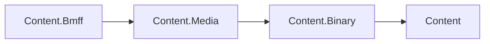

# Assimalign.Cohesion.Content.Media — Design

## Intent and current surface

Media is reserved for the shared track, sample, and timeline model in plan G3 (Stage 3).
Today it carries only IMediaFile and MediaFileKind. The model will support readers, writers,
and documents without coupling them to playback or service hosting.

The current dependency direction keeps binary operations below media abstractions:

BMFF references Media, Media references Binary, and Binary references the root Content package.
Exact reads and fixed-point values live in Binary. Media's former ReadBytes ignored partial reads;
its StreamExtensions and FPoint have been removed in favor of the shared primitives.

## Lifecycle, errors, and AOT

There is no implemented media lifecycle or ownership policy yet. Future track/sample documents
must follow the family's explicit source ownership and lazy-payload rules. Binary operations use
ContentFormatException and the shared error codes. This package defines no additional error root.

The inherited IsAotCompatible posture remains: no reflection or runtime-generated code.
Playback, codecs, transcoding, transport, and service orchestration remain outside this layer.
