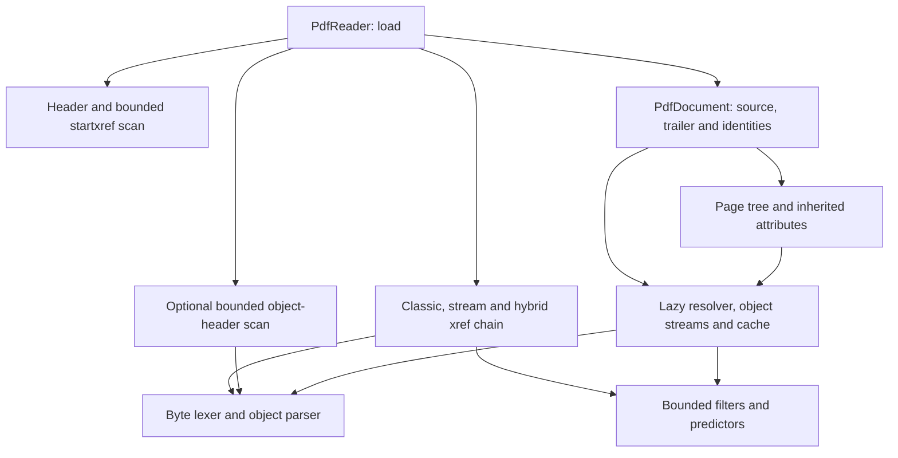

# PDF structural reader and object model

## Intent and dependency direction

This is Stage 2 of feature #470: an ISO 32000-2 structural reader for PDF 1.0–1.7 and 2.0,
and a retained model that Stage 3 can serialize and update. It does not claim PDF rendering,
semantic validation of every dictionary, or preservation of the original whitespace spelling.
The sole direct dependency is `Assimalign.Cohesion.Content.Binary`; Binary references Content.
No shipped assembly receives access to another assembly's internals. Tests have a local grant.

The program's common forward-only-reader pattern is specialized here by the PDF brief: cross-reference
resolution needs random access, so this reader rejects non-seekable sources. It does not spool a
40 GiB source to memory. The later writer remains a separate Stage 3 concern.

The load flow follows these dependencies; an arrow means that a component uses the target.
The reader locates the header/trailer, builds the revision-aware xref map, then creates a document.
The document resolves objects and page attributes on demand; recovery is opt-in.

## Retained scope by ISO 32000-2 clause

| Clause | Retained behavior | Main test coverage |
| --- | --- | --- |
| §7.2 | Byte classification; NUL, HT, LF, FF, CR and SP whitespace; comments terminate at EOL and separate tokens; PDF delimiters; braces remain ordinary name characters outside Type 4 functions | `PdfParserTests`, deterministic mutations in `PdfStructureBoundaryTests` |
| §7.3.2–§7.3.3 | Boolean, signed Int64 integers, finite Double reals; optional sign, leading zeros, `.5`, `-.002`, trailing decimal point | `PdfObjectModelTests`, `PdfParserTests` |
| §7.3.4 | Literal and hexadecimal strings stored as bytes; balanced parentheses; all escapes, octal low byte, escaped EOL continuation, unescaped EOL normalization, odd hex nibble zero padding | `PdfObjectModelTests`, `PdfParserTests` |
| §7.3.5–§7.3.7 | Byte names and #xx escapes; decoded-key equality; ordered editable arrays/dictionaries; null-valued entries retained as objects | `PdfObjectModelTests`, `PdfParserTests` |
| §7.3.8 | Dictionary plus lazy BinarySegment; LF or CRLF after stream; direct or resolved indirect Length; exact endstream/endobj checking; on-demand decoding | `PdfParserTests`, `PdfCorpusTests`, linked `TruncationCorpus`, sparse-source regression |
| §7.3.9–§7.3.10 | Null values, object number/generation identities, obj/endobj, unresolved indirect references; free/missing/wrong-generation references resolve to null | `PdfObjectModelTests`, `PdfCrossReferenceTests`, `PdfCorpusTests` |
| §7.4.1–§7.4.5 | Ordered filter chains; aligned DecodeParms; ASCIIHex, ASCII85, LZW (EarlyChange 0/1, 9–12 bits), Flate through BCL ZLibStream, RunLength | `PdfFilterTests`, `PdfFilterBoundaryTests` |
| §7.4.4.4 | TIFF horizontal differencing at 1/2/4/8/16 bits per component; PNG None/Sub/Up/Average/Paeth, including predictor 12 in xref streams | `PdfFilterBoundaryTests`, generated/golden predictor-12 corpus |
| §7.5.2 | Header begins within first 1024 bytes of the supplied origin; PDF 1.0–1.7 and 2.0; catalog Version may upgrade the effective version | `PdfCrossReferenceTests`, `PdfStructureBoundaryTests` |
| §7.5.4 | Classic subsections with strict 20-byte records; offset/object identity validation; retained free-list links/generations | `PdfCrossReferenceTests`, classic golden, count/offset regressions |
| §7.5.5–§7.5.6 | Bounded backward startxref/EOF search, trailer, cycle-safe and capped Prev chain; newest record wins even when free; trailer entries merge newest first | `PdfCrossReferenceTests`, incremental table/stream corpus, section-limit tests |
| §7.5.7 | Lazy bounded object-stream decode/index; N and First; member number/index agreement; ordered offsets and bounded extraction; one decoded index retained | `PdfCorpusTests`, `PdfMalformedCorpusTests` |
| §7.5.8 | Xref streams; direct W/Index/filter parameters; 0–8-byte fields; omitted type defaults to one, omitted generation to zero; sparse ranges and Prev; hybrid XRefStm supplement overrides its companion table | `PdfCorpusTests`, malformed range/width tests, zero-width-field regression |
| §7.7.2 | Catalog through Root; Type verification; effective Version upgrade | `PdfCrossReferenceTests`, `PdfStructureBoundaryTests` |
| §7.7.3 | Page-tree traversal, cycle/duplicate-node detection, Parent and Count validation; nearest Resources/MediaBox/CropBox/Rotate; CropBox defaults to MediaBox and Rotate to zero | Three-level generated/golden tree, `PdfCorpusTests`, cyclic/depth regressions |

Cross-reference sections are processed newest to oldest. A hybrid supplement is applied before its
companion table enters the global map; its Prev is not followed independently, as the companion table
controls revision traversal. Free-list links are retained for the writer, not traversed as a separate
free-list integrity validator. Unknown xref entry types report Unsupported. Unused dictionary entries,
including extensions and annotations, survive as generic objects.

Names are binary objects rather than grammar-bearing Unicode identifiers, so no string-backed
CohesionValueType is generated. Object identifiers are composed numeric values with range guards.
The common IPdfObject contract identifies the model family; sealed concrete values expose the
constructible forms. OrderedDictionary supplies ordered lookup without a duplicate index structure.

## Source, ownership and caching

The source's current position defines the PDF origin; xref offsets remain relative to it.
Diagnostics accumulate ContentSliceStream source offsets. A source must be readable and seekable;
failed loads never dispose it. A successful load borrows it unless leaveOpen is false. Disposing a
document invalidates resolution, and closes only an owned source. Extracted values and lazy segments
still require their backing source to remain open and unchanged. No operations synchronize concurrent
use of the document or source. The current source position after an operation is unspecified.

PdfInput rents a fixed buffer and maintains its own logical cursor, allowing nested resolution to
seek the shared source without corrupting the caller's cursor. Every rented buffer is returned on
success and failure. Large ordinary streams become BinarySegments without materialization.

Resolution caches parsed in-use objects by PdfObjectIdentifier and checks the xref identity before
caching. Reference cycles in eager resolution, including Length, fail. A single decoded object-stream
index is retained to bound compressed-index memory; extracted values join the identity cache.
Stream Decode calls are not cached, so edits to Filter/DecodeParms are visible. Page views are fresh
snapshots of the current dictionaries; inherited entries are never flattened into the leaf dictionary.

ReadAsync returns ValueTask and performs the same synchronous seek/read path. Cancellation is checked
before loading, between buffer fills, between xref sections and before lazy resolutions performed during
loading. Individual filter operations are bounded synchronous work. There is no background task or server.

## Limits and allocation policy

The defaults and meanings are tabulated in [OVERVIEW](OVERVIEW.md#limits-and-failures). Every wire count
is checked before allocating arrays or growing collections. Range checks use subtraction before addition;
xref numeric fields use unsigned byte reads and explicit conversion guards. Missing end markers never
trigger an unbounded scan. Recovery has a separate scan cap; a source larger than that cap cannot be
rebuilt without an explicit option increase.

Encoded materialization and each decoded intermediate have independent caps. Predictor row geometry
is checked before allocating; packed TIFF samples are reconstructed by component. Flate decoding checks
the zlib header and Adler-32 trailer in addition to ZLibStream's validation. ASCII/LZW/RunLength end markers
are required. String/array/dictionary nesting and resolution/page recursion are capped; MaxDepth may not
exceed 512. A per-object node budget also bounds wide containers. Object caches grow with accessed objects,
up to the cross-reference limit; these are per-unit bounds, not a global memory allocator quota.

## Error model and recovery

Package-authored messages come from Properties/ErrorMessages.resx. Public option/value misuse uses BCL
argument exceptions. Wire failures use ContentFormatException, never raw index/range/overflow/EOF/cast
exceptions. Positions are absolute source coordinates where available; decoded object-stream errors
anchor at the containing encoded stream, because no exact compressed-to-decoded byte mapping exists.

| Code | Behavior |
| --- | --- |
| `InvalidStructure` | Broken header/xref/trailer, wrong object at an offset, bad object boundaries, duplicate strict dictionary keys, cycles, malformed page tree or incorrect Length. Xref-level lexical/truncation failures are normalized to this code. |
| `InvalidValue` | Invalid numeric/name/hex token, corrupt filter data, invalid predictor parameters or page rotation. |
| `Truncated` | Incomplete object/token/stream or filter data outside xref loading. |
| `LimitExceeded` | Decoded/buffered bytes, nodes, depth, xref sections or recovery scan exceed a configured bound. |
| `Unsupported` | Non-seekable/unreadable source, unsupported PDF version, encryption payload access, image/unknown/crypt filters, external stream F data, or unknown xref entry type. |

Strict mode is the default. Lenient mode enables only these additional behaviors:

1. Exponent-form real numbers (`2e2`) are accepted; overflow and nonfinite values remain invalid.
2. Duplicate dictionary keys use the last value while retaining the first insertion position.
3. A bare CR after stream is accepted; LF and CRLF are accepted in both modes.
4. Classic xref records may use variable whitespace/field widths instead of the strict 20-byte form.
5. Bytes after the final EOF marker are tolerated within the bounded trailer search.
6. Structural filter abbreviations Fl, AHx, A85, LZW and RL are accepted in ordinary stream dictionaries.
7. A missing/wrong stream Length can be repaired by scanning for a line-start endstream followed by
   endobj. The preceding EOL is excluded from data. This is a heuristic: arbitrary binary payloads
   can contain the same markers, so strict mode never uses it.
8. Broken xref metadata can be rebuilt by a bounded scan for complete `n g obj` objects. Complete
   strings, comments and stream payloads are skipped. Later definitions win; object-stream headers
   can reconstruct compressed entries after trailer encryption is known. A wrong-object offset found
   during lazy resolution permits one repair attempt and invalidates the old resolution cache.

Header scanning within the first 1024 bytes is an explicit compatibility rule in both modes. Ordinary
PDF syntax such as leading zeros, `.5`, `-.002`, escaped newlines and odd-length hex strings is not a
leniency. Repair does not recover deletion/free-list history and may lose the intent of damaged revisions;
StartXref becomes -1. A later writer must require a full save for repaired documents instead of assuming
the original incremental chain is safe. Limits and Unsupported failures are never silently recovered.

## Unsupported semantic scope

| Deferred capability | Current behavior and errors |
| --- | --- |
| Encryption and security handlers (§7.6) | Trailer/xref structure loads; any access to retained string bytes or stream data/decoding is Unsupported. This deliberately includes ID/security-dictionary strings; no password API exists. An encrypted catalog inside an object stream cannot be resolved, but initial structure loading still succeeds. |
| Content-stream operator parsing (§7.8) | Streams remain byte payloads. Structural filter decoding is available; there is no operator-parser API and no error solely because content operators are present. |
| Fonts and text extraction (§9) | Dictionaries/streams are retained without interpreting fonts or extracting page text. There is no extraction API. PdfString.DecodeText uses only the caller's encoding and its fallback policy. |
| Rendering (§§8–11) | No rendering API. Structural loading does not reject graphics dictionaries. DCTDecode, JPXDecode, JBIG2Decode and CCITTFaxDecode payloads pass through via Data; Decode reports Unsupported. |
| Forms (§12.7) | Form dictionaries and references are readable. No form evaluation/filling API; their presence alone is not an error. |
| Signatures (§12.8) | Signature dictionaries and bytes are retained. No signing, cryptographic validation or trust result is exposed; their presence alone is not an error. |
| Annotation semantics (§12.5) | Annotations are only generic dictionaries/arrays/references. No annotation behavior API; no error solely because an annotation is present. |
| Writer (Stage 3, #1555) | No save API or writer implementation exists in this stage. There is no runtime stub that silently emits or modifies a file. |

Malformed generic structure and resource limits still apply inside deferred-feature dictionaries.
External stream F data and unknown/crypt filters are also Unsupported when decode is requested.
The package performs no external-file or network retrieval.

## Extension into the Stage 3 writer

Every standard object form has a retained representation: name/string bytes, boolean/integer/real
values, ordered arrays/dictionaries, object identities, and encoded lazy stream data. A writer can
serialize already resolved objects without reparsing them. It can resolve previously untouched objects
once for a full rewrite, or copy unchanged payloads through BinarySegment. Raw comments/whitespace,
number spelling and string escape spelling are intentionally normalized on serialization; literal versus
hexadecimal string form is retained.

The document keeps trailer extension entries, effective version, source origin, latest StartXref,
current generations and free-list records. Stage 3 can add allocation/replacement/change-tracking and
save APIs in this assembly, use the current xref map and cached objects for an append, update Size/Prev,
and select a full rewrite when repair has invalidated the old chain. It must handle transitive edits to
mutable containers and explicitly define stream replacement. No existing public interface needs a new
member to implement that work. New fonts, operators, forms and rendering capabilities should interpret
this model in focused packages instead of extending this parser into a rendering engine.

## Corpus, provenance and verification

All tests name their ISO 32000-2 clauses in their display names. PdfFixtureBuilder calculates byte offsets;
no fixture is downloaded. The generated suite covers classic xrefs, predictor-12 xref streams, lazy object
streams, both forms of incremental update, hybrid references, three-level page inheritance and indirect
Length. Every generated end-to-end corpus file resolves every in-use object and counts pages.

| Checked-in golden | Producer named inside its PDF comment |
| --- | --- |
| `tests/TestObjects/Golden/CLASSIC.pdf` | `PdfFixtureBuilder.Classic()` |
| `tests/TestObjects/Golden/XREF_PREDICTOR12.pdf` | `PdfFixtureBuilder.XrefStream()` |
| `tests/TestObjects/Golden/OBJECT_STREAM.pdf` | `PdfFixtureBuilder.XrefStream(objectStream: true)` |
| `tests/TestObjects/Golden/INHERITED_PAGES.pdf` | `PdfFixtureBuilder.InheritedPages()` through Classic |

Golden tests read those bytes without regenerating them. Their local .gitattributes marks PDFs binary so
checkout cannot rewrite line endings and invalidate offsets. Regeneration is an explicit developer action
calling the named helper and reviewing the resulting file. The malformed corpus covers broken headers,
missing startxref, wrong-object offsets, Prev cycles, wrong Length, every payload prefix through Binary's
linked TruncationCorpus, count/depth/decoded-size bombs, predictor geometry, compressed member mismatch,
page cycles and unsupported encryption/codecs. Filter boundaries include both LZW EarlyChange settings,
all widths through a full dictionary and reset, every PNG predictor, and packed TIFF samples.

A sparse 40 GiB source proves lazy payload handling; a deterministic 1,024-byte-mutation corpus checks
that corruption does not leak raw parsing exceptions. This is regression coverage, not a substitute for
the program's later coverage-guided fuzzing and benchmark work. The production code uses explicit BCL
operations, spans, pooled scratch storage and direct contracts: no reflection, dynamic code, runtime
code generation or Microsoft.Extensions dependency.

The governing specification is ISO 32000-2, with the PDF Association's
[clause 7 errata](https://pdf-issues.pdfa.org/32000-2-2020/clause07.html) used for corrected lexical,
object-stream and xref requirements. The
[program plan](../../../../docs/programs/CONTENT_FOUNDATION_PLAN.md) and
[Binary design](../../Assimalign.Cohesion.Content.Binary/docs/DESIGN.md) define shared limits,
lazy-source lifetime and malformed-input vocabulary.

## Stage 3 serialization and mutation decision

The internal serializer emits invariant integers and shortest round-trip Double decimals, expanding
exponents without rounding; integral reals retain a decimal point and negative zero retains its sign.
Names use uppercase #xx escapes outside ASCII 33–126 and for delimiters and #. Literal strings
escape every parenthesis, backslash, standard control and other non-printable byte (three octal digits).
Hexadecimal syntax is used when requested by the source or when more than half the bytes fall outside
ASCII 32–126. Ordered containers preserve insertion order. Streams retain encoded bytes and receive
a direct Length matching the emitted extent. Direct cycles and excessive nesting fail loudly.

Add allocates above Size and every known identity, without reusing free numbers; Replace preserves
the current generation; Free increments it up to 65535. Trailer remains directly editable. Automatic
tracking records the revisions of all direct mutable containers at resolution, including stream
dictionaries; references are leaves. Save examines these snapshots without reading payloads. A nested
in-place edit marks every containing resolved indirect object. Explicit replacement also marks dirty.
Rejected: an explicit-only Replace contract would silently discard existing in-place container edits
in incremental saves unless it also compared every direct graph. Revisions avoid that duplicate work
and event subscriptions. Changed-back containers may conservatively remain dirty. Read-side recovery
is disabled once edits exist, because rebuilding the cache would lose them.

ReplaceData borrows unencoded BinarySegment bytes, removes old filters/external-file entries, updates
Length and exposes the replacement immediately. Its memory/source must stay unchanged and open.
The existing interfaces and immutable object types need no new public members.
## Stage 3 full save

PdfWriter implements IContentWriter<PdfDocument> and borrows the destination. Full saves emit the
current effective version, a binary marker, every live object in number order (or deterministic
bounded packing batches), a fresh table or xref stream, and EOF. No output seek is required. Stream
xref/packing options require version 1.5 or later; the writer does not silently change the version.
Full-save Size is capped before filling gaps; free entries are linked in ascending order. Packing
uses at most 100 generation-zero non-stream objects per group and excludes indirect-reference
values, the catalog, and indirect stream Length identities. Encryption is rejected before output,
even if the caller removed Encrypt from a document originally loaded as encrypted.

Unchanged payloads use BinarySegment and CopyExactlyTo with original Filter/DecodeParms. Replaced
payloads are Flate encoded by default, or stored unfiltered by option. A counting compression pass
computes a direct Length, then a second pass emits to the forward-only destination. These passes
use fixed pooled copy buffers, not payload-sized allocations. Object-stream units and encoded xref
units are capped by MaxBufferedBytes; xref rows are emitted through Content.Binary's writer with
PNG Up predictor 12 and Flate. The xref layout uses W [1 8 4], including offsets above 4 GiB.
Classic table offsets exceeding ten digits fail with LimitExceeded; choose xref streams for them.

Existing ID array entries are kept, including both identifiers. When ID is absent, both entries are
the first 16 bytes of SHA-256 over the emitted header/body, accumulated during writing. No clock,
randomness, destination name, current culture, or process hash ordering affects the bytes. This is
reproducibility for identical model/order, options and compression runtime, not a cross-runtime zlib
bitstream promise. Save does not change the model's trailer, stream dictionaries or dirty baseline;
reload the output to make it the source of a subsequent revision. Partial output after I/O failure
or cancellation must be discarded. WriteAsync currently follows the synchronous I/O path with
cancellation checks between bounded reads/writes, matching the reader's execution model.
## Stage 3 incremental save

Incremental=true copies the PDF source range, from its recorded SourceOffset to its recorded end,
with Content.Binary CopyExactlyTo, then appends changed/new objects, a rebuilt free list and a
trailer with Prev pointing to the original StartXref. A source length change is rejected. Prefix
bytes before the caller-supplied PDF origin are outside the document. The original PDF range is
byte-identical in the output. Objects are never packed during an incremental save. Replaced
compressed members receive ordinary uncompressed entries, which supersede their old stream entries.

The loader retains the last section's actual style separately from the merged trailer: table follows
table, stream follows stream, hybrid writes a supplemental stream plus a companion table whose
XRefStm points to it. Prev belongs to the companion table in a hybrid update. Older inherited Type
or XRefStm keys cannot change the new revision's style. Freed entries increment generations and the
free head and links are emitted together. Removed trailer keys receive null tombstones so Prev
merging cannot resurrect Info or extension metadata. Structural keys are always regenerated.

Recovered sources (StartXref=-1) require a full save first. Changing an object-stream container while
unchanged compressed members still depend on it is rejected loudly: edit the individual members,
or replace/free all dependent members before changing the container. This prevents stale decoded
member caches from silently losing an edit. In-place append is deliberately omitted: separate
storage is the contract, and rollback cannot make shared/wrapped source aliases or concurrent
readers safe. Exact stream-object identity aliases are rejected; callers must also avoid distinct
wrappers/handles over the same storage. Successful saves retain their original baseline, so repeated
saves are deterministic; reload a saved file to build a new Prev revision.

The generated and checked-in reader corpora round-trip incrementally with nested in-place edits.
Four successive updates are tested in all three styles, including free-entry shadowing and links.
An instrumented source measures the save after metadata resolution, rejects payload-sized reads,
and proves a 2 MiB unsupported-codec payload is copied once without decode or materialization in
both save modes. Parser setup can read ahead into a payload; that is separate from the measured
copy operation. Cancellation and I/O failures leave the source untouched and the destination partial.