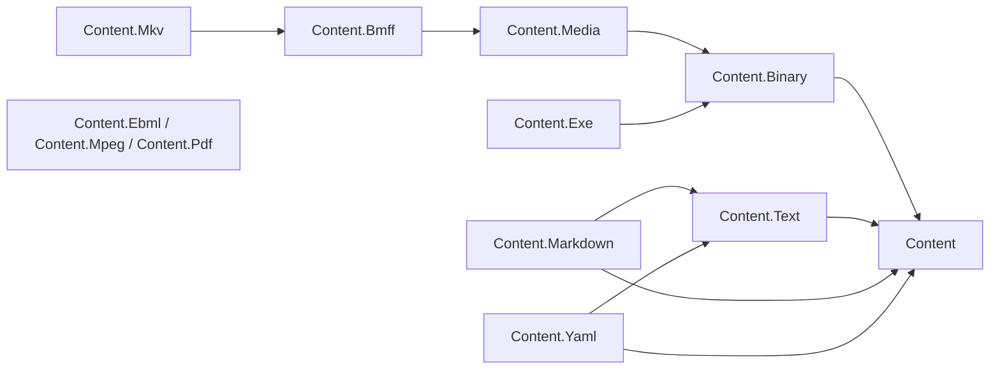

# Content

Content is the L1 foundation for reading, streaming and manipulating content: format-neutral
contracts, shared primitives, readers, writers and document models. A static content engine,
MediaHub and OpenApi YAML serialization build on this family; hosting, media workflows, job
orchestration and storage adapters belong at the service boundary.

## Project map

The diagram and table show direct csproj references at base commit `f7197e97f`; an arrow means
"depends on". Package names in the diagram omit the `Assimalign.Cohesion.` prefix.

EBML, MPEG and PDF in the combined node reference nothing; MKV currently references BMFF.
The target direction is in the [area architecture record](../../docs/libraries/Content/DESIGN.md#family-map).

| Package | Role | Depends on today | Classification | State |
| --- | --- | --- | --- | --- |
| [`Assimalign.Cohesion.Content`](./Assimalign.Cohesion.Content/) | Identity, ownership, composition and reader/writer contracts | None | Strategic | Implemented |
| [`Assimalign.Cohesion.Content.Binary`](./Assimalign.Cohesion.Content.Binary/) | Shared binary primitives: exact reads, slices, lazy segments, binary reader and writer | Content | Strategic | Implemented |
| [`Assimalign.Cohesion.Content.Text`](./Assimalign.Cohesion.Content.Text/) | Encoding detection, lines and tokens | Content | Strategic | Implemented |
| [`Assimalign.Cohesion.Content.Yaml`](./Assimalign.Cohesion.Content.Yaml/) | YAML 1.2.2 model, parser and emitter | Content, Content.Text | Strategic | Implemented |
| [`Assimalign.Cohesion.Content.Markdown`](./Assimalign.Cohesion.Content.Markdown/) | CommonMark subset, canonical writer and HTML renderer | Content, Content.Text | Strategic | Implemented |
| [`Assimalign.Cohesion.Content.Media`](./Assimalign.Cohesion.Content.Media/) | Shared tracks, rational timestamps, lazy sample indexes and seek ranges | Content.Binary | Strategic | Implemented (profile adapters in Stage 4) |
| [`Assimalign.Cohesion.Content.Bmff`](./Assimalign.Cohesion.Content.Bmff/) | ISO BMFF composite box model and reader/writer | Content.Media | Strategic | In progress |
| [`Assimalign.Cohesion.Content.Mpeg`](./Assimalign.Cohesion.Content.Mpeg/) | Planned MP4 profile over BMFF | None | Strategic | Placeholder |
| [`Assimalign.Cohesion.Content.Ebml`](./Assimalign.Cohesion.Content.Ebml/) | Tested VInt; container reader/writer/model incomplete | None | Strategic | In progress |
| [`Assimalign.Cohesion.Content.Mkv`](./Assimalign.Cohesion.Content.Mkv/) | Planned Matroska profile over EBML | Content.Bmff | Strategic | Placeholder |
| [`Assimalign.Cohesion.Content.Pdf`](./Assimalign.Cohesion.Content.Pdf/) | Planned PDF document structure and parser | None | Strategic | Placeholder |
| [`Assimalign.Cohesion.Content.Exe`](./Assimalign.Cohesion.Content.Exe/) | Executable inspection and, separately, process invocation (owner decision O-C1) | Content.Binary | Strategic | Placeholder |

BMFF builds but is incomplete; EBML builds with 60 passing VInt tests. State describes the delivered
surface, not stabilization approval. No package is experimental or archive today; classification definitions,
standards, O-C1 and the gates live in the [area architecture record](../../docs/libraries/Content/DESIGN.md).

## Dependency rule

References point toward shared contracts and primitives. The root never references a format, and
packages never consume each other's internals. Services compose these L1 libraries without making
them depend on hosting, workflow or storage implementations.
