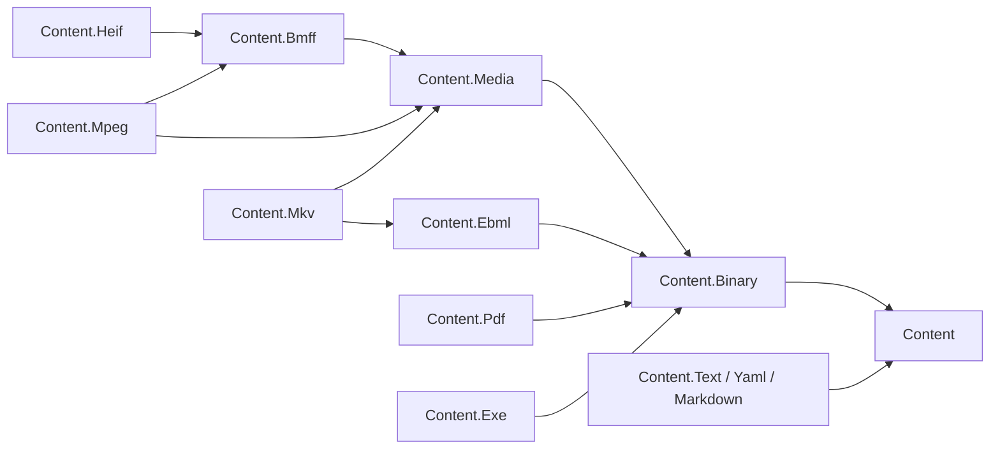

# Content

Content is the L1 foundation for reading, streaming and manipulating content: format-neutral
contracts, shared primitives, readers, writers and document models. A static content engine,
MediaHub and OpenApi YAML serialization build on this family; hosting, media workflows, job
orchestration and storage adapters belong at the service boundary.

## Project map

The diagram and table show direct csproj references in this worktree; an arrow means
"depends on". Package names in the diagram omit the `Assimalign.Cohesion.` prefix.

The text node groups Text, Yaml and Markdown to keep this map within twelve nodes.
HEIF references BMFF only. Binary references the root; Media, EBML, PDF and Exe reference Binary; BMFF references Media; Text
references the root, and YAML and Markdown reference both the root and Text. MKV references EBML and
Media, and MPEG references BMFF and Media. The target direction is in the [area architecture record](../../docs/libraries/Content/DESIGN.md#family-map).

| Package | Role | Depends on today | Classification | State |
| --- | --- | --- | --- | --- |
| [`Assimalign.Cohesion.Content`](./Assimalign.Cohesion.Content/) | Identity, ownership, composition and reader/writer contracts | None | Strategic | Implemented |
| [`Assimalign.Cohesion.Content.Binary`](./Assimalign.Cohesion.Content.Binary/) | Shared binary primitives: exact reads, slices, lazy segments, binary reader and writer | Content | Strategic | Implemented |
| [`Assimalign.Cohesion.Content.Text`](./Assimalign.Cohesion.Content.Text/) | Encoding detection, lines and tokens | Content | Strategic | Implemented |
| [`Assimalign.Cohesion.Content.Yaml`](./Assimalign.Cohesion.Content.Yaml/) | YAML 1.2.2 model, parser and emitter | Content, Content.Text | Strategic | Implemented |
| [`Assimalign.Cohesion.Content.Markdown`](./Assimalign.Cohesion.Content.Markdown/) | CommonMark subset, canonical writer and HTML renderer | Content, Content.Text | Strategic | Implemented |
| [`Assimalign.Cohesion.Content.Media`](./Assimalign.Cohesion.Content.Media/) | Shared tracks, rational timestamps, lazy sample indexes and seek ranges | Content.Binary | Strategic | Implemented (profile adapters in Stage 4) |
| [`Assimalign.Cohesion.Content.Bmff`](./Assimalign.Cohesion.Content.Bmff/) | ISO BMFF composite box model, registry, reader, writer and document with lazy `mdat` | Content.Media | Strategic | Implemented (strategic box field models in progress) |
| [`Assimalign.Cohesion.Content.Heif`](./Assimalign.Cohesion.Content.Heif/) | HEIF/AVIF still-image items, derived images, lazy payloads and metadata editing | Content.Bmff | Strategic | Implemented (still-image container scope) |
| [`Assimalign.Cohesion.Content.Mpeg`](./Assimalign.Cohesion.Content.Mpeg/) | MP4 profile over BMFF: brands, sample entries, media model, edit lists, fast start, CMAF checks | Content.Bmff, Content.Media | Strategic | Implemented |
| [`Assimalign.Cohesion.Content.Ebml`](./Assimalign.Cohesion.Content.Ebml/) | EBML reader, writer, document, schema and DocType registry | Content.Binary | Strategic | Implemented |
| [`Assimalign.Cohesion.Content.Mkv`](./Assimalign.Cohesion.Content.Mkv/) | Matroska and WebM over EBML: schema, blocks and lacing, media model, metadata editing | Content.Ebml, Content.Media | Strategic | Implemented (typed chapters and forward-only frames in #1559) |
| [`Assimalign.Cohesion.Content.Pdf`](./Assimalign.Cohesion.Content.Pdf/) | PDF object model, parser, cross-reference resolution, full save and incremental update | Content.Binary | Strategic | Implemented |
| [`Assimalign.Cohesion.Content.Exe`](./Assimalign.Cohesion.Content.Exe/) | Executable inspection and, separately, process invocation (owner decision O-C1) | Content.Binary | Strategic | Implemented |

Every package now has an implementation; the remaining work is tracked in the [program plan](../../docs/programs/CONTENT_FOUNDATION_PLAN.md).
State describes the delivered surface, not stabilization approval. No package is experimental or archive today; classification definitions,
standards, O-C1 and the gates live in the [area architecture record](../../docs/libraries/Content/DESIGN.md).

## Dependency rule

References point toward shared contracts and primitives. The root never references a format, and
packages never consume each other's internals. Services compose these L1 libraries without making
them depend on hosting, workflow or storage implementations.
