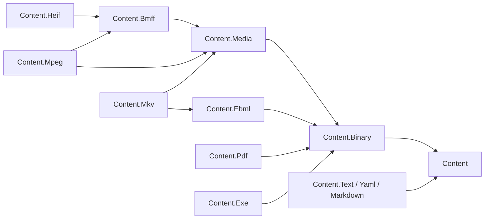

# Content

Content is the L1 foundation for reading, streaming and manipulating content. Its thirteen
packages provide shared contracts and primitives, format readers/writers and editable models.
Hosting, storage adapters, media workflows and orchestration belong to consuming services.

## Project map

Arrows show direct project references at `17e58c2a1`. The text node groups Text, YAML and
Markdown to keep the map at eleven nodes; the table records their individual references.

| Package | Delivered role | Direct dependencies |
| --- | --- | --- |
| [`Content`](./Assimalign.Cohesion.Content/docs/OVERVIEW.md) | Identity, ownership, composition and reader/writer contracts | None |
| [`Content.Binary`](./Assimalign.Cohesion.Content.Binary/docs/OVERVIEW.md) | Exact I/O, bounded slices, spans and lazy segments | Content |
| [`Content.Media`](./Assimalign.Cohesion.Content.Media/docs/OVERVIEW.md) | Tracks, rational time, lazy sample indexes and seek ranges | Content.Binary |
| [`Content.Bmff`](./Assimalign.Cohesion.Content.Bmff/docs/OVERVIEW.md) | BMFF box tree, registry, streaming I/O and relocation | Content.Media |
| [`Content.Mpeg`](./Assimalign.Cohesion.Content.Mpeg/docs/OVERVIEW.md) | MP4 tracks, sample entries, fast start and retained CMAF checks | Content.Bmff, Content.Media |
| [`Content.Heif`](./Assimalign.Cohesion.Content.Heif/docs/OVERVIEW.md) | HEIF/AVIF still-image items and metadata editing/erasure | Content.Bmff |
| [`Content.Ebml`](./Assimalign.Cohesion.Content.Ebml/docs/OVERVIEW.md) | Generic EBML streaming I/O, schema and editable documents | Content.Binary |
| [`Content.Mkv`](./Assimalign.Cohesion.Content.Mkv/docs/OVERVIEW.md) | Matroska/WebM tracks, blocks, chapters and metadata edits | Content.Ebml, Content.Media |
| [`Content.Pdf`](./Assimalign.Cohesion.Content.Pdf/docs/OVERVIEW.md) | PDF structure, random-access reading, full/incremental save | Content.Binary |
| [`Content.Exe`](./Assimalign.Cohesion.Content.Exe/docs/OVERVIEW.md) | PE/ELF/Mach-O inspection and separate process invocation | Content.Binary |
| [`Content.Text`](./Assimalign.Cohesion.Content.Text/docs/OVERVIEW.md) | Encoding detection, bounded lines and literal tokens | Content |
| [`Content.Markdown`](./Assimalign.Cohesion.Content.Markdown/docs/OVERVIEW.md) | Retained CommonMark subset, canonical writer and HTML | Content, Content.Text |
| [`Content.Yaml`](./Assimalign.Cohesion.Content.Yaml/docs/OVERVIEW.md) | YAML 1.2.2 document model, parser and emitter | Content, Content.Text |

All packages are strategic and implemented within their documented scopes. Stabilization remains
subject to the [final gate review](../../docs/libraries/Content/DESIGN.md#close-out-documentation-delta):
container streaming evidence, generated YAML documentation and the performance baseline remain open.
The [program plan](../../docs/programs/CONTENT_FOUNDATION_PLAN.md) owns follow-up scheduling.

## Dependency rule

References point toward shared contracts and primitives. The root never references a format, and
packages never consume another package's internals. Services compose these libraries without adding
hosting, workflow or storage dependencies to them. See the [area record](../../docs/libraries/Content/DESIGN.md).
