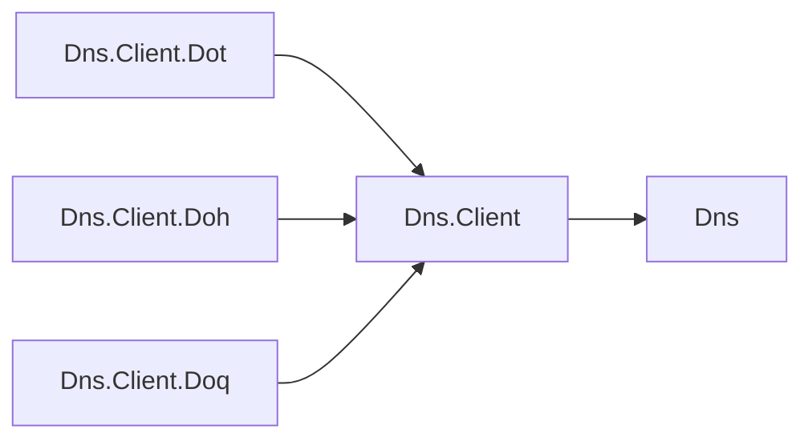

# DNS client design

## Design intent

Assimalign.Cohesion.Dns.Client implements stub queries, forwarding resolution and iterative
resolution over the DNS contracts and wire format in Assimalign.Cohesion.Dns. Transports exchange
raw messages; resolvers own query construction, response correlation, caching and referral policy.
All implementations use asynchronous I/O and support NativeAOT without reflection.

## Family map

The client depends on the DNS contracts; optional encrypted transport packages depend on the client.

| Package | Responsibility |
| --- | --- |
| Assimalign.Cohesion.Dns | Protocol contracts, DNS names and records, serialization and parsing |
| Assimalign.Cohesion.Dns.Client | UDP/TCP transports, stub client, forwarding and iterative resolvers |
| Assimalign.Cohesion.Dns.Client.Dot / Doh / Doq | Optional encrypted transport packages |

## Configuration lifetime

Every client, resolver and transport captures configuration at construction. Validated numeric
limits stay primitive values under decision V3. Readonly fields hold timeouts, buffer limits,
referral and query budgets, NS sub-resolution depth, EDNS payload size, recursion and minimization
flags, transports, and transport factories. Runtime operations never reread the caller's options.
The constructor validates the captured values, so later assignments cannot bypass validation.

Forwarder lists and TCP fallback dictionaries are copied, preserving the configured order and
mapping. Root endpoint lists are copied too. IPEndPoint values are copied with their
addresses, ports and IPv6 scope IDs, and transport Endpoint getters return another copy. Other
EndPoint implementations, transport instances, delegates and TimeProvider instances remain
caller-provided dependencies: their references are captured, but their internal behavior is not
cloned. Configure them before construction and preserve their intended lifetime. Concurrent writes
to an options object during construction are not supported.

Answer/delegation cache settings and cookie settings are consumed during construction. Caches
already retain their own capacity, TTL bounds and time source. DnsCookieStore copies the client
cookie bytes, including caller-provided seeds. Disabling a cache or cookie feature remains a
construction-time decision.

The iterative resolver requires positive referral and exchange budgets, and nonnegative NS
sub-resolution depth; zero NS depth intentionally disables those sub-resolutions. UDP response
limits remain 1 through 65535 octets, inclusive. There is no new minimum of 512. Timeouts remain
positive. Out-of-range constructor values throw ArgumentOutOfRangeException; required references,
empty forwarder/root sets and invalid cookie lengths retain their ArgumentException validation.

## Resolution and transport lifetime

Stub queries use one caller-owned transport. Forwarding resolution tries the captured upstreams in
order and uses the captured TCP fallback mapping after truncated UDP replies. Iterative resolution
starts from root hints or cached delegations, enforces bailiwick/glue checks, and shares its exchange
budget with name-server sub-resolution. Its transport factories create per-step transports that the
resolver disposes after use. Resolver disposal does not dispose caller-owned forwarding/stub
transports.

UDP and TCP serialize exchanges with a semaphore. TCP connects lazily, reuses connections until
its captured idle timeout, and retries a stale reused connection once. Disposing either transport
closes its socket. External cancellation propagates; internal exchange timeouts retain the existing
DNS timeout error behavior. Error messages in touched implementations use generated resources.

## Compatibility with 10.0.0-preview.1

- Later assignments to options, changes to forwarder/fallback collections, or mutations of supplied
  IP endpoints no longer reconfigure an existing client, resolver or transport. Construct a new
  instance to apply configuration changes.
- UDP/TCP Endpoint no longer exposes the owned mutable IPEndPoint instance; mutating the returned
  endpoint has no effect on future exchanges.
- Invalid numeric limits and timeouts now throw ArgumentOutOfRangeException instead of the exact
  ArgumentException type. The accepted numeric ranges are unchanged.
- A null element in RootEndpoints now fails during construction while its snapshot is copied,
  instead of failing later during resolution. Root endpoints must be real IP endpoints.

No public types or members are added, and numeric options keep their existing types.

## Verification

DnsOptionsSnapshotTests mutate options after construction and assert observable queries, referral
sub-resolution, fallback behavior, UDP responses and TCP connection reuse. Each regression is
intended to fail against the original retained-options implementation. Existing DNS suites cover
wire interoperability, spoofed responses, cookies, caches and transport cancellation.
