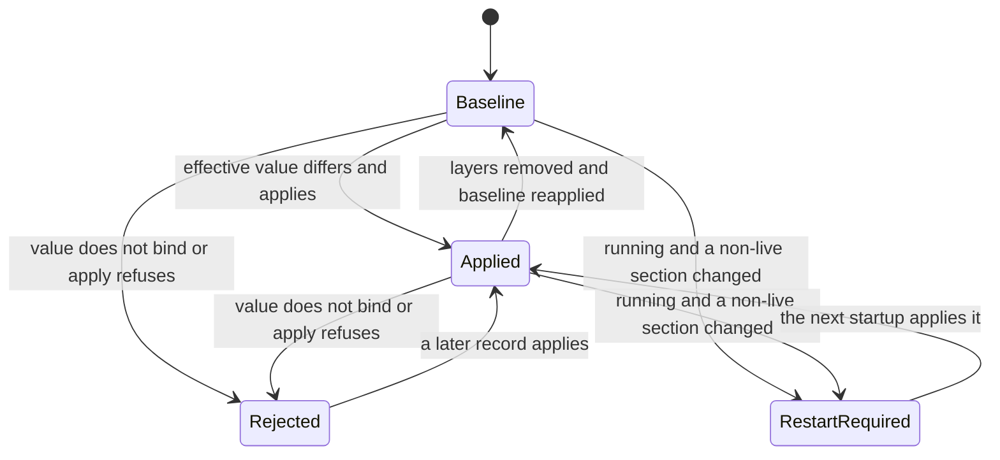
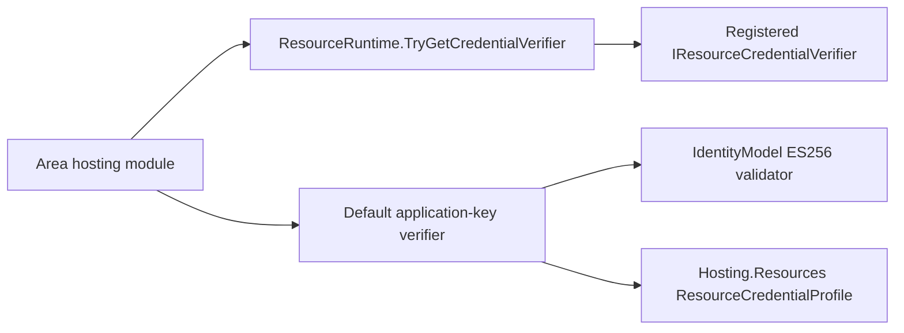

# Assimalign.Cohesion.Hosting.Resources Design

## Design intent

Resources is the opt-in composition layer between a plain Cohesion host and a resource supervisor.
It does not fork Hosting's lifecycle. Instead, it installs an `IHostRunner` on one built host and
observes the public run transitions defined by `Assimalign.Cohesion.Hosting`.

## Dependency direction

The assembly directly references Core and Hosting. Hosting owns lifecycle; Resources owns the shared
health vocabulary, contributor aggregation, ambient resource state and process policy. The Windows
ProtectedData reference is used only for protected mount files. It is an
out-of-band package, not part of `Microsoft.NETCore.App`, so the `Assimalign.Cohesion.App`
framework ships it as a private (runtime-only) member for `Sdk.<Area>` applications.

This direction keeps plain hosts free of resource environment parsing, signals, process output,
exit codes, and protected mount behavior. Health consumers now reference this consolidated package.

The base `Assimalign.Cohesion.App` framework delivers Resources because all opt-in resource SDKs
generate `ResourceRuntime` calls. Resources therefore travels beside the already-shared Hosting
assembly. Delivery is not activation: only an enabled
`CohesionApplicationModel` registration causes an area builder to install resource behavior.

### Consolidated health ownership

This assembly defines `HealthStatus`, `HealthContribution`, `IHealthContributor`,
`ResourceHealthCheck` and `ResourceHealthReport` in its own root namespace,
`Assimalign.Cohesion.Hosting.Resources`. The former Health project, package, framework member and
namespace are removed. There are no type forwarders, compatibility aliases or duplicate definitions.
Health behavior tests are owned by Resources. Database files remain frozen for separate branch
integration; their old references are intentionally not accommodated here.

`HealthStatus` remains ordered `Unhealthy = 0`, `Degraded = 1`, `Healthy = 2`, so default values fail
closed and aggregation selects the least healthy contribution. `HealthContribution` is an immutable
readonly record struct carrying status, optional description and optional diagnostic data. Its
factory methods preserve those values. `IHealthContributor` keeps a stable name and cancellable
`ValueTask<HealthContribution> CheckAsync`; composing runtimes own uniqueness, lifetime and failure
policy. `ResourceHealthCheck` names that callable shape and `ResourceHealthReport` is its aggregate
snapshot. All contracts remain statically typed and NativeAOT-compatible.

## Ambient invocation context

`ResourceRuntime.Current` returns the `ResourceContext` attached to the current asynchronous flow.
Without an explicit scope it lazily snapshots the frozen `COHESION_*` process environment.
`CreateScope` installs an in-process context and restores the previous frame on ordered disposal,
so parallel invocations do not overwrite process-global state.

The direct constructor carries application trust and bootstrap credential bytes plus additional
frozen runtime-contract values. This is how an in-process gateway supplies `COHESION_*` values
without mutating the shared process environment; `FromEnvironment` creates the equivalent snapshot
for an out-of-process resource.

Endpoints and references are `System.Uri` values. A declared development port is used only for
standalone execution when no gateway is present. The content root must be absolute and must match
the host environment before the resource run begins.

`ResourceMount` presents one read surface for in-memory and file-backed values. POSIX file mounts
contain plaintext protected by supervisor-enforced file permissions. Windows protected files
contain raw CurrentUser DPAPI ciphertext; read operations return decrypted bytes while the original
path remains available to path-only tools.

## Generated registration and entry invocation

An enabled resource's generated module initializer registers two assembly-keyed facts:

- its compiler-rooted executable entry point; and
- a factory that creates a fresh generic control plane with immutable `stopGraceSeconds` metadata.

Registration contains no invocation state. Each builder receives an isolated control plane, adds
host-local health contributors, and calls `ResourceRuntime.HostBuilt`. That method records realized
endpoints, attaches the host, and installs a `ResourceHostRunner` for that host only.

`InvokeEntry` is valid only inside an explicit `CreateScope` and only once per scope frame. The
registered `Assembly.EntryPoint` is invoked on a dedicated thread, and callers receive independent
host-ready and executable-completion tasks. The builder, not the entry-point name, surrenders the
actual built host; generated code therefore need not assume a type named `Program`.
Both public invocation methods are annotated with `RequiresUnreferencedCode`: generated gateways
root executable entry points, while a direct fallback caller must establish the same rooting.

`IsEntryRegistered` exposes whether the generated module initializer registered that assembly.
When a gateway already has a compiler-rooted assembly reference and has independently established
that the executable is an eligible resource, `InvokeEntryPoint` provides the corresponding direct
fallback without changing the registration-backed `InvokeEntry` contract. The fallback still
requires an explicit `CreateScope`, permits one invocation per scope frame, clones arguments, and
uses the same dedicated-thread, host-ready, completion, and in-process runner behavior.

## Control plane

### Public implementation and preview compatibility (#1465)

`ResourceControlPlane` is now the public sealed `IResourceControlPlane` implementation,
with a private constructor and its own `Create(IEnumerable<string>? acceptedCommandKinds = null)`.
It replaces the static facade and internal `DefaultResourceControlPlane` under owner decision 59.
The optional null argument still means no accepted kinds; enumeration, validation and isolation
are unchanged. Interface-based customization remains available through `IResourceControlPlane`.

In **10.0.0-preview.1**, `ResourceControlPlane.Create` returned `IResourceControlPlane` from
a static class. Existing calls keep their spelling and remain source-compatible, including
Database callers. The return type now is `ResourceControlPlane`, so this is **binary-breaking**:
rebuild consumers against the new package. This preview break is accepted on decision 15's terms.

`ResourceControlPlane.Create` returns a fresh control plane configured with area-defined command
kinds. Contributor names and endpoint names are stable keys. A health query snapshots contributors,
runs their asynchronous checks, and returns `ResourceHealthReport` with the least healthy status;
an empty set is healthy. Commands outside the configured kind set are rejected before the attached
host dispatcher is invoked.

A contributor that throws, including with an `OperationCanceledException` the caller did not
request, becomes an `Unhealthy` contribution described by the fixed text
`The contributor threw an exception.`; caller cancellation propagates instead. The description is
never the exception's message. Area hosts publish these reports on the bare `/healthz`, `/readyz`
and `/livez` probes, which carry no credential check, and a dependency's exception message
routinely names hosts, databases, users and ports (CWE-209). Through 10.0.0-preview.1 the control
plane recorded the message as the description, so every area that exposes the probes published it
(#1409). The catch hands the exception to this assembly's internal event source before returning
the fixed report (#1400). `HealthContribution` retains no exception member, and the control plane
does not retain the exception after the event is written.

The same holds for an exception a contributor returns rather than throws. An `Exception` value in
`HealthContribution.Data` is replaced in the report by the fixed text
`The contributor reported an exception.`; keys, the other values and their order are kept. Area
writers serialize a data value they do not recognize through `ToString()`, and an exception's is
its type, message, inner exceptions and stack trace, so through 10.0.0-preview.1 the probes
published all of it. The control plane is the one place every shipped area's report passes, so the
check lives here, as it does for a thrown exception. The two area writers that serialize data
(Web.Hosting's `ResourceControlPlaneMiddleware` and ConfigurationStore.Hosting's endpoint)
also write the same text for an `Exception` value, as defense in depth for a custom
`IResourceControlPlane`, whose report reaches them unfiltered. Descriptions and string data are the
contributor's own text and are reported as returned.

The control plane is transport-neutral. Area Hosting packages decide how to expose health and
commands over HTTP or another protocol.

### Runtime surface and the deployment record

A resource's manageable configuration is code it already has. A feature keeps its options type, its
source-generated `JsonTypeInfo<T>`, and an atomic replace; `ResourceConfigurationSection.Create`
turns those into a section: a `ResourceConfigurationPath` (`Web:Cors`), a JSON schema produced by
`JsonSchemaExporter` from the same metadata (with `DisplayName` and `Description` attributes as
`title` and `description`, the portal hooks of decision D8), a mutability (`Deployment`, `Restart`,
`Live`), a scope (`Process`, or `Backend` for a section the resource converges into storage it owns),
whether other applications may claim entries, the **baseline** value the resource configured itself
with, and an apply callback that returns `null` or a short refusal. `ResourceAction.Create` and
`ResourceTool.Create` complete the surface. The area builder hands every registered section, action
and tool to the control plane before `AttachHost`, which freezes the `ResourceRuntimeSurface`; its
`cohesion/runtime/v1` document and digest never change for the life of the process.

The surface is static by decision D2. `COHESION_DESCRIBE_PATH` makes `ResourceRuntime.HostBuilt`
write the frozen document and end the process before `Program.cs` runs the host, so a build can
learn the surface without starting anything; the SDK's describe step uses it to keep
`resource.runtime.json` beside every build's output. The
rejected alternative, discovering contracts from running processes, leaves a gateway with no
reachable instance unable to validate or render anything.

The resource keeps no desired state. `ResourceConfigurationRecord.Load` reads the deployment record
from `COHESION_CONFIG_DIRECTORY` (layout, limits and digest framing are the
[runtime contract's deployment record](../../../../docs/RUNTIME_CONTRACT.md#deployment-record)), and
`ApplyConfigurationAsync(record, phase)` computes each section's effective value: the baseline with
every layer that names the section merged over it as an RFC 7396 merge patch, in precedence order.
Values are compared after binding through the section's own metadata, so an absent member and its
default, or members in another order, are the same value. The record cannot go through the flat-key
configuration merge, which flattens arrays into indexed keys and would leave stale entries in force.
`ResourceConfigurationRecord.Create(deployment, claims, override)` builds the same record from layer
bytes in memory. It is public so a gateway computes the digest of the files it writes by the
instance's own rule and compares an instance's `configuration/status` report with what it
delivered; the gateway never re-implements the framing.

A section's state moves as records are applied:

- **Startup phase** (`ResourceConfigurationRunner`, before the inner host runner): every section
  applies. A refused section keeps its baseline, and readiness reports Unhealthy while any startup
  refusal stands, so a rollout stops at its first instance; liveness is unaffected.
- **Running phase** (the runner's poll, every 2 seconds): an unchanged record digest is a no-op, and a
  read is accepted only when two consecutive loads agree, because platforms replace files one at a
  time. A `Live` section applies; another changed section becomes `RestartRequired` and keeps its
  value. A section whose value is already in force settles without calling its apply callback.
- The `cohesion.configuration` health contribution, registered on the first apply, is Degraded while
  any section is rejected or waiting for a restart, and lists those sections in its data.
- An apply callback is application code: whatever it throws becomes the refusal
  `apply-failed: <exception type>`, and the previous value stays in force. Refusals are status text on
  the authenticated control plane, never exception messages, and carry no configuration values.

Gateways, generations, overrides and claims are invisible here: a layer is a file, and the resource
merges what it finds. Polling instead of a file watcher is deliberate, because Kubernetes swaps a
projected volume's symbolic links and Docker Desktop bind mounts can drop change events. The parked
codex design (process-bound revisions, admission slots, a state projection through a mount, and a
shared schema dialect) is deleted, not deprecated; see the
[deployment-record program](../../../../docs/programs/RESOURCE_CONTROL_PLANE_REDESIGN.md).

## Diagnostics

The internal `HostingResourceEventSource` is named `Assimalign.Cohesion.Hosting.Resources`.
It reports contributor failures, command execution outcomes and deployment-record application
from every area that uses the shared control plane, including direct calls without an HTTP adapter. A tool can enable the provider by its assembly name;
an application can also configure its own event-source forwarder. Non-Web resource processes
receive no default forwarding from a nested Web host. This provider is outside the default
`Assimalign.Cohesion.Web.` prefix, so Web entry points also select it explicitly when forwarding.
No logging dependency is added here.

| Id | Event | Level | Payload | Throttle |
| ---: | --- | --- | --- | --- |
| 1 | `ContributorFailed` | Error | `contributorName`, `exceptionType`, `exceptionMessage`, `suppressedCount:int` | Once per second, process-wide |
| 2 | `CommandApplied` | Informational | `kind`, `operation` | None |
| 3 | `CommandUnknownKind` | Warning | `kind` (empty), `operation`, `suppressedCount:int` | Once per second, process-wide |
| 4 | `CommandConflict` | Warning | `kind`, `operation`, `suppressedCount:int` | Once per second, process-wide |
| 5 | `CommandHandlerFailed` | Error | `kind`, `operation`, `exceptionType`, `suppressedCount:int` | Once per second, process-wide |
| 6 | `ConfigurationApplied` | Informational | `section` | None |
| 7 | `ConfigurationRejected` | Warning | `section`, `suppressedCount:int` | Once per second, process-wide |
| 8 | `ConfigurationRestartRequired` | Informational | `section` | None |
| 9 | `ConfigurationRecordUnreadable` | Warning | `exceptionType`, `suppressedCount:int` | Once per second, process-wide |

Configuration events name the section by its `ResourceConfigurationPath`, which the resource's own
code declares; no configuration value, refusal text, file path or exception message is written,
because a record is operator input. `ConfigurationRecordUnreadable` reports a record the runner
could not load (missing directory, unreadable file, or a layer that is not a JSON object within the
size limit) and leaves the record in force unchanged. A rejected section and an unreadable record
are repeatable on every poll, so both are throttled. Their exact counters are
`configuration-sections-applied`, `configuration-sections-rejected` and
`configuration-records-unreadable`, maintained like the command counters below.

The `contributor-failures` polling counter is the exact total of contributor exceptions caught
while aggregating health, readiness, and liveness. Its backing value increments even without a
listener and for suppressed events; the counter is created lazily when a listener enables the
source. Caller-requested cancellation propagates and neither raises an event nor increments the
counter. An unrelated contributor cancellation is a failure. There is no gauge.

Command outcomes are counted once per completed dispatch, even without listeners or when their
events are throttled. Their polling counters are also created lazily on the first enable:

| Counter | Exact transition |
| --- | --- |
| `commands-applied` | Successful apply or delete, including an identical replay or an already-absent deletion |
| `unknown-command-kinds` | No registered handler exists for the supplied kind; the HTTP adapter maps this to 501 |
| `command-conflicts` | The ledger or handler throws `ResourceCommandRejectedException`; HTTP maps this to 409 |
| `command-handler-failures` | Another exception escapes the actual handler invocation, except caller-requested cancellation |

`operation` is the fixed value `Apply` or `Delete`. A `kind` is written only after lookup in the
registered-handler dictionary succeeds. An unknown or merely advertised kind is written as the
empty string, never copied from the request. No command payload, key, identifier, owner/caller
identity, credential, exception message, or exception data is written. Command handler faults use
the event-source rule's type-only exception carve-out. A handler's `NotSupportedException` or an
independent cancellation is a handler failure; neither means its already-registered kind was
unknown. Cancellation requested by the caller propagates without any outcome counter or event.

Each throttled event has its own process-wide one-second window. Its next emission carries the
number of suppressed enabled-listener occurrences, saturating at `Int32.MaxValue`; all counters
remain exact. Applied outcomes indicate a successful dispatch, not necessarily a repeated
mutation: concurrent identical declarations execute their handler once while every replay
receives its own success outcome. An already-absent deletion also succeeds without invoking a
handler. No event is raised while holding the ledger's snapshot lock.

**Command boundary (#1434).** This source owns command execution; Web.Hosting owns
the HTTP envelope and status mapping. When a handler throws, an internal stateless helper marks
the original invocation in the exception's existing `Data` dictionary after recording the failure.
The marker is a BCL `ConditionalWeakTable<ResourceCommand, object>` with weak invocation keys,
so a reused exception can track concurrent calls without retaining their payloads. The Web
adapter consumes only its exact invocation marker and retains HTTP 400 for handler JSON, format,
and argument exceptions without also raising `CommandMalformed`. Custom control planes that do
not record an execution failure still produce the HTTP source's `phase=Handler` event. The helper
is shared source, not a shared provider or a shipped visibility grant; neither a new public
diagnostics API nor a command dependency on Web is introduced. A custom exception with unusable
`Data` prevents the private hand-off; diagnostics preserve the original exception and HTTP
behavior, but that exceptional case can also produce the HTTP malformed event.

Contributor names come from registered application contributors. Health-check exceptions follow
the event-source rule's application-exception policy: the type and `Message` are written, never
`ToString()`, stack traces, inner exceptions, or contribution data. If an exception overrides
`Message` with a throwing getter, the event writes `The exception message could not be read.`
instead, preserving the fixed health report. A dependency's message may
contain host, database, or user names, so configured sinks must be treated accordingly. The HTTP
report continues to contain only the fixed failure description introduced by #1409. This is an
additive diagnostic change from 10.0.0-preview.1; report and command behavior are unchanged.

**Boundary choice for #1400.** The internal hand-off remains inside Hosting.Resources: the
aggregation catch invokes this assembly's source directly. Web.Hosting cannot recover
the exception from the sanitized `ResourceHealthReport`. Routing it to that assembly's source
would require a new public exception/diagnostics seam or a shipped `InternalsVisibleTo` grant.
Neither is introduced. This producer-owned event is the smallest local alternative under the
session boundary rules; its placement differs from #1400's requested Web-source ownership and is
recorded as an escalation. The Web source owns HTTP credential refusals, malformed requests,
and stop acceptance, and does not duplicate contributor events. No ambient resource name is
read: this transport-neutral control plane has no reliable resource-context association.

### Standalone HTTP access (#1431)

A missing `ResourceContext.GatewayName` enables standalone development, not remote management.
Area HTTP adapters admit `/cohesion/v1` and every path beneath it only when the transport's remote
endpoint is an IP endpoint at `127.0.0.1`, `::1`, or IPv4-mapped `127.0.0.1`. Every other peer,
including an absent or non-IP endpoint, receives **403** before any management operation. The
explicit status explains the restriction. Forwarded headers never establish this trust. The
transport-neutral control-plane contract needs no HTTP dependency or new public member; enforcement
belongs to Web.Hosting's shared middleware and the area endpoints that handle their own
routes (ConfigurationStore, SecretStore, IdentityHub, LogSpace's log query, and Database's early
namespaced health mappings). Scheduler already requires a gateway identity to install its
control-plane listener.

Bare `/healthz`, `/readyz`, and `/livez` remain open for unauthenticated orchestrator and load-balancer
probes; their namespaced aliases are restricted. Existing listener gates still apply. A resource
with a gateway identity retains its existing credential policy, on loopback and remote connections.
This is a behavioral breaking change from 10.0.0-preview.1, accepted under owner decisions 46 and 15:
previously an unauthenticated remote caller could use standalone management routes on a reachable
listener. Standalone tools must connect over loopback; remote management requires gateway identity
and credentials. SecretStore also retains its existing standalone loopback bind restriction.

## Resource run modes

`ResourceRuntime.HostBuilt` selects one of two modes:

- **Process:** emit supervisor protocol lines, subscribe to process signals and the Windows named
  stop event, and set `Environment.ExitCode` from the frozen mapping.
- **In process:** selected only for a host surrendered to an active `InvokeEntry`; suppress process
  side effects and let failures fault `IResourceEntryInvocation.Completion` with a public
  `ResourceEntryExitException` carrying the same frozen exit code.

Merely creating a resource scope does not select in-process mode. A directly built host continues
to use process behavior.

## Signals and stop acceptance

One process-lifetime BCL router fans SIGINT, SIGTERM, and SIGHUP out to active resource runs; Windows
also uses SIGQUIT for CTRL_BREAK where supported. A Windows resource may additionally wait on the
fresh named event supplied by `COHESION_STOP_EVENT`.

The runner forwards a signal through `IHostRun.TryShutdown`. Hosting accepts it only while that
specific run is `Started`, so pre-start, stopping, stopped, and stale-run signals have no effect.
The first accepted signal is retained for drain-abort classification.

## Stdout protocol

When the started hook completes before a stop is accepted, the process contract is ordered by
Hosting's observer callbacks:

`cohesion-resource: ready` → `cohesion-resource: stopping` → `cohesion-resource: stopped`

`ready` means startup and `OnStartedAsync` completed. `stopping` means the state transition was
accepted and precedes service drain. `stopped` means the stop sequence, host reset, and
`OnStoppedAsync` completed. Each line is written at most once. A failed write is retained; a ready
write failure requests shutdown so teardown still occurs.

Because the host enters `Started` before awaiting `OnStartedAsync`, a stop can be accepted during
that hook. The runner then omits `ready`, begins the protocol with `stopping`, and suppresses the
late `Started` callback after the stop transition.

## Shutdown budget

`stopGraceSeconds` defaults to 30 and must be at least 5. The resource runner sets the host
`ShutdownTimeout` to `max(5 seconds, stopGraceSeconds - 5 seconds)`. Budgets of at least ten
seconds reserve the final five seconds for the supervisor; smaller valid budgets use the five-second
minimum without exceeding the declared grace. Resource hosts cannot independently expand the host
timeout beyond their declared grace. Plain Hosting retains its own default and is unaffected.

## Frozen exit mapping

The runner converts every boundary result to `cohesion/sysexits/v1`. A process writes the code to
`Environment.ExitCode`; an in-process invocation carries a nonzero code in
`ResourceEntryExitException` so its supervisor applies the identical disposition:

| Code | Classification | Supervisor disposition |
| ---: | --- | --- |
| 0 | Success | Completed |
| 64 | Area-classified configuration exception | Final |
| 69 | Area-classified dependency exception | Restartable |
| 70 | Other failure before `ready` | Final |
| 75 | Other failure after `ready` | Restartable |
| 130 | Drain cancellation after interrupt | Interrupted |
| 143 | Drain cancellation after another accepted stop | Terminated |

The area supplies static exception type tests and classification uses no reflection. A direct type
match on the currently inspected exception wins. If it is unclassified, classification recurses
through its inner exception or aggregate members; configuration wins over dependency among the
recursively inspected aggregate members. Any typed result wins over drain/phase fallback. SIGINT
and the Windows SIGQUIT/CTRL_BREAK mapping are interrupts; SIGTERM, SIGHUP, the named event, and an
unclassified requested stop use 143 when their drain budget is cancelled.

## Non-goals

- Resources does not define the host lifecycle or service execution model.
- Resources owns health value types but does not define an application health-probe transport.
- Resources does not choose an HTTP or other control-plane transport.
- Resources performs no assembly scanning, dynamic loading, or runtime code generation.

## Declarative command delivery

Runtime packages register an IResourceCommandHandler for each implemented advertised kind through
IResourceControlPlane.RegisterCommandHandler. Dispatch rejects blank identity fields and unsupported
kinds before invoking runtime mutations. A serialized per-plane ledger caches identical owner/id
replays, refuses another owner's claim to the same key, and prevents stale declarations from deleting
a newer declaration. Successful deletion releases the key. Commands exposes an owner-bearing snapshot;
the HTTP adapter deliberately excludes payloads from listings.

ResourceCommandRejectedException carries the provider's Detail through direct and HTTP dispatch.
ResourceRuntime.TryGetControlPlane resolves a surrendered host through a ConditionalWeakTable;
neither host nor its plane is kept alive by the lookup. Generated registration code is unchanged.

The command ledger is invocation-local, not durable. A host restart loses declaration ownership.
Area handlers must refuse to adopt pre-existing unmanaged resources when later deletion could destroy
them; Database applies that rule. Durable command ownership remains a follow-up.

## Resource credential verification

The runtime contract fixes the bootstrap credential's carrier, not its format (`docs/RUNTIME_CONTRACT.md`,
"Resource credentials"). The default is the ES256 application-key JWT, verified by each area hosting
module with the shared validator in `IdentityModel.Token.JsonWebToken`. This package owns that
default profile's constants, `ResourceCredentialProfile`, beside the verifier seam: the
`cohesion_token_use`/`gateway` claim, the `scope`/`telemetry` emitter scope, the `cohesion-export`
control-plane audience, the five-minute clock skew, and the 24-hour bootstrap and 8-hour developer
lifetime ceilings. The strings are `const` for the same reason as `AppEnvironment.Variables`, so
changing one is a breaking wire change; the clock skew and both lifetime ceilings are read-only
static `TimeSpan` properties. The profile lives here rather than in Core (owner decision R9,
2026-09-26) because every producer and verifier of
the default credential — the gateway, its control plane, and the area hosting modules — already
references Hosting.Resources, while the base ApplicationModel and the platform gateways never use
it. An application whose gateway registers another credential issuer supplies a matching verifier
through this package and needs none of these constants:

- `IResourceCredentialVerifier.VerifyAsync(ResourceCredentialPresentation)` receives the presented
  scheme and credential (`FromAuthorizationValue` splits an `Authorization` value at its first space),
  the resource name it must be issued for, the instant, and an optional client certificate. It returns a
  `ResourceCredentialVerification`: `NoResult` (the `default` value: not my credential), `Unauthorized`,
  `Forbidden`, or `Authorized` with a `ResourceCaller` (application, subject, `ResourceCallerKind`, and
  allowed command kinds).
- `ResourceRuntime.RegisterCredentialVerifier(assembly, factory)` follows `RegisterControlPlane`
  exactly: a process-wide `ConcurrentDictionary` keyed by the resource executable assembly, one
  registration per assembly (a second throws), and resolution that prefers the active entry
  invocation's logical assembly over the process entry assembly, so in-process members of one gateway
  each see only their own verifier. `TryCreateCredentialVerifier(assembly)` is the direct mirror of
  `TryCreateControlPlane` and creates a fresh verifier with `Current`.
- Request-time authorization code holds a `ResourceContext`, not an assembly: the Web control-plane
  middleware is a static entry shared by fifteen hosting modules. `TryCreateControlPlane` therefore
  records the resolved resource assembly on the current context — only when an ambient frame already
  exists or the assembly registered a control plane or endpoint certificates, so a plain application's
  builder still never snapshots the process environment — and
  `TryGetCredentialVerifier(context)` creates that assembly's verifier on first use and caches it on
  the context under a lock. One invocation shares one verifier; separate scopes get separate
  verifiers; a registration made after the builder resolved its control plane is still found on the
  next request; a context that never resolved a control plane (a standalone resource) has none.

The diagram reads as references: the hosting module references the runtime, which resolves the
registered verifier, and its own default verifier, which is configured from this package's
`ResourceCredentialProfile` constants and executed by the IdentityModel validator. The module
consults the registered verifier first; a `NoResult` verdict falls through to the default, any other verdict is final, and the module then
authorizes the mapped caller (for example, the management plane admits only `Kind=Gateway` callers of
its own application whose `Subject` is its own gateway; SecretStore and ConfigurationStore compare
`Application` for ownership). For
application-key tokens the mapping reproduces the former `iss`/`sub` comparisons exactly, so the
accepted token set did not change.

Every new type is BCL-only (`X509Certificate2` is the only non-primitive): Resources must not reference
IdentityModel, because the COHAM001 allowlist of the area ApplicationModel packages includes Resources
and would otherwise grow.

## Endpoint certificate contract (31t)

`ResourceContext.TryGetEndpointCertificate(endpoint, out leaf, out chain)` reads one ordinary Secret mount. The full constructor accepts an optional endpoint-to-mount dictionary; generated Resource.g.cs registers the same immutable metadata by executable assembly through ResourceRuntime.RegisterEndpointCertificates. Control-plane creation applies it to the current invocation. Without a mapping, the conventional mount is `tls`; a normalized environment lookup also handles names containing punctuation. The explicit-mount overload supports manually configured Web endpoints.

Absent or empty mounts return false. Present material requires the leaf as the first certificate and exactly one private key anywhere, accepting PKCS#8, EC, and RSA key labels. Chain parsing accepts either producer order and includes supplied roots. PKCS#12 re-import gives Windows SslStream a usable key association. The caller owns and disposes the returned leaf and chain. Intermediate secret buffers are cleared. The implementation uses only BCL cryptography and preserves the COHAM001 closure and the existing ResourceMount carrier.

`TryGetTrustBundle` reads AppEnvironment.Variables.TrustBundlePath through ResourceMount's protected-file reader. `CreateOutboundTrustValidator` preserves missing-certificate and hostname rejection, then builds a server-authentication chain with CustomRootTrust, CustomTrustStore and NoCheck revocation against the supplied anchors. It does not disable TLS validation.

CreateDevelopmentEndpointCertificate supplies the shared ephemeral fallback only for loopback Local contexts. Hosts own and dispose the returned identity. The persisted gateway issuer remains separate from this standalone fallback.

Telemetry composition lives in the sibling Hosting.Telemetry package, which references Resources in one direction only. COHAM001 (build/Targets/Build.Rules.targets resolved allowlist at 252-257) forbids Logging and OpenTelemetry in guarded ApplicationModel closures. ResourceContext.TryGetEnvironmentValue exposes the existing invocation dictionary to this sibling in both process topologies without adding any dependency.
