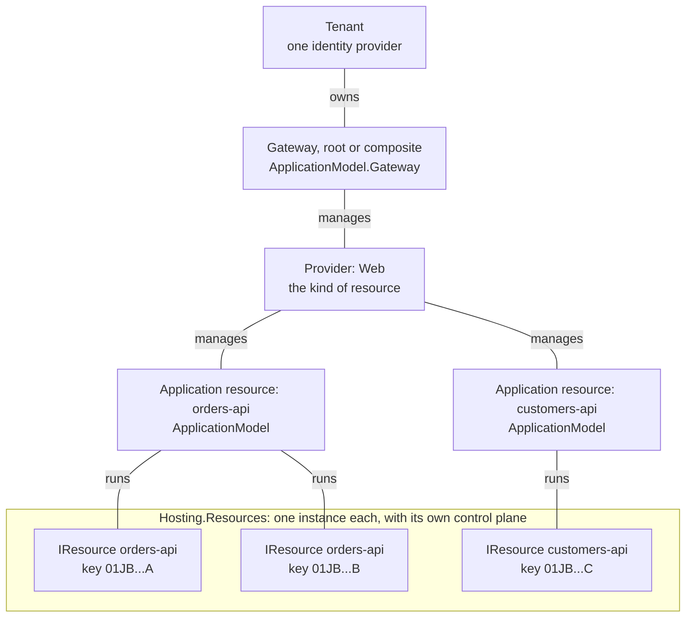
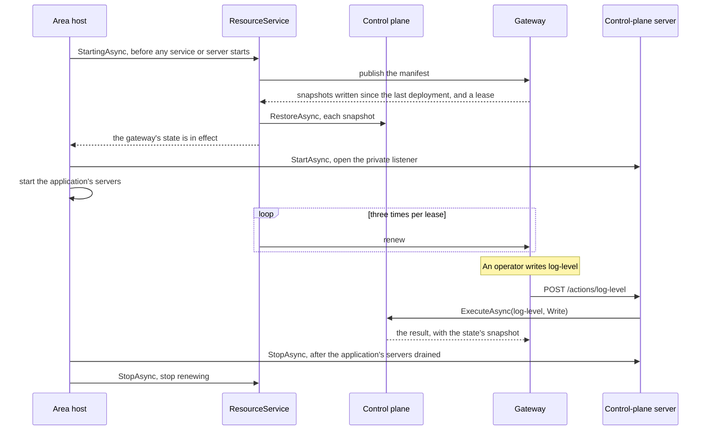

# Assimalign.Cohesion.Hosting.Resources — Design

> **Status (2026-10-27):** chunk 1 of the Application Model rebuild. This library was restarted
> from scratch. The previous implementation (deployment records, the ambient `ResourceRuntime`,
> commands, mounts, credentials) is retired; its source is at commit `6576e7c64`. ApplicationModel
> and ApplicationModel.Gateway are rebuilt in later chunks on top of this one.

## Purpose

This library defines what a **resource instance** is: the identity it starts with, the actions its
control plane exposes and the state those actions leave, its health contributors, the manifest it
publishes, and the generic control plane that runs all of it. It knows no transport and no gateway.
It references Core and Hosting only, because it will sit in the closure of every resource and every
gateway.

## Where it sits

Cohesion mirrors a cloud provider in three layers: a tenant with one identity provider, an
infrastructure platform, and the gateways that join them. A gateway manages providers (kinds of
resource); a provider manages application resources (logical services); each application resource
runs one or more instances. Only the instances belong to this library. The links below are
management, not references, so they carry no arrows; the library itself references only Core and
Hosting.

## The model

| Type | Role |
| --- | --- |
| `IResource` | One running instance: `Provider` + `Name` (shared by every instance), `Key` (this instance), its actions and health contributors. `Id` derives from provider and name. |
| `IResourceAction` | A named operation. `Kind` says which operations it accepts (`Read`, `Write`, or both); `State`, when present, is what its writes change. |
| `IResourceActionState`, `ResourceActionState<TState>` | The state a stateful action's writes change. A snapshot is the whole value, written by the content serializer; restoring one applies it. |
| `ResourceActionContext`, `ResourceActionResult` | One invocation and its outcome. The context carries the control plane's content serializer, which reads the input and writes the output. |
| `IResourceContentSerializer`, `JsonResourceContentSerializer`, `ResourceContentException` | The format of everything an instance exchanges (D12). JSON over source-generated contexts is the default; content the instance refuses is a `ResourceContentException`. |
| `ResourceStateSnapshot` | One action's state, as a gateway keeps it until the next deployment. |
| `ResourceManifest`, `ResourceActionDescriptor` | What an instance publishes about itself when its host starts. |
| `IResourceControlPlane`, `ResourceControlPlane` | The instance's actions and state: a plain object with no lifecycle that executes actions and restores snapshots from the moment it is created (D15). |
| `IResourceService`, `ResourceService` | The `IHostLifecycleService` an area registers: it publishes the manifest and restores the answer in `StartingAsync`, renews the lease, and stops renewing in `StopAsync` (D15). In-process code finds the control plane among the host's services through it. |
| `IResourceManifestPublisher`, `ResourceManifestPublisher`, `ResourceManifestPublisherOptions` | The seam to the gateway, its abstract base, and the options of the HTTP publisher `ResourceManifestPublisher.Create` returns (D13). Publication answers with a `ResourcePublication` (snapshots and a lease); `RenewAsync` renews the lease (D14). A local gateway accepts anonymous publication. |
| `IResourceHealthContributor`, `HealthContribution` | Health, contributed per component. A default contribution is `Unhealthy`, so unset health fails closed. |

Value objects carry the identity: `ProviderName`, `ProviderId`, `ResourceName`, `ResourceId`,
`ResourceInstanceKey`, `ResourceActionName`.

## Lifecycle

The diagram follows one instance through its host's start, an operator's write, and its host's stop.

1. The area registers a `ResourceService` and, when it serves the control plane over a network, a
   server as a host service of its own. Where they sit among the host's registrations does not
   matter.
2. `StartingAsync` publishes the manifest and restores every snapshot the publisher returns. A host
   completes `StartingAsync` for every lifecycle service before it starts any service or server, so
   the application serves only after the returned state is in effect. A failed publication or
   restore fails the host's start. When the answer carries a lease, the service renews it until
   `StopAsync` (D14).
3. The server starts with the other services, after every `StartingAsync`, so the control plane
   listens only once the gateway's state is in effect. The Web host stops its servers before its
   other services, so the control plane stays reachable while the application drains.
4. `ExecuteAsync` runs actions and `RestoreAsync` applies snapshots whenever they are called: the
   control plane has no lifecycle.

## Decisions

**D1 — No ambient state.** The retired `ResourceRuntime.Current` and its assembly-keyed control-plane
registry are gone; a control plane exists only where an area creates one. The tier rule needs this:
a Tier 2 or Tier 3 area that composes Web inside its own host must not stand up a second control
plane, and an ambient registry let a nested Web builder discover the outer resource (the old code
keyed the registry by entry assembly to stop it). Explicit creation makes "only the outer resource has a
control plane" structural, and lets one process host several instances. *Cost:* the SDK and
ApplicationModel chunk must attach an enabled executable's control plane without a registry.

**D2 — The provider is a name on the resource, not an object.** The scaffold's `IResourceProvider`
held one `IResource` and published it. In process, such a provider is one per instance, because its
actions bind to that instance's runtime, so it would duplicate the resource's identity and lifetime.
The provider that manages many application resources (orders-api and customers-api under Web) is the
gateway's object, built in a later chunk. This library keeps `ProviderName` and `ProviderId` as the
shared vocabulary; publishing is the resource service's start (D15), through `IResourceManifestPublisher`.

**D3 — State is a snapshot per action; replication restores, it does not replay.** Replaying writes
needs every write to be idempotent and order-independent, and repeats any divergence between
instances. A snapshot is the whole value: restoring it is idempotent, restores of different actions
commute, and a write executes once, on one instance, while the gateway restores its snapshot on the
others. Only a write may change state, so `Create` refuses state on an action that accepts no writes.

**D4 — Startup state is pulled in the publication's answer, not pushed afterwards.** With a push,
a new instance serves with its code defaults (for example, without a CORS restriction an operator
added) until the gateway's call lands, and every new instance costs one more inbound call. The
publisher returns the snapshots instead, and the resource service restores them before the host
starts serving (D15). `RestoreAsync` remains for live changes.

**D5 — Publication fails fast.** The resource service does not retry: a publisher that throws fails
the host's start, and the gateway's startup timeout and the platform's restart policy decide what
happens next. A publisher may retry inside `PublishAsync`.

**D6 — Dispatch returns statuses.** `NotFound`, `NotSupported`, and `Rejected` are results, so a
transport maps them to its own codes (404, 405, 400 over HTTP) without catching exceptions. A
`ResourceContentException`, from the serializer binding input or a snapshot or from an action or
apply callback refusing a value, is `Rejected`. Any other exception is a failure and reaches the
transport. `ResourceActionResult.NotFound()` and `NotSupported()` are public so
other dispatchers, such as an application resource's infrastructure actions, report the same results.

**D7 — Ids are version 5 UUIDs with one namespace per kind.** The scaffold derived both ids from the
name alone in Core's default namespace (the RFC 4122 DNS namespace), so a resource and a provider
with the same text shared one GUID, and `orders` under Web collided with `orders` under Database.
`ResourceId.FromName` hashes `{provider}/{name}` and `ProviderId.FromName` hashes the provider name,
each in its own namespace, with the provider name in lowercase because provider names compare
case-insensitively. The namespace GUIDs are wire contract; a test pins both derivations against an
independent RFC 9562 implementation.

**D8 — Names have grammars.** A resource name is an RFC 1035 label, the form Kubernetes requires of
a Service name. A provider name is dot-separated segments compared case-insensitively. An action
name is hyphen-separated lowercase words, at most 64 characters, so it fits one route segment.
"Orders API" is a display name, not a resource name.

**D9 — No identity on `IResource` yet.** The scaffold's `IResourceIdentity` was empty. The identity
provider belongs to the tenant and just-in-time credentials to `DependsOn`, both ApplicationModel
concerns, and a local gateway is anonymous, so this chunk works without one. Identity returns when
the identity-provider chunk defines what an instance presents and verifies.

**D10 — `ResourceActionKind` has a zero `None`.** The scaffold's `[Flags] ActionKind` gave `Read` the
value 0, which made `HasFlag(Read)` true for every value and `Read | Write` equal to `Write`. `None`
is 0, `Read` 1, `Write` 2, `ReadWrite` 3. There is no delete: a resource is marked deleted and its
platform removes it, so no action can destroy what it manages.

**D11 — State is an interface plus a sealed generic.** The scaffold's abstract
`ResourceActionState` exposed `object? State { get; set; }`, which boxed and had no serialization
contract. `IResourceActionState` is the contract the control plane uses; `ResourceActionState<TState>`
is the typed implementation areas construct, with an apply callback. It is written and read by the
control plane's content serializer (D12).

**D12 — The content format is a serializer the platform chooses (owner request, 2026-10-28).**
Actions, states, the publisher, and the transports took `JsonTypeInfo<T>` directly, which fixed
the format at JSON in every area. `IResourceContentSerializer` is now the one place the format
lives: a control plane is created with one, invocation contexts carry it, and transports write the
manifest and results with it and label content with its media type. A platform that exchanges
another format brings its own serializer, and that serializer must know every type the instances
exchange, this library's and each area's action types. The owner accepted that cost.
`JsonResourceContentSerializer` is the default. It resolves each type from this library's own,
internal context, then from the contexts it was created with, and writes each type with its own context's options,
so an area's naming survives being combined with others. *Rejected:* one merged
`JsonSerializerOptions` over all resolvers would impose one naming policy on every area's types.
Content the instance refuses is a `ResourceContentException` rather than a `JsonException`, so the
control plane's error model no longer names a format. `ResourceControlPlane.Create` snapshots
every state once, so a serializer that does not know a state's type fails at composition. Otherwise
it would fail the first write, after the write had already changed the instance.

**D13 — The HTTP publisher is internal behind an abstract base and options (owner request,
2026-10-28).** `ResourceManifestPublisher.Create(ResourceManifestPublisherOptions)` returns the
HTTP implementation. The options' `HttpClientFactory` callback is called once per publication,
and the client it returns is disposed afterward, the way an HTTP client factory's clients are
used. A factory such as `Assimalign.Cohesion.Http.ClientFactory` pools and rotates the handlers, so
publications do not exhaust sockets. Without a callback, every publisher in the process shares one
`SocketsHttpHandler`, whose connections are recycled every two minutes. Another transport derives
from `ResourceManifestPublisher`.

**D14 — Registrations are leases (owner decision, 2026-10-28).** Instances published once and sent
nothing after, so a gateway could not tell a dead instance from a live one, least of all after its
own restart. The publication answer, a `ResourcePublication`, now carries a lease. The resource
service renews it three times per lease through `IResourceManifestPublisher.RenewAsync`, which
carries no snapshots, so renewals cost no restores. A gateway that answers `false` does not know the
instance: the service publishes again and restores the answer, which is idempotent (D3). A failed
renewal is retried on the next one, so an unreachable gateway never stops the instance. Over HTTP a
renewal is a `PUT` of the manifest to the publication endpoint; `404` means unknown. *Rejected:*
renewing by publishing again, which would restore every snapshot, and rebuild what each one
applies, on every renewal. *Rejected for now:* asking the platform which instances run, which
detects a death faster but needs each provider to map its instances to instance keys.

**D15 — The control plane has no lifecycle; a resource service joins the host, and the server is
the area's own host service (owner decision, 2026-10-28).** `IResourceControlPlane` was an
`IHostService` whose start published and renewed, so one object held two lifetimes: its actions and
state, which last as long as the application, and its gateway registration, which lasts one host
run. The control plane is now a plain object that accepts invocations from the moment it is
created. `ResourceService`, written once here for every area, is an `IHostLifecycleService`.
`StartingAsync` publishes, restores and starts renewing. `StopAsync` stops renewing, which also
covers a failed start, because the host's rollback calls only `StopAsync`. A host completes every
`StartingAsync` before it starts any service or server, concurrent start included, so the instance
serves only once the gateway's state is in effect, wherever the area registered the service. Before,
the service started in registration order, and a service registered ahead of it started before the
restore.

The service knows no server. An area that serves the control plane over a network registers its
server as a plain host service of its own; the host starts it after every `StartingAsync`, so it
listens only once the state is in effect. In process, no server is registered, and a gateway calls
`IResourceService.ControlPlane` directly. *Rejected:* a host runner around `RunAsync`, which never
runs for a host started with `StartAsync`, as a nested host (`AsService`), a test host, and an
in-process gateway's instances are; and a server seam in this library, which the area's own host
service makes unnecessary. *Consequence:* a gateway push that reaches an instance before its
listener opens fails at once, and the gateway-to-instance channel retries it with the current state
(open question 6).

## Concurrency

Reads run concurrently. Writes and restores run one at a time per resource, under one gate, so the
snapshot a write returns is the state that write left. `ResourceActionState<TState>` holds no lock of
its own: change it only from an action. Use an immutable `TState` so a concurrent read is never torn.

## Tiers and area implementations

This library is under `libraries/`, so it cannot reference a resource area (COHLIB001) and knows
nothing of Web. The Web area (Tier 1) supplies the HTTP server that maps requests onto
`ExecuteAsync` and `RestoreAsync`: Web.Server's engine on a private listener, registered as a host
service of its own (D15). A Tier 2 or Tier 3 area reuses that server and exposes only the actions its
own resource lists. An action is a standalone object, so such an area can list
selected Web actions explicitly; nothing is exposed by nesting, and enabling the Application Model on
it creates its control plane only.

Under the requested rule change, an area's implementation of this library (its actions and its
control-plane wiring) and of the Application Model consolidate into `<Area>.ApplicationModel`.
That change lands with the chunk that first builds such a package.

## AOT

No reflection or runtime code generation. `JsonResourceContentSerializer` resolves metadata only
from source-generated contexts, and an undeclared type is `NotSupportedException`, never a
reflection fallback. The generated value objects carry their own JSON converters. A platform's own
serializer has to meet the same bar.

## Diagnostics

None. The library raises no events and has no event source.

## Open questions

1. **Name scope — settled in chunk 2.** A resource name is unique among one gateway's resources of
   the same provider. Across a hierarchy, the gateway's id qualifies the resource id, so
   `ResourceId` stays as it is (ApplicationModel DESIGN.md, D1).
2. **Health aggregation.** Contributors exist; who aggregates them, and do readiness and liveness differ?
3. **Instance key.** The key is a process-generated ULID. Does the manifest also need the platform's
   instance id (a Kubernetes pod UID) for the gateway's infrastructure actions?
4. **Attaching the control plane.** How does an executable with `CohesionApplicationModel=enabled`
   create and register its control plane without an ambient registry (D1)?
5. **Management routes.** `/resources/providers/{provider}/controls` has no segment for the
   application resource or the instance an action addresses.
6. **Push order on the gateway-to-instance channel.** When a gateway that forgot an instance
   answers its new publication, a push the gateway sends afterward can reach the instance first,
   and the late answer then overwrites the newer state. Snapshots need a version the instance checks
   before it applies one. This belongs with the channel.
