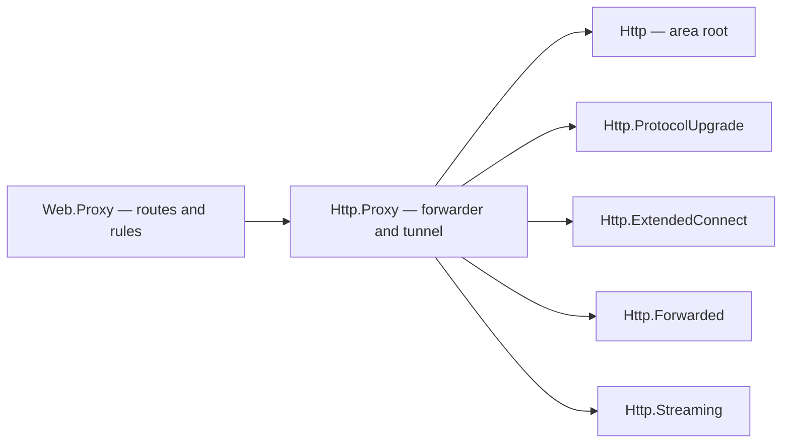
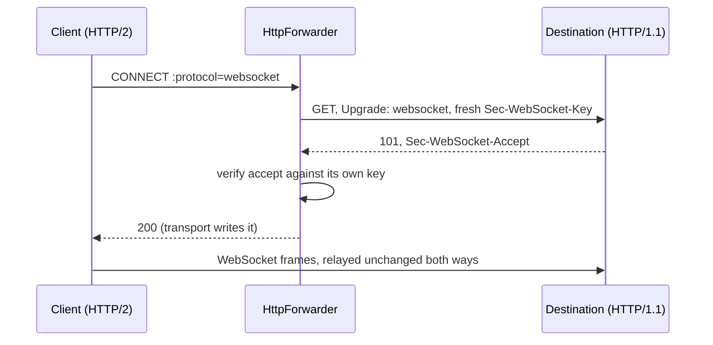

# Assimalign.Cohesion.Http.Proxy — Design

## Design intent

A proxy is policy over a mechanism. The policy decides which requests are accepted and where each
goes: a reverse proxy matches routes, a forward proxy checks a client's absolute-form target or
`CONNECT` authority against its rules. The mechanism is the same for both: rewrite the request for
the next hop, stream it, relay what comes back, pass an upgrade through, and answer a failure the
way a gateway must. This package is only the mechanism. It has two entry points: `HttpForwarder`
for one request/response exchange (including upgrades), and `HttpTunnel` for a `CONNECT`. The
policy, the routes, and the `AddReverseProxy`/`AddForwardProxy` registration verbs are in
`resources/Web/Assimalign.Cohesion.Web.Proxy`.

## Family map

`Http.Proxy` references the HTTP root and four concern packages. Its one in-repo consumer is
`Web.Proxy`. The arrow means "references".



| Package | Role |
| --- | --- |
| `Assimalign.Cohesion.Http.Proxy` | This package: `IHttpForwarder`/`HttpForwarder`, `IHttpTunnel`/`HttpTunnel`, their options, `HttpProxyResult` |
| `Assimalign.Cohesion.Http` | The exchange (`IHttpContext`), its request and response, the feature collection |
| `Assimalign.Cohesion.Http.ProtocolUpgrade` | `context.Upgrade`: hands over the client's HTTP/1.1 connection for an upgrade or a `CONNECT` |
| `Assimalign.Cohesion.Http.ExtendedConnect` | `context.ExtendedConnect`: hands over an HTTP/2 or HTTP/3 extended `CONNECT` stream |
| `Assimalign.Cohesion.Http.Forwarded` | `EffectiveRemoteIp`/`EffectiveScheme`/`EffectiveHost`: the client as a trusted proxy reported it |
| `Assimalign.Cohesion.Http.Streaming` | `IHttpResponseStreamingFeature`: write a response body as it arrives |
| `Assimalign.Cohesion.Web.Proxy` | The consumer: reverse-proxy routes, forward-proxy rules, the Web verbs |

## Why the mechanism is its own package

- **Libraries never reference resources (COHLIB001).** The mechanism is useful below the Web
  platform. A test server, a gateway, or a future sidecar can forward an exchange without taking
  the Web area's pipeline, settings and registration model. The Web package depends on this one,
  never the reverse.
- **One implementation for both proxies.** Hop-by-hop rules, forwarded headers, `Via`, body
  streaming, upgrade verification and the failure mapping are where proxies get security wrong.
  Writing them once means the forward proxy cannot drift from the reverse proxy.
- **Per-concern packaging.** The HTTP area gives each concern its own package (see the area
  `README.md`), and forwarding pulls in `System.Net.Http`, which nothing else in the root needs.

## Why `HttpMessageInvoker`, borrowed

The outbound side is the BCL's `SocketsHttpHandler` behind an `HttpMessageInvoker`. It already
provides connection pooling, HTTP/2 multiplexing, TLS, HTTP/1.1 upgrades (a 101 response's content
stream is the raw connection), and NativeAOT support. Writing a second client would be a liability.
`HttpMessageInvoker` is used rather than `HttpClient` because it adds no timeout and no response
buffering of its own.

The forwarder **borrows** the invoker: it never disposes it, and every exchange shares its pool.
The application or the Web registration owns it. A borrowed invoker lets one pool serve several
routes to the same destination, and lets tests substitute a handler. The handler is the caller's
to configure, and the OVERVIEW shows the settings a proxy wants. With no redirects, no cookie
container and no decompression, the response the client sees is the destination's. With no
`ActivityHeadersPropagator`, the client's trace context passes through unchanged instead of
gaining a hop.

`HttpForwarder` and `HttpTunnel` are `public sealed` with a private constructor and a static
`Create`, the repo's shape for an implementation consumers construct with arguments (owner
decisions 59 and 61). The interfaces are the contracts a consumer depends on and a test fakes.

## The request rewrite

The forwarded request carries the client's method, target (as the destination URI), fields and
body, with these changes:

| Field | Forwarded as |
| --- | --- |
| `Connection`, `Keep-Alive`, `Proxy-Connection`, `TE`, `Transfer-Encoding`, `Upgrade`, `Trailer` | Removed (RFC 9110 §7.6.1). `TE: trailers` is re-added when the client sent it, because gRPC requires it on the next hop |
| Fields the client's `Connection` header names | Removed |
| `Proxy-Authorization`, `HTTP2-Settings` | Removed: the first is for this proxy, the second belongs to the client's connection |
| `Host` | The destination's authority, unless `PreserveHost` keeps the client's |
| `Cookie` | HTTP/2 and HTTP/3 crumbs joined with `; ` (RFC 9113 §8.2.3) |
| `Max-Forwards` | Decremented on `OPTIONS` and `TRACE` (RFC 9110 §7.6.2); at zero the proxy answers itself |
| `X-Forwarded-*`, `Forwarded` | Per `ForwardedHeaderAction` (below) |
| `Via` | The client's entries plus `"<protocol> <pseudonym>"` (RFC 9110 §7.6.3) |
| `Content-Type`, `Content-Length`, other content fields | Moved onto the request content |

Pseudo-header names (`:authority` and the rest) never travel; HTTP/2 and HTTP/3 rebuild them. The
response gets the same treatment in reverse. The response's hop-by-hop fields and `Connection`
options are dropped. So are `Proxy-Authenticate`, which challenges this proxy and not the client,
and `Alt-Svc`, which advertises the destination's own endpoints that the client cannot reach
through this proxy. `Trailer` is dropped where the client cannot receive trailers.

### Forwarded headers

| Action | Client's headers | Hop added |
| --- | --- | --- |
| `None` | Copied unchanged | None |
| `Set` (default) | Both families removed | The **effective** client: `EffectiveRemoteIp`, `EffectiveScheme`, `EffectiveHost` |
| `Append` | Configured family kept, other family copied | The **raw** connection: the peer address, the request's scheme, its `Host` |

`Set` is for the edge proxy, the one clients reach directly. Whatever `X-Forwarded-For` a client
sends is attacker-controlled, so `Set` replaces it. The effective values let a trusted
forwarded-headers policy (Web.ForwardedHeaders) decide whether an earlier proxy's claim is
believed: the decision is made once, by the policy that owns trust, and the forwarder only reports
it. `Append` is for a proxy behind another proxy whose chain the destination reads. It appends what
this hop observed, never the effective values, because those already summarize the chain it
extends. An IPv4-mapped IPv6 peer is written as IPv4. The `Forwarded` format writes one RFC 7239
element (`for=…;host=…;proto=…`), quoting IPv6 nodes.

### `Via` and loop detection

The pseudonym defaults to `cohesion-` followed by eight random hexadecimal digits, chosen per
options instance. A pseudonym never names the host, so `Via` discloses nothing about the
deployment. A request whose `Via` already lists the pseudonym has been through this forwarder
before and is answered with **508 Loop Detected** rather than forwarded until something runs out.
Instances of one deployment that should detect loops between them share a configured pseudonym.
A `null` pseudonym adds no `Via` entry; the client's entries still pass through.

## Paths and destinations

A reverse proxy routes on the path and forwards the path. If those differ, a route meant for
`/api` can be used to reach `/admin`: the server decodes `%2E` to `.` and keeps `..` segments, so
`/api/%2E%2E/admin` arrives as `/api/../admin`, and a destination that normalizes would serve
`/admin`. `TryNormalizePath` removes dot segments (RFC 3986 §5.2.4) before routing, so the path a
route matched is the path the destination receives. The server's decoder leaves `%2F` encoded, so
a dot segment can still hide behind it (`/api/x%2F..%2F..%2Fadmin`), and some destinations treat a
backslash as a separator. Destinations disagree about both, so a path with `.` or `..` between such
separators is **refused** (the caller answers 400) rather than guessed at.

`CreateDestination` joins a destination prefix (which may carry a base path) with the normalized
path, re-encoded with the HTTP root's path encoder. That encoder writes back `%2F` and invalid
UTF-8 escapes as the decoder left them, and encodes every character a path cannot carry
literally. An escaped unreserved character (`%41`) comes back as the character, which RFC 3986
§6.2.2.2 makes equivalent. An escaped reserved character other than `/` does not survive:
`/a%3Bb` reaches the destination as `/a;b`, which RFC 3986 §2.2 makes a different URI and which a
server that splits path parameters reads differently. Forwarding the raw path needs the transport
to keep it; #1895 tracks that.

The query is forwarded **as the client sent it**: since #1894, a query collection reports the text it
was parsed from (`IHttpQueryCollection.Source`) until the application changes the collection. A rebuilt
query would reorder parameters and change their encoding, which breaks signed URLs. Any implementation
can supply `Source`, so the forwarder still refuses text that is not a valid RFC 3986 query and encodes
the collection instead, as it does when `Source` is `null`, the interface's default. The result is created
with `UriCreationOptions.DangerousDisablePathAndQueryCanonicalization`, so `System.Uri` does not
canonicalize again what the proxy already normalized. `CreateDestination` refuses a path that
`TryNormalizePath` would change, so skipping normalization fails loudly.

`IsValidDestinationPrefix` is the prefix rule `CreateDestination` enforces (an absolute `http` or
`https` URI with no query, fragment or user information), public so a proxy that configures its
destinations ahead of time refuses a bad one when it is configured rather than on each request. The
rule lives in one place; `CreateDestination` calls it.

## Bodies

**Request.** The body is streamed as it arrives (`StreamingRequestContent`), flushing after each
read so a streaming upload is not held back. It is single-use: a body cannot be re-read, so the
forwarder never retries. The length is never computed. A client-declared `Content-Length` travels
as a content field; otherwise the body is chunked, or sent in HTTP/2 and HTTP/3 `DATA` frames. A
failure *reading the client's body* is recorded on the content and becomes 400, because the
invoker reports it as its own failure.

Whether a request has a body at all is decided from the request. HTTP/1.1 frames a body only with
`Content-Length` or `Transfer-Encoding` (RFC 9112 §6.3). HTTP/2 and HTTP/3 need neither, so a
request there without `Content-Length` is taken to carry a body unless its method defines none
(`GET`, `HEAD`, `DELETE`, `OPTIONS`, `TRACE`, `CONNECT`). That heuristic sends an empty chunked
body for, say, a bodiless HTTP/2 `POST`. The exact answer (whether the client's stream ended with
the headers) is transport state the HTTP abstractions do not expose yet; #1921 tracks exposing it.

**Response.** When the exchange carries `IHttpResponseStreamingFeature`, which it does when the
host registers `HttpResponseStreamingInterceptor`, the status and fields are staged first and each
read is written and flushed. Server-sent events, gRPC streams and large downloads then reach the
client as they are produced. Without the feature, the forwarder reads the whole body into the
response buffer first, up to `MaxBufferedResponseBodySize` (4 MiB), and answers a larger body with
502. The head is staged only after the body is complete, so a failed or oversized body leaves
nothing of the destination's response behind. Running without the feature logs a one-time warning
(event 3). Trailers are copied where the client's protocol carries them, minus the fields RFC 9110
§6.5.1 prohibits.

## Failure model

Every failure is answered before `ForwardAsync` or `RelayAsync` returns. The returned
`HttpProxyResult` tells the caller what happened, for logging and counting, never for writing a
second response.

| Result | When | Client sees |
| --- | --- | --- |
| `Completed` | Relayed to the end | The destination's response, upgrade or tunnel |
| `AnsweredByProxy` | `OPTIONS`/`TRACE` with `Max-Forwards: 0` | 200 / 501 |
| `Canceled` | Caller's token, the client's abort, or the client stopped receiving | The exchange is aborted |
| `DestinationUnreachable` | Name resolution, connection or TLS failed | 502 |
| `DestinationTimedOut` | No progress for `ActivityTimeout` before the response head; tunnel connect timeout | 504 |
| `DestinationFailed` | Any other failure before the head (reset, malformed response) | 502 |
| `RequestBodyFailed` | Reading the client's body failed | 400 |
| `ResponseBodyFailed` | The destination's body failed after its head | Abort if the response started; else 502 |
| `ResponseTooLarge` | Buffered body over the limit | 502 |
| `UpgradeFailed` | An upgrade the proxy could not verify | 502 |
| `NotSupported` | `CONNECT` at the forwarder; extended `CONNECT` for another protocol; a non-`CONNECT` at the tunnel | 501 |
| `LoopDetected` | `Via` already names this forwarder | 508 |

A response body that fails **after** bytes reached the client aborts the exchange. Completing it
would present a truncated body as complete, and a client or cache would store it as such. A
`TRACE` at `Max-Forwards: 0` gets 501 instead of the reflected request RFC 9110 describes:
reflecting it would echo the client's cookies and credentials (cross-site tracing).

**Timeouts.** `ActivityTimeout` (100 seconds) is an idle timeout, not a deadline. It covers
connecting, sending, waiting for the head, and each read or write after that, and every completed
operation restarts it. A long download that keeps moving is never cut off; a destination that
stops is. A timeout before the head is 504. The caller's token and the exchange's
`RequestCancelled` cancel the same operations, and are reported as `Canceled`, never as a gateway
failure.

## Upgrades

**HTTP/1.1 upgrade.** When the exchange carries an `Upgrade`-kind protocol upgrade, the forwarded
request asks for the same protocol over HTTP/1.1 (`RequestVersionExact`: only HTTP/1.1 switches
protocols). On a 101 whose `Upgrade` names the requested protocol, the forwarder stages the
response's fields, takes the destination's raw connection from the response content, accepts the
client's upgrade (the transport writes the 101), and relays bytes both ways. A destination that
ignores the upgrade answers normally, and that response is relayed as any other. A 101 for another
protocol, or for a request that asked for none, is 502.

**WebSocket over HTTP/2 and HTTP/3.** RFC 8441 and RFC 9220 carry a WebSocket in an extended
`CONNECT` stream, and most destinations speak only the HTTP/1.1 handshake. The forwarder bridges:



The forwarder generates the key, because an HTTP/2 client sends none, and verifies the accept
value against it. A destination that switches without proving it understood the handshake is not
trusted with the stream. The accept field is not staged for the client, because the 200 that opens
an extended `CONNECT` carries none. WebSocket frames are identical in both carriers, so after the
handshake the relay copies bytes. A 2xx other than 101 is refused with 502: to the client, a 200
on an extended `CONNECT` means the tunnel is open, and an HTTP/1.1 destination's 200 means it
ignored the upgrade.

**Relay.** `StreamRelay` copies both directions with a 16 KiB pooled buffer per direction and
restarts the idle timer on each write. When the destination closes, the relay ends. When the
client finishes sending, the relay passes the end on as a TCP half-close where the destination is
a socket (a tunnel). An upgraded HTTP/1.1 connection taken from `SocketsHttpHandler` cannot be
half-closed, so there the relay keeps relaying toward the client until the destination closes or
the idle timeout runs out. WebSocket and most upgraded protocols close with a frame of their own,
so this costs nothing in practice. The relay owns and disposes both streams.

## Tunnels

`HttpTunnel` serves an HTTP/1.1 `CONNECT` (RFC 9110 §9.3.6). It **connects before it accepts**:
answering 200 first and closing when the connection fails would tell the client the tunnel opened.
A refused or unresolvable destination is 502, and one that does not answer within
`ConnectTimeout` (15 seconds) is 504. `IdleTimeout` defaults to infinite: the tunnel usually
carries TLS, whose keep-alives the proxy cannot see.

`ConnectCallback` replaces the default dual-mode TCP connect. It is where an access policy that
refuses some addresses belongs, because it owns name resolution: the address it checks is the
address it connects to. A check made before connecting, on a separate lookup, can be defeated by a
name that resolves differently the second time (DNS rebinding). `Web.Proxy`'s forward proxy
installs its address filter there.

A `CONNECT` over HTTP/2 or HTTP/3 is not served: the server exposes no protocol upgrade for it,
and the tunnel answers 501.

## Diagnostics

Source name `Assimalign.Cohesion.Http.Proxy` (`HttpProxyEventSource`, internal). Tools enable it by
name:

```bash
dotnet-counters monitor --counters Assimalign.Cohesion.Http.Proxy
dotnet-trace collect --providers Assimalign.Cohesion.Http.Proxy:0:5
```

| Id | Event | Level | Payload |
| --- | --- | --- | --- |
| 1 | `DestinationFailed` | Warning, at most once a second | `result`, `exceptionType`, `errorCode`, `suppressedCount` |
| 2 | `ExchangeFailed` | Verbose | `result`, `destination`, `exceptionType`, `errorCode` |
| 3 | `ResponseStreamingUnavailable` | Warning, once per process | — |
| 4 | `ResponseTooLarge` | Warning, at most once a second | `limit`, `suppressedCount` |
| 5 | `TunnelOpened` | Verbose | `destination` |
| 6 | `TunnelClosed` | Verbose | `destination`, `bytesToDestination`, `bytesToClient` |

| Counter | Kind | Meaning |
| --- | --- | --- |
| `current-tunnels` | Polling | Open `CONNECT` tunnels |
| `destination-failures` | Incrementing | Exchanges and tunnels the destination failed (unreachable, timed out, failed, broke off, too large, unverified upgrade) |

- **Type and code, not message.** Socket and `HttpClient` exception messages name the destination,
  which a forward proxy's client chooses. Event 1 therefore carries the exception type and the
  most specific platform code instead (`SocketError`, or `HttpRequestError` such as
  `ConnectionError`). This is a recorded deviation from `event-source.md`'s type-plus-message rule,
  within its rule 11 carve-out for messages that echo request input.
- **The destination only at Verbose.** The authority (`host:port`) is the diagnosis of a failed
  exchange, so events 2, 5 and 6 carry it, truncated to 259 characters and only at Verbose. Event 1,
  which a scanner can repeat at will, carries none and is throttled to once a second per event with
  `suppressedCount`. The counter still counts every occurrence.
- **No paths, queries, header values or bodies** appear in any event.
- **Request-body failures** are client failures, not destination failures. They appear only as
  event 2 with result `RequestBodyFailed`, and do not move `destination-failures`.

## AOT posture

No reflection, no runtime code generation, no serialization. The outbound side is
`SocketsHttpHandler`, which is NativeAOT-compatible. Header handling uses the non-validated header
views and frozen sets. The WebSocket accept computation uses `SHA1.HashData`, as RFC 6455
requires: the hash is a protocol checksum, not a security boundary.

## Non-goals

- **Routing, load balancing, health checks, access rules.** They are policy and live in
  `Web.Proxy`: routes and round-robin today, with health checks and failover tracked by #1898.
- **Retries.** The request body is read once as it streams, so a retried request could not carry
  it. Retrying an idempotent bodiless request on another destination is a policy decision, and
  #1898 places it in `Web.Proxy`.
- **Transforms beyond the hop rewrite.** `Host` preservation is `PreserveHost`; prefix stripping is
  the caller's choice of path for `CreateDestination`. Arbitrary header and body rewriting is an
  application concern: it is done in middleware before the proxy, or by wrapping the invoker's
  handler.
- **Caching.** A shared cache in front of the forwarder is `Web.Caching`'s job.
- **HTTP/2 or HTTP/3 `CONNECT` tunnels, CONNECT-UDP, MASQUE.** No transport hands those streams
  over today; #1896 tracks classic `CONNECT` on HTTP/2 and HTTP/3.
- **TLS interception.** A tunnel moves bytes; it never terminates the client's TLS.

## Known constraints

- The server's path decoder refuses a request whose decoded path holds a space, `?`, `#` or a
  control character: HTTP/1.1 closes the connection without a response (#1926), and HTTP/2 and
  HTTP/3 reset the stream. A path such as `/files/my%20doc.pdf` therefore never reaches a proxy
  route. This is a property of `HttpPath`, not of this package; #1922 tracks
  accepting it.
- Request bodies over HTTP/2 and HTTP/3 are detected by the method heuristic above until the
  transport exposes end-of-stream (#1921).
- An upgraded HTTP/1.1 relay cannot half-close the destination's connection (see Relay).
