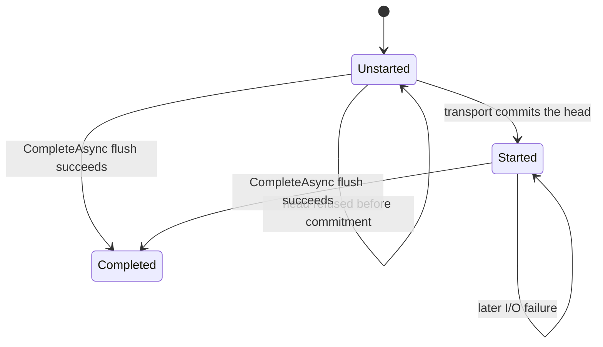

# Assimalign.Cohesion.Http.Streaming — Design

Incremental response streaming is a response-side capability, not protocol
machinery, so it ships as its own feature package that plugs into the transport
through the generic `IHttpExchangeInterceptor` seam — the same way
`Assimalign.Cohesion.Http.RequestLimits` plugs into request parsing via
`IHttpExchangeInterceptor`. Neither the protocol core nor the transport
(`Assimalign.Cohesion.Http.Connections`) depends on this package.

## Why a separate package

The naive placement — a streaming feature baked into the protocol core and attached
to every exchange by the transport — couples three layers to one capability. It
also forces the transport to know about "streaming." This package removes that
coupling:

- **The core** owns only the generic `IHttpExchangeInterceptor` seam and the raw
  write/flush primitive (a `System.IO.Stream`). It has no streaming type.
- **The transport** owns the per-protocol framing (chunked / `DATA` frames /
  flow control) behind a raw response body sink (`HttpResponseBodyStream`) that it
  exposes through the interceptor context. It has no streaming type.
- **This package** owns the typed streaming API (`IHttpResponseStreamingFeature`),
  the interceptor that installs it, and the ergonomic accessor. It depends only on
  the core.

Streaming is therefore **opt-in**: a host enables it by registering
`HttpResponseStreaming.CreateInterceptor()` on the transport's response
interceptors. Where it is not registered, the transport uses its buffered response
path with zero streaming overhead.

## How it works

1. A host adds `HttpResponseStreaming.CreateInterceptor()` to
   `HttpConnectionListenerOptions.Interceptors`.
2. Per exchange, the transport creates its per-protocol raw response body sink and
   runs the registered response interceptors, exposing the sink as
   `HttpExchangeInterceptorResponseContext.ResponseBody`.
3. `HttpResponseStreamingInterceptor.BeforeResponse` wraps that sink in a
   `HttpResponseStreamingFeature`, passes the optional generic `IHttpExchangeControl` from the
   interceptor context, and installs the feature on `context.Features`.
4. The handler resolves it — `context.Response.Streaming` — and calls
   `WriteAsync` / `FlushAsync` / `CompleteAsync`. The bytes flow through the sink,
   which frames and flushes them to the wire and commits the head on the first
   write/flush.
5. When the handler returns, the transport's `SendAsync` finalizes the sink (wire
   terminator) if it was written, or takes the buffered path if it was not. On
   either path, the registered interceptors' `AfterResponseAsync` hooks fire after
   that finalize, once the final response is fully written.

## The feature is a thin wrapper over the sink

`IHttpResponseStreamingFeature` is the typed contract; its implementation is a
small wrapper over the `Stream` sink. The wire framing and the "commit the head
once" rule live in the transport's sink; the wrapper owns the ergonomic surface —
`HasStarted`, implicit start on the first write/flush, and the
write-after-complete guard. When the interceptor context supplies `IHttpExchangeControl`,
`HasStarted` reads its existing `HasResponseStarted` state; the feature maintains no competing
transport-start tracker. A hand-built interceptor context without that optional control uses a
fallback latch, updated only after a sink call succeeds. An opaque throwing stream cannot tell
that fallback whether an unsuccessful call partially committed the head.

`CompleteAsync` marks the feature completed only after its flush succeeds, then forbids further
writes. The transport emits the actual end-of-body marker when it finalizes the exchange.

**Header-commit timing** is the load-bearing rule: the head is committed exactly
once, through the first `StartAsync` / `WriteAsync` / `FlushAsync` / `CompleteAsync` call
that commits it, and headers are locked thereafter. Callers set every response header before the
first write. A failure before commitment leaves the response unstarted; an I/O failure after the
transport committed the head still reports `HasStarted == true`.

## Refused heads and retries (#1388)

Encode-time validation can refuse a head with `HttpErrorCode.InvalidResponseField` before any
head byte is written (#1183). The transport then remains unstarted, and the streaming feature's
`HasStarted` agrees. After replacing the invalid fields, a caller can retry `StartAsync` or a
refused `CompleteAsync`; alternatively, it can write a buffered replacement. A refused completion
has not closed the feature's write/complete guard.

The feature observes transport commitment and advances completion only after a successful flush:

A response-head interceptor may already have run before field validation refuses the head. Its
once-per-exchange callback lifetime does not restart when streaming is retried. In Web.Hosting,
the response-starting callbacks stay closed and their recorded policy fields carry onto a buffered
replacement; `HasStarted == false` permits recovery, not another callback invocation.

### Behavior change from 10.0.0-preview.1

Preview.1 set the started and completed flags before awaiting the sink. A failed call could
therefore report that an uncommitted head had started, and a refused completion could suppress
later retries. The feature now observes the existing transport state when available and otherwise
advances its fallback latch only after success; completion likewise advances only after success.
No public interface member changes. The eager flags shipped in preview.1; the specific recoverable
`InvalidResponseField` refusal path was introduced after that tag by #1183. Callers handling a
failure must use the corrected `HasStarted` value to decide whether a replacement head is possible.

## Non-goals

- **The wire framing.** Chunked / `DATA`-frame framing, flow-control backpressure,
  and header-commit belong to the transport's sink, not here.
- **A dependency on the transport.** This package references only the core; a host
  (or a test/example project) composes it with a transport.
- **Feature-specific formats.** Server-Sent Events builds on this package
  (`Assimalign.Cohesion.Http.ServerSentEvents`); other formats would too.

## AOT posture

No reflection, no runtime code generation. The feature wraps a `Stream` and the optional core
`IHttpExchangeControl`; the interceptor installs it through `Features.Set`.
