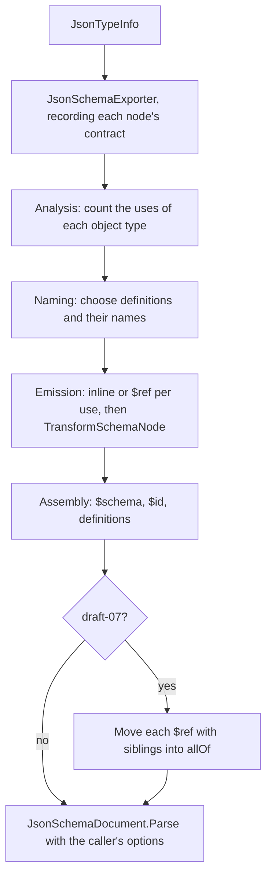

# Assimalign.Cohesion.JsonSchema.Generation — Design

## Design intent

Turn a `System.Text.Json` contract into a schema document that describes exactly the JSON the
contract reads and writes, and hand it back as a loaded `JsonSchemaDocument`. The guarantee the
package is built around is the round trip: a value serialized with a contract validates against the
document generated from that contract, in every supported dialect, with meta-schema validation on.
The tests hold it to that across nullable members, enums, polymorphism, recursion, required
members, naming policies, number handling and extension data.

The package is one static extension member, `JsonSchemaDocument.Generate`, one options type and one
context interface. It sits on the root package and on the BCL's `JsonSchemaExporter`, and nothing
else; the family map is in the root's [DESIGN.md](../../Assimalign.Cohesion.JsonSchema/docs/DESIGN.md).

## Pipeline

`Generate` exports the contract, rebuilds the export, and loads the result.

1. **Export.** `JsonSchemaExporter` describes the contract in 2020-12 terms. Its transform hook is
   used only to record, for every node, the contract, property and polymorphic base type the node
   describes; the export itself is not changed in place.
2. **Analysis** walks the export as the document will be written, following the exporter's
   pointers. It counts the places each object type is used, walking each type's description once,
   and finds collections that contain themselves with no object type in between.
3. **Naming** decides which types become definitions and names them (below).
4. **Emission** writes the document. A type used in more than one place, which includes a type used
   in its own description, becomes a definition and each use a reference to it; a type used once is
   described inline. Each use applies its own nullability and default, and every node that
   describes a contract passes through `TransformSchemaNode`.
5. **Assembly** puts `$schema` first, then `$id` when the options set one, the root's keywords, and
   the definitions. In draft-07, which ignores the siblings of `$ref`, every reference that has
   siblings is moved into an `allOf`.
6. **Load.** The document is parsed with the caller's `JsonSchemaDocumentOptions`, so it registers
   in their registry and is validated against its meta-schema when they ask.

## Why-this-not-that decisions

### Wrap `JsonSchemaExporter` rather than walk contracts directly

The exporter reads the contract the way the serializer does: naming policies, ignore conditions,
`required` members, constructor parameter defaults, number handling, enum converters, extension
data, unmapped-member handling and `JsonDerivedType` polymorphism. It works from `JsonTypeInfo`
alone, so a source-generated context works under NativeAOT. A walker of our own would restate the
serializer's rules and drift from them with each release. The cost is that the export's shape needs
rewriting, which is most of this package:

- **Pointers instead of definitions.** Where the exporter meets a type and property it has
  described before, it writes a JSON Pointer to the earlier description, relative to its own root.
  That ends recursion, but a type used in several places is described in full each time, and a
  pointer into the middle of the tree breaks as soon as anything around it changes, a transform
  included. The rebuild replaces those pointers with definitions.
- **Nullability in the wrong place.** For a polymorphic type that mixes object and non-object
  derived types, the exporter puts `null` into each alternative, or leaves it out where a nullable
  property allows it. The rebuild applies nullability once, where the value is used.
- **Converters.** A property with its own converter is described by its type's default contract,
  although only the converter knows what it writes. The rebuild describes it with the `true`
  schema, which keeps the round trip; a transform can describe it precisely.

### Definitions by use count, not one per type

A type used once is described inline and a type used twice or recursively becomes a definition.
Putting every object type into `$defs`, as OpenAPI components do, makes small documents harder to
read and changes no validation result. OpenAPI-specific naming and placement stay with
`Web.OpenApi` ([#1908](https://github.com/assimalign/cohesion/issues/1908)).

The root type is special. When it refers to itself, its references are `"#"` and it stays the root.
When the root allows `null` (the default, below), `"#"` would let every recursive reference accept
`null` as well, so the type moves into `$defs` and the root becomes `anyOf` of a reference and
`null`.

### Nullability where each value is used

The same type can be nullable in one property and required in another. Its definition is therefore
never nullable, and a nullable use is `anyOf` of the reference and `{"type": "null"}`. An inline
nullable use adds `"null"` to its `type` instead, or, when it has no `type` to extend, becomes an
`anyOf` with `{"type": "null"}`. A property's nullability comes from its nullable
annotation. The root, collection items and dictionary values carry no annotation in a contract, and
`System.Text.Json` writes `null` for a null reference there, so they allow `null` unless
`TreatNullObliviousAsNonNullable` is set. The default favors the round trip over strictness.

### Draft-07, 2019-09 and 2020-12 only

[#1904](https://github.com/assimalign/cohesion/issues/1904) names these three. Draft 4 has neither
`const` nor boolean schemas, which the output uses for type discriminators and for converter-backed
properties, and draft 6 was left out of scope with it. A custom dialect is refused too, since the
generator could not know which keywords it understands. Setting `Dialect` to any of these throws
`ArgumentException`.

### Fail on what the exporter cannot describe

`ReferenceHandler.Preserve` writes `$id` and `$ref` metadata the exporter does not support, so
generation throws `NotSupportedException` rather than produce a document the serializer's output
would fail. A contract nested deeper than its options' maximum depth throws
`InvalidOperationException` from the exporter.

## Definition names

- A definition is named after its type: `Order`, `PageOfOrder` for `Page<Order>`,
  `DictionaryOfStringAndOrder`, `OrderArray` for `Order[]`, and the underlying name for a
  `Nullable<T>`.
- Characters other than ASCII letters, digits, `.`, `-` and `_` become `_`. Those need no escaping
  in a JSON Pointer or a URI fragment and are what OpenAPI allows in a component name.
- Two types with one name (`Catalog.Item` and `Inventory.Item`) get `Item` and `Item2`, in the order
  analysis meets them, which follows the contract's property order.
- Definitions are written sorted by name, ordinally, so a contract always generates the same
  document.

## The transform hook

`TransformSchemaNode` receives every node that describes a contract, with an
`IJsonSchemaGenerationContext`, and returns the node to use.

- **Definition and references.** A type that becomes a definition is passed once as its
  definition, with no `PropertyInfo` and `IsReference` unset, and once for each use, with
  `IsReference` set and `PropertyInfo` naming the property when the use is one. A type described
  inline is one node for both. So a transform that says something about a type skips references, and
  one that says something about a property acts where `PropertyInfo` is set. What it adds to a
  reference stays beside the `$ref`; in draft-07 the `$ref` moves into an `allOf` and the additions
  stay outside it.
- **`Nullable<T>`.** A nullable use carries the `Nullable<T>` contract; the definition carries `T`'s.
- **Polymorphism.** Each derived type is passed with `BaseTypeInfo` set to the base type.
- **Order.** Children are passed before their parent, and the root before `$schema`, `$id` and the
  definitions are added, so a transform cannot change the dialect stamp.
- **Replacement.** The function may return the node it was given or a new one. A new node must not
  belong to another node; `null` or a node with a parent throws `InvalidOperationException`.
- **Root definitions.** Definitions the transform adds to the root under the dialect's keyword are
  merged with the generated ones; a name the generator also uses throws
  `InvalidOperationException` naming it.
- **Not passed:** nodes the contract does not describe, such as the alternative that allows `null`
  or a discriminator's `const`.

## Known limits

- **Formats assert only what the serializer guarantees.** The exporter adds `format` for some types:
  `date-time` for `DateTime` and `DateTimeOffset`, `date` for `DateOnly`, `uri` for `Uri`, `uuid` for
  `Guid`. Formats annotate by default and the round trip holds. With
  `JsonSchemaEvaluationOptions.FormatAssertion`, a `DateTime` of `DateTimeKind.Unspecified` (written
  without an offset) fails `date-time`, and a relative `Uri` fails `uri`.
- **String enums list only named values.** With a string enum converter, an undefined value such as
  `(Status)42` is written as a number and fails the generated `enum`. A `[Flags]` enum written as a
  string is described as any string, since combinations are comma-separated names.
- **What a converter writes is not described.** See "Wrap `JsonSchemaExporter`"; use the transform.
- **`object` and `JsonElement`** are described by the `true` schema; a root of either type
  generates a document with `$schema` alone.

## AOT posture

Generation reads contract metadata through `JsonTypeInfo` and `JsonSchemaExporter`'s
`JsonTypeInfo` overload, writes the document with `JsonNode` and `Utf8JsonWriter`, and uses no
reflection beyond the `Type` members that name a definition (`Name`, `IsArray`,
`GetElementType`, `GetGenericArguments`), which trimming preserves for any type a contract reaches.
The root's AOT guard (`samples/Assimalign.Cohesion.JsonSchema.AotSample`) generates documents from
a source-generated contract in all three dialects, validates them against their meta-schemas and
round-trips a value, as a NativeAOT binary with IL warnings as errors.

## Non-goals

- **OpenAPI documents.** Component naming, OAS `format` values and OpenAPI 3.0's `nullable` belong to
  `Web.OpenApi` ([#1908](https://github.com/assimalign/cohesion/issues/1908)).
- **Annotations the contract does not carry.** Descriptions, examples, validation attributes and XML
  documentation are not read; the transform hook is where an application adds them.
- **Schemas to types.** Generating C# from schema files is the planned source generator
  ([#1905](https://github.com/assimalign/cohesion/issues/1905)).
