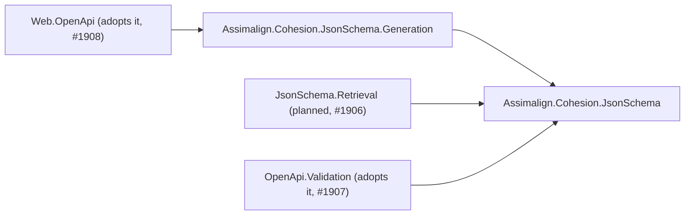
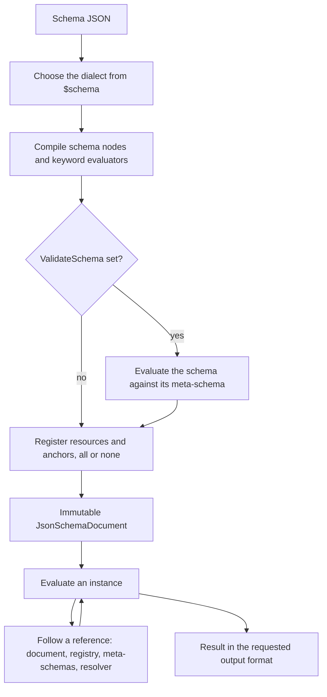

# Assimalign.Cohesion.JsonSchema — Design

## Design intent

One JSON Schema evaluator for every released dialect, with the specification's semantics rather
than an approximation of them, built on `System.Text.Json` and the BCL alone so that any Cohesion
library or application can take it without a dependency graph coming along. The official JSON Schema
Test Suite is the acceptance bar: every required and optional validation test and every annotation
test passes in all five dialects, and the suite runs on every build ("Conformance", below).

The package is deliberately narrow:

- **Load** a document once with `JsonSchemaDocument.Parse`, `ParseAsync` or `Create`, or with
  `JsonSchemaRegistry.Register` for a document known by the URI it was retrieved from. Loading
  compiles the document into an immutable graph of keyword evaluators.
- **Evaluate** any number of instances, from any number of threads. `Evaluate` returns the
  specification's output units and `IsValid` the verdict alone.
- **Resolve** references through a `JsonSchemaRegistry` that documents share. It asks an
  `IJsonSchemaResolver` for anything it does not hold; the library itself performs no I/O.
- **Extend** with keywords, vocabularies, dialects and formats through public seams.
- **Fail** with one exception root, `JsonSchemaException`, and an additive `JsonSchemaErrorCode`.
  An instance that does not satisfy its schema is a result, never an exception.

## Family map

Every package in the family references the root, and the root references nothing but the BCL. Two
packages exist today; the others are planned under epic
[#1901](https://github.com/assimalign/cohesion/issues/1901), and the diagram labels them so. Each
arrow reads "references".

| Package | Role | References | Status |
| --- | --- | --- | --- |
| `Assimalign.Cohesion.JsonSchema` | The evaluator: documents, registry, dialects, vocabularies, keywords, formats and results | The BCL only | Implemented ([#1902](https://github.com/assimalign/cohesion/issues/1902), [#1903](https://github.com/assimalign/cohesion/issues/1903)) |
| `Assimalign.Cohesion.JsonSchema.Generation` | Schema documents from `System.Text.Json` contracts (`JsonSchemaDocument.Generate`) | The root | Implemented ([#1904](https://github.com/assimalign/cohesion/issues/1904)) |
| `Assimalign.Cohesion.SourceGeneration.JsonSchema` | Types and validators generated at build time from schema files | Nothing in the family: a `netstandard2.0` Roslyn component cannot reference the root, but the code it emits does | Planned ([#1905](https://github.com/assimalign/cohesion/issues/1905)) |
| `Assimalign.Cohesion.JsonSchema.Retrieval` | Opt-in retrieval of `$ref` targets over HTTP(S) and files, deny by default | The root | Planned ([#1906](https://github.com/assimalign/cohesion/issues/1906)) |
| `Assimalign.Cohesion.OpenApi.Validation` | Replaces its private subset evaluator with the root | The root | Planned ([#1907](https://github.com/assimalign/cohesion/issues/1907)) |
| `Assimalign.Cohesion.Web.OpenApi` | Takes its generic generation steps from Generation | Generation | Planned ([#1908](https://github.com/assimalign/cohesion/issues/1908)) |

The source generator is absent from the diagram because it references no package in the family.
Nothing in the family references a `resources/` project (COHLIB001); `Web.OpenApi` is a resource
consuming a library, which is the permitted direction.

## How a document loads and evaluates

Loading does all the work that does not depend on an instance, once; evaluation walks the result.

1. `$schema` chooses the dialect: a built-in one, one registered in the registry, or a meta-schema
   the registry can resolve, whose `$vocabulary` names the vocabularies. A root without `$schema`
   uses `JsonSchemaDocumentOptions.DefaultDialect`, which defaults to 2020-12.
2. Compilation assigns base URIs from `$id` (`id` in draft 4), records anchors, and builds an
   evaluator for each keyword. Keyword arguments are checked here, so a malformed schema fails at
   load, and patterns are translated and compiled here, so an invalid pattern does too.
3. With `ValidateSchema`, the schema is evaluated against its dialect's meta-schema, with default
   evaluation options, and refused with `MetaSchemaViolation` when it does not conform.
4. The document's resources are registered as one atomic change: when any of them collides with a
   registered URI, none is registered and loading fails with `DuplicateResource`.
5. Evaluation follows a reference by looking in the document itself, then the registry, then the
   built-in meta-schemas, and finally the registry's resolver. The target is cached once found.

## Why-this-not-that decisions

### Sealed types for what callers create, interfaces for what they implement

- **`IJsonSchema` is the contract for "a schema"**: a document's root and every subschema in it.
  `TryGetSchema` returns one and results carry one, and a `JsonSchemaDocument` is one too, so code
  that evaluates a schema does not need to know whether it holds a document or a part of one.
- **Callback seams are interfaces because callers implement them**: `IJsonSchemaKeyword`,
  `IJsonSchemaResolver` and `IJsonSchemaFormat`. `IJsonSchemaKeywordContext` is the one the library
  implements and hands to a keyword.
- **What callers construct is `public sealed`**, with creation methods that validate their
  arguments (owner decisions 59 and 61): `JsonSchemaDocument.Parse`, `ParseAsync` and `Create`,
  `JsonSchemaDialect.Create`, `JsonSchemaVocabulary.Create`, `JsonSchemaKeywordDefinition.Create`,
  `JsonSchemaFormat.Create`, and `new JsonSchemaRegistry()`. Options and results are sealed data
  with `init` members.
- **Rejected: a public abstract keyword base class.** A base class would freeze the evaluator's
  internals, such as how annotations and evaluated positions are tracked, into every custom keyword.
  The context interface exposes what a keyword may read and record and nothing else, so the
  internals can change.

### Compiled once and interpreted, not code-generated at run time

Loading turns a schema into a graph of nodes, each holding evaluators for its keywords in a fixed
order: assertions and references first, then the applicators, then the keywords that read what
their siblings recorded (`unevaluatedItems`, `unevaluatedProperties`). Evaluation walks that graph.
Compiling a schema to IL or expression trees would evaluate faster, but it is unavailable under
NativeAOT, which every library here supports. Generating code for schemas known at build time is
the planned source generator ([#1905](https://github.com/assimalign/cohesion/issues/1905)), whose
results are to be tested against this evaluator's.

### References resolve when first followed

A reference is resolved the first time an evaluation or a `TryGetSchema` call follows it, and the
target is cached. A document may therefore refer to one that loads later, two documents may refer
to each other whichever loads first, and a resolver is asked only for documents an evaluation needs,
once each. The cost is that a reference to a missing resource is not reported at load: every
evaluation that follows it throws `UnresolvedReference`, until the target is registered and the next
evaluation succeeds. Resolving remote references before evaluation is the preloading
[#1906](https://github.com/assimalign/cohesion/issues/1906) plans.

### Exact decimal numbers, not `double` or `decimal`

JSON Schema compares numbers by mathematical value: `1.0` is an integer, `1` equals `1.0`, and
`multipleOf` is exact. `double` breaks this (`0.3` is not a multiple of `0.1` in binary, and
2^53 + 1 equals 2^53), and `decimal` overflows past 28 digits or about 7.9 × 10^28; the official
suite exercises both. A number is read from its raw JSON text into an internal exact decimal, a
`BigInteger` significand and an exponent normalized so that equal values have one representation.
Comparisons look at magnitude before they align significands, so `1e999999999` never materializes
its power of ten. The cost is `BigInteger` arithmetic instead of primitive arithmetic. It is also why
instances are `JsonElement` values: the raw text of a number is available there and lost once a
number is converted to a .NET type.

### RFC 3986 references, not `System.Uri`, for identification

Schema identification compares and resolves URI references by RFC 3986 (§5.2 resolution, §6.2.2
and §6.2.3 normalization). `System.Uri` rewrites paths it takes for file paths, unescapes
characters, and resolves some references differently from RFC 3986 depending on the platform, so
`$id`, `$ref`, `$anchor` and `$schema` are handled by an internal parser that keeps each component
as written unless normalization says otherwise. The public API still takes `System.Uri` where a
caller supplies a URI (`BaseUri`, `Register`, `TryGetSchema`, `IJsonSchemaResolver`).

The parser is lenient: it splits a reference with RFC 3986's Appendix B expression and validates
the scheme, and an anchor may be any non-empty string. Identifiers that break the finer grammar
still load. Meta-schema validation does not catch them either, because the meta-schemas express URI
syntax with `format`, which annotates under default options.

### ECMA-262 patterns, translated, linear time first

`pattern`, `patternProperties` and the `regex` format are ECMA-262 regular expressions (2020-12
Core §6.4), and .NET's syntax differs in ways that change results. Each pattern is translated, with
Unicode (`u` flag) semantics, into an equivalent .NET pattern: `\d`, `\w`, `\s` and `\b` take
ECMA-262's sets, `$` matches only at the end, `.` excludes the four ECMA-262 line terminators,
astral code points match as one unit, and groups are renumbered by their ECMA-262 position. Syntax
only .NET understands, such as inline options or atomic groups, is refused with
`InvalidRegularExpression`.

The translation compiles with `RegexOptions.NonBacktracking`, whose matching time is linear in the
input. Patterns that need backtracking (backreferences, lookarounds, and the lookarounds `\b`
becomes) fall back to the backtracking engine, bounded by `JsonSchemaDocumentOptions.RegexMatchTimeout`
(two seconds by default); exceeding it fails the evaluation with `RegularExpressionTimeout`. Only
those patterns can be made slow by a crafted instance.

### IDNA2008 in managed code, not `IdnMapping`

`idn-hostname` and `idn-email` require IDNA2008 (RFC 5890 to RFC 5893): the derived properties, the
CONTEXTJ and CONTEXTO rules and the Bidi rule, all of which the official suite exercises.
`IdnMapping` delegates to ICU on Linux and macOS, to the operating system on Windows, and to a
managed fallback under `InvariantGlobalization`, and the three disagree. On .NET 10 on Linux,
`IdnMapping.GetAscii("a‍b.com")` (a zero-width joiner outside the context RFC 5892 allows it in)
throws with ICU and returns `xn--ab-m1t.com` with invariant globalization. A schema must give the
same answer on a Windows workstation and in a Linux container built with NativeAOT, so the library
implements the algorithm itself:

- The derived properties follow RFC 5892 §3 over the runtime's general categories, which CoreLib
  carries without ICU, plus tables for the properties the BCL does not expose (Bidi_Class,
  Joining_Type, Canonical_Combining_Class, Script, Default_Ignorable_Code_Point, and the case
  foldings that differ from lowercase). The tables are range lists compiled into the data section,
  about 16 KB of source in all; their derivation is in [PROVENANCE.md](PROVENANCE.md).
- `idn-hostname` first applies the UTS #46 mapping, derived rather than tabled (NFKC case folding
  with the mapping table's ignored code points and nontransitional deviations). It agrees with the
  Unicode 18.0 mapping table for every code point that table does not disallow; a code point it
  disallows fails validation after mapping instead.
- An A-label's ASCII letters are lowercased before comparison, since DNS compares ASCII without
  case, and the Bidi rule applies to every label of a name that has a right-to-left label.

**Known limit:** under `InvariantGlobalization`, .NET's normalization is a no-op (`Normalize`
returns its input and `IsNormalized` returns `true`), so the NFC check and the NFKC steps of the
mapping cannot reject anything. A label that is not in NFC passes there. Everything else uses data
that does not depend on ICU and behaves the same in both modes.

## Lifecycle

- **Documents are immutable once loaded** and safe to evaluate from any number of threads. A
  document owns a private copy of its JSON (`Create` clones the element it is given), so it never
  depends on the lifetime of a `JsonDocument`, and it holds nothing that needs disposal.
- **Compilation finishes at load**, with one exception: a JSON Pointer reference into a part of the
  document that is not a schema location (the value of an unknown keyword, for instance) compiles
  that part the first time it is followed, under a lock, and caches it. Identifiers found in such a
  part stay private to the document rather than joining the registry.
- **Registries only grow.** Registration is atomic and thread-safe (copy-on-write under a lock;
  reads take no lock). There is no removal: references cache their targets once resolved, and a
  removal could not reach those caches. A caller who needs to drop documents drops the registry.
  Every registry falls back to one shared, built-in registry of the official meta-schemas, loaded
  from embedded resources on first use.
- **A document a resolver supplies is registered and never requested again.** Two threads that
  follow a reference to the same unregistered URI at the same moment may both ask the resolver; the
  first registration wins and the other thread uses it, so every evaluation sees one document.
- **Evaluation keeps its state per call.** `MaxEvaluationDepth` (512 by default) bounds how deeply
  schemas nest during one evaluation, counting every reference followed, and a reference that
  re-enters itself without consuming any of the instance fails at once. Both raise
  `EvaluationDepthExceeded`.

## Error model

`JsonSchemaException` is the library's one abstract exception root; the library throws an internal
subclass, and consumers may derive their own. `Code` says why the schema could not be processed and
`Location` names the schema location concerned, as an absolute URI with a JSON Pointer fragment, when
one applies.

| Code | Raised | Meaning |
| --- | --- | --- |
| `InvalidSchema` | Load | Not JSON, not an object or boolean, or a keyword argument of the wrong shape |
| `InvalidUri` | Load | A URI-valued keyword is not a URI reference, or carries a fragment its dialect forbids |
| `UnresolvedReference` | Evaluation, `TryGetSchema`, or load with `ValidateSchema` | A reference names a document, pointer or anchor nothing can provide |
| `UnknownDialect` | Load | `$schema` names no built-in, registered or resolvable dialect |
| `UnsupportedVocabulary` | Load | A meta-schema requires a vocabulary the registry does not know |
| `DuplicateResource` | Load | Two resources claim one absolute URI, in a document or a registry |
| `InvalidRegularExpression` | Load | A pattern is not a supported ECMA-262 expression |
| `RegularExpressionTimeout` | Evaluation | A backtracking pattern exceeded `RegexMatchTimeout` |
| `EvaluationDepthExceeded` | Evaluation | `MaxEvaluationDepth` was exceeded, or a schema recursed without consuming the instance |
| `MetaSchemaViolation` | Load with `ValidateSchema` | The schema does not conform to its meta-schema |

- API misuse throws the BCL's argument exceptions (`ArgumentNullException`, `ArgumentException`,
  `ArgumentOutOfRangeException`), never `JsonSchemaException`.
- A custom keyword's factory may throw, and its exception propagates unchanged; a factory that
  returns `null` fails with `InvalidOperationException`.
- The codes are additive: a new failure gets a new value, and existing values keep their meaning.

## Semantics where the specification leaves room

- **Formats annotate by default**, as 2019-09 and 2020-12 require. `FormatAssertion` makes the
  formats the library knows assert in any dialect, while unknown formats still pass; the 2020-12
  format-assertion vocabulary asserts regardless and fails unknown formats. Every built-in format is
  recognized in every dialect, and where releases differ the declaring dialect's rule applies:
  `hostname` checks A-labels from draft 7 on, and `relative-json-pointer` allows index manipulation
  from 2020-12 on.
- **Formats the specification defines loosely** follow the stricter reading the suite's optional
  tests take: `ipv4` refuses leading zeros, `email` and `idn-email` accept only IPv4 and `IPv6:`
  address literals (no other tag is registered) and set no length limits (RFC 5321's limits belong to
  SMTP, not to the grammar), `hostname` enforces 63 characters a label and 253 in all, and
  `uri-template` applies RFC 6570 erratum 6937, which allows an apostrophe in a literal.
- **Caller formats** replace a built-in format of the same name. `JsonSchemaEvaluationOptions.Formats`
  is copied when set, and of two formats with one name the later wins.
- **Content keywords annotate by default**, as the specification requires. `ContentAssertion` makes
  `base64` content decode, `application/json` and `+json` content parse, and parsed content satisfy
  `contentSchema`; other encodings and media types are not checked.
- **Unknown keywords** are collected as annotations from 2019-09 on and ignored before it. Through
  draft 7, `$ref` overrides its sibling keywords.

## Extending

- **A keyword** is a `JsonSchemaKeywordDefinition`: a name, a factory that runs once for each
  occurrence at load and receives the keyword's value, and a `JsonSchemaSubschemaLayout` that tells
  the compiler where its subschemas are, so their identifiers and anchors are found and pointers into
  them resolve. The keyword evaluates through `IJsonSchemaKeywordContext`: the instance, its
  subschemas, the annotations its siblings produced and the positions they evaluated.
- **A vocabulary** groups definitions under a URI (`JsonSchemaVocabulary.Create`), and **a dialect**
  combines vocabularies under a URI (`JsonSchemaDialect.Create`). Registering either in a registry
  lets `$schema` and a meta-schema's `$vocabulary` name it; passing a dialect as `DefaultDialect`
  applies it to documents without `$schema`.
- **A format** is `JsonSchemaFormat.Create(name, predicate)` for strings, or an `IJsonSchemaFormat`
  implementation for any instance type.
- **A resolver** implements `IJsonSchemaResolver.TryResolve`, synchronously and thread-safely; the
  planned Retrieval package is one ([#1906](https://github.com/assimalign/cohesion/issues/1906)).
- **A new dialect release** adds a `JsonSchemaVersion` value, its built-in vocabularies and dialect,
  its embedded meta-schemas and its rows in the suite runner;
  [#1909](https://github.com/assimalign/cohesion/issues/1909) tracks the next stable release.

## AOT posture

- No reflection, `Reflection.Emit`, expression compilation or `System.Text.Json` serializer: schemas
  and instances are read through `JsonElement`, and results are written with `Utf8JsonWriter`.
- Regular expressions are constructed at load from translated patterns and run interpreted
  (`NonBacktracking`, or the backtracking interpreter); `RegexOptions.Compiled` is not used.
- Meta-schemas are embedded resources read with `GetManifestResourceStream`, and the IDNA tables
  are constant arrays, so trimming has nothing to preserve.
- `samples/Assimalign.Cohesion.JsonSchema.AotSample` publishes with NativeAOT and IL warnings as
  errors, then runs: each check takes a different path (dialects, meta-schema validation, `$ref`,
  `$dynamicRef` and remote references, asserted formats, patterns, a custom format and keyword,
  every output format, and generation in three dialects), so a build that trims away a path fails
  the run. `library-json-schema.yml` runs it on every change to the area.

## Diagnostics

The library has no `EventSource`. It performs no I/O and holds no long-lived resources, and every
failure reaches the caller as an exception or a result, so there is nothing for an operator to
observe that the caller has not already seen (`event-source.md`: an assembly that raises nothing
has none).

## Conformance

The JSON Schema Test Suite is vendored in `tests/TestObjects/JSON-Schema-Test-Suite` at the commit
[PROVENANCE.md](PROVENANCE.md) records, unmodified. The suite's unified layout marks each test case
with the dialects it applies to and carries the external schemas it needs, which the runner
registers before the case loads. For each of the five dialects the runner executes every required
and optional validation file, through both `IsValid` and a Verbose `Evaluate`, and every annotation
file.

**Exclusions: none.** An exclusion is a `TestSuiteExclusion` entry in the tests' `Shared/` folder
and a row in this section with its reason; a test that starts passing fails its suite row until its
entry is removed.

## Non-goals

- **Network or file access.** The root resolves references from what it holds and what a resolver
  supplies. Retrieval with an SSRF-safe policy is a separate, opt-in package
  ([#1906](https://github.com/assimalign/cohesion/issues/1906)), so the evaluator never acquires I/O.
- **Run-time code generation.** See "Compiled once and interpreted"; build-time generation is
  [#1905](https://github.com/assimalign/cohesion/issues/1905).
- **Unreleased drafts.** Only published dialects are built in; a working draft can be added as a
  custom dialect, and the next stable release is [#1909](https://github.com/assimalign/cohesion/issues/1909).
- **A schema object model.** Documents are read-only. A schema is written as JSON, or generated from
  a `System.Text.Json` contract by `Assimalign.Cohesion.JsonSchema.Generation`.
- **Changing instances.** `default` and the other annotations are reported, never applied; the
  library does not fill in values or coerce types.
