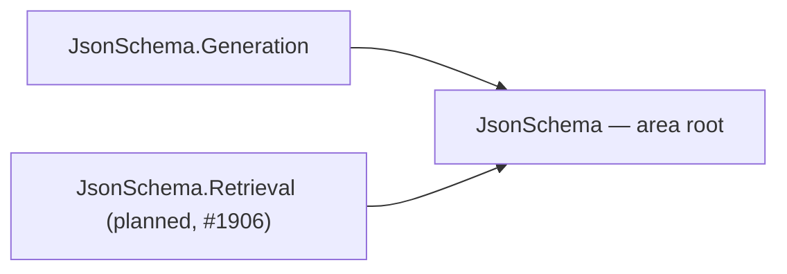

# JsonSchema

The JsonSchema area implements [JSON Schema](https://json-schema.org/) for Cohesion: an evaluator for
every released dialect (draft-04, draft-06, draft-07, 2019-09 and 2020-12) and schema generation from
`System.Text.Json` contracts. It is an L1 foundation family built on the BCL alone. It references no
other Cohesion area, and the areas that need JSON Schema, OpenApi and Web among them, build on it
rather than the reverse.

## Project map

An arrow means "references": `JsonSchema.Generation --> JsonSchema` reads
`Assimalign.Cohesion.JsonSchema.Generation` references `Assimalign.Cohesion.JsonSchema`. The second
arrow belongs to a planned package and is labeled so.

Every package in the area references the root, and the root references nothing but the BCL. The
planned source generator, `Assimalign.Cohesion.SourceGeneration.JsonSchema`, lives under
`analyzers/` and references no package of the area; the code it emits references the root. The
packages outside the area that will consume this one are drawn in the root's
[DESIGN.md](./Assimalign.Cohesion.JsonSchema/docs/DESIGN.md) ("Family map").

The full reference graph for every Cohesion assembly is in
[docs/DEPENDENCIES.md](../../docs/DEPENDENCIES.md).

## Layering

- **L1 (this area):** loading and evaluating schemas, reference resolution within and across
  documents, dialects, vocabularies, formats and output, and schema generation from serializer
  contracts. The area never reaches the network or the file system: a reference the registry does
  not hold goes to the `IJsonSchemaResolver` the application supplies.
- **Consumers:** `OpenApi.Validation` is planned to replace its private subset evaluator with the
  root ([#1907](https://github.com/assimalign/cohesion/issues/1907)), an L1 reference between
  libraries. `Web.OpenApi` is planned to take its generic generation steps from Generation
  ([#1908](https://github.com/assimalign/cohesion/issues/1908)), a resource consuming a library.
  Nothing in the area references a `resources/` project (COHLIB001).

## Project family

| Package | Responsibility | Depends on | Release |
|---|---|---|---|
| [`Assimalign.Cohesion.JsonSchema`](./Assimalign.Cohesion.JsonSchema/) | The evaluator: documents, `$ref`/`$dynamicRef`/`$recursiveRef` resolution, the registry, dialects and vocabularies, every 2020-12 format, custom keywords and formats, the four output formats | — (BCL only) | NuGet package |
| [`Assimalign.Cohesion.JsonSchema.Generation`](./Assimalign.Cohesion.JsonSchema.Generation/) | Schema documents from `System.Text.Json` contracts, source-generated ones included, in draft-07, 2019-09 and 2020-12 (`JsonSchemaDocument.Generate`) | root | NuGet package |
| `Assimalign.Cohesion.SourceGeneration.JsonSchema` | Types and validators generated at build time from schema files | — (build time) | Planned ([#1905](https://github.com/assimalign/cohesion/issues/1905)) |
| `Assimalign.Cohesion.JsonSchema.Retrieval` | Opt-in retrieval of `$ref` targets over HTTP(S) and files, deny by default | root | Planned ([#1906](https://github.com/assimalign/cohesion/issues/1906)) |

The two implemented libraries are built and tested on Linux, Windows, and macOS by
`.github/workflows/library-json-schema.yml`, which also publishes the root's AOT guard
(`Assimalign.Cohesion.JsonSchema/samples/Assimalign.Cohesion.JsonSchema.AotSample`) as a NativeAOT
binary and runs it. Both are listed in the release inventory
(`scripts/modules/CohesionPackaging.psm1`), so a release publishes each as its own package. Neither is
a member of a shared framework, so an application references the package it uses.

## Standards

The root evaluates draft-04, draft-06, draft-07, 2019-09, and 2020-12 with each dialect's own
semantics, and produces the Flag, Basic, Detailed, and Verbose output of 2020-12 Core §12. The
official [JSON Schema Test Suite](https://github.com/json-schema-org/JSON-Schema-Test-Suite) is
vendored in the root's tests, and every required and optional validation test and every annotation
test passes in every dialect, with no exclusions. Where the specification leaves a choice open, the
choice made and its reason are in the root's DESIGN.md ("Semantics where the specification leaves
room"). The vendored suite, the official meta-schemas, and the Unicode data behind `idn-hostname`
and `idn-email` are recorded, with their sources and licenses, in
[PROVENANCE.md](./Assimalign.Cohesion.JsonSchema/docs/PROVENANCE.md).

## Status and roadmap

The evaluator ([#1902](https://github.com/assimalign/cohesion/issues/1902)), its formats
([#1903](https://github.com/assimalign/cohesion/issues/1903)), and generation
([#1904](https://github.com/assimalign/cohesion/issues/1904)) are complete. The source generator,
retrieval, the two adoptions above, and tracking the next stable JSON Schema release
([#1909](https://github.com/assimalign/cohesion/issues/1909)) are planned under epic
[#1901](https://github.com/assimalign/cohesion/issues/1901).

See each package's `docs/OVERVIEW.md` and `docs/DESIGN.md` for detail:

- Root: [OVERVIEW.md](./Assimalign.Cohesion.JsonSchema/docs/OVERVIEW.md),
  [DESIGN.md](./Assimalign.Cohesion.JsonSchema/docs/DESIGN.md),
  [PROVENANCE.md](./Assimalign.Cohesion.JsonSchema/docs/PROVENANCE.md)
- Generation: [OVERVIEW.md](./Assimalign.Cohesion.JsonSchema.Generation/docs/OVERVIEW.md),
  [DESIGN.md](./Assimalign.Cohesion.JsonSchema.Generation/docs/DESIGN.md)
