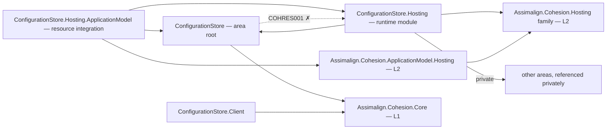

# ConfigurationStore

ConfigurationStore is the L3 resource area for durable, named configuration namespaces. Its
default host serves namespace snapshots over its `/cohesion/v1` endpoint; values are configuration
rather than secrets and are stored as plain JSON beneath the `data` volume. A ConfigurationStore application becomes a managed resource instance with `Assimalign.Cohesion.ConfigurationStore.Hosting.ApplicationModel`: `builder.Services.AddResource("settings", resource => resource.UseInProcess())` joins the gateway that runs it through the platform it opted into.

## Project map

An arrow means "references": `ConfigurationStore.Hosting --> ConfigurationStore` reads
`ConfigurationStore.Hosting` references `Assimalign.Cohesion.ConfigurationStore`.



Solid edges are the references this area permits. The dotted edge is the one `COHRES001`
rejects: **no library in the area may reference its own `ConfigurationStore.Hosting` runtime
module**. The area root, the client, and any feature library likewise reference no
`Assimalign.Cohesion.Hosting*` library at all (`COHRES004`).

The one exception is the resource integration, `ConfigurationStore.Hosting.ApplicationModel`,
which joins the runtime module to the application model's hosting; `COHRES001` sanctions that
reference by the integration's exact name, with no exemption property.

The full reference graph for every Cohesion assembly, including the exact external dependencies
collapsed above, is in [docs/DEPENDENCIES.md](../../docs/DEPENDENCIES.md).

## Projects

- `Assimalign.Cohesion.ConfigurationStore` defines the public area-root application and builder contracts alongside the existing loader abstraction.
- `Assimalign.Cohesion.ConfigurationStore.Client` is the thin, Core-only HTTP protocol client that reads configuration namespace snapshots; a program that reads the store references it directly.
- `Assimalign.Cohesion.ConfigurationStore.Hosting` provides the concrete creation entry point, durable store, and HTTP protocol host.
- `Assimalign.Cohesion.ConfigurationStore.Hosting.ApplicationModel` registers the application as a managed resource instance (`builder.Services.AddResource(name, ...)`) on the platform its gateway names, with the actions the application adds.

## Layering and dependencies

As an L3 service platform, ConfigurationStore composes the shared Hosting and private Web transport
primitives rather than defining a second lifecycle or HTTP stack. The resource integration,
`ConfigurationStore.Hosting.ApplicationModel`, builds on the instance-side
`Assimalign.Cohesion.ApplicationModel.Hosting` contracts, which the App kernel framework carries.

The client is Core-only, never references `*.Hosting` or an application-model assembly, and is not
delivered through the `App.ConfigurationStore` shared framework. A gateway references neither the
client nor the store's runtime: it declares the resource generically
(`builder.AddResource("ConfigurationStore", "settings")`) and runs the actions the instance's
application adds through the platform the instance runs on.

## Project documentation

- [Root overview](./Assimalign.Cohesion.ConfigurationStore/docs/OVERVIEW.md)
- [Root design](./Assimalign.Cohesion.ConfigurationStore/docs/DESIGN.md)
- [Hosting overview](./Assimalign.Cohesion.ConfigurationStore.Hosting/docs/OVERVIEW.md)
- [Hosting design](./Assimalign.Cohesion.ConfigurationStore.Hosting/docs/DESIGN.md)
- [Resource integration overview](./Assimalign.Cohesion.ConfigurationStore.Hosting.ApplicationModel/docs/OVERVIEW.md)
- [Resource integration design](./Assimalign.Cohesion.ConfigurationStore.Hosting.ApplicationModel/docs/DESIGN.md)
- [Client overview](./Assimalign.Cohesion.ConfigurationStore.Client/docs/OVERVIEW.md)
- [Client design](./Assimalign.Cohesion.ConfigurationStore.Client/docs/DESIGN.md)

## Application composition (O34)

The root contracts are hosting-free (O34): `IConfigurationStoreApplication` exposes `Context`, `StartAsync`, and `StopAsync`; `IConfigurationStoreApplicationContext` exposes `ContentRootPath`. `IConfigurationStoreApplicationBuilder` owns area declarations and `Build()`. The root and feature packages reference no `Assimalign.Cohesion.Hosting*` library; COHRES004 enforces the boundary.

`ConfigurationStoreApplication.CreateBuilder(args)` returns the public concrete `ConfigurationStoreApplicationBuilder`; its `Build()` returns the public `ConfigurationStoreApplication : Host<ConfigurationStoreApplicationContext>`. The public `ConfigurationStoreApplicationContext` implements `IConfigurationStoreApplicationContext`, reading `ContentRootPath` from the host environment. The application explicitly forwards the root lifecycle contract to `IHost`, and consumers use the concrete application for `RunAsync` and `await using`. Runtime options and supporting services remain internal.

```csharp
using Assimalign.Cohesion.ConfigurationStore.Hosting;

ConfigurationStoreApplicationBuilder builder = ConfigurationStoreApplication.CreateBuilder(args);
// Add area declarations and optional hosting services before Build().
await using ConfigurationStoreApplication application = builder.Build();
await application.RunAsync();
```
