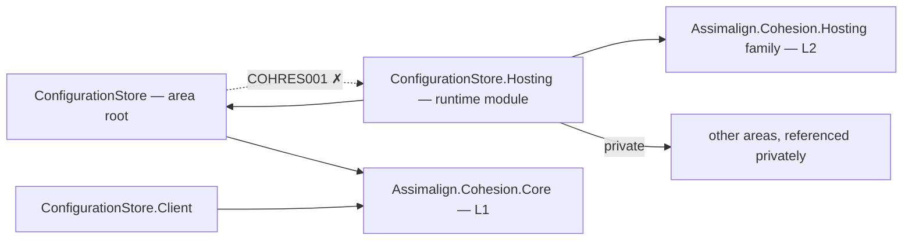

# ConfigurationStore

ConfigurationStore is the L3 resource area for durable, named configuration namespaces. Its
default host serves namespace snapshots over its `/cohesion/v1` endpoint; values are configuration
rather than secrets and are stored as plain JSON beneath the `data` volume. The retired resource
integration (control plane, declarative commands, bootstrap-token trust, telemetry) was removed on
2026-10-31 with the application-model restart (assimalign/cohesion#1759), and the area's resource
integration returns as `Assimalign.Cohesion.ConfigurationStore.Hosting.ApplicationModel`.

## Project map

An arrow means "references": `ConfigurationStore.Hosting --> ConfigurationStore` reads
`ConfigurationStore.Hosting` references `Assimalign.Cohesion.ConfigurationStore`.



Solid edges are the references this area permits. The dotted edges are the ones the build
rejects. `COHRES001`: **no library in the area may reference its own `ConfigurationStore.Hosting`
runtime module**, and the declarative `.ApplicationModel` package in particular never does —
generated code in an opted-in consumer executable joins the two sides at run time through
`Assimalign.Cohesion.Hosting.Resources.ResourceRuntime` instead. `COHRES004`: the area root and its
feature libraries, the opt-in `.ApplicationModel.Orchestration` package included, reference no
`Assimalign.Cohesion.Hosting*` library at all — which is also why the Orchestration package never
references `.ApplicationModel` (whose `Hosting.Resources` reference it would inherit).

The full reference graph for every Cohesion assembly, including the exact external dependencies
collapsed above, is in [docs/DEPENDENCIES.md](../../docs/DEPENDENCIES.md).

## Projects

- `Assimalign.Cohesion.ConfigurationStore` defines the public area-root application and builder contracts alongside the existing loader abstraction.
- `Assimalign.Cohesion.ConfigurationStore.Client` is the thin, Core-only HTTP protocol client that the opt-in orchestration package uses on a gateway's behalf to read configuration namespace snapshots. A gateway never references it directly.
- `Assimalign.Cohesion.ConfigurationStore.Hosting` provides the concrete creation entry point, durable store, and HTTP protocol host.

## Layering and dependencies

As an L3 service platform, ConfigurationStore composes the shared Hosting and private Web transport
primitives rather than defining a second lifecycle or HTTP
stack. The ApplicationModel package remains orchestration-only and COHAM001-guarded.

The client is Core-only, never references `*.Hosting` or an ApplicationModel assembly, and is not
delivered through the `App.ConfigurationStore` shared framework. The gateway library references no
client: the ConfigurationStore wire knowledge for mount sources lives in the opt-in
`.ApplicationModel.Orchestration` package, which implements the `IResourceSourceProvider` seam from
`Assimalign.Cohesion.ApplicationModel` over this client, and command delivery uses the gateway's
generic control-plane client. A gateway resolves a `<store>:<namespace>` mount only when its
`Program.cs` calls `builder.UseConfigurationStore(store)`; without it `Build()` rejects the mount
and names this package and verb. Gateway platform
implementation assemblies continue to avoid ConfigurationStore ApplicationModel packages. A gateway
project that references a ConfigurationStore resource project receives the area ApplicationModel
package from `Sdk.Gateway` and calls its hand-written `builder.AddConfigurationStore(Manifests.<Name>)`
verb for the typed resource and planner.

## Project documentation

- [Root overview](./Assimalign.Cohesion.ConfigurationStore/docs/OVERVIEW.md)
- [Root design](./Assimalign.Cohesion.ConfigurationStore/docs/DESIGN.md)
- [Hosting overview](./Assimalign.Cohesion.ConfigurationStore.Hosting/docs/OVERVIEW.md)
- [Hosting design](./Assimalign.Cohesion.ConfigurationStore.Hosting/docs/DESIGN.md)
- [Client overview](./Assimalign.Cohesion.ConfigurationStore.Client/docs/OVERVIEW.md)
- [Client design](./Assimalign.Cohesion.ConfigurationStore.Client/docs/DESIGN.md)

## Application composition (O34)

The root contracts are hosting-free (O34): `IConfigurationStoreApplication` exposes `Context`, `StartAsync`, and `StopAsync`; `IConfigurationStoreApplicationContext` exposes `ContentRootPath`. `IConfigurationStoreApplicationBuilder` owns area declarations and `Build()`. The root and feature packages reference no `Assimalign.Cohesion.Hosting*` library; COHRES004 enforces the boundary.

`ConfigurationStoreApplication.CreateBuilder(args)` returns the public concrete `ConfigurationStoreApplicationBuilder`; its `Build()` returns the public `ConfigurationStoreApplication : Host<ConfigurationStoreApplicationContext>`. The public `ConfigurationStoreApplicationContext` implements `IConfigurationStoreApplicationContext`, reading `ContentRootPath` from the host environment. The application explicitly forwards the root lifecycle contract to `IHost`, and consumers use the concrete application for `RunAsync` and `await using`. Runtime options and supporting services remain internal.

```csharp
using Assimalign.Cohesion.ConfigurationStore.Hosting;

ConfigurationStoreApplicationBuilder builder = ConfigurationStoreApplication.CreateBuilder(args);
// Add area declarations and optional hosting services before Build().
await using ConfigurationStoreApplication application = builder.Build();
await application.RunAsync();
```
