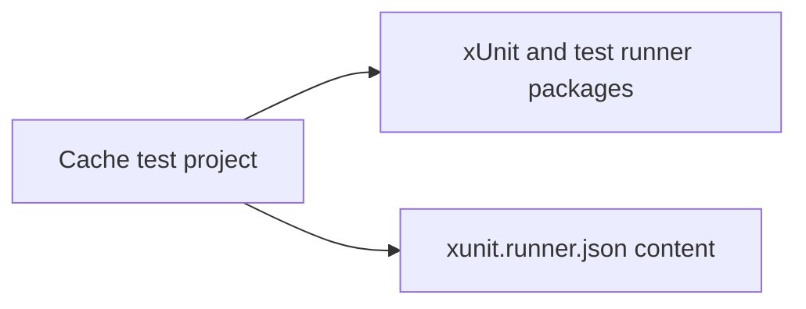

# Assimalign.Cohesion.Database.Cache — Design

## Model component boundaries

The empty Cache Catalog and Storage projects are retired. Cache has no Security satellite and remains deferred. Future public Catalog and Storage types belong under src/Catalog and src/Storage; internal component types belong under src/Internal/Catalog and src/Internal/Storage and declare Assimalign.Cohesion.Database.CacheDb.Internal.

The future dependency direction is engine → Catalog → Storage → shared kernel. Cache currently has only a Class1 placeholder, so the architecture test and compiler-input export are removed: a successful check would enforce no component boundary. Restore both when Cache gains implementation, using the implemented models' folder and external-assembly rules in the area README. Build-generated resource accessors and assembly metadata are shared infrastructure, outside the three layers. No shipped-assembly visibility grant, wire or disk format, diagnostic code, or behavior is introduced.

Cache is deferred behind the Key-Value engine and currently has no implemented
engine, persistence, or lifecycle. Its empty source and test stubs do not define
the future Cache model architecture.

The only build correction in Phase 2 is the test project's item classification:
`xunit.runner.json` is content rather than a C# compile item. The stub test remains
unchanged. Future runtime implementation must compose the shared Database kernel
and follow the resource-area reference rules.

The test project references runner packages; runner configuration is a content
file owned by that project. This diagram shows those existing build dependencies.

## Public assembly identity changes

The following public types move from their Catalog or Storage assembly into Assimalign.Cohesion.Database.Cache. Their namespaces, members, diagnostic codes and serialized representations are unchanged. Public members whose signatures expose these types also reference their new assembly identity. Consumers must replace satellite project/package/assembly references with the model reference and recompile; assembly-qualified type names change. No type forwarding or compatibility assembly is supplied. Empty Security (and Cache Catalog/Storage) projects had no public types.

This deferred model has no public Catalog or Storage types to move.
