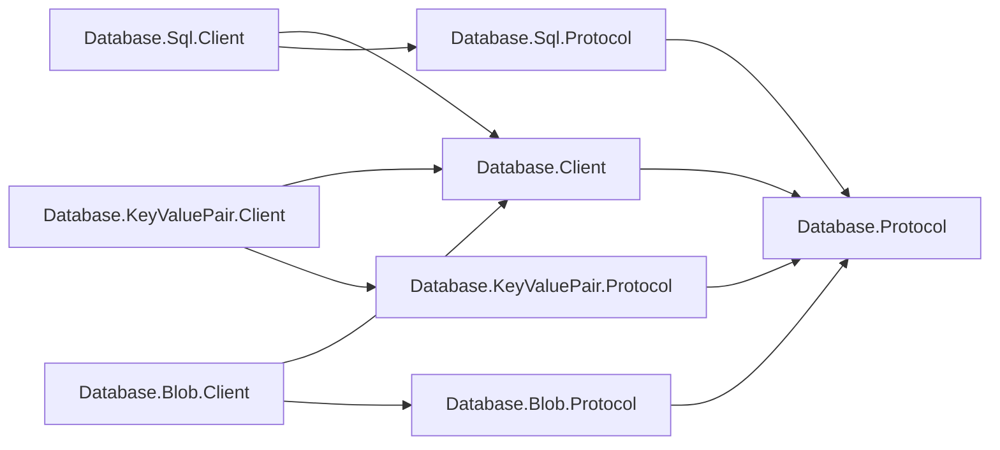
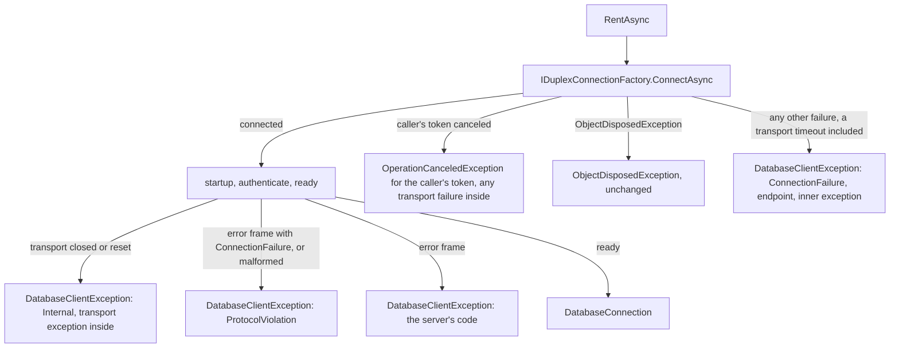
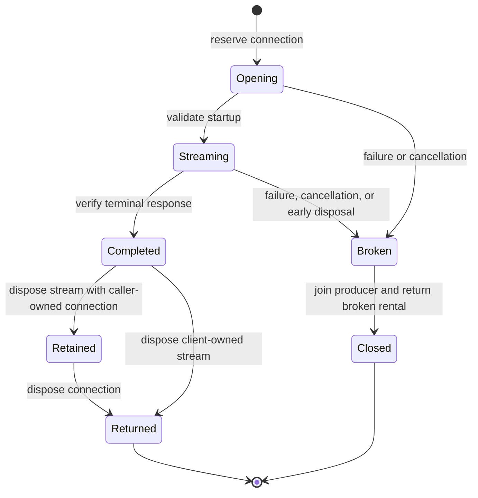

# Assimalign.Cohesion.Database.Client — Design

## Engine dependency guard

COHDBCLIENT001 checks every project whose project name or evaluated AssemblyName is the shared
Database.Client or matches Database.*.Client, case-insensitively with exact suffix boundaries.
Only complete tests/examples/samples/fixtures segments below CohesionRepositoryDirectory exempt
harnesses; checkout ancestors and exemption properties do not. Embedded and Studio are outside scope.

Before ResolveAssemblyReferences and CoreCompile the guard rejects all evaluated engine
ProjectReference items, including name-only/private, transitive and ReferenceOutputAssembly=false
references. After ResolveAssemblyReferences, GetAssemblyIdentity checks each existing ReferencePath
asset's actual simple name, so packages, framework members, HintPath and renamed DLLs receive the
same rule. Both this guard and the canary's closure check filter missing design-time outputs before
identity inspection. A third layer rejects
forbidden CohesionSharedSource identities before expansion and Compile inputs under engine project
directories after shared-source expansion and before CoreCompile, regardless of Link metadata.
All three layers reject model roots and Catalog/Storage/Security/Tcp implementation families (including
retired identities), plus Database root and shared Storage/Transactions/Indexing/Memory/Embedded/Hosting.
Shared Types/Execution/Language/Protocol/Security and model Protocol contracts are independently named.
The implementation uses Framework MSBuild-compatible path normalization and has no opt-out.

## Contract-only dependencies

Direct references are Database.Protocol, Database.Types and Connections. Wire contracts live in each model Protocol assembly, shared by client and engine. This client has no engine, area-root, storage, transaction, indexing, model parser or schema reference. Cache.Client remains an empty placeholder. Engine-free trimming and NativeAOT coverage lives in Database.Client/samples/Assimalign.Cohesion.Database.Client.AotSample. The resource-database workflow publishes and runs it in the NativeAOT job, rejects IL2xxx/IL3xxx warnings, and executes its pre-trim compiler-closure guard during publish.

The NativeAOT canary also runs a real twenty-path graph exchange against an in-memory wire peer
(#1539). It exercises bounded frame batching, callback-scoped borrowed pooled reads, the span path encoder and
the typed client's single-decode channel after trimming, retaining a path across later reads.

## Client exception ownership

`DatabaseClientException` is a sealed leaf deriving directly from `System.Exception` (#1264). It preserves constructors, wire codes, inner exception and connection-usability behavior. Its locally declared Diagnostics is never null: explicit diagnostics are defensively copied into a read-only snapshot, stably ordered by offset with unlocated entries last. SQL and Graph wrappers copy from DatabaseClientException or their own nested client exception. Documents retains its explicit diagnostics parameter and returns an empty collection when none was supplied. Engine-side DatabaseException remains in the area root; catching it intentionally no longer catches remote client failures.

The shared client owns transport dialing, startup/authentication, framing, pooling,
and connection health. Model clients own request encoding, response validation, and
result materialization. The shared client references no model package and imposes
no result shape.

## Family boundary

Clients depend on shared mechanism and their own model's wire codecs:

| Package | Responsibility |
| --- | --- |
| Database.Client | Dial, handshake, bounded pooling, framed exchange lifetime |
| Database.Protocol | Framing, shared messages, immutable family binding |
| Database.Sql.Client | SQL parameter encoding, decoding, and materialization |
| Database.KeyValuePair.Client | Key-value encoding, decoding, and materialization |
| Database.Blob.Client | Blob transfer validation, acknowledgements, and typed metadata responses |
| Model packages | Model identifiers and payload codecs |

`DatabaseClientOptions.Family` is mandatory. The pool captures the exact immutable
`ProtocolMessageFamily` instance before dialing. Every connection uses a
`ProtocolChannel` bound to that family throughout its lifetime. A
`DatabaseProtocolExchange<TResult>` takes its required family in its protected
constructor and consumes one exchange through the channel reader and writer. A
different family instance is rejected before execution, including a family that
reuses the same identifier bytes.

The materialized operation returns only after consuming the complete response and
must not retain or dispose the borrowed reader/writer. SQL and Key-Value materialize;
Blob uploads transfer bounded chunks from caller-owned streams. Downloads use the
shared streaming exchange described below. Model payloads, result shapes, and
acknowledgement rules remain owned by their model packages.

## Lifecycle and errors

Creation performs no I/O. Rent opens or reuses an authenticated session.
Disposing a healthy rental returns it to an idle stack; `MaxPoolSize` bounds
rentals and exhausted rents wait. Disposing the client closes idle connections;
outstanding rentals close when returned. Closure sends best-effort `Terminate`.

Shutdown publishes an interlocked disposed flag and cancels linked semaphore waits, which
surface `ObjectDisposedException` without waiting for outstanding rentals. A pool lock coordinates
semaphore entry/release/disposal and idle-stack changes. Return rechecks shutdown after pushing
and removes and closes its connector if shutdown won, including from the synchronous
`ConnectionReturned` event. Neither event listeners nor I/O run under the pool lock. A dial that
finishes after shutdown closes its connector instead of creating a lease.
Shutdown joins admitted semaphore waits before disposing the semaphore: token cancellation
unlinks waiters asynchronously, so cancellation alone is insufficient to make disposal safe.

The pool does not infer connection health from an error code. On failure, the
exchange's completion evidence certifies that it consumed the entire response and
left the server session ready for another request. The base owns that evidence: its
internal run entry clears it before every run, and a leaf records it with the
protected `MarkResponseComplete` before it throws. An exchange that supplies no
evidence is discarded after failure. Successful return already guarantees a complete
response, so a successful exchange never marks anything. Framing violations,
transport failure, and an unfinished response invalidate the connection.

SQL, Key-Value and Graph mark the evidence only after decoding a terminal response.
Before the base owned the reset, each of the three cleared it by hand at the start of
its exchange. Key-Value and Graph exchanges currently certify `ParseFailure` and
`ExecutionFailure` only before result frames, then throw the unchanged
`DatabaseClientException`. SQL also certifies ExecutionFailure after partial result frames
(#1651): Error ends that statement and the SQL exchange discards its partial rows.
ParseFailure after result frames still fails to certify completion. This knowledge belongs
to the statement exchange, not to a pool-wide list of safe codes; the shared pool continues
to use only exchange evidence.
Blob failures do not certify completion: a transfer can leave unread frames even
when its error code is `ExecutionFailure`. Wire codes and messages reach callers
unchanged, independently of the health decision.

Handshake rejections preserve their wire code in `DatabaseClientException`.
Idle and graceful-stop terminal errors remain discoverable at next use, including when
the transport is already closed. Under the lease's single-operation admission, the connector
checks for buffered input or a closed transport before writing a model request.
It consumes the terminal response once and discards the connector. Physical IsOpen remains
false for a closed transport; logical admission permits only this final error read. Streaming
startup uses the same operation gate and preflight. No I/O runs under the lease lock, and a
buffer peek preserves consumed and examined positions for the frame reader. Unexpected or
malformed terminal frames are ProtocolViolation; clean EOF keeps Internal. Rent-time pings
remain future work.

A failed dial is a `DatabaseClientException` too (owner decision 39 of 2026-10-07).
The internal `DatabaseConnector.OpenAsync` dials through the connection factory and
catches its failure: a refused or unreachable endpoint (`SocketException`), an
`IOException`, a TLS handshake failure (`AuthenticationException` from the TLS layer),
a connect timeout. It throws `DatabaseClientException` with
`ProtocolErrorCode.ConnectionFailure`, a message that names the endpoint
(`Failed to connect to 127.0.0.1:5740: …`; a connection-string or resource-URI endpoint,
a `DnsEndPoint`, reads `host:port`, with an IPv6 literal in brackets, not the
`Unspecified/host:port` of its own text) and the factory's exception as
`InnerException`. `ConnectionFailure` is the taxonomy's one client-local code; no
server sends it (Protocol `DESIGN.md`), and the client holds peers to that: an error
frame that carries it, in the handshake or in an exchange, is a `ProtocolViolation`
that breaks the connection, so the code means a failed dial and nothing else (a
malformed handshake error frame is a `ProtocolViolation` too). The catch is broad on
purpose: `IDuplexConnectionFactory` is an open seam, and each transport throws its own types.
Three exceptions pass through unchanged: `OperationCanceledException` when the caller's
token is canceled, `ObjectDisposedException`, and `OutOfMemoryException`. Any other
failure the transport reports once the caller's token is canceled (a socket the
cancellation aborted, say) is the caller's cancellation as well: an
`OperationCanceledException` for the caller's token with the failure inside. A
cancellation the caller did not request is the transport's own timeout (the TLS layer
cancels a handshake that outlives `TlsClientOptions.HandshakeTimeout`), so it is wrapped
like any other dial failure, with a message that says the attempt timed out.
`RentAsync` then releases the pool slot, so an unreachable endpoint never exhausts the
pool. (A failed TLS upgrade still leaves its dialed TCP connection open inside the
Connections layering, which never reaches this client; plan §12.) The model clients
translate this exception as they translate a handshake rejection: SQL and Key-Value map
the code to their `ConnectionFailure` kind, and Graph and Blob keep the code.

A transport that breaks after the dial, during the handshake, reports `Internal`, with
the transport's exception inside when there is one: a peer that closes the connection
gives "The server closed the connection during the startup handshake before sending the expected response.",
and one that resets it gives the
transport's error. The TCP transport completes the connection's input with the raw
`SocketException` of a reset, and a `SocketException` is not an `IOException`, so the
handshake and the exchanges translate `IOException`, `SocketException`,
`ConnectionAbortedException` and `ConnectionResetException` alike; no transport
exception leaves `RentAsync` or `ExecuteAsync` raw. Whether a handshake-phase break
should report `ConnectionFailure` instead is an owner question (plan §12).

The shape is Npgsql's connector open path (`npgsql/npgsql` at `9c472445`).
`NpgsqlConnector.ConnectAsync` catches every failure of a connect attempt
(`src/Npgsql/Internal/NpgsqlConnector.cs:1362`), rethrows the caller's cancellation
first (`:1373`), turns any other cancellation into a `TimeoutException` (`:1375-1376`)
and throws `new NpgsqlException($"Failed to connect to {endpoint}", e)` (`:1383`). Its
TLS negotiation wraps every failure but a cancellation in
`NpgsqlException("Exception while performing SSL handshake", e)` (`:1194-1196`), and
`NpgsqlException.IsTransient` reads the inner `IOException`, `SocketException` or
`TimeoutException` (`src/Npgsql/NpgsqlException.cs:45-46`). Two differences, both
keeping the original exception: Npgsql replaces a transport's cancellation with a new
`TimeoutException`, and its `ThrowIfCancellationRequested` drops the transport failure
it found after the caller canceled, while this client keeps each as the inner
exception.

A lease serializes exchange admission and disposal under its own lock. It releases that lock
before cancellation callbacks, frame I/O or pool return; return joins the admitted exchange
before the connector can enter another lease. Cancellation callback failures cannot skip the
join or release of the pool slot. No pool lock is acquired under the lease lock.

Only one exchange may use a connection at a time. An overlapping exchange is rejected
before it writes any frames. Disposing a connection cancels and joins its current
operation before returning the rental, so an active exchange cannot enter the idle
pool. Disposal and failure release each rental exactly once.

`DatabaseConnection.AbortAsync` explicitly discards a rental when a model cannot
reset its application-level session state. It marks the connection unusable before
cancelling/joining any active exchange and disposing the rental, so the pool closes
its transport instead of reusing the session. This is non-cancellable; abort on an already-returned
lease joins the same return task as repeated disposal, without touching the connector. It makes no claim about whether the server completed an
unacknowledged command; transaction outcome and reconciliation remain model concerns.

### Transaction reset (#1540)

SQL and Graph negotiate transaction-status. The connector consumes the terminal Ready status
before completing an Execute exchange, including complete statement errors. Pool return sends
ROLLBACK for active or failed transactions, then requires a successful zero-count completion and
Idle status before reuse. It performs this I/O outside the pool lock, after joining the last
lease operation, with a five-second cleanup timeout. Failure, missing/invalid status, cancellation
or an unnegotiated transaction-capable peer discards the connector. Idle sessions need no reset
exchange. No state is inferred from statement text; custom Execute exchanges opt into the status
postamble with protected DatabaseProtocolExchange(ProtocolMessageFamily, bool transactionStatus).
Ping and other non-Execute exchanges retain their existing completion contract. The original
statement exception survives a failure reading its status, and the connector is discarded.

## Streaming exchange and ownership

`DatabaseStreamingExchange` takes the exact `Family` in its protected constructor
and implements two protected cores: an `OpenCoreAsync` phase that writes the request
and validates startup metadata, and a `CopyToCoreAsync` phase that copies content
into a borrowed destination and verifies the terminal response. Their entry points
are internal, so only the shared client runs the phases, in that order.
The shared client owns the asynchronous producer, bounded handoff, cancellation,
read stream, and connection lifetime. The model owns framing semantics, metadata,
counts, and acknowledgements; it never owns the handoff queue or producer task.
Startup failures reach the opening call. After startup, failures reach stream reads.
Streaming frame adapters normalize completed transport pipes that report
`InvalidOperationException` into transport failures. This normalization is confined
to streaming frame I/O; materialized SQL and Key-Value exchanges retain their
existing transport exception behavior, and caller stream exceptions are unchanged.

There are two deliberate ownership forms. `DatabaseConnection.ExecuteStreamingAsync`
retains the caller-owned lease and preserves that rental after verified completion and
stream disposal, allowing another operation on the same typed connection. A failed
or abandoned transfer invalidates and returns that rental immediately.
`DatabaseClient.ExecuteStreamingAsync` rents on the caller's behalf; its returned
stream owns that rental until disposal or failure. It rejects an exchange of another
family before it rents, so a wrong exchange dials nothing. Verified EOF alone does
not return a client-owned stream's healthy rental: the caller must dispose the stream.
These forms serve the Blob and Graph connection APIs and model clients that expose a
download directly from their pooled client.

The destination copies content into chunks no larger than 65,536 bytes and writes
them through a single-slot bounded queue. Backpressure stops the producer when the
consumer's current chunk and queued chunk have not advanced. Content memory stays
bounded by those chunks, a pending destination chunk, and model/transport buffers,
independent of transfer length. The producer must finish validating the terminal
response before the stream can report EOF. A recorded failure is sticky: it takes
precedence over buffered content and subsequent reads keep reporting it.

The opening token remains active throughout the transfer. Canceling any asynchronous
read cancels the whole producer, including a destination write blocked on a full
queue. Early synchronous or asynchronous stream disposal cancels and joins the
producer and closes the unfinished connection; completed stream disposal preserves
connection health. Disposal suppresses recorded transfer errors because reads carry
those errors. Streams are read-only and sequential, reject overlapping reads, and
do not support length or seeking.

The lifecycle below distinguishes verified completion from release of the rental.
For a caller-owned connection, healthy stream disposal retains the rental until
connection disposal; for a client-owned stream, it returns the rental to the pool.

The completion signal serves SQL, Key-Value, Graph, Blob, and future exchanges with
their own terminal semantics. The streaming contract and its two ownership forms serve
Blob's downloads, Graph's path streams and test-level model consumers; a future
Documents client implements only its startup and content protocol. No Blob-specific
type enters the shared contract, and those clients need not copy Blob's former
lifetime machinery.

## Diagnostics

The client core reports through one internal event source named for its assembly,
`Assimalign.Cohesion.Database.Client` (`src/Internal/EventSource/DatabaseClientEventSource.cs`).
Every model client runs on `DatabaseClient`, so one source covers the connections of all of them;
each model client's own source reports its commands. The pool's per-rental events carry the `Pool`
keyword (`0x1`).

| Id | Event | Level | Keyword | Payload | Written by |
| --- | --- | --- | --- | --- | --- |
| 1 | `ConnectionOpened` | Informational | — | `database`, `endPoint` (as the dial failure names it), `serverVersion`, `durationMilliseconds` (dial and handshake) | `OpenAsync`, once the ready frame arrives |
| 2 | `ConnectionOpenFailed` | Error | — | `database`, `endPoint`, `code`, `exceptionMessage`, `durationMilliseconds` | `OpenAsync`: a failed dial (`ConnectionFailure`), a handshake rejection (the server's code), a protocol violation, a transport break (`Internal`) |
| 3 | `ConnectionClosed` | Informational | — | `database`, `endPoint` | the first `CloseAsync` of a connection that opened |
| 4 | `ConnectionBroken` | Warning | — | `database`, `code`, `exceptionMessage` | `MarkBroken` on an open connection: a protocol or transport failure during an exchange |
| 5 | `ConnectionRented` | Verbose | `Pool` | `database`, `reused`, `waitedMilliseconds` (the wait for a pool slot; a new connection's dial is event 1's duration) | `RentAsync` |
| 6 | `ConnectionReturned` | Verbose | `Pool` | `database`, `pooled` (false when the connection closes instead) | `ReturnAsync` |
| 7 | `ExchangeFailed` | Verbose | — | `database`, `code`, `exceptionType` (never the message, see below) | `ExecuteAsync`, for every coded failure of an exchange: a server error, or a client-detected one, including one that leaves the response incomplete. When the response was incomplete the connection does not survive, and this Verbose event is the only record of the loss; it is not reported as `ConnectionBroken`. The model client's own failure event is the operator-facing record |
| 8 | `DownloadReleaseFailed` | Warning | — | `database`, `exceptionType`, `exceptionMessage` | the download stream, when returning a failed download's rental fails (swallowed: the download's own failure stays the caller's) |

A failure during the open is `ConnectionOpenFailed` only: a connection that never opened is not
broken. It is captured by an exception filter that declines it, so it reaches the caller unchanged,
and written from the open's `finally` once the throwing call unwound. Endpoints and database names
are written; connection strings, credentials and statement text never are.

**The failure rule** (the area's, `docs/resources/Database/DESIGN.md`, "Diagnostics"). A
statement-level server error can quote user data the core cannot recognize: the key-value server
names a conflicting key in hexadecimal, the Blob server names a missing or existing blob, and a
parse error can quote a fragment of the statement. `ExchangeFailed` therefore writes the failure's
code and exception type only, as every model client's failure event does. The lifecycle failures
keep their message: a failed open's (the dial's names the endpoint, a handshake rejection is the
server's refusal of the startup), a broken connection's (a transport or protocol fault's text) and
a failed release's.

Counters, created on the first enable command: `current-connections` (a connection that opened, +1
in `OpenAsync`, −1 in its first `CloseAsync` behind an `Interlocked.Exchange` flag, because
`_isClosed` is checked and set without synchronization), `current-rented-connections` (+1 when
a new lease is created, −1 when `DisposeAsync` ends that lease), `connections-opened-per-second`
and `total-connection-failures` (failed opens). The backing fields are updated whether or not anyone
listens, so a tool that attaches late reads exact values. Timestamps are taken only while a listener
takes the source (the pool wait only under `Pool`).

`DatabaseClientEventSourceTests` checks the name, the strict manifest, a loopback client against a
real SQL server (open, rent, return, re-rent, a failing statement, close: each event once, in order,
and both gauges back where they started), a dial to a dead endpoint, a refused authentication, a
protocol violation mid-exchange, a refused download over a transport whose disposal throws (event 8
once, from the stream's swallowing catch, and event 7 with its code and type and no server message), and the four
counters.

## Settings and compatibility

Connection strings carry database, principal, endpoint, and pool size. Drivers are
typed `IDuplexConnectionFactory` options, composed statically. Typed endpoints also
support in-memory transports. The endpoint selects the model; startup carries no
model discriminator.

The shared startup version is 2.1 since #1105's additive negotiation change. SQL and
Key-Value model payloads are unchanged by that bump. Moving APIs is a managed API
migration: direct SQL callers import `Database.Sql.Client` and bind
`SqlProtocol.Family`, or use the existing typed client. `DatabaseClientResult`
and `DatabaseClientColumn` now live in the SQL client's namespace. New model
clients derive from the exchange bases using their model's exact family.

No reflection, code generation, driver discovery, model parser, or model result
policy is required. The streaming path adds no dependencies or shipped-library
`InternalsVisibleTo` grants and remains compatible with `net10.0` and NativeAOT.
TLS remains a connection-factory concern.

## Declarative command delivery

`DatabaseCommandClient.Create(Uri controlPlaneAddress, string bearerToken, HttpMessageInvoker transport)`
accepts a caller-owned transport, including its TLS trust policy. Disposing the returned client
does not dispose that transport; the caller retains it until requests finish and disposes it
afterward. The two-argument factory still creates a transport owned and disposed by the client.
Both overloads perform the same endpoint and credential validation; a null supplied transport
throws `ArgumentNullException`. The client does not discover application trust.

The sealed `DatabaseCommandClient` is the separate HTTP admin command client. `DatabaseCommandClient.Create`
accepts the full manifest control-plane URI (including its path) and an opaque bootstrap bearer.
SendCommandAsync posts the camel-case id/kind/owner/key/payload envelope to commands; payload is
base64. DeleteCommandAsync sends DELETE to the same route and envelope. Both return package-local
ResourceCommandObservation with Status and Detail, retaining actionable provider refusal text.
Transport failures propagate; HTTP refusals become Rejected observations. Serialization uses explicit
Utf8JsonWriter/JsonDocument access. The caller disposes the client; redirect following and cookies
are disabled. No runtime Hosting or ApplicationModel dependency was added.

## Concrete types (concrete-types plan, phase 5, #1261)

The client core has no public interface left and no `Abstractions/` folder
([plan](../../../../docs/programs/DATABASE_CONCRETE_TYPES_PLAN.md) §7, "P5, as landed").

| Type | Shape | Was |
|---|---|---|
| `DatabaseClient` | sealed; `Create(DatabaseClientOptions)` over a private constructor | the static `DatabaseClient` factory, `IDatabaseClient` and the internal `DefaultDatabaseClient` |
| `DatabaseCommandClient` | sealed; the two `Create` overloads over a private constructor | the static factory, `IDatabaseCommandClient` and the internal `HttpDatabaseCommandClient` |
| `DatabaseConnection` | sealed; internal constructor | `IDatabaseConnection` and the internal `PooledDatabaseConnection` |
| `DatabaseProtocolExchange<TResult>` | abstract; protected constructor | `IDatabaseProtocolExchange<TResult>` |
| `DatabaseStreamingExchange` | abstract; protected constructor | `IDatabaseStreamingExchange` |

- **Why the two exchange bases are abstract.** They are inverted seams (`database-area.md`, rule
  2): Database.Client runs them, and the model clients, their tests and applications implement
  them. The protocol exchange is a variant set as well (the Sql, Key-Value, Graph and Blob
  exchanges and the download stream's carrier), and so is the streaming exchange (Blob's download
  and Graph's path stream). Their leaves live in other shipped assemblies, so the constructors
  are protected (rule 3), and both carry the deviation marker.
- **What the bases own.** The family is a constructor argument behind a non-virtual getter (rule
  6). The protocol exchange owns the completion evidence: an internal getter the connection reads,
  cleared by the internal run entry before every run, and set by the leaf through the protected
  `MarkResponseComplete`. That replaces the interface's default member and the hand-written resets
  of the Sql, Key-Value and Graph exchanges (and Graph's test exchange).
  `DatabaseExchangeHealthTests.ExecuteAsync_ReusedExchangeWithoutNewEvidence_ShouldDiscardSession`
  pins the reset: it fails when the entry stops clearing the evidence.
- **Internal entry points.** The run entries (`ExecuteAsync`, `OpenAsync`, `CopyToAsync`) are
  internal over protected abstract cores. Only a connection runs an exchange, so no public entry
  exists that runs one over another reader and writer, for the same reason the engine worker has
  no public release.
- **No generic virtual method.** `DatabaseConnection.ExecuteAsync<TResult>` was a generic
  interface call, which NativeAOT never devirtualizes; it is a non-virtual generic method on the
  sealed connection (rule 5).
- **`DatabaseConnector.OpenAsync` is internal.** The client opens every connection before its
  first rental, and nothing else called it. Public, it reopened a broken connection by dialing a
  second transport over the first without releasing it.
- **The streaming extension is folded in** (plan §5.2). `DatabaseClient.ExecuteStreamingAsync` is
  an instance member, and it rejects an exchange of another family before it rents
  (`DatabaseStreamingExchangeTests.ExecuteStreamingAsync_DifferentFamily_ShouldRejectBeforeRenting`);
  the extension rented first (dialing when no connection was idle) and then returned the rental.
- **What changed for a caller.** The interface names become the sealed types, so a caller that
  mocked a client through its interface uses an in-process engine behind a loopback server
  instead, as these tests do. An exchange passes its family to the base constructor, overrides
  `ExecuteCoreAsync` (or `OpenCoreAsync` and `CopyToCoreAsync`), and calls
  `MarkResponseComplete()` where it used to set `IsResponseComplete`.
- **Each returned `DatabaseConnection` is a lease (#1313).** The idle pool holds internal
  `DatabaseConnector` instances with their transport, frame reader/writer, handshake agreement
  and health. Every rent creates a new public lease with its own final disposed flag and active
  exchange state. A stale lease rejects operations and metadata access; `IsOpen` is the one
  state/metadata member that does not throw and reports `false` after disposal, following the .NET
  disposed-state convention. Repeated disposal and abort await its original return without touching the
  connector. Reuse is observed by the server session id or the `ConnectionRented.reused` event,
  never by public object identity. This lands independently of P8 (#1264).
- **Dial failures are wrapped (resolved).** The P5 review found that `RentAsync` wrapped
  handshake failures in `DatabaseClientException` while a transport dial failure (a
  `SocketException` from `TcpConnectionFactory`) reached the caller unchanged, through each
  model's `ConnectAsync` as well (plan §7, "P5, as landed", owner review 39). Owner decision 39
  of 2026-10-07 wraps it with `ProtocolErrorCode.ConnectionFailure` ("Lifecycle and errors",
  above); the XML documentation of `RentAsync` and the four `ConnectAsync` members says so.
  `DatabaseClientDialFailureTests` pins the refused TCP dial (and that the slot is released),
  five transport exception types, the TLS layer's handshake timeout and alert, the
  unwrapped caller cancellation and `ObjectDisposedException`, a transport failure after the
  caller canceled, and the `host:port` naming of a connection-string endpoint; each model
  client's `…ClientDialFailureTests` pins the refused dial and the canceled dial. The
  decision's review closed the neighboring gap a peer reset left open, a raw
  `SocketException` from the handshake: `DatabaseClientHandshakeFailureTests` pins the reset
  (`Internal` with the socket error inside, the slot released), a handshake or exchange error
  frame that carries the client-local code, and a malformed handshake error frame (each a
  `ProtocolViolation`), and `SqlClientDialFailureTests` pins the reset's chain through
  `SqlClient.ConnectAsync`.

## Duplex transport composition

`ConnectionFactory` accepts `IDuplexConnectionFactory`. The shared client reads and writes
framed bytes through the returned `IDuplexConnection`; the common `IConnection` root carries
identity, features and lifecycle only. TCP, InMemory and TLS-layered duplex factories satisfy
this contract. The pool owns each established connection and disposes it when discarded or
when the pool closes; transport disposal has signaled `ConnectionClosed` before it completes.

### Breaking changes from 10.0.0-preview.1 (#1459)

`DatabaseClientOptions.ConnectionFactory` changes from `IConnectionFactory?` to
`IDuplexConnectionFactory?`. Changing the property's getter and setter signatures breaks
preview.1 binaries and source that supplies a factory typed only as `IConnectionFactory`.
This preview break is accepted under owner decisions 15 and 58. Rebuild consumers and use
`IDuplexConnectionFactory` for factory variables and custom implementations. Custom factories
can derive from `DuplexConnectionFactory`, implement `ConnectCoreAsync` returning
`ValueTask<IDuplexConnection>`, and produce a `DuplexConnection` implementation. Built-in TCP,
InMemory and TLS-layered duplex factories already satisfy the new contract. Database wire
framing, handshake and model messages are unchanged.

## Negotiated statement diagnostics (#1105)

The shared protocol is 2.1. Startup optionally appends the client's capability names;
Ready returns the agreed version and the two-sided intersection. A negotiated 2.0
session retains empty Ready and the existing model and Error bytes. An empty Ready
from an older endpoint means 2.0 with no capabilities. Different majors are refused.
Capability names are ordinal and append-only; model names are scoped with the
lowercase endpoint family followed by a dot. The core owns `diagnostics` and frame 14.

SQL and Graph register `ProtocolCapability.Diagnostics`. When agreed, one Diagnostics
frame carries the complete Warning/Error list immediately before Error on failure,
or immediately before ResultComplete (PathsComplete for graph paths) on success.
Information, including SQL0100, is never sent. Error and result payloads are unchanged.
Statement failures leave the server session ready. Model clients validate diagnostic
ordering and preserve every code, severity, message, nullable offset and source line.

DatabaseConnection.ServerVersion and Capabilities expose the actual agreement. An empty Ready reports 2.0 rather than assuming Current. DatabaseClientException retains structured diagnostics through its locally declared read-only Diagnostics snapshot.

## Dedicated test actors (#1285)

Deadline-dependent peers and busy test drivers use the linked Storage test helper's LongRunning threads. Ordinary async driver continuations stay on their actor scheduler, without changing SynchronizationContext. Existing deadlines of 25 seconds or more are hang guards. Runner settings impose no parallel-thread cap. See the [scheduling audit](../../Assimalign.Cohesion.Database.Storage/docs/TEST-HYGIENE-AUDIT.md) for every original Task.Run site, the exact journal counters and the physical index-work guards.

Reference consulted: RavenDB test/StressTests/Voron/InvalidReleasesOfScratchPages.cs:39–68 and :71–103 use LongRunning stress drivers. No code was copied.

## Server-reported transaction reset (#1540)

SQL/Graph transaction-status negotiation adds an existing Ready I/T/E frame after Execute
completion or a statement error. The shared client drains it before returning, rolls back open
or failed transactions on pool return, and only reuses an Idle session. Cleanup runs outside the
pool lock with a five-second timeout. Missing/invalid state or legacy transaction-capable peers
are discarded. SQL's formerly skipped pool-rollback regression is enabled. No new wire identifier,
public interface, protocol version or persistent format is introduced.
