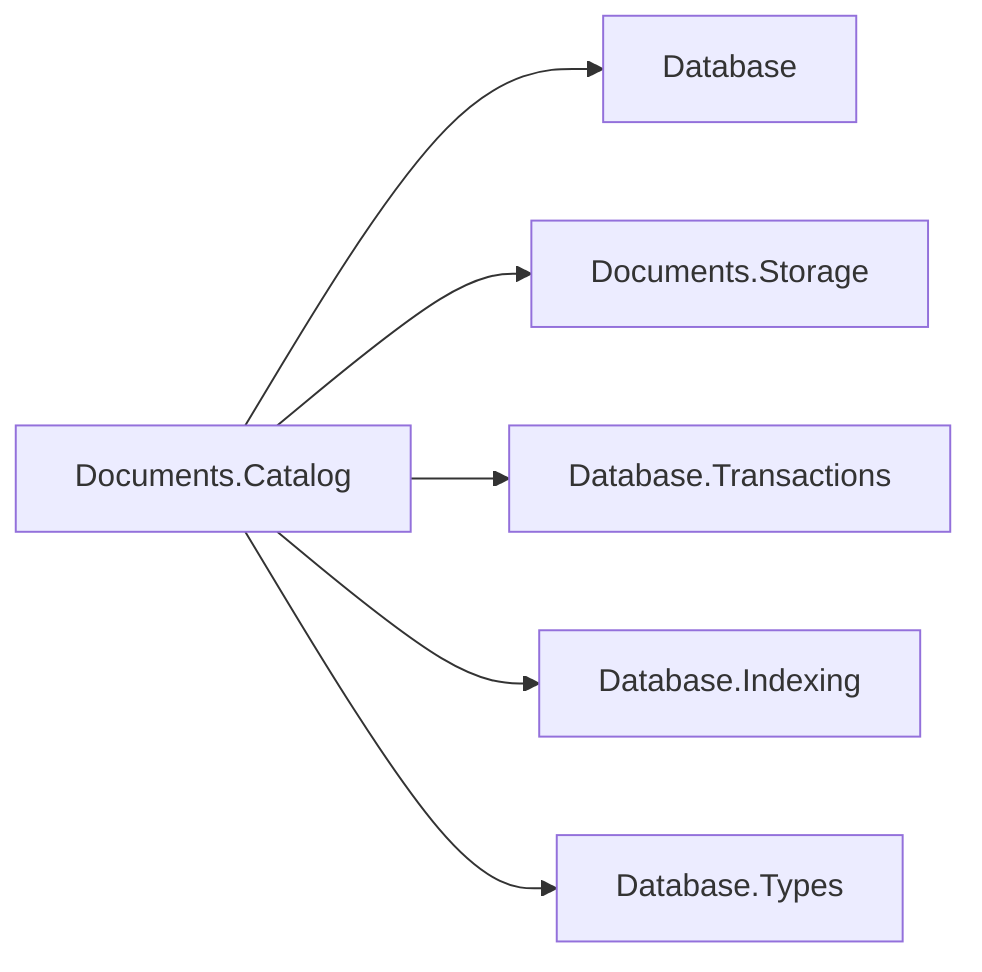

# Document catalog design

## Family and responsibilities

Documents.Catalog depends on the Database root for ownership vocabulary, Documents.Storage for
record/content access, Database.Transactions for MVCC and statement brackets, Database.Indexing
for B+Trees, and Database.Types for scalar key encoding. The engine depends on this package and
owns sessions, OQL planning/execution, lock acquisition, ownership enforcement, and
commit/rollback. There is no Hosting or ApplicationModel dependency and no compiled-schema
provisioning.

The dependency diagram shows the same reference direction as the prose.

`DocumentCatalog.Open` returns the sealed `DocumentCatalog`, which has a private constructor; its
record and codecs are internal. The former `IDocumentCatalog` interface, `DocumentCatalog` static
factory and internal `DefaultDocumentCatalog` collapsed into it (concrete-types plan, phase 4,
#1260), and its index members (`CreateIndexAsync`, `DeleteIndexAsync`, `SearchIndexAsync`) now
check their reference arguments themselves. Public metadata records are immutable values.

## Snapshot directory and ownership

Opening scans only owner-zero metadata pages, building directories keyed by ordinal collection
name, `(collectionId, documentId)`, and `(collectionId, indexName)`. Directories retain physical
version references. Every lookup rereads record stamps and identity: rollback, purge, and slot
reuse cannot silently stale the directory. Each reread is `Storage.TryReadRecord` with owner
zero, which reports a reclaimed location (a deleted or reverted slot, a metadata page the purge
freed, a page reallocated to a content chain or as an index node) without reading it; that
reference, and one whose identity changed, is dropped from the directory. CRC and I/O failures
propagate. Until #1342 the lookup caught only the slot exceptions, so once the purge freed a
metadata page every lookup that reached one of its references failed with "Page N is not
allocated": 250 versions of one document and a purge pass were enough. Reads choose the newest visible writer whose
deleter is not visible. Enumeration is ordinal name/identity order, independent of insertion,
page allocation, or B+Tree scan order.

`SearchIndexAsync` fetches the catalog record behind each visible index entry the same way:
`TryReadRecord` with owner zero skips an entry whose record was reclaimed beneath it, the
collection and stamp checks reject a slot that now holds another record, and a page that fails
its checksum or cannot be read fails the search. Until #1342 the search read the record without
the reclamation check, so an entry over a deleted slot failed the search with "Cannot read a
deleted slot", and one over a freed page with "Page N is not allocated", instead of being skipped.

Collections carry `DatabaseObjectOwner` plus an optional owning schema. `Schema` requires a
nonempty schema name. The engine creates live-session collections as `Adhoc` and rejects
`DROP COLLECTION`, OQL `CREATE INDEX`, and OQL `DROP INDEX` against a schema-owned collection with
`DatabaseObjectLockedException`, naming the collection, schema, and requested operation. Catalog
metadata can be directly marked for enforcement tests; this is not a compiled-schema deployment
facility.

The caller holds appropriate shared-kernel locks and checks latest committed metadata before a
write. In particular, a transaction whose snapshot predates a changed index definition must be
rejected for mutation: maintaining its obsolete index set would miss newly committed indexes.
The engine performs this check. Catalog methods are lower-level composition seams, like Blob's
catalog, and do not acquire model locks themselves.

## Record format, per-kind versions

Every record starts with UInt64 writer at offset 0, UInt64 deleter at 8, byte kind at 16, byte
format version at 17. All integers are little-endian. Strings are Int32 UTF-8 byte length followed
by those bytes; length -1 means null where explicitly allowed. Strings use strict UTF-8. GUIDs
are the 16 bytes produced by `Guid.ToByteArray()` (the .NET mixed-endian layout). These choices
are explicit so a reader in another language can decode the format without .NET serialization.

The fields below appear consecutively beginning at offset 18. No trailing fields are accepted.

| Kind | Owner pages | Payload fields, in order |
| --- | --- | --- |
| 1 collection | 0 | GUID collection identity; string name; byte owner; nullable string owning schema |
| 2 document | 0 | GUID collection identity; string document identity; UInt64 version; UInt64 head; Int64 byte length; UInt32 IEEE CRC-32 |
| 4 index definition (v2) | 0 | GUID collection identity; string index name; Int32 path count (1..32); ordered path strings; byte unique flag (0 or 1); UInt64 physical generation identity |
| 5 physical registration (v2) | 1 | UInt64 physical generation identity; Int64 root page; string index name; byte unique flag (0 or 1) |

Kinds 1 and 2 remain v1. Every index uses v2, including single-path nonunique indexes.
V1 index records are refused before the recovery scrub writes anything, with found/supported
versions and a recreate remedy. There is no upgrade path or legacy reader. The preceding v1 index reader
refuses v2 physical registrations at its pre-scrub fence. Engines predating that fence must
never open these files, as the compatibility section below records.
Key-path lists are immutable and compare by value, including catalog conflict checks.

Kind 3 content chunks use the format in
[Documents.Storage](../../Assimalign.Cohesion.Database.Documents.Storage/docs/DESIGN.md).
Collection IDs cannot be empty, names cannot be blank, document versions start at 1, content
heads cannot be zero, and document lengths must be positive and fit in an Int32. Owner is the
underlying `DatabaseObjectOwner` byte (`Adhoc = 0`, `Schema = 1`). Unknown kinds, versions, invalid
references, duplicate physical generations, and malformed payloads fail closed.

Catalog metadata records fit one slotted-page record. Identity/name/path sizes are consequently
bounded by `SlottedPage.MaxRecordSize`; very long metadata is rejected by the shared storage
layer. Document content has its separate multi-page chunk mechanism.

## Index definition and key semantics

Index definitions are lower-level catalog mutations, not a second public engine entry point. The
Documents planner turns OQL `CREATE INDEX` and `DROP INDEX` expressions into catalog-operation
plans, and the plan executor invokes this package under the statement's `TransactionContext`
after lock acquisition and ownership enforcement. `DocumentDatabase` therefore needs no index
members, and the catalog and B+Tree updates retain the same transaction as the DDL statement.

Each index has 1..32 ordered case-sensitive paths and an immutable UNIQUE flag. The cap
matches PostgreSQL `src/include/pg_config_manual.h:79` (INDEX_MAX_KEYS). Paths retain the
lossless dotted/bracket-string encoding: `customer.address.zip`, `items[0].price`, and
`['root.name']`. Wildcards, expansion, expression keys and sort directions are outside T1.
The single-path catalog overload remains a convenience for a nonunique definition; it writes v2.

A document gets one entry when the leading path is not MISSING. Absent members, incompatible
shapes, navigation through NULL and out-of-range subscripts yield MISSING; reading a NULL
member itself yields NULL, matching the evaluator. Trailing MISSING and explicit NULL are
distinct encoded components. No document-identity suffix is needed.

Every component starts with one Documents-owned byte: 0 MISSING, 1 NULL, 2 FALSE, 3 TRUE,
4 number, 5 string, 6 array, 7 object. The first four and the last two have no payload.
Arrays and objects each use a lossy tag; the executor always reapplies the full predicate.
Number payloads use `DatabaseKeyWriter.AppendDecimal`, so 1 and 1.00 are equal. String
payloads use `AppendBinary` over UTF-16BE code units, including surrogates, preserving ordinal
OQL order. Each scalar payload includes the shared writer's type byte and terminator/escaping.
Concatenation preserves MISSING &lt; NULL &lt; FALSE &lt; TRUE &lt; number &lt; string &lt; array &lt; object.
The complete key must fit the shared 1024-byte limit; oversize fails before publication.

UNIQUE checks are immediate, under the caller's database writer lock, before the physical
statement bracket. A latest-state snapshot includes the caller's own earlier writes and
excludes committed contexts from its in-flight set, including during the interval between
writer-lock release and coordinator untracking. A cursor
probes equal keys while excluding the document's own previous entry. Build detects duplicate
encoded keys before creating any tree or registration. Keys containing NULL or MISSING never
conflict (PostgreSQL's NULLS DISTINCT default, `doc/src/sgml/ref/create_index.sgml:340-347`),
including trailing NULL/MISSING. This differs from Cohesion SQL's equal-NULL index policy.
Arrays and objects in an indexed UNIQUE key fail with COHDOC021 naming the index and path.
Duplicate writes/builds raise COHDOC020 (SQLSTATE 23505, PostgreSQL
`src/backend/utils/errcodes.txt:239`), naming the collection and index without echoing key data.
Both use the public `DocumentConstraintViolationException : DatabaseException` owned by this
catalog package. The physical B+Trees deliberately stay nonunique: the catalog implements
NULLS DISTINCT and arbitration. Kind 4 and kind 5 retain the UNIQUE flag across restart.
An immediate multi-row key swap fails, and the engine's transaction boundary undoes the statement.

`SearchIndexAsync` accepts leading scalar equality values plus lower/upper bounds on the
next component. It uses SQL's prefix-successor ranges (`SqlPlanExecutor.cs:1407-1490`):
equality is [P, successor(P)); an exclusive lower uses successor(P+v), and an inclusive
upper uses successor(P+v) exclusively. A successor increments the last non-FF byte and
truncates after it. Every component tag is below FF, so every nonempty prefix has a successor.
These bounds include trailing components, unlike an inclusive [P,P] range. The planner uses
one range component and retains all other conjuncts as residual filters, matching PostgreSQL
`doc/src/sgml/indices.sgml:461-466`. Candidate documents remain ordered by ordinal identity.

Index leaf entry references are packed metadata page/slot locations. Leaf entries carry writer
and deleter stamps through the existing index API. Create builds the tree immediately while the
caller holds the logical database's exclusive writer lock, preserving each visible source
document's writer stamp. The new index definition is invisible to snapshots predating its
creation; those snapshots use scans.

## Mutation, rollback, and recovery

Saving a document prepares old and new composite keys and checks unique constraints, then one shared physical statement bracket
tombstones prior metadata, inserts new metadata, tombstones old index entries, inserts new index
entries, and persists any changed root registration (a backstop: a tree's root page stays fixed
through splits since #1159, so registrations change only when a tree is created). Deletion
tombstones metadata and keys in one
bracket. The surrounding logical transaction also owns all chunk writes/tombstones. The catalog
publishes its in-memory reference only after the physical bracket succeeds. The shared version
ledger records record and index mutations, so logical rollback erases the writer's keys and
restores old tombstones. The caller aborts the logical operation after failure.

Physical tree generations use reserved storage sequences and are never reused. Root registrations
carry writer/deleter zero because they describe current physical topology, including nodes holding
uncommitted versions. Root splits rewrite the root page in place, and a tree's creation and its
registration share one physical bracket. A failure reattaches the manager from physically
restored registrations. Undo adapters resolve the current
tree instead of holding a stale manager object. Current B+Tree erase/purge removes leaf entries
without merging nodes or collapsing roots, so undo does not change the persisted root.

Dropping an index tombstones its definition and keeps the physical tree for readers with older
snapshots. Recreating the name allocates a new physical generation. Tree reclamation for dropped
or rolled-back definitions is deferred; the shared index manager has no tree-page vacuum yet.
This costs disk space, but never rebuilds a live index or exposes a dropped definition.

Recovery order is physical storage redo, coordinator `AnalyzeAndScrub` over stamped records,
catalog open (including physical registrations), `RecoverIndexesAsync` using the same abandoned
writer set, and finally coordinator `CompleteRecovery`. Root registrations survive logical scrub
so every tree can be scrubbed before the journal's proof is checkpointed away. No query-time
repair or lazy index rebuild is used. Tests exercise split roots, committed and abandoned updates,
logical rollback, snapshot-pinned versions, mixed shapes, and a serialized restart image.
The DELETE restart cases open the recovered `by_rank` B-tree directly under the latest snapshot:
the committed-deleted key has no live entry, while an abandoned deletion restores exactly one.
They also retain a live control key, bypassing `SearchIndexAsync`'s catalog-record filtering.
The restart test uses an ordinary journal flush before cloning its memory streams;
it verifies recovery and index scrub without claiming physical durable-flush support.

## Compatibility and error model

Adding/removing fields, changing scalar type, or replacing an object with an array is supported
without schema migration. Each change creates a new version and updates every affected index.
On-disk record-layout changes require a new format version with no migration or legacy reader;
unknown versions are rejected.

The index trees' pages are not catalog records: `Database.Indexing` owns their B-tree page
format (2 since #1194, entries ordered by key, entry location and writer) and checks each tree's
root page when the catalog attaches it. Opening the catalog happens after the coordinator's
recovery scrub, so `DocumentCatalog.EnsureIndexFormat(storage)` makes the same check first,
reading the metadata and registration records (which carry no MVCC stamps, so the scrub does not change
them) and each root page. The Documents engine calls it before recovery and refuses a database
whose indexes an engine before #1194 wrote with "Database 'x' cannot be opened. COHDBI001: …",
the `IndexFormatException` as its inner exception. A cleanly closed database is left
byte-identical; a crashed one has had only the storage layer's format-agnostic journal redo and
undo, and keeps its journal for the engine that wrote it. There is no upgrade path (owner decision
of 2026-10-02; #1152). The fence runs one way only: engines before #1194 check neither the page
format nor anything this catalog changed, so they cannot detect a database this engine wrote and
must not open one (owner review of #1194). Former raw, unstamped DocumentStorage stub files are unsupported
as engine databases. Catalog format failures, including truncated physical registrations at the pre-scrub fence, raise
`DocumentCatalogException`; shared storage
corruption remains a storage exception. Invalid JSON/numeric-domain input is rejected by the
validated storage write helper before publication. Public package APIs require no reflection,
dynamic code generation, or Microsoft.Extensions dependencies.
