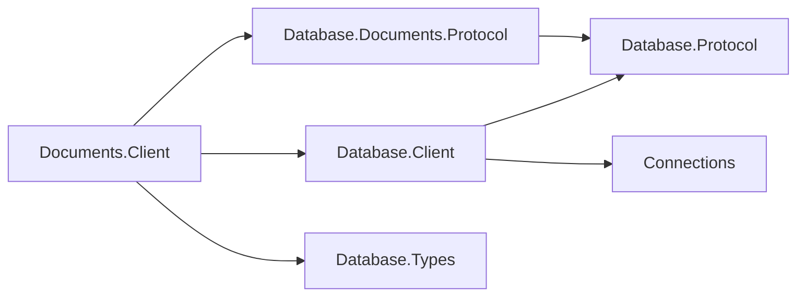

# Documents client design

## Terminal TCP conformance (#1087)

The real DocumentClient and model server run missing-database handshakes on InMemory and
loopback TCP for at least one second and 200 consecutive coded refusals per transport. The
tests assert DatabaseNotFound and reuse a one-slot pool to expose leaked failed rentals.

## Contract-only dependencies

Direct references are Database.Client, Documents.Protocol, Database.Types, Database.Protocol, Database.Execution and Connections. Wire contracts live in each model Protocol assembly, shared by client and engine. This client has no engine, area-root, storage, transaction, indexing, model parser or schema reference. Cache.Client remains an empty placeholder. Engine-free trimming and NativeAOT coverage lives in Database.Client/samples/Assimalign.Cohesion.Database.Client.AotSample.

## Client exception ownership

`DocumentClientException` derives directly from `System.Exception`. It preserves constructors, wire codes, inner exception and connection-usability behavior. Its locally declared Diagnostics is never null: explicit diagnostics are defensively copied into a read-only snapshot, stably ordered by offset with unlocated entries last. SQL and Graph wrappers copy from DatabaseClientException or their own nested client exception. Documents retains its explicit diagnostics parameter and returns an empty collection when none was supplied. Engine-side DatabaseException remains in the area root; catching it intentionally no longer catches remote client failures.

## Intent and dependencies

The client makes the existing database-bound document session available over its model protocol.
It owns OQL and document exchanges, while `Database.Client` owns dialing, authentication,
pool limits, leases, cancellation and evidence for connection reuse. The model assembly owns
the codecs, so there is one definition of the wire vocabulary. No new public interface or
cross-assembly friend grant is required.

| Package | Responsibility |
| --- | --- |
| `Database.Documents.Client` | Sealed client, connection, result types and diagnostic exception |
| `Database.Client` | Shared client and authenticated connection pool |
| `Database.Documents.Protocol | Server, engine, document value types and model codecs |
| `Database.Protocol` | Family-bound frame reader/writer and handshake |
| `Database.Types` | Column types and structured diagnostics |
| `Connections` | Transport contracts; the consumer supplies a concrete driver |

SELECT lists arrive as objects in projection order. SELECT VALUE/RAW uses the existing
whole-value header mode and exposes a single `value` column and its JSON values in Documents.
LIMIT/OFFSET use the ordinary JSON parameter path; Complete counts only the returned Document
frames, while query AffectedCount stays -1. Empty pages retain headers, IsDocumentQuery and static
function column types. CD00007 survives parse or plan failure at the operand and keeps the session
reusable. Both transports and the NativeAOT guard exercise paging.
DISTINCT completion counts follow duplicate removal; object/array constructors need no codec
extension. A lone SELECT * preserves stored bytes on the wire, including scalar roots.
With UNNEST, the same whole-document mode instead carries synthetic objects keyed by FROM
and array variable names; MISSING LEFT bindings are omitted, actual null elements remain null.
Array expansion, grouped Int64 counts, ANY/SOME/EVERY and array IN use the ordinary query
exchange, without new messages or format versions. The advertised-clause test exercises
grouped UNNEST and ANY on both transports; the AOT consumer covers these shapes too.
VALUE/RAW MISSING becomes NULL during engine projection, before DISTINCT and projected ordering,
so embedded and wire rows agree on IsMissing=false and completion counts. Embedded MISSING
object members remain omitted and MISSING array elements become NULL.
GetBytes preserves exact bare-frame JSON bytes (a lone SELECT *, or VALUE/RAW). Named string
columns return unquoted UTF-8 and named NULL/MISSING columns return empty bytes, matching the engine.
Constructed and bare scalar rows use the engine's RFC 8259 encoder, retaining non-ASCII,
HTML-sensitive characters and U+2028/U+2029 as UTF-8 while escaping quotes, backslashes and controls.

## Exchange and result ownership

Every rental supports one active exchange. Requests capture parameter and content bytes before
their first await. The server enters `DocumentDatabaseSession.ExecuteStatementAsync` internally;
its typed execution traces through the root exactly once. Queries materialize both in the engine
and in the client. The server writes a header, then one bounded row or document at a time,
then Complete; its formatter retains one encoded frame. Each value must fit the shared 16 MiB
frame limit; engine and client materialization still depend on query size. Additional server
response memory is bounded only when the transport applies backpressure, as default TCP does.
InMemory disables output-pipe backpressure: queued bytes grow with the result if its reader
stops reading. Bounded InMemory output is a Connections follow-up; the
[server streaming design](../../Assimalign.Cohesion.Database.Documents/docs/DESIGN.md#exchange-boundaries-and-json)
records the formatter's bound and this transport constraint.

The following exchange shows the common lifecycle and both OQL result shapes. Commands share
the same ready loop and terminal completion/error rules.

`DocumentResultSet` exposes ordinal/name-indexed rows, columns and `AffectedCount`. Queries use
`-1`; collection and index DDL use zero. INSERT uses the inserted-document count and emits
no Document frames. UPSERT uses the written-document count for inserts and complete replacements,
with fresh versions and the same MISSING validation as INSERT. Repeated keys fail the whole
statement with CD03012; invalid keys use CD02008. Both preserve the connection. EXPLAIN UPSERT
describes Upsert/UpsertSelect without writing. DELETE uses the deleted-document count, including zero, and likewise
emits only Complete. UPDATE uses the matched-document count, including byte-identical rewrites
and no-op UNSET, with fresh versions for every match. SET and UNSET preserve the engine's
nested-path, array-index, MISSING and atomicity rules. Invalid paths return ExecutionFailure
with CD02016 and leave the connection reusable. EXPLAIN UPDATE describes its access path
without writing. DELETE's scan/seek selection, full-predicate filtering and rollback behavior
are the embedded engine's. EXPLAIN DELETE includes its chosen access without mutating.
Duplicate keys preserve CD03012 as ExecutionFailure and the next statement can reuse the
session. The advertised-clause suite covers VALUES, UPSERT, SELECT, UPDATE, UNSET, DELETE and META.
The advertised-predicate corpus also covers IN, BETWEEN, LIKE, searched/simple
CASE, grouped CASE and CASE under SUM over InMemory and TCP. It preserves embedded rows,
MISSING versus NULL, CD02013 and reuse after a malformed LIKE pattern.
`CREATE COLLECTION [IF NOT EXISTS]` and
`DROP COLLECTION [IF EXISTS]` use the existing Execute exchange and retain collection ownership
and conditional no-op semantics. A schema-owned drop returns ExecutionFailure (6), and the
connection remains usable. `IsDocumentQuery` means one bare JSON value per frame
(a lone SELECT *, or VALUE/RAW), even for an empty result.
`Documents` holds owned `JsonElement` values in that case; positional queries leave it empty.
Bare-value rows contain the same owned JsonElement as Documents, including scalar and constructed values;
the row also owns the original frame bytes for GetBytes.
Projected rows expose JSON numbers as `long` when the header column type is Int64, otherwise `decimal` (#1137), strings, booleans, null, and nested object/array values as
owned `JsonElement`. Mixed Int64/Decimal columns promote to Decimal in the engine; numeric cells
in heterogeneous columns use decimal as well, preserving embedded/client value equality.
Projected Document-frame objects omit MISSING members and retain explicit null members
(for example, `"x":null`). The header supplies each column's ordinal even when its member is omitted.
`DocumentRow` is a sealed DatabaseRow leaf with SupportsMissing true: IsMissing distinguishes
omission from explicit NULL, IsNull is false for MISSING, and GetValue/indexers return null
for either. An internal undefined JsonElement marks absence without crossing an assembly
boundary as a sentinel type. Bare-value rows retain their original JSON and are never MISSING.
The engine requires unique projection names; duplicate header names and unknown or duplicate
object members are malformed responses. This follows the authorized concrete-first row capability.

CRUD uses `DocumentId`, `DocumentVersion` and `Document` from the model assembly. Get returns
null when absent; Put returns the new stored version; Delete returns whether it removed a document.
Expected-version failures retain engine semantics. Collection operations return names, because
a server-side `DocumentCollection` is bound to an engine session and cannot cross the wire.
Catalog queries use `COHESION_SCHEMA.INDEXES` and `COHESION_SCHEMA.OBJECT_OWNERSHIP`.

Composite and UNIQUE index DDL and IF modifiers use Execute without new frames. Duplicate Put
and CREATE UNIQUE INDEX over duplicates return ExecutionFailure (6), preserve CD03020 and
name index/collection without key contents; the same connection accepts the next query. Non-scalar
UNIQUE keys retain CD02021. The AOT guard exercises the composite seek, metadata and duplicate
failure over InMemory and TCP (#1135).

## Failures and pooling

The typed connection captures its immutable database name when it receives the shared lease
(#1313). Operation diagnostics can finish after disposal returns that lease, whose members then
refuse access. The cached name keeps diagnostics independent of the returned rental.

A statement or serialization failure ends the response with one terminal model `Failure` (72),
including after partial rows or documents, with no `Complete` after it. The client discards all
accumulated results and throws the typed error; the authenticated session remains reusable. Failure
carries the shared classification
and the server's structured `Diagnostic` values, including codes and nullable locations. Parser
diagnostics, planning and evaluation diagnostics (`CD05001`–`CD02018`), and offline `CD06102`
survive intact. The server reads the database exception carrier and composes `CODE: message`
once; the client preserves that text without adding a prefix. Located diagnostics retain their
spans; direct collection APIs retain unlocated diagnostics. An engine failure without structured diagnostics
has an empty list; the client never extracts codes from message text. The server bounds failure
text to 4096 UTF-16 characters and diagnostics to 256 (codes to 256 characters), with explicit
truncation/omission markers. Codes and locations of retained diagnostics are unchanged. This
keeps even a near-frame-sized failing identifier from turning a statement error into a broken wire.

Blank OQL collection names return `CD05001` at the quoted name's span; empty quoted names
return the parser's `CD00002`. Both preserve the connection. The typed command API rejects blank
names locally with its existing argument guard. A peer sending one through Command (69) receives
an unlocated `CD05001` Failure and can continue using the same server session.

Collection refusals preserve `CD01002` (missing DROP), `CD03010` (duplicate CREATE), and
`CD03011` (schema-owned DROP) through both OQL and Command exchanges. Their OQL diagnostics
carry the statement span; command diagnostics have no source location. All are ExecutionFailure
and preserve the session, including conditional schema-owned drops.

INSERT rejects numeric literals and JsonElement parameters outside the exact decimal domain
with CD02007 before normalization, including underflow and excess fractional precision.
VALUES and computed SELECT inputs preserve the collection on failure over both InMemory and
TCP; the diagnostic span and the reusable session survive the wire unchanged.

`DocumentClientException` is a sealed `System.Exception` leaf, like Graph's model exception.
It uses the inherited diagnostic carrier, so callers catching the area root see the same diagnostics.
Before #1103 it derived from `DatabaseClientException` and owned a separate diagnostic list; keeping
that shape would hide the root carrier or require widening the shared client's constructors just for
this model. The local ancestry change avoids both. Shared client failures are translated locally,
retaining their protocol code and inner exception. The model source reports statement failures;
the shared source continues to report dial, handshake and transport failures. Its ExchangeFailed
event observes shared-client exceptions, not model failures. Pool reuse depends on terminal-response
evidence for any exception type, so this change preserves session health.
Only a fully decoded model `Failure` calls `MarkResponseComplete`. Shared `Error` is fatal;
bad order, widths, counts, enum values, trailing bytes and malformed JSON discard the session.
EOF, transport failure or cancellation during an unfinished exchange also discard it.

The rental's disposal guard prevents a second Dispose or a stale wrapper from returning a later
rental of the same underlying connection. Abort discards instead of returning it. Client disposal
drains idle pooled connections. Operation registration and Dispose/Abort share a wrapper lock: after
QueryStart, the wrapper rechecks disposal while registering the exchange with the shared core.
Disposal either prevents registration or cancels and joins the registered exchange before returning
the rental. Repeated disposal joins the same teardown task and never touches a subsequent rental.

## Diagnostics

`Assimalign.Cohesion.Database.Documents.Client` is the single internal EventSource. Shared
`Assimalign.Cohesion.Database.Client` reports dialing, pooling and connection events. Every enabled
start has one stop; no statement text, JSON content, parameter values or failure messages are logged.

| Id | Event | Level | Payload |
| --- | --- | --- | --- |
| 1 | `QueryStart` | Verbose, `Queries` | database, operation |
| 2 | `QueryStop` | Verbose, `Queries` | database, operation, status, rowCount, durationMilliseconds |
| 3 | `QueryFailed` | Error | database, operation, code, exceptionType, durationMilliseconds, suppressedCount |

Database names are bounded to 256 characters inside the enabled guard.
Operation names identify Query, Execute, Get, Put, Delete, CreateCollection, GetCollection,
DropCollection and ListCollections. Result counts include returned documents and collection names.
Status is Success, Error or Cancelled. Repeatable errors are throttled once per second per event
ID; the next emitted event includes the number suppressed. Start/stop pairs remain unthrottled.
This source has no counters; the server has lifecycle counters documented in the model design.

## AOT, packaging and extension

Serialization uses explicit JSON readers/writers and codecs, with no reflection-based object
serialization, dynamic activation or runtime code generation. The NativeAOT sample is nonpackable
and uses project-local `PublishAot=true`. Publish with `-c Release -r win-arm64` locally (Visual
Studio Installer on PATH), or `linux-x64` in the shared Database NativeAOT CI job. Both publish
analysis and execution of the published binary are gates; IL2xxx/IL3xxx warnings fail CI.
The sample executes every scalar category and verifies code-point LENGTH and Int64 COUNT over
both InMemory and TCP (#1137), alongside the existing advertised-clause checks.

Documents.Client is inventoried and built in the Database workflow, but remains NuGet-only like
Graph.Client. Model-specific Documents security remains deferred within the engine. Transactions, remote database administration,
replication and model-specific security policies are outside this wire slice. OQL INSERT, UPSERT, UPDATE and DELETE
return their affected counts through the existing completion field. Wire negotiation remains
the shared protocol's responsibility, with no model-specific version exchange. The startup version
is 2.1, retaining the major-2 projection contract; old-major peers receive the existing coded
startup refusal and close before authentication. See [Shared startup 2.1](#shared-startup-21-1105)
for #1105's capability negotiation.

## Graph precedent differences

- JSON preserves whole documents and nested values; projected rows use a header plus Document (65)
  objects. MISSING omits a member; explicit NULL emits `"x":null`. Graph's typed scalar/path
  encodings do not represent this contract.
- Commands add CRUD, expected versions and collection names alongside OQL INSERT.
- A dedicated terminal Failure carries diagnostics and gives the pool explicit reuse evidence.
  Bounded failure text/cardinality keeps error responses below the frame limit.
- The typed exception uses the root diagnostic carrier and owns its protocol code, like Graph;
  terminal-response evidence remains independent of exception ancestry.
- A rental disposal guard closes the stale-wrapper return hazard locally.
- Server recovery event IDs 1–2 remain stable; lifecycle events occupy 3–11 and parse failure 12.
  Repeatable Warning/Error events are throttled with suppression counts under rule 13.
- The server validates timer bounds at creation and tracks rejection cleanup through shutdown,
  preventing malformed options or an unobserved over-limit peer from escaping lifecycle ownership.

The [protocol layout](../../Assimalign.Cohesion.Database.Documents/docs/DESIGN.md#document-wire-family)
is authoritative for bytes and completion semantics. Tests drive both transports, all advertised
OQL clauses and commands, malformed responses, lifecycle limits, failure recovery and telemetry.
`DocumentClientDiagnosticTests` compares embedded and wire carriers over InMemory and TCP for
parse, plan, division-by-zero, missing-parameter and read-only system-collection rejections,
including multiple parser diagnostics and direct collection writes. It verifies complete diagnostic
fields, composed text, a successful next command and reuse of the same pooled server session.

JSON result and parameter writers use `JsonElement.WriteTo` so the configured writer depth
of 256 applies, including values deeper than 64 levels. The other wire readers explicitly set
256. Embedded stored-document validation and query reads explicitly use 128; system-collection
JSON uses fixed, one-level objects and cannot carry arbitrary nested content.

## Shared startup 2.1 (#1105)

The shared client reads the negotiated Ready version and capability intersection. Documents agrees 2.1 with an empty list and retains its existing structured Failure payload; it does not adopt the core Diagnostics frame. A negotiated 2.0 peer still sends empty Ready.

## Dedicated test actors (#1285)

Deadline-dependent peers and busy test drivers use the linked Storage test helper's LongRunning threads. Ordinary async driver continuations stay on their actor scheduler, without changing SynchronizationContext. Existing deadlines of 25 seconds or more are hang guards. Runner settings impose no parallel-thread cap. See the [scheduling audit](../../Assimalign.Cohesion.Database.Storage/docs/TEST-HYGIENE-AUDIT.md) for every original Task.Run site, the exact journal counters and the physical index-work guards.

Reference consulted: RavenDB test/StressTests/Voron/InvalidReleasesOfScratchPages.cs:39–68 and :71–103 use LongRunning stress drivers. No code was copied.

## Document access estimates (#1527)

EXPLAIN remains a nonexecuting query returning one JSON document per plan row. IndexSeek now
includes an Int64 index-entry estimate and labels complete counts or lower bounds in Detail.
IndexIntersection has IndexSeek children and a minimum-input upper bound, before JSON reads;
actual_rows remains JSON null. The existing nullable count members and Document frames carry
these values over InMemory and TCP, without a protocol-version or client API change. The AOT
consumer checks intersection results, both input descriptions and nonexecuting behavior.

## Documents diagnostic conventions (#1470)

Exception and diagnostic templates use the project's build-generated `ErrorMessages` resources.
Parameterized templates format with the current culture; abort/cancellation templates used in
normal cleanup are cached. The [Database error-code registry](../../Assimalign.Cohesion.Database/docs/ERROR-CODES.md)
assigns this family its two-letter prefix and categorized five-digit identities.
Existing SQLSTATE meanings, numeric wire error kinds, frame layouts and disk formats are preserved.
Structured diagnostics keep their code outside the message. Compiler diagnostic identifiers and
standard .NET argument guards retain their own contracts.
