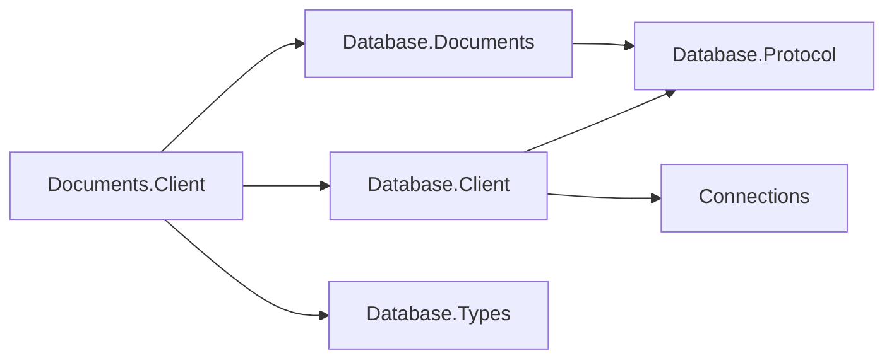

# Documents client design

## Intent and dependencies

The client makes the existing database-bound document session available over its model protocol.
It owns OQL and document exchanges, while `Database.Client` owns dialing, authentication,
pool limits, leases, cancellation and evidence for connection reuse. The model assembly owns
the codecs, so there is one definition of the wire vocabulary. No new public interface or
cross-assembly friend grant is required.

| Package | Responsibility |
| --- | --- |
| `Database.Documents.Client` | Sealed client, connection, result types and diagnostic exception |
| `Database.Client` | Shared client and authenticated connection pool |
| `Database.Documents` | Server, engine, document value types and model codecs |
| `Database.Protocol` | Family-bound frame reader/writer and handshake |
| `Database.Types` | Column types and structured diagnostics |
| `Connections` | Transport contracts; the consumer supplies a concrete driver |

## Exchange and result ownership

Every rental supports one active exchange. Requests capture parameter and content bytes before
their first await. The server enters `DocumentDatabaseSession.ExecuteStatementAsync` internally;
its typed execution traces through the root exactly once. Queries materialize both in the engine
and in the client. The server writes a header, then one bounded row or document at a time,
then Complete; its formatter retains one encoded frame. Each value must fit the shared 16 MiB
frame limit; engine and client materialization still depend on query size. Additional server
response memory is bounded only when the transport applies backpressure, as default TCP does.
InMemory disables output-pipe backpressure: queued bytes grow with the result if its reader
stops reading. Bounded InMemory output is a Connections follow-up; the
[server streaming design](../../Assimalign.Cohesion.Database.Documents/docs/DESIGN.md#exchange-boundaries-and-json)
records the formatter's bound and this transport constraint.

The following exchange shows the common lifecycle and both OQL result shapes. Commands share
the same ready loop and terminal completion/error rules.

`DocumentResultSet` exposes ordinal/name-indexed rows, columns and `AffectedCount`. Queries use
`-1`; collection and index DDL use zero. INSERT uses the inserted-document count and emits
no Document frames. Duplicate keys preserve COHDOC012 as ExecutionFailure and the next
statement can reuse the session. The advertised-clause suite covers VALUES, SELECT and META. `CREATE COLLECTION [IF NOT EXISTS]` and
`DROP COLLECTION [IF EXISTS]` use the existing Execute exchange and retain collection ownership
and conditional no-op semantics. A schema-owned drop returns ExecutionFailure (6), and the
connection remains usable. `IsDocumentQuery` distinguishes `SELECT *` even for an empty result.
`Documents` holds owned `JsonElement` values in that case; positional queries leave it empty.
Whole-document rows contain the same owned JsonElement as Documents, including scalar roots.
Projected rows expose JSON numbers as `decimal`, strings, booleans, null, and nested object/array values as
owned `JsonElement`. Projected Document-frame objects omit MISSING members and retain explicit
null members (for example, `"x":null`). The header supplies each column's ordinal even when its member is omitted.
`DocumentRow` is a sealed DatabaseRow leaf with SupportsMissing true: IsMissing distinguishes
omission from explicit NULL, IsNull is false for MISSING, and GetValue/indexers return null
for either. An internal undefined JsonElement marks absence without crossing an assembly
boundary as a sentinel type. Whole-document rows retain their original JSON and are never MISSING.
The engine requires unique projection names; duplicate header names and unknown or duplicate
object members are malformed responses. This follows the authorized concrete-first row capability.

CRUD uses `DocumentId`, `DocumentVersion` and `Document` from the model assembly. Get returns
null when absent; Put returns the new stored version; Delete returns whether it removed a document.
Expected-version failures retain engine semantics. Collection operations return names, because
a server-side `DocumentCollection` is bound to an engine session and cannot cross the wire.
Catalog queries use `COHESION_SCHEMA.INDEXES` and `COHESION_SCHEMA.OBJECT_OWNERSHIP`.

## Failures and pooling

A statement or serialization failure ends the response with one terminal model `Failure` (72),
including after partial rows or documents, with no `Complete` after it. The client discards all
accumulated results and throws the typed error; the authenticated session remains reusable. Failure
carries the shared classification
and the server's structured `Diagnostic` values, including codes and nullable locations. Parser
diagnostics, planning and evaluation diagnostics (`COHDOC001`–`008`), and offline `COHDBD002`
survive intact. The server reads the database exception carrier and composes `CODE: message`
once; the client preserves that text without adding a prefix. Located diagnostics retain their
spans; direct collection APIs retain unlocated diagnostics. An engine failure without structured diagnostics
has an empty list; the client never extracts codes from message text. The server bounds failure
text to 4096 UTF-16 characters and diagnostics to 256 (codes to 256 characters), with explicit
truncation/omission markers. Codes and locations of retained diagnostics are unchanged. This
keeps even a near-frame-sized failing identifier from turning a statement error into a broken wire.

Blank OQL collection names return `COHDOC001` at the quoted name's span; empty quoted names
return the parser's `OQL0002`. Both preserve the connection. The typed command API rejects blank
names locally with its existing argument guard. A peer sending one through Command (69) receives
an unlocated `COHDOC001` Failure and can continue using the same server session.

Collection refusals preserve `COHDOC002` (missing DROP), `COHDOC010` (duplicate CREATE), and
`COHDOC011` (schema-owned DROP) through both OQL and Command exchanges. Their OQL diagnostics
carry the statement span; command diagnostics have no source location. All are ExecutionFailure
and preserve the session, including conditional schema-owned drops.

INSERT rejects numeric literals and JsonElement parameters outside the exact decimal domain
with COHDOC007 before normalization, including underflow and excess fractional precision.
VALUES and computed SELECT inputs preserve the collection on failure over both InMemory and
TCP; the diagnostic span and the reusable session survive the wire unchanged.

`DocumentClientException` is a sealed `DatabaseException` leaf, like Graph's model exception.
It uses the inherited diagnostic carrier, so callers catching the area root see the same diagnostics.
Before #1103 it derived from `DatabaseClientException` and owned a separate diagnostic list; keeping
that shape would hide the root carrier or require widening the shared client's constructors just for
this model. The local ancestry change avoids both. Shared client failures are translated locally,
retaining their protocol code and inner exception. The model source reports statement failures;
the shared source continues to report dial, handshake and transport failures. Its ExchangeFailed
event observes shared-client exceptions, not model failures. Pool reuse depends on terminal-response
evidence for any exception type, so this change preserves session health.
Only a fully decoded model `Failure` calls `MarkResponseComplete`. Shared `Error` is fatal;
bad order, widths, counts, enum values, trailing bytes and malformed JSON discard the session.
EOF, transport failure or cancellation during an unfinished exchange also discard it.

The rental's disposal guard prevents a second Dispose or a stale wrapper from returning a later
rental of the same underlying connection. Abort discards instead of returning it. Client disposal
drains idle pooled connections. Operation registration and Dispose/Abort share a wrapper lock: after
QueryStart, the wrapper rechecks disposal while registering the exchange with the shared core.
Disposal either prevents registration or cancels and joins the registered exchange before returning
the rental. Repeated disposal joins the same teardown task and never touches a subsequent rental.

## Diagnostics

`Assimalign.Cohesion.Database.Documents.Client` is the single internal EventSource. Shared
`Assimalign.Cohesion.Database.Client` reports dialing, pooling and connection events. Every enabled
start has one stop; no statement text, JSON content, parameter values or failure messages are logged.

| Id | Event | Level | Payload |
| --- | --- | --- | --- |
| 1 | `QueryStart` | Verbose, `Queries` | database, operation |
| 2 | `QueryStop` | Verbose, `Queries` | database, operation, status, rowCount, durationMilliseconds |
| 3 | `QueryFailed` | Error | database, operation, code, exceptionType, durationMilliseconds, suppressedCount |

Database names are bounded to 256 characters inside the enabled guard.
Operation names identify Query, Execute, Get, Put, Delete, CreateCollection, GetCollection,
DropCollection and ListCollections. Result counts include returned documents and collection names.
Status is Success, Error or Cancelled. Repeatable errors are throttled once per second per event
ID; the next emitted event includes the number suppressed. Start/stop pairs remain unthrottled.
This source has no counters; the server has lifecycle counters documented in the model design.

## AOT, packaging and extension

Serialization uses explicit JSON readers/writers and codecs, with no reflection-based object
serialization, dynamic activation or runtime code generation. The NativeAOT sample is nonpackable
and uses project-local `PublishAot=true`. Publish with `-c Release -r win-arm64` locally (Visual
Studio Installer on PATH), or `linux-x64` in the shared Database NativeAOT CI job. Both publish
analysis and execution of the published binary are gates; IL2xxx/IL3xxx warnings fail CI.

Documents.Client is inventoried and built in the Database workflow, but remains NuGet-only like
Graph.Client. Documents.Security remains deferred. Transactions, remote database administration,
replication and model-specific security policies are outside this wire slice. OQL INSERT
returns its affected count through the existing completion field. Wire negotiation remains
the shared protocol's responsibility, with no model-specific version exchange. The startup major
is now 2.0 for the incompatible projection contract; old-major peers receive the existing coded
startup refusal and close before authentication. #1105 (protocol 1.1 capability negotiation,
wave 4) supersedes per-feature version bumps when implemented.

## Graph precedent differences

- JSON preserves whole documents and nested values; projected rows use a header plus Document (65)
  objects. MISSING omits a member; explicit NULL emits `"x":null`. Graph's typed scalar/path
  encodings do not represent this contract.
- Commands add CRUD, expected versions and collection names alongside OQL INSERT.
- A dedicated terminal Failure carries diagnostics and gives the pool explicit reuse evidence.
  Bounded failure text/cardinality keeps error responses below the frame limit.
- The typed exception uses the root diagnostic carrier and owns its protocol code, like Graph;
  terminal-response evidence remains independent of exception ancestry.
- A rental disposal guard closes the stale-wrapper return hazard locally.
- Server recovery event IDs 1–2 remain stable; lifecycle events occupy 3–11 and parse failure 12.
  Repeatable Warning/Error events are throttled with suppression counts under rule 13.
- The server validates timer bounds at creation and tracks rejection cleanup through shutdown,
  preventing malformed options or an unobserved over-limit peer from escaping lifecycle ownership.

The [protocol layout](../../Assimalign.Cohesion.Database.Documents/docs/DESIGN.md#document-wire-family)
is authoritative for bytes and completion semantics. Tests drive both transports, all advertised
OQL clauses and commands, malformed responses, lifecycle limits, failure recovery and telemetry.
`DocumentClientDiagnosticTests` compares embedded and wire carriers over InMemory and TCP for
parse, plan, division-by-zero, missing-parameter and read-only system-collection rejections,
including multiple parser diagnostics and direct collection writes. It verifies complete diagnostic
fields, composed text, a successful next command and reuse of the same pooled server session.

JSON result and parameter writers use `JsonElement.WriteTo` so the configured writer depth
of 256 applies, including values deeper than 64 levels. The other wire readers explicitly set
256. Embedded stored-document validation and query reads explicitly use 128; system-collection
JSON uses fixed, one-level objects and cannot carry arbitrary nested content.
