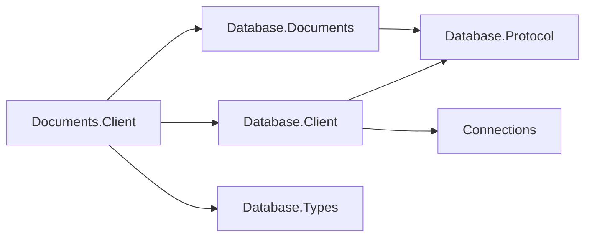
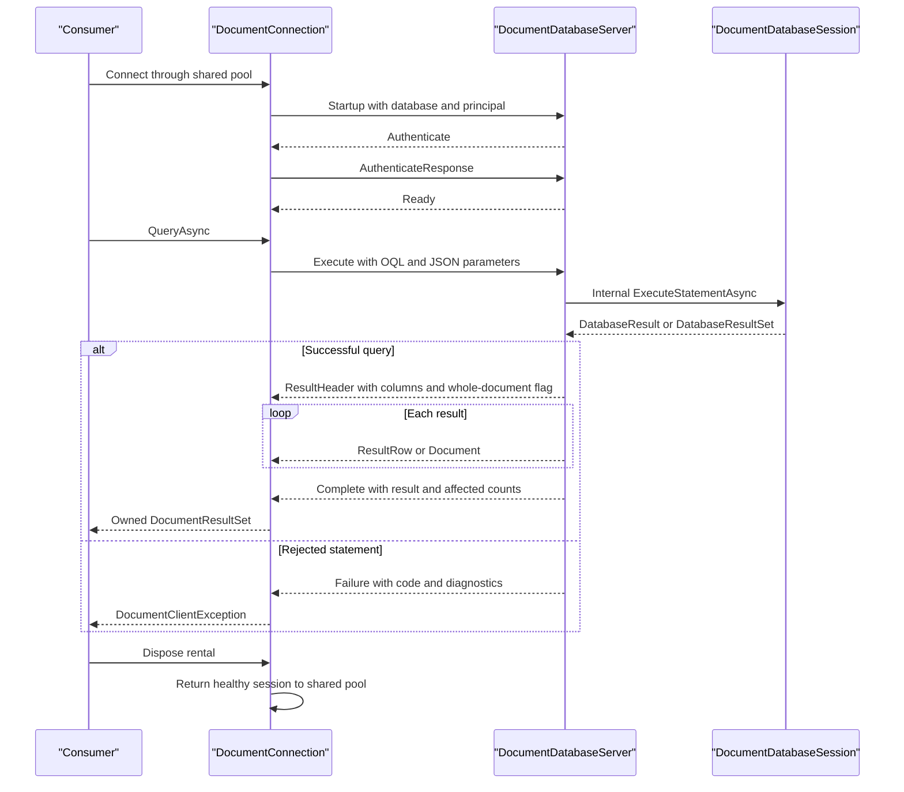

# Documents client design

## Intent and dependencies

The client makes the existing database-bound document session available over its model protocol.
It owns OQL and document exchanges, while `Database.Client` owns dialing, authentication,
pool limits, leases, cancellation and evidence for connection reuse. The model assembly owns
the codecs, so there is one definition of the wire vocabulary. No new public interface or
cross-assembly friend grant is required.

| Package | Responsibility |
| --- | --- |
| `Database.Documents.Client` | Sealed client, connection, result types and diagnostic exception |
| `Database.Client` | Shared client and authenticated connection pool |
| `Database.Documents` | Server, engine, document value types and model codecs |
| `Database.Protocol` | Family-bound frame reader/writer and handshake |
| `Database.Types` | Column types and structured diagnostics |
| `Connections` | Transport contracts; the consumer supplies a concrete driver |

## Exchange and result ownership

Every rental supports one active exchange. Requests capture parameter and content bytes before
their first await. The server enters `DocumentDatabaseSession.ExecuteStatementAsync` internally;
its typed execution traces through the root exactly once. Queries materialize both in the engine
and in the client. Each response frame is bounded by the shared 16 MiB limit; total result memory
depends on query size. There is no unbounded streaming promise or implicit fragmentation.

The following exchange shows the common lifecycle and both OQL result shapes. Commands share
the same ready loop and terminal completion/error rules.

`DocumentResultSet` exposes ordinal/name-indexed rows, columns and `AffectedCount`. Queries use
`-1`; index DDL uses zero. `IsDocumentQuery` distinguishes `SELECT *` even for an empty result.
`Documents` holds owned `JsonElement` values in that case; positional queries leave it empty.
Whole-document rows contain the same owned JsonElement as Documents, including scalar roots.
Projected rows expose JSON numbers as `decimal`, strings, booleans, null, and nested object/array values as
owned `JsonElement`. Duplicate column names resolve to the first ordinal, following Graph.

CRUD uses `DocumentId`, `DocumentVersion` and `Document` from the model assembly. Get returns
null when absent; Put returns the new stored version; Delete returns whether it removed a document.
Expected-version failures retain engine semantics. Collection operations return names, because
a server-side `DocumentCollection` is bound to an engine session and cannot cross the wire.
Catalog queries use `COHESION_SCHEMA.INDEXES` and `COHESION_SCHEMA.OBJECT_OWNERSHIP`.

## Failures and pooling

The server pre-encodes a successful response before emitting any frames. A statement failure is
one terminal model `Failure` (72), with no `Complete` after it. It carries the shared classification
and the server's structured `Diagnostic` values, including codes and nullable locations. Parser
diagnostics and offline `COHDBD002` survive intact. An engine failure without structured diagnostics
has an empty list; the client never extracts codes from message text. The server bounds failure
text to 4096 UTF-16 characters and diagnostics to 256 (codes to 256 characters), with explicit
truncation/omission markers. Codes and locations of retained diagnostics are unchanged. This
keeps even a near-frame-sized failing identifier from turning a statement error into a broken wire.

`DocumentClientException` is a sealed `DatabaseClientException` leaf. This differs from Graph's
`DatabaseException` leaf so the shared pool can observe the coded failure while the model retains
structured diagnostics, without a new bridge member or exception translation that loses evidence.
Only a fully decoded model `Failure` calls `MarkResponseComplete`. Shared `Error` is fatal;
bad order, widths, counts, enum values, trailing bytes and malformed JSON discard the session.
EOF, transport failure or cancellation during an unfinished exchange also discard it.

The rental's disposal guard prevents a second Dispose or a stale wrapper from returning a later
rental of the same underlying connection. Abort discards instead of returning it. Client disposal
drains idle pooled connections; the shared core owns concurrent lease disposal semantics.

## Diagnostics

`Assimalign.Cohesion.Database.Documents.Client` is the single internal EventSource. Shared
`Assimalign.Cohesion.Database.Client` reports dialing, pooling and connection events. Every enabled
start has one stop; no statement text, JSON content, parameter values or failure messages are logged.

| Id | Event | Level | Payload |
| --- | --- | --- | --- |
| 1 | `QueryStart` | Verbose, `Queries` | database, operation |
| 2 | `QueryStop` | Verbose, `Queries` | database, operation, status, rowCount, durationMilliseconds |
| 3 | `QueryFailed` | Error | database, operation, code, exceptionType, durationMilliseconds, suppressedCount |

Database names are bounded to 256 characters inside the enabled guard.
Operation names identify Query, Execute, Get, Put, Delete, CreateCollection, GetCollection,
DropCollection and ListCollections. Result counts include returned documents and collection names.
Status is Success, Error or Cancelled. Repeatable errors are throttled once per second per event
ID; the next emitted event includes the number suppressed. Start/stop pairs remain unthrottled.
This source has no counters; the server has lifecycle counters documented in the model design.

## AOT, packaging and extension

Serialization uses explicit JSON readers/writers and codecs, with no reflection-based object
serialization, dynamic activation or runtime code generation. The NativeAOT sample is nonpackable
and uses project-local `PublishAot=true`. Publish with `-c Release -r win-arm64` locally (Visual
Studio Installer on PATH), or `linux-x64` in the shared Database NativeAOT CI job. Both publish
analysis and execution of the published binary are gates; IL2xxx/IL3xxx warnings fail CI.

Documents.Client is inventoried and built in the Database workflow, but remains NuGet-only like
Graph.Client. Documents.Security remains deferred. Transactions, remote database administration,
replication and model-specific security policies are outside this wire slice. Later OQL writes
can return their affected count through the existing completion field. Wire negotiation remains
the shared protocol's responsibility (#1095 / #1105), with no model-specific version exchange.

## Graph precedent differences

- JSON preserves whole documents and nested values; projected rows need a header plus JSON-array
  frames. Graph's typed scalar/path encodings do not represent this contract.
- Commands add CRUD, versions and collection names because OQL has no document-write syntax yet.
- A dedicated terminal Failure carries diagnostics and gives the pool explicit reuse evidence.
  Bounded failure text/cardinality keeps error responses below the frame limit.
- The typed exception derives from the shared client exception for that evidence and its code.
- A rental disposal guard closes the stale-wrapper return hazard locally.
- Server recovery event IDs 1–2 remain stable; lifecycle events occupy 3–11 and parse failure 12.
  Repeatable Warning/Error events are throttled with suppression counts under rule 13.
- The server validates timer bounds at creation and tracks rejection cleanup through shutdown,
  preventing malformed options or an unobserved over-limit peer from escaping lifecycle ownership.

The [protocol layout](../../Assimalign.Cohesion.Database.Documents/docs/DESIGN.md#document-wire-family)
is authoritative for bytes and completion semantics. Tests drive both transports, all advertised
OQL clauses and commands, malformed responses, lifecycle limits, failure recovery and telemetry.
