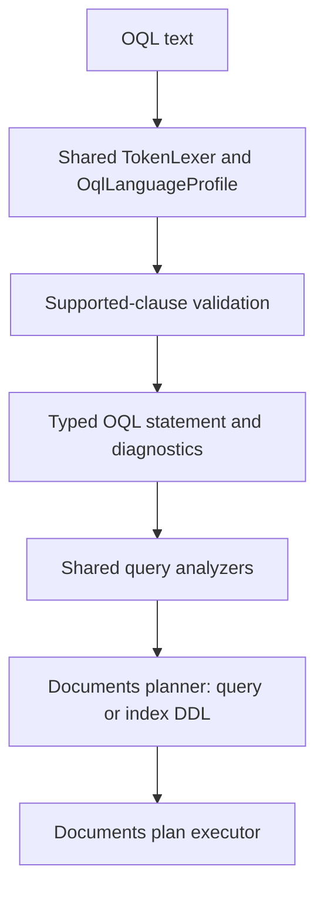

# Assimalign.Cohesion.Database.Documents.Language — Design

The package owns the document model's OQL grammar, statement and expression trees, diagnostics,
and conformance corpus. `OqlQueryParser` derives from the shared `QueryParser` and declares
`OqlLanguageProfile.Instance` as its profile. The shared `TokenLexer` provides tokenization;
there is no alternate lexer or duplicated keyword configuration.

Double-quoted identifiers decode doubled `""` to one embedded quote (#1235), in collection,
field and alias names. The shared lexer keeps the whole identifier in one token; OQL verifies
its closing quote before unescaping it. A final escaped quote without a closing delimiter is
CD00003. The parser conformance corpus and identifier-value test pin this extension to the
existing double-quoted name syntax. See Database.Language DESIGN for the scanner reference.

The OQL name is retained, but the language basis is SQL++ for JSON, following Couchbase
SQL++ for Query. The executable subset below is the dialect contract; it does not claim
complete SQL++ support. MISSING and NULL are separate values (#1126, owner D2/D2a).

## Less-than followed by minus (#1647)

OQL leaves the shared profile's `RecognizeLeftArrow` option disabled. `a<-1` and `a <- 1` parse
as a less-than comparison with unary minus. `a<--1` leaves the comparison operand missing
because `--1` is a comment (CD00002). `OqlLeftArrowConformanceTests` pins both forms;
Database.Language DESIGN records the shared configuration and scanner reference.

## Family and pipeline

`Database.Documents.Language` references only `Assimalign.Cohesion.Database.Language`.
`Database.Documents` consumes its AST for logical planning, physical index selection,
collection and index catalog changes, and execution. This package has no catalog, storage, hosting, or
ApplicationModel dependency.

Parsing runs shared lexing, capability validation, statement/expression parsing, then shared
analyzers. Malformed input remains an `OqlQueryStatement` with error diagnostics; consumers
must reject statements containing errors before planning.

The diagram shows the common parse-plan-execute flow. Both `SELECT` and index DDL remain on this
path; DDL is not dispatched through a separate engine API.



## Supported-clause matrix

The profile's supported set is deliberately the executable subset of `OqlClauses`.
Lexical recognition preserves the established vocabulary so rejected constructs receive
`CK00001`; recognizing a token does not make its operation supported.

| Clause | Supported | Shape or reason |
| --- | --- | --- |
| `BEGIN` | Yes | Session transaction start; START requires WORK, TRAN or TRANSACTION |
| `COMMIT` | Yes | Optional WORK, TRAN or TRANSACTION |
| `ROLLBACK` | Yes | Optional WORK, TRAN or TRANSACTION; savepoints remain deferred |
| `SELECT` | Yes | One or more projected expressions, optional `AS` labels; a lone `*` returns the stored document |
| `DISTINCT` | Yes | Optional quantifier directly after SELECT; ALL is the default |
| `SELECT VALUE` | Yes | One bare expression; RAW is a synonym |
| `OBJECT CONSTRUCTOR` | Yes | Named members in braces; last non-MISSING member wins |
| `ARRAY CONSTRUCTOR` | Yes | Expressions in brackets; MISSING elements become NULL |
| `ARRAY ... FOR` | Yes | One IN binding, optional WHEN; ordered mapped array omits MISSING |
| `FIRST ... FOR` | Yes | First qualifying mapping, or MISSING |
| `EXPLAIN` | Yes | SELECT, INSERT, UPSERT, UPDATE or DELETE plan description without reading document data or writing |
| `INSERT` | Yes | Explicit KEY/VALUE pairs, or KEY and optional VALUE bindings to SELECT output names |
| `UPSERT` | Yes | The same KEY/VALUE grammar; inserts absent keys and wholly replaces existing documents |
| `UPDATE` | Yes | One collection, optional alias, SET assignments and/or UNSET paths, optional WHERE |
| `UNSET` | Yes | Removes properties in UPDATE; a final array index is invalid |
| `DELETE` | Yes | `DELETE FROM collection [AS? alias] [WHERE expression]`; keeps the collection and indexes |
| `RETURNING` | Yes | Affected-image expressions with optional AS labels, or one RAW/VALUE expression, on all four writes |
| `OPTIONS` | No | INSERT/UPSERT header element; one CK00001 at OPTIONS, including directly after KEY; no TTL or version precondition in T1 |
| `VALUES` | Yes | One or more parenthesized key/value pairs for INSERT or UPSERT |
| `FROM` | Yes | One collection or reserved `COHESION_SCHEMA` source, optional iteration variable, then ordered UNNEST bindings |
| `UNNEST` | Yes | Optional INNER; one row per array element, chainable |
| `LEFT UNNEST` | Yes | Optional OUTER; preserves empty and non-array inputs with a MISSING variable |
| `WHERE` | Yes | Scalar comparison and Boolean document filtering |
| `ANY ... SATISFIES` | Yes | One array binding; SOME is a synonym |
| `EVERY ... SATISFIES` | Yes | One array binding; empty arrays satisfy EVERY |
| `IN` | Yes | Structural membership in a parenthesized list or array value, optionally NOT |
| `BETWEEN` | Yes | Inclusive same-scalar-kind range, optionally NOT |
| `LIKE` | Yes | Ordinal string patterns, optionally NOT, with Unicode scalar wildcards and ESCAPE |
| `CASE` | Yes | Searched and simple conditional expressions, including aggregate arguments |
| `GROUP BY` | Yes | One or more grouping expressions, optionally aliased with or without AS |
| `GROUP AS` | Yes | Array of input binding wrappers, including group-term aliases |
| `HAVING` | Yes | Group filtering, including aggregate calls |
| `ORDER BY` | Yes | One or more expressions, each optionally `ASC` or `DESC`, then `NULLS FIRST` or `LAST` |
| `LIMIT` | Yes | Non-negative signed Int64 integer literal or parameter, applied after ordering |
| `OFFSET` | Yes | Non-negative signed Int64 integer literal or parameter; either order with LIMIT |
| `FETCH` | No | The SQL FETCH FIRST spelling is not adopted; one CK00001 at FETCH |
| `CREATE COLLECTION` | Yes | One database-local collection, optionally `IF NOT EXISTS` |
| `DROP COLLECTION` | Yes | One database-local collection, optionally `IF EXISTS` |
| `CREATE INDEX` | Yes | 1..32 ordered scalar paths or one DISTINCT ARRAY key; scalar-only UNIQUE; IF NOT EXISTS |
| `DROP INDEX` | Yes | One named index in one collection, optional IF EXISTS; ON is required |
| `SUBQUERY` | No | A nested `SELECT` reports this capability name at the inner keyword, including UPDATE SET/WHERE, DELETE and INSERT/UPSERT VALUES, with or without EXPLAIN |
| `MERGE` | No (pin) | SQL++ merge; stays a pin with no T1 item lifting it, and #1101 owns it |

`OqlFunctions.All` is the public, immutable standard-function metadata consumed by the
standalone parser, profile and engine's native registrations. It classifies scalar versus aggregate
calls, argument counts and kinds, and static result types. Engine request parsing admits additional
named calls for the executing engine's frozen catalog to bind. The profile derives its function tokens from this table; names remain usable as fields.
In this table, **propagate** means MISSING wins over NULL; a wrong-kind stored value gives NULL,
while an incompatible literal kind fails planning before document access. **Selected** means the
result has the selected argument's type. Conditional functions evaluate only through the selected
argument. Aggregate placement and grouped scalar arguments are validated by the planner.

| Name | Arity | Result type | NULL / MISSING rule |
| --- | --- | --- | --- |
| META | 0..1 | Metadata members | [#1131](#insert-and-metadata-1131): only .id and .version |
| COUNT | 1, including * | Int64 | Skip both; * counts input rows; empty input gives 0 |
| SUM, AVG | 1 | Decimal | Skip both; empty valued input gives NULL |
| MIN, MAX | 1 | Argument type | Skip both; empty valued input gives NULL |
| ARRAY_AGG | 1 | Json | Skip MISSING; include NULL; empty/all-MISSING gives NULL |
| BOOL_AND, BOOL_OR, EVERY | 1 | Boolean | Skip NULL/MISSING and non-Booleans; empty gives NULL |
| STDDEV, VARIANCE | 1 | Decimal | Skip NULL/MISSING and nonnumbers; empty gives NULL; singleton zero |
| LOWER, UPPER | 1 | String | Propagate |
| LENGTH | 1 | Int64 | Propagate |
| SUBSTR | 2..3 | String | Propagate |
| POSITION | 2 | Int64 | Propagate |
| CONTAINS, STARTS_WITH, ENDS_WITH | 2 | Boolean | Propagate |
| REPLACE | 3..4 | String | Propagate; optional integer count |
| TRIM | 1..2 | String | Propagate |
| CONCAT | 2..N | String | Propagate |
| ABS | 1 | Decimal | Propagate |
| ROUND, TRUNC | 1..2 | Decimal | Propagate |
| FLOOR, CEIL | 1 | Decimal | Propagate |
| POWER | 2 | Decimal | Propagate |
| SQRT | 1 | Decimal | Propagate |
| NOW_STR | 0 | String | No inputs |
| NOW_MILLIS | 0 | Int64 | No inputs |
| STR_TO_MILLIS | 1 | Int64 | Propagate; invalid date gives NULL |
| MILLIS_TO_STR | 1 | String | Propagate; out-of-range date gives NULL |
| TYPE | 1 | String | Return 'null' or 'missing' for those values |
| IS_ARRAY, IS_OBJECT, IS_STRING, IS_NUMBER, IS_BOOLEAN | 1 | Boolean | Propagate |
| ARRAY_LENGTH | 1 | Int64 | Propagate; non-array gives NULL |
| ARRAY_CONTAINS | 2 | Boolean | Propagate; non-array gives NULL |
| COALESCE, IFMISSINGORNULL | 2..N | Selected | First neither NULL nor MISSING; otherwise NULL |
| IFMISSING | 2..N | Selected | First non-MISSING, including NULL; otherwise NULL |
| IFNULL | 2..N | Selected | First non-NULL, including MISSING; otherwise NULL |

The conditional rules follow [Couchbase](https://docs.couchbase.com/server/current/n1ql/n1ql-language-reference/condfununknown.html).
REGEXP_LIKE, REGEXP_REPLACE and REGEXP_POSITION are deliberately deferred and report
one CK00001 in call position. Unknown function names instead report CD00008 after their
arguments are parsed, avoiding secondary syntax diagnostics. Retired ODMG constructs retain
their positional refusals. Calls never become planner constants or index seek bounds, and
INSERT/UPSERT VALUES continues to reject calls.

REPLACE's optional fourth argument limits replacement to the first n nonoverlapping occurrences;
an omitted or negative count replaces all, following the
[Couchbase string-function contract](https://docs.couchbase.com/server/current/n1ql/n1ql-language-reference/stringfun.html#replace).
A fractional count gives the engine type diagnostic CD02008. Plain arity errors name only
the invalid count; the CD00006 COUNT-star explanation appears only for an actual star operand.

### Aggregate extensions (#1729, OQ-G1)

OqlCallExpression retains an OqlAggregateQuantifier (None, All or Distinct). The explicit ALL
spelling survives parsing; binding equivalence treats it like omitted ALL. EVERY(...) uses
OqlCallExpression, while EVERY v IN ... SATISFIES ... END remains OqlQuantifiedExpression,
including inside an aggregate argument. Function tokens remain usable as names. Quantifier
syntax uses CD00011, direct-AST binding uses CD01029, and existing arity/context/value/budget
identities remain in use. The [dialect](DIALECT.md#aggregate-quantifiers-and-native-aggregates-1729-oq-g1)
records every input rule, equality, statistic, memory estimate and no-order promise. Parser and
engine conformance corpora cover all eleven names and both transports. Native aggregate retention shares the statement counter with SELECT source/group staging (#1753); scratch reservations release at expression and sort boundaries. GROUP AS wrappers use the same reservation owner.

### GROUP AS and group-term aliases (#1729, OQ-G2)

OqlSelectExpression retains parallel GroupAliases and optional GroupAs metadata with the existing
GroupBy list. Ordinary nodes have no additional instance fields or metadata allocation; optional
metadata follows the list through planner copies. Terms accept `expr [AS] alias`; GROUP AS requires
at least one GROUP BY term (CD00012). Binding validates direct-AST list shape, nonempty names and
collisions with other group/FROM/UNNEST declarations (CD01030). A group array is a post-group
binding and cannot supply an aggregate's row input (CD01031). Inner ARRAY/FIRST and quantified
variables retain their own lexical identity. LETTING remains a named CK00001 refusal.
The [dialect](DIALECT.md#group-as-and-group-term-aliases-1729-oq-g2) records wrapper shape,
empty/MISSING behavior, visibility and budget lifetimes. Parser, engine conformance, InMemory/TCP
and NativeAOT checks cover these contracts without a new disk or wire format.
Alias retention charges shared key representations once while preserving binding overhead and
separate charges for independently owned values, wrappers and the final array.

### Array index keys (#1530)

CREATE INDEX accepts `DISTINCT ARRAY v.p FOR v IN arr [WHEN cond] END` among scalar keys.
The parser reuses `OqlComprehensionExpression` inside the immutable
`OqlCreateIndexExpression.Keys`; an index comprehension denotes DISTINCT and is never FIRST.
The scalar Paths view is empty for array indexes. The engine binds the document source path,
element-relative projection and bounded WHEN to catalog-owned descriptors without adding a
catalog reference here. ALL remains one CK00001. Malformed bindings and missing END retain
CD00002; unsupported WITHIN/multiple bindings retain their existing capability refusals.
Restricted source/projection/WHEN forms and multiple/UNIQUE arrays receive located engine
diagnostics CD01028, CD02027, CD03025, CD03027 or CD03028 before catalog mutation. Numeric
text binds to Decimal; direct AST Single/Double values are refused. WHEN permits only path-to-
literal comparisons, NULL/MISSING tests, AND/OR/NOT, within 32 levels and 128 predicate nodes.
The [dialect](DIALECT.md#index-ddl-1135) records matching ANY and UNNEST access, residuals,
canonical catalog rendering and the measured fetch bound/limit. The existing v3 format is unchanged.

### Projection semantics (#1128)

The [Couchbase SELECT clause](https://docs.couchbase.com/server/current/n1ql/n1ql-language-reference/selectclause.html)
defines ALL as the default, DISTINCT as duplicate removal, and VALUE/RAW as a single unwrapped
expression. OQL accepts these spellings, requiring FROM and rejecting VALUE aliases, star and
multiple expressions. VALUE and RAW are reserved: use `"value"`, `"raw"` or `d.value` for fields.
After AS, a projection label accepts reserved words, following PostgreSQL ColLabel
(`src/backend/parser/gram.y:17638,18042-18046` in the reference clone). DISTINCT and ALL retain
their positional capability refusal except directly after a clause-head SELECT or at a call's
argument head (and after a dot). The call parser and engine binder enforce aggregate-only use.
A property or projection label named select does not open a SELECT clause. The AS-label exemption
applies only within a SELECT list; reserved unsupported FROM and INSERT aliases retain CK00001.
Recognized-unsupported function names still receive one CK00001 with their optional
quantifier included in the named construct.
Computed member names and path access on constructor results remain deferred.
Member colons remain delimiters even without whitespace: `{a:DISTINCT}` receives the positional
capability refusal, while `:distinct` in an operand keeps the parameter-form syntax diagnostic.

Object and array constructors are primary expressions and participate in input validation,
constant evaluation, predicates, grouping and aggregates. Objects retain #1131's last-member-wins
rule, including repeated literal names; arrays preserve source order and replace MISSING elements
with JSON null. Constructors use Utf8JsonWriter and owned JsonElement values, preserving decimal
scale and the decimal scalar domain. The existing 128-level parser limit also covers constructors.

### RETURNING (#1727)

Each public write AST has an optional OqlReturningExpression with ordered OqlProjection values,
IsValue and a clause span. The parser retains the complete statement Text, including RETURNING;
this language has no separate expression renderer. RAW/VALUE enforces one non-star expression
without an alias. Named projections reuse SELECT's expression parsing and reserved AS labels.
RETURNING stays contextual: destinations, properties, output bindings and aliases keep that name.
The recognized-vocabulary row remains for contextual coverage and unsupported prefix/SELECT use.
The capability scan recognizes nested SELECT in RETURNING as SUBQUERY, including INSERT VALUES.

The engine binds only the target image (alias or implicit collection binding), validates scalar
contexts before writes, and uses SELECT projection names/types and JSON semantics. Aggregate
placement fails CD05001; duplicate output names retain CD01003; parameters retain CD01005.
The [dialect contract](DIALECT.md#returning-1727) records pre/post images, stable output order,
owned rows, budget CD05018 and the unnegotiated existing-wire completion contract. EXPLAIN adds
Returning/ReturningValue while retaining its nonexecuting behavior. OqlReturningParserTests,
OqlExecutionConformanceTests, DocumentReturningTests and DocumentReturningWireTests cover the
parser, in-process execution and both transports. No disk or frame format changes.
Older clients can reject the successful completion after an autocommit write has committed,
so retrying may repeat the write; disconnect rolls back explicit uncommitted work. The dialect
states both outcomes beside the compatibility contract, and permanent wire probes cover them.

## ORDER BY null placement (#1730)

Each term accepts `expr [ASC | DESC] [NULLS FIRST | LAST]`, including projection aliases,
multiple terms and LIMIT/OFFSET. ASC is the omitted direction. The omitted placement is FIRST
for ASC and LAST for DESC. FIRST/LAST moves the whole MISSING/NULL block; direction controls
its internal order: ASC keeps MISSING before NULL, DESC keeps NULL before MISSING. Thus the
older “MISSING before NULL” wording means the ascending base order, not every direction.
This follows the pinned [Couchbase table](https://github.com/couchbaselabs/docs-devex/blob/c3bb1549af4887019b9983e371d9e8b4f569052c/modules/n1ql/pages/n1ql-language-reference/orderby.adoc#L64-L99).
Values retain Boolean, number, ordinal string, array and object order (reversed for DESC).
Equal query keys retain ordinal document identity, independent of direction; later ORDER BY
terms precede that tie break. NULLS stays contextual, so existing fields named nulls remain valid.
Malformed NULLS options give located CD00013; an invalid direct-AST placement gives CD01032.
The capability scan defers ALL and DISTINCT immediately after NULLS to the ordering parser,
so they receive CD00013 at that option, like a numeric option or end of input. A second LAST
after NULLS FIRST retains CK00001 at LAST, outside the completed placement suffix.
No new sorting bound or budget diagnostic is introduced; retained sorting still uses CD05018.

| Term | First to last |
|---|---|
| ASC / ASC NULLS FIRST | MISSING, NULL, values ascending |
| ASC NULLS LAST | values ascending, MISSING, NULL |
| DESC / DESC NULLS LAST | values descending, NULL, MISSING |
| DESC NULLS FIRST | NULL, MISSING, values descending |

OqlOrdering retains OqlNullPlacement (Default/First/Last) through alias rewriting. OQL has no
general AST renderer; parsed source text remains intact and EXPLAIN renders direction and
written NULLS suffixes. The lexical profile keeps NULLS and INCLUDE contextual.

### LIMIT and OFFSET (#1129)

LIMIT and OFFSET accept integer literals, optionally signed, or ordinary $name/@name/$1
parameters. Either clause may appear alone or first, at most once each. Both operands survive
alias rewriting. Values must be integral, non-negative and within signed Int64, including counts
above Int32.MaxValue (the 2026-10-18 ruling supersedes the issue's original Int32 bound).
+1 and -0 are valid. Literal 2.0 and 1e2, NULL/NIL, TRUE/FALSE, MISSING, ALL, parentheses,
arrays and document-dependent expressions are invalid counts. Integral decimal and JSON numeric
parameter values are accepted after normalization; NULL parameters are invalid.

Every invalid count has CD00007 at its full operand span, with the message
"LIMIT requires a non-negative integer in the signed 64-bit range." (OFFSET names OFFSET).
A missing operand, duplicate clause (at its second keyword), arithmetic after a count or
ORDER BY after paging retains CD00002. LIMIT m, n reports one CK00001 at LIMIT before
validating m (including ALL, negative and string operands), naming that unsupported spelling
and asking for LIMIT n OFFSET m. Missing parameters retain CD01005;
parameter lookup is the shared contract. Normalization failures, including nonfinite values and
numbers outside the decimal domain, become CD00007 for paging. Direct AST counts are checked too.
No new shared public member or visibility grant is required; the two assemblies keep the message
locally, with equality covered by planner/parser tests.

Paging follows WHERE, grouping/HAVING, projection, DISTINCT and ORDER BY. INSERT and UPSERT SELECT
sources use the same final page. UPDATE/DELETE LIMIT and OFFSET remain CK00001, naming the
statement and clause (for example, DELETE LIMIT). INSERT/UPSERT VALUES paging names
INSERT VALUES LIMIT, UPSERT VALUES OFFSET, or the corresponding clause. RETURNING as an implicit source alias may precede paging.
EXPLAIN validates counts without reading documents and reports the resolved limit and offset.
The PostgreSQL reference accepts either order (src/backend/parser/gram.y:13537-13566) and rejects
the comma spelling at LIMIT (13586-13593). OQL rejects NULL and LIMIT ALL, unlike PostgreSQL's
no-limit/zero-offset interpretation (src/backend/executor/nodeLimit.c:359-408). The Int64 bound
agrees with Cohesion SQL #1100; these NULL and literal-grammar rules remain OQL-specific.

### Keyword disposition (#1101)

The capability scan reads one static recognized-unsupported table, `OqlUnsupportedVocabulary`.
Each entry has a spelling, the construct its `CK00001` names, and a position. Each
recognized-unsupported construct is reported once at the word that names it, and never bound as
a name:

- **Anywhere** (reserved unsupported SQL++ vocabulary): every occurrence except a path segment after a dot or an explicit SELECT-list AS label. All
  are lexer keywords or functions.
- **Clause** (statements and clauses of other languages, including FETCH, NEST and WITHIN):
  the first word of the statement, or directly after the end of an operand. Names, literals,
  parameters, closing delimiters and ASC/DESC end operands. FETCH FIRST is one unsupported
  spelling at FETCH; FIRST is exempt only directly after a FETCH in construct position.
  ALL is an invalid paging count only after an actual LIMIT/OFFSET clause head; path segments
  such as c.fetch and c.limit grant no exemption to a following FIRST or ALL. These words remain
  identifiers elsewhere. A Clause word cannot be an implicit FROM alias: FROM c NEST
  reports NEST, while FROM c AS nest keeps it a name. LIMIT and OFFSET execute and are
  reserved; use quoted names or path segments such as d.limit. SELECT a AS limit still parses.
- **Statement** (`DEFINE`, `MERGE` and the enabled `UPSERT` coverage entry): only the first word of the
  statement. UPSERT bypasses refusal through OqlClauses.Upsert; its table entry retains contextual
  keyword coverage. Elsewhere they are names, so an AS-less alias such as `FROM c merge` still parses,
  as it did before #1101.
- **Trailing** (`RETURNING`): executable at the end of INSERT/UPSERT/UPDATE/DELETE;
  unsupported at the statement prefix or after SELECT. Other identifier positions retain
  `returning`, including an implicit FROM alias before the end or another clause. The final
  grammar owns the trailing projection; it does not reserve the spelling globally.
- **Function** (`ELEMENT`, `FLATTEN`, `LISTTOSET`, `STRUCT`, `LIST`, `BAG`, `TYPEOF`, and the deferred REGEXP functions):
  only immediately before `(`. Elsewhere these spellings are ordinary identifiers.
- **Quantifiers**: `EVERY`, `ANY` or `SOME` followed by `name IN` opens a supported predicate.
  The scan skips the binding IN and still scans the collection and SATISFIES expression for
  unsupported constructs. SOME maps to the ANY capability. ARRAY/FIRST open supported
  comprehension scopes; their binding FOR is exempt while inner expressions remain scanned.
  ANY AND EVERY is one deferred construct through its matching END, including nested CASE.
  ODMG's `FOR ALL name IN` and `EXISTS name IN` retain their single refusal. Non-binding ANY
  and SOME uses remain unsupported. EVERY and SATISFIES remain contextual names elsewhere.

A statement whose first word is unsupported, such as `MERGE INTO c ...`, is one construct:
the scan reports that word and nothing after it. Each
operand of a set operation starts its own `SELECT`, which is not reported as a subquery, and a
set operation with `ALL` or `DISTINCT` (`UNION ALL`) is one construct spanning both words.
`OqlKeywordDispositionTests` enumerates the profile's keywords plus the table. Every word needs
a supported parse case or a case with exactly one `CK00001` naming its construct, and for a
table entry that diagnostic must also name the construct the table records. A word added
without a case fails, so oql-sqlpp-basis and the flip items add their cases in the same change.
OQL declares no `~`, so `SELECT ~a FROM c` stays an `CD00002` syntax error (a pin). It is one
error: a second error with the same code at the same span is dropped, so recovery that reaches
one bad token from several rules no longer reports it three times.

### SQL++ reservations and retired ODMG words (#1126)

Membership tests assert these lists without freezing arrays that later T1 items extend:

| Disposition | Words |
| --- | --- |
| Reserved | MISSING, VALUED, KNOWN, UNKNOWN, NIL, UNDEFINED, SET, ARRAY, COLLECTION, FIRST, LAST, UNIQUE |
| Projection reservations (#1128) | VALUE, RAW |
| Paging reservations (#1129) | LIMIT, OFFSET |
| Predicate and conditional reservations (#1127) | CASE, WHEN, THEN, ELSE, END, ESCAPE |
| Freed identifiers | DEFINE, ELEMENT, FLATTEN, STRUCT, LIST, BAG, LISTTOSET, TYPEOF |
| Removed functions | ELEMENT, FLATTEN, FIRST, LAST, LISTTOSET, UNIQUE |

`DEFINE` is rejected only statement-initially. `ELEMENT`, `FLATTEN` and `LISTTOSET` are
rejected only in call position; a future positional SELECT ELEMENT needs no reservation.
`STRUCT`, `LIST`, `BAG` and `TYPEOF` lose their ODMG constructor/type meaning and are likewise
rejected only as calls. All eight freed names can be projected as unquoted fields.
`FIRST`, `LAST` and `UNIQUE` retain SQL++ reservations. FIRST executes as a comprehension;
its retired function spelling remains CK00001. LAST remains unsupported; UNIQUE executes only
directly after CREATE in CREATE UNIQUE INDEX.
`UNDEFINED` stays reserved and rejected, never a MISSING synonym. `NIL` remains a NULL synonym.
SET and UNSET are reserved for UPDATE assignments and removals. Only SET immediately after
UPDATE's destination and optional alias is exempt from the unsupported-word scan; SET calls
in SELECT, UPDATE right-hand sides or WHERE still report CK00001. Property segments such as
`d.set` remain names. ARRAY, COLLECTION, FOR, SOME and ANY remain reserved.
COLLECTION retains its collection-DDL meaning. KNOWN and UNKNOWN are
reserved but deferred; `IS KNOWN` and `IS UNKNOWN` report CK00001 at that word.

Removing public `OqlClauses.Define`, `Element` and `Flatten` is an intentional source/binary
API break, allowed by the owner's decision that nothing has shipped publicly. No aliases remain.

### SQL++ MISSING semantics (#1126)

The [Couchbase four-valued table](https://docs.couchbase.com/server/current/n1ql/n1ql-language-reference/booleanlogic.html)
is the owner-selected dialect. T/F/N/M below mean TRUE/FALSE/NULL/MISSING.

| Left AND right | T | F | N | M |
| --- | --- | --- | --- | --- |
| T | T | F | N | M |
| F | F | F | F | F |
| N | N | F | N | M |
| M | M | F | M | M |

| Left OR right | T | F | N | M |
| --- | --- | --- | --- | --- |
| T | T | T | T | T |
| F | T | F | N | M |
| N | T | N | N | N |
| M | T | M | N | M |

NOT maps T/F/N/M to F/T/N/M. Ordinary comparison and arithmetic propagate MISSING before
NULL, including `MISSING + NULL`. WHERE, HAVING, AND, OR, NOT and searched WHEN share SQL++ Truth conversion. Nonzero numbers
and nonempty strings, arrays and objects are true; zero and empty strings/arrays/objects are
false. NULL/MISSING preserve the tables above. Thus WHERE 1 and HAVING COUNT(*) retain
nonempty input; the earlier Boolean-only filter rule is superseded.

| Predicate | Present value | NULL | MISSING |
| --- | --- | --- | --- |
| IS NULL | FALSE | TRUE | MISSING |
| IS NOT NULL | TRUE | FALSE | MISSING |
| IS MISSING | FALSE | FALSE | TRUE |
| IS NOT MISSING | TRUE | TRUE | FALSE |
| IS VALUED | TRUE | FALSE | FALSE |
| IS NOT VALUED | FALSE | TRUE | TRUE |

An absent member, a wrong shape, or an out-of-range array index produces MISSING. Navigating
through explicit NULL also produces MISSING: Couchbase's `nullValue.Field` and `Index`
return missing values ([value/null.go:147-169](https://github.com/couchbase/query/blob/master/value/null.go#L147-L169)).
Reading the NULL member itself still yields NULL. This is the implementer's navigation
default, recorded for owner review. Arrays are indexed explicitly; dotted property access
does not implicitly map across an array.

Total ascending order is MISSING < NULL < FALSE < TRUE < number < ordinal string < array <
object. Descending reverses it; ties retain document identity order. GROUP BY retains
separate MISSING and NULL keys. COUNT(expr), SUM, AVG, MIN and MAX skip both; COUNT(*)
counts input rows, including expanded UNNEST rows. A MISSING value does not obscure a column's one observed scalar type.
Result projections and object constructors omit MISSING members and retain explicit null.
Composite/UNIQUE index keys use the rules documented under Index DDL (#1135).

### Array bindings and quantified predicates (#1136)

`OqlSelectExpression.Unnest` retains ordered public `OqlUnnestExpression` nodes; each has
Collection, Variable and IsLeft. The SELECT constructor accepts this list. The public
`OqlQuantifiedExpression` retains Variable, Collection, Predicate and IsEvery; SOME normalizes
to ANY. A path-headed variable resolves before document fields, with the innermost binding
winning. Quantifier collections evaluate in the enclosing scope, then SATISFIES adds the
inner variable. Otherwise an unqualified path addresses the FROM document. The unaliased
collection name keys a synthetic star and is reserved for duplicate binding checks; it does
not become an implicit path variable.
The full source name keys an unaliased COHESION_SCHEMA synthetic star too.

The explicit FROM alias (or unaliased collection name) and its UNNEST bindings form one list with unique ordinal names. Quantifier
variables may shadow outer variables and document fields. Duplicate names in one binding
list give CD00010; a direct SELECT AST receives CD01023. Multi-binding quantifiers remain
deferred. An omitted UNNEST alias defaults to the final named path step; expressions without
one require an explicit alias. An inferred duplicate spans the final path-name token, including
bracket-string paths and parenthesized paths. UNNEST, INNER, LEFT, OUTER, EVERY and SATISFIES are contextual,
preserving existing fields and AS-less aliases named every or satisfies. END was already
reserved. ANY and SOME retain their existing reservations. UNNEST in UPDATE/DELETE, FLATTEN calls,
JOIN, NEST, WITHIN and ANY AND EVERY remain CK00001.
UPDATE/DELETE reject UNNEST only where their grammar expects a clause; a field named unnest
in SATISFIES remains an expression. MERGE INTO in a CASE result under SATISFIES reports the
single MERGE construct before its internal mutation tokens are scanned.

INNER UNNEST emits array elements in order and emits nothing for MISSING, NULL, scalar,
object or empty-array operands. LEFT UNNEST preserves those inputs with a MISSING binding;
an actual null array element remains NULL. Chaining expands each preceding tuple. With
UNNEST, star is a synthetic object keyed by FROM and UNNEST variable names, omitting MISSING.
Without UNNEST, a lone star retains the original stored value and exact bytes.
An array variable matching the unaliased collection name is a duplicate binding, even though
the implicit source name does not resolve in paths.

ANY/SOME return TRUE on the first true SQL++ Truth conversion, otherwise FALSE. EVERY returns
FALSE on the first not-true conversion, otherwise TRUE. NULL and MISSING SATISFIES results
are not true, so `NOT ANY x IN [NULL] SATISFIES x = 1 END` is TRUE. An empty ANY is FALSE;
an empty EVERY is TRUE. A MISSING collection gives MISSING; NULL or a non-array gives NULL.
These rules follow [coll_any.go:41-85](https://github.com/couchbase/query/blob/master/expression/coll_any.go#L41-L85)
and [coll_every.go:41-87](https://github.com/couchbase/query/blob/master/expression/coll_every.go#L41-L87),
with non-array handling in [coll_util.go:16-60](https://github.com/couchbase/query/blob/master/expression/coll_util.go#L16-L60),
superseding the original issue's three-valued element table. IN uses structural equality,
with a match winning over a NULL element. A MISSING operand on either side gives MISSING;
a NULL or non-array right operand gives NULL. Cohesion retains NULL for `NULL IN []`,
diverging from [Couchbase coll_in.go:57-71](https://github.com/couchbase/query/blob/master/expression/coll_in.go#L57-L71).
Aggregates are forbidden inside UNNEST operands. Quantified collections and predicates inherit aggregate permission from SELECT, HAVING and ORDER BY and evaluate with the enclosing group; nested aggregates remain forbidden. META accepts
only the stored FROM binding; META on an inner variable is an error even if it shadows FROM.

### ARRAY and FIRST comprehensions (#1728)

OqlComprehensionExpression is a sealed expression leaf retaining Variable, Collection,
Projection, optional Predicate and IsFirst. CREATE INDEX reuses this shape for its restricted
DISTINCT ARRAY key (#1530). Comprehensions are primary
expressions, including parenthesized mappings, nested mappings, registered function arguments,
UNNEST, grouping, predicates and RETURNING. The collection evaluates in the enclosing scope;
the mapped expression and WHEN introduce one binding which may shadow any enclosing variable.
Bindings never escape END. Malformed syntax uses CD00002 and nesting shares CD00005's limit.
Legacy ARRAY()/FIRST() calls, WITHIN, position variables and multiple bindings remain CK00001.
An empty direct-AST binding gives CD01027. OBJECT transformation remains outside this subset.

ARRAY preserves input order, filters using SQL++ Truth, omits mapped MISSING and returns []
for no retained mappings. FIRST returns the first qualifying mapping, including NULL or MISSING,
without visiting later elements; with no qualifying element it returns MISSING. Both propagate
MISSING input, and return NULL for NULL or non-array input. The
[dialect](DIALECT.md#array-and-first-comprehensions-1728) records the reference and defaults.
All child expressions participate in parameter/numeric, function, aggregate and metadata
validation even for empty input. Aggregates inside a comprehension are
refused; a comprehension may be an aggregate argument. Closed comprehensions and quantified
predicates are constant for VALUES/constructor validation when all paths bind local variables;
registered calls remain nonconstant. No rendering, wire or storage contract changes.

Constant classification does not make evaluation eager. Failed speculative seek bounds are
discarded, leaving ordinary row/branch evaluation to report OQL errors; cancellation propagates.
VALUES and constructors retain the same short-circuit rules for closed bindings.

Comprehension lookahead memoizes punctuation and END-delimited scopes in one reverse token pass.
CASE, nested ARRAY/FIRST and ANY/SOME/EVERY are skipped as complete expressions while locating
the enclosing FOR, including within WHEN. Dotted members, AS labels and object keys are names;
they do not open or close expression scopes. ARRAY()/FIRST() retain their dedicated CK00001 refusal.

## Grammar, statement, and expression trees

```text
statement    := (query | insert | upsert | update | delete | EXPLAIN (query | insert | upsert | update | delete) | create-collection | drop-collection | create-index | drop-index) [';']
query        := SELECT [ALL | DISTINCT] select-kind from-clause
                [WHERE expression] [GROUP BY expression [[AS] alias] (',' expression [[AS] alias])* [GROUP AS alias]]
                [HAVING expression] [ORDER BY ordering (',' ordering)*]
                [LIMIT count [OFFSET count] | OFFSET count [LIMIT count]]
count        := ['+' | '-'] integer-literal | parameter
from-clause  := FROM collection [AS? identifier] unnest*
unnest       := [INNER | LEFT [OUTER]] UNNEST expression [AS? identifier]
aggregate-call := COUNT '(' '*' ')' | aggregate-name '(' [ALL | DISTINCT] expression ')'
quantified-expression := (ANY | SOME | EVERY) identifier IN expression SATISFIES expression END
comprehension := (ARRAY | FIRST) expression FOR identifier IN expression [WHEN expression] END
select-kind  := projection (',' projection)* | (VALUE | RAW) expression
insert       := INSERT INTO collection [AS identifier] write-input
upsert       := UPSERT INTO collection [AS identifier] write-input
write-input  := '(' KEY ',' VALUE [refused-options] ')' VALUES '(' expression ',' expression ')' (',' '(' expression ',' expression ')')*
              | '(' KEY identifier [',' VALUE identifier] [refused-options] ')' query
refused-options := ',' OPTIONS [expression]  -- recognized header element; rejected with one CK00001 at OPTIONS
delete       := DELETE FROM collection [AS? identifier] [WHERE expression]
update       := UPDATE collection [AS? identifier] (set [unset] | unset) [WHERE expression]
set          := SET assignment (',' assignment)*
assignment   := path '=' expression
unset        := UNSET path (',' path)*
object       := '{' [(string | identifier) ':' expression (',' (string | identifier) ':' expression)*] '}'
metadata     := META '(' [identifier] ')' '.' (id | version)
create-collection := CREATE COLLECTION [IF NOT EXISTS] collection
drop-collection   := DROP COLLECTION [IF EXISTS] collection
create-index := CREATE [UNIQUE] INDEX [IF NOT EXISTS] identifier ON collection '(' index-path [INCLUDE MISSING] (',' index-path)* ')'
index-path   := (identifier | '[' string ']') ('.' identifier | '[' integer ']' | '[' string ']')*
drop-index   := DROP INDEX [IF EXISTS] identifier ON collection
collection   := identifier | COHESION_SCHEMA '.' identifier
projection   := expression [AS label]
label        := identifier | quoted-identifier | reserved-word
array        := '[' [expression (',' expression)*] ']'
ordering     := expression [ASC | DESC] [NULLS (FIRST | LAST)]
path         := identifier ('.' identifier | '[' integer ']' | '[' string ']')*
presence-test := expression IS [NOT] (NULL | MISSING | VALUED)
membership   := expression [NOT] IN ('(' expression (',' expression)* ')' | expression)
range-test   := expression [NOT] BETWEEN expression AND expression
pattern-test := expression [NOT] LIKE expression [ESCAPE expression]
case         := CASE [expression] (WHEN expression THEN expression)+ [ELSE expression] END
literal      := NULL | NIL | MISSING | TRUE | FALSE | number | string
```

`CREATE INDEX` and `DROP INDEX` use the profile's SQL++ index-DDL shape.
The create form accepts the same document-path grammar as query expressions, so
an index can target a nested object field or array element. The path is relative to each document;
there is no iteration alias in an index statement. Index and collection names follow the same
identifier quoting and case-preservation rules as query collection names.

`OqlQueryStatement` wraps one top-level `OqlExpression`: `OqlSelectExpression`,
`OqlExplainExpression` (one SELECT, INSERT, UPSERT, UPDATE or DELETE), `OqlInsertExpression`, `OqlUpsertExpression`, `OqlUpdateExpression`, `OqlDeleteExpression`,
`OqlCreateCollectionExpression`, `OqlDropCollectionExpression`, `OqlCreateIndexExpression`, or
`OqlDropIndexExpression`. Collection nodes retain `Name` and `IfNotExists`/`IfExists`.
Index creation retains its target as an `OqlPathExpression`, rather than flattening the path during
parsing, so the planner receives the
same segment model used by query predicates.

Keywords and function names are case-insensitive. Collection and property names preserve case.
Double quotes delimit identifiers; single quotes delimit strings, with a doubled single quote
representing one quote. Property names after a dot may use a reserved word; bracket strings
address arbitrary property names. Array indices are nonnegative, zero-based 32-bit integers.
Parentheses group expressions. Parameters follow the
[shared parameter contract](../../Assimalign.Cohesion.Database.Language/docs/DESIGN.md#parameter-contract-1102):
`$name`, `@name`, `$_x`, `$1` and `@1` produce bare parameter names. Empty sigils and
mixed numeric/identifier names such as `$1a` report one CD00002 naming the grammar.
Numeric names use ASCII digits only: `$١`, `@١` and `$1١` report CD00002 at the whole reference.
Operand `?` and `:name` use the shared supported-form message at the complete span;
a trailing stray `?` keeps its generic character error. Empty identifiers are syntax errors.
The parser links Execution's stateless name check without an assembly dependency.
ParameterConformanceTests is the parameter-form conformance corpus.

Literal nodes hold a string, Boolean, numeric `JsonElement`, or null; `NIL` is a synonym for null.
These values use `OqlLiteralExpression`; MISSING has its own `OqlMissingExpression`.
Decimal and scientific notation retain every digit until the Documents evaluator applies
`DocumentStorage.ValidateContent` before conversion to decimal. Underflow, excess nonzero
fractional precision and overflow report `CD02007` (SQLSTATE 22003) at the literal's span.
The parser reports malformed numeric syntax as `CD00004`; it adapts optional integer digits
(`.5`) and leading zeros to JSON syntax without changing the number's value.

Operator precedence, lowest first: `OR`, `AND`, comparisons, presence tests and IN/BETWEEN/LIKE, addition/subtraction,
multiplication/division/remainder, unary signs. `NOT` binds around comparisons, so
`NOT age < 18` means `NOT (age < 18)`. Comparison operators are `=`, `!=`, `<>`, `<`, `<=`, `>`,
and `>=`; the AST normalizes `<>` to `!=`. Presence tests are unary `IS [NOT] NULL`,
`IS [NOT] MISSING` and `IS [NOT] VALUED` nodes with distinct operator strings.
Arithmetic supports `+`, `-`, `*`, `/`, and `%`.
Infix NOT belongs to IN, BETWEEN or LIKE at comparison precedence. BETWEEN bounds parse
above AND: `a BETWEEN 1 AND 3 AND b = 2` is a conjunction of two predicates. Parentheses
inside either bound can still group a Boolean expression. CASE is a primary expression.

### Predicates and CASE (#1127)

OqlInExpression retains either a nonempty Values list or an Array expression; even
`x IN (d.tags)` compares x with the whole array as one structural item. The array operand
parses above comparison precedence, so `x IN d.tags AND p` is a conjunction. A nested SELECT
still names SUBQUERY, including inside SATISFIES.
The other public nodes are OqlBetweenExpression, OqlLikeExpression and OqlCaseExpression.
Negated predicates preserve unknown results. Structural equality returns NULL for otherwise equal
arrays/objects containing NULL, so IN and simple CASE do not match them. A definite structural
mismatch returns FALSE. The engine design records their truth tables and source anchors.

LIKE is ordinal and case-sensitive. `%` matches zero or more Unicode scalars; `_` matches
exactly one, including a supplementary character or a newline. The default escape is
backslash, matching [Couchbase's default](https://github.com/couchbase/query/blob/master/expression/comp_like.go#L41-L46).
ESCAPE overrides it with one Unicode scalar; `ESCAPE ''` disables escaping. String literals
do not consume backslashes, so `a LIKE 'x\%'` matches the literal x%. An escape quotes the
next scalar, including `%`, `_` and itself. A literal escape longer than one scalar is an
CD00002 syntax error at that literal; an evaluated invalid escape or a trailing escape in
the pattern gives CD02013. Non-string operands, patterns or escapes give NULL, unless
another operand is MISSING. The hand-written matcher uses two pointers and only the latest
percent as its backtracking point; it uses no Regex, reflection or suffix recursion. The statement
cancellation token is checked periodically during compilation, scalar decoding and matching.
Constant patterns and escapes compile lazily once per LIKE node in the statement evaluator;
row-dependent values compile per evaluation. The cache ends with that statement execution.

CASE tests branches in order and evaluates only the selected result. Searched WHEN selects
values with true SQL++ Truth conversion; simple CASE uses structural equality, so NULL and MISSING do not match WHEN
values, including themselves. An unmatched CASE returns ELSE or NULL when ELSE is absent.
A selected result may itself be MISSING. These conditional rules follow
[simple CASE](https://github.com/couchbase/query/blob/master/expression/case_simple.go#L77-L108)
and [searched CASE](https://github.com/couchbase/query/blob/master/expression/case_searched.go#L72-L98).
All branches still undergo parameter, numeric, metadata, aggregate and grouping validation.

CASE, WHEN, THEN, ELSE, END and ESCAPE are now reserved. Existing fields remain accessible
quoted or after a dot: `"end"` and `d.end` still work, as do `"case"` and `d.case`.

The parser is a partial class, split into dispatch/token handling, transaction control, SELECT clauses, DDL, DML, and
expression parsing, following `SqlQueryParser`. Parser-produced list properties are read-only
snapshots; AST nodes retain source spans and the top-level expression retains the original
statement text.
Locations use zero-based UTF-16 offsets with exclusive ends and one-based line numbers.
Nested expressions are capped at 128 recursive parse levels; rejection is a diagnostic, not a
stack-overflow exception. Concurrent calls on one parser are serialized. The parser owns no
disposable resources beyond those used by the shared analyzer pipeline.

## EXPLAIN (#1104)

SQL++'s EXPLAIN for SELECT, INSERT, UPSERT, UPDATE and DELETE produces the shared plan-description columns documented by
[Execution](../../Assimalign.Cohesion.Database.Execution/docs/DESIGN.md#plan-descriptions-1104).
`OqlExplainExpression.Statement` retains the query for ordinary parameter validation and
planning. The parser rejects DDL, transaction control, nested EXPLAIN and EXPLAIN ANALYZE with
`CK00001`, and applies the normal single-statement/trailing-token check to the whole form.
The Documents engine owns its operator names and JSON-document wire representation.
`EXPLAIN` is contextual only at the statement prefix, matching PostgreSQL's unreserved keyword
classification (`src/include/parser/kwlist.h:167` in the local clone). It is not a lexer keyword;
unquoted `explain` remains a collection, property path, iteration variable or output alias.
The keyword-disposition corpus covers these identifiers both with and without the prefix.

## Diagnostic contract

| Code | Meaning |
| --- | --- |
| `CK00001` | A recognized clause or operation lies outside the executable profile, reported once at the word that names it (see Keyword disposition) |
| `CD00001` | Empty statement, including whitespace/comment-only text |
| `CD00002` | Syntax error, missing token, invalid identifier/path, multiple statements or leftover tokens, or a character OQL does not use (`?`, `#`, `^`, `§`, ...) |
| `CD00003` | Unterminated quoted text or block comment |
| `CD00004` | Malformed numeric literal (decimal-domain refusals belong to the engine's `CD02007`) |
| `CD00005` | Expression nesting exceeds the supported depth |
| `CD00006` | Invalid function argument count or star operand; only COUNT accepts * |
| `CD00007` | Invalid LIMIT/OFFSET operand or value; same clause-specific message at parse and plan time, located at the operand |
| `CD00008` | Unknown function name; standalone parsing or deferred engine binding |
| `CD00009` | More than 32 index key paths, at the 33rd path |
| `CD00010` | A duplicate variable within one FROM/UNNEST or quantifier binding list, at the repeated name |
| `CD00011` | ALL/DISTINCT on a scalar or star call, at the quantifier |
| `CD00013` | NULLS without FIRST or LAST, at the expected option |

Every error has an absolute start/end span and source line. End-of-input errors use the source
length for both offsets. A line breaks at LF, CR, NEL (U+0085), LS (U+2028) or PS (U+2029), and
CR LF is one break (`TokenLexer.CountLineBreaks`). Capability validation precedes statement parsing
so an unsupported construct receives the shared capability diagnostic instead of an accidental
generic syntax error. Quotes, comments, and property names after dots are not mistaken for clauses.
Malformed collection or index DDL produces `CD00002` at the missing or invalid token; it does not escape the
parser as an exception.

A `--` comment ends before the first of those line terminators, the rule
`Database.Language/docs/DESIGN.md` records for every language, so line numbers break exactly where
a comment ends (#1150). The shared lexer used to end a comment only at LF, so in
`SELECT * FROM people -- note<CR>WHERE age > 1` the `WHERE` was comment text and every document
matched. The `WHERE` now stays in effect at every terminator, and `OqlLineCommentTests` pins it
together with the diagnostic lines. OQL has no `//` comment: `/` is the division operator.

A character OQL does not use lexes as `TokenType.Unrecognized`. It reports
`Unexpected character '<c>'; it is not part of OQL.` (`CD00002`) at its span during
tokenization. The statement is then not parsed, so nothing is bound and no `NULL` literal stands
in for the character. `?` defers rejection to syntax parsing: an operand gets the shared
supported-form message, while a trailing stray `?` keeps the generic character message.
Adjacent host-parameter names in operand position, including `:union`, `:like` and `:select`,
bypass the capability scan and receive that one syntax diagnostic at the whole reference.
Every statement form (`SELECT`, collection DDL, and index DDL)
rejects leftover tokens with `CD00002`, with or without a separating `;`, and the corpus pins
both.

## Scope, index DDL, and mutations

OQL's scope was deliberately expanded from query-only to include index DDL. Documents and SQL now
manage secondary indexes through their language pipelines, and callers no longer need document
index extension members that switch on internal database implementations. This is an intentional
language-design change, not an accidental departure from the earlier query-only boundary. It is
extended by `CREATE COLLECTION [IF NOT EXISTS] name` and `DROP COLLECTION [IF EXISTS] name`
(#1130). Collection and index statements are parsed, planned, and executed by the Documents
engine in the same change that adds them to `OqlLanguageProfile`.

`IF` remains an identifier, recognized as a modifier only immediately after `COLLECTION` or `INDEX` when
followed by `NOT` or `EXISTS`. Thus `CREATE COLLECTION if`, `CREATE COLLECTION "if"`, and
`DROP COLLECTION if` use the name `if`. The shared DDL helper requires `NOT EXISTS` for creation
and `EXISTS` for removal. `CREATE COLLECTION IF EXISTS c` reports `CD00002` at `EXISTS`.
Unquoted `EXISTS` remains reserved and reports `CK00001` outside that modifier (except an
ordinary property segment after a dot); `COLLECTION` remains reserved outside its DDL position.
Both statements return Success with affected count zero. Creation defaults to Adhoc ownership;
conditional creation preserves any existing collection, including a schema-owned one. Conditional
removal ignores an absent collection but still refuses a schema-owned collection. Snapshot
conflicts are checked before either no-op. OQL collection and index DDL runs only in autocommit;
an explicit transaction refuses it with CD04105 and aborts, including conditional no-ops.

An OQL statement cannot name a server or switch databases. `FROM other.collection` is invalid
syntax; quoted collection names remain a single opaque identifier. The only qualified source
syntax is the reserved `COHESION_SCHEMA.<name>` namespace in the current database. The engine
resolves `COHESION_SCHEMA.INDEXES` and `COHESION_SCHEMA.OBJECT_OWNERSHIP` to virtual document
collections computed from its statement catalog snapshot. Their qualified names are
case-insensitive, including fully quoted names. Their document fields retain ordinary
case-sensitive OQL path semantics. No catalog or storage dependency is added to this parser.

The same source syntax is parsed in collection and index DDL so supported mutations receive the engine's
stable `System collection '<canonical source>' is read-only.` diagnostic instead of an
accidental syntax or missing-collection error. Projection, filtering, grouping, and ordering
reuse ordinary SELECT syntax; no separate metadata API or statement class is introduced.
The engine design documents the field shapes, snapshot visibility, and read-only rules.
`CREATE DATABASE`,
`DROP DATABASE`, `USE`, and transaction savepoints remain unsupported.
Multiple statements per parse are rejected. Logical database creation and deletion remain
engine-side C# operations.

### Text transactions (#1725 T1)

`OqlTransactionExpression` carries a validated `OqlTransactionCommand`, an
`OqlTransactionIsolation`, and the complete command span. Transaction controls bypass planning
and execute on the owning Documents session after diagnostics are checked. The language package
adds no dependency on the transaction kernel. All transaction words remain contextual identifiers,
including implicit FROM, DELETE and UPDATE aliases named `savepoint`. SAVEPOINT is recognized
as unsupported only at statement start; ROLLBACK reports its unsupported `TO` clause in the parser.

The grammar is `(BEGIN [WORK | TRAN | TRANSACTION] | START (WORK | TRAN | TRANSACTION))
[ISOLATION LEVEL (SNAPSHOT | READ COMMITTED)]`, `COMMIT [WORK | TRAN | TRANSACTION]`, and
`ROLLBACK [WORK | TRAN | TRANSACTION]`. Bare BEGIN and explicit SNAPSHOT are Cohesion extensions
to the [SQL++ transaction grammar](https://github.com/couchbaselabs/docs-devex/blob/c3bb1549af4887019b9983e371d9e8b4f569052c/modules/n1ql/partials/grammar/tcl.ebnf#L9-L28).
Snapshot remains Documents' default; [SQL++ defaults to READ COMMITTED](https://github.com/couchbaselabs/docs-devex/blob/c3bb1549af4887019b9983e371d9e8b4f569052c/modules/n1ql/pages/n1ql-language-reference/begin-transaction.adoc#L56-L60). Unsupported isolation
spellings receive CD00002; SAVEPOINT and ROLLBACK TO SAVEPOINT receive CK00001. SET TRANSACTION
and EXPLAIN transaction control remain unsupported. Each parse accepts only one command.

OqlTransactionParserTests covers commands, isolation, spans, malformed text, contextual names and
savepoint refusals. The keyword-disposition corpus and Documents' advertised-clause execution
corpus include the enabled transaction capabilities. In-process and wire sessions accept these
controls. Documents negotiates Ready transaction-status after Execute and Command; pooled reset
uses Execute 64 / Complete 66 and requires both completion counts zero and Idle status. Legacy
peers without status cannot certify reuse and are discarded. A server refuses text transaction
control with CD07002 when the peer did not negotiate transaction-status, before any transaction
is touched, so a legacy pool cannot inherit an open transaction.
No wire request identifier, protocol version or persisted format changes (#1725 OQ-T2).

### UPDATE (#1133)

The [SQL++ UPDATE statement](https://docs.couchbase.com/server/current/n1ql/n1ql-language-reference/update.html)
supplies the SET/UNSET clause shape. This T1 profile requires at least one assignment or removal.
`OqlUpdateExpression` retains Collection, Alias, Assignments, Unset, Predicate and the statement
span. Each `OqlUpdateAssignment` retains its Path, Value and complete assignment span; path and
value nodes retain their own spans. Targets use ordinary nested, bracket-string and integer-index
paths, including `d['odd.name']`, `d.set` and aliased array roots such as `d[0].name`.
Planning rejects root replacement, duplicate/prefix-overlapping paths (after stripping the alias),
and UNSET ending in an index. Every right-hand side reads the original document. SET-to-MISSING
removes a property; an array element assigned MISSING becomes NULL. The engine design records
creation, shape failure, ordering, depth, version and transaction rules.
Every index segment needs an existing array and an in-range index, including removals beneath
missing object members; an absent object member alone is a no-op for UNSET. Invalid shapes,
overlapping targets and invalid stored results carry CD02016, CD01017 and CD02018
respectively. The [dialect page](DIALECT.md) records the executable UPDATE contract.

WHERE and SET values share ordinary parameter, numeric and META validation, and reject aggregates.
Subqueries in either clause report CK00001 naming SUBQUERY at the inner SELECT, including under
EXPLAIN. USE KEYS remains CK00001 at USE. ARRAY/FIRST comprehensions execute in SET and WHERE;
UPDATE's separate SQL++ FOR mutation clause remains CK00001 at FOR.
UPDATE's grammar itself refuses LIMIT and OFFSET, independently of SELECT capabilities. An update without RETURNING returns
the matched-document count without rows; EXPLAIN UPDATE describes its scan or seek without writing.

### DELETE (#1132)

DELETE accepts one database-local collection, an optional explicit or implicit source alias,
and an optional WHERE expression. It uses the same metadata, parameter, numeric and Boolean
validation as SELECT filters; aggregates are invalid. WHERE retains SQL++ Truth: a nonzero
number such as 1 selects every document, while NULL and MISSING select none. Without WHERE,
all documents are deleted and the collection and its index definitions remain.

The public OqlDeleteExpression retains Collection, Alias, Predicate and source spans. The
engine chooses the existing scan or index seek, reapplies the full predicate to the statement
snapshot, then deletes the collected identities atomically. META predicates remain residual
filters with no key lookup in T1. USE KEYS and DELETE LIMIT remain CK00001 at
their clause token; DELETE's parser refuses LIMIT and OFFSET independently of SELECT's paging support.
System collections are read-only; Schema-owned stored collections permit content deletion.
Commands report the deleted-document count, including zero, through the existing completion
affected count and, without RETURNING, emit no Document frames. EXPLAIN DELETE describes the access without writing.

### UPSERT (#1134)

[SQL++ UPSERT](https://docs.couchbase.com/server/current/n1ql/n1ql-language-reference/upsert.html)
uses INSERT's KEY/VALUE forms, with an optional explicit AS alias. The public sealed
OqlUpsertExpression retains Collection, Alias, Values, Select, KeyName, ValueName and spans.
It inserts an absent identity or wholly replaces the existing JSON value with Put semantics;
properties absent from the replacement disappear. Every pair counts once and receives a fresh
version, including an unchanged value. SELECT sources materialize before writes, including self-sources.
Repeated keys in one statement raise DocumentDuplicateKeyException and roll back the statement;
last-writer-wins does not apply. Key/value validation, MISSING omission and complete-row binding
are shared with INSERT. OPTIONS remains CK00001 at its token, and a nested
SELECT in VALUES reports SUBQUERY. There is no statement-level version precondition in T1;
use PutAsync(expectedVersion) or UPDATE WHERE META().version = $v for optimistic replacement.
EXPLAIN UPSERT describes Upsert or UpsertSelect without writing. The existing completion carries
the affected count and optional RETURNING rows; no wire or persisted catalog shape changes.

### INSERT and metadata (#1131)

Document keys are external: collections declare no key field and never generate ids. The
SQL++ KEY/VALUE forms above are the T1 mutation grammar. Id-less VALUE/VALUES forms report
CD00002 asking for KEY. KEY, VALUES and INTO remain non-reserved; the header reads KEY and
VALUE by position, independently of SELECT VALUE's eventual reservation. OPTIONS in the
header reports one CK00001 at OPTIONS, including when it follows KEY directly in the SELECT
form, because Documents has no TTL or statement-level version precondition. A trailing RETURNING clause projects the affected image; identifier positions keep `returning` as a name. General database-qualified destinations remain invalid.

VALUES expressions accept constants, parameters, operators and object constructors; document
paths, aggregates and META require a source and fail planning here. INSERT SELECT binds KEY
and optional VALUE to exact output names. Without VALUE, the complete projected row becomes
the JSON object. A MISSING key or top-level VALUE fails the statement; MISSING members are
omitted and explicit NULL members are stored. Object construction has an OqlObjectExpression
node so the required INSERT member rule uses the ordinary evaluator, without a second JSON parser.

Object constructors build one ordinal, case-sensitive keyed object. Members are evaluated in
source order; the last non-MISSING member with the same name wins, while explicit NULL replaces
an earlier value. Thus `{'a':1, 'a':2}` yields `{"a":2}` in SELECT and INSERT VALUE alike.
This follows Couchbase's keyed map construction
([expression/cons_object.go:53-77](https://github.com/couchbase/query/blob/master/expression/cons_object.go#L53-L77)),
including omission before assignment at lines 72-73. Raw JsonElement parameters still obey
storage's duplicate-property refusal, translated to CD02008 for INSERT. #1128 extends this
existing parser, evaluator and OqlObjectExpression node, retaining these constructor semantics.

META is a declared function with its own OqlMetaExpression. It exposes id and the engine's
monotonic version for stored rows, even when their content has absent members. An optional
argument must be the source alias. Bare META, other members and virtual system sources fail
planning. The name meta remains usable as a property or an implicit FROM alias. Metadata
predicates remain residual filters; a content index on id cannot become a metadata lookup.
The engine design records atomicity, serialization and duplicate/conflict behavior.

## Index DDL (#1135)

CREATE INDEX retains Paths in source order, with Path as the first path. IsUnique and IfNotExists
are explicit AST flags; DROP INDEX retains IfExists. Single-path constructors remain useful
convenience forms. Quoted "if" stays an index name. Duplicate paths compare segment values, so
`a`, `"a"` and `['a']` name the same key. Empty/duplicate paths, wildcards, expressions, ASC/DESC,
partial WHERE receive CD00002 at the invalid token. The engine enforces the
32-key cap on directly constructed ASTs with CD03022; text reports CD00009 at the 33rd key.
ALL array keys receive one CK00001 from the key parser; DISTINCT ARRAY uses the restricted
grammar above. Capability validation computes the balanced key-list token range once, so repeated
array-key words do not cause quadratic prefix rescans. UNIQUE elsewhere, including SELECT UNIQUE(a),
retains CK00001 and is never a function.

Composite keys follow SQL++'s leading-key MISSING rule. UNIQUE is a Cohesion SQL-spelled extension;
any NULL/MISSING component exempts the key from conflicts (PostgreSQL NULLS DISTINCT). Arrays and
objects in a UNIQUE key fail CD02021; duplicate valued scalar keys fail CD03020 (23505).
The catalog refuses an encoded index definition larger than 8,092 bytes with CD03026 before
posting extraction or physical tree creation (#1530). This execution limit also applies to
syntactically valid long path lists; it adds no parser or AST limit. The execution conformance
corpus verifies the code, catalog cause and session reuse after refusal.
Immediate per-row checks and the existing failed-transaction contract apply to every mutation.
COHESION_SCHEMA.INDEXES exposes PATH, ordered PATHS and the real IS_UNIQUE. Conditional creation
preserves an existing name even if the requested definition differs. Conditional absent DROP is
a no-op; an existing schema-owned index still refuses removal. All snapshot conflicts precede no-ops.
The dialect page and execution conformance corpus carry the same executable contract.

Array-index catalog DDL rendering quotes individual source, projection and WHEN path segments
when needed, including keyword, punctuated and Unicode names admitted by the typed catalog API.
The engine's catalog round-trip corpus binds the rendered syntax back to the same canonical paths
and filter descriptor, including integer subscripts and doubled identifier/string quotes (#1530).

## Verification and extension

`OqlQueryParserTests` and `OqlIndexDdlParserTests` contain valid and malformed query/index-DDL
corpora plus structural AST, exact diagnostic span, precedence, nested-path/array, parameter,
scope, and recursion-limit checks. `OqlParseStrictnessTests` pins stray characters, the SQL++
words, field names that reuse them, and trailing tokens after every statement form.
`OqlKeywordDispositionTests` is the keyword-disposition corpus.
Profile tests assert every supported capability and every deferred OQL clause. Existing lexer
conformance remains unchanged, including recognition of unsupported reserved vocabulary.

A new clause requires parser, planner, executor, conformance tests, and a matrix entry together;
only then may it join the profile's supported set. The package uses static code and BCL values,
with no reflection, runtime discovery, or `Microsoft.Extensions.*` dependencies, and remains
NativeAOT compatible.

## Function declaration and diagnostic delivery (#1103)

Profile.Functions is the executable built-in set, checked by the engine's one function-
coverage guard: every declared name has a passing live case and every live case has a
declared name. OQL declares META, eleven aggregates and 34 SQL++ scalars (#1137); the retired
ODMG declarations and their temporary guard exemptions are gone. ABS is executable and leaves
the recognized-unsupported table and keyword corpus. The function table is the declaration source.

The root DatabaseException.Diagnostics carrier preserves the complete parser list at text
factories and session boundaries, including parsed typed requests. DatabaseParseException
retains the existing first-error message and no error-recovery AST executes. Graph's path
request factory shares this contract. Diagnostics remain plain Database.Types data.

### INCLUDE MISSING and ordered index execution (#1632)

`CREATE INDEX ix ON items (score INCLUDE MISSING, category)` includes leading-MISSING
records using the existing v3 flag; INCLUDE is contextual. The suffix belongs inside the key
list on the first scalar key, following [Couchbase](https://github.com/couchbaselabs/docs-devex/blob/c3bb1549af4887019b9983e371d9e8b4f569052c/modules/n1ql/pages/n1ql-language-reference/createindex.adoc#L317-L330).
It is invalid on later keys or after the closing parenthesis. Direct AST leading-array definitions
still receive CD03025. COHESION_SCHEMA.INDEXES exposes INCLUDE_MISSING and renders the suffix
in PATH and PATHS[0], making the key list reusable as DDL. No format or wire bump is needed.

EXPLAIN reports order_eligible and order_reason on the selected access and one
IndexOrderCandidate per visible index, including ORDER BY-only candidates. Eligible candidates
report forward/reverse direction, equality prefix, complete equal-key buckets and the document
identity tie break. Ordinary sparse indexes need a mandatory predicate proving that leading
MISSING cannot qualify. AND needs either proof, OR needs both; direct presence tests and direct
comparisons are recognized. Calls and computed paths establish no proof. ORDER BY must match
consecutive leading keys after optional equality-fixed keys, with one direction for varying keys.
Nondefault null placement requires proof that both unknowns are excluded. Arrays, grouping,
DISTINCT, UNNEST, nonindex expressions and intersections retain their stated fallback reasons.

Lossy array/object values never establish ordering. UNIQUE enforces scalar keys; direct scalar
comparisons or NULL/MISSING tests can also prove a domain. Otherwise a snapshot-visible,
512-entry/32-page absence probe checks complex tags on the first varying component, without
fetching documents. Incomplete probes and later varying components without a scalar proof
report scalar_domain_unproven. This deliberately conservative fallback needs no new diagnostic.
A shorter ORDER BY than the physical key still requires a complete equal-ORDER-BY-prefix bucket,
including all trailing physical components, before identity sorting and LIMIT termination.
Execution consumes a proven scalar index in forward or reverse order and elides the result
sort. The existing predicate chooser's eligible index wins; otherwise the first eligible index
in ordinal name order wins. Intersections retain their identity merge and fallback sort.
The catalog cursor uses the statement snapshot and releases every page/latch before returning
metadata. It materializes one complete equal-ORDER-BY-prefix bucket, including trailing physical
components, then emits that bucket in ascending document identity order in either scan direction.
The full WHERE predicate filters this stream without changing its order. Bucket metadata, keys
and identities charge the existing statement memory budget (CD05018); cancellation and failure
release the cursor and reservations.

With fixed projection types, LIMIT/OFFSET stop after OFFSET + LIMIT residual survivors. LIMIT 0
opens no cursor. One next-bucket entry establishes completeness, and the B-tree may already have
read ahead in its bounded batch. Projections needing result type inference (including SELECT *)
still read all matching documents so column headers retain the existing full-result contract;
their proven index order still elides sorting. EXPLAIN reports consumed=True; sort=elided on the
selected access and candidate, early_paging, and paging_reason=result_type_inference when needed.
VALUE/RAW ordering by its projected expression retains sorting unless MISSING is rejected,
because projection promotes MISSING to NULL and changes equal-key ties (value_missing_becomes_null).
Other candidates retain consumed=False and their eligibility/selection reason; the root describes
sort retention and its reason. EXPLAIN remains nonexecuting and actual_rows remains NULL.

Conformance compares 504 generated index/predicate/order combinations across eight paging
windows (4,032 exact comparisons), with complete duplicate buckets, residual rejections,
scalar extremes, MISSING/NULL, escaped strings and trailing coarse tags. Controlled concurrent
insert/update/delete/index replacement tests cover autocommit, Snapshot and ReadCommitted,
plus own writes, rollback and cancellation. InMemory/TCP and the NativeAOT consumer exercise
consumption and paging without new API, wire or disk formats.

## Access estimates (#1527)

The engine costs competing equality-prefix/range paths using bounded snapshot-visible B+Tree
probes and may intersect selected identity sets before JSON reads. EXPLAIN retains its existing
grammar and nonexecuting contract, naming IndexSeek/IndexIntersection with entry estimates or
explicit bounds in the existing nullable count columns. actual_rows remains NULL; EXPLAIN ANALYZE
and standalone ANALYZE remain unsupported in OQL. No persisted statistics or language AST changes.

## Documents diagnostic conventions (#1470)

Exception and diagnostic templates use the project's build-generated `ErrorMessages` resources.
Parameterized templates format with the current culture; abort/cancellation templates used in
normal cleanup are cached. The [Database error-code registry](../../Assimalign.Cohesion.Database/docs/ERROR-CODES.md)
assigns this family its two-letter prefix and categorized five-digit identities.
Existing SQLSTATE meanings, numeric wire error kinds, frame layouts and disk formats are preserved.
Structured diagnostics keep their code outside the message. Compiler diagnostic identifiers and
standard .NET argument guards retain their own contracts.

## Debugger inspection (#1470)

Language debugger views expose stored AST properties and the reviewed source-text/location getters on sealed expression leaves. Parse Diagnostics sorting, the create-index Path indexer and parser Profile initialization are omitted. Source text is not included in debugger summaries.

Eligible types follow the [Database conventions](../../Assimalign.Cohesion.Database/docs/CONVENTIONS.md) debugger display/proxy rules. Views are private and read-only; inspection does not change the public API, execution paths, error contracts, storage formats or protocol bytes.

## Registered function admission

The default parser retains the built-in OqlFunctions metadata table and standalone unknown-name
and arity diagnostics. The optional allowUnregisteredFunctions constructor argument admits arbitrary
named-call ASTs for engine binding; the language package takes no engine or catalog dependency.
Ordinary DocumentQueryRequest.FromOql and wire execution select this mode automatically. Native
arity checks and recognized unsupported constructs remain unchanged. Native argument metadata remains private; engine adapters use OqlFunction.AcceptsArgument.
OqlQueryParser retains its original optional QueryParserOptions constructor and adds a bool-first
overload for deferred binding. Ordinary engine requests defer unknown names to binding and
report CD00008 as ExecutionFailure without StatementParseFailed; standalone parsing still
reports ParseFailure for unknown names. No protocol layout or version changes.
