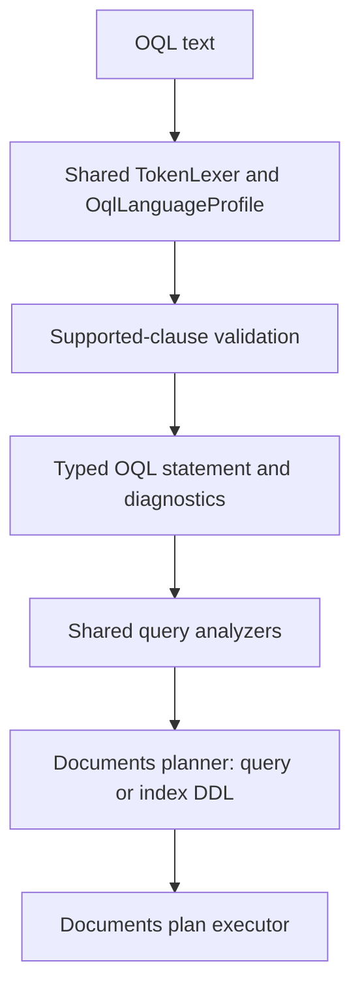

# Assimalign.Cohesion.Database.Documents.Language — Design

The package owns the document model's OQL grammar, statement and expression trees, diagnostics,
and conformance corpus. `OqlQueryParser` derives from the shared `QueryParser` and declares
`OqlLanguageProfile.Instance` as its profile. The shared `TokenLexer` provides tokenization;
there is no alternate lexer or duplicated keyword configuration.

The OQL name is retained, but the language basis is SQL++ for JSON, following Couchbase
SQL++ for Query. The executable subset below is the dialect contract; it does not claim
complete SQL++ support. MISSING and NULL are separate values (#1126, owner D2/D2a).

## Family and pipeline

`Database.Documents.Language` references only `Assimalign.Cohesion.Database.Language`.
`Database.Documents` consumes its AST for logical planning, physical index selection,
collection and index catalog changes, and execution. This package has no catalog, storage, hosting, or
ApplicationModel dependency.

Parsing runs shared lexing, capability validation, statement/expression parsing, then shared
analyzers. Malformed input remains an `OqlQueryStatement` with error diagnostics; consumers
must reject statements containing errors before planning.

The diagram shows the common parse-plan-execute flow. Both `SELECT` and index DDL remain on this
path; DDL is not dispatched through a separate engine API.



## Supported-clause matrix

The profile's supported set is deliberately the executable subset of `OqlClauses`.
Lexical recognition preserves the established vocabulary so rejected constructs receive
`COHDBL001`; recognizing a token does not make its operation supported.

| Clause | Supported | Shape or reason |
| --- | --- | --- |
| `SELECT` | Yes | One or more projected expressions, optional `AS` output names; `*` returns the source document |
| `EXPLAIN` | Yes | `EXPLAIN SELECT` or `EXPLAIN INSERT` describes the plan without reading document data or writing |
| `INSERT` | Yes | Explicit KEY/VALUE pairs, or KEY and optional VALUE bindings to SELECT output names |
| `VALUES` | Yes | One or more parenthesized key/value pairs for INSERT |
| `FROM` | Yes | Exactly one unqualified collection or reserved `COHESION_SCHEMA` source and optional iteration variable, with or without `AS` |
| `WHERE` | Yes | Scalar comparison and Boolean document filtering |
| `GROUP BY` | Yes | One or more grouping expressions |
| `HAVING` | Yes | Group filtering, including aggregate calls |
| `ORDER BY` | Yes | One or more expressions, each optionally `ASC` or `DESC` |
| `CREATE COLLECTION` | Yes | One database-local collection, optionally `IF NOT EXISTS` |
| `DROP COLLECTION` | Yes | One database-local collection, optionally `IF EXISTS` |
| `CREATE INDEX` | Yes | One named, nonunique index over one document path in one collection |
| `DROP INDEX` | Yes | One named index in one collection; the `ON` qualifier is required |
| `SUBQUERY` | No | A nested `SELECT` reports this capability name at the inner keyword |
| `LIMIT`, `OFFSET` | No (pin) | SQL++ row limits; oql-limit-offset flips the pin |
| `UPSERT` | No (pin) | SQL++ document write; oql-upsert flips the pin |
| `MERGE` | No (pin) | SQL++ merge; stays a pin with no T1 item lifting it, and #1101 owns it |
| `UNNEST` | No (pin) | SQL++ array expansion in `FROM`; oql-arrays flips the pin |
| `EVERY ... SATISFIES` | No (pin) | SQL++ quantified predicate, also opened by `ANY` and `SOME`; oql-arrays flips the pin |

Callable functions are `META` and the aggregates `COUNT`, `SUM`, `AVG`, `MIN`, and `MAX`. Each aggregate takes one expression;
`COUNT(*)` also counts documents. Aggregate placement, grouping consistency, and value semantics
are validated by the Documents planner/executor. `DISTINCT`, `ALL`, `IN`, `EXISTS`, `LIKE`,
`BETWEEN`, collection constructors/quantifiers, `ABS`, and other reserved but unimplemented
operations produce `COHDBL001`. Unknown function calls likewise produce `COHDBL001` naming the
function. Retired ODMG constructs remain recognized only to produce deliberate diagnostics.

### Keyword disposition (#1101)

The capability scan reads one static recognized-unsupported table, `OqlUnsupportedVocabulary`.
Each entry has a spelling, the construct its `COHDBL001` names, and a position. Each
recognized-unsupported construct is reported once at the word that names it, and never bound as
a name:

- **Anywhere** (reserved unsupported SQL++ vocabulary): every occurrence except a path segment after a dot. All
  are lexer keywords or functions.
- **Clause** (statements and clauses of other languages, and the SQL++ words `LIMIT`,
  `OFFSET` and `UNNEST`): the first word of the statement, or the word directly after the end
  of an operand. An operand ends with a name, a path segment, a literal, a parameter, `)`, `]`,
  `NULL`/`NIL`/`TRUE`/`FALSE` or `ASC`/`DESC`. So `WHERE a = 1 LIMIT 5`, `WHERE a = 'x' LIMIT 1`
  and `ORDER BY a DESC OFFSET 2` report `LIMIT` or `OFFSET`, where they used to fall through to
  `OQL0002`. `FROM c UNNEST c.items` reports `UNNEST` instead of binding it as the alias. These
  words are not lexer keywords, so `SELECT limit, merge FROM c` and `SELECT a AS limit FROM c`
  still parse. Because the collection name ends an operand, a Clause word cannot be an AS-less
  `FROM` alias: `FROM c unnest` reports `UNNEST`, while `FROM c AS unnest` keeps it a name.
- **Statement** (`DEFINE` and the SQL++ statement verbs `UPSERT` and `MERGE`): only the first word of the
  statement. Elsewhere they are names, so an AS-less alias such as `FROM c merge` still parses,
  as it did before #1101.
- **Function** (`ELEMENT`, `FLATTEN`, `LISTTOSET`, `STRUCT`, `LIST`, `BAG`, `TYPEOF`, and `ABS`):
  only immediately before `(`. Elsewhere these spellings are ordinary identifiers.
- **Quantifier**: `EVERY`, `ANY` or `SOME` followed by `name IN` opens a quantified predicate.
  It is one construct named `EVERY ... SATISFIES` (or `ANY`/`SOME`), up to its `END`. Its binding
  `IN` is not reported as the `IN` predicate. ODMG's `FOR ALL name IN` and `EXISTS name IN` bind
  the same way and report `FOR ALL` and `EXISTS`; the `SATISFIES` after them is not reported
  again. `EVERY` and `SATISFIES` name the construct only there, so an alias such as
  `FROM c every` still parses.

A statement whose first word is unsupported, such as `UPSERT INTO c ...` or
`MERGE INTO c ...`, is one construct: the scan reports that word and nothing after it. Each
operand of a set operation starts its own `SELECT`, which is not reported as a subquery, and a
set operation with `ALL` or `DISTINCT` (`UNION ALL`) is one construct spanning both words.
`OqlKeywordDispositionTests` enumerates the profile's keywords plus the table. Every word needs
a supported parse case or a case with exactly one `COHDBL001` naming its construct, and for a
table entry that diagnostic must also name the construct the table records. A word added
without a case fails, so oql-sqlpp-basis and the flip items add their cases in the same change.
OQL declares no `~`, so `SELECT ~a FROM c` stays an `OQL0002` syntax error (a pin). It is one
error: a second error with the same code at the same span is dropped, so recovery that reaches
one bad token from several rules no longer reports it three times.

### SQL++ reservations and retired ODMG words (#1126)

Membership tests assert these lists without freezing arrays that later T1 items extend:

| Disposition | Words |
| --- | --- |
| Reserved | MISSING, VALUED, KNOWN, UNKNOWN, NIL, UNDEFINED, SET, ARRAY, COLLECTION, FIRST, LAST, UNIQUE |
| Freed identifiers | DEFINE, ELEMENT, FLATTEN, STRUCT, LIST, BAG, LISTTOSET, TYPEOF |
| Removed functions | ELEMENT, FLATTEN, FIRST, LAST, LISTTOSET, UNIQUE |

`DEFINE` is rejected only statement-initially. `ELEMENT`, `FLATTEN` and `LISTTOSET` are
rejected only in call position; a future positional SELECT ELEMENT needs no reservation.
`STRUCT`, `LIST`, `BAG` and `TYPEOF` lose their ODMG constructor/type meaning and are likewise
rejected only as calls. All eight freed names can be projected as unquoted fields.
`FIRST`, `LAST` and `UNIQUE` retain SQL++ reservations and report COHDBL001 wherever a
reserved unsupported word does; UNIQUE's index meaning belongs to oql-index-ddl.
`UNDEFINED` stays reserved and rejected, never a MISSING synonym. `NIL` remains a NULL synonym.
SET remains reserved (its UPDATE meaning belongs to oql-update), as do ARRAY, COLLECTION,
FOR, SOME and ANY. COLLECTION retains its collection-DDL meaning. KNOWN and UNKNOWN are
reserved but deferred; `IS KNOWN` and `IS UNKNOWN` report COHDBL001 at that word.

Removing public `OqlClauses.Define`, `Element` and `Flatten` is an intentional source/binary
API break, allowed by the owner's decision that nothing has shipped publicly. No aliases remain.

### SQL++ MISSING semantics (#1126)

The [Couchbase four-valued table](https://docs.couchbase.com/server/current/n1ql/n1ql-language-reference/booleanlogic.html)
is the owner-selected dialect. T/F/N/M below mean TRUE/FALSE/NULL/MISSING.

| Left AND right | T | F | N | M |
| --- | --- | --- | --- | --- |
| T | T | F | N | M |
| F | F | F | F | F |
| N | N | F | N | M |
| M | M | F | M | M |

| Left OR right | T | F | N | M |
| --- | --- | --- | --- | --- |
| T | T | T | T | T |
| F | T | F | N | M |
| N | T | N | N | N |
| M | T | M | N | M |

NOT maps T/F/N/M to F/T/N/M. Ordinary comparison and arithmetic propagate MISSING before
NULL, including `MISSING + NULL`. WHERE and HAVING retain only Boolean TRUE.

| Predicate | Present value | NULL | MISSING |
| --- | --- | --- | --- |
| IS NULL | FALSE | TRUE | MISSING |
| IS NOT NULL | TRUE | FALSE | MISSING |
| IS MISSING | FALSE | FALSE | TRUE |
| IS NOT MISSING | TRUE | TRUE | FALSE |
| IS VALUED | TRUE | FALSE | FALSE |
| IS NOT VALUED | FALSE | TRUE | TRUE |

An absent member, a wrong shape, or an out-of-range array index produces MISSING. Navigating
through explicit NULL also produces MISSING: Couchbase's `nullValue.Field` and `Index`
return missing values ([value/null.go:147-169](https://github.com/couchbase/query/blob/master/value/null.go#L147-L169)).
Reading the NULL member itself still yields NULL. This is the implementer's navigation
default, recorded for owner review. Arrays are indexed explicitly; dotted property access
does not implicitly map across an array.

Total ascending order is MISSING < NULL < FALSE < TRUE < number < ordinal string < array <
object. Descending reverses it; ties retain document identity order. GROUP BY retains
separate MISSING and NULL keys. COUNT(expr), SUM, AVG, MIN and MAX skip both; COUNT(*)
counts documents. A MISSING value does not obscure a column's one observed scalar type.
Result projections and object constructors omit MISSING members and retain explicit null.
Composite/UNIQUE index keys belong to oql-index-ddl.

## Grammar, statement, and expression trees

```text
statement    := (query | insert | EXPLAIN (query | insert) | create-collection | drop-collection | create-index | drop-index) [';']
query        := SELECT projection (',' projection)* FROM collection [AS? identifier]
                [WHERE expression] [GROUP BY expression (',' expression)*]
                [HAVING expression] [ORDER BY ordering (',' ordering)*]
insert       := INSERT INTO collection [AS identifier] '(' KEY ',' VALUE ')'
                VALUES '(' expression ',' expression ')' (',' '(' expression ',' expression ')')*
              | INSERT INTO collection [AS identifier] '(' KEY identifier [',' VALUE identifier] ')' query
object       := '{' [(string | identifier) ':' expression (',' (string | identifier) ':' expression)*] '}'
metadata     := META '(' [identifier] ')' '.' (id | version)
create-collection := CREATE COLLECTION [IF NOT EXISTS] collection
drop-collection   := DROP COLLECTION [IF EXISTS] collection
create-index := CREATE INDEX identifier ON collection '(' path ')'
drop-index   := DROP INDEX identifier ON collection
collection   := identifier | COHESION_SCHEMA '.' identifier
projection   := expression [AS identifier]
ordering     := expression [ASC | DESC]
path         := identifier ('.' identifier | '[' integer ']' | '[' string ']')*
presence-test := expression IS [NOT] (NULL | MISSING | VALUED)
literal      := NULL | NIL | MISSING | TRUE | FALSE | number | string
```

`CREATE INDEX` and `DROP INDEX` use the profile's SQL++ index-DDL shape.
The create form accepts the same document-path grammar as query expressions, so
an index can target a nested object field or array element. The path is relative to each document;
there is no iteration alias in an index statement. Index and collection names follow the same
identifier quoting and case-preservation rules as query collection names.

`OqlQueryStatement` wraps one top-level `OqlExpression`: `OqlSelectExpression`,
`OqlExplainExpression` (one SELECT or INSERT), `OqlInsertExpression`,
`OqlCreateCollectionExpression`, `OqlDropCollectionExpression`, `OqlCreateIndexExpression`, or
`OqlDropIndexExpression`. Collection nodes retain `Name` and `IfNotExists`/`IfExists`.
Index creation retains its target as an `OqlPathExpression`, rather than flattening the path during
parsing, so the planner receives the
same segment model used by query predicates.

Keywords and function names are case-insensitive. Collection and property names preserve case.
Double quotes delimit identifiers; single quotes delimit strings, with a doubled single quote
representing one quote. Property names after a dot may use a reserved word; bracket strings
address arbitrary property names. Array indices are nonnegative, zero-based 32-bit integers.
Parentheses group expressions. Parameters follow the
[shared parameter contract](../../Assimalign.Cohesion.Database.Language/docs/DESIGN.md#parameter-contract-1102):
`$name`, `@name`, `$_x`, `$1` and `@1` produce bare parameter names. Empty sigils and
mixed numeric/identifier names such as `$1a` report one OQL0002 naming the grammar.
Numeric names use ASCII digits only: `$١`, `@١` and `$1١` report OQL0002 at the whole reference.
Operand `?` and `:name` use the shared supported-form message at the complete span;
a trailing stray `?` keeps its generic character error. Empty identifiers are syntax errors.
The parser links Execution's stateless name check without an assembly dependency.
ParameterConformanceTests is the parameter-form conformance corpus.

Literal nodes hold a string, Boolean, decimal, or null; `NIL` is a synonym for null.
These values use `OqlLiteralExpression`; MISSING has its own `OqlMissingExpression`.
Decimal and scientific notation use invariant culture and reject invalid/out-of-range decimal values.
Numeric query literals therefore have a bounded decimal range even when JSON can represent a
larger number. The parser does not silently round a literal to an infinity or coerce it to text.

Operator precedence, lowest first: `OR`, `AND`, comparisons and null tests, addition/subtraction,
multiplication/division/remainder, unary signs. `NOT` binds around comparisons, so
`NOT age < 18` means `NOT (age < 18)`. Comparison operators are `=`, `!=`, `<>`, `<`, `<=`, `>`,
and `>=`; the AST normalizes `<>` to `!=`. Presence tests are unary `IS [NOT] NULL`,
`IS [NOT] MISSING` and `IS [NOT] VALUED` nodes with distinct operator strings.
Arithmetic supports `+`, `-`, `*`, `/`, and `%`.

The parser is a partial class, split into dispatch/token handling, SELECT clauses, DDL, DML, and
expression parsing, following `SqlQueryParser`. Parser-produced list properties are read-only
snapshots; AST nodes retain source spans and the top-level expression retains the original
statement text.
Locations use zero-based UTF-16 offsets with exclusive ends and one-based line numbers.
Nested expressions are capped at 128 recursive parse levels; rejection is a diagnostic, not a
stack-overflow exception. Concurrent calls on one parser are serialized. The parser owns no
disposable resources beyond those used by the shared analyzer pipeline.

## EXPLAIN (#1104)

SQL++'s `EXPLAIN SELECT` and `EXPLAIN INSERT` spellings produces the shared plan-description columns documented by
[Execution](../../Assimalign.Cohesion.Database.Execution/docs/DESIGN.md#plan-descriptions-1104).
`OqlExplainExpression.Statement` retains the query for ordinary parameter validation and
planning. The parser rejects DDL, transaction control, nested EXPLAIN and EXPLAIN ANALYZE with
`COHDBL001`, and applies the normal single-statement/trailing-token check to the whole form.
The Documents engine owns its operator names and JSON-document wire representation.
`EXPLAIN` is contextual only at the statement prefix, matching PostgreSQL's unreserved keyword
classification (`src/include/parser/kwlist.h:167` in the local clone). It is not a lexer keyword;
unquoted `explain` remains a collection, property path, iteration variable or output alias.
The keyword-disposition corpus covers these identifiers both with and without the prefix.

## Diagnostic contract

| Code | Meaning |
| --- | --- |
| `COHDBL001` | A recognized clause or operation lies outside the executable profile, reported once at the word that names it (see Keyword disposition) |
| `OQL0001` | Empty statement, including whitespace/comment-only text |
| `OQL0002` | Syntax error, missing token, invalid identifier/path, multiple statements or leftover tokens, or a character OQL does not use (`?`, `#`, `^`, `§`, ...) |
| `OQL0003` | Unterminated quoted text or block comment |
| `OQL0004` | Invalid or out-of-range numeric literal |
| `OQL0005` | Expression nesting exceeds the supported depth |
| `OQL0006` | Invalid aggregate argument count or star operand |

Every error has an absolute start/end span and source line. End-of-input errors use the source
length for both offsets. A line breaks at LF, CR, NEL (U+0085), LS (U+2028) or PS (U+2029), and
CR LF is one break (`TokenLexer.CountLineBreaks`). Capability validation precedes statement parsing
so an unsupported construct receives the shared capability diagnostic instead of an accidental
generic syntax error. Quotes, comments, and property names after dots are not mistaken for clauses.
Malformed collection or index DDL produces `OQL0002` at the missing or invalid token; it does not escape the
parser as an exception.

A `--` comment ends before the first of those line terminators, the rule
`Database.Language/docs/DESIGN.md` records for every language, so line numbers break exactly where
a comment ends (#1150). The shared lexer used to end a comment only at LF, so in
`SELECT * FROM people -- note<CR>WHERE age > 1` the `WHERE` was comment text and every document
matched. The `WHERE` now stays in effect at every terminator, and `OqlLineCommentTests` pins it
together with the diagnostic lines. OQL has no `//` comment: `/` is the division operator.

A character OQL does not use lexes as `TokenType.Unrecognized`. It reports
`Unexpected character '<c>'; it is not part of OQL.` (`OQL0002`) at its span during
tokenization. The statement is then not parsed, so nothing is bound and no `NULL` literal stands
in for the character. `?` defers rejection to syntax parsing: an operand gets the shared
supported-form message, while a trailing stray `?` keeps the generic character message.
Adjacent host-parameter names in operand position, including `:union`, `:like` and `:select`,
bypass the capability scan and receive that one syntax diagnostic at the whole reference.
Every statement form (`SELECT`, collection DDL, and index DDL)
rejects leftover tokens with `OQL0002`, with or without a separating `;`, and the corpus pins
both.

## Scope, index DDL, and mutations

OQL's scope was deliberately expanded from query-only to include index DDL. Documents and SQL now
manage secondary indexes through their language pipelines, and callers no longer need document
index extension members that switch on internal database implementations. This is an intentional
language-design change, not an accidental departure from the earlier query-only boundary. It is
extended by `CREATE COLLECTION [IF NOT EXISTS] name` and `DROP COLLECTION [IF EXISTS] name`
(#1130). Collection and index statements are parsed, planned, and executed by the Documents
engine in the same change that adds them to `OqlLanguageProfile`.

`IF` remains an identifier, recognized as a modifier only immediately after `COLLECTION` when
followed by `NOT` or `EXISTS`. Thus `CREATE COLLECTION if`, `CREATE COLLECTION "if"`, and
`DROP COLLECTION if` use the name `if`. The shared DDL helper requires `NOT EXISTS` for creation
and `EXISTS` for removal. `CREATE COLLECTION IF EXISTS c` reports `OQL0002` at `EXISTS`.
Unquoted `EXISTS` remains reserved and reports `COHDBL001` outside that modifier (except an
ordinary property segment after a dot); `COLLECTION` remains reserved outside its DDL position.
Both statements return Success with affected count zero. Creation defaults to Adhoc ownership;
conditional creation preserves any existing collection, including a schema-owned one. Conditional
removal ignores an absent collection but still refuses a schema-owned collection. Snapshot
conflicts are checked before either no-op. DDL, documents, and indexes commit or roll back together.

An OQL statement cannot name a server or switch databases. `FROM other.collection` is invalid
syntax; quoted collection names remain a single opaque identifier. The only qualified source
syntax is the reserved `COHESION_SCHEMA.<name>` namespace in the current database. The engine
resolves `COHESION_SCHEMA.INDEXES` and `COHESION_SCHEMA.OBJECT_OWNERSHIP` to virtual document
collections computed from its statement catalog snapshot. Their qualified names are
case-insensitive, including fully quoted names. Their document fields retain ordinary
case-sensitive OQL path semantics. No catalog or storage dependency is added to this parser.

The same source syntax is parsed in collection and index DDL so supported mutations receive the engine's
stable `System collection '<canonical source>' is read-only.` diagnostic instead of an
accidental syntax or missing-collection error. Projection, filtering, grouping, and ordering
reuse ordinary SELECT syntax; no separate metadata API or statement class is introduced.
The engine design documents the field shapes, snapshot visibility, and read-only rules.
`CREATE DATABASE`,
`DROP DATABASE`, `USE`, and other SQL data-mutation/transaction commands are unsupported.
Multiple statements per parse are rejected. Logical database creation and deletion remain
engine-side C# operations.

### INSERT and metadata (#1131)

Document keys are external: collections declare no key field and never generate ids. The
SQL++ KEY/VALUE forms above are the T1 mutation grammar. Id-less VALUE/VALUES forms report
OQL0002 asking for KEY. KEY, VALUES and INTO remain non-reserved; the header reads KEY and
VALUE by position, independently of SELECT VALUE's eventual reservation. OPTIONS in the
header reports COHDBL001 because Documents has no TTL. RETURNING is recognized but deferred,
including after literal and parameter operands. General database-qualified destinations remain invalid.

VALUES expressions accept constants, parameters, operators and object constructors; document
paths, aggregates and META require a source and fail planning here. INSERT SELECT binds KEY
and optional VALUE to exact output names. Without VALUE, the complete projected row becomes
the JSON object. A MISSING key or top-level VALUE fails the statement; MISSING members are
omitted and explicit NULL members are stored. Object construction has an OqlObjectExpression
node so the required INSERT member rule uses the ordinary evaluator, without a second JSON parser.

META is a declared function with its own OqlMetaExpression. It exposes id and the engine's
monotonic version for stored rows, even when their content has absent members. An optional
argument must be the source alias. Bare META, other members and virtual system sources fail
planning. The name meta remains usable as a property or an implicit FROM alias. Metadata
predicates remain residual filters; a content index on id cannot become a metadata lookup.
The engine design records atomicity, serialization and duplicate/conflict behavior.

## Verification and extension

`OqlQueryParserTests` and `OqlIndexDdlParserTests` contain valid and malformed query/index-DDL
corpora plus structural AST, exact diagnostic span, precedence, nested-path/array, parameter,
scope, and recursion-limit checks. `OqlParseStrictnessTests` pins stray characters, the SQL++
words, field names that reuse them, and trailing tokens after every statement form.
`OqlKeywordDispositionTests` is the keyword-disposition corpus.
Profile tests assert every supported capability and every deferred OQL clause. Existing lexer
conformance remains unchanged, including recognition of unsupported reserved vocabulary.

A new clause requires parser, planner, executor, conformance tests, and a matrix entry together;
only then may it join the profile's supported set. The package uses static code and BCL values,
with no reflection, runtime discovery, or `Microsoft.Extensions.*` dependencies, and remains
NativeAOT compatible.

## Function declaration and diagnostic delivery (#1103)

Profile.Functions is the executable built-in set, checked by the engine's one function-
coverage guard: every declared name has a passing live case and every live case has a
declared name. OQL declares META, COUNT, SUM, AVG, MIN and MAX; the retired ODMG declarations
and their temporary guard exemptions are gone. ABS remains recognized by its unsupported
table, and parser/planner membership checks read the profile.

ABS now lexes as an identifier and its unsupported-table position matches calls only:
`ABS(value)` reports COHDBL001 while a field named `abs` remains a path expression.

The root DatabaseException.Diagnostics carrier preserves the complete parser list at text
factories and session boundaries, including parsed typed requests. DatabaseParseException
retains the existing first-error message and no error-recovery AST executes. Graph's path
request factory shares this contract. Diagnostics remain plain Database.Types data.
