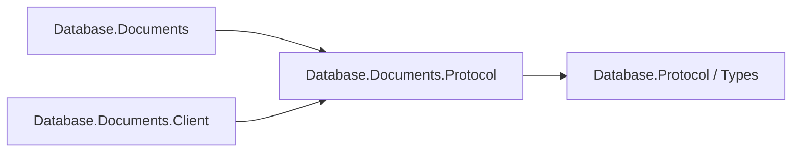

# Assimalign.Cohesion.Database.Documents.Protocol design

This independently consumable contract library owns Documents framing payloads, validation and transferred values. Its direct contract references are Database.Protocol and Database.Types for scalar and diagnostic values. The engine and client use the same CLR DTO types and family singleton; there are no duplicate DTOs or type forwarders. Model request, planner, executor, catalog, storage and server state remain engine-owned.

The arrows show references:

Model payload bytes, limits, malformed-payload behavior and exception text are preserved. Span-based codecs and explicit value handling remain trimming and NativeAOT compatible; no reflection serializer or dynamic discovery is introduced. The ProtocolMessageFamily is defined exactly once in this assembly. Existing codec tests live in this project's tests; engine/server/client integration tests retain their existing owners.
DocumentProtocolJson and DocumentProtocolWire live in src/Internal under the owning Protocol namespace. They preserve strict UTF-8 JSON parsing, complete-value checks and payload bounds. Their required ErrorMessages entries are owned and generated here; engine-only resources remain in Documents.

## Documents diagnostic conventions (#1470)

Exception and diagnostic templates use the project's build-generated `ErrorMessages` resources.
Parameterized templates format with the current culture; abort/cancellation templates used in
normal cleanup are cached. The [Database error-code registry](../../Assimalign.Cohesion.Database/docs/ERROR-CODES.md)
assigns this family its two-letter prefix and categorized five-digit identities.
Existing SQLSTATE meanings, numeric wire error kinds, frame layouts and disk formats are preserved.
Structured diagnostics keep their code outside the message. Compiler diagnostic identifiers and
standard .NET argument guards retain their own contracts.

## Debugger inspection (#1470)

DocumentId debugger inspection exposes its existing public Value getter, which reads the stored identifier or the existing empty default. Static codecs remain unchanged; inspection does not parse JSON, encode payloads or walk document values.

Eligible types follow the [Database conventions](../../Assimalign.Cohesion.Database/docs/CONVENTIONS.md) debugger display/proxy rules. Views are private and read-only; inspection does not change the public API, execution paths, error contracts, storage formats or protocol bytes.

## Transaction-status agreement (#1725)

Documents advertises the existing core transaction-status capability without Diagnostics.
Negotiated Ready follows Complete or Failure for Execute (64) and Command (69). Its exact two-byte
payload carries ASCII I, T or E followed by a retained-session-state byte, always zero for Documents
(#1717). It replaces the former one-byte public record/payload without a compatibility reader;
other lengths or retained bytes outside 0/1 are CK07002. The family declares no retained-state
reset statement. Pool return sends only a needed ROLLBACK and requires Idle with zero retained state.
Legacy 2.0 and unnegotiated 2.1 responses retain their terminal framing. Reset uses the existing
Execute payload with ROLLBACK and an empty JSON object; Complete (66) must carry two zero Int64
counts, followed by Idle. No new message identifiers or protocol version are introduced.
