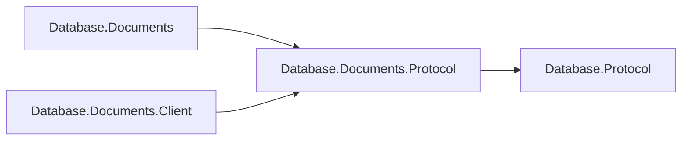

# Assimalign.Cohesion.Database.Documents.Protocol design

This independently consumable contract library owns Documents framing payloads, validation and transferred values. It references only shared Database.Protocol. It also references Database.Types for scalar and diagnostic values. The engine and client use the same CLR DTO types and family singleton; there are no duplicate DTOs or type forwarders. Model request, planner, executor, catalog, storage and server state remain engine-owned.

The arrows show references:

Wire bytes, limits, malformed-payload behavior and exception text are preserved. Span-based codecs and explicit value handling remain trimming and NativeAOT compatible; no reflection serializer or dynamic discovery is introduced. The ProtocolMessageFamily is defined exactly once in this assembly. Existing codec tests live in this project's tests; engine/server/client integration tests retain their existing owners.