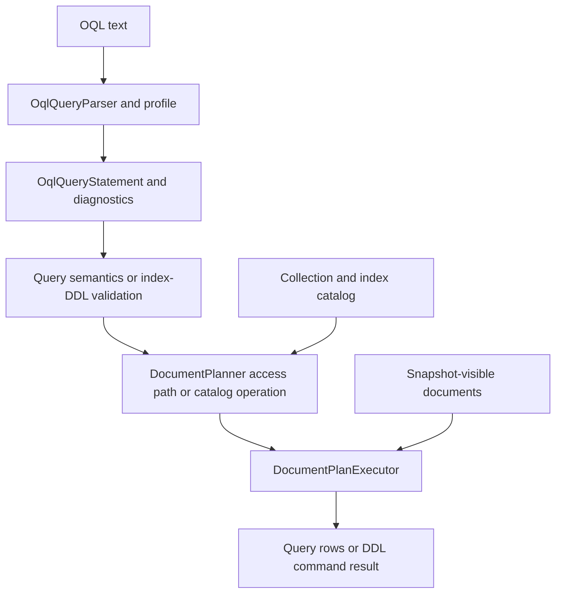
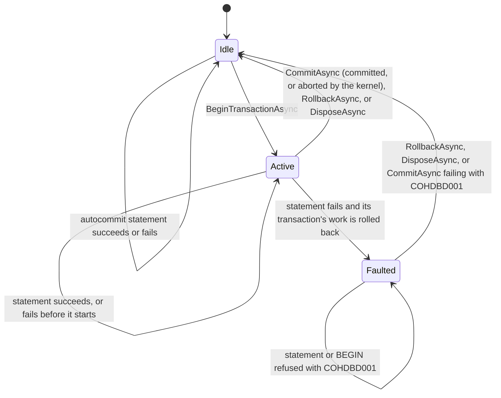
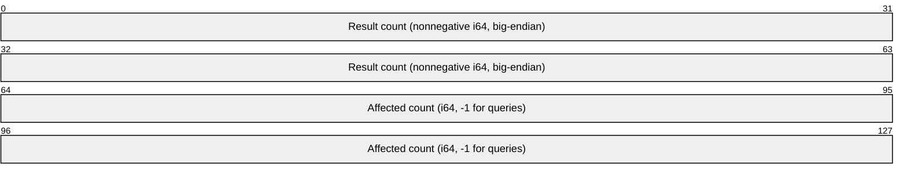
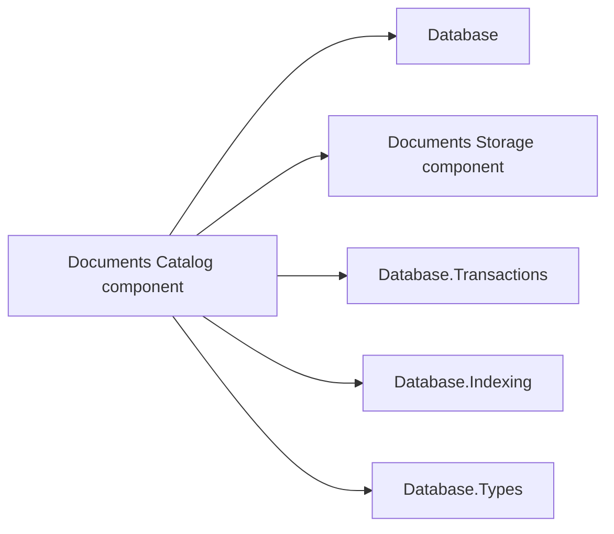
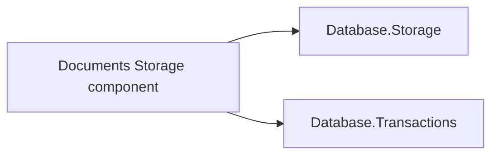

# Documents engine design

## Child-root failure boundaries (#1247, #1364)

Attached-index damage becomes `DatabaseCorruptionException` / `COHDBS003`, retaining the
index cause, `COHDBI002`, and model diagnostic `COHDBD005`. Other index failures use
`COHDBD005`. I/O inside catalog/index-registration wrappers remains `COHDBD004`, including
open before publication. Explicit and automatic transaction begin use the same full translator.
Wire execution returns `ExecutionFailure` with diagnostics and preserves the session; a
regression damages an actual non-root B-tree leaf and proves both embedded and wire behavior.
Aborted-transaction refusals carry `COHDBD001` in Diagnostics; only the wire adds its prefix.
The internal begin fault seam exercises both begin callers without widening the coordinator.


## Storage corruption (#1160)

A StorageIOException or IOException while opening storage crosses the engine boundary as
DatabaseException with structured COHDBD004 diagnostics (#1364). Open releases any acquired
file set and publishes no database, so callers may resolve the I/O condition and retry.


Storage corruption is `COHDBS003` (#1160). The engine translates a
`StorageCorruptionException` into `DatabaseCorruptionException`, retaining the storage
cause and page id, naming the database and page, and advising restoration from a verified
backup. Its structured diagnostic crosses the existing wire execution-failure path; a
failed read never becomes an absent row, document, node, key or blob. Legitimate slot
reclamation still reads as absence. Create/open failures receive the same translation
from the root lifecycle after the model has released its resources. Storage format 4
reserves zero headers for entirely zero pages and identifies reclaimed pages separately.

Corruption translation searches coded inner exceptions and every aggregate branch with
`StorageCorruptionException.Find`; an existing `DatabaseCorruptionException` is retained.
This applies to read/statement and transaction failures as well as synchronous and deferred
create/open failures. A refused open retains any existing model diagnostics in addition to the
outer `COHDBS003`; Graph, Documents and Blob also carry their unrecoverable-files diagnostic
(`COHDBG018`, `COHDBD003` and `COHDBB004` respectively). The original storage exception remains
the inner cause, preserving its page context. Graph abort messages prefix a cause's code only
when the message does not already contain that prefix.

## Wire contract ownership

`Assimalign.Cohesion.Database.Documents.Protocol` owns this model's wire messages, codecs, family singleton and transferred value shapes (14 public types). Both engine and remote client reference that one assembly. Its public namespace and RootNamespace equal its project name. Engine requests, planning, catalog, storage and server lifecycle stay in `Assimalign.Cohesion.Database.Documents`. This extraction preserves wire bytes and validation; moved public types intentionally change namespace and assembly identity with no forwarders.


## Model component boundaries

Catalog, Storage and the empty Security satellite projects are consolidated into Assimalign.Cohesion.Database.Documents. Public Catalog and Storage types keep their existing namespaces and live under src/Catalog and src/Storage; their assembly identity is now Assimalign.Cohesion.Database.Documents. Internal component types live under src/Internal/Catalog and src/Internal/Storage and declare Assimalign.Cohesion.Database.Documents.Internal.

Engine-owned storage strategies, row/entry codecs and catalog-aware persistence glue live in src/Internal/Engine/Storage; the architecture test enforces strategy placement there. TransactionRecordSpace implementations and physical location-packing helpers belong to the Storage layer (src/Internal/Storage, or nested within a public Storage type); adapter placement is also enforced. This refines the original fold folder map without changing namespaces, members or behavior.

The dependency direction remains engine → Catalog → Storage → shared kernel. Storage-folder types must reference neither Catalog-folder nor engine types; Catalog-folder types must reference no engine types. The build exports the actual compiler inputs, and this model's architecture test recompiles them with Roslyn and checks resolved type/member symbols by their declaring source folders, including partial and generated types. Referenced types also pass a per-layer containing-assembly allowlist seeded from the retired satellite csprojs at a64426436: Storage permits shared Storage, Transactions, Indexing and the actual BCL reference pack; Catalog additionally permits the area root and Types. Engine code is unrestricted. See the area README for the common placement and assembly rules. Build-generated resource accessors and assembly metadata are shared infrastructure, outside the three layers. No new shipped-assembly visibility grant, wire or disk format, diagnostic code, or behavior is introduced.


## Request parameters (#1102)

The session copies the caller map once per execution with Execution's stateless shared
source, inside the operation bracket so a failure retains the usual transaction-abort
behavior. It validates every parameter reference before planning/executing data access,
including projections, filters, grouping, HAVING and ordering over empty collections.
Missing names carry COHDOC005 and their reference span; normalized-key collisions carry
COHDOC009. The evaluator reads the ordinal bare-name snapshot. Unused keys are ignored.
Numeric names use ASCII digits only; Unicode numeric references fail parsing before a
matching map key can bind. `$0`, `$01` and names beyond Int64 remain exact string keys.
See the [shared parameter contract](../../Assimalign.Cohesion.Database.Language/docs/DESIGN.md#parameter-contract-1102).


## String comparison and collation (#1025)

Documents remains ordinal-only. OQL string predicates, ordering, grouping, and
distinct comparisons use case-sensitive .NET ordinal (UTF-16 code-unit) order.
String index keys encode that same order, including supplementary characters;
they do not inherit SQL's UTF-8 collation transforms. Collection names, document
IDs, JSON property names, and prefix listings are also ordinal and case-sensitive.
Administrative database lookup remains ordinal-ignore-case. SQL database defaults,
column collations, and expression `COLLATE` have no effect on this model.
Configurable document collation is deferred; stored text retains its original form.

## Incremental index reads (#1542)

Catalog index scans and unique probes pass their statement token at cursor open and on every move. Shared B+Tree cursors copy bounded batches and release their read latch before document decoding or validation. Scans and unique checks finish before applying index changes, so transaction-stamped own writes cannot extend an active scan.

The unique probe uses an unpinned latest-state snapshot, so its view can move between batches.
The existing check-then-act gap between that probe and physical apply predates incremental
cursors: it is not a statement-wide uniqueness reservation. The database writer protocol remains
responsible for write serialization; this change adds neither a key reservation nor a pinned
unique-check horizon. Manager replacement after failed apply shares the physical tree's latch
with surviving cursors through the Indexing registry keyed by storage and fixed root page.

## Intent and composition

Documents combines the Blob engine's lifecycle, session transaction, worker, and
stamped chunk discipline with SQL's parse, logical planning, physical planning,
and execution split. Storage, journaling, paging, locks, MVCC, and B+Tree algorithms
belong to the shared kernel. No kernel contract was widened. The engine, its database
(`DocumentDatabase`), session, transaction, collection and builder are public sealed types, the
first four leaves of the area root's bases ([Concrete types](#concrete-types-concrete-types-plan-phase-4-1260)),
while the planner, executor, workers and storage strategy are internal.

SELECT and index-DDL statements flow through these stages; INSERT, UPSERT, UPDATE and DELETE use the same pipeline. Catalog metadata informs query access-path
selection and index-DDL planning; `SELECT`, `CREATE INDEX`, and `DROP INDEX` all reach the same
plan executor rather than an index-management side channel.



| Component or assembly | Responsibility |
| --- | --- |
| `Database.Documents` | Engine, bound sessions, CRUD, OQL query/index-DDL plans and execution, document protocol family, builder extension |
| `Database.Documents.Language` | Profile, parser, AST, stable diagnostic locations |
| `Catalog/` in Database.Documents | Versioned collection/document/index metadata and transactional index maintenance |
| `Storage/` in Database.Documents | Explicit JSON validation, stamped metadata/chunk records, kernel record-space adapter |
| `Database` and child roots | Shared contracts, transaction coordinator, lock manager, WAL, pages, B+Tree |

The engine references the model language package and the Database root. Its Catalog component
uses Documents Storage and shared indexing/transactions, never engine types.
There are no Hosting or ApplicationModel references.

## Sessions and authority

Collection operations exist only on the session (owner decision 32 of 2026-10-06):
`DocumentDatabaseSession.CreateCollectionAsync`, `GetCollectionAsync`, `DropCollectionAsync` and
`GetCollectionsAsync` use that session's active transaction, as OQL statements do; without one,
each runs in an automatic statement transaction. Until decision 32 the database carried
session-less copies that always ran automatic transactions. The engine has one writer at a time,
so a write through one of them while the caller's own session held an explicit transaction's
writer lock waited for that transaction, and a caller that awaited it before ending the
transaction waited until the call's token was canceled. With the session as the one entry point
that self-wait cannot happen. `session.Database` is the unbound database (option B of the
concrete-types plan, §6.6): disposing it closes the database for every session, never the
session itself. Once that close ends the engine forgets the database, so a later
`OpenDatabaseAsync` opens it again from its files ("Lifecycle and durability", owner decision 33).

Collection CRUD always takes a `DocumentDatabaseSession`; a collection rejects sessions from
another database. A handle obtained through a session remains bound to that specific session and
fails once it closes. Collection names are database-local, case-sensitive names;
OQL has one collection source and no database qualification or server commands.
The inherited `DatabaseInstance.Engine` lifecycle reference is the root API;
executing OQL or CRUD never interprets it as session authority over other databases.

Each statement uses one `TransactionContext`. Automatic operations commit on
success and roll back on failure. Explicit transaction operations leave commit
to the caller; a failing operation aborts the whole explicit transaction, which
then refuses every later statement until the caller rolls it back, as
[Failed statements in explicit transactions](#failed-statements-in-explicit-transactions-1225)
describes.
Snapshot isolation fixes the read horizon at transaction start. ReadCommitted
captures one statement snapshot and pins its retention horizon for the statement.
Serializable is rejected rather than silently weakened.
Statement pins use `TransactionCoordinator.BeginSnapshotPinAsync` (#1351), retaining their
manager registration, fixed snapshot and existing rollback/disposal release paths. Pins remain
in the current-transactions gauge but move none of the begin, commit or rollback rates and
emit no Verbose kernel lifecycle events. A real explicit rollback still counts. Read-only pins
append no lifecycle records (#1280); registered statement snapshots are outside this change.

The shared lock manager serializes writers per logical database. Before changing
a document, collection, or index, the operation compares its snapshot with the
latest state under that lock. Committed contexts are excluded from the in-flight set even
while the coordinator still tracks them: the manager marks them committed before releasing
the writer lock, and the coordinator untracks them afterward. A deterministic commit-event
gate pins that handoff for both UNIQUE arbitration and stale-document conflicts (#1135).
An intervening change raises
`DatabaseTransactionAbortedException`. A commit or rollback the transaction kernel
refuses or aborts crosses the model boundary the same way (see "Failed statements in
explicit transactions" below for the end contract). An operation that ends up granted
the writer lock after its transaction ended gives the grant back through the
coordinator's lock manager, which leaves that release to the transaction manager while
the manager still tracks the transaction: a rolled-back transaction whose undo the
kernel had to defer keeps the writer lock until the version-purge pass completes the
undo (#1226, `Database.Transactions` DESIGN.md, "Ending a transaction"). Reads stay
snapshot based. Catalog and
index writes use the same logical context as content chunks; rollback and crash
recovery cannot publish a partial document.

### Failed statements in explicit transactions (#1225)

A statement that fails inside an explicit transaction aborts the whole transaction. Document
storage cannot undo one statement: a `PutAsync` writes its content chunks, tombstones the old
chain and publishes catalog and index entries through separate physical brackets, and
`Database.Transactions` undoes a writer only as a whole transaction, with no savepoints. Until
#1225 the session then dropped the rolled-back transaction from view, so the next statement
silently ran in autocommit and the caller's `RollbackAsync` threw. The session now follows the
contract the Graph engine set in #1188 (Graph [DESIGN.md](../../Assimalign.Cohesion.Database.Graph/docs/DESIGN.md#failed-statements-in-explicit-transactions-1188)),
with its own code, `COHDBD001`:

1. The failure rolls the transaction's work back at once and releases its locks, so the aborted
   transaction blocks no other writer while it waits for the caller. (When the undo itself fails,
   the kernel keeps the writer lock until its version-purge pass completes the undo; see
   `Database.Transactions` DESIGN.md, "Ending a transaction".)
2. The transaction stays the session's `CurrentTransaction` and reports `TransactionState.Faulted`.
   Every later statement on the session fails with `COHDBD001`: OQL text or requests, collection
   `GetAsync`/`PutAsync`/`DeleteAsync`, and the session's own collection operations
   (`CreateCollectionAsync`, `GetCollectionAsync`, `DropCollectionAsync`,
   `GetCollectionsAsync`). `BeginTransactionAsync` fails with `COHDBD001` too. The error names the
   original failure in its message (`Cause: ...`) and carries it as `InnerException`. A refused
   statement does not change the transaction, and an aborted transaction refuses text before
   parsing it.
3. `RollbackAsync` succeeds, leaves none of the transaction's writes, and returns the session to
   autocommit. Disposing the transaction or the session ends it the same way. A rollback of any
   transaction that did not commit may be repeated and raises nothing; a rollback of a committed
   transaction is refused. This holds when the rollback, or the session's disposal, runs while a
   statement of the transaction is still running on another thread: the kernel admits no
   physical bracket of a transaction whose end has begun and waits for the one already applying
   before it undoes the transaction (Transactions [DESIGN.md](../../Assimalign.Cohesion.Database.Transactions/docs/DESIGN.md#ending-a-transaction-under-a-running-statement)),
   so the running statement fails with `DatabaseTransactionAbortedException` and writes nothing
   that outlives the rollback. A statement still waiting for the writer lock fails at once.
4. `CommitAsync` fails with `COHDBD001`, commits nothing, and ends the transaction (`RolledBack`).
   It keeps that answer after the transaction has ended some other way (disposed, or rolled back
   by the caller), so a commit never reports anything but `COHDBD001` for a transaction a
   statement aborted. A commit after the session closed fails with `COHDBD001` too, naming the
   closure ("The session closed before the transaction ended.") when no statement failed first,
   or the statement the closure aborted ("The document session closed while the operation was
   running."). A commit while a statement of the transaction still runs is refused ("An operation
   of the transaction is still running; commit after it completes.") and leaves the transaction
   active. A commit the kernel aborts throws
   `DatabaseTransactionAbortedException` and leaves the transaction `Faulted` and ended.
5. Every failure of a statement that started counts: parse diagnostics of text the session parses
   or of a typed request, planning and execution errors (an unknown collection, a stale expected
   version, a document whose indexed value outgrows the 1,024-byte index key, OQL collection or
   index DDL on a `COHESION_SCHEMA` collection), ownership
   refusals, kernel aborts such as snapshot conflicts, and cancellation while the statement runs,
   including a wait for the writer lock. Failures that come before a statement starts leave the
   transaction unchanged: argument validation (a null, empty or whitespace id, collection name or
   statement text), the typed `CreateCollectionAsync` and `DropCollectionAsync` refusal of a
   `COHESION_SCHEMA` name, a session of another database, a request that carries no OQL
   statement, and the refusal of a second concurrent operation on the session.
6. Autocommit statements are unaffected: a failure ends only its own statement transaction.
7. A rollback or commit observes its cancellation token only before it starts: a token canceled by
   then throws `OperationCanceledException` and leaves the transaction as it was. One that has
   started runs to completion (PostgreSQL holds interrupts through `AbortTransaction`,
   `backend/access/transam/xact.c:2854-2861`), and it always ends the transaction (#1226): the
   transaction kernel completes a started rollback whatever fails (a lost abort record is ignored,
   and a failed undo is retried by the kernel with the writer lock held), and it aborts a commit it
   cannot complete. Until #1226 a journal or storage failure could leave the context active behind
   a failed rollback, and the session kept the transaction `Faulted`, refusing work with
   `COHDBD001`, until a later rollback completed; that end-failure state is gone, as it is in Graph.
   The kernel still refuses a rollback before it starts while the database closes
   (`ObjectDisposedException`: the manager's disposal flags itself before it claims any end, so
   every end refused during the close fails this way). The context then stays active only until
   disposal's own abort ends it: the session refuses statements in the ended transaction ("being
   committed or rolled back; start the operation after it ends."), another `RollbackAsync` fails the same way while the close runs
   and is accepted once the close's abort ended the context, and a `CommitAsync` commits nothing:
   it fails with `ObjectDisposedException` while the database closes, or reports the `Faulted`
   state once disposal's abort ended the context.

Kernel failures cross the engine boundary translated (the area error policy): a deadlock as
`DatabaseTransactionDeadlockException`, a kernel abort as `DatabaseTransactionAbortedException`,
and a commit whose record was written but could not be made durable as
`DatabaseTransactionCommitUnconfirmedException` (the transaction is `Committed`; only its
durability is unconfirmed, `Database.Transactions` DESIGN.md), never as the kernel's own
exception types, for statements and for every end of the explicit transaction alike: commit,
rollback, disposal, the session's closure, and the abort a statement failure starts. One translation (`DocumentDatabase.TranslateKernelFailure`) serves them
all. The unconfirmed commit's message leads with the model's code on every path, the explicit
commit and an automatic statement's own commit alike (owner decision 24 of 2026-10-06, #1272):
`COHDBD002: Database '{name}' went offline while a transaction was committing: ...`, built by the
root's `DatabaseTransactionCommitUnconfirmedException.Create(code, database, cause)` with the
kernel's `TransactionCommitUnconfirmedException` as its inner exception. Before #1272 this path
carried the kernel's message alone, without a code. Storage failures still surface as the
storage child root's exceptions. Since phase 4 of the concrete-types plan the end state machine
this section describes is the root `DatabaseTransaction` base's, and the session state, the "already active" check and the
one-statement hold are the root `DatabaseSession` base's; the model supplies `COHDBD001`,
`COHDBD002`, the kernel calls and this translation ([Concrete types](#concrete-types-concrete-types-plan-phase-4-1260)).

The explicit-transaction lifecycle, where Faulted is the new state:



The reference engines agree on the outcome. PostgreSQL aborts the whole block on any error
(`TBLOCK_ABORT`, "failed xact, awaiting ROLLBACK", `backend/access/transam/xact.c:171`) and rejects
every later command but COMMIT and ROLLBACK before parse analysis with SQLSTATE 25P02
(`backend/tcop/postgres.c:1150-1164`); Neo4j refuses work in a terminated transaction
(`community/kernel/.../coreapi/TransactionImpl.java:529-535`), accepts repeated rollbacks
(`community/kernel/.../KernelTransactionImplementation.java:1184-1194`) and fails a commit of a
transaction it rolled back (`KernelTransactionImplementation.java:1206-1210`, `1291-1303`). COMMIT
follows Neo4j, not PostgreSQL's silent ROLLBACK tag (`xact.c:4133-4139`): a caller awaiting
`CommitAsync` must not see success when nothing committed. RavenDB, the document-model reference,
has no interactive server transaction; its all-or-nothing unit is one client command or batch.
Its transaction merger groups independent requests into one write transaction and, when that
merged transaction fails, disposes it and reruns each request on its own
(`src/Raven.Server/Documents/TransactionMerger/AbstractTransactionOperationsMerger.cs:368-375`,
`391-394`); each rerun gets its own write transaction, disposed uncommitted when the command
throws (`AbstractTransactionOperationsMerger.cs:906-916`). A failed request therefore commits
nothing of its own, and the merge never makes one request's failure another's. Citations are to
PostgreSQL `85f55534e80`, Neo4j `54a7dcf7c25` and RavenDB `83399cb8bc8`.

Documents wire commands use automatic statement transactions; explicit transactions remain in process only
(`DocumentTransactionFailureTests`).

Collections created by these APIs or OQL `CREATE COLLECTION` have `DatabaseObjectOwner.Adhoc`. A collection
directly marked `Schema` refuses `DROP COLLECTION`, `CREATE INDEX`, and `DROP INDEX`,
with `DatabaseObjectLockedException` naming the collection, owning schema, and requested
operation. Document contents remain mutable. There is no
compiled-schema provisioning authority in this engine.

## Documents engine diagnostic codes (#1103)

Child-root storage and catalog failures cross the engine boundary as DatabaseException with
Error entries in Diagnostics and the original InnerException (#1247). Offline and common
COHDBS003 corruption translations take precedence. A failed operation aborts an explicit
transaction; after rollback the in-process session remains usable. The Documents wire returns ExecutionFailure with the carrier and serves the next statement.


Planner failures are `DatabaseException` instances with structured `Diagnostics`, an Error
severity and the offending expression's Start/End/Line when its AST has a location. Their
Message contains no code prefix. The Documents family is `COHDOCnnn`; paging deliberately uses
OQL0007 for the same count rule at parse and plan time:

| Code | Meaning |
| --- | --- |
| `COHDBD003` | Missing or unrecoverable database files; preserve files and restore the complete file set from backup |
| `COHDBD004` | Storage operation failure (including I/O); original cause retained |
| `COHDBD005` | Malformed or unsupported catalog/index metadata |
| `COHDOC001` | Invalid statement, index definition, expression or grouping context |
| `COHDOC002` | Collection does not exist |
| `COHDOC003` | Duplicate projection name; use unique aliases |
| `COHDOC010` | Collection already exists (PostgreSQL SQLSTATE 42P07) |
| `COHDOC011` | Collection is owned by the declared schema and cannot be dropped through a session |
| `COHDOC012` | INSERT found an existing key, or INSERT/UPSERT repeated a key in one statement |
| `COHDOC013` | Invalid evaluated LIKE escape or a pattern ending in its escape character |
| `COHDOC014` | DISTINCT ORDER BY expression is absent from the projection |
| `COHDOC015` | A SELECT array or object constructor exceeds the 256-level result limit |
| `COHDOC016` | Invalid UPDATE target or an incompatible object/array shape or index |
| `COHDOC017` | UPDATE targets duplicate or prefix-overlap after alias normalization |
| `COHDOC018` | UPDATE produces invalid stored JSON or exceeds storage's 128-level depth |
| `COHDOC019` | A scalar function argument is outside its domain (SQRT, POWER or a fractional ROUND/TRUNC scale) |
| `COHDOC020` | A UNIQUE index found a duplicate valued scalar key (23505) |
| `COHDOC021` | A UNIQUE key contains an array or object |
| `COHDOC022` | An index has fewer than one or more than 32 paths |
| `COHDOC023` | A direct SELECT AST repeats a FROM/UNNEST binding name or supplies an empty binding name |
| `COHDOC024` | Index already exists |
| `COHDOC025` | Index does not exist |
| `COHDOC026` | Composite index key exceeds the shared 1024-byte limit |

`DocumentQueryRequest.FromOql` and a directly constructed typed query with parse errors
throw `DatabaseParseException` carrying the complete, ordered parser diagnostics and the
existing first-error Message. No recovery AST reaches the planner. The Documents
server reads `DatabaseException.Diagnostics` for every database exception, including parse,
plan, evaluator and system-collection rejections. It composes `CODE: message` from the first
Error diagnostic, as the SQL and Graph servers do, preserving a message that already contains
that code and colon. Parser exceptions carry every parser diagnostic. Failed results likewise
carry their diagnostics through the exception used by the terminal Failure path.

## OQL query and DDL semantics

### Catalog introspection

Collections are already discoverable through `GetCollectionsAsync` and
`GetCollectionAsync`. OQL adds only the catalog facts those handles do not expose,
through two virtual document collections:

| Source | Document properties | Cardinality |
| --- | --- | --- |
| `COHESION_SCHEMA.INDEXES` | `COLLECTION_CATALOG`, `COLLECTION_NAME`, `INDEX_NAME`, `PATH`, `PATHS`, `IS_UNIQUE` | One document per visible definition; PATHS is the ordered path array, PATH its leading element, and IS_UNIQUE the actual flag |
| `COHESION_SCHEMA.OBJECT_OWNERSHIP` | `COLLECTION_CATALOG`, `COLLECTION_NAME`, `OBJECT_TYPE`, `OBJECT_NAME`, `OWNER`, `OWNING_SCHEMA` | One document per visible collection; `OBJECT_TYPE` is `COLLECTION` |

`COLLECTION_CATALOG` is the bound database name. `OWNER` preserves SQL's `Adhoc`
and `Schema` values; `OWNING_SCHEMA` is the schema name or JSON null. Documents
enforces ownership on the collection: index DDL checks that collection's owner.
The index metadata has no independent ownership, so the ownership source reports
collections and does not invent an index owner. Index paths retain the catalog's
canonical document-path spelling; physical generation IDs and B+Tree pages remain
internal. There is no collection schema or inferred document-field catalog.

The sources are document shaped: `SELECT *` returns one JSON document per entry,
and ordinary projection, aliases, parameters, filtering, grouping, aggregates,
and ordering use the same evaluator as stored documents. For example:

```sql
SELECT INDEX_NAME, PATH FROM COHESION_SCHEMA.INDEXES
WHERE COLLECTION_NAME = 'items' ORDER BY INDEX_NAME

SELECT OBJECT_NAME, OWNER, OWNING_SCHEMA
FROM COHESION_SCHEMA.OBJECT_OWNERSHIP
```

This follows the existing choice to put document index DDL in OQL and keeps the
frozen database interface unchanged. The system-source names are case-insensitive;
their JSON property names are case-sensitive, as with all document paths. Only the
reserved `COHESION_SCHEMA` qualifier is accepted: it names a source in the session's
database, never another database. Ordinary `other.items` remains invalid. Quoting
the entire system-source name also identifies the same reserved source.

Every query computes documents directly from the same transaction catalog snapshot
used by the statement. Snapshot transactions retain their read horizon, while own
uncommitted catalog writes are visible. Subsequent statements observe committed
catalog changes according to their isolation level. No metadata copy, content record,
or synthetic collection is stored, and existing collection listing stays unchanged.

The sources are read-only. `INSERT`, `UPSERT`, `UPDATE`, `DELETE`, `CREATE COLLECTION`, `DROP COLLECTION`, `CREATE INDEX`, and `DROP INDEX` targeting either source,
and `CreateCollectionAsync` or `DropCollectionAsync` using either reserved name,
throw `DatabaseException` with `System collection '<canonical source>' is read-only.`
before ordinary catalog lookup or mutation. Virtual sources do not provide mutable `DocumentCollection` handles.

### Stored document queries

#### Array row bindings (#1136)

Each evaluation tuple carries its owned FROM value, identity/version/raw metadata and a
persistent chain of named UNNEST bindings. Quantifiers add an inner frame only while evaluating
SATISFIES; their collection expression sees the enclosing tuple. The nearest named variable
wins, then the explicit FROM alias, then document fields. Names use ordinal comparison.
FROM and UNNEST form one binding list with unique names, reserving the unaliased collection
name for duplicate checks (OQL0010 in text, COHDOC023 for a
direct AST); quantifiers may shadow outer bindings. META on a quantified or UNNEST variable
is invalid, including a quantified name that shadows the FROM alias.

Stored and virtual sources share expansion and residual WHERE evaluation. An iterative
depth-first stage enumerates JsonElement arrays, preserving document-ID order then array
index at each binding. INNER drops non-arrays and empty arrays; LEFT emits one MISSING
binding for MISSING, NULL, scalar, object and empty-array inputs. A null element remains
NULL. Groups, HAVING, aggregate arguments and ordering evaluate these tuples; COUNT(*) is
an Int64 count of rows. LIMIT's early-stop window counts matching expanded rows and checks
before advancing to the next element, including multiple rows from the same document.
Projection aliases retain precedence in ORDER BY. Group-key and VALUE-order equivalence
distinguish a variable t from the document field d.t and preserve quantifier scope when
matching compound group keys. Persistent quantifier scope frames and UNNEST variable names
are computed once per plan; VALUE-order equivalence is also resolved before iterating rows.

With UNNEST, star constructs an object with the explicit FROM alias (or collection name) and
each array variable, omitting MISSING bindings. For an unaliased system source, the full
COHESION_SCHEMA name is the object key. The collection name does not become a path variable;
broader implicit-keyspace alias semantics remain a follow-up. Synthetic stars use the existing
whole-document result mode and row writer, with empty RawContent, so the wire receives the
constructed object. A lone star without UNNEST still preserves stored bytes.
An array variable colliding with the unaliased collection name is a duplicate binding;
no additional path alias is introduced.

Quantified element results use Couchbase's true/not-true test, as recorded in the
[language contract](../../Assimalign.Cohesion.Database.Documents.Language/docs/DESIGN.md#array-bindings-and-quantified-predicates-1136).
MISSING collection operands propagate MISSING; NULL and non-array operands give NULL.
Array IN reuses #1127 structural equality, preserving the distinction from list IN and the
existing NULL-left rule even for an empty array. The Couchbase NULL IN [] difference remains
a follow-up. UPDATE and DELETE may use quantified predicates but cannot introduce UNNEST.

Index collection uses only top-level document conjuncts; variable-headed paths cannot select
a document index, and quantifier predicates are never traversed for seeks. A document-only
conjunct can still select an index with UNNEST. Array-index pushdown remains deferred.
EXPLAIN inserts Unnest/LeftUnnest nodes, naming each variable in Detail, between projection
and access while retaining the existing Select detail string.

With UNNEST each stored document is cloned once and shared across its expanded rows.
Without UNNEST, WHERE reads the borrowed root and only matching documents are cloned;
no expansion iterator or stack is created. Path navigation keeps the root as a JsonElement
and consults variable frames only when bindings exist, avoiding a boxed root per path.
The selective-scan allocation regression allows 10% above an in-test control that reads the
same catalog/storage snapshot and filters borrowed JSON roots directly. A separate path
regression subtracts a NULL-expression control and allows Boolean leaf boxes plus 10%.
Synthetic stars have a fixed object result type, so unsorted, ungrouped, non-DISTINCT LIMIT
queries stop expansion and projection at the completed window. Constant array and object
constructors cache their owned JSON per evaluator and result-depth limit. Path navigation
does not revalidate JSON subtrees already validated by storage; parameter JSON normalizes
once per evaluator. UNNEST, quantifiers and array IN enumerate arrays without indexing them
repeatedly. Expansion checks cancellation and transaction activity for every row; predicate
and structural-equality loops also observe cancellation. The expansion method is internal for
the owning test assembly to cancel from borrowed JSON reads and verify per-element checks.
No reflection or runtime code generation is involved. No catalog, storage or wire layout
changes, format bump or upgrade path are needed; #1135's index v2 remains unchanged.

#### Result paging (#1129)

Both stored and system collections resolve LIMIT/OFFSET in planning, before collection lookup
or document reads, including EXPLAIN and direct AST requests. Input validation visits count
parameters through the same normalization and lookup path; wire JsonElement numbers are accepted.
A bad node kind, NULL, negative, fractional, nonfinite, unsupported CLR value or out-of-Int64 count
has structured OQL0007 at the operand and the same clause-specific message as bad literals.
Missing names retain COHDOC005. Integral finite CLR floating-point counts are accepted without
rounding; fractional inputs cannot normalize to zero or round into an integer. Counts accept signed Int64, matching SQL #1100 and superseding
the issue's original Int32 bound under the 2026-10-18 ruling. NULL and LIMIT ALL remain invalid,
diverging from PostgreSQL (src/backend/executor/nodeLimit.c:359-408).

Paging runs last, after HAVING, DISTINCT, ORDER BY and complete column-type inference and numeric
promotion. Alias rewrites retain both AST operands. Empty and zero-limit pages keep the header
and static function types, including Int64 COUNT. The window clamps offset to row count, then
limit to remaining rows; it never adds counts, so Int64.MaxValue is safe. The same output slice
carries original whole-document bytes. Query AffectedCount stays -1; wire Complete's result
count is the number of frames after paging. INSERT and UPSERT SELECT write only that page.
No catalog, storage or wire layout changes are involved; no format bump or migration is needed.

Scan and seek pages follow ordinal document-ID order before filtering; groups use group-key
order. System-source catalog enumeration is ordinal by collection name, then index name.
ORDER BY ties preserve baseline ordinal order, so pages concatenate without gaps on unchanged
data. Writes between separate statements may shift pages; use a shared snapshot for repeatability.
EXPLAIN's select detail includes resolved limit (none when absent) and offset (zero when absent).
Unsorted, ungrouped, non-DISTINCT queries whose projections have fixed static result types stop reads
once the page is complete, including scalar functions from OqlFunctions, unary and binary operators,
META, literals and constructors. LIMIT 0 evaluates no row predicates; a completed window never
evaluates the next predicate, following PostgreSQL src/backend/executor/nodeLimit.c:153-159.
Paths and lone stars can observe heterogeneous scalar roots and
still inspect all matches to guarantee page-independent column types; their result is materialized.
This preserves the metadata contract while making early termination safe where types are fixed.

#### SQL++ functions and transaction clock (#1137)

Documents.Language's public immutable OqlFunctions table owns the 40 executable names (META,
five aggregates and 34 scalars), arities, kind constraints, aggregate classification and static
result types. There is no duplicate engine table or new visibility grant. Scalar validation
passes aggregate permission into its arguments, while aggregates forbid nested aggregates.
Grouping equivalence is checked before recursing through scalar arguments, so GROUP BY LOWER(x)
and UPPER(MIN(x)) bind correctly. Literal kinds, including JsonElement numbers and unary minus,
fail during planning; incompatible stored kinds yield NULL. Ordinary functions propagate MISSING
before NULL. TYPE and the four short-circuit conditional functions have the explicit rules in
the language table. Calls stay excluded from IsConstant and VALUES and cannot become seek bounds.

NOW_STR and NOW_MILLIS follow PostgreSQL's transaction-start rule. The engine captures one UTC
instant through EngineOptions.TimeProvider ?? TimeProvider.System before Coordinator.BeginAsync,
on explicit begin or an autocommit statement. The transaction and operation carry it independently
of Context, which ReadCommitted repins per statement. All five executing evaluator sites receive
it; clock-less validation/constant evaluators cannot evaluate calls. This aligns the internal seam
with SQL (#1120), adding no public option. Date conversion uses invariant TryParseExact with
AssumeUniversal; renderings use UTC Z and millisecond precision. Supported ISO inputs and the
T1 no-format-argument boundary are recorded in DIALECT. Out-of-range epoch dates return NULL.
The [Couchbase date reference](https://docs.couchbase.com/server/current/n1ql/n1ql-language-reference/datefun.html)
supplies the string/epoch forms; the transaction clock is the recorded PostgreSQL default.

String positions and lengths count code points; predicates compare ordinally and case conversion
is invariant. SQL shares code-point LENGTH/POSITION, invariant case conversion, empty REPLACE and
half-away-from-zero ROUND. OQL's divergence is zero-based SUBSTR/POSITION and -1 for no match,
versus SQL's one-based positions and zero for no match. Results/work buffers are bounded to
1,048,576 UTF-16 units, with cancellation at least every 1024 loop iterations. Inputs have no
function-size cap: LENGTH, POSITION, CONTAINS, STARTS_WITH, ENDS_WITH and SUBSTR scan directly.
Ordinal searching uses PostgreSQL's fixed-size skip-table approach
(src/backend/utils/adt/varlena.c:1004-1070,1233-1271), with UTF-16 comparisons and cancellation
inside both pattern preparation and matching. TRIM's omitted character set is SQL++ whitespace
(space, tab, newline, form feed and carriage return), unlike SQL's space-only default; its input
scan is streamed and its distinct trim-character set is bounded. OQL rounds exact digits with
remainders. ROUND/TRUNC support negative scales and bound extreme scales before rounding
(PostgreSQL src/backend/utils/adt/numeric.c:1548-1577 also bounds scale). SQRT rejects
negative arguments with COHDOC019, following PostgreSQL src/backend/utils/adt/float.c:1492-1495;
POWER invalid domains use that code too. Overflow retains COHDOC007 and division by zero COHDOC006.
SQRT and fractional POWER preserve the BCL double result through its shortest round-trip
representation when converting to the decimal scalar domain, avoiding the decimal cast's
15-significant-digit rounding. Nonfinite or overflowing results retain COHDOC007.
A function error inside an explicit transaction aborts it through the existing statement bracket.
REPLACE accepts a fourth integer count: the first n nonoverlapping occurrences, all occurrences
when omitted or negative, and none for zero (Couchbase stringfun.html#replace). A fractional
count is a COHDOC008 type error; a wrong-kind literal still fails planning. Unchanged results
returned directly from REPLACE's empty-pattern or zero-count path need no constructed-string buffer.
Negative-scale rounding uses the exact decimal remainder before testing the midpoint, avoiding
the double rounding that a division by the scale factor can introduce just below a midpoint.

COUNT, LENGTH, POSITION and ARRAY_LENGTH return Int64 columns holding long, as do epoch-millisecond
functions. Number, Kind, Truth, comparison, JSON constructors/writes and bare-value encoding accept
these numbers. DocumentProjection retains the static type before execution/paging (#1129), so a
zero-row grouped result keeps Int64 metadata. Documents.Client decodes Int64 header columns to long;
JSON digits are unchanged. No persisted layout or catalog-format change is involved.
Mixed Int64/Decimal projection columns promote to Decimal. In any heterogeneous column without
an Int64 header, long numeric cells normalize to decimal after grouping, DISTINCT and ordering;
this preserves embedded/client value equality without adding numeric tags to JSON. Uniform Int64
columns retain long values. JSON numeric equality and wire digits are unchanged by this promotion.

The supported clause matrix lives in the language package's
[DESIGN.md](../../Assimalign.Cohesion.Database.Documents.Language/docs/DESIGN.md).
SELECT (ALL/DISTINCT and VALUE/RAW), object/array constructors, FROM/UNNEST, quantified predicates, WHERE, GROUP BY, HAVING, ORDER BY, LIMIT, OFFSET, CREATE COLLECTION, DROP COLLECTION,
CREATE INDEX, DROP INDEX, INSERT, UPSERT, UPDATE, UNSET, DELETE, VALUES, IN, BETWEEN, LIKE and CASE are executed. OQL retains its name with a SQL++ basis.
Retired ODMG constructs are rejected positionally; nested queries, deferred document mutations
and server statements are rejected with `COHDBL001`. The parser advertises only clauses this executor
supports.
AST diagnostics are checked both for text requests and directly constructed requests.

Each result is one JSON value. A SELECT list desugars to a VALUE object: `e1 AS a, e2 AS b`
means `SELECT VALUE {"a": e1, "b": e2}`. In-process SELECT lists retain named columns in
projection order; VALUE/RAW exposes one `value` column. The internal DocumentRowWriter is
the sole row-to-Document-frame mapping: lists become objects in projection order, omitting
MISSING members and retaining NULL; VALUE emits the bare value. A star mixed with other
projections becomes a `document` member. A lone SELECT * deliberately deviates from Couchbase:
it returns the stored document byte for byte, including surrounding whitespace, rather than
wrapping it under the source name. Object, array and scalar roots (`42`, `"text"`, `true`, `null`)
are valid JSON. Raw bytes travel with rows through DISTINCT and ordering and are owned by the
result. No catalog format or wire version changes are required.

The owner ruling normalizes a top-level VALUE/RAW MISSING to NULL inside the engine during
projection, before DISTINCT, ORDER BY over that projection, and completion counting. In-process,
InMemory and TCP results therefore agree: IsMissing is false and a MISSING/NULL mix deduplicates
to one NULL row. This preserves Couchbase's observable bare-MISSING JSON null output
(query `execution/project_initial.go:128-167`, `value/missing.go:66-68` at 179bff61402a),
while embedded object members still omit MISSING and array elements still become NULL.

Evaluation proceeds through WHERE, GROUP BY/HAVING, projection, DISTINCT, ORDER BY, then OFFSET/LIMIT. Duplicate removal uses grouping's total-order equality and
retains the first occurrence. This differs from predicate equality: two objects containing NULL
deduplicate, and decimal values 2 and 2.0 are equal. Couchbase documents
[duplicate result removal](https://docs.couchbase.com/server/current/n1ql/n1ql-language-reference/selectclause.html#all-distinct);
its [object collation](https://github.com/couchbase/query/blob/master/value/object.go#L781-L823)
compares member values through Collate rather than the NULL-propagating Equals function.
Under DISTINCT, ORDER BY must match a projected expression after alias rewriting, following
PostgreSQL `src/backend/parser/parse_clause.c:3018` in the reference clone; otherwise COHDOC014
reports `SELECT DISTINCT requires every ORDER BY expression to appear in the projection.`
Its span is the rejected ORDER BY expression, excluding ASC/DESC.
Constructors recurse through validation and grouping; array MISSING elements become NULL,
while object MISSING members are omitted. Duplicate object names retain #1131's keyed semantics.
SELECT constructors accept nested stored values and parameters up to the result writer's
256-level limit, including the outer object for named projections. An over-limit array or object
raises COHDOC015, naming the constructor at its expression span. INSERT retains the 128-level storage limit and COHDOC008 INSERT diagnostic.

GetBytes returns unquoted UTF-8 for named string columns and empty bytes for named NULL/MISSING
columns; named JSON objects/arrays return JSON bytes. A bare VALUE/RAW row returns JSON bytes
(including quotes for strings and null for NULL), and a lone SELECT * returns exact stored bytes.
The in-process row and Documents.Client share this contract and the same RFC 8259 encoder:
non-ASCII text, HTML-sensitive characters and U+2028/U+2029 retain their UTF-8 spelling;
quotes, backslashes and U+0000 through U+001F are escaped.

Projection supports whole documents, nested field paths, zero-based array element
paths, literals, parameters, arithmetic, and aggregates. `SELECT *` returns one
`document` column containing the entire JSON value. Objects and arrays remain
`JsonElement` values; scalars become null, Boolean, decimal, or string. Mixed-type
columns advertise `DatabaseType.Null` as unknown rather than guessing a schema.
An explicit alias resolves duplicate projected column names; otherwise they fail.
An ordinal HashSet checks projection-name uniqueness in linear time and the planner observes
statement cancellation while validating projections.
No POCO reflection, schema inference, or runtime code generation is involved.
Query JSON parsing uses the same 128-level nesting limit as storage validation
and index extraction, so every accepted document can be queried at its stored depth.

Absent fields, paths through an incompatible shape (including explicit null), and out-of-range
array indexes evaluate to a private MISSING sentinel, distinct from null. Reading an explicit
null itself yields NULL. The evaluator implements the owner-selected Couchbase four-valued
truth table and IS [NOT] MISSING / IS [NOT] VALUED predicates, recorded in the language
[dialect contract](../../Assimalign.Cohesion.Database.Documents.Language/docs/DESIGN.md#sql-missing-semantics-1126).
MISSING propagates before NULL through ordinary comparison and arithmetic; `MISSING IS NULL`
and `MISSING IS NOT NULL` produce MISSING. WHERE/HAVING retain values whose SQL++ Truth conversion is true.
Equality compares scalar values and structurally compares arrays/objects.
Range predicates compare only values of the same scalar kind. Arithmetic requires
decimal or Int64 operands; invalid numeric input and division by zero fail explicitly.

COUNT(*) counts input rows; COUNT(expression) skips both MISSING and NULL. SUM and AVG
require numeric valued inputs. SUM, AVG, MIN, and MAX skip MISSING and NULL; no valued inputs return
null; COUNT returns zero. Ungrouped aggregate queries yield a single group even
for an empty source. Outside aggregate calls, grouped projection, HAVING, and
ORDER BY expressions must be a group key or an expression built from group keys
and constants. Group-key binding compares expression structure, preserves literal
scalar types, and treats qualified and unqualified document paths as equivalent only when
neither resolves to an inner variable. Group values compare structurally.

Results are deterministic. A scan and an index seek both establish ordinal
document-ID order before filtering and projection. GROUP BY uses the total order
MISSING, NULL, FALSE, TRUE, decimal, ordinal string, array, object. NULL and MISSING form
separate groups; absent values do not mask a column's observed scalar type. Arrays compare element by
element; objects compare property names in ordinal order and their values.
ORDER BY accepts source expressions or a standalone explicit projection alias;
alias names take precedence over source fields for that standalone form.
It compares its expressions and preserves the established order for ties.
This baseline makes identical data and queries return identical sequences across
access paths. Query results are materialized and own their JSON values; they do
not retain a transaction or borrowed storage memory after execution.

Documents rows opt into Execution's optional MISSING capability. `SupportsMissing` is true;
an absent value has `IsMissing(ordinal) == true`, `IsNull(ordinal) == false`, and
`GetValue(ordinal) == null`. Explicit NULL has the reverse predicates. SELECT * keeps the
whole source value. SQL, Graph and KeyValuePair leaves keep the default unsupported capability.
The evaluator's sentinel remains internal to Documents; no catalog value or public sentinel
type is introduced. Index definitions and physical registrations use v2 (#1135); collections,
documents and content retain their current versions. Leading MISSING omits an index entry;
trailing MISSING and NULL have distinct component tags. See the catalog's key-layout contract.
Unary NULL/MISSING/VALUED tests never select an index seek.

### Predicate truth tables (#1127)

The new predicates preserve the SQL++ unknown values through projection and filtering.
T/F/N/M mean TRUE/FALSE/NULL/MISSING. NOT maps T/F/N/M to F/T/N/M.

| IN left operand and list | Result |
| --- | --- |
| MISSING, any nonempty list | M |
| NULL, any nonempty list (including MISSING) | N |
| Valued, matching structural item, with any NULL/MISSING items | T |
| Valued, no match, NULL item (with or without MISSING) | N |
| Valued, no match, MISSING item without NULL | M |
| Valued, no match, only valued items | F |

These priorities follow [couchbase/query expression/coll_in.go:58-159](https://github.com/couchbase/query/blob/master/expression/coll_in.go#L58-L159).
List expressions evaluate in source order before membership is selected, including when
the left operand is unknown, matching [array construction](https://github.com/couchbase/query/blob/master/expression/cons_array.go#L43-L59).
Equality follows [value/object.go:770-799](https://github.com/couchbase/query/blob/master/value/object.go#L770-L799)
and [value/array.go:751-779](https://github.com/couchbase/query/blob/master/value/array.go#L751-L779):
a definite structural mismatch is FALSE; otherwise a nested NULL yields NULL.
IN and simple CASE select only TRUE equality, so `{'a':NULL} IN ({'a':NULL})` is FALSE,
as is its array equivalent. Ordinary `=` and `!=` preserve that nested NULL.
Total ordering remains separate for grouping, ordering and index bounds.
No scalar coercion occurs: `1 IN ('1')` is FALSE. A single JsonElement array parameter in
`tags IN (@expected)` is one structural item. Empty value lists are syntax errors.

| BETWEEN operands (input, lower, upper) | Result |
| --- | --- |
| Any MISSING, including alongside NULL or an excluding bound | M |
| No MISSING, any NULL, including an excluding bound | N |
| Valued, same scalar kind, inclusive ordered bounds contain input | T |
| Other valued combinations, including reversed bounds | F |

Unknown propagation follows [expression/comp_between.go:41-72](https://github.com/couchbase/query/blob/master/expression/comp_between.go#L41-L72).
It is deliberately evaluated before the Boolean comparisons, so `0 BETWEEN 1 AND MISSING`
is MISSING. The existing OQL same-scalar-kind range rule is retained for valued operands.

| LIKE operands (input, pattern, escape) | Result |
| --- | --- |
| Any MISSING, including alongside NULL/non-string | M |
| No MISSING, any non-string or NULL | N |
| All strings with a valid escape and pattern | T or F from ordinal Unicode-scalar matching |

This follows [expression/comp_like.go:90-116](https://github.com/couchbase/query/blob/master/expression/comp_like.go#L90-L116).
Backslash is the default escape; an empty escape disables escaping. A malformed evaluated
escape or trailing pattern escape raises COHDOC013 with a fixed message and source span.
The trailing-escape refusal also follows PostgreSQL `85f55534e80`,
`src/backend/utils/adt/like_match.c:353-356`; the matcher algorithm is independent.
Matching backtracks only to the latest `%`, with no Regex or recursive suffix exploration.
The statement token reaches every evaluator, including constant bound evaluation during planning,
system sources and INSERT. Pattern compilation, input scalar decoding and matching check it every
1,024 iterations; matching also checks before success. PostgreSQL checks interrupts inside its
matching loop at `src/backend/utils/adt/like_match.c:302` in the local reference clone.
When pattern and escape are constant (including statement parameters), the statement evaluator
lazily compiles and caches tokens once per LIKE node; row-dependent patterns/escapes are compiled
for each evaluation. Matching decodes Unicode scalars at UTF-16 offsets without allocating
a scalar array per input row; a terminal percent accepts the remaining suffix directly. Lazy compilation preserves skipped CASE branches and NULL/MISSING priorities.
Caches never outlive an execution, so another statement's parameter snapshot cannot reuse them.
Regression tests repeat the 50,000/25,000-character cancellation probe with a 50 ms cancellation
and a 500 ms ceiling, cover planning, filtering, grouping, ordering and INSERT, and bound
allocations across rows with a long constant pattern.

All Boolean contexts share SQL++ Truth conversion: WHERE, HAVING, both operands of AND/OR,
NOT and searched WHEN. Nonzero numbers and nonempty strings, arrays and objects are true;
zero and empty strings/arrays/objects are false. NULL/MISSING retain their four-valued
operator behavior and do not pass filters or select WHEN. This corrects the earlier
Boolean-only WHERE/HAVING rule: `WHERE 1` and `HAVING COUNT(*)` now retain nonempty input.
Couchbase [case_searched.go:73-88](https://github.com/couchbase/query/blob/master/expression/case_searched.go#L73-L88)
calls Truth; [integer.go:171-172](https://github.com/couchbase/query/blob/master/value/integer.go#L171-L172),
[string.go:183-185](https://github.com/couchbase/query/blob/master/value/string.go#L183-L185),
[array.go:254-256](https://github.com/couchbase/query/blob/master/value/array.go#L254-L256) and
[object.go:440-442](https://github.com/couchbase/query/blob/master/value/object.go#L440-L442) define these conversions.

CASE takes the first matching WHEN and evaluates only its THEN. Unknown conditions do not
select a branch; simple CASE compares with structural `=` and therefore NULL/MISSING do
not match themselves. Without a match the result is ELSE or NULL, including for a MISSING
simple operand. A selected THEN/ELSE may itself yield MISSING. See
[expression/case_simple.go:77-108](https://github.com/couchbase/query/blob/master/expression/case_simple.go#L77-L108)
and [expression/case_searched.go:72-98](https://github.com/couchbase/query/blob/master/expression/case_searched.go#L72-L98).
This SQL++ fallthrough supersedes the older issue body's blanket MISSING propagation for
simple CASE. Grouping equivalence and recursive input, metadata and aggregate validation
include every new node and every branch, even when runtime evaluation skips it.

Positive BETWEEN on an indexed path with constant bounds supplies inclusive lower and
upper seeks; the full predicate remains a residual filter. IN and LIKE may scan. No plan
record, catalog format, persisted query encoding, public interface or wire shape changes.

### Collection DDL (#1130)

`CREATE COLLECTION [IF NOT EXISTS] name` and `DROP COLLECTION [IF EXISTS] name` use collection
plans in the ordinary OQL pipeline. The internal database cores accept the statement's existing
`DocumentOperation`; the session's unchanged C# collection members start one operation and
delegate to those same cores. No statement reserves a second operation on its session.

Both return Success with affected count zero. Conditional creation preserves an existing
collection, including its identity and Schema ownership. Conditional removal ignores an absent
collection; a Schema-owned collection still throws `DatabaseObjectLockedException` naming
`DROP COLLECTION`. System sources remain read-only even with either modifier. Names are local
to the session's database; `IF` is positional and remains usable as an unquoted name.

Planning rejects null, empty or whitespace-only names with `COHDOC001`, matching the session
API's name rule before either collection core runs. Parsed quoted names carry the name token's
span, found with the shared lexer on the refusal path; directly constructed nodes retain their
supplied location. Empty quoted identifiers are already syntax errors (`OQL0002`). These failures
leave an autocommit session usable. Command 69 validates collection names inside the statement
failure boundary and returns the same unlocated `COHDOC001`, including empty names; malformed
payload encodings still terminate the session with a protocol error.

The shared collection cores attach `COHDOC002` to an unconditional missing DROP, `COHDOC010`
to an unconditional duplicate CREATE, and `COHDOC011` to any schema-owned DROP. OQL refusals
carry the statement span; session APIs carry no source location. Exception types and messages
are unchanged, including `DatabaseObjectLockedException` for ownership. `COHDOC009` is reserved
for #1102. PostgreSQL's duplicate-relation refusal supplies the 42P07 precedent
(`src/backend/catalog/heap.c:1194-1198`, `src/backend/utils/errcodes.txt:383`).

Under the database writer lock, snapshot conflicts are checked before either conditional no-op.
A collection committed after a Snapshot transaction began therefore aborts conditional creation.
DDL is transactional: CREATE is visible to subsequent statements of its transaction; rollback
removes it. DROP removes documents and indexes together with the collection; rollback restores
all three, including physical index selection. A failed OQL collection statement aborts an
explicit transaction under the ordinary failed-statement rule above.

The existing wire Execute operation carries both clauses. CREATE followed by DocumentClient
Put/Get works on the new collection. A schema-owned DROP returns ExecutionFailure (6), naming
`DROP COLLECTION`; the next Execute on the same connection succeeds. No protocol layout changes.

### Partial updates and serialization (#1133)

UPDATE materializes candidate identities through DELETE's generalized scan/seek path and
reapplies the complete WHERE predicate against the statement snapshot. It evaluates every SET
value and builds every patched document before the first write. Thus all right-hand sides read
the pre-update content, even a swap such as `SET amount = details.score, details.score = amount`.
Moving an indexed value never revisits a candidate (Halloween safety). A missing collection
reports `Collection 'x' does not exist.`; Schema ownership permits content updates.

Targets are compared by ordinal property names and integer indexes after stripping the optional
source alias. Repeated paths, prefix overlaps and SET/UNSET overlaps fail planning (COHDOC017).
A segment trie detects all three in time linear in the total number of target segments, checking
statement cancellation at each target and segment. This follows PostgreSQL's one-pass assignment
lookup principle (`src/backend/rewrite/rewriteHandler.c:840-870` in the reference clone); the
document-specific trie also detects prefix overlaps. Bounded regressions plan 200,000 distinct
UPDATE targets and SELECT projection names, and a deterministic enumeration cancels planning.
Root replacement (`SET d = ...`) and UNSET ending in an array index fail planning (COHDOC016).
An aliased array root can be updated through an index, for example `SET d[0].name = 'new'`.
At execution, name segments require objects; missing intermediate objects are created as `{}`
when a SET needs them. Index segments require an existing array and an in-range index, with
shape failures identifying the target path (COHDOC016). These index requirements apply equally
to UNSET and SET-to-MISSING, even beneath missing members; every invalid target fails the
statement before anything is written. UNSET of an absent object member is a no-op; an existing
incompatible intermediate value fails. No array is created or expanded implicitly.

SET-to-MISSING is removal for a named member, including leaving an absent member absent.
Missing intermediate objects are not created solely for removals, including SET-to-MISSING.
A MISSING assigned directly to an existing array element becomes JSON null. SET-to-NULL writes
JSON null in either shape. Sibling targets share one patch tree; object properties that survive
keep their original order, replacement keeps the property's position, and new properties append
in target order. Array order and length remain unchanged. Untouched values and property names
retain their original UTF-8 bytes, including escape and number spelling and whitespace within
untouched values. Whitespace between members or elements of rewritten containers, and around
their names and delimiters, may be normalized. Raw JsonElement/JsonProperty text supplies those
fragments; only target values and new names are serialized through Utf8JsonWriter and
JsonEncodedText. No JsonSerializer, reflection or mutable object-model serialization is used.
New names and values retain non-ASCII characters (including supplementary Unicode scalars) in
UTF-8. The internal JSON encoder escapes quotes, backslashes and controls as required by
[RFC 8259 section 7](https://www.rfc-editor.org/rfc/rfc8259#section-7); the BCL relaxed encoder
still escapes supplementary characters. Its pointer-based BCL override signatures require
AllowUnsafeBlocks locally, without changing public surface or NativeAOT compatibility.
The result passes DocumentStorage.ValidateContent, including its 128-level limit, before writing.
Only the patched document is constrained by storage depth: temporary SET and WHERE constructors
retain the ordinary 256-level query allowance, even inside CASE conditions. COHDOC018 uses the
failing target's span for a leaf-value write, and the statement span for whole-document validation.

Every matched document is passed through INSERT/CRUD's existing WriteAsync primitive, even if
the content is byte-identical or UNSET removes nothing. Each receives a strictly greater version;
unmatched documents retain theirs. AffectedCount is the number matched, including zero.
`WHERE META(d).version = $v` supplies the version precondition and a stale value matches zero.
WriteAsync takes the writer lock, runs EnsureCurrent and replaces old/new index keys in the
same logical transaction as content and metadata. An intervening committed writer takes the
existing DatabaseTransactionAbortedException conflict path. Any failure rolls back the automatic
statement, or aborts the whole explicit transaction under #1225. Own writes remain visible to
later statements of that transaction and invisible to other sessions until commit.

The existing wire completion carries the matched count with no Document frames. Path failures
arrive as ExecutionFailure with their diagnostic and leave the session reusable. Tests exercise
scan/seek parity, swaps, versions, failures before and after the first write, cancellation,
concurrent committed writers, explicit commit/rollback and process termination. Recovery checks
read the raw B-tree to prove both committed old-key removal and abandoned new-key removal,
rather than relying on catalog filtering in a seek. No catalog layout or wire encoding changes;
no format version or upgrade reader is added.

## EXPLAIN operator vocabulary and wire shape (#1104)

EXPLAIN for SELECT, INSERT, UPSERT, UPDATE and DELETE performs ordinary parameter validation and snapshot-visible planning, then
materialize a `DatabasePlanDescription` before reading document content or invoking the plan
executor. Its columns and nullable count fields follow
[Execution](../../Assimalign.Cohesion.Database.Execution/docs/DESIGN.md#plan-descriptions-1104).
It changes no documents or catalog entries, including when its explicit transaction commits.

| Operators | Meaning |
| --- | --- |
| `Select`, `Project`, `ProjectValue`, `Group` | The physical query and its logical projection or grouping stage; details include filters and ordering |
| `Distinct` | A separate parent node above Project, ProjectValue or Group, preserving the underlying stage |
| `Unnest`, `LeftUnnest` | Array expansion between projection/grouping and access, with the variable name in Detail |
| `CollectionScan` | Candidate retrieval from the named collection |
| `IndexSeek` | The chosen catalog index name, collection and inclusive/exclusive path bounds |
| `Delete` | Snapshot-filtered deletion; detail states filter presence and IndexSeek or CollectionScan, with that access as its child |
| `Update` | Snapshot-filtered partial update; detail states filter presence and its IndexSeek or CollectionScan child |
| `Insert`, `InsertSelect` | Document creation from VALUES or a fully materialized query; SELECT children describe the source access |
| `Upsert`, `UpsertSelect` | Whole-document insert-or-replace from the same staged inputs; SELECT children describe the source access |
| `SystemCollection` | A virtual `COHESION_SCHEMA` collection without stored-document access |
| `SystemCollectionScan` | Virtual-source input below UNNEST; ordinary system queries retain their compact SystemCollection description |
| `CreateCollection`, `DropCollection`, `CreateIndex`, `DropIndex` | Internal DDL mappings; EXPLAIN DDL is refused by the parser |

Nodes use depth-first pre-order. Test-only enumeration guards both logical and statement plan
records, including #1130's collection DDL records; shipped descriptions use closed switches.

Documents wire differs from SQL and Graph. The implemented default for #1104/#190 is one JSON
document per description row, with `node_id`, `parent_id`, `operator`, `target`, `index`, `detail`,
`estimated_rows` and `actual_rows` as members in shared column order. Absent optional values
are explicit JSON nulls. DocumentRowWriter performs the same row-to-frame mapping used for query
rows. Existing ResultHeader (one `document` Json column, whole-document mode),
Document and Complete frames carry it. No new frame kind or positional-row contract is added.
The typed client exposes these values in `Documents` and each row's document value. #190's
advertised-clause suite and the description parity cases cover InMemory and TCP. This default
is recorded for owner review; P8 (#1264) later absorbs the description into its per-row shape.

## Index planning and writes

Index definition and physical registration records use catalog v2 (#1135); other record kinds
retain their current versions. Startup validates metadata and tree formats before the recovery
scrub. V1 index catalogs are refused with a recreate remedy; no legacy reader or upgrade exists.
The engine-level refusal names the database, disposes its coordinator and leaves a cleanly closed
file set byte-identical, for both v1 definition and registration records.


`CREATE [UNIQUE] INDEX [IF NOT EXISTS] <index-name> ON <collection> (<path>, ...)` and
`DROP INDEX [IF EXISTS] <index-name> ON <collection>` are OQL statements. `DocumentPlanner` binds them to
catalog-operation plans and `DocumentPlanExecutor` executes those plans under the statement's
`TransactionContext`. This replaced the former extension-member entry point and gives
`DocumentDatabase` and `DocumentDatabaseSession` no index-management members; there is no runtime
switch on internal database implementations.

The create path uses the same segment grammar as a WHERE path, including nested object fields,
array subscripts, and bracket-string property names. Planning converts those segments to the
catalog's lossless canonical path without changing their case or treating a property name's
punctuation as structure.

The executor takes the logical database's exclusive writer lock, enforces schema ownership using
the specific `CREATE INDEX` or `DROP INDEX` operation name, and delegates the transactional
catalog/tree work to Documents.Catalog. The catalog owns index definitions and maintains shared
B+Trees during every Put/Delete and collection drop. Index creation populates existing documents
in its transaction; queries never lazily build trees. Dropping an index removes its visible
definition in the same transaction, so subsequent physical plans stop selecting it while older
snapshots retain their defined visibility.

Conditional creation preserves an existing same-named definition regardless of its paths or
UNIQUE flag. Conditional removal ignores an absent name. Under schema ownership, an existing
index still refuses removal, while an absent conditional DROP is a no-op. Snapshot conflicts
are checked before no-ops. After collection-identity checks, a present schema-owned index
retains its ownership refusal before document/index-set conflict checks; an absent conditional
DROP still checks those conflicts before returning its no-op. Indexes and documents remain
in the same logical transaction.
INSERT, UPSERT, UPDATE, DELETE and CRUD share eager atomic maintenance of every index.
UNIQUE violations use the catalog-owned public DocumentConstraintViolationException, COHDOC020
(23505); non-scalar UNIQUE components use COHDOC021. NULL and MISSING components never conflict.
Checks are immediate per row, so a swap can fail; a failed explicit transaction requires caller
RollbackAsync before session reuse (#1225). The wire sends ExecutionFailure (6) and remains usable.
Randomized fixed-seed tests compare scans, one/two/three-path seeks and post-DROP scans over mixed
shapes, scales, parameters and contradictory bounds, including negative decimal bounds whose
prefix successors skip trailing FF bytes. The process fixture checks raw entries in
both trees after committed/abandoned UPDATE, UPSERT, DELETE and Put, then probes uniqueness twice.

Successful index DDL returns a command `DatabaseResult` with `Success` status and an affected count
of zero; index definition changes are not document-row mutations.

`ChooseAccess` takes a predicate and source alias independently of SELECT, so SELECT, UPDATE and DELETE
share the same physical access selection. The planner uses applicable equality/range predicates on indexed paths,
including parameters, reversed operands and conjunctive bounds. Choice ranks longest leading
equality prefix, then a range on the next path, then UNIQUE, then ordinal index name. A bound
only on a non-leading path scans. Equality-prefix and trailing-range seeks use prefix successors;
EXPLAIN names the index and prints all equality and range components. Single-path descriptions
retain their existing inclusive/exclusive scalar-bound spelling. The executor reapplies
the full predicate to candidates, preserving mixed-shape semantics. See the
[catalog design](DESIGN.md#catalog-component)
for composite key collation, NULL/MISSING rules, uniqueness arbitration, visibility and restart recovery. META expressions are
not document paths: META(alias).id comparisons stay residual filters over a scan or a content
index chosen by another conjunct. T1 has no key-lookup access path.

## Data mutation and serialization semantics

OQL UPSERT uses the [SQL++ KEY/VALUE grammar](https://docs.couchbase.com/server/current/n1ql/n1ql-language-reference/upsert.html)
and INSERT's staging and validation. It has Put semantics: an absent key is inserted and an
existing key receives the complete replacement value, with omitted properties gone. A fresh
durable version is allocated even for identical content; other documents retain their versions.
Both VALUES and SELECT forms validate all rows before writing, and a self-source reads the
statement snapshot. A repeated ordinal key fails the whole statement with DocumentDuplicateKeyException
(COHDOC012), without applying last-writer-wins. The failure rolls back autocommit or aborts the
whole explicit transaction under #1225; the caller rolls back that transaction before reuse.
No statement-level version precondition is supported in T1: OPTIONS remains COHDBL001 and
expiration is not implemented. Optimistic replacement uses PutAsync(expectedVersion) or
UPDATE WHERE META(d).version = $v. RETURNING remains deferred.

UPSERT calls the same WriteAsync primitive as INSERT, UPDATE and PutAsync, with insert-only
checking disabled. It writes the new content first, tombstones the old content, then saves
the catalog entry with old/new index-key maintenance, all in one logical transaction. Current-state checks reject
an intervening committed writer with DatabaseTransactionAbortedException. Schema ownership
permits content writes; virtual system collections are read-only and missing destinations
are never created. EXPLAIN describes Upsert/UpsertSelect without mutation. Completion reports
the written-document count and emits no Document frames. The process-exit fixture and its raw
B-tree assertions prove committed old-key removal and abandoned new-key removal after recovery.
The catalog layout is unchanged, so no format bump or upgrade path is introduced.

The shared INSERT/UPSERT JSON writer now uses the existing RFC 8259 encoder used by UPDATE.
Non-ASCII text (including é, CJK, < and supplementary Unicode scalars) remains UTF-8;
quotes, backslashes and controls are escaped. VALUES parameters and constructors share the
same serialization and storage validation. Other whitespace and original escape spelling may
be normalized, as in INSERT. No public boundary or wire layout is widened.


OQL DELETE FROM collection [AS? alias] [WHERE predicate] collects matching document ids from
the statement snapshot before its first write, in ordinal identity order. Candidate retrieval
uses the chosen scan or seek; the complete predicate is always reapplied, including metadata
and mixed-shape values. Each candidate and deletion checks cancellation. This materialization
prevents mutations of index entries from changing the candidate set (Halloween safety).

DELETE and the public collection DeleteAsync share one internal delete primitive beside
INSERT's write primitive: writer lock, collection/index snapshot checks, current-document
conflict check, content tombstone and catalog/index removal. All use the statement's single
TransactionContext. A later conflict rolls back earlier deletions, and an automatic failure
deletes nothing. Failure inside an explicit transaction aborts all its work under #1225.
Rollback restores documents and index visibility; an older snapshot still sees committed
deleted documents. Re-inserting a deleted id receives a strictly higher version.

Without WHERE, DELETE removes every document while retaining the collection and its index
definitions. A zero-match delete succeeds with affected count zero. Schema ownership permits
content mutation; system sources remain read-only and missing collections give COHDOC002.
The existing Complete affected count reports deletions with no Document frames. USE KEYS,
RETURNING and DELETE LIMIT remain deferred. No catalog-format or protocol change is needed.
The process-exit fixture checks document reads and index-seek query results after committed
and interrupted uncommitted deletions. Documents.Catalog restart tests inspect the recovered
`by_rank` B-tree directly under the latest snapshot: a committed-deleted key has no live entry,
and an abandoned deletion restores exactly one. The engine's journal fault-injection test also
checks document reads and indexed lookup after an uncommitted DELETE's abort record is lost.
These fault-injection cases defer background page write-back alongside other maintenance so
the test flow alone drains the buffered abort record.

OQL INSERT creates externally keyed documents using the [SQL++ KEY/VALUE forms](https://docs.couchbase.com/server/current/n1ql/n1ql-language-reference/insert.html).
A collection declares no key field. Id-less AsterixDB/PartiQL forms are refused and ids are never
generated. SELECT output names supply KEY and optional VALUE; omitting VALUE stores the entire
row in projection order. All source rows and VALUES inputs are materialized and validated before
the first write. JSON uses only Utf8JsonWriter and JsonElement with the 128-level storage limit.

Numeric literals retain their JSON digits until evaluation. Before normalizing a numeric
JsonElement (including numbers nested in parameters), the evaluator delegates exact decimal
representability to `DocumentStorage.ValidateContent`. Rounding, underflow and overflow raise
COHDOC007 (SQLSTATE 22003), with the offending literal or parameter span. This also applies to
computed INSERT SELECT inputs. Final document validation precedes all writes; other invalid
INSERT JSON carries COHDOC008. PutAsync keeps its existing storage validation and write order.
The input walk validates numeric literals and referenced JsonElement parameters before planning,
so grouped-expression matching and empty sources retain the same located numeric refusal.
Unused parameter-map entries remain ignored.

INSERT, UPDATE and PutAsync share one internal write primitive inside the existing statement operation:
writer lock, collection/index snapshot checks, current-key check, content write/tombstone,
durable version allocation and catalog/index maintenance. A statement is atomic, including its
index changes. A failure in an explicit transaction rolls back all of that transaction's work
and leaves it Faulted until rollback, as described above. Schema ownership restricts DDL only:
INSERT accepts Schema-owned collections. Missing collections are never created implicitly.

An existing or repeated key raises DocumentDuplicateKeyException with CollectionName,
DocumentId and diagnostic COHDOC012. An existing INSERT key reports "Collection 'items' already
contains document key 'n'."; an INSERT/UPSERT key repeated within one statement reports
"Document key 'n' appears more than once in one statement." This follows PostgreSQL's separate
same-command cardinality refusal (src/backend/executor/nodeModifyTable.c:2828-2830 in the reference clone).
Shared KEY, VALUE, VALUES-context, output-binding and JSON-depth failures name the statement's
INSERT or UPSERT verb while retaining their existing codes. Input validation also runs for
EXPLAIN UPSERT and SELECT sources with zero rows, so unused execution paths cannot hide an
unbound parameter or a lossy JSON number.

Duplicate-key messages deliberately name the key because document
identity is an explicit caller-supplied address, matching the CRUD expected-version diagnostic;
this differs from SQL constraint diagnostics that omit key values. A same-key insert committed
after the snapshot instead raises DatabaseTransactionAbortedException: current-state conflict
checks precede duplicate detection. Successful inserts allocate strictly increasing versions;
rollback may leave sequence gaps. A successful command reports its inserted-document count.
The existing wire Complete carries that affected count with zero Document frames; duplicates
are ExecutionFailure and preserve the wire session. No protocol or catalog format changes occur.

A top-level MISSING KEY or VALUE fails the whole statement; KEY must be a nonblank string.
MISSING object members are omitted, while explicit NULL members are stored as JSON null, both
in object constructors and in INSERT SELECT without VALUE. This follows Couchbase INSERT's
NULL and MISSING object examples (examples 7 and 8 in the linked reference). For example,
{'score': MISSING, 'amount': NULL} stores only amount:null. NULL itself is also a valid VALUE.
Object constructors first build one ordinal keyed map: later non-MISSING members replace
earlier values of the same name, so SELECT and INSERT both produce `{"a":2}` for
`{'a':1, 'a':2}`. The language DESIGN records the Couchbase source and extension rule for #1128.

[META](https://docs.couchbase.com/server/current/n1ql/n1ql-language-reference/metafun.html) reads
metadata attached to the source document, so missing content fields never erase its identity.
META([alias]).id returns that external key; .version exposes Cohesion's durable version rather
than Couchbase's cas property. These values travel with rows through filtering, grouping and
projection. Bare calls, unsupported members, mismatched aliases, VALUES use and system sources
are planning errors. Metadata is never resolved as a content path or a key-lookup access path.

The existing collection API provides deterministic mutation semantics: Put replaces the complete JSON value
by ordinal identity, Delete removes that identity, and each operation either
completes in its transaction or rolls back. Put captures caller memory before
awaiting and returns a new version. An optional expected version must match an
existing visible document; mismatch fails. Versions use the durable kernel
sequence allocator, are strictly increasing for successful writes, and may have
gaps. Delete/reinsert and restart never reuse an old version.

Nested objects, arrays, and scalar roots are accepted. JSON validation and exact
byte-preservation rules are specified in the
[storage format](DESIGN.md#storage-component).
Adding/removing fields and changing a scalar's type are supported complete-document
replacements. They need no compiled schema migration and update indexes in the
same transaction. The new shape can change predicate membership and projection
types by the explicit mixed-shape rules above.

## Lifecycle and durability

`DocumentDatabaseEngine.Create` starts four engine-owned workers: checkpoint,
write-ahead-log flush, dirty-page write-back, and MVCC version purge. `Workers`
exposes them through the existing engine contract. The observable state is Running,
Faulted while a worker keeps failing, and Disposed after close.

A worker failure never ends a worker (#1268). Each worker catches per database: a failed
checkpoint, page write-back or group flush of one database is reported
(`DatabaseEngineWorker.ReportFailure`, the worker's `Fault`), the pass goes on to the next
database, and later passes skip that database for `DatabaseEngineWorker.FailureBackoff` (one
second, PostgreSQL's error sleep, `src/backend/postmaster/checkpointer.c:286-346`,
`bgwriter.c:154-205`) while every other database keeps the worker's full pace (#1268 review); the
first pass that finishes that database's work clears its record, so the engine is Faulted exactly while a worker
keeps failing. A failure that took a database offline (a failed durable flush, a failed drain of
the journal's append buffer, #1252, or a failed header slot write) is not the worker's: the
workers skip the database and the engine lists it in
`OfflineDatabases`. The root engine base's pump runs a worker again after the backoff if its loop
ever ends early, and the engine then reports Faulted until disposal; a `DatabaseEngineWorker`, the
only kind the engine attaches since phase 4 of the concrete-types plan, records a failed pass
instead and its loop lets nothing escape. Each pump thread is named for its worker
(`{engine}/wal-flush` and its siblings; it was `{engine}/{kind}` before phase 4). Before #1268
the pump caught outside the worker's loop, so one unexpected exception ended that worker for
good. `DocumentWorkerResilienceTests` fails a
checkpoint's and a write-back's page writes (the worker reports, backs off and recovers while
the other database's work goes on), a group flush's drain or fsync on the flush worker's own
thread (only its database goes offline, `StorageOfflineCause.JournalFlush` either way), and a
header slot write (the database goes offline with COHDBD002, naming "a write of the file
header", and its files stop changing). It also checks that a database whose checkpoints keep
failing leaves the other database a pace a worker-wide backoff cannot reach: over a shared
six-second window more than twice the backoff's checkpoints, the floor that fails every
worker-wide backoff or stall of one backoff a pass, with the median second's share of the no-fault
checkpoints as a secondary signal. A smaller worker-wide slowdown can pass; the deterministic
signal that would catch it is required follow-up work (the SQL engine's DESIGN.md, "Engine-owned
background workers"). It also checks that a writer
queued for the database writer lock when the database goes offline (a header slot write, a
journal fsync or a journal drain failing) gets COHDBD002 at once instead of waiting for the reopen: an offline
database undoes nothing, so the writer holding the lock keeps it, and the coordinator ends every
lock wait instead (`TransactionCoordinator.AbandonLockWaits`, wired to the storage's offline hook).

**A failure that persists takes the database offline (owner decisions 25 of 2026-10-06 and
42 of 2026-10-07).** When
the checkpoint, page write-back, write-ahead flush or version-purge worker keeps failing on one
database for `WorkerFailureWindow` across at least `WorkerFailureMinimumPasses` failed passes in a
row (engine options, 100 s and three by default since owner decision 42 of 2026-10-07, which
replaced decision 35's count of a hundred passes: the window of Neo4j's ten failed checkpoints,
`community/kernel/src/main/java/org/neo4j/wal/checkpoint/CheckPointScheduler.java:41-42`, at its
ten-second checkpoint check, `CheckPointThreshold.java:40`, measured on the engine's clock from
the first failed pass, so every worker gives up about that long after its first failure: about
100 s for a failing checkpoint, page write-back or write-ahead flush, about 101 s for a version purge's
full pass and about 102 s for a deferred undo, where the count took about 100 and 92 minutes;
the root `DESIGN.md`, "Why time, not a count"),
the root worker base asks the engine to give up on it, and
`DocumentDatabaseEngine.TakeDatabaseOfflineCore` takes the database's storage offline with the
`StorageOfflineCause` that names the worker (`CheckpointFailures` and its siblings). A second checkpoint in a row
that fails while the database's journal holds `JournalSizeLimit` bytes (an engine option; zero, the
default, means four times `CheckpointJournalSize`, 1 GiB at its default) takes it offline with
`JournalSizeLimit`; one failure of a journal that reached the cap with no failure at all (#1283)
is retried like any other. Either way the database goes offline through the #1243 machinery: every
operation is refused with `COHDBD002`, its lock waits end, nothing more is written to it, and the
engine lists it in `OfflineDatabases` until `OpenDatabaseAsync` reopens it (a hosted engine's
application reopens it with backoff, owner decision 22). The engine takes it offline on a thread-pool thread, never the worker's,
so a give-up that waits for a hung fsync of that database holds back none of the others, and it
finds the database in its published snapshot, without its registry lock, so it never waits for
another's open. Once the database is offline, or whenever it closes, the engine ends every
worker's failure record of it, so the engine reports `Running` at once and a reopened database
starts a new streak; a database already offline or closed is not counted.
`DocumentWorkerResilienceTests` pins it: a checkpoint failure that persists takes only its
database offline once it lasted the window across the minimum of passes (on a clock the test
moves; the minimum of passes inside the window leaves it online), a journal past the cap does on its second
failed checkpoint in a row, one transient failure of a journal already past the cap does not,
and a transient failure under the window does not (the window starts again once a checkpoint
finishes). A database opened from a copied file set, whose storage carries the original's name
in its file header, goes offline for its own write-back failures, never the original: the
write-back and flush workers visit the engine's databases and report under the database's
name, not the storage's (owner decision 25 review). The
suite's other engines set the minimum of passes and the journal cap out of reach, since
they keep a database failing on purpose.
Disposal is idempotent: stop/join workers, dispose coordinators (rolling back open
transactions), then durably flush and close each storage file set. Close errors
are aggregated after attempting every database.

**A database closed outside the engine is skipped, then forgotten** (owner decision 33 of
2026-10-06, #1289). A database its holder disposed, directly or through `session.Database`
(option B, "Sessions and authority"), stays registered only until its close ends. The close then
tells the engine (`DocumentDatabaseEngine.ForgetClosedDatabaseCore`, through the root's shared
`DatabaseRegistry.Forget`), which stops tracking it, so a later `OpenDatabaseAsync` opens it again
from its files: a new instance with every committed document. An in-memory database reopens with
its documents too, because the engine keeps each in-memory file set's streams until its own
disposal releases them (`DatabaseMemoryFiles`) and the open copies the closed streams' bytes and
runs the same recovery over them (#1272); before #1272 an in-memory reopen got empty storage.
While the close runs, an open waits for it (the root `DatabaseEngine.OpenDatabaseAsync`),
`TryGetDatabase` does not report
the database, a create of its name is refused as existing, and a drop or the engine's disposal
waits for the close, so nothing reuses the files under it. Before decision 33 the database stayed
registered until it was dropped, and the open refused it with `ObjectDisposedException`. The
forget reads the engine's lock-free instance snapshot and takes the engine's lock only through a
bounded `Monitor.TryEnter` loop. A drop, an offline reopen and the engine's disposal remove a
database from the snapshot and dispose it while holding that lock, and that disposal waits for a
close a holder started, so a forget that blocked on the lock would deadlock with them. The same
wait means a holder's close that stalls (a fsync that does not answer) stalls the engine's other
registry operations until it ends, and a drop's token is not observed meanwhile (root
`DESIGN.md`, "A stalled close stalls the engine's registry").

For the window between the close and the forget the workers skip the database:
`DocumentDatabase.IsClosed` reads the base's disposed flag, `DocumentDatabaseEngine.IsOpen` is
false for the closed database, the version-purge worker skips it in its pass
and in its trigger wait, and the checkpointer skips it
through the model's `IsCheckpointDue`, which is false for a closed database (the pass is the
engines' shared one, and its `IsOpen` check covers only a checkpoint that raced the close). A
close that was not idle leaves the journal untruncated: when its retry of a deferred undo still
fails, the close keeps that writer in flight (#1226), so the closed storage stays due for a
checkpoint it refuses. The flush and write-back workers skip it too (`DocumentDatabase.IsClosed`),
and an `ObjectDisposedException` from a close that raced their visit is tolerated through
`IsOpen(DocumentDatabase)` rather than recorded. Until owner decision 25's review they visited the
engine's storages rather than its databases, and reported under the storage's name, which a
storage reads from its file header: a database opened from a copied file set carries the
original's, so its persistent failures would have taken the original offline. Before the skips, the version-purge worker failed
on the closed database's disposed coordinator every pass (21 failed passes in half a second at
20 ms intervals); and when the checkpointer had a failure recorded for a database whose close was
not idle, every poll handed a lane the refused checkpoint, which kept the failure recorded.
Either way the engine reported `Faulted` for good and `Database.Hosting` reported it degraded
until the engine was recreated. The workers do what PostgreSQL's background workers do with an
object dropped under them: check that it still exists and skip it quietly. Autovacuum leaves out
a dropped or partially dropped database (`src/backend/postmaster/autovacuum.c:998-1000`,
`:1859-1868`) and a relation dropped since it listed it (`:2510-2513`), and the checkpointer skips
the fsync request of a dropped relation, which the drop canceled before it unlinked the file
(`src/backend/storage/sync/sync.c:400-411`, `:492-503`). A close here happens outside the engine,
which learns of it only when it ends, so until then the workers read the database's own flag
where PostgreSQL reads the cancellation. `DocumentWorkerResilienceTests.DisposeAsync_DatabaseClosedOutsideTheEngine_ShouldLeaveTheEngineRunning`
closes a database both ways under 20 ms worker intervals and asserts that every pass succeeds,
no worker records a failure, the engine is `Running`, the other database takes writes, and the
open opens the database again with its 20 documents.
`OpenDatabaseAsync_DatabaseClosedOutsideTheEngine_ShouldReopenItWithItsDocuments` closes it both
ways, in memory and on disk, with a document of an uncommitted transaction: the reopened instance
is new, holds the committed documents and not the uncommitted one, takes writes, and a second
close and open keeps them.
`DocumentWorkerResilienceTests.CheckpointWorker_FailingDatabaseClosedWithAWriterInFlight_ShouldEndItsFailureAndLeaveTheEngineRunning`
records a checkpoint failure for a database whose page writes fail, closes it with a rolled-back
transaction's undo deferred behind a bracket that holds every page, and asserts that the
checkpointer's failure ends and the engine runs again (before the checkpointer's skip it stayed
`Faulted` for the test's 30 seconds).

File-backed databases have `document.dat`, `document.log`, and `document.bak` under
one directory, `<RootPath>/<storage name>`, where the storage name is the invariant lower case of
the database's name (#1392). Database names compare ignoring case, so every spelling reaches that
one directory on every OS: on Linux an open of `SALES` finds `sales`, a create of `SALES` after
`sales` is refused as existing, and a drop of `SALES` drops `sales`. Before #1392 the engine
scanned the root for a directory whose name matched ignoring case (a scan per open, and ambiguous
when `sales` and `Sales` both existed on a case-sensitive file system); now the directory is a pure
function of the name (`DatabaseFileNames`, shared with every model; the area design, §3.3, has the
reasoning). A name follows the area's one rule, with the same verdict on every OS: 1 to 128 ASCII
letters, digits, `_`, `-` and `.`; no leading, trailing or doubled dot; no Windows device name
before the first dot. Enumeration takes each directory that is a lower-case valid name holding
`document.dat`, so it skips a case-variant directory made outside the engine (outside the
contract: on Windows and macOS the file system resolves an open's lower-case path to it). An open
needs `document.dat` too, so a directory without it, left by an interrupted create or drop, is not
found; a create refuses it with a message that names the leftover, and a drop removes it.
`TryGetDatabase` is a lookup, so a name that breaks the rule is not found rather than refused. A
database reports the spelling its storage header kept from its create, whatever spelling opened or
listed it. In memory the engine's `DatabaseMemoryFiles` keys the file set by the same storage name.
`DocumentDatabaseNameTests` pins each case in memory and on disk, asserting the exact directory
names it leaves with ordinal comparison. Open performs kernel WAL replay with its
checkpoint deferred, scrubs uncommitted record writers and index changes, and then
completes the recovery checkpoint. Before the scrub it checks every index tree's
B-tree page format (`DocumentCatalog.EnsureIndexFormat`, #1194): a database whose
indexes an engine before #1194 wrote is refused with "Database 'x' cannot be
opened. COHDBI001: …". A cleanly closed database is left byte-identical. A
crashed one has already had the storage layer's format-agnostic journal redo and
undo when the check runs, but keeps its journal (the open-time checkpoint is
deferred), so the engine that wrote it still recovers it. A file set in another storage
format (#1251) is refused by the storage before its journal is read, and the engine names
the database: "Database 'x' cannot be opened. COHDBS001: …", the storage's
`StorageFormatException` as its inner exception, the files byte-identical
(`DocumentEngineTests`). Both synchronous and grouped durability
acknowledge commits only after the journal is durable. Memory-backed databases
use the identical storage/transaction implementation over in-memory streams.

### Interrupted creation (#1421)

Missing journals and backups are refused with COHDBD003 in DatabaseException.Diagnostics,
including the DatabaseNotFoundException for a directory without its data file. A complete
header proves sidecars existed at creation; their absence can mean an interrupted drop or
lost acknowledged commits. No sidecar is silently recreated, even beside an empty closed
database. Preserve ambiguous files and restore a complete backup. This follows Neo4j's
missing-log refusal (community/configuration/src/main/java/org/neo4j/configuration/GraphDatabaseSettings.java:697-698;
community/kernel/src/main/java/org/neo4j/kernel/recovery/Recovery.java:1146-1153).
Drop explicitly deletes the data file before recursively removing the remaining files.
A file no larger than one page is incomplete creation: create flushes two pages before returning.
Its refusal names DropDatabaseAsync followed by CreateDatabaseAsync, which can complete. A partial
final data page proceeds through WAL recovery. Recovery may leave an uncommitted extension torn
at the tail; storage ignores that tail and overwrites it at the next allocation, preserving all
committed data. Only corruption is classified as unrecoverable damage. Transient storage I/O
failures, including a full pinned buffer pool, ask callers to retry open after the condition is
resolved, without drop or backup advice. No record or storage format changes.

## Storage operations (#1243, #1254, #1226)

**A failed fsync takes the database offline (#1243).** When a durable flush of the
database's journal or data file fails, the storage goes offline (`Database.Storage`
DESIGN.md, "A failed durable flush takes the storage offline") and nothing more is written to
the file set, closing included — PostgreSQL's `PANIC` on a failed WAL fsync (`issue_xlog_fsync`,
`src/backend/access/transam/xlog.c:9877-9937`; the commit critical section in
`RecordTransactionCommit`, `src/backend/access/transam/xact.c:1470-1583`; and `data_sync_retry`
off, `src/backend/storage/file/fd.c:3966-3987`), scoped to the database. The statement whose
commit flush failed gets `DatabaseTransactionCommitUnconfirmedException`, its message leading
with `COHDBD002` (owner decision 24). Every later operation —
a new session, an OQL statement or typed request, a collection call, BEGIN, and the COMMIT or
ROLLBACK of a transaction open at the failure — is refused with `DatabaseOfflineException`, code
`COHDBD002`, carrying the storage's `StorageOfflineException`. The wire server returns this refusal as an Unavailable failure with structured COHDBD002 diagnostics.
The workers skip the database; closing its sessions and transactions writes nothing. A storage
bracket whose commit record was written before its flush failed is reported as unconfirmed,
never refused (`StorageOfflineException.CommitRecordWritten`). The engine stays `Running`;
`DocumentDatabaseEngine.OfflineDatabases` names the database, and `Database.Hosting` reports the
application unhealthy while it is listed. A header slot write that fails takes the database
offline the same way (#1268): no header write may run again in that process, so no checkpoint
could truncate the journal, and a database that kept accepting commits would grow it without
bound; the refusal's message names "a write of the file header".
`DocumentDatabaseEngine.OpenDatabaseAsync(name)` disposes the offline instance without writing
and reopens the file set, whose recovery keeps the unconfirmed commit if its record's bytes
reached the media and aborts every transaction that was open. `DocumentStorageOperationsTests`
fails the commit's journal fsync through a fault-injecting strategy over durable in-memory
handles, checks every refusal and that the file set did not change through the workers' passes
and the close, and reopens with and without the unconfirmed record's bytes. The test holds
its open transaction as a reader: the engine's single database writer lock would otherwise block
the failing commit.

**Buffer pool and checkpoint options (#1254).** `DocumentDatabaseEngineOptions` (and
`DocumentDatabaseEngineBuilder`) carry `BufferPoolCapacity` (32 MiB; whole 8 KiB pages, at least
1 MiB), `CheckpointJournalSize` (256 MiB; zero for time only; not negative) and
`CheckpointInterval` (5 minutes, was 30 seconds), all validated by `Create`. The checkpoint
worker checkpoints a database when its journal reaches the size (its storage wakes the worker
at once) or when the interval passed and its journal received records, looking at most once a
second otherwise; it checkpoints through the transaction coordinator, under the statement apply
gate, so a sustained load cannot keep it out, and it never waits for the gate: a statement that
holds it runs the checkpoint as it ends (`TransactionCoordinator.TryCheckpoint`), so a long
statement in one database cannot stop the other databases' checkpoints. An open database costs
up to about 33 MiB of pool memory once it touched that many pages; an in-memory one also holds
its data and its journal (up to the checkpoint size, briefly twice that while the buffer doubles
past it, released by the checkpoint). The reasoning is in `Database.Storage` DESIGN.md
("Capacity", "Checkpoint triggers").

**Deferred undo is retried on its own backoff (#1226).** The version-purge worker retries a
rollback's failed undo about 100 ms after the deferral, then at doubling delays up to
`MaintenanceInterval`, so a transient failure releases the database writer lock within about a
second; a failure that persists is recorded as a worker fault and retried without stopping the
worker, and the first pass with no failure and no undo still deferred clears the fault
(`Database.Transactions` DESIGN.md). A full pass that fails keeps the database's failure until a
later full pass completes: the retries between full passes do not redo its work (owner decision
42 review; Sql DESIGN.md, "Deferred undo is retried on its own backoff"). That later full pass is
the database's own retry, a `FailureBackoff` after the failure, not the next
`MaintenanceInterval` (owner decision 46), so a full pass that keeps failing gives up at about
101 s, like the other workers.

## Limits and verification

The current engine materializes query inputs/results and whole JSON values in
managed memory. UNNEST multiplies input rows and has no row cap; it is not a join and
does not add JOIN or cross-collection execution. Chunk persistence handles documents larger than a page but does
not promise a bounded heap independent of document/query size. Database-wide
writer locking is conservative; there is no query-cost statistics model, join,
subquery, external sort, replication, model-specific security,
ApplicationModel integration, or compiled-schema provisioning.

Co-located tests cover nested/mixed JSON, expected-version writes, explicit commit
and rollback, both isolation levels, cross-database/session guards, direct-marked
schema ownership, indexed-versus-scanned queries, and file reopen. Storage/catalog
tests exercise crash images with committed and abandoned writes and index recovery.
The advertised-clause conformance loop gives each execution case its own 30-second cancellation
token as a hang guard, so time spent in earlier cases cannot exhaust a later case's budget.
All serialization and activation are static BCL calls compatible with trimming
and NativeAOT.

The frozen lock manager does not cancel queued requests on transaction rollback.
Documents rechecks the context after a writer grant and releases any grant to an
ended transaction. A caller cancellation token cancels a pending wait promptly;
without cancellation, an ended operation fails when the earlier writer releases.
Operation completion and abort are serialized to avoid duplicate logical rollback.

The engine's durability setting configures the storage's physical commit gate, and
the transaction coordinator's logical commit goes through it
(`Storage.EnsureCommitDurable`): under `Grouped` a commit waits for the WAL flush
worker's group flush, as `DocumentWorkerResilienceTests` shows (the failing fsync
of a grouped commit runs on the flush worker's thread). The WAL flush worker is the
engine-owned implementation of the shared storage flush duty.

## Document wire family

`DocumentDatabaseServer.Create(engine, options)` binds its listener on Start and owns it through
Stop. An `AddServer(options => ...)` builder registration creates the same server; the factory
verb remains available. Options are snapshotted: listener, authenticator (AllowAll by default),
MaxSessions (100), AuthenticationTimeout (10 seconds), IdleTimeout (30 minutes), and
ShutdownDrainTimeout (30 seconds). Timer durations must fit the runtime timer range, or be
`Timeout.InfiniteTimeSpan`. Stop cancels accepts and idle/handshake reads, drains active operations,
then aborts them when the drain budget expires. Rejected-peer cleanup is tracked through Stop.
Readiness is the shared DatabaseServer state after a successful bind. The engine remains owned
by the composition root; an engine-built server is disposed by that engine.

Each connection binds one database at the shared handshake (A5/R1). Authentication precedes
opening its engine session. Unknown databases, refused authentication, incompatible shared
versions and malformed requests receive coded shared Error frames and close. Ping/Pong and
Terminate use the shared protocol. Requests cannot select another database or model.

The server uses the session's internal `ExecuteStatementAsync` to parse and then invoke typed
execution, so the root traces each executed statement once. OQL's SELECT/WHERE/GROUP BY/HAVING/
ORDER BY, parameters, nested paths, aggregates, collection DDL and index DDL use the same executor
as embedded execution. `SELECT *` returns whole JSON values; projections return JSON objects
whose property names are the unique column names. MISSING members are omitted; explicit NULL
members emit JSON null (for example, `"x":null`). Both use Document (65) frames.
Document and collection commands use the existing session-bound operations and automatic
transactions. No transaction-control member or frame is exposed over this wire.

### Envelope and payload layout

The shared envelope is unchanged: `u32be payloadLength`, `u8 messageType`, payload bytes. The length
excludes the five-byte header and is at most 16,777,216.
#1126 advanced the shared startup version from 1.0 to 2.0 because Documents projections changed from ResultRow (68) arrays to Document (65) objects carrying MISSING by omission. The shared handshake now negotiates 2.1 (#1105), with an empty capability list for Documents and its existing structured Failure payload. Different majors are refused before authentication; additive future capabilities use negotiation rather than another minor bump.

All integers below are big-endian. `str(x)` means `i32 byteLength` followed by that many UTF-8
bytes. `json(x)` means `i32 byteLength` followed by one complete UTF-8 JSON value. Negative lengths,
truncation, invalid enums/flags and trailing bytes are rejected. Offsets exclude the envelope.

Before #190 the family was Execute=64, Document=65, Complete=66; Complete held only an i64
result count. Execute and Document retain their byte layouts. The full family is now:

| Byte | Name | Direction | Exact payload in byte order |
| --- | --- | --- | --- |
| 64 | Execute | Client to server | `str(statement), json(parameters)`; parameters must be an object |
| 65 | Document | Server to client | Raw JSON value occupying the whole payload, no inner length |
| 66 | Complete | Server to client | `i64 resultCount, i64 affectedCount` (exactly 16 bytes) |
| 67 | ResultHeader | Server to client | `u8 wholeDocuments, i32 columnCount`, then columnCount repetitions of `str(name), u8 DatabaseType` |
| 68 | ResultRow (reserved) | None | Retired projection-array frame; not emitted or accepted by OQL execution |
| 69 | Command | Client to server | `u8 operation`, then the operation-specific fields below |
| 70 | StoredDocument | Server to client | `str(id), u64 version, json(content)` |
| 71 | Collection | Server to client | `str(name)` |
| 72 | Failure | Server to client | `u16 ProtocolErrorCode, str(message), i32 diagnosticCount`, then diagnosticCount diagnostic records below |

For Execute, statement length S is at offset 0, its bytes at 4, parameter length P at 4+S,
and parameter bytes at 8+S. For Complete, resultCount occupies offsets 0..7 and affectedCount
8..15. ResultHeader's flag occupies offset 0 (0=rows, 1=documents), columnCount offsets 1..4,
and columns begin at 5. columnCount must be positive; wholeDocuments requires exactly one column.
StoredDocument's ID length I is at 0, its bytes at 4, version at 4+I..11+I, content length at
12+I..15+I, and content at 16+I. Collection's name length N is at 0, with N name bytes at 4.
Failure's code is at 0..1, message length M at 2..5, message bytes at 6, diagnostic count at
6+M..9+M, and records begin at 10+M. Document is raw JSON from offset 0 to the end.

Complete's fixed layout carries both result cardinality and write effect:



A Command's operation is at offset 0; its remaining bytes are exactly:

| Operation byte | Operation | Fields after operation | Result frames | Affected count |
| --- | --- | --- | --- | --- |
| 1 | Get | `str(collection), str(id)` | Zero or one StoredDocument | -1 |
| 2 | Put | `str(collection), str(id), expectedVersion, json(content)` | One StoredDocument | 1 |
| 3 | Delete | `str(collection), str(id), expectedVersion` | None | 0 or 1 |
| 4 | CreateCollection | `str(collection)` | One Collection | 0 |
| 5 | GetCollection | `str(collection)` | One Collection | -1 |
| 6 | DropCollection | `str(collection)` | None | 0 |
| 7 | ListCollections | No fields (one-byte payload) | Zero or more Collection, ordinal name order | -1 |

`expectedVersion` is `u8 present`: 0 means no following version; 1 means exactly eight following
bytes containing a u64 version. The complete UInt64 domain is retained. Collection and document
identities cannot be blank. Get of a missing document returns no StoredDocument. Put returns the
stored bytes and assigned version; conditional put/delete use the engine's optimistic-concurrency
rules. Collection DDL affects zero documents. ResultCount counts row/document/collection result
frames, excluding the header and completion; query AffectedCount is -1, index DDL zero.

Each diagnostic record is `str(code), str(message), i32 start, i32 end, i32 line, i32 severity,
i32 location`. For code length C and message length D, code length starts at 0, code bytes at 4,
message length at 4+C, message bytes at 8+C, and the five i32 fields start at 8+C+D, 12+C+D,
16+C+D, 20+C+D and 24+C+D; the record length is 28+C+D. Empty code/message represent null;
-1 represents nullable start/end/severity/location; line is one-based. Severity and location use
Database.Types enum values. Failure accepts only ParseFailure, ExecutionFailure and Unavailable.
The Failure diagnostics come from the exception carrier, preserving code, message, severity,
location kind and nullable Start/End/Line fields. Older offline and unconfirmed-commit exceptions
with an empty carrier retain their existing unlocated COHDBD002 fallback; a supplied carrier
always takes precedence. Other uncoded engine failures have an empty diagnostics list.
The server limits failure/diagnostic messages to 4096 UTF-16 characters,
diagnostic codes to 256 characters and the list to 256 entries. Truncated text is marked and
omitted entries are announced in the failure message. Surrogate pairs are not split; all retained
locations and normal diagnostic codes remain intact. Even worst-case UTF-8 expansion fits the
frame. The client never infers codes from error-message prose.

### Exchange boundaries and JSON

After Ready, Execute returns ResultHeader followed by Document frames,
then Complete. Index DDL returns only Complete. Commands return their table's result frames and
Complete. A statement failure terminates the response with Failure, including after partial
rows or documents. The client discards accumulated results, throws the typed error and may reuse
the session. Failure has no following Complete.
ResultHeader's wholeDocuments flag means one bare JSON value per frame (a lone SELECT *, or
VALUE/RAW), including scalar and constructed values; false means named projection objects;
for projections a missing property maps to MISSING by header ordinal. ResultRow remains a
defined codec but is not emitted or accepted by OQL execution. The existing raw-JSON
Document payload carries the major-2 projection contract on both negotiated 2.0 and 2.1 sessions. Shared Error terminates the
session. The client rejects wrong ordering, unknown projection members, identity,
collection ordering, count or affected-count semantics before accepting completion.

The server streams the header and each row/document frame directly, then Complete. It retains
one encoded frame at a time and reuses one JSON writer/buffer for the result, resetting it only
after the preceding frame write and flush complete. Its buffer accepts at most 16 MiB of committed JSON
and bounds scratch capacity to six frame lengths plus 4096 bytes (the JSON writer may request
six bytes per UTF-16 character before escaping). The formatter's storage is independent of row
count; an end-to-end response-memory bound also requires transport backpressure. Default TCP
applies backpressure, so additional server response memory stays bounded beyond the engine's
materialized result. InMemory disables output-pipe backpressure
(`libraries/Connections/Assimalign.Cohesion.Connections.InMemory/src/Internal/InMemoryConnection.cs:63`).
With InMemory and a reader that stops reading, queued transport bytes grow with the result.
Providing bounded InMemory output is a Connections follow-up. Collection listings also stream
per name under the same transport constraint.
Put preflights its complete response size before mutation, preserving refusal before commit.
Every individual value must fit one frame. Transport failure or cancellation after mutation
may leave its outcome unknown.

SQL writes header/rows directly (`SqlDatabaseServerSession.cs:431-449`); its serialization
failures currently reach the fatal pump catch. Graph writes header/rows directly and catches
streaming statement failures (`GraphDatabaseServerSession.cs:417-446,518-532`). Documents follows
Graph's terminal statement-error rule with its model Failure and explicit client reuse evidence.

JSON supports any root kind and nested values. Stored numbers must be exactly representable as
System.Decimal, as in embedded operations; a numeric-domain refusal is a reusable statement failure.
The wire permits depth at most 256, without comments, trailing
commas, malformed UTF-8 or multiple roots. Stored document codecs preserve exact bytes, including
whitespace and Unicode spelling. Projected numbers become decimals; objects/arrays remain owned
JsonElement values. Whole-document results retain JSON values in `DocumentResultSet.Documents`;
A lone SELECT * and Put/Get retain exact stored bytes; constructed and other projected values may change whitespace and escape spelling.
The [client design](../../Assimalign.Cohesion.Database.Documents.Client/docs/DESIGN.md) shows the
full exchange diagram, API ownership, pool evidence and telemetry. Real server/client tests run
all advertised clauses and commands on both InMemory and TCP; the NativeAOT consumer and Studio
smoke independently exercise the transport surface.


## Phase 29: deferred hosting composition

The owner-approved [Database hosting composition](../../../../docs/programs/DATABASE_HOSTING_DESIGN.md)
is implemented as `AddDocuments(name, engine => ...)` on
`IDatabaseApplicationBuilder`. This replaces `AddDocumentDatabase`. The engine name is the
verb's first argument (owner decision 52 of 2026-10-09): the verb reserves it through the root
seam's named `AddEngine(name, factory)`, so a duplicate fails at the call, and the builder
created for it reports it as `Name`; no options type carries the name (B3 of the engine extensibility design). The model callback
runs during application Build and receives the sealed `DocumentDatabaseEngineBuilder`.
It sets the engine's settings on `Options`, a `DocumentDatabaseEngineOptions` with the complete
option set, including `FileSystemPath? RootPath`, durability and worker intervals; it neither
binds configuration nor accesses a service container. Since B3 the builder has the SQL builder's
engine-level shape:

- `Options` is values only. `Build` copies it before anything is created and checks the copy, so a
  change made after the build began never reaches the engine; the properties that mirrored the
  options on the builder are gone.
- `AddDatabase(name)` declares a database the engine owns. The build opens it, or creates it when
  `OpenDatabaseAsync` throws the root's `DatabaseNotFoundException`, in declaration order, after the
  workers and servers are attached; a failure disposes the engine. A second declaration of the same
  name (ignoring case) is refused at the call, and the built engine refuses to drop a declared
  database with `DatabaseObjectLockedException` (owner decision 56 of 2026-10-09), worded as the
  SQL engine words it.
- `AddServer(options => ...)` composes DocumentDatabaseServer; the factory overload also composes a `DatabaseServer` over this exact engine.
- `Build()` bridges `BuildAsync(CancellationToken)` on the thread pool; the token is observed
  before the engine is created and before each declared database. Factories and declarations
  reject mutation after the first build attempt.

`AddWorker` and `AddServer` take factories typed over the engine
(`Func<DocumentDatabaseEngine, DatabaseEngineWorker>`,
`Func<DocumentDatabaseEngine, DatabaseServer>`) whose engine argument exists before
the factory runs, so a model-specific factory needs no cast. A factory runs when
its product is attached, so it sees the products attached before it; every worker
is attached before any server. The engine schedules custom workers through the
root `DatabaseEngineWorker` base, and refuses a worker whose name another worker
of the engine has. The engine owns successful factory products and cleans them up
on subsequent construction failure. Nested servers must front that exact engine.
The application snapshots each engine's Servers for start/stop; disposing the
engine disposes its servers and custom workers.

`DocumentDatabaseEngine.Create(name, options)` remains the standalone entry point; it keeps a copy of
its options, and every option refusal names the engine and the option
(`Document engine '{name}': CheckpointJournalSize must not be negative.`).
Application factory registrations are application-owned; instance registrations
remain caller-owned, including their nested components. All four named database
operations now take `DatabaseName`, with the existing implicit string conversion
preserving ordinary literal call sites. Empty/default names are rejected.

The explicit requirement for StorageStrategy superseded the draft's statement
that this model lacks a storage injection parameter. The internal
`DocumentStorageStrategy` provides create/open/drop, existence and discovery using
the existing `DocumentStorage` product. It overrides RootPath without allocating
default files; returned storage is engine-owned and the strategy itself is
borrowed. Durability is supplied explicitly, and opening must defer
checkpointing until engine recovery. Default file/memory selection remains
unchanged. Since phase 4 of the concrete-types plan the strategy is
`internal abstract` (D9): no shipped code implemented the former public
`IDocumentStorageStrategy`, so the options and builder property are internal and
only this assembly's test doubles (fault-injecting and recording) supply one.

`DocumentDatabaseEngine.CreateBuilder(name)` exposes the model builder for the
concrete hosting builder's `AddEngine(name, build => ...)` overload. The consumer
assigns resolved configuration/service values, registers nested server/worker
factories, and returns `Build()`; the model package still never sees DI. The
builder implements no root interface: no Hosting code consumed
`IDatabaseEngineBuilder`.

## Concrete types (concrete-types plan, phase 4, #1260)

The model is the third to adopt the root bases
([plan](../../../../docs/programs/DATABASE_CONCRETE_TYPES_PLAN.md) §7), after KeyValuePair and
Graph. Its public types are sealed leaves; it has no public interface left, and no
`Abstractions/` folder. Its child root collapsed the same way: `DocumentCatalog` is a sealed
type behind its `Open` factory. DocumentDatabaseServer is a sealed DatabaseServer leaf; its session is internal sealed and calls the internal statement entry.

| Type | Base | Was |
|---|---|---|
| `DocumentDatabaseEngine` | `DatabaseEngine` | a sealed `IDatabaseEngine` |
| `DocumentDatabase` | `DatabaseInstance` | `IDocumentDatabase`, the internal `DocumentDatabaseInstance`, and the session-bound view `DocumentSessionDatabase` a session returned as its database |
| `DocumentDatabaseSession` | `DatabaseLanguageSession<DocumentQueryRequest>` | an internal `IDatabaseSession` |
| `DocumentDatabaseTransaction` | `DatabaseTransaction` | an internal `IDatabaseTransaction` |
| `DocumentCollection` | none | `IDocumentCollection` and its internal implementation |
| `DocumentDatabaseEngineBuilder` | none | `IDocumentDatabaseEngineBuilder` and its internal implementation |
| `DocumentStorageStrategy` (internal abstract) | none | `IDocumentStorageStrategy` |

- **Option B for the session's database** (plan §6.6). The session-bound view gave `Dispose` two
  meanings: disposing a session's database closed the session, disposing the database itself
  closed the database. The session now runs its collection operations itself
  (`CreateCollectionAsync`, `GetCollectionAsync`, `DropCollectionAsync`, `GetCollectionsAsync`,
  in its transaction), and `session.Database` is the unbound `DocumentDatabase`, whose disposal
  closes the database. So `session.Database` creates sessions after the session closed (the view
  refused with "The document session is closed."), and disposing it closes the database for every
  session, not the session. Since owner decision 33 the engine forgets the closed database once
  its close ends and the next open opens it again; until then it refused the reopen with
  `ObjectDisposedException` until the database was dropped or the engine recreated, as a directly
  disposed database always was. Its workers skip a closed database ("Lifecycle and durability"),
  so the engine stays `Running`; until they did, option B made the version-purge worker's endless
  failure on a closed database, which a directly disposed database always caused, reachable from
  a session's own property.
- **Session-only collection operations** (owner decision 32 of 2026-10-06, plan §6.6). Phase 4
  kept the database's own `CreateCollectionAsync`, `GetCollectionAsync`, `DropCollectionAsync` and
  `GetCollectionsAsync`, which ran in autocommit outside any session. A write through one of them
  while the caller's session held an explicit transaction's writer lock waited for that
  transaction, so a caller that awaited it before ending the transaction waited until its token
  was canceled. Decision 32 removed them: the session is the one entry point, a collection handle
  is always bound to the session that produced it, and the self-wait, its caveat and its test are
  gone. Studio already used the session's operations.
- **Typed surface without casts.** The engine re-exposes `CreateDatabaseAsync`,
  `OpenDatabaseAsync` and `GetDatabasesAsync` typed (`DocumentDatabase`) with `new` members over
  the base's public members; a database re-exposes its `Engine` and `CreateSessionAsync`
  (`DocumentDatabaseSession`); a session its `Database`, `CurrentTransaction` and both
  `BeginTransactionAsync` overloads (`DocumentDatabaseTransaction`). Each `new` member awaits or
  reads the base's public member and casts once, so the base's checks always run.
  `TryGetDatabase(DatabaseName, out DocumentDatabase)` is a typed overload of the base's lookup,
  not a `new` member: an `out var` call binds it, and an explicitly typed `out DatabaseInstance`
  binds the base's. A collection's `GetAsync`, `PutAsync` and `DeleteAsync` take a
  `DocumentDatabaseSession`.
- **What the bases own now.** The engine base owns the name, the model, the workers' pumps (the
  model no longer compiles `shared/DatabaseEngineWorkerPump.cs`), the state fold, composition and
  the disposal order; the database base owns the disposed flag; the session base owns the session
  state, the session's transaction, the "already active" check and the statement hold (the
  model's former reservation flag and operation set, at most one statement at a time); the
  transaction base owns the whole end state machine, the admission of statements (the model's
  former operation counter) and the abort. The model supplies its vocabulary: `COHDBD001`,
  `COHDBD002`, the kernel calls and the translation of the kernel's exceptions. It keeps its
  per-statement rule (#1225): a failed statement aborts the explicit transaction through the
  base's `AbortAsync`, and a statement holds the session from its start to its end.
- **What changed for a caller** (plan §6.4): a closed session fails every operation with "The
  session is closed." (was "The document session is closed."); BEGIN refuses a closed session,
  then an active transaction or operation, then a canceled token, before the isolation-level and
  offline refusals, which came first; on an offline database BEGIN from the session that holds an
  open transaction fails "already active" (was `COHDBD002`), and a canceled token is refused by
  `CreateSessionAsync`, both execute seams and BEGIN before `COHDBD002`, and so are the seams'
  argument errors, a null request and a blank statement (the collection and document operations
  keep their order, the offline refusal first); BEGIN refuses a transaction the kernel ended under
  its caller with `COHDBD001`, where it reported the disposed database; BEGIN and both execute
  seams refuse a closed session as closed before they check its database, so a closed session of a
  dropped or closed database reports "The session is closed." where it reported
  `ObjectDisposedException` (the collection and document operations check the database first and
  still report it); a commit after the session closed an active transaction names "The session
  closed before the transaction ended." (was "The document session closed before the transaction
  ended."); a commit while a statement of the transaction runs fails with "An operation of the
  transaction is still running; commit after it completes." (was "Dispose every document
  operation before committing its transaction."); a statement refused while the caller's commit
  or rollback runs says "operation" where it said "statement", and one refused after the caller's
  own end says the transaction "ended before the operation started" where it reported `COHDBD001`
  without a cause; a session that fails to close reports "The session failed to close." (was "One
  or more document operations failed to close."); and the engine's disposal aggregate is "One or
  more components of engine '{name}' failed to close." (was "One or more document engine
  components failed to close."), with the databases that fail to close as one component, nested
  in "One or more document databases failed to close." when there are several. The engine's
  guards check an empty name, then disposal, then the token, and the model's
  single-file-name-component rule after them (it checked the whole name, then the token, then
  disposal); `GetDatabasesAsync` checks disposal when it is called; a blank engine name is refused by `Create` and
  `CreateBuilder` (`ArgumentException`, parameter `name`; it was the options' `EngineName` until B3); a worker whose
  name another worker of the engine has is refused (the model never checked names); and each
  worker's pump thread is named for the worker (it was `{engine}/{kind}`).
- **Unchanged for Documents**, though the bases now carry it: the "already active" message (the
  model's was the base's); a second commit of an aborted transaction and a commit after the
  teardown reporting `COHDBD001` with the cause (the model's teardown already closed the
  transaction with a cause); the `Faulted` state of a transaction whose session closed while its
  database was offline; the one-statement hold's refusal, "Dispose the active document operation
  before starting another operation on this session."; the worker disposal order (last attached
  first); and the collection's refusal of a session of another database or of another session
  than the one it is bound to.

## Diagnostics

The create core accepts the root's explicit `object? creationState` parameter (#1349 review).
This model's public create uses null/defaults; the root continues to own validation and
create telemetry, with no per-call options allocation or additional model event.

The model raises its own events through one internal event source, named for the assembly:
`Assimalign.Cohesion.Database.Documents`
(`src/Internal/EventSource/DocumentDatabaseEventSource.cs`; database event-sources plan, batch
B5). Engine sessions, statements, transactions and storage remain reported by the root, Transactions and Storage sources. This source owns index recovery and the wire server lifecycle. Recovery IDs 1-2 are preserved; Graph uses 10-11 for those events.

| Id | Event | Level | Payload |
| --- | --- | --- | --- |
| 1 | `IndexRecoveryStart` | Informational | `database`, `abortedWriters` (the writers the journal's analysis found aborted) |
| 2 | `IndexRecoveryStop` | Informational | `database`, `status` (`Success`, or `Error` for a recovery that threw), `durationMilliseconds` (written when the recovery ends, whatever ended it) |
| 3 | `SessionAccepted` | Verbose, Sessions | engineName, sessionId, activeSessions |
| 4 | `SessionRejected` | Warning | engineName, reason, activeSessions, maxSessions, suppressedCount |
| 5 | `HandshakeRefused` | Warning | sessionId, database, principal, code, detail, suppressedCount |
| 6 | `HandshakeTimedOut` | Warning | sessionId, timeoutMilliseconds, suppressedCount |
| 7 | `SessionClosed` | Verbose, Sessions | sessionId, reason, durationMilliseconds |
| 8 | `SessionProtocolViolation` | Warning | sessionId, exceptionMessage, suppressedCount |
| 9 | `SessionFaulted` | Error | sessionId, exceptionType, exceptionMessage, suppressedCount |
| 10 | `SessionCleanupFailed` | Warning | sessionId, exceptionType, exceptionMessage, suppressedCount |
| 11 | `SessionsAborted` | Warning | engineName, sessions, drainTimeoutMilliseconds, suppressedCount |
| 12 | `StatementParseFailed` | Error | sessionId, database, code, exceptionType, suppressedCount |

Every open of an existing database writes both around `DocumentCatalog.RecoverIndexesAsync`,
from the constructor that recovers it; a create writes neither. The stop is written from a
`finally`, so a recovery that throws still closes the activity its start opened on the opening
flow (event-source.md rule 8): without it, every later event on that flow, the root's failed open
among them, would be nested under a recovery that never ended. The root's failed open reports the
failure itself; the stop's `status` follows the area's ending convention
(`docs/resources/Database/DESIGN.md`, "Diagnostics"), so an operator reads a failed recovery from
the stop alone. The start reads its timestamp only while it is written.
`DocumentDatabaseEventSourceTests` checks the name, the strict manifest, a reopen with an aborted
writer, a create, and that neither write allocates while nobody listens; a recovery that throws
is not driven by a test yet (no fault-injection seam reaches `RecoverIndexesAsync`), so its
`Error` stop is checked by a direct write.

The server maintains current-server-sessions, total-server-sessions and total-rejected-sessions
polling counters even while events are disabled. Counter objects are created only when enabled.
Warnings/errors are throttled once per second per event ID; the next emitted event reports the
suppressed count. Names and diagnostic text are bounded. Parse failures log code and exception
type, never OQL text or parameter values. Client events and shared connection events are documented
in Documents.Client DESIGN.md; both sources have strict-manifest and lifecycle coverage.

## Session execution (#1576, 2026-10-16)

`DocumentDatabaseSession` derives from `DatabaseLanguageSession<DocumentQueryRequest>`. It offers typed
and text execution; a foreign-model request fails compilation. `DocumentQueryRequest` owns its typed
`Statement` and optional `Parameters` over the memberless `DatabaseRequest` root. Results
use the model-neutral `DatabaseResult` family. Lifecycle and explicit transactions remain
on `DatabaseSession`.

JSON result and parameter writers use `JsonElement.WriteTo` so the configured writer depth
of 256 applies, including values deeper than 64 levels. The other wire readers explicitly set
256. Embedded stored-document validation and query reads explicitly use 128; system-collection
JSON uses fixed, one-level objects and cannot carry arbitrary nested content.

Before writing a terminal shared Error, the server starts one ShutdownDrainTimeout deadline.
That same deadline covers the error write, its flush, transport output completion and the wait
for connection closure. Expiry aborts the connection to release blocked transport I/O; the pump
joins that I/O before releasing the session and its counter. The hard-abort registration stays
attached through the drain, and shutdown can interrupt output completion and the closure wait.
A flush only queues pipe bytes; immediate TCP disposal can discard a queued fatal frame. This
local drain uses the existing connection contract and adds no public transport member. A deferred
send fixture deterministically verifies error delivery before disposal; TCP unknown-database
coverage verifies the real transport path.
Controlled-output regressions block the terminal frame write (ignoring or observing cancellation),
explicit flush and asynchronous completion separately, and assert session completion and
registry/counter release within the 100 ms budget plus a 500 ms scheduling margin. A separate unwind gate verifies that an abort
does not release the session before pending output completion returns.

Streaming regressions count all 128 rows and 130 wire frames and verify a distinct marker in
each row. They limit allocations before the first header to 8 MiB, which detects pre-encoding
a 32 MiB result. Separate encoder tests measure peak backing-array capacity directly under
the same 8 MiB budget. Whole-process live-heap deltas are not used as a buffer metric because
they include the loopback client's frame arrays and the engine's storage and runtime pools.
These checks cover formatter storage and allocations before the header, not transport queue
growth when a reader stalls; they do not establish an end-to-end InMemory memory bound.

## Diagnostic completion (#1103 review)

Catalog-write helpers use COHDOC004 and accept an optional source location: OQL collection and index DDL
passes its location; direct collection APIs have none. Evaluator and executor rejections
carry COHDOC001 for unsupported contexts/operators, COHDOC005 for missing parameters,
COHDOC006 for division/remainder by zero (PostgreSQL SQLSTATE 22012), COHDOC007 for numbers
outside the decimal domain or arithmetic overflow (22003), and COHDOC008 for invalid
operand/parameter/value types. The innermost evaluator expression supplies its span before
a failure propagates; outer expressions preserve it. Numeric normalization also codes
conversion overflow outside expression evaluation. No message embeds its code.

## Shared startup negotiation (#1105)

The endpoint participates in protocol 2.1: Startup may carry capability names and Ready returns the agreed version with an empty capability list. Negotiated 2.0 still sends empty Ready. Different majors are refused. This model does not register the core Diagnostics capability and its channel rejects that frame in both directions. Documents keeps the existing structured Failure frame (#190/#1103); no second diagnostics frame is needed.


## Catalog component

The Catalog component is part of `Assimalign.Cohesion.Database.Documents`, with public types in `src/Catalog/` and helpers in `src/Internal/Catalog/`. Its namespaces are unchanged; it is not a separate project or assembly. The [model component boundaries](DESIGN.md#model-component-boundaries) govern its dependencies.

### Catalog: Document catalog design

#### Catalog: Family and responsibilities

Documents.Catalog depends on the Database root for ownership vocabulary, Documents.Storage for
record/content access, Database.Transactions for MVCC and statement brackets, Database.Indexing
for B+Trees, and Database.Types for scalar key encoding. The engine uses this component and
owns sessions, OQL planning/execution, lock acquisition, ownership enforcement, and
commit/rollback. There is no Hosting or ApplicationModel dependency and no compiled-schema
provisioning.

Catalog and Storage live within `Database.Documents`; the diagram shows their internal
dependency direction and references to shared packages.



`DocumentCatalog.Open` returns the sealed `DocumentCatalog`, which has a private constructor; its
record and codecs are internal. The former `IDocumentCatalog` interface, `DocumentCatalog` static
factory and internal `DefaultDocumentCatalog` collapsed into it (concrete-types plan, phase 4,
#1260), and its index members (`CreateIndexAsync`, `DeleteIndexAsync`, `SearchIndexAsync`) now
check their reference arguments themselves. Public metadata records are immutable values.

#### Catalog: Snapshot directory and ownership

Opening scans only owner-zero metadata pages, building directories keyed by ordinal collection
name, `(collectionId, documentId)`, and `(collectionId, indexName)`. Directories retain physical
version references. Every lookup rereads record stamps and identity: rollback, purge, and slot
reuse cannot silently stale the directory. Each reread is `Storage.TryReadRecord` with owner
zero, which reports a reclaimed location (a deleted or reverted slot, a metadata page the purge
freed, a page reallocated to a content chain or as an index node) without reading it; that
reference, and one whose identity changed, is dropped from the directory. CRC and I/O failures
propagate. Until #1342 the lookup caught only the slot exceptions, so once the purge freed a
metadata page every lookup that reached one of its references failed with "Page N is not
allocated": 250 versions of one document and a purge pass were enough. Reads choose the newest visible writer whose
deleter is not visible. Enumeration is ordinal name/identity order, independent of insertion,
page allocation, or B+Tree scan order. The #1287 regression repeats both committed overwrite/purge
and explicit rollback for 120 rounds, forcing one metadata version per page and asserting each
reclamation before looking through the same catalog's cached references. Purge is driven directly
instead of relying on a 100 ms worker schedule.

`SearchIndexAsync` fetches the catalog record behind each visible index entry the same way:
`TryReadRecord` with owner zero skips an entry whose record was reclaimed beneath it, the
collection and stamp checks reject a slot that now holds another record, and a page that fails
its checksum or cannot be read fails the search. Until #1342 the search read the record without
the reclamation check, so an entry over a deleted slot failed the search with "Cannot read a
deleted slot", and one over a freed page with "Page N is not allocated", instead of being skipped.

Collections carry `DatabaseObjectOwner` plus an optional owning schema. `Schema` requires a
nonempty schema name. The engine creates live-session collections as `Adhoc` and rejects
`DROP COLLECTION`, OQL `CREATE INDEX`, and OQL `DROP INDEX` against a schema-owned collection with
`DatabaseObjectLockedException`, naming the collection, schema, and requested operation. Catalog
metadata can be directly marked for enforcement tests; this is not a compiled-schema deployment
facility.

The caller holds appropriate shared-kernel locks and checks latest committed metadata before a
write. In particular, a transaction whose snapshot predates a changed index definition must be
rejected for mutation: maintaining its obsolete index set would miss newly committed indexes.
The engine performs this check. Catalog methods are lower-level composition seams, like Blob's
catalog, and do not acquire model locks themselves.

#### Catalog: Record format, per-kind versions

Every record starts with UInt64 writer at offset 0, UInt64 deleter at 8, byte kind at 16, byte
format version at 17. All integers are little-endian. Strings are Int32 UTF-8 byte length followed
by those bytes; length -1 means null where explicitly allowed. Strings use strict UTF-8. GUIDs
are the 16 bytes produced by `Guid.ToByteArray()` (the .NET mixed-endian layout). These choices
are explicit so a reader in another language can decode the format without .NET serialization.

The fields below appear consecutively beginning at offset 18. No trailing fields are accepted.

| Kind | Owner pages | Payload fields, in order |
| --- | --- | --- |
| 1 collection | 0 | GUID collection identity; string name; byte owner; nullable string owning schema |
| 2 document | 0 | GUID collection identity; string document identity; UInt64 version; UInt64 head; Int64 byte length; UInt32 IEEE CRC-32 |
| 4 index definition (v2) | 0 | GUID collection identity; string index name; Int32 path count (1..32); ordered path strings; byte unique flag (0 or 1); UInt64 physical generation identity |
| 5 physical registration (v2) | 1 | UInt64 physical generation identity; Int64 root page; string index name; byte unique flag (0 or 1) |

Kinds 1 and 2 remain v1. Every index uses v2, including single-path nonunique indexes.
V1 index records are refused before the recovery scrub writes anything, with found/supported
versions and a recreate remedy. There is no upgrade path or legacy reader. The preceding v1 index reader
refuses v2 physical registrations at its pre-scrub fence. Engines predating that fence must
never open these files, as the compatibility section below records.
Key-path lists are immutable and compare by value, including catalog conflict checks.
A default `DocumentIndexMetadata` reports an empty leading `Path` and can be formatted safely.

Kind 3 content chunks use the format in
[Documents.Storage](DESIGN.md#storage-component).
Collection IDs cannot be empty, names cannot be blank, document versions start at 1, content
heads cannot be zero, and document lengths must be positive and fit in an Int32. Owner is the
underlying `DatabaseObjectOwner` byte (`Adhoc = 0`, `Schema = 1`). Unknown kinds, versions, invalid
references, duplicate physical generations, and malformed payloads fail closed.

Catalog metadata records fit one slotted-page record. Identity/name/path sizes are consequently
bounded by `SlottedPage.MaxRecordSize`; very long metadata is rejected by the shared storage
layer. Document content has its separate multi-page chunk mechanism.

#### Catalog: Index definition and key semantics

Index definitions are lower-level catalog mutations, not a second public engine entry point. The
Documents planner turns OQL `CREATE INDEX` and `DROP INDEX` expressions into catalog-operation
plans, and the plan executor invokes this component under the statement's `TransactionContext`
after lock acquisition and ownership enforcement. `DocumentDatabase` therefore needs no index
members, and the catalog and B+Tree updates retain the same transaction as the DDL statement.

Each index has 1..32 ordered case-sensitive paths and an immutable UNIQUE flag. The cap
matches PostgreSQL `src/include/pg_config_manual.h:79` (INDEX_MAX_KEYS). Paths retain the
lossless dotted/bracket-string encoding: `customer.address.zip`, `items[0].price`, and
`['root.name']`. Wildcards, expansion, expression keys and sort directions are outside T1.
The single-path catalog overload remains a convenience for a nonunique definition; it writes v2.

A document gets one entry when the leading path is not MISSING. Absent members, incompatible
shapes, navigation through NULL and out-of-range subscripts yield MISSING; reading a NULL
member itself yields NULL, matching the evaluator. Trailing MISSING and explicit NULL are
distinct encoded components. No document-identity suffix is needed.

Every component starts with one Documents-owned byte: 0 MISSING, 1 NULL, 2 FALSE, 3 TRUE,
4 number, 5 string, 6 array, 7 object. The first four and the last two have no payload.
Arrays and objects each use a lossy tag; the executor always reapplies the full predicate.
Number payloads use `DatabaseKeyWriter.AppendDecimal`, so 1 and 1.00 are equal. String
payloads use `AppendBinary` over UTF-16BE code units, including surrogates, preserving ordinal
OQL order. Each scalar payload includes the shared writer's type byte and terminator/escaping.
Concatenation preserves MISSING &lt; NULL &lt; FALSE &lt; TRUE &lt; number &lt; string &lt; array &lt; object.
The complete key must fit the shared 1024-byte limit; oversize fails before publication.

The latest-state uniqueness snapshot is created only when a changed UNIQUE key needs a probe.
UNIQUE checks are immediate, under the caller's database writer lock, before the physical
statement bracket. A latest-state snapshot includes the caller's own earlier writes and
excludes committed contexts from its in-flight set, including during the interval between
writer-lock release and coordinator untracking. A cursor
probes equal keys while excluding the document's own previous entry. Build detects duplicate
encoded keys before creating any tree or registration. Keys containing NULL or MISSING never
conflict (PostgreSQL's NULLS DISTINCT default, `doc/src/sgml/ref/create_index.sgml:340-347`),
including trailing NULL/MISSING. This differs from Cohesion SQL's equal-NULL index policy.
Arrays and objects in an indexed UNIQUE key fail with COHDOC021 naming the index and path.
Duplicate writes/builds raise COHDOC020 (SQLSTATE 23505, PostgreSQL
`src/backend/utils/errcodes.txt:239`), naming the collection and index without echoing key data.
Both use the public `DocumentConstraintViolationException : DatabaseException` owned by this
catalog package. The physical B+Trees deliberately stay nonunique: the catalog implements
NULLS DISTINCT and arbitration. Kind 4 and kind 5 retain the UNIQUE flag across restart.
An immediate multi-row key swap fails, and the engine's transaction boundary undoes the statement.

`SearchIndexAsync` accepts leading scalar equality values plus lower/upper bounds on the
next component. It uses SQL's prefix-successor ranges (`resources/Database/Assimalign.Cohesion.Database.Sql/src/Internal/Execution/SqlPlanExecutor.cs:1407-1490`):
equality is [P, successor(P)); an exclusive lower uses successor(P+v), and an inclusive
upper uses successor(P+v) exclusively. A successor increments the last non-FF byte and
truncates after it. Every component tag is below FF, so every nonempty prefix has a successor.
These bounds include trailing components, unlike an inclusive [P,P] range. The planner uses
one range component and retains all other conjuncts as residual filters, matching PostgreSQL
`doc/src/sgml/indices.sgml:461-466`. Candidate documents remain ordered by ordinal identity.

Index leaf entry references are packed metadata page/slot locations. Leaf entries carry writer
and deleter stamps through the existing index API. Create builds the tree immediately while the
caller holds the logical database's exclusive writer lock, preserving each visible source
document's writer stamp. The new index definition is invisible to snapshots predating its
creation; those snapshots use scans.

#### Catalog: Mutation, rollback, and recovery

Saving a document prepares old and new composite keys and checks unique constraints, then one shared physical statement bracket
tombstones prior metadata, inserts new metadata, tombstones old index entries, inserts new index
entries, and persists any changed root registration (a backstop: a tree's root page stays fixed
through splits since #1159, so registrations change only when a tree is created). Deletion
tombstones metadata and keys in one
bracket. The surrounding logical transaction also owns all chunk writes/tombstones. The catalog
publishes its in-memory reference only after the physical bracket succeeds. The shared version
ledger records record and index mutations, so logical rollback erases the writer's keys and
restores old tombstones. The caller aborts the logical operation after failure.

Physical tree generations use reserved storage sequences and are never reused. Root registrations
carry writer/deleter zero because they describe current physical topology, including nodes holding
uncommitted versions. Root splits rewrite the root page in place, and a tree's creation and its
registration share one physical bracket. A failure reattaches the manager from physically
restored registrations. Undo adapters resolve the current
tree instead of holding a stale manager object. Current B+Tree erase/purge removes leaf entries
without merging nodes or collapsing roots, so undo does not change the persisted root.

Dropping an index tombstones its definition and keeps the physical tree for readers with older
snapshots. Recreating the name allocates a new physical generation. Tree reclamation for dropped
or rolled-back definitions is deferred; the shared index manager has no tree-page vacuum yet.
This costs disk space, but never rebuilds a live index or exposes a dropped definition.

Recovery order is physical storage redo, coordinator `AnalyzeAndScrub` over stamped records,
catalog open (including physical registrations), `RecoverIndexesAsync` using the same abandoned
writer set, and finally coordinator `CompleteRecovery`. Root registrations survive logical scrub
so every tree can be scrubbed before the journal's proof is checkpointed away. No query-time
repair or lazy index rebuild is used. Tests exercise split roots, committed and abandoned updates,
logical rollback, snapshot-pinned versions, mixed shapes, and a serialized restart image.
The DELETE restart cases open the recovered `by_rank` B-tree directly under the latest snapshot:
the committed-deleted key has no live entry, while an abandoned deletion restores exactly one.
They also retain a live control key, bypassing `SearchIndexAsync`'s catalog-record filtering.
The restart test uses an ordinary journal flush before cloning its memory streams;
it verifies recovery and index scrub without claiming physical durable-flush support.

#### Catalog: Compatibility and error model

Adding/removing fields, changing scalar type, or replacing an object with an array is supported
without schema migration. Each change creates a new version and updates every affected index.
On-disk record-layout changes require a new format version with no migration or legacy reader;
unknown versions are rejected.

The index trees' pages are not catalog records: `Database.Indexing` owns their B-tree page
format (2 since #1194, entries ordered by key, entry location and writer) and checks each tree's
root page when the catalog attaches it. Opening the catalog happens after the coordinator's
recovery scrub, so `DocumentCatalog.EnsureIndexFormat(storage)` makes the same check first,
reading only metadata kind/version headers, the registration records (which carry no MVCC stamps,
so the scrub does not change them), and each root page. `Open` decodes metadata payloads once,
after recovery; the fence does not allocate decoded collections, documents or path lists.
The Documents engine calls it before recovery and refuses a database
whose indexes an engine before #1194 wrote with "Database 'x' cannot be opened. COHDBI001: …",
the `IndexFormatException` as its inner exception. A cleanly closed database is left
byte-identical; a crashed one has had only the storage layer's format-agnostic journal redo and
undo, and keeps its journal for the engine that wrote it. There is no upgrade path (owner decision
of 2026-10-02; #1152). The fence runs one way only: engines before #1194 check neither the page
format nor anything this catalog changed, so they cannot detect a database this engine wrote and
must not open one (owner review of #1194). Former raw, unstamped DocumentStorage stub files are unsupported
as engine databases. Catalog format failures, including truncated physical registrations at the pre-scrub fence, raise
`DocumentCatalogException`; shared storage
corruption remains a storage exception. Invalid JSON/numeric-domain input is rejected by the
validated storage write helper before publication. Public package APIs require no reflection,
dynamic code generation, or Microsoft.Extensions dependencies.


## Storage component

The Storage component is part of `Assimalign.Cohesion.Database.Documents`, with public types in `src/Storage/` and helpers in `src/Internal/Storage/`. Its namespaces are unchanged; it is not a separate project or assembly. The [model component boundaries](DESIGN.md#model-component-boundaries) govern its dependencies.

### Storage: Document storage design

#### Storage: Composition and lifecycle

Documents.Storage depends on Database.Storage for pages, checksums, file headers, journaling,
write-back, and physical recovery, and on Database.Transactions for logical transactions and
record-version bookkeeping. It duplicates none of those mechanisms. The engine supplies one
coordinator for one storage instance. Catalog metadata and content occupy the same file set.

The dependency direction is shown below; both arrows mean references.



`Create` initializes a shared-kernel file set with model `Document`. The engine opens with
`checkpointOnOpen: false`, constructs the coordinator, calls `AnalyzeAndScrub`, opens the catalog
and scrubs its indexes, and only then calls `CompleteRecovery`. Checkpointing earlier would discard
the commit evidence needed to distinguish abandoned logical writes. Engine disposal aborts active
logical contexts before durably flushing storage. Storage owns the passed streams.

#### Storage: Serialization rules, version 1

Content is exactly one UTF-8 JSON value, without a BOM, comments, or trailing commas. Objects,
arrays, strings, booleans, JSON null, and numbers are accepted at the root or nested. Maximum
nesting depth is 128. Object field names are ordinal and case-sensitive; duplicate names in any
object are rejected, including names that become equal after JSON escape decoding. Object field
order, array order, whitespace, string escape spelling, and numeric spelling round-trip byte for
byte. Unicode escapes use the BCL JSON reader's validation and decoding semantics.

Numbers must be exactly representable by `System.Decimal`. Validation first parses a decimal,
then compares normalized signed significands and base-10 exponents against the original token.
Rounding and underflow are rejected: for example, `1e-100` and excess nonzero fractional precision
are unsupported. Numerically equal spellings such as `1`, `1.0`, and `1e0` remain byte-distinct
content but compare equally in OQL and indexes. Signed zero compares equal to zero. NaN and
infinity are not JSON and are rejected. Timestamps and binary content have no implicit type;
applications may encode them as ordinary strings or arrays.

Validation occurs before any chunk write in `WriteContentAsync`. A malformed write creates no
chunks. `ReadContent` verifies the length, chain topology, complete checksum, and JSON rules. It
returns an independent byte array; changing it cannot mutate storage. The implementation uses
`JsonDocument` and explicit scalar handling; it does not use reflection, runtime activation,
`JsonSerializer` type discovery, or dynamic code generation.

#### Storage: Physical record envelope

All integers in record envelopes are little-endian. Offsets below are relative to the start of a
slotted-page record, not the physical page. Shared page headers, CRCs, slot directories, journaling,
and allocation are specified by Database.Storage. The writer/deleter prefix follows
[Database.Transactions](../../Assimalign.Cohesion.Database.Transactions/docs/DESIGN.md).

| Offset | Bytes | Meaning |
| --- | --- | --- |
| 0 | 8 | Logical writer sequence, UInt64 |
| 8 | 8 | Logical deleter sequence, UInt64; zero means not tombstoned |
| 16 | 1 | Record kind: 1 collection, 2 document metadata, 3 content chunk, 4 index definition, 5 physical tree registration |
| 17 | 1 | Record-format version, currently 1 |

Collection, document, and index-definition metadata use owner-zero pages and the formats in
[Documents.Catalog](DESIGN.md#catalog-component).
Physical tree registrations use owner-one pages, writer/deleter zero, and physical statement
atomicity; logical metadata controls whether a tree is queryable.

#### Storage: Chunk-chain format

Kind 3 contains this complete header followed by raw JSON bytes:

| Offset | Bytes | Meaning |
| --- | --- | --- |
| 0 | 18 | Common stamped envelope above; kind 3, version 1 |
| 18 | 2 | Payload length, UInt16 |
| 20 | 8 | Packed next chunk location, UInt64; zero marks the final chunk |
| 28 | payload length | Consecutive slice of the original UTF-8 content |

Payload capacity is `SlottedPage.MaxRecordSize - 28` (8,064 bytes with the current kernel page
layout). A packed location stores the page in its high 48 bits and slot in its low 16 bits:
`(pageId << 16) | slotIndex`. Zero cannot identify a content record.

Every chunk page carries one content owner, `1UL << 63` (`DocumentStorage.ContentOwner`), which
keeps streaming content out of the owner-zero catalog and owner-one tree-registration scans. All
transactions share it. The kernel fills only an owner's current write page, so the former owner
per writer, `writerSequence | (1UL << 63)`, gave every transaction a fresh page: a 180-byte
document took a whole 8 KiB page, 1.009 pages per auto-commit put, and one six-second pace test on
a fast CI runner grew an in-memory data file past 2 GiB. With the shared owner, about 38 such
documents fill a page. PostgreSQL keeps its insert target per relation for the same reason: it
tries the cached target block, then the free-space map, then the last page "to avoid
one-tuple-per-page syndrome" (`src/backend/access/heap/hio.c:571-596`,
`RelationGetBufferForTuple`). Visibility needs no page of its own: it is per record, through the
writer and deleter stamps, and every chunk bracket runs under the coordinator's apply gate. A page
holds chunks of many transactions, so it returns to the free-space map only when the last of them
is undone or purged. A full 8,064-byte chunk still takes a page alone, and the partly filled page it
passes over is not revisited until the kernel tracks partial free space (Database.Storage
DESIGN.md, "Per-owner record chains"). A file written with per-writer owners needs no migration:
owner tags only group pages, so its chunks stay readable and its pages simply take no new chunks.

The catalog stores the first location, total byte length, and IEEE CRC-32 over all content bytes.
CRC-32 uses polynomial `0xedb88320`, initial state `0xffffffff`, and final bitwise complement.
Every chunk payload must fit the advertised remaining length. Only the chunk exhausting that
length may have a zero next pointer; a truncated chain, unexpected continuation, or checksum
disagreement is corruption. A valid JSON document is nonempty, so its reference always has a
nonzero head and positive length, at most `Int32.MaxValue`. Streaming primitives can represent an
empty byte chain, but catalog publication rejects it as a document.

A write buffers one chunk, inserts it in a shared physical statement bracket, and links the
previous tail in that same bracket. All chunks and the later metadata version carry the same
logical writer. They remain invisible until the transaction commits. Replacing/deleting content
tombstones every old chunk through `TransactionContext`; snapshot readers retain the old chain
until the shared purge bound allows reclamation. The shared version ledger removes all created
chunks and clears old tombstones on rollback. A crash uses the shared recovery scrub instead of
an in-memory undo ledger. Tests flush the journal ordinarily and clone serialized memory-stream
bytes before disposal to prove committed chunks survive and abandoned chunks disappear,
including chains larger than 128 pages. These recovery images test replay and scrub;
MemoryStream supplies no durable-flush contract or physical-persistence guarantee.

#### Storage: Compatibility and limits

Adding, removing, or reordering object fields is supported without provisioning or migration.
Changing a field between scalar types, object, array, and null is supported and produces a new
document version. Documents within one collection may have unrelated shapes. Index maintenance
removes the old scalar key and inserts the new scalar key in the same transaction. There is no
implicit scalar conversion: a number becoming a string changes its query/index type.

Changing the on-disk envelope, field ordering, scalar domain, or checksum requires a new format
version and an explicit reader/writer compatibility design. Unknown versions fail closed; there
is no automatic format migration. Files produced by the former unstamped `DocumentStorage` stub
are not supported as engine file sets. Its retained low-level record APIs remain separately usable
and do not validate or stamp data. They are intentionally excluded from engine composition.

Compiled-schema provisioning, compression, binary-JSON field-offset tables, encryption,
replication, and a wire streaming protocol are outside this component's scope.


## Public assembly identity changes

The following public types move from their Catalog or Storage assembly into Assimalign.Cohesion.Database.Documents. Their namespaces, members, diagnostic codes and serialized representations are unchanged. Public members whose signatures expose these types also reference their new assembly identity. Consumers must replace satellite project/package/assembly references with the model reference and recompile; assembly-qualified type names change. No type forwarding or compatibility assembly is supplied. Empty Security (and Cache Catalog/Storage) projects had no public types.

- From `Assimalign.Cohesion.Database.Documents.Catalog`: `Assimalign.Cohesion.Database.Documents.Catalog.DocumentCatalog`, `Assimalign.Cohesion.Database.Documents.Catalog.DocumentCatalogEntry`, `Assimalign.Cohesion.Database.Documents.Catalog.DocumentCatalogException`, `Assimalign.Cohesion.Database.Documents.Catalog.DocumentCollectionMetadata`, `Assimalign.Cohesion.Database.Documents.Catalog.DocumentConstraintViolationException`, `Assimalign.Cohesion.Database.Documents.Catalog.DocumentIndexMetadata`.
- From `Assimalign.Cohesion.Database.Documents.Storage`: `Assimalign.Cohesion.Database.Documents.Storage.DocumentContentReference`, `Assimalign.Cohesion.Database.Documents.Storage.DocumentStorage`.

Identical resource keys `IndexPathCount` are stored once with their unchanged values.
