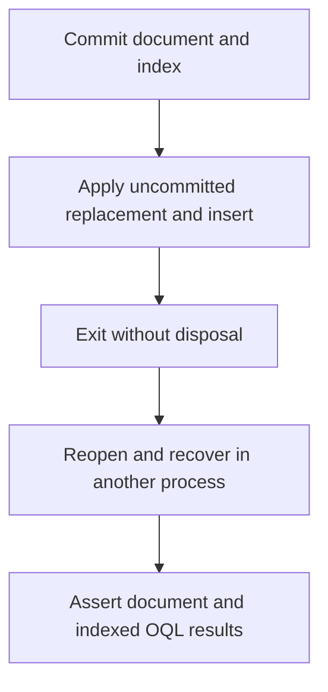

# Documents recovery fixture design

The seed process creates `items` with OQL `CREATE COLLECTION items`, obtains its session-bound
handle with `GetCollectionAsync`, commits a multi-page document and its secondary index, starts
an explicit transaction, overwrites that document, inserts another, writes dirty
pages through the kernel's WAL-before-data gate, and exits
without disposing anything. The verification process reopens storage, reads
the original nested JSON, checks the partial document is absent, and executes
an indexed parameterized OQL aggregate and an IS MISSING projection that checks IsMissing,
IsNull and GetValue remain distinct. Assertions fail the executable with a
nonzero exit. COUNT verification requires an Int64 long (#1137), including indexed DELETE checks.
A composite UNIQUE (rank, marker) index also survives restart. Verify seeks the committed key
and attempts a duplicate Put, which must fail without leaving state so verify can run twice.
The owning test reads both raw trees and counts all live entries as well as each committed,
deleted and abandoned key, proving no missing or orphan entries. Both registrations are v3 (#1530) and
the composite registration retains its UNIQUE flag. The fixture uses no reflection and can be published with NativeAOT.

The process boundary forces recovery from persisted files, independently of
in-process cleanup. A separate identity receives a committed whole-document UPSERT and an
abandoned UPSERT. Recovery retains only the committed value and drops its absent property;
the owning test reads the raw B-tree to assert zero old/abandoned keys and exactly one committed key.

## Registered-function NativeAOT consumer

The fixture builds the engine with three application registrations before any database I/O:
a typed lower_tag scalar, a typed rank_total aggregate and the derived has_value scalar that
receives NULL/MISSING explicitly. Verify executes all three after recovery and checks exact
string, Boolean and Decimal results. These registrations exercise static generic factory
instantiations and a protected-core application implementation without reflection, dynamic code,
new dependencies or persisted function records. Seed/verify storage behavior remains unchanged.
