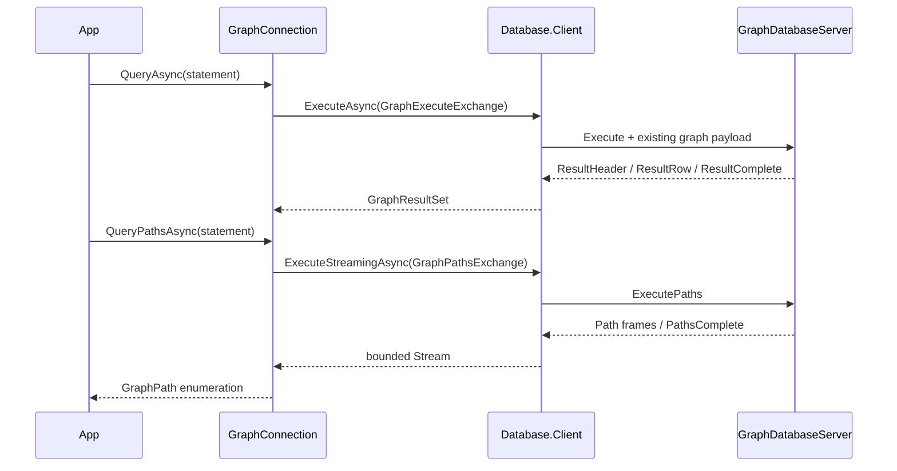

# Graph client design

## Terminal TCP conformance (#1087)

The real GraphClient and model server run missing-database handshakes on InMemory and
loopback TCP for at least one second and 200 consecutive coded refusals per transport. The
tests assert DatabaseNotFound and reuse a one-slot pool to expose leaked failed rentals.

## Contract-only dependencies

Direct references are Database.Client, Graph.Protocol, Database.Types, Database.Protocol and Connections. Wire contracts live in each model Protocol assembly, shared by client and engine. This client has no engine, area-root, storage, transaction, indexing, model parser or schema reference. Cache.Client remains an empty placeholder. Engine-free trimming and NativeAOT coverage lives in Database.Client/samples/Assimalign.Cohesion.Database.Client.AotSample.

## Client exception ownership

`GraphClientException` derives directly from `System.Exception`. It preserves constructors, wire codes, inner exception and connection-usability behavior. Its locally declared Diagnostics is never null: explicit diagnostics are defensively copied into a read-only snapshot, stably ordered by offset with unlocated entries last. SQL and Graph wrappers copy from DatabaseClientException or their own nested client exception. Documents retains its explicit diagnostics parameter and returns an empty collection when none was supplied. Engine-side DatabaseException remains in the area root; catching it intentionally no longer catches remote client failures.

The client follows Sql.Client's shape: a sealed client with a `Create` factory over options, a
sealed connection, internal exchanges, and an exception that keeps the wire code. It references
Graph.Protocol for the model wire contracts and graph values, and Database.Client for the pool,
handshake, frame transport, and connection lifetime. Its other direct references are Database.Types,
Database.Protocol and Connections. It has no
Hosting dependency, reflection, dynamic serialization, or dependency on Microsoft.Extensions.

## Correlated existence predicates (#1537)

EXISTS/NOT EXISTS return ordinary Boolean scalar cells through the existing Execute exchange.
InMemory/TCP conformance verifies correlated parameters, anti filtering, iterator and NULL
bindings, EXPLAIN, coded refusals and continued reuse of the authenticated session. The client
requires no new capability, result kind, protocol version or engine dependency.

## Scalar completion

Reduce and ALL/ANY/NONE/SINGLE (#1736, GQ-C2) use the existing Execute exchange. InMemory/TCP
regressions pin NULL/empty identities, ordered and nested reduction, scalar entity-group fields,
aggregate operands, MERGE actions and nonexecuting EXPLAIN. Entity-valued reductions and nested
entity accumulators retain static pre-write refusal until #1662. CG01018/CG02015/CG05025 and
existing Boolean CG02013 failures retain structured diagnostics and the authenticated session.
No client source, protocol message, codec or capability change is required.

Collection admission regressions (#1736) cover scalar comprehension properties and both MERGE
action branches over InMemory and TCP. Static slice/filter refusals retain structured codes
CG00012, CG02014 and CG02013 and the authenticated session; protocol 2.1 is unchanged.

SET and REMOVE execute through existing requests and ResultComplete affected counts (#1149).
QueryAsync returns post-update values and the distinct mutation count. NULL optional targets
count zero. Label removal is visible to subsequent reads. Schema/kind refusals arrive as
ExecutionFailure with CG03003 before rows and preserve the authenticated session; ExecutePaths
refuses either update stage with CG05001. No protocol, codec or capability changes are needed.

GraphExecuteExchange derives from DatabaseProtocolExchange, whose run entry clears the completion
evidence before each run. A successful ResultComplete certifies completion. A ParseFailure or
ExecutionFailure received before any result header is the server's complete rejected-statement
response, so the exchange calls MarkResponseComplete and the pool may reuse that session. A malformed response, truncated transport,
cancellation, or error after result output cannot certify completion.

Rows require exactly the advertised number of value components. Columns preserve wire names
and shared DatabaseType identities. The engine rejects duplicate final result column names
ordinally with CG01015 before any result output or mutation, including implicit/explicit
collisions. The result container retains first-column lookup for manually constructed duplicate
metadata. Scalar statements fully materialize before returning.
Direct COUNT aggregate metadata is Int64, including empty input and values carried through WITH/NEXT. Other MATCH projection metadata remains the engine's DatabaseType.Null (unknown), because graph
properties may have heterogeneous types. The tuple codec preserves each actual value's runtime
type. SHOW metadata retains its precisely declared catalog types.

GraphClientException preserves the stable ProtocolErrorCode and inner failure. The typed
connection does not translate error codes into connection health decisions: completion belongs
to its exchange and pooling belongs to Database.Client.

A failed dial reaches ConnectAsync as the core's DatabaseClientException with
ProtocolErrorCode.ConnectionFailure (owner decision 39; the core's DESIGN.md, "Lifecycle and
errors"). GraphClientException keeps that code, and the core exception, which keeps the
transport's exception, is its inner exception. A canceled dial throws OperationCanceledException
unchanged (GraphClientDialFailureTests).

WHERE scalar value errors (#1140) arrive as ExecutionFailure text `CG02013: message`
before ResultHeader. GraphClientWireTests pins division by zero, overflow and invalid conditions,
then reuse of the exact authenticated pooled session followed by SHOW LABELS. A combined
OR/IN/string/arithmetic case compares wire rows with in-process rows. No wire fields change.

## Core functions and CAST (#1148)

Scalar element/string/math/conversion functions, CAST and niladic CURRENT_DATE/CURRENT_TIMESTAMP
execute through the same QueryAsync exchange. Known function and CAST result types are retained
in column metadata; dynamic math types remain unknown until values arrive. DateOnly and
DateTimeOffset use existing scalar components. labels/keys/properties use existing composite
negotiation and preserve list/map runtime types. Unnegotiated possible composites fail before
writer admission with CG07016. No codec, capability or frame changes are introduced.

The static Execute gate rejects nodes/edges/relationships/startNode/endNode entity outputs before
mutations, including when wrapped in lists/CASE or accessed to an entity. Scalar fields through
them are supported. A mandatory LET s=startNode(r) can be projected as a bare entity through
QueryPathsAsync. Graph wire explicit transactions preserve one datetime instant; autocommit functions share
one captured UTC instant per statement. Their date/instant values sort without numeric coercion.
Function and CAST value failures, including floating underflow, arrive as CG02013 ExecutionFailure
before ResultHeader and retain the same authenticated pooled session. Proven incompatible kinds
(non-integral toBoolean, Boolean numeric CAST and temporal property maps) arrive as plan-time
CG03003 before writes. Engine-resolved unknown calls are CG00010 ExecutionFailure. GraphFunctionWireTests
pins exact values, types, raw-frame ordering, entity rejection before mutation, capability
refusal and pooled-session reuse over InMemory and TCP.

## Aggregates (#1147)

Aggregates (#1147) round-trip count and integral sums as Int64, floating averages as Double,
and Decimal sums/averages as Decimal. Exact SUM preserves the largest input Decimal scale,
including scale zero for UInt64, through negotiated Graph value tag 7 (decimal.GetBits).
Scalar Decimal columns receive the existing marked-column framing after materialization.
Unnegotiated scalar tuples keep the shared numeric encoding. Mixed integer/floating
sums preserve the integral total before promotion. COLLECT_LIST (Cypher collect) uses the negotiated
graph.composite-values list encoding. GROUP BY and implicit grouping run before ordering,
including aggregate aliases. Aggregate overflow is CG02013 before ResultHeader; terminal
failure permits reuse of the exact authenticated pooled session. ExecutePaths retains the
existing CG05001 projection diagnostic. GraphAggregateWireTests verifies both transports,
recorded types and names, empty input, capability refusal and session reuse.

## Quantified paths (#1144)

QueryAsync accepts ISO quantified edges/subpaths and Cypher bracketed lengths; QueryPathsAsync
returns the complete source-ordered path under WALK/TRAIL/SIMPLE/ACYCLIC (implicit TRAIL) in the existing Path frame, including intermediate
nodes, stored relationship directions and zero-length paths. Right index anchors preserve that
order. Group lists flow through FOR/UNWIND with their entity kinds; scalar projections after
expansion use the existing result codec. Unnegotiated possible composite final projections
fail statically with CG07016. Negotiated lists containing entities keep the existing Execute
entity-result rejection with CG05001 naming lists of nodes or relationships, as collect(entity)
does. A provably empty Max=0 group projects as `[]` on a negotiated session. No new wire tag or capability is introduced.
Malformed bounds and adjacent comments hiding Cypher ranges return ParseFailure and keep the authenticated session; the protocol suite
also pins the following Ping/Pong. GraphQuantifiedPathWireTests exercises rows, paths, aliases,
linear group flow, empty group results, the negotiated entity-list gate and exact-session reuse
over InMemory and TCP.

## Ordering and paging (#1142)

Without ORDER BY, wire rows and paths have no guaranteed enumeration order. Tests compare
complete result membership with multiplicity preserved while retaining ordered assertions for
each path's nodes and relationships. Row-sequence assertions use an explicit ORDER BY.

QueryAsync and QueryPathsAsync preserve the engine's ORDER BY, OFFSET/SKIP and LIMIT sequence,
including RETURN aliases and paging parameters with either named sigil. The server validates
counts before emitting rows or paths; invalid graph counts retain CG02013, while non-finite
or unsupported CLR inputs retain CG03003. OFFSET/SKIP precedes LIMIT. Terminal completion
allows reuse of the authenticated session. GraphOrderPagingWireTests compares ordered rows and
paths with in-process execution over InMemory and TCP. No wire bytes or capabilities change.

## Composite values (#1146)

GraphConnection checks the negotiated graph.composite-values capability before constructing
an exchange. When absent, GraphRequestEncoder refuses list/map parameters locally with
ExecutionFailure and sends no frame. When present, scalar and path request parameters use
GraphValueCodec. ResultHeader marks possible composite columns with bit 7 of their type byte.
Unmarked ResultRow columns keep scalar tuple bytes. Marked columns carry tag 0 plus a scalar
tuple component, or tag 1 plus a little-endian Int32 byte length and GraphValueCodec component.
Lists materialize as object?[] and maps as read-only ordinal IReadOnlyDictionary<string, object?>,
with nested NULLs and scalar runtime types preserved. GraphRow now carries those values.
Column metadata stays unchanged. No GraphPathResult or Path frame format changes.

The [Graph codec contract](../../Assimalign.Cohesion.Database.Graph/docs/DESIGN.md#composite-values-and-wire-framing-1146)
defines depth 64, 65536 values and 16777216 bytes, checked before allocations while decoding.
Malformed result components or row lengths are ProtocolViolation and discard the connection.
The server rejects unnegotiated possible composite projections statically before writer locking
with CG07016. Constructors and materialized row sizes enforce bounds inside the transaction,
so refusals roll back writes and permit pooled-session reuse. Scalar results have no encoding
preflight or additional value framing. Pattern property maps remain scalar-only. Protocol 2.0 and 2.1 without
the capability retain legacy scalar bytes. Both halves ship now that #1105 has landed.

## Named scalar parameters (#1138)

QueryAsync, ExecuteAsync and QueryPathsAsync send the existing named scalar map unchanged.
The server now binds `$name` and `@name` in node/relationship property maps, WHERE operands and RETURN expressions
using exact bare names after removing one sigil. Values keep their runtime scalar types.
An unbound parameter returns ExecutionFailure carrying CG05001; materialized statement
rejections and terminal path rejections before any path output complete the exchange and allow
reuse of that authenticated session. Later path failures
retain the streaming lifetime rules below. No frame or codec change is needed on wire 2.0.

## Selector execution (#1734)

ANY/ALL, ANY/ALL SHORTEST and counted shortest paths/groups execute through the existing
scalar QueryAsync and complete-path QueryPathsAsync exchanges. Identity ties, prefilters and
postfilters are decided by the server per endpoint pair and incoming row. InMemory and TCP
conformance verifies both result shapes and all four modes, then a coded CG05004 refusal,
explicit-transaction abort/rollback and reuse of the exact authenticated session. Missing
prefilter parameters retain CG05001. Work/state/output budgets preserve CG05004/CG05020.
No client production API, capability, frame or encoding changes are required.

## Path lifetime

The typed connection captures its immutable database name and negotiated composite-value flag when it receives the shared lease
(#1313). Diagnostics can finish after streaming cleanup returns that lease, whose members then
refuse access. The cached values preserve diagnostics and let subsequent queries reach the
telemetry path before the disposed lease rejects execution. `AbortAsync` after a failed or
abandoned path stream joins the lease's original return, as repeated disposal does; it cannot
abort another caller's rental.

GraphPathsExchange derives from DatabaseProtocolExchange<bool> and runs one worker under the
shared rental's exchange admission. The worker reads borrowed pooled payloads when supported,
decodes each Path exactly once inside the borrowed read's synchronous callback, and hands
independently owned GraphPath values to a single-slot bounded channel. The reader returns the
payload rental immediately after decoding every frame, including terminal and diagnostic frames,
before queue waits or a healthy connection can become idle. Capacity one plus waiting for room
before each read keeps a terminal error from overtaking a queued path. The byte stream, private length
prefix, per-chunk copies and second decode are removed (#1539); no wire bytes change.

EOF joins the worker after it verifies PathsComplete's count and releases exchange admission.
A terminal ParseFailure or ExecutionFailure before path output certifies a complete response
before throwing, preserving the healthy rental and its negotiated diagnostics. Later errors,
malformed frames, count mismatches, truncation and cancellation discard the connection. An
unfinished enumeration cancels and joins the worker before clearing pending values and disposing
its cancellation source. Cleanup retains the original failure and reports a secondary rental
return failure by exception type only (event 4, PathReleaseFailed).

No lease or pool lock is held during channel waits, cancellation callbacks or transport I/O.
Only the producer uses the frame reader; decoded paths keep no references to pooled payload
storage. Retained values survive subsequent reads, pool reuse and disposal. The client holds
one queued path plus the consumer's current path; the engine still materializes its result.
A single path retains the existing frame bound, without entity deduplication or an aggregate cap.
The non-parallel regression observes queue-full counters before racing connection disposal and
runs until a minimum duration and observed race count are met, with a cancellation ceiling.

GraphClientEventSource publishes exact cumulative path-decode-calls, path-decode-milliseconds
and path-backpressure-waits, including work before a listener attaches. Event 5,
PathDecodeCompleted (Verbose, Queries), reports durationMilliseconds for each attempted decode.
The TCP allocation regression takes the minimum of three whole-process rounds, retains the
20-path digest and checks exactly one decode per path. It enforces a 40% allocation reduction
against the pre-change fixture. Server phase counters and protocol transport counters provide
the corresponding execution, encoding, send and flush evidence. SF10 remains the external
#1511 gate; local TCP work does not establish quiet-host throughput acceptance.

## Supported surface and limits

ExecutePaths accepts exactly one bound path, node, or relationship projection from a read-only
MATCH. A node becomes a singleton path; a relationship includes its stored-direction endpoints;
a named path retains traversal order. DISTINCT compares the projected binding's identity before
path conversion. RETURN * is accepted with exactly one named binding. Computed or multiple
projections, star over several bindings and mutations are rejected with CG05001,
so no path is reconstructed from scalar results. Execute serves scalar projection rows and
mutations; its gate uses static planned projection kinds before reads or writes. Computed
scalar expressions, parameters, aliases and standalone RETURN pass; possible entity/path results
direct callers to ExecutePaths even for an empty MATCH. Thus `MATCH (a) RETURN *` now returns
ExecutionFailure instead of ParseFailure. Entity-returning INSERT fails before mutation.
EXPLAIN remains scalar, including `EXPLAIN MATCH (a:Person) RETURN a`. Names and DISTINCT values
match in-process results; the [GQL dialect](../../Assimalign.Cohesion.Database.Graph.Language/docs/DIALECT.md#return)
defines normalization and equality. This implements the owner's static conservative gate default;
no protocol 2.1 frame or GraphPathResult shape changes.

OPTIONAL MATCH scalar null extension uses the existing scalar NULL encoding. ExecutePaths
rejects an optional-only projected node, relationship or named path during planning with
ExecutionFailure carrying CG05001, even when the data would match. Terminal rejection completes
before any path output and preserves the authenticated pooled session. A mandatory projection
alongside an optional remains valid; unknown optional labels/types still deliver their warnings
on scalar results or GraphPathResult completion. GraphOptionalMatchWireTests covers these cases
through GraphDatabaseServer over Connections.InMemory without a codec change.

GraphResultSet.Diagnostics exposes negotiated success warnings, including CG01010 and CG01011 for unknown names. QueryPathsAsync returns a sealed GraphPathResult implementing IAsyncEnumerable<GraphPath>. Its Diagnostics property exposes the same ProtocolDiagnostic values as scalar results, finalized after EOF. Each result permits one enumeration. Terminal statement rejections before path output preserve diagnostics on GraphClientException and retain the rental after EOF; later stream failures discard it.

Graph transaction control uses Execute text BEGIN [TRANSACTION] / START TRANSACTION, COMMIT and ROLLBACK;
the reserved Transaction message remains unsupported. Mutations retain
the engine's existing execution and validation semantics. Database binding remains fixed at
handshake and catalog SHOW keeps its existing read-only and scoping diagnostics.

## Diagnostics

The client reports through one internal event source named for its assembly,
`Assimalign.Cohesion.Database.Graph.Client` (`src/Internal/EventSource/GraphClientEventSource.cs`),
written by GraphConnection's three public members. Start and stop carry the `Queries` keyword
(`0x1`).

| Id | Event | Level | Keyword | Payload |
| --- | --- | --- | --- | --- |
| 1 | `QueryStart` | Verbose | `Queries` | `database`, `operation` (`Query`, `Execute` or `QueryPaths`) |
| 2 | `QueryStop` | Verbose | `Queries` | `database`, `operation`, `status` (`Success`, `Error` or `Cancelled`), `rowCount` (rows; for `QueryPaths`, the paths read by then; -1 for a scalar query that did not return), `durationMilliseconds` |
| 3 | `QueryFailed` | Error | — | `database`, `operation`, `code` (the wire code; empty for an uncoded failure), `exceptionType`, `durationMilliseconds` |
| 4 | `PathReleaseFailed` | Error | — | `exceptionType` |
| 5 | `PathDecodeCompleted` | Verbose | `Queries` | `durationMilliseconds` |

QueryAsync and ExecuteAsync share one private core that names the operation, so an Execute is
reported as such and not as the Query it runs. **Every start has a stop** (the area's convention,
`docs/resources/Database/DESIGN.md`, "Diagnostics"), written from a `finally`: a failure writes
event 3 and then `QueryStop` with `Error`, a cancellation (how a timeout surfaces) `QueryStop` with
`Cancelled` and no failure. The failure is captured by an exception filter that declines it, so it
reaches the caller unchanged. A path query ends when its enumeration does: `Success` once it
reached the server's terminal count; `Error`, after event 3, for a failed open or read;
`Cancelled` for a cancellation or for a caller that stopped reading and disposed the enumerator
early, with the paths read by then. An iterator cannot catch around a `yield`, so the open and each
read capture their own failure, and the iterator's `finally` writes the stop. Its start and stop are
written by different steps of the enumerator, each on its consumer's execution context, where the
start's activity is not current; so while the start was written, the enumerator captures the
start's execution context and writes the end in it (`ExecutionContext.Run`, allocating only then),
and an activity-tracking tool sees `QueryStop` close the activity `QueryStart` opened. As
`System.Net.Http`'s `RequestStop`, a stop is written only for a start that was written, so a
listener that attaches mid-query sees no stop without its start; event 3 is written either way.

The statement text and the parameter values are never written, nor is the server's message: a GQL
parse error's quotes a fragment of the statement, so event 3 writes the wire code and the
exception's type only (the area's failure rule). Timestamps are taken only while a listener takes
the source. Path decode and backpressure counters are described above.

`GraphClientEventSourceTests` checks the name, the strict manifest, one event per query of each
member, a refused statement included (its failure, then its `Error` stop, with no statement text and
no server message), a path query its caller stopped reading (a `Cancelled` stop with the paths read),
a cancelled query (a `Cancelled` stop and no failure), a path query the server refused
(`ParseFailure`, then an `Error` stop with no paths), a query refused by the client itself because a
path query holds the exchange (an empty code and `InvalidOperationException`), a failure whose start
was not written (no stop), and, under `TplEventSource` activity tracking, a path query's stop
carrying its start's activity id whether its caller read every path or stopped early.

## Concrete types (concrete-types plan, phase 5, #1261)

The package has no public interface left and no `Abstractions/` folder
([plan](../../../../docs/programs/DATABASE_CONCRETE_TYPES_PLAN.md) `7, "P5, as landed").

| Type | Shape | Was |
|---|---|---|
| `GraphClient` | sealed; `Create(GraphClientOptions)` over a private constructor | the static `GraphClient` factory, `IGraphClient` and the internal `DefaultGraphClient` |
| `GraphConnection` | sealed; internal constructor; moved out of `Internal/` | `IGraphConnection` and the internal `GraphConnection` |

The two exchanges stay internal sealed leaves of the shared bases: `GraphExecuteExchange` of
`DatabaseProtocolExchange<GraphResultSet>` and `GraphPathsExchange` of
`DatabaseProtocolExchange<bool>`. `GraphResultSet.Columns` and its rows are never null (`database-area.md`,
rule 9): a statement without a result header yields empty ones. Studio's graph workspace was
retyped to the sealed types.

## Duplex transport composition

`ConnectionFactory` accepts `IDuplexConnectionFactory`. The shared client reads and writes
framed bytes through the returned `IDuplexConnection`; the common `IConnection` root carries
identity, features and lifecycle only. TCP, InMemory and TLS-layered duplex factories satisfy
this contract. The pool owns each established connection and disposes it when discarded or
when the pool closes; transport disposal has signaled `ConnectionClosed` before it completes.

### Breaking changes from 10.0.0-preview.1 (#1459)

`GraphClientOptions.ConnectionFactory` changes from `IConnectionFactory?` to
`IDuplexConnectionFactory?`. Changing the property's getter and setter signatures breaks
preview.1 binaries and source that supplies a factory typed only as `IConnectionFactory`.
This preview break is accepted under owner decisions 15 and 58. Rebuild consumers and use
`IDuplexConnectionFactory` for factory variables and custom implementations. Custom factories
can derive from `DuplexConnectionFactory`, implement `ConnectCoreAsync` returning
`ValueTask<IDuplexConnection>`, and produce a `DuplexConnection` implementation. Built-in TCP,
InMemory and TLS-layered duplex factories already satisfy the new contract. Database wire
framing, handshake and model messages are unchanged.

## Negotiated statement diagnostics (#1105)

The shared protocol is 2.1. Startup optionally appends the client's capability names;
Ready returns the agreed version and the two-sided intersection. A negotiated 2.0
session retains empty Ready and the existing model and Error bytes. An empty Ready
from an older endpoint means 2.0 with no capabilities. Different majors are refused.
Capability names are ordinal and append-only; model names are scoped with the
lowercase endpoint family followed by a dot. The core owns `diagnostics` and frame 14.

SQL and Graph register `ProtocolCapability.Diagnostics`. When agreed, one Diagnostics
frame carries the bounded Warning/Error list immediately before Error on failure,
or immediately before ResultComplete (PathsComplete for graph paths) on success.
Information, including CS00009, is never sent. Error and result payloads are unchanged.
Statement failures leave the server session ready. Model clients validate diagnostic
ordering and preserve every code, severity, message, nullable offset and source line.

GraphClientException copies the underlying database diagnostics carrier; GraphResultSet.Diagnostics exposes negotiated ProtocolDiagnostic values. GraphPathResult.Diagnostics exposes path completion warnings. Terminal path statement rejections before path output retain the connection after EOF; later failures discard it.
The #1230 wire regression sends 500,000 nested label negations through QueryPathsAsync over
InMemory and TCP, checks ExecutionFailure/CG05008, then queries on the same rental and rents
again, verifying the exact server session survives both.

Path completion diagnostics follow Neo4j's completion metadata model
(community/bolt/src/main/java/org/neo4j/bolt/protocol/common/fsm/response/metadata/DefaultMetadataHandler.java:206).
The concrete result stream preserves bounded streaming and adds no public interface.
CK07001 reports diagnostic overflow without turning successful reads into failures.

## MERGE (#1735)

MERGE uses the existing Execute request, scalar result and negotiated diagnostic carriers. Whole-path
match/create, ON CREATE/ON MATCH SET, repeated-row overlays, undirected relationships and bound
reuse execute unchanged over InMemory and TCP. GraphMergeWireTests pins counts, values, EXPLAIN,
coded refusals and reuse of the exact authenticated session after failure. ExecutePaths keeps the
existing pre-mutation refusal of writing stages. No protocol capability or wire bytes change.

## Linear composition (#1145)

QueryAsync executes LET, FILTER, FOR/UNWIND, WITH and RETURN ... NEXT using the existing request encoding. Lists use the negotiated composite-value parameter codec. Final planned column kinds govern Execute admission: scalar LET/FOR values pass, possible composites require negotiation, and carried entities keep the ExecutePaths hint. Read-only composed path requests preserve optionality; a write stage anywhere rejects the request before execution. GraphLinearCompositionWireTests verifies both InMemory and TCP, own-write reads, row-valued insertion maps, bound MATCH maps, map/entity member access, decoded star bindings and Int64 COUNT metadata through WITH. Scope, duplicate carried-name, INSERT-map and runtime container rejections retain coded diagnostics and permit the next statement on the exact same server session. Comma-separated MATCH maps can reference later pattern parts; their clause-wide predicates, including anonymous elements, execute over both transports and validate under EXPLAIN. FOR/UNWIND retains proven node and relationship list element kinds through WITH/NEXT for later MATCH, DELETE and ExecutePaths; scalar/mixed lists retain coded rejection and exact-session reuse. No protocol format changes.

## Pattern comprehensions (#1736, GQ-C3)

QueryAsync carries pattern collection as ordinary GQL. Scalar/property projections and nested
lists use the existing protocol 2.1 composite capability over InMemory and TCP. Entity-valued
lists (nodes, relationships and paths) retain CG05001 until #1662; no available capability
encodes those values. Refusal precedes writes and preserves the exact session. Pattern tests
cover NULL correlation, iterator correlation, projection, EXPLAIN and subsequent rental reuse.
No client API or wire contract changes.

## List comprehensions and slices (#1736, GQ-C1)

QueryAsync uses the existing scalar/composite encoding for comprehensions and slices. Lexical
scalar projections over quantified groups and path lists cross Execute; entity-producing lists
retain the pre-write static refusal until #1662, even with a FALSE filter. Existing protocol 2.1
composite negotiation remains required. GraphCompositeWireTests covers InMemory/TCP, nested
shadowing, slices, NULLs, parameters, EXPLAIN, rollback and exact-session reuse after CG02014
and CK00001 ALL admission errors. No client API, capability or wire bytes change.

## Explicit transaction text (#1540, D5)

START TRANSACTION, COMMIT and ROLLBACK are standalone ISO statements on Execute, using the
existing session transaction objects. BEGIN [TRANSACTION] aliases START TRANSACTION (#1725); both use
Snapshot. Savepoints, transaction options,
statement composition and EXPLAIN of transaction controls remain outside this profile.
WORK, TRAN, access modes, isolation levels and deferrability retain CG00002 / ParseFailure
without starting a transaction or replacing the authenticated session. The transaction corpus
checks both aliases' commit, rollback, snapshot retention, duplicate-start refusal and
ExecutePaths refusal over InMemory and TCP.
A failed statement aborts the transaction; subsequent work is refused with CG04007 until
ROLLBACK. Failed COMMIT rolls back and reports failure, never silently commits. Duplicate START
uses CG04022 and aborts the existing transaction; COMMIT/ROLLBACK without an open transaction
uses CG04023. ExecutePaths refuses controls with CG05001 before any control takes effect.
Disconnect and session teardown roll back. The shared negotiated transaction-status postamble
also resets unfinished transactions before pool reuse; legacy peers are discarded on return.

An idle open wire transaction holds the database writer lock once it has acquired it, until
COMMIT, ROLLBACK, disconnect, pool return or IdleTimeout (30 minutes by default). Keep transactions
short: an idle writer blocks other writers. New clients discard sessions against pre-#1540 servers
that cannot negotiate transaction-status, so those servers are not pooled.

The parser exposes GqlQueryExpression.TransactionCommand (GqlTransactionCommand None/Start/Commit/Rollback).
The server owns the connection's existing transaction, following Neo4j's
community/bolt/src/main/java/org/neo4j/bolt/protocol/common/fsm/transition/ready/CreateTransactionStateTransition.java:63-81
(local Neo4j clone). No code is copied, and no transaction wire message is added.

The twenty-path TCP allocation ceiling remains 386,699 bytes per operation and is enforced only
in Release, per the allocation-budget convention. Debug still executes the fixture and verifies
all twenty path results and their digest; its allocation samples are recorded only.

## Graph diagnostic conventions (#1470)

Exception and diagnostic templates use the project's build-generated `ErrorMessages` resources.
Parameterized templates format with the current culture; abort/cancellation templates used in
normal cleanup are cached. The [Database error-code registry](../../Assimalign.Cohesion.Database/docs/ERROR-CODES.md)
assigns this family its two-letter prefix and categorized five-digit identities.
Existing SQLSTATE meanings, numeric wire error kinds, frame layouts and disk formats are preserved.
Structured diagnostics keep their code outside the message. Compiler diagnostic identifiers and
standard .NET argument guards retain their own contracts.

## Debugger inspection (#1470)

Client debugger views expose the captured database name, owned-row counts and stored result/diagnostic references. They omit live connection state, transport settings and row-value buffers. Inspecting a path result never enumerates its single-use stream or completes the exchange.

Eligible types follow the [Database conventions](../../Assimalign.Cohesion.Database/docs/CONVENTIONS.md) debugger display/proxy rules. Views are private and read-only; inspection does not change the public API, execution paths, error contracts, storage formats or protocol bytes.

## Engine-registered function calls

QueryAsync and ExecuteAsync send ordinary named scalar/aggregate calls through the existing
GQL request encoding. The server's engine-local catalog resolves them; the client needs no
registration object or engine reference. Existing planned entity/composite admission,
negotiated composite encoding and pooled-session cleanup apply. CG05021 callback diagnostics
round-trip through the existing carrier. GraphRegisteredFunctionWireTests covers both InMemory
and TCP, custom scalar and DISTINCT aggregate values, failure diagnostics and exact-session reuse.
No frame layout, capability or version changes.

Unknown engine-resolved function names use ExecutionFailure rather than ParseFailure, with
no StatementParseFailed event. Application callback timeout and I/O errors use the model
callback diagnostic and leave the exact wire session reusable after a completed failure.
