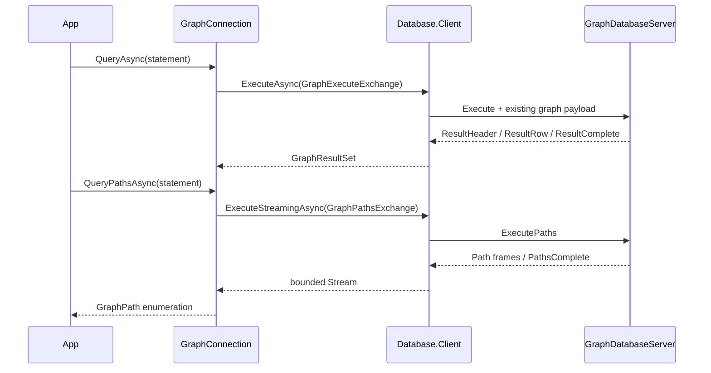

# Graph client design

The client follows Sql.Client's shape: a sealed client with a `Create` factory over options, a
sealed connection, internal exchanges, and an exception that keeps the wire code. It references Database.Graph for its existing model protocol and graph values, and
Database.Client for the pool, handshake, frame transport, and connection lifetime. It has no
Hosting dependency, reflection, dynamic serialization, or dependency on Microsoft.Extensions.

## Scalar completion

GraphExecuteExchange derives from DatabaseProtocolExchange, whose run entry clears the completion
evidence before each run. A successful ResultComplete certifies completion. A ParseFailure or
ExecutionFailure received before any result header is the server's complete rejected-statement
response, so the exchange calls MarkResponseComplete and the pool may reuse that session. A malformed response, truncated transport,
cancellation, or error after result output cannot certify completion.

Rows require exactly the advertised number of value components. Columns preserve wire names
and shared DatabaseType identities. The engine rejects duplicate final result column names
ordinally with COHDBG015 before any result output or mutation, including implicit/explicit
collisions. The result container retains first-column lookup for manually constructed duplicate
metadata. Scalar statements fully materialize before returning.
Direct COUNT aggregate metadata is Int64, including empty input and values carried through WITH/NEXT. Other MATCH projection metadata remains the engine's DatabaseType.Null (unknown), because graph
properties may have heterogeneous types. The tuple codec preserves each actual value's runtime
type. SHOW metadata retains its precisely declared catalog types.

GraphClientException preserves the stable ProtocolErrorCode and inner failure. The typed
connection does not translate error codes into connection health decisions: completion belongs
to its exchange and pooling belongs to Database.Client.

A failed dial reaches ConnectAsync as the core's DatabaseClientException with
ProtocolErrorCode.ConnectionFailure (owner decision 39; the core's DESIGN.md, "Lifecycle and
errors"). GraphClientException keeps that code, and the core exception, which keeps the
transport's exception, is its inner exception. A canceled dial throws OperationCanceledException
unchanged (GraphClientDialFailureTests).

WHERE scalar value errors (#1140) arrive as ExecutionFailure text `COHDBG013: message`
before ResultHeader. GraphClientWireTests pins division by zero, overflow and invalid conditions,
then reuse of the exact authenticated pooled session followed by SHOW LABELS. A combined
OR/IN/string/arithmetic case compares wire rows with in-process rows. No wire fields change.

## Aggregates (#1147)

Aggregates (#1147) round-trip count and integral sums as Int64, floating averages as Double,
and Decimal sums/averages as Decimal. Exact SUM preserves the largest input Decimal scale,
including scale zero for UInt64, through negotiated Graph value tag 7 (decimal.GetBits).
Scalar Decimal columns receive the existing marked-column framing after materialization.
Unnegotiated scalar tuples keep the shared numeric encoding. Mixed integer/floating
sums preserve the integral total before promotion. COLLECT_LIST (Cypher collect) uses the negotiated
graph.composite-values list encoding. GROUP BY and implicit grouping run before ordering,
including aggregate aliases. Aggregate overflow is COHDBG013 before ResultHeader; terminal
failure permits reuse of the exact authenticated pooled session. ExecutePaths retains the
existing COHDBG001 projection diagnostic. GraphAggregateWireTests verifies both transports,
recorded types and names, empty input, capability refusal and session reuse.

## Quantified paths (#1144)

QueryAsync accepts ISO quantified edges/subpaths and Cypher bracketed lengths; QueryPathsAsync
returns the complete source-ordered trail in the existing Path frame, including intermediate
nodes, stored relationship directions and zero-length paths. Right index anchors preserve that
order. Group lists flow through FOR/UNWIND with their entity kinds; scalar projections after
expansion use the existing result codec. Unnegotiated possible composite final projections
fail statically with COHDBG016. Negotiated lists containing entities keep the existing Execute
entity-result rejection, as collect(entity) does. No new wire tag or capability is introduced.
Malformed bounds and adjacent comments hiding Cypher ranges return ParseFailure and keep the authenticated session; the protocol suite
also pins the following Ping/Pong. GraphQuantifiedPathWireTests exercises rows, paths, aliases,
linear group flow and session reuse over InMemory and TCP.

## Ordering and paging (#1142)

QueryAsync and QueryPathsAsync preserve the engine's ORDER BY, OFFSET/SKIP and LIMIT sequence,
including RETURN aliases and paging parameters with either named sigil. The server validates
counts before emitting rows or paths; invalid graph counts retain COHDBG013, while non-finite
or unsupported CLR inputs retain COHDBG003. OFFSET/SKIP precedes LIMIT. Terminal completion
allows reuse of the authenticated session. GraphOrderPagingWireTests compares ordered rows and
paths with in-process execution over InMemory and TCP. No wire bytes or capabilities change.

## Composite values (#1146)

GraphConnection checks the negotiated graph.composite-values capability before constructing
an exchange. When absent, GraphRequestEncoder refuses list/map parameters locally with
ExecutionFailure and sends no frame. When present, scalar and path request parameters use
GraphValueCodec. ResultHeader marks possible composite columns with bit 7 of their type byte.
Unmarked ResultRow columns keep scalar tuple bytes. Marked columns carry tag 0 plus a scalar
tuple component, or tag 1 plus a little-endian Int32 byte length and GraphValueCodec component.
Lists materialize as object?[] and maps as read-only ordinal IReadOnlyDictionary<string, object?>,
with nested NULLs and scalar runtime types preserved. GraphRow now carries those values.
Column metadata stays unchanged. No GraphPathResult or Path frame format changes.

The [Graph codec contract](../../Assimalign.Cohesion.Database.Graph/docs/DESIGN.md#composite-values-and-wire-framing-1146)
defines depth 64, 65536 values and 16777216 bytes, checked before allocations while decoding.
Malformed result components or row lengths are ProtocolViolation and discard the connection.
The server rejects unnegotiated possible composite projections statically before writer locking
with COHDBG016. Constructors and materialized row sizes enforce bounds inside the transaction,
so refusals roll back writes and permit pooled-session reuse. Scalar results have no encoding
preflight or additional value framing. Pattern property maps remain scalar-only. Protocol 2.0 and 2.1 without
the capability retain legacy scalar bytes. Both halves ship now that #1105 has landed.

## Named scalar parameters (#1138)

QueryAsync, ExecuteAsync and QueryPathsAsync send the existing named scalar map unchanged.
The server now binds `$name` and `@name` in node/relationship property maps, WHERE operands and RETURN expressions
using exact bare names after removing one sigil. Values keep their runtime scalar types.
An unbound parameter returns ExecutionFailure carrying COHDBG001; materialized statement
rejections and terminal path rejections before any path output complete the exchange and allow
reuse of that authenticated session. Later path failures
retain the streaming lifetime rules below. No frame or codec change is needed on wire 2.0.

## Path lifetime

GraphPathsExchange derives from DatabaseStreamingExchange. OpenCoreAsync sends ExecutePaths and
validates the initial Path or PathsComplete frame. A terminal ParseFailure or ExecutionFailure
before any path frame is retained as the rejected statement's error, and CopyToCoreAsync completes
without content. GraphConnection consumes EOF, which joins the shared worker and releases the
active exchange, then raises GraphClientException with the retained code, message and diagnostics. The healthy
connection can execute another statement immediately and returns to the pool when disposed.
This completion handling stays entirely in Graph.Client; the shared streaming and pool code is unchanged.
For successful responses, CopyToCoreAsync validates each existing path
payload and verifies the final path count. Its private stream handoff prefixes each payload
with its length to preserve boundaries through bounded byte buffering; this is entirely within
the client and does not alter the graph wire protocol. GraphConnection decodes those same
payloads into GraphPath values.

The shared ExecuteStreamingAsync owns frame I/O, applies backpressure, and keeps the connection
busy through completion. Consuming EOF verifies terminal completion before another operation.
Disposing an unfinished enumeration cancels the worker and discards the rental. Failures after
path output, malformed frames, transport failures, cancellation and non-statement errors discard
the connection under the existing shared streaming contract. InMemory and TCP tests verify an
unbound parameter rejection followed by SHOW LABELS on the same connection and pooled session.

The client holds a bounded number of path payloads for materialization plus the shared bounded
byte buffer. The engine currently materializes its path result, so end-to-end server memory still
depends on the number of matched paths. A single path must fit the existing maximum frame size.

## Supported surface and limits

ExecutePaths accepts exactly one bound path, node, or relationship projection from a read-only
MATCH. A node becomes a singleton path; a relationship includes its stored-direction endpoints;
a named path retains traversal order. DISTINCT compares the projected binding's identity before
path conversion. RETURN * is accepted with exactly one named binding. Computed or multiple
projections, star over several bindings and mutations are rejected with COHDBG001,
so no path is reconstructed from scalar results. Execute serves scalar projection rows and
mutations; its gate uses static planned projection kinds before reads or writes. Computed
scalar expressions, parameters, aliases and standalone RETURN pass; possible entity/path results
direct callers to ExecutePaths even for an empty MATCH. Thus `MATCH (a) RETURN *` now returns
ExecutionFailure instead of ParseFailure. Entity-returning INSERT fails before mutation.
EXPLAIN remains scalar, including `EXPLAIN MATCH (a:Person) RETURN a`. Names and DISTINCT values
match in-process results; the [GQL dialect](../../Assimalign.Cohesion.Database.Graph.Language/docs/DIALECT.md#return)
defines normalization and equality. This implements the owner's static conservative gate default;
no protocol 2.1 frame or GraphPathResult shape changes.

OPTIONAL MATCH scalar null extension uses the existing scalar NULL encoding. ExecutePaths
rejects an optional-only projected node, relationship or named path during planning with
ExecutionFailure carrying COHDBG001, even when the data would match. Terminal rejection completes
before any path output and preserves the authenticated pooled session. A mandatory projection
alongside an optional remains valid; unknown optional labels/types still deliver their warnings
on scalar results or GraphPathResult completion. GraphOptionalMatchWireTests covers these cases
through GraphDatabaseServer over Connections.InMemory without a codec change.

GraphResultSet.Diagnostics exposes negotiated success warnings, including COHDBG010 and COHDBG011 for unknown names. QueryPathsAsync returns a sealed GraphPathResult implementing IAsyncEnumerable<GraphPath>. Its Diagnostics property exposes the same ProtocolDiagnostic values as scalar results, finalized after EOF. Each result permits one enumeration. Terminal statement rejections before path output preserve diagnostics on GraphClientException and retain the rental after EOF; later stream failures discard it.

Graph transactions remain a deliberate limit: there are no connection transaction members;
BEGIN, COMMIT, ROLLBACK, and the reserved Transaction message are unsupported. Mutations retain
the engine's existing execution and validation semantics. Database binding remains fixed at
handshake and catalog SHOW keeps its existing read-only and scoping diagnostics.

## Diagnostics

The client reports through one internal event source named for its assembly,
`Assimalign.Cohesion.Database.Graph.Client` (`src/Internal/EventSource/GraphClientEventSource.cs`),
written by GraphConnection's three public members. Start and stop carry the `Queries` keyword
(`0x1`).

| Id | Event | Level | Keyword | Payload |
| --- | --- | --- | --- | --- |
| 1 | `QueryStart` | Verbose | `Queries` | `database`, `operation` (`Query`, `Execute` or `QueryPaths`) |
| 2 | `QueryStop` | Verbose | `Queries` | `database`, `operation`, `status` (`Success`, `Error` or `Cancelled`), `rowCount` (rows; for `QueryPaths`, the paths read by then; -1 for a scalar query that did not return), `durationMilliseconds` |
| 3 | `QueryFailed` | Error | — | `database`, `operation`, `code` (the wire code; empty for an uncoded failure), `exceptionType`, `durationMilliseconds` |

QueryAsync and ExecuteAsync share one private core that names the operation, so an Execute is
reported as such and not as the Query it runs. **Every start has a stop** (the area's convention,
`docs/resources/Database/DESIGN.md`, "Diagnostics"), written from a `finally`: a failure writes
event 3 and then `QueryStop` with `Error`, a cancellation (how a timeout surfaces) `QueryStop` with
`Cancelled` and no failure. The failure is captured by an exception filter that declines it, so it
reaches the caller unchanged. A path query ends when its enumeration does: `Success` once it
reached the server's terminal count; `Error`, after event 3, for a failed open or read;
`Cancelled` for a cancellation or for a caller that stopped reading and disposed the enumerator
early, with the paths read by then. An iterator cannot catch around a `yield`, so the open and each
read capture their own failure, and the iterator's `finally` writes the stop. Its start and stop are
written by different steps of the enumerator, each on its consumer's execution context, where the
start's activity is not current; so while the start was written, the enumerator captures the
start's execution context and writes the end in it (`ExecutionContext.Run`, allocating only then),
and an activity-tracking tool sees `QueryStop` close the activity `QueryStart` opened. As
`System.Net.Http`'s `RequestStop`, a stop is written only for a start that was written, so a
listener that attaches mid-query sees no stop without its start; event 3 is written either way.

The statement text and the parameter values are never written, nor is the server's message: a GQL
parse error's quotes a fragment of the statement, so event 3 writes the wire code and the
exception's type only (the area's failure rule). Timestamps are taken only while a listener takes
the source. No counters.

`GraphClientEventSourceTests` checks the name, the strict manifest, one event per query of each
member, a refused statement included (its failure, then its `Error` stop, with no statement text and
no server message), a path query its caller stopped reading (a `Cancelled` stop with the paths read),
a cancelled query (a `Cancelled` stop and no failure), a path query the server refused
(`ParseFailure`, then an `Error` stop with no paths), a query refused by the client itself because a
path query holds the exchange (an empty code and `InvalidOperationException`), a failure whose start
was not written (no stop), and, under `TplEventSource` activity tracking, a path query's stop
carrying its start's activity id whether its caller read every path or stopped early.

## Concrete types (concrete-types plan, phase 5, #1261)

The package has no public interface left and no `Abstractions/` folder
([plan](../../../../docs/programs/DATABASE_CONCRETE_TYPES_PLAN.md) `7, "P5, as landed").

| Type | Shape | Was |
|---|---|---|
| `GraphClient` | sealed; `Create(GraphClientOptions)` over a private constructor | the static `GraphClient` factory, `IGraphClient` and the internal `DefaultGraphClient` |
| `GraphConnection` | sealed; internal constructor; moved out of `Internal/` | `IGraphConnection` and the internal `GraphConnection` |

The two exchanges stay internal sealed leaves of the shared bases: `GraphExecuteExchange` of
`DatabaseProtocolExchange<GraphResultSet>` and `GraphPathsExchange` of
`DatabaseStreamingExchange`. `GraphResultSet.Columns` and its rows are never null (`database-area.md`,
rule 9): a statement without a result header yields empty ones. Studio's graph workspace was
retyped to the sealed types.

## Duplex transport composition

`ConnectionFactory` accepts `IDuplexConnectionFactory`. The shared client reads and writes
framed bytes through the returned `IDuplexConnection`; the common `IConnection` root carries
identity, features and lifecycle only. TCP, InMemory and TLS-layered duplex factories satisfy
this contract. The pool owns each established connection and disposes it when discarded or
when the pool closes; transport disposal has signaled `ConnectionClosed` before it completes.

### Breaking changes from 10.0.0-preview.1 (#1459)

`GraphClientOptions.ConnectionFactory` changes from `IConnectionFactory?` to
`IDuplexConnectionFactory?`. Changing the property's getter and setter signatures breaks
preview.1 binaries and source that supplies a factory typed only as `IConnectionFactory`.
This preview break is accepted under owner decisions 15 and 58. Rebuild consumers and use
`IDuplexConnectionFactory` for factory variables and custom implementations. Custom factories
can derive from `DuplexConnectionFactory`, implement `ConnectCoreAsync` returning
`ValueTask<IDuplexConnection>`, and produce a `DuplexConnection` implementation. Built-in TCP,
InMemory and TLS-layered duplex factories already satisfy the new contract. Database wire
framing, handshake and model messages are unchanged.

## Negotiated statement diagnostics (#1105)

The shared protocol is 2.1. Startup optionally appends the client's capability names;
Ready returns the agreed version and the two-sided intersection. A negotiated 2.0
session retains empty Ready and the existing model and Error bytes. An empty Ready
from an older endpoint means 2.0 with no capabilities. Different majors are refused.
Capability names are ordinal and append-only; model names are scoped with the
lowercase endpoint family followed by a dot. The core owns `diagnostics` and frame 14.

SQL and Graph register `ProtocolCapability.Diagnostics`. When agreed, one Diagnostics
frame carries the bounded Warning/Error list immediately before Error on failure,
or immediately before ResultComplete (PathsComplete for graph paths) on success.
Information, including SQL0100, is never sent. Error and result payloads are unchanged.
Statement failures leave the server session ready. Model clients validate diagnostic
ordering and preserve every code, severity, message, nullable offset and source line.

GraphClientException copies the underlying database diagnostics carrier; GraphResultSet.Diagnostics exposes negotiated ProtocolDiagnostic values. GraphPathResult.Diagnostics exposes path completion warnings. Terminal path statement rejections before path output retain the connection after EOF; later failures discard it.

Path completion diagnostics follow Neo4j's completion metadata model
(community/bolt/src/main/java/org/neo4j/bolt/protocol/common/fsm/response/metadata/DefaultMetadataHandler.java:206).
The concrete result stream preserves bounded streaming and adds no public interface.
COHDBP001 reports diagnostic overflow without turning successful reads into failures.

## Linear composition (#1145)

QueryAsync executes LET, FILTER, FOR/UNWIND, WITH and RETURN ... NEXT using the existing request encoding. Lists use the negotiated composite-value parameter codec. Final planned column kinds govern Execute admission: scalar LET/FOR values pass, possible composites require negotiation, and carried entities keep the ExecutePaths hint. Read-only composed path requests preserve optionality; a write stage anywhere rejects the request before execution. GraphLinearCompositionWireTests verifies both InMemory and TCP, own-write reads, row-valued insertion maps, bound MATCH maps, map/entity member access, decoded star bindings and Int64 COUNT metadata through WITH. Scope, duplicate carried-name, INSERT-map and runtime container rejections retain coded diagnostics and permit the next statement on the exact same server session. Comma-separated MATCH maps can reference later pattern parts; their clause-wide predicates, including anonymous elements, execute over both transports and validate under EXPLAIN. FOR/UNWIND retains proven node and relationship list element kinds through WITH/NEXT for later MATCH, DELETE and ExecutePaths; scalar/mixed lists retain coded rejection and exact-session reuse. No protocol format changes.
