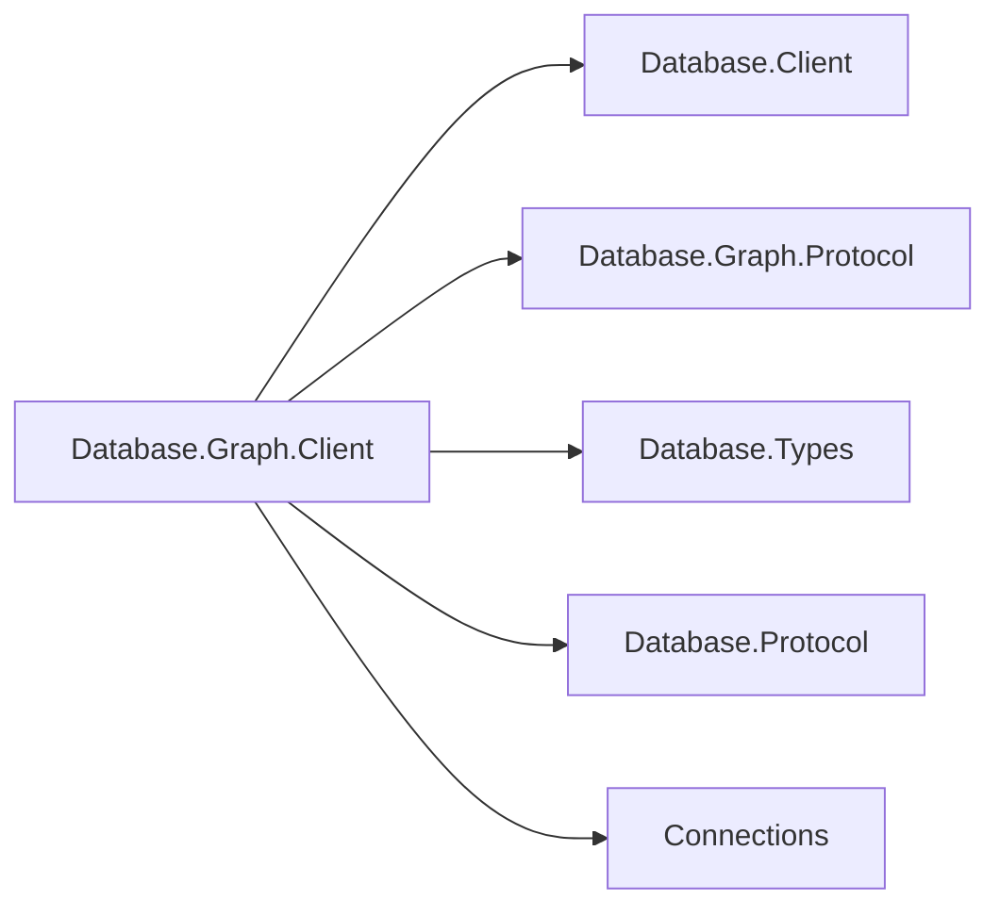

# Graph client

`Assimalign.Cohesion.Database.Graph.Client` is the pooled, transport-independent client for
`GraphDatabaseServer`. It ships as a NuGet package outside the App.Database shared framework.
Create the sealed `GraphClient` through `GraphClient.Create`, supplying `GraphClientOptions` with shared
database settings and a Connections transport factory.

Its only project references are `Database.Client`, `Graph.Protocol`, `Database.Types`,
`Database.Protocol` and `Connections`. `Graph.Protocol` owns the model wire contracts and graph
values shared with the engine. The arrows show these project references:

`QueryAsync` returns scalar, list and map RETURN expressions (also standalone, DISTINCT/ALL and aliased) and the existing SHOW catalog rows as
`GraphResultSet`, with column metadata and rows accessible by ordinal or name.
Core scalar functions, CAST and UTC transaction-start temporal readers preserve their result values and declared types.
List/map accessors use composite negotiation; entity-valued function results retain the Execute gate.
Aggregates support implicit or ISO GROUP BY and ordering by aggregate aliases. Count is Int64;
COLLECT_LIST and its collect alias return lists through graph.composite-values negotiation.
`ExecuteAsync` sends CREATE, INSERT, DELETE, and DETACH DELETE to the engine and returns its
affected count. The server retains engine ownership, cycle, and database-scoping enforcement.

`QueryPathsAsync` returns a `GraphPathResult` streaming real engine paths for a single bound projection:
`MATCH p = (a)-[r:KNOWS]->(b) RETURN p`, `MATCH (a) RETURN a`, or
`MATCH (a)-[r]->(b) RETURN r`. Paths retain ids, labels, relationship types, direction, and
properties. DISTINCT deduplicates identities, and RETURN * works when one named binding is in scope.
Execute's static planned-kind gate directs entity columns to this path API before any mutation.
Enumerate to completion to verify the terminal count; abandoning an unfinished
enumeration discards its connection. After EOF, read the result's `Diagnostics` for
completion warnings, including CG01010 for an unknown label. Each result is enumerated once.

Dispose each connection to return a healthy authenticated session to the pool, and dispose the
client to close the pool. Scalar parse/execution failures and terminal path rejections before any
path output retain the session; later path failures discard it. Execute accepts START TRANSACTION,
COMMIT and ROLLBACK. Negotiated server status makes pool return roll back unfinished transactions.
BEGIN and the reserved Transaction message remain unsupported.

Parameters use scalar components, or GraphValueCodec when graph.composite-values is negotiated, and bind `$name` or `@name` in property maps, WHERE
operands and RETURN expressions. Bare names match case-sensitively after removing one sigil; runtime scalar types are
preserved, including nested NULLs. Lists materialize as object arrays and maps as read-only ordinal
string dictionaries. Conditional expressions include CASE, COALESCE and NULLIF. The client never parses GQL or retries statements.
See [design](DESIGN.md) for completion and lifetime behavior.

Supply an `IDuplexConnectionFactory` through `GraphClientOptions.ConnectionFactory`; the shared pool owns the duplex connections it establishes.

## Graph diagnostic conventions (#1470)

Exception and diagnostic templates use the project's build-generated `ErrorMessages` resources.
Parameterized templates format with the current culture; abort/cancellation templates used in
normal cleanup are cached. The [Database error-code registry](../../Assimalign.Cohesion.Database/docs/ERROR-CODES.md)
assigns this family its two-letter prefix and categorized five-digit identities.
Existing SQLSTATE meanings, numeric wire error kinds, frame layouts and disk formats are preserved.
Structured diagnostics keep their code outside the message. Compiler diagnostic identifiers and
standard .NET argument guards retain their own contracts.

## Debugger inspection (#1470)

Client debugger views show captured metadata without transport work, path enumeration or exchange completion.

Eligible types follow the [Database conventions](../../Assimalign.Cohesion.Database/docs/CONVENTIONS.md) debugger display/proxy rules. Views are private and read-only; inspection does not change the public API, execution paths, error contracts, storage formats or protocol bytes.
