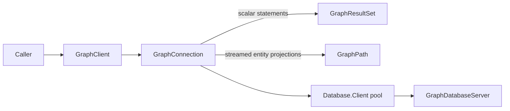

# Graph client

`Assimalign.Cohesion.Database.Graph.Client` is the pooled, transport-independent client for
`GraphDatabaseServer`. It ships as a NuGet package outside the App.Database shared framework.
Create the sealed `GraphClient` through `GraphClient.Create`, supplying `GraphClientOptions` with shared
database settings and a Connections transport factory.

`QueryAsync` returns scalar RETURN expressions (also standalone, DISTINCT/ALL and aliased) and the existing SHOW catalog rows as
`GraphResultSet`, with column metadata and rows accessible by ordinal or name.
`ExecuteAsync` sends CREATE, INSERT, DELETE, and DETACH DELETE to the engine and returns its
affected count. The server retains engine ownership, cycle, and database-scoping enforcement.

`QueryPathsAsync` returns a `GraphPathResult` streaming real engine paths for a single bound projection:
`MATCH p = (a)-[r:KNOWS]->(b) RETURN p`, `MATCH (a) RETURN a`, or
`MATCH (a)-[r]->(b) RETURN r`. Paths retain ids, labels, relationship types, direction, and
properties. DISTINCT deduplicates identities, and RETURN * works when one named binding is in scope.
Execute's static planned-kind gate directs entity columns to this path API before any mutation.
Enumerate to completion to verify the terminal count; abandoning an unfinished
enumeration discards its connection. After EOF, read the result's `Diagnostics` for
completion warnings, including COHDBG010 for an unknown label. Each result is enumerated once.

Dispose each connection to return a healthy authenticated session to the pool, and dispose the
client to close the pool. Scalar parse/execution failures and terminal path rejections before any
path output retain the session; later path failures discard it. Explicit transactions are not exposed:
BEGIN/COMMIT/ROLLBACK and the reserved Transaction message are unsupported.

Parameters use the shared scalar codec and bind `$name` or `@name` in property maps, WHERE
operands and RETURN expressions. Bare names match case-sensitively after removing one sigil; runtime scalar types are
preserved. The client never parses GQL or retries statements.
See [design](DESIGN.md) for completion and lifetime behavior.

Supply an `IDuplexConnectionFactory` through `GraphClientOptions.ConnectionFactory`; the shared pool owns the duplex connections it establishes.
