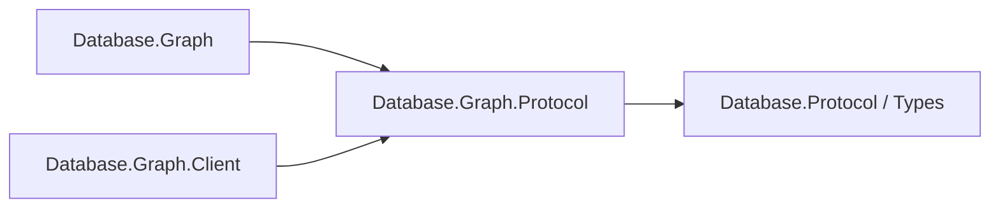

# Assimalign.Cohesion.Database.Graph.Protocol design

This independently consumable contract library owns Graph framing payloads, validation and transferred values. Its direct contract references are Database.Protocol and Database.Types for scalar and diagnostic values. The engine and client use the same CLR DTO types and family singleton; there are no duplicate DTOs or type forwarders. Model request, planner, executor, catalog, storage and server state remain engine-owned.

The arrows show references:

Wire bytes, limits, malformed-payload behavior and exception text are preserved. Span-based codecs and explicit value handling remain trimming and NativeAOT compatible; no reflection serializer or dynamic discovery is introduced. The ProtocolMessageFamily is defined exactly once in this assembly. Existing codec tests live in this project's tests; engine/server/client integration tests retain their existing owners.
GraphValueCodec is the sole public facade. The stateless internal GraphValueEncoding algorithm is compiled through explicit CohesionSharedSource items in Graph and Graph.Protocol. Each local wrapper supplies an immutable three-message value at call time, preserving culture and resource ownership. Only CompositeLimit, CompositeMalformed and CompositeRequired are shared resource text; engine-only keys stay in Graph. No family singleton, EventSource, lock or mutable static state is linked.
