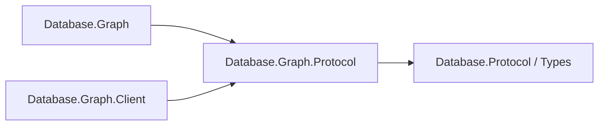

# Assimalign.Cohesion.Database.Graph.Protocol design

This independently consumable contract library owns Graph framing payloads, validation and transferred values. Its direct contract references are Database.Protocol and Database.Types for scalar and diagnostic values. The engine and client use the same CLR DTO types and family singleton; there are no duplicate DTOs or type forwarders. Model request, planner, executor, catalog, storage and server state remain engine-owned.

The arrows show references:

Wire bytes, limits, malformed-payload behavior and exception text are preserved. Span-based codecs and explicit value handling remain trimming and NativeAOT compatible; no reflection serializer or dynamic discovery is introduced. The ProtocolMessageFamily is defined exactly once in this assembly. Existing codec tests live in this project's tests; engine/server/client integration tests retain their existing owners.

GraphProtocolPathMessage measures a path with GetEncodedLength and encodes directly into a
caller-owned Span<byte>. The same bounded traversal measures and writes scalar tags, integer
bits, decimal parts and UTF-8 bytes, without List<byte>, temporary primitive arrays or a final
ToArray copy. Encode() remains an owned-array convenience. Measurement refuses a path above
the per-frame 16 MiB bound before payload allocation. GraphPathEncodingTests compare the bytes
with the original primitive codec for every property tag, Unicode and reverse traversal.
Path payloads still repeat entities; no entity deduplication, capability or version change is
introduced (#1539 owner default).
GraphValueCodec is the sole public facade. The stateless internal GraphValueEncoding algorithm is compiled through explicit CohesionSharedSource items in Graph and Graph.Protocol. Each local wrapper supplies an internal struct implementing static abstract message getters. The generic algorithm reads a getter only on a throw path, preserving the culture active at failure and local resource ownership with zero resource lookups on successful encoding, decoding or size measurement. No strings are cached. Only CompositeLimit, CompositeMalformed and CompositeRequired are shared resource text; engine-only keys stay in Graph. No family singleton, EventSource, lock or mutable static state is linked.

## Execution budgets (#1533)

The engine streams internal read bindings and applies deterministic retained-memory and physical-work
budgets. Unordered read LIMIT may stop expansion (D4); final results stay materialized until statement
completion. GraphQueryLimits carries optional lower MemoryBytes and WorkUnits, with positive engine
ceilings of 256 MiB and 1,000,000 units by default. It is an in-process request contract; no grammar,
Execute payload, capability, wire version or disk format changes. See the engine DESIGN for ownership,
CG05020/CG08021 and the preserved 64-hop trail limit.

## Execute transaction status (#1540, D5)

SQL and Graph advertise the shared `transaction-status` capability in protocol 2.1. Startup Ready
keeps its version/capability payload. When negotiated, each Execute (also Graph ExecutePaths)
ends with an existing Ready frame (byte 4) after ResultComplete/PathsComplete or a statement Error.
Its payload is exactly two bytes: ASCII `I` idle, `T` explicit transaction active or `E` explicit
transaction failed, then a retained-session-state byte (`0` clean, `1` requires reset). Other
lengths and retained-state bytes are malformed (CK07002). This replaces the former one-byte
payload and public record without a compatibility reader (#1717). The existing transaction-status
capability gates it; no new identifier, protocol version or on-disk format is introduced.
Unnegotiated peers retain their original bytes. Ping/Pong and terminal connection errors have no
postamble. Malformed status payloads use CK07002 and are protocol violations.

The capability also defines parameterless reset: Execute byte 5 carries the usual length-prefixed
UTF-8 `ROLLBACK` followed by a zero Int32 parameter count. Success is ResultComplete byte 8 with
an Int64 affected count of zero, then Ready `I`. An error or any other completion/status discards
the connector. Clients never determine transaction state by recognizing user command text.

PostgreSQL reports the same idle/active/failed distinction after a command cycle in
`src/backend/tcop/dest.c:268-281` and `src/backend/access/transam/xact.c:5058-5090` (local PostgreSQL
clone). This copies the state contract only; no source code is copied.

## Graph diagnostic conventions (#1470)

Exception and diagnostic templates use the project's build-generated `ErrorMessages` resources.
Parameterized templates format with the current culture; abort/cancellation templates used in
normal cleanup are cached. The [Database error-code registry](../../Assimalign.Cohesion.Database/docs/ERROR-CODES.md)
assigns this family its two-letter prefix and categorized five-digit identities.
Existing SQLSTATE meanings, numeric wire error kinds, frame layouts and disk formats are preserved.
Structured diagnostics keep their code outside the message. Compiler diagnostic identifiers and
standard .NET argument guards retain their own contracts.

## Debugger inspection (#1470)

GraphProtocolPathWriter has an empty debugger view: its internal length and private Span buffer are not exposed or captured. Inspection performs no measure/write traversal and introduces no boxing of ref-like state. Static protocol codecs remain unchanged.

Eligible types follow the [Database conventions](../../Assimalign.Cohesion.Database/docs/CONVENTIONS.md) debugger display/proxy rules. Views are private and read-only; inspection does not change the public API, execution paths, error contracts, storage formats or protocol bytes.

## Retained session reset (#1717)

The last statement Ready certifies both transaction state and retained session state. SQL reports
currval/lastval entries or timeout settings different from the session reset values; Graph and
Documents always report zero retained state. ProtocolMessageFamily declares ResetStatement
(SQL: DISCARD ALL; Graph/Documents: null). Pool return sends ROLLBACK only when needed, then
rechecks the new Ready before sending the declared reset only for retained state. Reuse requires
Idle plus zero retained state. A clean idle return performs no exchange. A failed, malformed or
timed-out reset discards the connector. Startup Ready, Ping/Pong and unnegotiated framing stay
unchanged. The strict two-byte payload is covered by codec and scripted/live transport counters.
