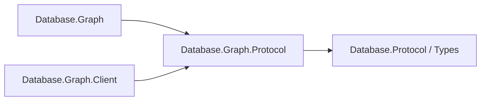

# Assimalign.Cohesion.Database.Graph.Protocol design

This independently consumable contract library owns Graph framing payloads, validation and transferred values. Its direct contract references are Database.Protocol and Database.Types for scalar and diagnostic values. The engine and client use the same CLR DTO types and family singleton; there are no duplicate DTOs or type forwarders. Model request, planner, executor, catalog, storage and server state remain engine-owned.

The arrows show references:

Wire bytes, limits, malformed-payload behavior and exception text are preserved. Span-based codecs and explicit value handling remain trimming and NativeAOT compatible; no reflection serializer or dynamic discovery is introduced. The ProtocolMessageFamily is defined exactly once in this assembly. Existing codec tests live in this project's tests; engine/server/client integration tests retain their existing owners.

GraphProtocolPathMessage measures a path with GetEncodedLength and encodes directly into a
caller-owned Span<byte>. The same bounded traversal measures and writes scalar tags, integer
bits, decimal parts and UTF-8 bytes, without List<byte>, temporary primitive arrays or a final
ToArray copy. Encode() remains an owned-array convenience. Measurement refuses a path above
the per-frame 16 MiB bound before payload allocation. GraphPathEncodingTests compare the bytes
with the original primitive codec for every property tag, Unicode and reverse traversal.
Path payloads still repeat entities; no entity deduplication, capability or version change is
introduced (#1539 owner default).
GraphValueCodec is the sole public facade. The stateless internal GraphValueEncoding algorithm is compiled through explicit CohesionSharedSource items in Graph and Graph.Protocol. Each local wrapper supplies an internal struct implementing static abstract message getters. The generic algorithm reads a getter only on a throw path, preserving the culture active at failure and local resource ownership with zero resource lookups on successful encoding, decoding or size measurement. No strings are cached. Only CompositeLimit, CompositeMalformed and CompositeRequired are shared resource text; engine-only keys stay in Graph. No family singleton, EventSource, lock or mutable static state is linked.

## Execution budgets (#1533)

The engine streams internal read bindings and applies deterministic retained-memory and physical-work
budgets. Unordered read LIMIT may stop expansion (D4); final results stay materialized until statement
completion. GraphQueryLimits carries optional lower MemoryBytes and WorkUnits, with positive engine
ceilings of 64 MiB and 1,000,000 units by default. It is an in-process request contract; no grammar,
Execute payload, capability, wire version or disk format changes. See the engine DESIGN for ownership,
COHDBG020/COHDBG021 and the preserved 64-hop trail limit.
