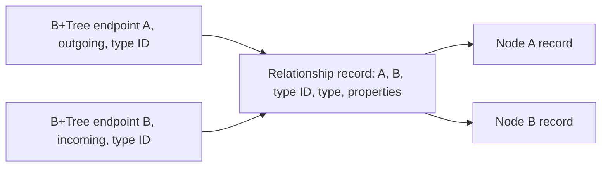

# Graph storage design

## Ownership and composition

The store is one public sealed type, `GraphStore`, with a private constructor behind
`GraphStore.Open` (concrete-types plan, phase 4, #1260): the former `IGraphStore` interface,
`GraphStore` static factory and internal `DefaultGraphStore` collapsed into it, so the Graph
engine's calls are non-virtual. `GraphStorage` is the thin shared-kernel storage subclass.
The engine owns its storage streams and coordinator; the store owns neither and has
no independent disposal or background workers. All identities are reserved from the
kernel's durable transaction-sequence namespace, so rollback and restart do not reuse
an identity.

The Graph root owns query planning, label/type validation and session scoping.
Graph.Catalog owns schema metadata. This package owns physical graph records and their
indexes. The dependency arrows point to the shared Storage, Transactions and Indexing
packages; no model-specific paging, journal, lock manager or B+Tree is implemented here.

## Physical layout and adjacency

The shared file header persists `StorageModel.Graph`. Slotted data pages carry an owner
identifier: owner 0 is Graph.Catalog metadata, owner 1 is physical B+Tree registrations,
and owner 2 contains nodes, relationships and logical property-index definitions.
Shared B+Tree pages use the kernel's `PageType.Index` format.

One relationship record contains both directed endpoint identities and the relationship type's
catalog GUID, supplied explicitly to CreateRelationshipAsync by the Graph engine. The store does
not verify that this ID matches relationship.Type; the engine resolves that pairing from the catalog.
The store does not reference Graph.Catalog or hash names. One shared adjacency B+Tree, registered under object
ID UInt64.MaxValue and name graph, maps (node, direction, type ID, relationship ID) to the packed
physical location. Keys occupy 33 bytes: UInt64 node (big-endian), direction byte (1 outgoing,
2 incoming), 16-byte GUID (big-endian), UInt64 relationship (big-endian). Every relationship has
two entries, including a self-loop. Both-direction reads skip an incoming self-loop using the
record's fixed source field before decoding it again, without a set proportional to outgoing degree.

The diagram shows endpoint adjacency references to records that retain both endpoints.

The filtered GetIncidentAsync overload streams per-direction, per-type closed ranges from
(node, direction, type ID, 0) through (node, direction, type ID, UInt64.MaxValue). Null type
selection reads all types within each requested direction; an empty selection reads none.
Duplicate type IDs add no visits. For t selected type/direction ranges and r retained entries in those ranges, index work is
O(t log E + r); only snapshot-visible references are decoded. Unrelated directions and types
cause no record decodes. The instance-local IncidentRecordsDecoded counter proves this with
leaf splits and minimum-of-three-round comparisons. The unfiltered list overload and engine
materialization sort by relationship identity; the streaming overload specifies no cross-range
ordering. The shared B+Tree currently materializes each entire selected key/reference range under
its read latch while opening a cursor. Cancellation is checked before each range, but allocation and
collection inside OpenCursor cannot be interrupted or stopped by the caller's work budget (#1542).
Graph record decoding occurs afterward. The engine collects and sorts those decoded relationships
before DFS visits them, so its candidate budget bounds visits, not range loading or decoding.
Creating, replacing or deleting a relationship maintains both entries in its single physical
statement bracket, preserving the record's writer/deleter stamps.

Compound keys make every current relationship entry distinct. This is also deliberate
protection against a duplicate-key lower-bound seek starting in a later leaf after a
shared B+Tree split. A regression creates 240 incident edges, forces splits, reopens the
file set, and checks all edges. There is no kernel change.

## Version 3 record format

All multibyte fixed-width values below are little-endian unless a key explicitly says
otherwise. Every slotted record starts with the shared 16-byte stamp prefix: writer
sequence at offsets 0-7, deleter sequence at offsets 8-15. Zero deleter means live.
Graph records have kind at offset 16, format version `3` at offset 17 and a nonzero
64-bit logical identity at offsets 18-25 and a UInt64 revision at offsets 26-33. Revision starts at zero and increases with each replacement. The remaining payload is:

| Kind | Meaning | Payload after identity |
| --- | --- | --- |
| 1 | Node | Int32 label count, label strings, property map |
| 2 | Relationship | UInt64 source, UInt64 target, 16-byte catalog type GUID (Guid.ToByteArray order), type string, property map |
| 3 | Property index definition | Label string, property-key string |

A property map is an Int32 count followed by ordinally sorted `(key string, scalar)`
pairs. Counts must be nonnegative and bounded by the maximum record size. Strings use
the .NET BinaryWriter length format: a 7-bit encoded nonnegative UTF-8 byte length and
those bytes, with strict UTF-8 validation. Labels are ordinally deduplicated and sorted.
The explicit scalar encoding is:

| Tag | Payload |
| --- | --- |
| 0 | Null, no payload |
| 1 | Boolean byte |
| 2 | String |
| 3, 4 | SByte, Byte |
| 5, 6 | Int16, UInt16 |
| 7, 8 | Int32, UInt32 |
| 9, 10 | Int64, UInt64 |
| 11 | Decimal, BinaryWriter's four Int32 words |
| 12, 13 | Finite IEEE-754 Float64, Float32 |

Record length is limited to the shared `SlottedPage.MaxRecordSize` (8,092 bytes).
Unsupported CLR objects, empty or whitespace names and non-finite floating values fail
with `ArgumentException`, a caller error, before insertion. An oversized record fails
with the public `GraphElementTooLargeException`, a `StorageException`, before anything
is written: the size is the element's, not a store fault, so the Graph engine reports it
as the statement failure `COHDBG009` and keeps the session. This version does not define
arrays, nested objects or overflow chains; Neo4j spills large label sets to dynamic label
records and long values to property chains, and an overflow-record format is a follow-up. Nodes and
relationships are immutable versions. UpdateNodeAsync replaces labels and properties;
UpdateRelationshipAsync replaces properties and preserves endpoints and type. Both publish a
replacement even when the supplied values equal the visible version. The engine filters entities
whose assignments were all no-ops; a changed-then-restored entity retains its write conflict. Creation accepts complete StoredGraphNode/StoredGraphRelationship
records whose nonzero identities the caller reserves from the backing storage's durable sequence;
duplicate identities are refused. Reserving identities before insertion lets the engine stage all
changes before first publication. Formats 1 and 2 are refused before recovery scrub with COHDBG017
and the remedy to recreate the database; no legacy reader or upgrade path exists. The existing
StorageCorruptionException carries the code in its message; the engine preserves it in DatabaseException.Diagnostics.
The graph record and tree-registration version is 3; catalog and B-tree page formats are unchanged.
GraphRecordCodec.FormatVersion is the single fence used by pre-recovery validation and open.
The owner-directed #1532 bump is shared with #1534: that later label-index tree extends version 3
and the existing directory reconstruction/OpenIndexes path, without another bump, rebuild of
legacy files, upgrade path or legacy reader.

Owner-one physical registration records are exactly 34 bytes: a zero stamp prefix,
kind `4`, version `3`, UInt64 object ID, and Int64 root page ID. Every tree is named
`graph`; its object ID distinguishes it. A tree's root page stays fixed through splits
(#1159), so a registration changes only when a tree is created; every mutation bracket
still saves changed registrations as a backstop, and registrations are reloaded after
physical statement rollback. They are physical
infrastructure, so logical rollback leaves an unused tree available for recovery;
logical property-index definitions remain stamped and determine visibility.

The trees' pages carry `Database.Indexing`'s own B-tree page format (2 since #1194: entries
ordered by key, record location and writer), which the index manager checks on each tree's root
page when the store attaches it. The store opens after the coordinator's recovery scrub, so
`GraphStore.EnsureIndexFormat(storage)` makes the same check first from the registration records
(zero-stamped, so the scrub never changes them) and the root pages, writing nothing. The Graph
engine calls it before recovery and refuses a database whose indexes an engine before #1194 wrote
with "Database 'x' cannot be opened. COHDBI001: …" (the `IndexFormatException` as its inner
exception). A cleanly closed database is left byte-identical; a crashed one has had only the
storage layer's format-agnostic journal redo and undo, and keeps its journal for the engine that
wrote it. There is no upgrade path (owner decision of 2026-10-02; #1152). The fence runs one way
only: engines before #1194 check neither the page format nor anything this store changed, so they
cannot detect a database this engine wrote and must not open one (owner review of #1194).

Physical references use the high 48 bits for the page ID and low 16 bits for the slot.
Readers check page allocation, data-page owner, record identity and writer stamp before
trusting cached references. Checksum errors and real I/O failures propagate; reclaimed
pages/slots and reused locations are treated as stale directory entries. The allocation,
page-type, owner and slot checks are `Storage.TryReadRecord` with owner 2, the storage's
shared reclamation check (#1342), which the store made inline before.

## Secondary indexes

Each label/property definition owns a B+Tree whose object ID is its durable definition
identity. Keys consist of the shared `DatabaseKeyWriter` scalar encoding followed by
the node identity as eight unsigned big-endian bytes. The scalar encoding is null,
Boolean, ordinal UTF-16 big-endian string bytes, or Float64 for every numeric CLR type.
The scalar prefix may occupy at most 1016 bytes, leaving eight bytes within the shared
1024-byte key limit. A node write, or an index build over an existing node, whose indexed
value encodes past that prefix fails with `GraphElementTooLargeException` before anything
is written. No entry can therefore hold such a value, so a search for one matches nothing
instead of failing. Missing properties have no entry; a present null has a null key.

`GetIndexes` lists the definitions a snapshot sees in one pass, so a planner matching many
labels and property keys reads them once rather than once per pair. The store keeps the
definition identities apart from its node and relationship directory, so listing them costs
the definition count, not a pass over every record.

Numeric keys are a candidate projection. Nearby Int64 or Decimal values can map to the
same Float64 value. Every result is compared to its original scalar: integral/Decimal
pairs compare exactly as Decimal, and a pair involving Float32 or Float64 compares as
Double. This matches the root evaluator and supports very large and very small finite
floating values. Positive and negative zero share one key. Prefix seeks bound the
candidate range by node identities zero and `UInt64.MaxValue`; the identity suffix
also makes a heavily repeated property value safe across B+Tree leaf splits.

Index creation backfills visible nodes under the database writer lock and preserves
source record stamps. Every subsequent node create/update/delete maintains all current
definitions in its transaction. Dropping an index tombstones its logical definition;
older snapshots retain the tree and their view. This MVP retains dropped physical trees
for later reclamation rather than recycling them while snapshots may still reference
them. An exact seek costs `O(log N + k)` index work for `k` candidates, including numeric projection
collisions and retained versions; ordering its `m` visible matches adds `O(m log m)` CPU work.

## Atomicity, conflicts and recovery

All graph writers acquire the shared database-level exclusive lock and retain it until
logical commit/rollback; readers use MVCC snapshots. A weakly associated per-transaction
async gate serializes complete store mutations, including statement views of the same
transaction, from lookup and encoding through directory publication. The gate is allocated
once per transaction; repeated uncontended entries and their value-type leases allocate
nothing. The physical apply gate alone cannot protect a prior-version lookup or the later
publication. The lock is deliberately coarse
for the MVP. Once the writer lock is acquired, a mutation given the transaction's original
ReadCommitted context captures a fresh statement snapshot. A caller-pinned statement view
retains its horizon and reports conflicts against that view; the caller decides whether to
refresh and retry, as PostgreSQL's executor does (`src/backend/executor/nodeModifyTable.c:2636-2665`).
Snapshot isolation retains its fixed horizon.
After a wait, the store checks cancellation and active transaction state
and releases a grant received after rollback. Update and deletion checks compare the
caller's snapshot with the latest committed view while holding the lock; a changed
record produces `TransactionAbortedException`. A stale detach cannot silently cascade
a relationship that appeared after its snapshot.

Creating a relationship applies the record and endpoint indexes in one coordinator
statement. Deleting a connected node without detach is refused before mutation.
Detach tombstones the node, every incident relationship, both adjacency entries and
all node-property entries in one physical bracket. Version-ledger entries allow logical
rollback to restore those records and index stamps together. Committed tombstones remain
available to older snapshots until the shared version-purge worker's safe bound passes.

Opening follows this order:

1. `GraphStorage.Open(..., checkpointOnOpen: false)` runs shared physical recovery.
2. Construct the coordinator and call `AnalyzeAndScrub()` to undo unproven record writers.
3. `GraphStore.Open` loads owner-two record directories and owner-one registrations.
4. `RecoverIndexesAsync(plan.Aborted)` scrubs aborted index writers and deleters.
5. `CompleteRecovery()` checkpoints after lifecycle classification has been consumed.

Crash tests ordinarily flush the journal and clone data and journal memory streams
without disposing the live database. MemoryStream has no durable-flush contract;
these serialized images test recovery replay and scrub, not physical persistence. They
prove committed nodes, relationships and property indexes survive while a partially
applied logical transaction disappears. The graph store keeps an in-memory identity
directory of every retained version, rebuilt in `O(R log R)` for `R` retained records.
Chains are ordered by descending persisted revision; reads choose the first visible version.
Single-version identities keep their reference inline in the directory. Older versions form a
linked history, so publication prepends in constant time. A rotating sweep checks at most four
older references per publication; it validates fixed identity headers without decoding properties.
Lookup also removes encountered reclaimed or reused references and decodes only visible records.
Repeated updates in one transaction therefore allocate and decode linearly in their count.
Label scans examine node identities and retained versions and sort their `m` visible matches in `O(m log m)`. Traversal path
enumeration and cycle limits are owned and documented by the Graph root.

Updates encode the replacement and every new index key before mutation. They move every
property-index entry, or both direction-specific adjacency entries (also for a self-loop), to the new physical
location and tombstone the old record in one physical bracket. Rollback restores old stamps
and removes new versions. Relationship insertion checks endpoint existence in the latest
committed view, so property updates do not conflict with insertion. Snapshot pins protect
old versions from purge.
