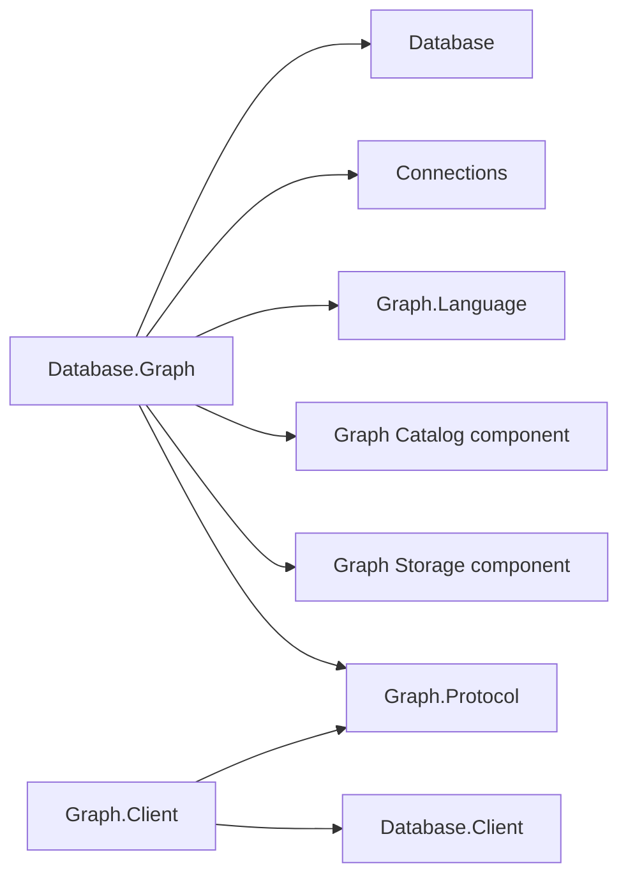
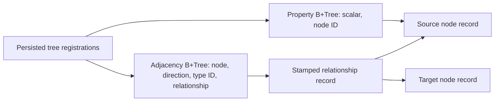
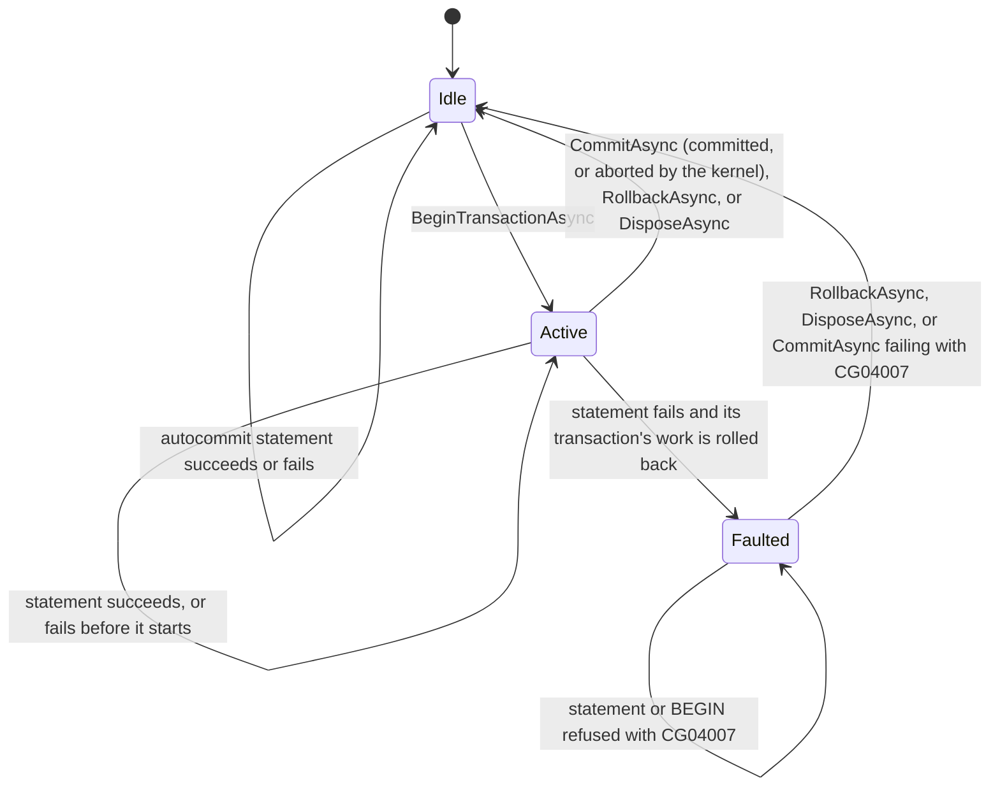
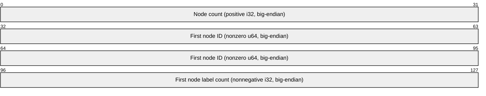
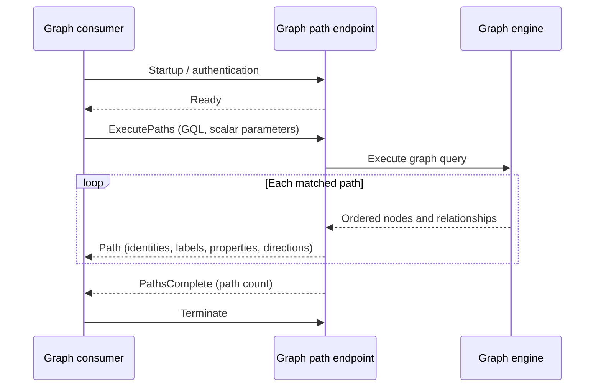
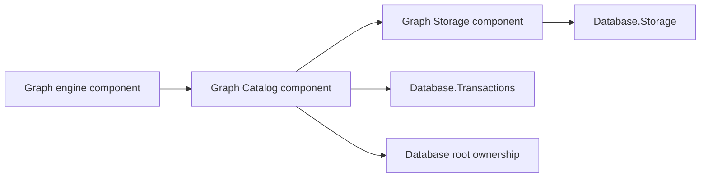
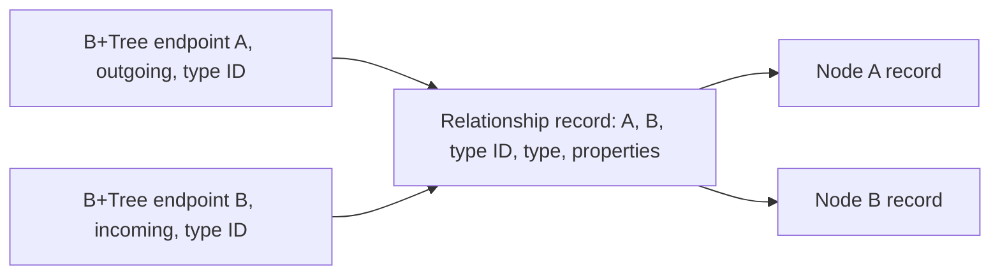

# Graph engine design

## Worker lane isolation (#1279)

Checkpoint, page write-back, WAL group flush and version purge run one database's work at a
time on worker-owned dedicated lanes, with no process-wide scheduling atomic. Idle runners
retire after 30 seconds.

Admission is round-robin, starting after the last database admitted, including after a
collected WAL flush rechecks late commits. The working cap is 64 non-stuck operations per
engine and worker kind. An operation releases its admission slot after four worker intervals,
clamped to 1–4 seconds (the checkpoint poll is at most one second). It retains its lane and
storage ownership until I/O returns. A hard ceiling of 128 dedicated threads (twice the cap),
including parked and stuck runners, bounds replacement cost. Capacity deferral and each newly
stuck lane report observational failures and root event 35, naming the database and worker kind;
these reports never take a database offline or replace an unresolved operational fault.
Warnings repeat at most once per second per database. At the hard ceiling progress waits for a
runner to return, with an explicit health signal rather than silent loss of maintenance.

Idle visits check pending grouped commits, the constant-time dirty-page count, deferred undo,
and owed full purge passes on the pump. They allocate nothing and dispatch no lane. SQL/Key-Value
index stubs dispatch only through their internal test hook until a real maintenance body exists.
A detached write-back completion wakes collection without advancing other databases' interval;
the next regular write-back deadline remains absolute, including a stuck-detection timeout.
Work deferred by capacity remains owed and can use reclaimed slots on these early wakes. Runner parking and result publication
share one critical section. Provisional and published SQL/Key-Value data file sets keep the same
lane identity; a published database waits for an outstanding provisional catalog flush before
flushing that catalog itself. The provisional collection path also rechecks later registrations.

Disposal continues joining every lane before storage closes. Root event 36 names each database
and worker kind still running, once per second while disposal waits. **Open owner question:
bounded disposal** would need retained storage ownership for abandoned I/O; no timeout abandons
I/O or closes its storage. The defaults (64 slots, 128 threads, 30-second idle retirement and the
1–4-second stuck threshold) need owner review against expected database counts and device latency.

A collected WAL flush rechecks later commit registrations before the group window; provisional
SQL/Key-Value file sets do the same, preventing a reset signal from leaving construction to self-help.
Only the pump collects outcomes and calls the root failure/reporting methods, preserving per-database
backoff, give-up fault retention and observational purge refusals. Purge retry and refusal state
is pump-owned; lanes return full-pass, undo and reclamation facts. A full pass becoming due while
an earlier lane runs remains owed and wakes the pump after collection. SQL/Key-Value provisional flushes also use lanes, keeping a
stalled constructor from holding back published databases. Engine disposal joins all lane runners
before closing storages. Lock order is the root pass gate, then the lane monitor; no lane monitor
spans model/apply/storage locks, failure reporting or observer callbacks.

The shared DatabaseLaneWorker publishes opt-in DatabaseWorkerPass observations for all kinds.
Checkpoint failure tests assert requested waits, due visits, completed work and runner availability
at publication, including a delayed observer; elapsed times are diagnostic. Deferred-undo tests
require a recorded undo-only worker completion, a positive-work DeferredUndoCompleted event and a
released writer with 30-second hang guards,
independently of the hour-long full-maintenance interval.
Checkpoint due evidence remains optional checkpoint-specific data. Resilience tests hold the actual
page-write/fsync faults (purge/index use the internal dispatch hook), require K = 4 healthy
positive-work completions while exactly one runner remains held, and assert lane-wait counters.
Page-write setup holds dispatch while preparing the dirty page, then releases it into the device gate.
A 30-second hang guard bounds each phase; elapsed durations are diagnostic only. After release,
the held worker must complete and clear any stuck-lane advisory before a second stall exercises disposal. They do not credit
committer self-help or a statement's
checkpoint as worker progress. Cancellation, completion, failed thread start, capacity and disposal
are exercised in the non-parallel lane stress tests. Each runner starts without caller ExecutionContext and restores a clean context after each job,
preventing apply-gate reentrancy or other AsyncLocal state from crossing databases.
The isolation loop waits for positive-work completions under its hang guard. A slow healthy producer with extra
WAL wakes covers the early no-op exit under concurrent engine load.
SQL/Key-Value index compaction remains a stub: the test hook performs counted page write-back
on its lane and pairs the result with collection. Grouped-commit resilience uses worker flush
and self-help events; hung-checkpoint progress uses a 30-second hang guard instead of a short
throughput window. Slow-cadence, producer and observer regressions cover runner pauses.
No public type, visibility grant, project reference or storage format changed. Storage exposes
its pending-commit and dirty-page scheduling hints without exposing buffer-pool frames.

## Runtime child-root diagnostics (#1247, #1364)

The process-recovery verifier uses Blob's linked test-only `CrashReopen` source for its actual
open after fixture termination (#1713). Only native sharing/lock failures (0x80070020/0x80070021,
or EWOULDBLOCK/EAGAIN errno 11 on Linux and 35 on macOS),
including coded storage wrappers, retry. A successful open decides readiness; 25 ms pacing and
a 30-second hang guard bound the wait and name the file and last error on timeout. The engine
continues to return CG06006 immediately for a sharing violation; no production retry is added.

An autocommit statement whose commit succeeded reports success even if releasing its
ReadCommitted snapshot pin fails during disposal (an OutOfMemoryException still propagates).
Cleanup still releases the session hold;
the coordinator owns any remaining pin until shutdown. Event 13, `StatementCleanupFailed`
(Warning; database, exceptionType), records the cleanup failure without changing the durable
outcome or inviting a duplicate retry.

A CommitAsync or RollbackAsync that the closing coordinator refuses before claiming its
end reports DatabaseException with structured CG09019 and ObjectDisposedException as
its cause. The transaction ends without committing; database disposal aborts its context.
An ODE from a protocol read/write faults the server session without any further error write,
including the generic pump's best-effort Internal response. A non-transport ODE during result
streaming aborts an explicit transaction and reports CG09019 while keeping the authenticated
session ready.

Runtime storage failures, including wrapped I/O, use structured `CG06006` Diagnostics and
plain embedded messages, matching open. Only the wire writer adds the prefix. Begin and
operations share the translator. Attached-index damage leads with `CK06003`, retaining the
index cause and `CK06102` plus `CG06006`; other index failures use `CG06006`.

## Storage corruption (#1160)

A StorageIOException or IOException while opening storage crosses the engine boundary as
DatabaseException with structured CG06006 diagnostics (#1364). Open releases any acquired
file set and publishes no database, so callers may resolve the I/O condition and retry.

Storage corruption is `CK06003` (#1160). The engine translates a
`StorageCorruptionException` into `DatabaseCorruptionException`, retaining the storage
cause and page id, naming the database and page, and advising restoration from a verified
backup. Its structured diagnostic crosses the existing wire execution-failure path; a
failed read never becomes an absent row, document, node, key or blob. Legitimate slot
reclamation still reads as absence. Create/open failures receive the same translation
from the root lifecycle after the model has released its resources. Storage format 4
reserves zero headers for entirely zero pages and identifies reclaimed pages separately.

Corruption translation searches coded inner exceptions and every aggregate branch with
`StorageCorruptionException.Find`; an existing `DatabaseCorruptionException` is retained.
This applies to read/statement and transaction failures as well as synchronous and deferred
create/open failures. A refused open retains any existing model diagnostics in addition to the
outer `CK06003`; Graph, Documents and Blob also carry their unrecoverable-files diagnostic
(`CG06018`, `CD06103` and `CB06004` respectively). The original storage exception remains
the inner cause, preserving its page context. Graph abort messages prefix a cause's code only
when the message does not already contain that prefix.

## Wire contract ownership

`Assimalign.Cohesion.Database.Graph.Protocol` owns this model's wire messages, codecs, family singleton and transferred value shapes (13 public types). Both engine and remote client reference that one assembly. Its public namespace and RootNamespace equal its project name. Engine requests, planning, catalog, storage and server lifecycle stay in `Assimalign.Cohesion.Database.Graph`. This extraction preserves wire bytes and validation; moved public types intentionally change namespace and assembly identity with no forwarders.

## Model component boundaries

Catalog, Storage and the empty Security satellite projects are consolidated into Assimalign.Cohesion.Database.Graph. Public Catalog and Storage types keep their existing namespaces and live under src/Catalog and src/Storage; their assembly identity is now Assimalign.Cohesion.Database.Graph. Internal component types live under src/Internal/Catalog and src/Internal/Storage and declare Assimalign.Cohesion.Database.Graph.Internal.

Engine-owned storage strategies, row/entry codecs and catalog-aware persistence glue live in src/Internal/Engine/Storage; the architecture test enforces strategy placement there. TransactionRecordSpace implementations and physical location-packing helpers belong to the Storage layer (src/Internal/Storage, or nested within a public Storage type); adapter placement is also enforced. This refines the original fold folder map without changing namespaces, members or behavior.

The dependency direction remains engine → Catalog → Storage → shared kernel. Storage-folder types must reference neither Catalog-folder nor engine types; Catalog-folder types must reference no engine types. The build exports the actual compiler inputs, and this model's architecture test recompiles them with Roslyn and checks resolved type/member symbols by their declaring source folders, including partial and generated types. Referenced types also pass a per-layer containing-assembly allowlist seeded from the retired satellite csprojs at a64426436: Storage permits shared Storage, Transactions, Indexing and the actual BCL reference pack; Catalog additionally permits the area root and Types. Graph Storage also permits Types for index-key encoding, historically available through its Indexing reference. Engine code is unrestricted. See the area README for the common placement and assembly rules. Build-generated resource accessors and assembly metadata are shared infrastructure, outside the three layers. No new shipped-assembly visibility grant, wire or disk format, diagnostic code, or behavior is introduced.

## String comparison and collation (#1025)

Graph remains ordinal-only. String property predicates use case-sensitive .NET
ordinal (UTF-16 code-unit) comparison; property index keys encode the same order.
Labels, edge types, property keys, and query variable bindings retain ordinal,
case-sensitive identity. Administrative database lookup remains
ordinal-ignore-case. SQL database defaults and `COLLATE` overrides do not apply
to GQL or graph storage. Configurable graph collation is deferred; no case or
accent folding is applied to stored labels or property values.

## Composition and frozen contracts

The fifth database engine follows Documents' parser/planner/executor composition and Blob's
engine-owned lifecycle. `GraphDatabaseEngine` is the public factory and engine; the engine, its
database (`GraphDatabase`), session, transaction, server and builder are public sealed types, the
first five leaves of the area root's bases ([Concrete types](#concrete-types-concrete-types-plan-phase-4-1260)),
while the planner, executor, server session and storage strategy are internal. Its dependencies
are the area root, Connections and the Graph.Language package and its own Catalog and Storage components. Storage uses
shared Storage, Transactions and Indexing rather than another pager, journal or lock manager.

| Component or package | Responsibility |
| --- | --- |
| `Database.Graph` | Engine, sessions, typed operations, planning, scalar/path execution, and graph protocol server |
| `Database.Graph.Client` | NuGet-only scalar and path client over the shared connection pool; references Graph.Protocol and Database.Client |
| `Database.Graph.Language` | ISO GQL subset, AST and syntax/capability diagnostics |
| `Catalog/` in Database.Graph | Snapshot-visible labels, types, property keys, index metadata and ownership |
| `Storage/` in Database.Graph | Record encoding, kernel adapter, adjacency and property B+Trees |

The engine references the area root, transport abstraction and its model packages; the protocol
and security contracts arrive through the area's root composition. These are dependency edges:

`GraphDatabase` takes an explicit `GraphDatabaseSession` for each data operation. Every entry point
checks the session's database identity; sharing an engine or database name is insufficient.
`GraphSchema.Open(database, session)` returns a `GraphSchema` bound to that exact database and
session. Its operations join the session transaction. #1228 changed `GraphSchema.GetIndexesAsync`
(a breaking change) to return `GraphSchemaResult<GraphIndexMetadata>`, a read-only list that also
carries the read's warnings. Administrative database lifecycle remains on the engine; no GQL AST
can select a server, another database, or another graph.

## Physical records and adjacency

Each logical database owns `graph.dat`, `graph.log` and `graph.bak`, in the directory
`<RootPath>/<storage name>` when it is file-backed (see "Database names and directories" below).
All records start with the
shared 16-byte little-endian writer/deleter transaction stamp. The graph payload's byte 16 is the
kind, byte 17 is format version 5, bytes 18–25 are a nonzero unsigned 64-bit identity and bytes
26–33 hold the entity's increasing revision. Formats 1, 2, 3 and 4 are refused before logical recovery scrub,
with CG06017 and the remedy to recreate the database; no upgrade path exists. Graph
identities are reserved from the shared storage sequence allocator, so rollback does not recycle
an identity. Database-local IDs must always be paired with the correct session.

| Page owner / kind | Payload after the stamp |
| --- | --- |
| Owner 0, catalog | Catalog-specific version, discriminant and encoded definition; see Graph.Catalog's format |
| Owner 2, kind 1 | Common graph header, label count and (string, catalog GUID) pairs, then scalar property map |
| Owner 2, kind 2 | Common graph header, source ID, target ID, catalog type GUID, type string, scalar property map |
| Owner 2, kind 3 | Common graph header, indexed label and property key |
| Owner 1, kind 4 | Zero stamps, kind/version, tree object ID, signed 64-bit root page; 34 bytes total |

Counts and fixed integers are little-endian. Strings use BinaryWriter's UTF-8 encoding with a
7-bit encoded byte-length prefix. Property maps are ordered by ordinal key and preserve scalar
type tags. The exact tag table and index tuple encodings live in
[Graph.Storage DESIGN.md](DESIGN.md#storage-component), which
is the format reference for another reader. Properties support null, Boolean, string, integral,
decimal and finite floating point values. Records fit one shared slotted page; oversized records
are rejected before publication. Large graph properties/chunking are deferred.

The adjacency B+Tree keys (node ID, direction, catalog type GUID, relationship ID), pointing
to the relationship's packed record location (page ID << 16) | slot. A relationship has outgoing
and incoming entries, including a self-loop. The engine resolves a simple type by catalog name;
Boolean type expressions select the visible catalog IDs they accept. Wildcard/untyped hops read
all types. Statement-local selections are cached per pattern and invalidated by INSERT type
discovery. Fixed and quantified hops reverse direction when expanding left of the anchor.
The overlay indexes newly created edges by the same node/direction/type tuple, so irrelevant
pending edges add no physical candidates. Self-loops appear once for both-direction reads.
Dropping a relationship type checks only that catalog ID's outgoing ranges and stops at the first
in-use edge; existing schema handoff tests cover the refusal and concurrent deletion paths.

The diagram shows the references stored by the adjacency and property trees; relationship records
carry endpoint identities referring to node records.

A filtered incident lookup costs O(b log E + r) index work for b bounded batches across selected type/direction ranges
and r retained entries in them, decoding k visible references; deterministic identity ordering adds O(k log k) CPU work. Direct
traversal uses these same selections and ordering with O(Vvisited) visited state. A label scan seeks MVCC postings keyed by (catalog label GUID, node identity), decoding only
visible matching references in identity order. Its index work is O(b log P + r) for b bounded batches and retained
postings r in the selected label range; unrelated nodes add no record decodes. A property equality anchor
instead seeks its shared B+Tree in `O(b log N + candidates)` for b bounded batches after locating index metadata, then sorts its matches.
Index numeric keys normalize
integral, decimal and finite floating point values through double conversion. Full scalar comparisons
filter index candidates using exact reduced numeric fractions across all numeric types, including
floating operands, so key collisions cannot change equality or lose adjacent large integers.
All node creation, replacement and deletion paths maintain property indexes. The sealed
GraphStore exposes UpdateNodeAsync and UpdateRelationshipAsync; GraphDatabase adds no public
update verb. Its GQL SET/REMOVE stages use a statement-local working copy, so rows observe earlier
rows and items evaluate left to right, while publishing one replacement per updated entity at
statement completion. Later scans, index seeks, traversals and endpoint functions consult that
working copy. Every binding is refreshed after an update stage, including nested lists/maps/paths;
updated entities retain read-only label and property collections when returned to callers.
Refresh traverses shared composites once per stage, memoized by reference identity, copying only
branches containing touched identities and retaining unchanged lists and maps. Refreshed maps
remain `ReadOnlyDictionary`. Scalar evaluation resolves entity leaves through the current working
copy, preserving left-to-right reads without rebuilding composites per row or assignment.
INSERT reserves stable identities from storage, stages the complete entities, then inserts their
final working copies once, nodes before relationships. A cascade discards pending relationship
updates just as explicit relationship deletion does; the affected count includes explicit targets.

Each persisted replacement tombstones the old record and moves every label posting and property-index entry or
both direction-specific adjacency entries (also for a self-loop) and its relationship-type posting to the new location in one physical bracket.
The identity directory retains all versions newest first, ordered by the format-3 revision on
reopen. Older snapshots retain the old records and index entries; rollback removes replacements
and restores old stamps. Purge reclaims only versions no snapshot can see; reclaimed or reused
references are discarded during lookup and subsequent publication. The process fixture checks
committed updates and an in-flight indexed-name update through index seeks and label scans.

SET NULL removes a property; INSERT still stores explicit NULL. Map replacement removes absent
keys and map merge preserves them. Labels and keys reuse INSERT catalog discovery and resulting
property-set validation. Type-exact no-ops write no version and count zero. The mutation count is
created entities plus distinct entities changed at any point, counting an entity created then
updated once. Restoring an original value later still counts and publishes that entity, preserving
Snapshot first-updater-wins conflicts. An entity whose assignments were all no-ops skips
replacement. Row-returning mutations carry the same count over
the existing ResultComplete frame. EXPLAIN
describes update stages and their targets without executing them.

Autocommit runs at ReadCommitted and pins its statement snapshot. Every mutation entry point,
including typed creates/deletes and catalog/schema writes, retakes a ReadCommitted snapshot
after taking the writer lock. A GQL write then replans against it using the
already normalized, captured parameter bindings, so queued
increments serialize. Refresh replaces only the statement view and retains the existing
snapshot pin: its earlier horizon still protects the newer view from pruning, without writing
another transaction begin or rollback to the journal. Explicit Snapshot writers retain first-updater-wins. Relationship insertion
checks latest endpoint existence, so a concurrent endpoint property replacement does not abort it.

Behavior references (consulted, no code copied), relative to C:/Source/repos/neo4j/neo4j:
`community/cypher/interpreted-runtime/src/main/scala/org/neo4j/cypher/internal/runtime/interpreted/pipes/SetOperation.scala:103-108`
removes NULL properties; `community/kernel/src/main/java/org/neo4j/kernel/impl/newapi/Operations.java:3116-3119`
requires both the same value type and equal value for a no-op;
`community/kernel/src/main/java/org/neo4j/kernel/impl/api/state/EntityStateImpl.java:68-75`
retains assigned values in transaction state, including a restored original value.

### Database names and directories

A file-backed database's directory is `<RootPath>/<storage name>`, where the storage name is the
invariant lower case of the database's name (#1392). Database names compare ignoring case, so every
spelling reaches that one directory on every OS: on Linux an open of `SALES` finds `sales`, a create
of `SALES` after `sales` is refused as existing, and a drop of `SALES` drops `sales`.

- **Why a pure function, not a scan.** Before #1392 the engine scanned the root for a directory
  whose name matched ignoring case. That cost a directory scan per open, create and drop, and on a
  case-sensitive file system it was ambiguous when `sales` and `Sales` both existed. The directory
  is now computed from the name by `DatabaseFileNames`, the function every model shares (the area
  design, `3.3, has the rejected alternatives).
- **One name rule on every OS.** 1 to 128 ASCII letters, digits, `_`, `-` and `.`; no leading,
  trailing or doubled dot; no Windows device name before the first dot. The rule used to be the
  platform's invalid file-name characters, so `a:b` was valid on Linux and refused on Windows.
- **Enumeration** takes each directory under the root that is a lower-case valid name holding
  `graph.dat`, so it skips a case-variant directory made outside the engine. Such a directory is
  outside the contract: on Windows and macOS the file system resolves an open's lower-case path to
  it.
- **A database is its data file.** An open needs `graph.dat` too, so a directory without it, left
  by an interrupted create or drop, is not found (`DatabaseNotFoundException`). A create claims
  the directory, so it refuses that one with a message that names the leftover, and a drop
  removes it. `TryGetDatabase` is a lookup, so a name that breaks the rule is not found rather
  than refused.
- **The reported name** is the spelling the storage header kept from the database's create,
  whatever spelling opened or listed it.
- **In memory** the engine's `DatabaseMemoryFiles` keys the `graph` file set by the same storage
  name.

`GraphDatabaseNameTests` pins each case in memory and on disk, asserting the exact directory names
it leaves with ordinal comparison, so the tests prove the mapping on Windows, whose file system
folds case, as on Linux.

### Interrupted creation (#1421)

Missing journals and backups are refused with CG06018 in DatabaseException.Diagnostics,
including the DatabaseNotFoundException for a directory without its data file. A complete
header proves sidecars existed at creation; their absence can mean an interrupted drop or
lost acknowledged commits. No sidecar is silently recreated, even beside an empty closed
database. Preserve ambiguous files and restore a complete backup. This follows Neo4j's
missing-log refusal (community/configuration/src/main/java/org/neo4j/configuration/GraphDatabaseSettings.java:697-698;
community/kernel/src/main/java/org/neo4j/kernel/recovery/Recovery.java:1146-1153).
Drop explicitly deletes the data file before recursively removing the remaining files.
A file no larger than one page is incomplete creation: create flushes two pages before returning.
Its refusal names DropDatabaseAsync followed by CreateDatabaseAsync, which can complete. A partial
final data page proceeds through WAL recovery. Recovery may leave an uncommitted extension torn
at the tail; storage ignores that tail and overwrites it at the next allocation, preserving all
committed data. Only corruption is classified as unrecoverable damage. Transient storage I/O
failures, including a full pinned buffer pool, ask callers to retry open after the condition is
resolved, without drop or backup advice. No record or storage format changes.

## Transactions, atomicity and recovery

One `TransactionCoordinator` per database owns MVCC, logical undo, journal durability, lock
management and physical statement brackets. A conservative database writer lock serializes writers
through their logical commit or rollback; readers use snapshots. Metadata and affected graph
records are checked against the latest committed view after lock acquisition, so a stale writer
cannot create an orphan endpoint or bypass a newer schema constraint. The engine's latest
snapshot excludes committed contexts still tracked between lock release and untracking
(#1665), mirroring Documents' filter (db1a2e3bf) while preserving caller-owned writes and
excluding every other tracked context; node/relationship metadata conflicts, label/type
in-use checks and property-metadata validation all use it. Catalog/store latest snapshots
already filter to active contexts for property-key deletion, metadata/record conflicts
and index creation/population/deletion. PostgreSQL likewise ends transaction visibility
before lock release (`src/backend/access/transam/xact.c:2425-2430`).

Node creation and label/key metadata participate in the same logical transaction. Relationship
creation writes its record and both adjacency entries in one physical bracket. Deleting a node
with `DETACH DELETE` tombstones its incident relationships, adjacency and property entries with
the node atomically. Plain GQL `DELETE` refuses a still-connected node. `DELETE r,a` first deletes
explicitly selected relationships, then checks the nodes. The frozen typed `DeleteNodeAsync`
contract explicitly cascades and is implemented that way. Any statement failure rolls back the
owning logical transaction. An autocommit statement's transaction is its own; an explicit session
transaction is aborted as a whole and stays aborted until the caller rolls it back, as
[Failed statements in explicit transactions](#failed-statements-in-explicit-transactions-1188)
describes.

Snapshot and ReadCommitted isolation are supported. ReadCommitted captures and pins a statement
snapshot, so metadata and each hop of a traversal share a visibility horizon. Serializable is
rejected rather than silently weakened. Explicit transactions use the session API or ISO text
`START TRANSACTION`, `COMMIT` and `ROLLBACK` over Execute (#1540, D5). Text START uses Snapshot.
`BEGIN [TRANSACTION]` aliases START TRANSACTION (#1725); reserved `Transaction` byte 9 is still rejected with
`ProtocolViolation`. Results materialize before
the statement transaction is released, so result iteration cannot race record reclamation.
Statement pins use `TransactionCoordinator.BeginSnapshotPinAsync` (#1351), retaining their
manager registration, fixed snapshot and existing rollback/disposal release paths. Pins remain
in the current-transactions gauge but move none of the begin, commit or rollback rates and
emit no Verbose kernel lifecycle events. A real explicit rollback still counts. Read-only pins
append no lifecycle records (#1280); registered statement snapshots are outside this change.

Open defers the storage checkpoint, performs physical WAL recovery, validates graph/index formats
before coordinator record scrub, opens catalog/store indexes, purges unproven index writers using the same recovery
plan, and checkpoints last. The process fixture exits after committed graph/index creation and
after uncommitted detach/insertion page write-back, without disposal. Restart must recover the
committed path and index, remove partial nodes/types/edges, and undo partial tombstones; it then
reopens a second time to verify the recovery checkpoint.

Recovery fixtures compare selected-label reads before and after an uncommitted labeled create
and relabel: the committed label ranges and properties survive, while partial postings disappear.
The process fixture exits after page write-back with both operations still uncommitted and
checks the same committed label membership after recovery and a second reopen.

The Database solution includes `Graph.RecoveryFixture` so solution builds keep the fixture in
the selected configuration. The Graph test build copies that configuration's outputs beside the
test assembly, allowing `dotnet test --no-build` after a Debug or Release solution build.

### Whole-pattern MERGE execution (#1735, GQ-M2)

The planner treats GqlMergeStage as a writing stage and validates both SET bodies through the same
local validation as ordinary SET. It admits one creation-compatible fixed path and binds all path
variables before checking branch items. Equalities see only the incoming scope and are evaluated
once per input row; known null/invalid equalities also fail EXPLAIN (CG03004). Dynamic invalid
values fail before the seam or creation. A bound null/missing/incompatible entity uses CG03005.
The language DIALECT records repeated branch ordering, undirected orientation and bare repeated
node variables. Already-declared relationship variables refuse during planning (CG03007); labels
or properties on a repeated or incoming node refuse there too (CG03006), including EXPLAIN.
No new public execution boundary or interface is added.

| Code | MERGE condition |
| --- | --- |
| CG03004 | Null, non-finite or non-scalar equality, proven at planning or evaluated per row |
| CG03005 | Null or absent bound node, or incompatible bound identity |
| CG03006 | Repeated or already-bound node decorated with labels or properties |
| CG03007 | Relationship variable declared before MERGE |
| CK04002 | Operation ended before tracker acquisition or during a late pattern grant |

The executor gives every anonymous element a collision-free internal binding, constructs a fully
evaluated path and lock identity, then delegates both probes to GraphMergeConcurrency. Each probe
uses the supplied read view through GraphUpdates, includes overlays, and enumerates every complete
match. Its freshness read set includes all matched elements and bound node identities, even
when the remaining path has no match. Each probe re-reads incoming node and relationship values
at its supplied view, including overlays, so ON MATCH expressions and replacement construction
cannot republish stale incoming properties after a ReadCommitted pattern wait. That refreshed
view also supplies incoming aliases outside the pattern to ON CREATE. Each incoming entity
refresh checks cancellation and consumes one work unit. Work and both probe result tables are
charged to the statement budget and released per input row. Output copies leave probe tables
immutable while branch SET updates and binding cleanup run. Creation reuses bound nodes;
later bare occurrences reuse the first node slot without merging labels or property maps.
Both branches use ApplyAsync. After all input rows, RefreshMergeBindings refreshes the complete
output table through SET's recursive alias refresh. Ordinary creation validates schema before entering the overlay;
MERGE creation discovers definitions and checks supplied property types then, defers Required
checks until ON CREATE has finished, and validates every created entity before the row leaves
that branch. An entity still missing a Required property refuses with the existing CG03003.
ApplyAsync validates complete changed entities after each SET branch. The one-time PublishAsync
owns storage publication and affected counts; it does not own schema validation.

The planner chooses an indexed label/property for row-dependent MERGE equalities and retains
the expression as its value placeholder. The executor substitutes the already-evaluated row value
before both probes, so an UNWIND upsert performs a seek per row and view. Row-dependent
seeks rank ahead of every label or relationship-type scan, including zero published counts,
because those estimates exclude the growing statement overlay. EXPLAIN renders the placeholder
as GQL expression text. Property seeks maintain a lazy value-keyed view of added and removed
overlay postings for each label/property, updated on creation, replacement, relabeling and deletion.
Exact graph scalar equality supplies the keys, including numeric equality across CLR tags.
Building a view charges each earlier overlay entry once; each probe charges its value lookup and
matching entries, and each subsequent change charges index maintenance. Overlay label scans
charge every compared node, including rejected labels. Retained change buckets and entries use
the existing statement memory lease. The MERGE read-view override lives in MERGE's lazy state,
so this cache adds no object size or eager allocation to ordinary writes. This follows Neo4j's
value lookup of transaction-state index additions at
`community/kernel/src/main/java/org/neo4j/kernel/impl/newapi/TxStateIndexChanges.java:333-345`
(local clone, behavior consulted; no code copied). Latest probes retain
the dropped-index fallback to a label scan. Ordinary MATCH anchor selection is unchanged.
EXPLAIN describes the probe and both branches; InMemory/TCP conformance and NativeAOT exercise the
same stage. Ordinary CREATE/SET/DELETE/MATCH retain their existing paths and lock resources. Release fixtures
retain their base allocation ceilings: the MERGE count box is allocated only in its branch, and
flow cleanup reuses RunAsync's existing finally without growing ordinary operations.
The fix-pass Release fixtures retain the pre-fix MATCH planning/execution minima and enforce
the measured ordinary CREATE, SET and DELETE allocation ceilings; MERGE-only checks avoid
captured delegates that would grow every plan's closure.
Ordinary-write measurements run their own warm-up in a fresh fixture process with fixed catalog
label identities, keeping the posting layout and runner state reproducible. Their ceilings use
that fixture's standalone baseline plus 128 bytes, excluding the 4096-byte difference previously
observed in combined runs; that difference is not attributed to snapshot bookkeeping. Injection
tests require the guards to reject an additional 1 KiB on CREATE and DELETE. Successful assertions stay
outside measured loops; unexpected outcomes still fail immediately. Existing MATCH ceilings
and runtime compilation settings are unchanged.

### Internal MERGE serialization contract (#1735, GQ-M1)

`GraphMergeConcurrency.MatchAsync` executes every GQL MERGE decision (#1735, GQ-M2).
Call it inside the existing operation failure bracket, before choosing match or create. Supply
`GraphMergePatternIdentity` after binding: node binding slots with bound IDs, ordinal labels and
evaluated property equalities, and fixed relationships with endpoint slots, type, orientation,
optional bound ID and equalities. Repeated variables reuse a node slot; variable names are absent.
Incoming edges swap endpoint slots. Node slots are canonical content tokens: sorting the node
and relationship multisets makes incoming/outgoing spellings, reordered node-only parts,
label/property order, duplicate labels, relationship-part order and undirected endpoint order
independent of source positions. Equal node tokens can conservatively collapse different
topologies, just as any lock-hash collision can over-serialize. Equal numeric values share the
existing exact-fraction hash. Null, non-finite and composite equalities, zero bound IDs, empty
patterns and invalid endpoint slots are refused with structured CG05023. This validates the
internal identity only; the executor validates language equalities first with CG03004.

The seam takes the existing exclusive database writer lock, then an exclusive logical pattern
entry in Graph's reserved `ObjectId = ulong.MaxValue - 3` lock namespace.
`GraphLockNamespaces` defines it once beside adjacency, label and relationship-type posting
namespaces (`ulong.MaxValue - 2 .. ulong.MaxValue`). All four exceed the signed sequence
allocator's range, so no allocated catalog/property-index object can collide. The entry is a process-local
32-bit equality hash; collisions only over-serialize. An absent pattern is still a resource.
No registry, public API, Transactions change or storage format is needed. These locks belong to
the transaction and remain held through commit/rollback, including an empty or matched return.
The writer lock is mandatory: differently expressed overlapping patterns, and ordinary writes,
must also serialize with this decision. Ordinary CREATE/SET/DELETE acquire no additional lock and
pay no new check. The source comment establishes lock/latch order; probes take only read latches
and must neither mutate nor acquire locks. Normal operation abort and coordinator undo release
ownership on exception/cancellation/disposal; an ended owner's late grant is explicitly released.

The caller supplies a read-only whole-pattern probe over the supplied `TransactionSnapshot`,
including its statement overlays and every match's persisted node/relationship read set. The
seam owns an internal GraphUpdates read-view override around the latest probe, restored in
`finally` on success, failure, cancellation or disposal. Every overlay-aware lookup, anchor,
type selection and incident stream uses that view; type-selection caches are invalidated at
each view transition and ReadCommitted writer refresh, including cached absence. A latest-view probe
whose planned property index was dropped falls back to a label scan under the same locks. The probe returns complete matches, reports
every persisted entity read, and charges ordinary query work and retained memory to its budget.
At Snapshot, the seam probes the original view, compares every matched and bound entity's writer
and revision against the latest committed view, and probes that latest pattern view before
returning the original decision. A changed/deleted entity, fewer latest matches than decided
matches, or a create decision with a new matching pattern raises retryable
`DatabaseTransactionAbortedException` with structured CG04024. This
detects replacements even if values are restored, and checks bound endpoints even with no whole
match. Each entity revision comparison checks cancellation and consumes one physical-work unit
from the operation's query budget. Caller-owned uncommitted versions appear in both views;
overlay-only identities are absent
from both store views. Unrelated commits and additional matches beside unchanged existing matches
do not invalidate the original match decision. The match-count cross-check also catches an
incomplete entity read set when a decided match disappears. At ReadCommitted the seam refreshes
the statement view after the pattern grant and probes once, so a competing creator matches and
a concurrent property/label update or deletion re-matches to absence. Its existing snapshot pin
continues protecting that newer view.

MERGE allocates its statement caches lazily. While the transaction-long database writer is
held, it captures one latest-state view and one ReadCommitted writer view per statement; a
pattern wait invalidates them and refreshes after its grant. Reentrant mutation writer requests
reuse the captured view. The evaluated-pattern overload caches the most recent identity by
reference to an immutable evaluation key, including every bound id and equality. An evaluation
whose inputs change must use a fresh key. This one-entry cache retains no factory closure and
cannot grow with distinct input rows; the executor accounts evaluated operands and both complete probe results.

GraphMergeLocks is lazy and transaction-owned, including across statements. A new parent/entry
charges 640 bytes to the acquiring operation's existing query-memory budget (CG05020 on refusal),
covering manager state and local bookkeeping. Each MERGE statement also accounts for all retained
pattern state from earlier statements; 256 additional bytes cover its statement cache. All query
leases end with the statement, so the tracker never retains a completed query's budget or value
workspaces. A smaller later query budget refuses even a previously held pattern if the retained
state exceeds that limit, aborting the explicit transaction. Each pattern first takes parent
IntentExclusive. After 128 distinct entry resources, new patterns use a single Exclusive object
lock in the same namespace. The earlier, at most 128 entry grants remain held through undo and
normal coordinator release; escalation never grows that set. This caps both retained lock state
and the manager's end walk without a new kernel release API or an unsafe early release. The
parent protocol preserves phantom serialization. While the writer lock remains, production never
waits on a pattern lock: raw test holders exercise those waits and escalation. If writer serialization
were weakened, competing IntentExclusive-to-Exclusive upgrades would surface as detected retryable
deadlocks. The database writer remains mandatory for
overlapping patterns and ordinary writes. Normal writes allocate no MERGE tracker or cache.
End cleanup fences tracker charges before releasing the statement lease on the same budget;
late autocommit grant cleanup cannot race that release. FinishAsync atomically publishes an ended
sentinel and disposes only locks, with operation release in finally. RunAsync releases the statement
memory lease on its flow after execution has stopped, even if teardown already ended the operation.
Late Merge access returns CK04002; a closing session also ends the statement before rollback
and pin release publish that sentinel. A disposed pattern tracker reports the same code when
teardown wins after the seam re-reads its state. A disposed read inside a probe also uses CK04002
once the statement has ended. The seam rechecks the sentinel before touching its cached tracker
and after a late grant. A losing CompareExchange releases its unpublished lease. End-between-grants tests assert budget
and lease release for both explicit transactions and autocommit operations.

Non-parallel tests exercise real transactions for creators, ordinary deleters/replacements,
directed/undirected relationship overlap, all matched entities, bound endpoints, overlays,
unrelated commits and every return/failure/disposal path. Threaded stress runs for at least
250 ms, then until at least two recorded queued creator races of each isolation have completed,
under a 30-second cancellation ceiling; counters and lock-release checks decide success.
GQ-M2 also races teardown against active memory charges until at least two rounds and 200
post-teardown charges have completed after a 250 ms minimum, under the same 30-second ceiling.
Indexed-anchor and type-cache regressions cover the latest-view fallback and writer refresh.
Each creator-stress iteration disposes its database before the next begins. Actors publish their queued
progress before assertions, so a failed assertion reaches the caller instead of hiding behind
the progress wait's hang guard. The pending state is captured before publication: the signal
may let the main actor commit before the assertion executes. Deterministic inline-completion
and already-completed-task tests cover both orderings.

The strict unselected-MATCH allocation fixture runs in the same non-parallel collection.
Concurrent suite activity perturbs its small retained fixture ceiling; isolated baseline and
current implementations allocate identically. All existing allocation ceilings remain enforced.
Optional internal, instance-free test gates after writer acquisition and after pattern bookkeeping
deterministically end the session or cancel before the manager request, proving actual late-grant
cleanup and CK04002. Creator tests record the loser's pinned view before allowing the winner to
commit. The seam's wait hook records an incomplete grant before releasing a raw pattern holder.
Tests also force a
pattern-only wait and check failure release before the caller rolls back its faulted transaction.

Behavior consulted, no code copied: Neo4j
`community/cypher/interpreted-runtime/src/main/scala/org/neo4j/cypher/internal/runtime/interpreted/pipes/MergePipe.scala:32-45,79-102`
branches on a whole input match and its locking variant locks then re-reads. Neo4j's
`community/cypher/front-end/ast/src/main/scala/org/neo4j/cypher/internal/ast/semantics/SemanticPatternCheck.scala:467-488`
permits undirected MERGE and rejects variable-length update relationships. The fixed-Snapshot
retry requirement above is the stronger owner-approved contract (2026-10-25).
Redeclaration checks follow `SemanticPatternCheck.scala:670` and
`community/cypher/cypher-planner/src/main/scala/org/neo4j/cypher/internal/compiler/ast/convert/plannerQuery/ClauseConverters.scala:519,885`.
Repeated actions follow that converter at `:816-822` and
`community/cypher/front-end/parser/v5/parser/src/main/antlr4/org/neo4j/cypher/internal/parser/v5/Cypher5Parser.g4:188`.
Required-property deferral follows Neo4j's validation before commit
(`community/kernel/src/main/java/org/neo4j/kernel/impl/api/KernelTransactionImplementation.java:1383,1830`);
Graph validates the finished ON CREATE row before publication.

### Failed statements in explicit transactions (#1188)

A statement that fails inside an explicit transaction aborts the whole transaction. Graph storage
cannot undo one statement: a statement writes catalog definitions, records and index entries
through separate physical brackets, and `Database.Transactions` undoes a writer only as a whole
transaction, with no savepoints. The SQL session's contract, where the failed statement writes
nothing and the transaction stays active, is therefore unavailable, and the session follows Neo4j:

1. The failure rolls the transaction's work back at once and releases its locks, so the aborted
   transaction blocks no other writer while it waits for the caller. (When the undo itself fails,
   the kernel keeps the writer lock until its version-purge pass completes the undo; see
   `Database.Transactions` DESIGN.md, "Ending a transaction".)
2. The transaction stays the session's `CurrentTransaction` and reports `TransactionState.Faulted`.
   Every later statement on the session fails with `CG04007`: GQL text or requests, typed
   `GraphDatabase` operations, traversals and `GraphSchema` calls. `BeginTransactionAsync` fails
   with `CG04007` too. The error names the original failure in its message (`Cause: ...`) and
   carries it as `InnerException`. A refused statement does not change the transaction, and an
   aborted transaction refuses text before parsing it.
3. `RollbackAsync` succeeds, leaves none of the transaction's writes, and returns the session to
   autocommit. Disposing the transaction or the session ends it the same way. A rollback of any
   transaction that did not commit may be repeated and raises nothing: one already rolled back,
   one a failed statement aborted, and one whose commit the kernel aborted (a commit record that
   could not be written). So a catch-block rollback after a failed commit never hides the
   commit's error. A rollback of a committed transaction is refused, because it cannot do what it
   says.
4. `CommitAsync` fails with `CG04007`, commits nothing, and ends the transaction (`RolledBack`);
   every later commit fails the same way, with the same cause, and so does a commit after the
   session's teardown ended the transaction (since phase 4 of the concrete-types plan, when the
   root transaction base took over the state machine; before it a later commit reported "The
   transaction is RolledBack.").
   A commit the kernel aborts throws `DatabaseTransactionAbortedException`, as a statement's kernel
   abort does, and leaves the transaction `Faulted` and ended. A commit whose record was written
   but could not be made durable is not an abort: it throws
   `DatabaseTransactionCommitUnconfirmedException` and leaves the transaction `Committed`
   (`Database.Transactions` DESIGN.md, "A commit record that was written but not made durable").
   Its Diagnostics carry the model's code on every path, the explicit commit and an autocommit
   statement's own commit alike (owner decision 24 of 2026-10-06, #1272):
   `Database '{name}' went offline while a transaction was committing: ...`, built by
   the root's `DatabaseTransactionCommitUnconfirmedException.Create(code, database, cause)` in
   `GraphDatabase.TranslateKernelFailure`, now an instance member so it knows the database, with
   the kernel's `TransactionCommitUnconfirmedException` as its inner exception. Before #1272 this
   path carried the kernel's message alone.
5. Every failure of a statement that started counts: parse diagnostics, planning and execution
   errors, ownership refusals, kernel aborts such as conflicts and deadlocks, cancellation while
   the statement runs, and (on the wire) a result the server cannot encode or deliver.
   Pre-execution planning failures such as an unbound parameter follow the same rule, in
   ordinary execution and EXPLAIN alike. Failures
   that come before a statement starts leave the transaction unchanged: argument validation (null
   or whitespace text; a null label list, or a null, empty or whitespace label or relationship
   type, on the typed `GraphDatabase` writes; an invalid traversal specification, reported as
   `CG05001` before the traversal starts), a session of another database (`CG07005`), a token
   canceled before the statement starts, a non-GQL request, and the refusal of a second
   concurrent operation on the session. A definition `GraphSchema` saves is validated by the
   catalog inside its statement, so a rejected definition is a failed statement.
6. Autocommit statements are unaffected: a failure ends only its own statement transaction.
7. A rollback or commit observes its cancellation token only before it starts: a token canceled
   by then throws `OperationCanceledException` and leaves the transaction as it was. One that has
   started runs to completion. A rollback stopped half way would keep the writer lock, and a
   commit stopped half way would only become a kernel abort of work the caller asked to keep;
   PostgreSQL likewise holds interrupts through `AbortTransaction`
   (`backend/access/transam/xact.c:2854-2861`), and Neo4j's `commit` and `rollback` take no
   cancellation.
   A rollback or commit that started always ends the transaction. Until #1226 a journal or
   storage failure could leave the context active behind a failed rollback, and the session then
   kept the transaction `Faulted` until a later rollback completed. The transaction kernel now
   completes a started rollback whatever fails (a lost abort record is ignored, and a failed undo
   is retried by the kernel with the writer's locks held), and it aborts a commit it cannot
   complete. The kernel still refuses a rollback before it starts when the database is closing:
   once the manager's disposal begins, a rollback fails with `ObjectDisposedException` (the
   disposal flags itself before it claims any end, so no end refused during the close fails any
   other way). That refusal leaves the context active only until disposal's own abort ends it, so the
   `Faulted` end-failure state and its `CG04007` message were removed, and the stateless guard
   that remains covers the case: once a rollback throws with the context active, the session
   refuses statements in the ended transaction ("being committed or rolled back"), another
   `RollbackAsync` fails the same way while the close runs and is accepted once the close's abort
   ended the context, and a `CommitAsync` commits nothing the caller rolled back: it fails with
   `ObjectDisposedException` while the database closes, or reports the `Faulted` state once
   disposal's abort ended the context.

The session's explicit-transaction lifecycle, where Faulted is the new state:

The reference engines agree on the failure and the refusal; they differ only on COMMIT. Citations
are to Neo4j commit `54a7dcf7c25` and PostgreSQL commit `85f55534e80`, under each repository's
`community/` and `src/` trees respectively.

| Behavior | Neo4j (followed) | PostgreSQL | Graph |
| --- | --- | --- | --- |
| A statement fails | Any failure, compilation included, marks the transaction for termination (`cypher/cypher/.../ExecutionEngine.scala:232-245`); every error classification rolls back (`common/.../Status.java:983-1005`); Bolt marks the transaction failed (`bolt/.../tx/TransactionImpl.java:130-145`) | Any error aborts the block into `TBLOCK_ABORT`, "failed xact, awaiting ROLLBACK" (`backend/access/transam/xact.c:171`) | Aborted; its work is rolled back at once |
| Later statements | Refused as terminated (`kernel/.../coreapi/TransactionImpl.java:529-535`, `fabric/query-router/.../RouterTransactionImpl.java:478-486`); Bolt answers every request but RESET with IGNORED or FAILURE (`bolt/.../fsm/StateMachineImpl.java:143-153`) | Rejected with SQLSTATE 25P02 before parse analysis (`backend/tcop/postgres.c:1150-1164`) | `CG04007`, checked before parsing |
| BEGIN | Refused with the rest in Bolt's failed state | 25P02: BEGIN is no transaction exit statement (`backend/tcop/postgres.c:2945-2958`) | `CG04007` |
| ROLLBACK | Succeeds, repeatably, on any transaction that is no longer open, a committed one included (`kernel/.../coreapi/TransactionImpl.java:210-214`, `kernel/.../KernelTransactionImplementation.java:1184-1194`, `RouterTransactionImpl.java:268-275`) | Ends the block; abort processing is already done (`xact.c:4272-4280`) | Succeeds, repeatably, on any transaction that did not commit; refused after a commit |
| COMMIT | Rolls back and throws `Terminated` (`KernelTransactionImplementation.java:1206-1210`, `1291-1303`; `RouterTransactionImpl.java:219-225`) | Ends the block and reports the tag ROLLBACK without an error (`xact.c:4133-4139`, `backend/tcop/utility.c:636-641`) | `CG04007`; nothing commits; the transaction ends |

COMMIT follows Neo4j: a caller awaiting `CommitAsync` must not see success when nothing committed.
A Bolt driver sends RESET after a failure; `RollbackAsync` plays that part here. ROLLBACK departs
from Neo4j in one case: Neo4j ignores a rollback of a committed transaction, and Graph refuses it,
because a rollback that returns normally promises that none of the transaction's work persists.

Reading a label or relationship type the database does not have is not a failed statement (#1228,
following Neo4j). A read probe such as `MATCH (n:Missing) RETURN n` or
`GraphSchema.GetIndexesAsync("Missing")` returns no rows and a `CG01010` or `CG01011` warning,
and the explicit transaction stays active with its earlier writes, as
[Unknown labels and relationship types in reads](#unknown-labels-and-relationship-types-in-reads-1228)
describes.

A wire session starts an explicit transaction through START TRANSACTION on Execute, or its
host can open one through the server session's engine session
(`DatabaseServerSession.DatabaseSession`, through `GraphDatabaseServer.Sessions`). The server hands
parsing and request validation to
that engine session, so a parse failure or an entity projection on `Execute` aborts the
transaction exactly as the same failure does in process. A statement whose result the server
then cannot encode or deliver (for example a property value the wire codec has no encoding for)
fails for the client after its operation completed, so the server aborts the transaction before
it writes the `ExecutionFailure`, as Bolt marks its transaction failed on any failure of a request,
result streaming included (`bolt/.../fsm/StateMachineImpl.java:156-162`). An empty statement is
rejected before it reaches the session and changes nothing. Each refusal is an `ExecutionFailure` whose message starts with `CG04007`, on
`Execute` and `ExecutePaths` alike, and the session stays ready.

## Planning, execution and bounds

### Linear composition (#1145)

The planner validates each source-ordered stage against its incoming scope. LET adds bindings; FOR/UNWIND retains a proven node or relationship element kind from COLLECT, homogeneous entity lists and compatible result branches, while unproven or mixed elements stay Value bindings; a RETURN/NEXT or WITH boundary retains only referenceable projected columns, including entity kinds, optionality, composite possibilities and Int64 COUNT metadata. Carried columns use binding names independently of displayed source text; duplicate carried names are CG01015 during planning, including EXPLAIN. MATCH anchors prefer carried entities. An INSERT introduces its label and relationship-type names for later stages without retaining negative token-cache entries. Unknown names empty only their MATCH stage.

WITH WHERE validates independently of ORDER BY expression reuse. DISTINCT or aggregation restricts it to projected bindings; other WITH predicates also see incoming bindings. An out-of-scope reference or aggregate in WHERE is CG05001 during planning; aggregate aliases remain usable. MATCH declares every comma-separated pattern part before validating its maps. For paths without selectors or inline WHERE, inline maps are predicates on the complete bound clause: available inputs can filter early, while references to later pattern parts wait until the clause is fully bound, including anonymous elements and either expansion direction. Only literal/parameter equalities supply property-index seeks, so a deferred predicate cannot narrow the scan candidates. INSERT/CREATE maps may reference only the incoming scope (CG05001 otherwise). Member access on value bindings admits maps and entities and propagates the accessed value's composite/entity shape; known scalar owners are CG03003 during planning, and invalid runtime containers are CG02013.

Behavior consulted, no code copied, relative to C:/Source/repos/neo4j/neo4j: community/cypher/front-end/ast/src/main/scala/org/neo4j/cypher/internal/ast/Clause.scala:1723-1724,1965,1998-2030; front-end/rewriting/src/main/scala/org/neo4j/cypher/internal/rewriting/rewriters/PropertyPredicateNormalizer.scala:35-41; front-end/ast/src/main/scala/org/neo4j/cypher/internal/ast/semantics/SemanticPatternCheck.scala:101-103; front-end/ast/src/main/scala/org/neo4j/cypher/internal/ast/semantics/SemanticError.scala:725; front-end/ast/src/main/scala/org/neo4j/cypher/internal/ast/semantics/SemanticExpressionCheck.scala:495 and interpreted-runtime/src/main/scala/org/neo4j/cypher/internal/runtime/interpreted/commands/expressions/Property.scala:43-79 (the latter paths are also under community/cypher).

Read stages exchange one owned slot binding at a time in source order. Writes acquire the writer lock before any stage and materialize each mutation's complete target table before applying it; paging never reduces an already admitted mutation set. Both paths use the statement's retained-memory and physical-work budgets (#1533). FOR elements consume physical work units. Statements observe their own writes at both supported isolation levels. NEXT after a write without RETURN seeds one empty binding. Entity-kind proofs and nullable element shapes survive WITH/NEXT and nested list access. COLLECT omits null operands; nullable literal elements retain optional path restrictions. Runtime FOR elements and carried MATCH/DELETE bindings are checked before graph operations: incompatible values raise CG02013, while scalar binding rejections remain CG03003 during planning. The pipeline uses typed dispatch without reflection or runtime code generation.

MATCH and OPTIONAL MATCH execute as source-ordered joins over a nullable binding table. Each
`GraphMatchClausePlan` records its paths, clause-local predicate, optional flag, newly declared
variables and unsatisfiable flag. The planner validates WHERE immediately after that clause's
declarations and chooses fresh anchors from that clause's predicate only. Nodes bound by earlier
paths or clauses take precedence over every label scan or index seek at any pattern position;
otherwise a bound relationship supplies its adjacent endpoint, trying both orientations for an
undirected pattern. Each input row runs all paths of a clause, then its WHERE; mandatory joins
discard failures and optional joins preserve exactly
one row with explicit NULL entries for all new variables when none survives. The initial table has
one empty row, including for a leading OPTIONAL MATCH. Earlier variables are preserved, and
trail uniqueness resets for every path. The retained-memory and physical-work budgets are shared across clauses. A null-bound node or relationship
refuses a later pattern before reading candidates, including when it is not the selected anchor.

Property access and RETURN expressions over null-extended variables yield NULL using #1140/#1141's
existing three-valued and exact numeric rules. DELETE ignores NULL and does not count it. INSERT
requires a non-null node endpoint (CG03003); statement rollback removes any prior writes, and a
failure aborts an explicit transaction. Null extension itself succeeds and leaves transactions active.
ExecutePaths rejects a variable bound only by optional clauses with CG05001 during planning,
even when every row would match, because a Path frame requires a first node. A variable bound or
subsequently constrained by a mandatory clause is projectable. These implement the owner's path
default. The old GqlQueryExpression constructor/view is retained; the engine reads the ordered Stages facade.
No catalog format or wire encoding changes are involved.

Behavior consulted, no code copied, relative to `C:/Source/repos/neo4j/neo4j`:
`community/cypher/interpreted-runtime/src/main/scala/org/neo4j/cypher/internal/runtime/interpreted/pipes/OptionalExpandAllPipe.scala:54-68`
null-extends an empty expansion or null source, and `:174` filters candidates before fallback;
`OptionalPipe.scala:30-42` returns one row with explicit null bindings on empty input.
`community/cypher/cypher-planner/src/main/scala/org/neo4j/cypher/internal/compiler/planner/logical/steps/leafplanner/argumentLeafPlanner.scala:33-37`
plans from existing node or relationship arguments before a fresh scan, and
`OptionalExpandAllPipe.scala:51-56` expands from the source node in the input row.

RETURN (#1141) evaluates the same expressions as WHERE after matching and mutation. A standalone
RETURN starts with the executor's one empty binding. The planner validates every projection and
parameter before data access, expands star in first-declaration order (path assignment, then
interleaved nodes/relationships), and records each expression's name and static result kind.
Aliases name columns exactly; unaliased parsed expressions use normalized source text. The
[language design](../../Assimalign.Cohesion.Database.Graph.Language/docs/DESIGN.md#return-expressions-and-duplicate-elimination-1141)
records the owner's naming default and the limits of the ISO 14.11 check. Final names, implicit
and explicit, must be unique under ordinal case-sensitive comparison; the second occurrence
raises located planning error CG01015 before reads or mutations, including EXPLAIN and empty
matches. Path-request shape diagnostics retain precedence over duplicate names. Behavior consulted,
no code copied: Neo4j `community/cypher/front-end/frontend/src/main/scala/org/neo4j/cypher/internal/frontend/phases/parserTransformers/scoping/VariableCheckerUtil.scala:434-444`
(relative to C:/Source/repos/neo4j/neo4j) reports the second duplicate result column.

DISTINCT runs on projected tuples, after writes have completed for every input binding. It uses
NULL equality, ordinal strings, exact numeric value equality across CLR tags, entity IDs and
ordered path identities. Reduced fractions preserve transitivity and hash consistency for
large integers, decimals and subnormal floats. Comparisons (=, <>, !=, <, <=, >, >=), inline
property matching and IN use this same exact numeric equality and ordering: 0.1m differs from
0.1d, 1 equals 1.0, and an Int64 above 2^53 is never rounded to compare with a Double.
NULL comparisons remain UNKNOWN while DISTINCT groups NULLs. Overflowing numeric text such as
`1e999` fails parsing with CG00004. Non-finite AST literals and parameters, including NaN,
fail planning with CG03003; internal value equality groups NaNs consistently across float/double
and hashes, and treats signed zeros as equal. This #1141 owner choice changes #1140 comparison
promotion; grouping (#1147) reuses it, and #1145 must also. Arithmetic promotion remains unchanged.
Reference behavior consulted, no code copied, relative to C:/Source/repos/neo4j/neo4j:
`community/values/src/main/java/org/neo4j/values/storable/Value.java:162` delegates ordinary
non-NaN predicate equality to value equality, `IntegralValue.java:77-95` shares numeric equality
and exact mixed ordering, and `community/cypher/interpreted-runtime/src/main/scala/org/neo4j/cypher/internal/runtime/interpreted/pipes/DistinctPipe.scala:78`
uses value equality for grouping. Cohesion rejects NaN at its public planning boundary.
First representatives retain their actual values and types. ALL preserves multiplicity. These
implement the owner's duplicate-equality default; no persistent state or catalog version changes.
GraphProjectionPlan and GraphDistinctPlan both have EXPLAIN mappings and description rows.

The owner's Execute default is a conservative static gate over planned column kinds. The wire
request marks its scalar requirement internally; the executor checks it after binding and planning,
before writer locking, reads or writes. Node, relationship or path columns fail with CG05001
and the existing ExecutePaths guidance, even for empty matches. Collection and CASE result
kinds propagate possible entities through the closed planner dispatch (#1146). EXPLAIN
bypasses execution and continues to return scalar description rows for entity projections.

WHERE executes the scalar grammar in
[Graph.Language](../../Assimalign.Cohesion.Database.Graph.Language/docs/DESIGN.md#scalar-where-expressions-1140):
OR/XOR/NOT, null/truth tests, arithmetic, concatenation, list membership and string predicates.
Only TRUE keeps a binding; evaluated non-Boolean conditions raise CG02013. CLR arithmetic
faults become that same code in DatabaseException.Diagnostics, with code-free Message.
Filtering finishes before result materialization or mutations, so the server sends value
errors as ExecutionFailure before ResultHeader and the pooled scalar session remains usable.
Arithmetic promotion is Double for floating operands, otherwise Decimal for ulong/decimal, otherwise
checked Int64 (division truncates toward zero).
Integral remainder by -1 is always 0, including Int64.MinValue, while its division by -1
keeps CG02013 (PostgreSQL `src/backend/utils/adt/int8.c:584-594`).
All recursive nodes check the stack; Boolean runs are n-ary. Index anchoring and required
unknown-name inference descend only through AND.
IN evaluates the entire list before comparing membership, preserving errors after a matching
item. A match still wins over NULL; without a match, a NULL operand or item yields UNKNOWN
(the empty list is always FALSE). This follows Neo4j's `ListLiteral.scala:36-45` and
`CachedIn.scala:38-49` under `community/cypher/interpreted-runtime/src/main/scala/org/neo4j/cypher/internal/runtime/interpreted/commands/`.

`GqlQueryParser` builds `GqlQueryStatement`; `GraphPlanner` resolves labels, relationship types,
variable kinds and access paths; `GraphPlanExecutor` applies that plan. The planner considers
scalar literal/parameter inline properties and equality predicates joined by `AND` for every node position in a
pattern. It can anchor at the middle or end, expanding right and then left with appropriately
reversed directions. Bound variables from earlier comma-separated paths or earlier MATCH and
OPTIONAL MATCH clauses take precedence over a fresh scan or index seek. Every selected candidate
still passes labels, property predicates and bindings.

Named scalar parameters (#1138) bind through #1102's shared `ParameterBindings` helper.
Each execution copies the request map and matches normalized bare names ordinally, before any
data read or writer lock. CG05001 names an unbound reference, CG03003 rejects unsupported
or non-finite values, and CG01014 rejects normalized-key collisions, including unused ones.
Map values are literal/parameter expressions evaluated before creation and property matching;
WHERE threads the same bindings through its scalar evaluator. All references are validated even
on empty matches or skipped branches. EXPLAIN runs the same binder and planner without writes.
The [language dialect](../../Assimalign.Cohesion.Database.Graph.Language/docs/DIALECT.md#named-scalar-parameters)
records sigils, case rules, runtime type preservation and the remaining syntax boundaries.
`GraphDatabase.TypeOf` promotion is reused without normalizing runtime values: an Int32
parameter satisfies an Int32 schema key and reads back as Int32, while Decimal compares with
integral stored values. This implements the owner's default, pending confirmation.

Non-null parameters in inline maps or either side of a WHERE property equality supply index
anchors, just as literals do; null supplies no anchor. Plans are rebuilt on every execution.
Any future plan cache must recompute anchors that depend on parameter values. Execute and
ExecutePaths bind the existing named scalar map on wire 2.0 without changing frame encoding;
unbound parameters return ExecutionFailure carrying CG05001 and leave the connection ready.

Label expressions (#1139, #1245) supply required labels from a pattern's pure conjunction (`:A`,
`:A&B`, `:A:B`) and from non-negated labeled predicates in the clause's top-level `AND` chain
whose label expression is a pure conjunction (`WHERE n:Keep`, `n IS LABELED Keep&Tagged`).
Pattern labels precede WHERE labels in source order. Every required label participates in property
index selection with inline or WHERE equality values. Bound entities still take precedence;
the smallest candidate estimate across property seeks, required labels and pure pattern
unions chooses the node access path, preferring equality seeks on ties and otherwise retaining
source position. Retained-posting estimates include historical
and rolled-back versions and affect cost only; snapshot visibility remains authoritative. Thus
`(a)->(b:Keep)` and `(a)->(b) WHERE b:Keep` can both start at `b`, expanding right then left.
EXPLAIN reports the actual LabelScan or IndexSeek label and node ordinal. Every candidate still
passes the full pattern and WHERE residual, including other required labels.
A pure pattern disjunction (`:A|B`, including nested disjunctions) merges all selected label
ranges in identity order and decodes each identity once. EXPLAIN uses LabelScan with entity
`A|B` and `combine=union`. Its summed estimate competes with other pattern positions. A
conjunction (`:A&B`) seeks the cheapest required label and evaluates the complete conjunction
as a residual, avoiding work on a common label's range. Negation, wildcard and mixed Boolean
expressions retain a full scan unless another safe anchor is available.

Relationship-type anchors (#1633, GQ-R2) compete at every outer singleton edge position.
A named type or pure disjunction of names selects only those persistent format-5 posting ranges;
duplicate names are removed. Retained-publication counts, reconstructed on open and incremented
with relationship publication, sum across the selected types. Each maintenance pass reconciles
them against retained relationship headers after undo and record/index reclamation, removing
purged and rolled-back publications without reopening. The directory keeps the immutable type
name for each relationship identity; stamp-verified references prevent reused slots from counting.
Planning reads only cached counts and performs no reconciliation or graph-record scan.
Undirected and left-or-right estimates double that sum conservatively; a self-loop still emits
one orientation. Pinned history and pending statements can still inflate advisory counts;
rollback removals are reflected by the next successful maintenance pass. Counts never decide
visibility. Equality seeks count at most 512 physical index entries and 32 page visits,
without graph-record decoding. An incomplete count falls back to at least the retained label
population, rather than treating a partial prefix as an exact selective count. Numeric key
collisions are included. Ties prefer an equality seek, then the first node candidate, then the
first relationship candidate; existing first-value/first-indexed-key selection within a label
is retained. Bound entities remain the first choice.
Equality probes reuse the clause's index identities rather than rediscovering definitions per
candidate. A deterministic definition-read regression pins one visible-index pass per clause.

The executor reads the selected relationship postings in identity order, resolves the left
endpoint for the requested direction and consumes the posting edge directly. It expands the
remaining right side, then the left side, preserving source-ordered nodes, relationships and
property checks. It never rescans the anchor edge through adjacency. Undirected edges seed
both endpoint orientations, except self-loops. The statement overlay has a type-keyed creation
directory; selected pending creations merge with persisted postings and property replacements
override stored values. Every candidate retains all pattern, binding, mode and predicate checks.
Quantified edges (including zero-length matches), wildcards, negations, mixed Boolean type
expressions and WHERE-only relationship type predicates retain the existing safe access paths.
An outer fixed edge can anchor a pattern that also contains quantified segments.

Each posting head consumes one physical work unit before its key or record is inspected,
including union priming and resumed cursor reads, shared by both undirected orientations.
An exhausted work budget refuses the next head without charging an attempted overrun;
empty cursor exhaustion adds no unit. Read-ahead resumes after yielding, so LIMIT stops
without visiting the following posting. Cancellation is checked at every admitted head.
Cursor staging uses the shared B-tree's bounded owned batches, as other access paths do;
each accepted hop consumes one viable unit. Endpoint lookups do not add physical units, matching
existing incident-hop accounting. Cursor batches, pending identities and retained relationship
properties use the statement memory ledger and unwind on LIMIT, cancellation and failure.
The large unrelated-graph regression compares identical results with the explicit all-node /
incident fallback and bounds work by selected postings plus matching endpoint lookups, independent
of unrelated graph size. Neo4j's fixed relationship token leaf planning was consulted at
`community/cypher/cypher-planner/src/main/scala/org/neo4j/cypher/internal/compiler/planner/logical/steps/leafplanner/relationshipTypeScanLeafPlanner.scala:47-80`
under `C:/Source/repos/neo4j/neo4j`; no code copied. No format, public API or shortest-path API change.

Predicates under OR, XOR, NOT or truth tests, and label expressions using
disjunction, negation or wildcard, supply no required labels. Collection is clause-local and
only node variables can supply node anchors; a relationship's labeled predicate tests its type. The
executor evaluates the expression on every candidate node, and a relationship pattern's expression
against visible catalog type names before seeking their adjacency ranges. `GraphLabelEvaluator` validates each expression before execution:
an unknown kind, a null operand, name or operand list, a conjunction or disjunction with fewer than
two operands, or `Labels`/`Type` that disagree with the expression are `CG05001`. Every name a
match reads, including those under `!` and `|`, resolves against the catalog at the statement's
snapshot, and a chain that repeats a name resolves it once; a name the database does not have
matches nothing and is reported as a warning, not an error (see
[Unknown labels and relationship types in reads](#unknown-labels-and-relationship-types-in-reads-1228)).
`Undirected` and `LeftOrRight`
constrain neither end of a stored edge; insertion takes only `Outgoing` and `Incoming`, one type,
and a label conjunction. Storage cannot hold an empty or all-whitespace label, relationship type or
property key, and a delimited name such as `(n:" ")` or `{" ": 1}` can spell one, so insertion
rejects each with `CG05001` before anything is written; matching on such a name finds no catalog
entry, so no element carries it and a read warns (`CG01010`/`CG01011`).

Label expressions and `WHERE` predicates have no length or nesting limit (#1139 follow-up, owner
decision 2026-10-02: do what Neo4j does; the evidence is in the
[language design](../../Assimalign.Cohesion.Database.Graph.Language/docs/DESIGN.md#chain-length-and-nesting-1139-follow-up)).
A conjunction or disjunction of labels, and an AND, OR or XOR chain of predicates, is one n-ary node, and the
engine evaluates it with a loop that stops at the first operand that decides it, under three-valued
logic for `AND` (false, otherwise unknown, otherwise true). Validation, name collection and the
anchor's predicate search walk with an explicit stack. Anchor selection reads the visible indexes
at most once per clause (the internal index-identity view, grouped by label) and that clause's `WHERE`
chain once for required label conjunctions and equalities, keeping each variable's first non-null value per key; each node then tries,
for each distinct label in order, only the keys that label has an index on. Planning each clause
therefore costs time linear in its `E`
equalities and WHERE labels, its `D` pattern labels and properties and its `I` visible indexes, plus for each node the
indexes its own labels carry, never the product of labels, equalities and indexes. Across `C`
clauses, listing and grouping visible indexes costs at most `C` times `I`. Neo4j's leaf
planner likewise groups predicates once and visits only each label's own index descriptors
(`NodeIndexLeafPlanner.scala`:184, :201, :248-296). Selection agrees with a per-pair search: the
first label with an index on a key the node has a value for, then that label's key whose value comes
first, inline properties before `WHERE` equalities. A node carrying more than 16 labels is tested
through a hash set built once per evaluation. Label scans decode only selected visible postings
and charge those candidates to expansion work. The deterministic sparse-label proxy compares
4,359 full-scan node decodes with 30 label-index decodes and 30 posting visits, using the R4
Person fraction and the minimum of three rounds. The external SF10 benchmark remains a
separate program gate. Statement-local label maps select pending additions and replacements;
merging them suppresses replaced stored identities without scanning unrelated stored or pending nodes.
Neo4j likewise builds label scans from selections' HasLabels predicates for any pattern node
(`community/cypher/cypher-planner/src/main/scala/org/neo4j/cypher/internal/compiler/planner/logical/steps/leafplanner/labelScanLeafPlanner.scala:45-46, :73-78`,
relative to C:/Source/repos/neo4j/neo4j; behavior consulted, no code copied).
Only label and predicate evaluation recurse, where the
tree nests, and each descent calls `RuntimeHelpers.EnsureSufficientExecutionStack`. A statement
whose parse (`CG00009`), plan or evaluation needs more stack than the executing thread has left
fails with `CG05008`, statement too complex (ISO SQLSTATE 54001; Neo4j's transient
`StackOverFlowError`, GQLSTATUS 51N37). A caller that runs `GraphQueryRequest.FromGql` itself gets
the failure before any statement starts. Text the session parses (`ExecuteAsync(string)`, the wire)
is part of its statement (#1188), and so is a typed request whose statement already carries
`CG00009`: a parse, plan or evaluation out of stack is a failed statement and, like any other,
aborts an explicit transaction (`CG04007` until the caller rolls back; see
[Failed statements in explicit transactions](#failed-statements-in-explicit-transactions-1188)).
The session stays open. Over the wire's `Execute` seam the
failure is an `ExecutionFailure` that keeps the connection ready; on the `ExecutePaths` seam a
terminal statement rejection before the first path also keeps Graph.Client's connection ready.
Failures after path output still discard the connection. Planner messages quote at
most 256 UTF-16 code units of a label expression, cut so that no surrogate pair is split.

Two storage limits remain, recorded here rather than hidden behind the language. A node's labels
and properties, or a relationship's type and properties, share one graph record of at most 8,092
bytes (`GraphRecordCodec`), so the number of distinct labels one node can carry is bounded by their
encoded size, and an indexed property value must fit the 1,016-byte index key. Past either limit the
store throws `GraphElementTooLargeException` before it writes anything for the element, and the
engine fails the statement with `CG02009`, element too large: the operation aborts like any other
statement failure (an explicit transaction is aborted until the caller rolls back) and the session, in process and over the
wire, stays open. A search for a value too long for its index matches nothing, since no write can
store one. Neo4j instead spills labels to dynamic label records and long properties to property
chains, which this store's format does not yet have. Catalog discovery uses identity and parent
directories (#1229), so introducing N definitions takes O(N log N) catalog work or better,
including property discovery. Neither physical size limit counts expression length.

GQL patterns include quantified relationships and parenthesized subpaths; the sum of finite upper bounds (or unbounded lower bounds) is at most 64 relationships. The default matched path is a trail: an edge
identity is used at most once within that path; a node may recur. Separate comma-separated paths
have separate edge sets and share variable bindings. This makes a three-edge cycle a valid
three-hop result but forbids reusing its first edge on a fourth hop. Intermediate read bindings stream;
retained results and operator state share a 256 MiB default statement memory budget. Physical work
defaults to 1,000,000 selected node/edge candidates or FOR elements, including dead ends. Memory
exhaustion is `CG05020`; work or the 64-hop path limit is `CG05004`, never silent truncation.
Cancellation is observed during expansion and materialization. Repeated node/relationship
variables enforce identity equality, and conflicting variable kinds fail before execution.

### GQL path modes (#1733)

The outer `GqlPathPattern.Mode` flows into `GraphPathPlan.Mode`, resolving an omitted mode to
TRAIL. WALK permits repeated nodes and relationships; TRAIL forbids repeated relationships;
ACYCLIC forbids repeated nodes; SIMPLE permits only one closing repetition of the first node.
SIMPLE may reuse a relationship to close a two-hop path, and a self-loop closes a one-hop path.
All modes admit a zero-length path. Each separate path gets its own identity scope, including
comma-separated paths in one MATCH; the typed TraverseAsync contract is unchanged.

The existing accounted heap frontier carries source-ordered nodes and relationships. TRAIL
retains its relationship identity set; other modes leave that set empty. SIMPLE/ACYCLIC inspect
the already-accounted node list, bounded by 65 entries, avoiding another retained identity set.
Every branch copies this state before descent, so backtracking cannot leak sibling identities.
Right expansion runs before left expansion from an interior anchor. A SIMPLE candidate may
equal only the opposite endpoint of the current partial path; once endpoints coincide, further
edge tasks stop on either side. This gives the same complete-path rule for any anchor and
across all parenthesized and quantified segments, including zero-repetition junctions.

Shape validation rejects undefined modes and insertion modes with CG05001. Explicit nested
modes and unselected unbounded WALK are CK00001, independently of text parsing, empty data or LIMIT.
WALK is never silently restricted to TRAIL. Selector execution uses the search below; its plans
admit unbounded WALK without changing these identity rules. All modes preserve cancellation,
retained-memory accounting (CG05020), physical-work exhaustion and qualifying 65th-hop refusal
(CG05004); the text-bound sum above 64 remains CG00005. EXPLAIN reports `mode=<Mode>` on
ExpandPath and quantified Expand rows, including the default. No disk or wire format changes.

This follows the owner decisions of 2026-10-25. The language DESIGN's
[path-mode section](../../Assimalign.Cohesion.Database.Graph.Language/docs/DESIGN.md#path-modes-1733)
records the rechecked Neo4j grammar, nested-prefix rejection, unbounded repeatability refusal
and effective-mode references. SIMPLE is the owner's GQL requirement beyond Neo4j's mode set.
GqlPathModeTests and GraphPathModeWireTests cover cycles, self-loops, repeated relationships,
whole-path identity, interior anchors, backtracking, rows and path frames over InMemory and TCP.

### GQL path selectors: execution (#1734, GQ-SP2/SP3)

MATCH accepts `ANY`, `ALL`, `ANY SHORTEST`, `ALL SHORTEST`, `SHORTEST k [PATHS]`
and `SHORTEST k GROUPS`. The prefix follows an optional `p =` assignment. Its complete
order is selector/count, optional WALK/TRAIL/SIMPLE/ACYCLIC, optional PATH/PATHS, then
GROUP/GROUPS for a counted group selector. For example:
`MATCH p = SHORTEST 2 TRAIL GROUPS ((a)-[r:T WHERE r.w > 0]->*(b) WHERE a.k <> b.k) WHERE path_length(p) > 2 RETURN p`.
GROUP is an accepted singular spelling; canonical rendering uses GROUPS. Counted SHORTEST
requires a positive Int64 literal (CG00011 otherwise); parameter counts, omitted counts and
counted ANY remain outside this delivery (counted ANY retains CK00001).

`GqlPathPattern.Selector` records the kind, count and complete prefix span. Its sealed
`GqlPathSelector` renders a canonical selector independently of optional mode/path tokens.
`GqlPathPattern.ToString()` uses the language renderer to emit the complete semantic path,
including predicates and quantifiers, in selector/mode/PATH/GROUPS order. Round-trip tests
compare every semantic AST field, normalizing source locations and redundant flat elements.
Omission preserves exhaustive matching; an explicit ALL retains its own selection plan.
Selection partitions by the actual ordered start/end identities for each incoming binding,
even for anonymous endpoints, equal endpoints and an interior scan anchor. ANY selects one
admissible path; ALL selects every admissible path. ANY SHORTEST selects one minimum-length
path; counted SHORTEST selects up to k paths in ascending hop count. ALL SHORTEST is equivalent
to SHORTEST 1 GROUPS: groups count distinct hop lengths and retain every path at each selected
length. A path count can split ties; a length-group count cannot. Shortest ties use the
lexicographically ascending complete relationship-identity sequence from start to end, as in
SP1; a node-identity sequence breaks any remaining identity tie. ANY uses that stable identity
order without length ranking. The omitted mode is explicitly TRAIL, Cohesion's existing
choice; SIMPLE, ACYCLIC and WALK retain their documented identity rules.

Labels, relationship directions/types, property maps and inline node/relationship WHERE are
element prefilters. A WHERE inside a parenthesized path is a path prefilter. These remain
inside search, including under quantifiers; each repeated body's variables denote its local
singleton occurrence inside its predicates and group lists outside it. Unquantified group
flattening retains predicate boundary offsets. One iterative pass appends each filter once to
its owning search shape; unquantified groups do not merge accumulated lists. Minimum-round
allocation regressions prove linear growth for nested filters and for a filtered singleton
preceding each growing nested group. Empty filter storage and quantified predicate locals
are allocated lazily; Release planning checks retain the base budgets for node, edge and
quantified paths without selectors or prefilters. Unselected execution dispatches directly to
the ordinary matcher; it allocates neither
a forwarding iterator nor search-only continuation grants or repeated-body predicate locals.
Ordinary match results keep the base two-reference carrier and unfiltered iteration tasks keep
their two-reference continuation layout; predicate/property checkpoints live only in filtered tasks.
A private execution variant of the internal path plan holds selector state, keeping search
arguments out of the ordinary iterator's retained parameter layout.
Budget profile counters are also lazy: ordinary queries retain no selector observations, and
test progress callbacks keep their values when the first selector counter creates that state.
Release minimum-of-five-round checks pin node, one-hop and quantified execution below the
reviewed base allocation ceilings (9,160, 28,696 and 204,546 bytes per match).
Ordinary MATCH WHERE remains a post-selection
filter, including in OPTIONAL MATCH before null extension. It cannot be pushed into an index
anchor or a matches-nothing shortcut for a clause containing a selector. FILTER and later
WITH predicates retain their ordinary downstream placement.
Search prefilters, with or without an explicit selector, may reference their own path bindings, including quantified
singletons and the named path, plus the scope entering MATCH. Peer-path-only dependencies
are refused with CG01016 at the reference, regardless of comma order (Neo4j
`community/cypher/front-end/ast/src/main/scala/org/neo4j/cypher/internal/ast/Clause.scala:1053-1098`).

SP2/SP3 deliver parsing, binding, execution and nonexecuting EXPLAIN, including zero-hop paths, cycles,
bound endpoints and quantified bodies in all modes. A selector admits unbounded WALK into
execution; an unselected unbounded WALK keeps its existing CK00001. EXPLAIN exposes SelectPaths,
PathSearch, ElementPrefilter, PathPrefilter and PostFilter, the count unit, endpoint partition,
resolved mode and stable order. Search work uses CG05004 and retained history/state plus output
use CG05020 under the existing configurable statement ceilings (defaults: 1,000,000 work units,
256 MiB); these are separate from SP1's vertex-visited BFS state contract. GQL's 64-hop backstop
is retained. No claim of memory independent of path histories or output is made.

SP3 executes selectors and inline WHERE in scalar and path requests, including source-free
ASTs, empty input and LIMIT 0. Selected searches anchor at the source boundary and run per
ordered endpoint pair and incoming row. A budgeted finite topology pass, using a safe union of the pattern's directions/types, excludes
disconnected pairs; it never substitutes vertex-visited state for accepting path histories.
ANY SHORTEST and counted SHORTEST use reverse breadth-first distances for element-local
searches (types, directions, node/edge properties and predicates, plus incoming/end bindings).
The filtered transition graph retains vertices and edges, rather than predecessor histories.
A homogeneous repeated hop has exact distances; unions of position-specific steps provide a
safe lower bound, with the matcher enforcing the original pattern. On the shortest-path DAG,
ordered DFS lazily chooses the smallest relationship identity, then node identity, that can
still reach the target in the remaining hops. A shortest path between distinct vertices has
no repeated node, so every mode admits it. No accepting tie buffer is built for a path quota.
Fixed chains and a single fixed-body repetition have unique decompositions. Adjacent quantifiers
instead enumerate physical identities in that same order and validate only the first accepting
source-ordered decomposition, preserving group bindings without counting duplicates.

If k exceeds the number of shortest paths, exact-length reachability layers prune subsequent
lengths and output stops at k. Lengths beyond the graph distance, including unsatisfied pattern
or quantifier minimums, retain the accounted matcher history for TRAIL, SIMPLE and ACYCLIC;
vertex reachability alone cannot prove their admissibility. Graph state costs O(V+E), and layers
for longer lengths cost O(L*V) retained state and O(L*E) work, with L at most 64, in addition to
the mode history and selected output. Path predicates and correlations outside the current
hop/endpoints retain iterative deepening and identity sorting. ALL SHORTEST and counted length
groups also retain exhaustive tie handling: combinatorial output can still refuse cleanly.
Directed n-by-n grid regressions bound one witness by 5E+128 work units and three witnesses
at n=20 by 6E+128 (E=2*n*(n-1)); ALL SHORTEST on that grid still refuses with CG05004.
The independent bounded oracle covers 3,240 selector/mode/pattern/graph cases, checking both
bags and order, including longer paths, cycles, filters, bound endpoints and decompositions.
ALL enumerates the pattern's
complete bounded domain. ANY deepens until its smallest complete identity sequence cannot be
preceded by any truncated prefix. The 64-hop backstop refuses an unresolved search with CG05004;
in particular, an unbounded WALK can have no lexicographic minimum (ever-longer lower-identity
cycles), and is refused rather than returning an unstable ANY witness. ALL WALK likewise refuses
if more qualifying paths exceed the backstop. A completed shortest quota does not explore longer
paths. Repeated prefixes, connectivity visits, retained history states, comparison work and output
all charge the statement's existing work/memory grants; no partial selection survives exhaustion.
Nullable-segment continuation chains reserve their retained memory before construction, even
when the complete match has zero hops.
Repeated-body predicates run with singleton bindings before group-list publication. A predicate
waiting for the enclosing named path retains that iteration's local bindings until completion.
Unquantified group filters retain their own variables and test the complete candidate before
selection. Multiple quantifier decompositions of one relationship/node identity sequence count
as one physical path; the first source-ordered decomposition supplies its group bindings.

EXPLAIN remains nonexecuting and reports source anchoring, count units and configured ceilings.
The PathSearch description with a live execution budget also reports statement-wide pairs, states, candidates
and selected paths. Existing statement metrics include all physical and viable work and peak
retained bytes. No EventSource, public interface, storage or wire format changes are introduced.
PATH SELECTOR joins the executable language profile, backed by GqlProfileExecutionTests and
GqlPathSelectorExecutionTests; InMemory/TCP GraphPathSelectorWireTests and the Graph NativeAOT
sample exercise the same operators.

Conformance lives in GqlPathSelectorParserTests and the keyword-disposition corpus,
GqlPathSelectorPlanningTests, and GraphPathSelectorWireTests (InMemory and TCP). Former parser
refusal cases now have AST/planning evidence; counted ANY and nested selectors stay pinned.
Local Neo4j behavior consulted, no code copied (paths relative to `C:/Source/repos/neo4j/neo4j`):
`community/cypher/cypher-logical-plans/src/main/scala/org/neo4j/cypher/internal/logical/plans/LogicalPlan.scala:3533-3560`
defines endpoint-pair selectors and distinguishes path counts from length groups;
`community/cypher/ir/src/main/scala/org/neo4j/cypher/internal/ir/NodeConnectionAndPathPattern.scala:389-407`
keeps prefilters in the selective path pattern;
`community/cypher/front-end/parser/v25/parser/src/main/antlr4/org/neo4j/cypher/internal/parser/v25/Cypher25Parser.g4:401-425,431-442,482-485`
provides prefix order and inline predicates. Cohesion requires explicit literal k, retains
TRAIL by default and strengthens arbitrary ties to the identity order above.
`community/cypher/runtime-util/src/main/java/org/neo4j/internal/kernel/api/helpers/traversal/BiDirectionalBFS.java:39-63,78-95`
separates filtered BFS exploration from lazy/eager path retracing; Cohesion uses reverse distances
and the stricter identity-minimal witness contract, without copying reference code.

### Retained execution memory and explicit query limits (#1533, D4)

`GraphDatabaseEngineOptions.QueryMemoryBudget` defaults to 268,435,456 bytes and
`QueryWorkBudget` to 1,000,000 units. The engine snapshots both positive ceilings at construction.
The default preserves the former 100,000-row envelope for one-property SET targets, FOR/INSERT,
entity RETURN and QueryPaths, and the 30,000-node collect/SET fixture. Wider properties and retained
intermediate stages reduce capacity; this is a memory limit, not a guaranteed row count for arbitrary
queries. Ten times that envelope is refused by memory accounting. To admit larger workloads, raise
QueryMemoryBudget on GraphDatabaseEngineOptions; raise QueryWorkBudget too when physical work
would exceed its ceiling. This does not change a process memory limit. `GraphQueryLimits` has optional `long? MemoryBytes` and `long? WorkUnits`;
omitted members use the engine ceiling, and a request may only lower it. Existing two-argument
request constructors/factories remain; GraphQueryRequest and GraphPathsQueryRequest add
three-argument `(statement/query, parameters, limits)` overloads. `GraphTraversal.Limits` applies
the same policy to typed traversal. TraverseAsync, previously uncapped, now refuses at the default
1,000,000 selected-candidate work units (CG05004), and also uses the memory ceiling; configure the
engine ceilings or lower per-traversal Limits explicitly. These lower-limit DTOs are currently an in-process request
surface; Execute wire payloads and capabilities do not change. Remote statements receive their
server engine's safe defaults. Plain EXPLAIN stays nonexecuting and reports the effective work
ceiling in Expand details, with null actual counts.

Each FOR and MATCH operator owns one reusable slot row, borrowed only until its consumer requests the next
row. Retaining operators copy values or acquire value ownership before that move. Mutation tables
release/reacquire their value ownership when INSERT, SET/REMOVE or DELETE changes a binding.

Accounting is deterministic and statement-local: owned row/slot containers, group/aggregate and
DISTINCT state, ordered results, writer overlays, scan identity arrays, bounded cursor batches,
merge heads and DFS state all consume the same grant. Constructed FOR lists and projected values
remain charged while a downstream iterator holds them. Parameter/variable input lists are borrowed
from their existing input scope. Reference-counted ownership charges containers and supported immutable leaves once across operators,
including small strings, byte arrays and boxed scalars. Nested boxed scalars use a 48-byte identity
entry; a root scalar acquires the combined 96-byte grant, including owner bookkeeping, once.
Containers use that same 96-byte combined identity/root-owner grant;
operators do not add a second 64-byte owner-entry grant for each retained container. Typed entity collections
are traversed by index without boxing each node/relationship.
Decoded anchors have lexical grants; each incident cursor owns one decoded target grant until
that child's complete subtree finishes. Backtracking and iterator disposal release those grants.
Scalar property sizes are measured once per decoded node, while retaining operators use the
shared-value ledger. Simple Node/StartLeft continuations keep one active frame and resize its
metadata grant instead of repeatedly releasing and reacquiring the same ownership.
Container estimates include tracking/collection overhead and intentionally bound retained storage;
they are not GC heap samples or process working-set limits. Each active value traversal and
operator observes cancellation. Partial value-retention failures unwind successful increments;
exception identity and cancellation tokens pass through unchanged. No process-wide per-frame or
per-pass atomics, public interfaces, disk format changes or new events/counters are added.

A session reuses cleared accounting storage to preserve the existing TCP path-allocation budget.
Its cache holds at most one identity table with capacity 1,024, pending/journal buffers with
capacity 256 each, and eight owner maps with capacity 128 each. Larger high-water buffers are
discarded. Cached collections contain no query values; these bounded free buffers are session
cache storage rather than live statement state. Completed metrics drop their leased buffers and
retain totals only. Session disposal drops cache references without mutating actively rented
collections. The execution action disposes its overlay ownership in its own finally, before normal
completion releases session admission; teardown cannot concurrently clear the running action's
value ledger. No global buffer pool or per-state lock/atomic is introduced.

Local reference behavior consulted, no code copied: Neo4j
`community/cypher/interpreted-runtime/src/main/scala/org/neo4j/cypher/internal/runtime/interpreted/pipes/VarLengthExpandPipe.scala:74-87`
passes operator memory tracking into a closing expansion iterator;
`community/cypher/interpreted-runtime/src/main/scala/org/neo4j/cypher/internal/runtime/interpreted/pipes/TopPipe.scala:58-85`
uses a scoped top table and releases evicted row memory. Cohesion keeps materialized final results
and uses engine ceilings plus optional lower request limits. External SF0.01/R4 digest verification
and a controlled SF10 peak/work profile remain required acceptance evidence; local deterministic
fan-out/ownership tests establish neither external result digests nor SF10 measurements.

### Indexed adjacency and expansion work (#1532)

Each hop selects direction and catalog type IDs before decoding relationships or allocating
path states, including quantified bodies and TraverseAsync. Relationship bindings/properties and
safe target-node constraints still run before a viable descent, with deferred references retaining
their existing final checks. The statement ExpansionBudget has separate physical and viable
counters: physical includes visited anchor candidates and selected relationship candidates,
including heads required to initialize the identity-ordered merge, after type/direction selection
from storage or the overlay. A discovered type and its first stream head share one charge;
returning a primed head does not charge it again. Viable counts hops passing mode, binding, relationship and safe node
checks before copying state. Physical work defaults to a 1,000,000-unit ceiling, including dead ends; explicit engine/query limits are described below.
Its CG05004 message includes actual physical and viable totals; no EventSource counters are added.
The 64-hop path cap remains. TraverseAsync shares the configurable memory/work budgets and selected-range streaming;
its start lookup consumes one work unit, followed by selected merge heads. Its results remain materialized
before the statement releases its snapshot. Genuine matching fan-out can still exhaust an explicit budget.

EXPLAIN's Expand detail names the adjacency tuple, effective seek direction and type expression,
physical/viable counting rules and physical limit. EXPLAIN does not execute, so these are counting
semantics, not invented runtime totals; EXPLAIN ANALYZE remains unsupported. Tests inspect actual
per-budget totals and the store's internal decode counter. They also cover replacement/rollback,
old snapshots, journal replay, self-loops, cancellation between ranges, deterministic retention
across a commit between directions and independently running reader/writer loops with overlap
counters. B+Tree cursors now copy bounded batches and observe cancellation while acquiring the
latch and reading entries (#1542). DFS merges selected type/direction streams and the statement
overlay in relationship identity order, retaining one head per range instead of a full incident
list. Incident types are discovered lazily with one-entry B+Tree probes. The merge opens each
stream only when it needs its head and charges before decoding that head, so a small remaining
budget bounds initialization even with hundreds of distinct incident types. Only pending head
identities are retained for charge deduplication, including self-loops; no degree-sized visited
set is built. Deterministic tests cover 500 incident types and wildcard first-hop allocation
across twelve types with different degrees. Exhaustion, budget refusal, cancellation and evaluation/storage
errors dispose every active parent stream in the frontier, attempting all disposals and retaining
the first disposal exception; their cursors retain no page or latch
between moves. The store's mutation-gate entry documents
lock and latch order; no new lock, friend grant or public interface is introduced.

Behavior consulted, no code copied: Neo4j
community/kernel/src/main/java/org/neo4j/kernel/impl/newapi/DefaultRelationshipTraversalCursor.java:67-75
passes RelationshipSelection into the store cursor, and :217-218 applies it to transaction-state
added relationships (relative to C:/Source/repos/neo4j/neo4j).

### Quantified expansion (#1144)

GraphPathShape validates both AST representations and lowers juxtaposed node constraints and
parenthesized bodies into boundary nodes and repeated segments. Shape validation uses an explicit
stack; cycles and repeated path instances in one walk fail with CG05001 before any recursive walk.
Direct AST subpath depth above 128 also fails; parsed text is bounded only by the CG00009 stack guard.
Bounds over 64, nested repetitions, conflicting chain/element lists and quantified INSERT ASTs
also use CG05001. Text insertion quantifiers are CG00002. Parenthesized INSERT paths are outside
the insertion grammar and are refused before writes. No catalog/storage format change is needed.

The executor's DFS frontier and continuations live on the heap. Each incident cursor resumes after
one child, so live search states scale with depth rather than sibling fan-out; storage incident
buffers and materialized results retain their existing budgets. For a fixed hop, target node checks
precede copying the trail for descent. Each state carries the source-ordered entities, the TRAIL relationship identity set when needed, group lists and the actual pattern/property
pair for every occurrence. This mapping replaces positional indexing: repeated properties and
anonymous elements are checked correctly after full-clause binding, including forward references.
Fixed chains recheck node maps in source order, then relationship maps in source order, regardless
of anchor, preserving the base matcher's short-circuit behavior. Quantified paths recheck maps in
reverse encounter order (expansion goes right then left; constraints at a boundary are encountered
in source order); entries within each map retain their declared order.
Zero repetitions conjoin the outer boundary nodes; a Min=0 body's unknown labels/types cannot
set MatchesNothing on the clause, although their warnings are retained.

Only outer singleton nodes/relationships can anchor. Expansion proceeds right, then left, and
prepends leftward entities and group elements to restore source order without changing stored
relationship endpoints. Group lists retain node/relationship kind through FOR/UNWIND and projection
boundaries, including result-preserving expressions and container access at each depth; RETURN *
and WITH * include them. Inner property maps that reference a group, direct group member access, group deletion and mixed singleton/group declarations are CG03003.
ORDER BY resolves group provenance through projection aliases inside compound expressions and
container access, so `COALESCE(rs,rs).w` and `[rs][0].w` reject a projected group alias with
CG03003 during ordinary planning and EXPLAIN.

Finite upper-bound sums and unbounded lower-bound sums cannot exceed 64. An unbounded repetition
explores at most 64 successful hops; an unused 65th relationship passing direction, type,
bound-variable identity and its own property checks (including deferred maps)
raises CG05004 before testing its endpoint. Failed filters do not trigger the hop cap, and
An unordered read LIMIT may stop before an unvisited branch reaches it (D4); an ORDER BY or
aggregate that needs the complete expansion still observes it. The shared memory/work budgets
apply to every visited repeated branch. The internal per-budget OnConsume test hook cancels deterministically
after expansion begins; tests assert the consumed count. The unbounded default-TRAIL regression
uses OnFrontier to cancel after 32 viable hops in a dense graph, before dispatching the queued
end-of-iteration continuation. It asserts cancellation before another frontier visit, so removing
the dispatcher's cancellation check fails even when storage and materialization still check tokens.
The high-fan-out regression observes
all pending DFS states through a per-budget hook: 20,000 successful one-hop descents must retain
only the parent cursor plus one child, for fixed and quantified edges. This structural bound is
independent of whole-process heap accounting, JIT liveness and async thread hops.
No partial wire output precedes failure.

EXPLAIN emits Expand details `quantifier={min,max}; body_hops=n; mode=Trail` (empty max means
unbounded). The existing Path frame represents every length, including one node with no edges.
The composite capability check precedes the existing Execute entity-result gate, so an unnegotiated
group list receives static CG07016 even on an empty match. A Max=0 group is provably empty
and projects as `[]` when negotiated. A possibly nonempty list of entities retains CG05001
with a message naming lists of nodes or relationships; scalar results after FOR/UNWIND travel
through the existing codec. In-process list/aggregate results preserve real entities. No new capability or encoding
is introduced. The [language design](../../Assimalign.Cohesion.Database.Graph.Language/docs/DESIGN.md#quantified-paths-1144)
records the ISO and Cypher deviations and reference-engine evidence.

`TraverseAsync` implements the frozen `GraphTraversal` contract separately: breadth-first traversal,
an explicit nonnegative maximum depth, a visited-node set seeded with the start, and no repeated
nodes. It excludes the start even when a cycle or self-loop reaches it. Selected incident edges are ordered
by identity, making the breadth-first result deterministic. Its result contains visited nodes;
GQL's projected `a,r,b` values expose the actual frozen `GraphNode`/`GraphRelationship` objects
through `DatabaseRow.GetValue`. Property projections return scalars. This does not add a path member
to the frozen traversal contract.

### Typed shortest distance and path (#1536, GQ-SP1)

`GraphDatabase.FindShortestDistanceAsync(session, GraphShortestPathSearch, token)` returns
`int?`; `FindShortestPathAsync` returns `GraphShortestPathResult?`, with `Distance` and an
ordered `GraphPath`. A null result means no path, or an endpoint absent from the statement's
snapshot. A visible start equal to the target returns zero and a singleton path, even with
an unknown type. Default direction is Outgoing; Both supplies the undirected KNOWS benchmark
operation. A null type accepts all types; a supplied name compares ordinally and case-sensitively.
Unknown, empty and whitespace type names accept no edges and produce no warning, matching the
typed traversal's diagnostic surface. Identities are database-local and the session must belong
to this exact database. Default/zero identities are absent nodes.

The search runs as one ordinary read statement, using Snapshot or a pinned ReadCommitted
horizon and seeing earlier own writes. It has no GQL 64-hop limit. Identity-based BFS retains
one predecessor and distance per visited vertex and a FIFO frontier; cycles, self-loops and
parallel relationships cannot create path-history states. Equal-length ties use the
lexicographically smallest complete relationship-identity sequence from start to target,
deliberately strengthening Neo4j's arbitrary single-path choice. Stored relationship directions
remain intact when traversed backwards. Only the selected path's entities are materialized;
the distance-only call retains no explored entity payloads.

Adjacency ranges stream sequentially through one bounded cursor. For each expanded vertex,
new neighbors keep their smallest relationship identity, then enter the FIFO in that order
through a priority queue. This keeps search memory O(visited vertices + frontier), plus a
constant cursor/key batch and one decoded record, even for arbitrarily many types or parallel
edges between two nodes. It avoids the general executor's one-merge-head-per-type storage.
CPU work is O(selected candidates + sum of k log k), where k is each vertex's newly discovered
neighbors, plus index seeks/batches. The complete selected incident range of an expanded vertex
is read before accepting its target, so range order cannot change ties. A budget can therefore
refuse even after a target edge was seen. Bidirectional search remains an optional optimization.

`GraphShortestPathSearch.Limits` uses existing engine ceilings: 256 MiB of accounted retained
memory and 1,000,000 physical work units by default; per-search limits may only lower them.
Endpoint probes consume work (one for an equal/absent start, otherwise two); selected adjacency
candidates consume work before decoding, including dead ends and the second stored adjacency
entry of a self-loop. Path reconstruction additionally charges its node and relationship reads.
Container growth, cursor buffers, current edge properties and returned path payloads share the
memory grant. Cancellation is checked at frontier dispatch, candidate reads, neighbor ordering
and reconstruction. All owners/cursors unwind on success, refusal or cancellation. Work and
memory exhaustion raise existing CG05004/CG05020, never a partial path or a false no-path result;
invalid limits use CG08021. Invalid direction uses structured CG05001 before admission;
pre-cancellation also precedes admission. Admitted failures abort an explicit transaction under
the normal Graph statement contract. The APIs add no interfaces or boundary grants.

Expansion and reconstruction check the operation's database, session and transaction lifecycle,
including after record reads. A close during the search reports the existing CK07004 session
refusal; an ended operation reports CK04002. Reconstruction handles absent node and relationship
records explicitly: lifecycle refusals take precedence, and an absent selected record while the
operation remains active raises structured CG05022, never an unchecked nullable lookup or partial
path. Deterministic teardown, rollback and record-removal tests exercise both reconstruction reads
under Snapshot and ReadCommitted and assert released memory leases. This follows Neo4j's
closed/terminated transaction check before operations
(`community/kernel/src/main/java/org/neo4j/kernel/impl/coreapi/TransactionImpl.java:529-537,550-552`
in `C:/Source/repos/neo4j/neo4j`); no reference code is copied.

Deterministic tests compare the existing reachability traversal's retained wide entity payloads
with distance search over the same reachable set, and prove unchanged peak state for one versus
128 parallel relationship types, using the minimum of three rounds. External benchmark digests
and SF10 measurements remain integration gates. GQL selectors, all-shortest output and richer
predicate/path-history searches belong to GQ-SP2/SP3, with separately budgeted retained state;
neither Graph.Language nor query planning changes here. No wire or disk format changes.

Local reference behavior consulted, no code copied: Neo4j
`community/cypher/slotted-runtime/src/main/scala/org/neo4j/cypher/internal/runtime/slotted/pipes/ShortestPathSlottedPipe.scala:90-120`
checks endpoint presence and supplies type, direction, maximum depth, memory tracking and
single-path selection to its BFS factory. Cohesion exposes these typed search results directly,
and selects the stable identity tie policy approved by the owner on 2026-10-25.

`GraphPathsQueryRequest.FromGql` selects real path execution through the existing
`GraphDatabaseSession.ExecuteAsync(GraphRequest)` capability. Both row and path requests derive
from `GraphRequest`, whose private protected constructor fixes their result shape. The returned `GraphPathsQueryResult.Paths` contains
materialized `GraphPath` objects from the matcher's bound entities and traversal sequence, under
the same pinned snapshot as scalar execution. Exactly one projection is required: a node variable
produces a singleton path, a relationship variable produces its stored source and target nodes,
and a named path (`MATCH p = (a)-[r:KNOWS]->(b) RETURN p`) preserves traversal order, including
reverse traversal and legal cycles. Properties, labels, types and database-local identities are
the actual engine values. DISTINCT deduplicates the projected binding by entity/path identity
before conversion to GraphPath; star is accepted when exactly one named binding is in scope.
Optional-only bindings, computed projections, multiple projections, multi-binding star, mutations
and catalog queries are rejected as path requests before execution. This new request/result pair adds no members to
existing public interfaces and does not infer paths from scalar rows.

The [supported-clause matrix](../../Assimalign.Cohesion.Database.Graph.Language/docs/DESIGN.md#supported-clause-matrix)
is the single executable-language inventory: MATCH, OPTIONAL MATCH, WHERE, LET, FILTER, FOR/UNWIND, RETURN/NEXT, WITH, INSERT, CREATE (compatibility
extension), DELETE, DETACH DELETE, SHOW (catalog extension), GROUP BY and LABEL EXPRESSION.
COUNT, SUM, AVG, MIN, MAX, COLLECT_LIST and collect execute with implicit or explicit grouping.
Core scalar functions and CAST execute as described below; graph selection and language DDL are not advertised. ORDER BY, OFFSET, SKIP and LIMIT execute
after RETURN, as described below. Label/type/index management is the
session-bound C# schema API. The ISO decision and conformance corpus are documented alongside the
parser; this is a bounded ISO subset, not a full conformance claim.

### Core functions, planning and the transaction clock (#1148)

The [language function table](../../Assimalign.Cohesion.Database.Graph.Language/docs/DESIGN.md#core-scalar-functions-and-cast-1148)
is the spelling/signature record. Immutable function and CAST AST nodes participate in every
expression walk, projection/entity shape proof, structural grouping key and EXPLAIN rendering.
Static enum metadata still describes native signatures and shapes; engine-registered function adapters now drive their common invocation pipeline without runtime code generation.
Parsed scalar arity shares aggregates' CG00002 rule; hand-built invalid calls are CG05001.
Provably incompatible kinds (including group lists) fail planning with CG03003 naming the
function; dynamic wrong kinds and conversion/domain failures use CG02013. Unknown calls
retain CG00010 after deferred engine resolution as well as standalone parsing. Strict NULL arguments return NULL before kind/domain checks. The main walk
checks each reference once, carrying the enclosing function; evaluation uses borrowed inline argument storage for native calls and formats function names only on errors. KnownFunctionKind proves non-integral
toBoolean arguments, Boolean numeric CAST and temporal MATCH/INSERT properties incompatible
(CG03003), including EXPLAIN and empty inputs.

Capture: GraphDatabaseSession.BeginTransactionCoreAsync reads one UTC instant from the existing
EngineOptions.TimeProvider or TimeProvider.System before Coordinator.BeginAsync. Autocommit
captures at that same point in GraphDatabase.BeginOperationAsync; an explicit transaction
reuses its saved instant. Carrier: GraphDatabaseTransaction.TransactionStart and
GraphOperation.TransactionStart, independently of TransactionContext, which ReadCommitted
replaces for each statement snapshot. Reader: an explicit GraphEvaluationContext argument
at every evaluator call, including MATCH maps, projection stages, grouping and sort keys.
Every stage and statement of a transaction shares the instant. CURRENT_DATE reads its UTC date;
CURRENT_TIMESTAMP reads the UTC DateTimeOffset. This mirrors SQL #1120's recorded seam; no
public option, interface, assembly reference or visibility grant is added. The test clock
advances on every GetUtcNow read so per-row or per-stage capture fails the regression.

abs/ceil/floor/round preserve numeric CLR types (unsigned inputs become Decimal), unlike
Neo4j's Float ceil/floor/round results. Round ties go away from zero. Exact comparisons remain
unchanged. sqrt/ln/log domain errors are CG02013. Strings use Unicode code points for length
and zero-based Cypher substring, invariant casing, and bounded ordinal replacement. Empty-search
replacement inserts at every boundary, including both ends, as Neo4j StringValue.java:197
does; the expanded size is checked before allocation. CAST shares
SQL's fractional rejection, nonzero floating underflow checks (SqlStandardCasts.cs:206-249),
direct decimal-text REAL conversion (:161) and optional timestamp fraction (resources/Database/Assimalign.Cohesion.Database.Sql/src/Internal/Types/SqlCastText.cs:27); Cypher conversions truncate and return NULL for unparsable text.
DateOnly and DateTimeOffset gain predicate and total ordering; total order places zoned timestamps then
dates between paths and strings (Neo4j storable/ValueGroup.java:56-65). PropertyScalar checks storage admissibility, so computed
dynamic temporal properties raise CG02013 inside the transaction rather than a storage ArgumentException.

Function result shapes drive Execute's static entity gate before writer admission or mutation.
nodes/edges/relationships and startNode/endNode entity outputs are rejected there; scalar
reads such as nodes(p)[0].name pass. LET endpoint bindings retain their proven Node kind for
ExecutePaths. Depth-one nodes/edges/relationships elements are proven non-null, including
through LET/WITH aliases and FOR expansion. labels/keys/properties use existing negotiated composite values, with ordinal
labels/keys and snapshot-correct endpoint nodes. Materialized value failures precede ResultHeader,
allowing exact pooled-session reuse. No catalog, storage or wire format change is needed.
GraphFunctionTests, GraphFunctionWireTests and the profile's one-live-case-per-name guard pin
these behaviors and both temporal regressions.

### Aggregates and grouping (#1147)

GraphGroupingPlan records the non-aggregate RETURN keys and the distinct aggregate expression
shapes. GraphPlanner validates placement, nesting and grouped scope before reads or writer
locking. An explicit GROUP BY must name exactly the non-aggregate RETURN items or use equivalent
input expressions; a plain variable resolves to a RETURN name first. Aggregate aliases are rejected.
The ISO empty grouping set `()` is valid when there are no non-aggregate keys. Omission derives the
same keys. A mixed expression can reference a grouping key or a grouped entity's properties,
but cannot introduce an ungrouped binding. ORDER BY sees aggregate aliases after grouping.
EXPLAIN maps the record to GroupAggregate with key count and aggregate expressions, without
evaluating arguments. Path requests retain the existing CG05001 projection message.

After matching and mutations, GraphGrouping hashes keys using GraphRowComparer's exact
numeric and composite equality. A group holds computed key values and statically typed
aggregate state; it exposes no arbitrary source row. Evaluation resolves grouped expressions
by structural shape, avoiding AST rewriting or assembly-boundary changes. ORDER BY excludes
cached expressions referencing shadowed input names from both projection and grouped-key lookup;
RETURN and aggregate operands keep their original input scope. Groups retain first
input order. One cached scope index serves every RETURN and ORDER BY item, avoiding quadratic
key-index allocation for wide projections. Each aggregate consumes non-null values; optional null-extension rows count
for COUNT(*) only. DISTINCT inside aggregates uses GraphValueComparer. MIN/MAX prepare keys
once per candidate and use the shared total order. Numeric totals remain exact until final
promotion; mixed integer/floating SUM converts the exact integer quotient once. Exact Decimal SUM
retains the largest input scale; only AVG searches for a rounded Decimal result. Floating-to-Decimal
shadow conversions check the range before conversion, avoiding per-row overflow exceptions.
Non-numeric SUM/AVG messages name the aggregate under CG02013. Running Double averages avoid
intermediate sum overflow. Count is Int64 in values
and column metadata. Other aggregate metadata retains unknown (DatabaseType.Null) because
property groups can have heterogeneous result types. Full typing and empty-input rules are in
the [language design](../../Assimalign.Cohesion.Database.Graph.Language/docs/DESIGN.md#aggregates-and-grouping-1147).

Hash-group keys, aggregate state and DISTINCT sets consume retained-memory budget. Streaming
aggregation does not retain its complete input; an unordered LIMIT may stop upstream read work (D4). COLLECT_LIST additionally checks depth 64, 65,536 total values
and 16,777,216 encoded bytes while appending. Its wire result requires graph.composite-values;
no new capability is added. Negotiated value tag 7 preserves Decimal scale without changing
the shared sortable scalar codec. Numeric and collection overflow uses CG02013
before any result header, so failures roll back mutations and preserve pooled-session reuse.
Aggregate syntax adds no catalog data or on-disk format; no catalog version changes.

### Ordering and paging (#1142)

Queries without ORDER BY have no guaranteed row order. Choosing a later-position anchor can
change their result row order, even though each matched path retains its source-ordered elements.
Tests compare unordered results with multiplicity preserved, including complete row tuples when
columns are related; tests that assert a row sequence specify ORDER BY explicitly.

GraphPlanner binds sort keys against projected names and source bindings. DISTINCT admits only
projected values, including a projected entity under any alias. Structural expression matching
ignores source spans and requires literal type and value to match. A per-plan structural hash
index caches subtree hashes, keeping ORDER BY planning linear in expression size and observing
cancellation while indexing and validating. Computed aliases that may hold entities permit label
tests, with runtime CG03003 for a non-entity value, following #1140.
GraphSortPagePlan records keys and validated non-negative Int64 offset/limit counts, including
named parameters; invalid dynamic graph counts are CG02013 before reads or writer locking;
non-finite and unsupported CLR inputs are CG03003 during binding.
EXPLAIN maps SortPage and SortKey records explicitly and never executes the stage.

Read execution streams bindings into projection and aggregates. Without ORDER BY, OFFSET/LIMIT
can stop upstream expansion, including LIMIT 0 before its first move (D4). DISTINCT is evaluated
before paging. ORDER BY consumes every required input, caches each key once, and retains a bounded
heap of OFFSET + LIMIT rows when the end is finite, with source ordinals preserving stable ties.
WITH applies its WHERE after ordering/paging as before. All final rows and paths remain materialized
until statement completion; this is internal streaming, with unchanged wire result ownership.
Mutation target tables and writes complete before final paging. The former 100,000-result/group/
DISTINCT guard is replaced by retained-memory accounting; affordable complete results may exceed it.
The 317-by-317 scalar-result test checks all 100,489 rows under the default budget.
Each map key, including maps nested inside lists or
maps, gets canonical ordinal key/value arrays during key materialization. Map comparisons use
those arrays without re-sorting or allocating.
Mixed numeric comparisons cross-multiply fixed 192-bit limbs (the maximum product is 162 bits)
and compare binary exponents, preserving exact CLR numeric order without heap allocation.
Sorting checks cancellation before it starts and throughout comparisons (including nested
values), and unwraps List.Sort's comparer cancellation
so statement rollback and session/transaction state follow the ordinary cancellation path.
Sorting uses static comparison with no reflection.

NULL defaults to last ASC / first DESC, with per-key NULLS FIRST/LAST overrides (owner default,
diverging from Cohesion SQL's NULL-first ASC). Exact numeric comparison agrees with equality,
IN and DISTINCT. The total ascending family order is map, node, relationship, list, path,
string, Boolean, number, NULL. Lists are lexicographic; maps compare count, sorted ordinal keys,
then values; nested NULL sorts last. Strings compare ordinally and entities by identity.
Neo4j behavior references and full language rules are recorded in
[Graph.Language ordering design](../../Assimalign.Cohesion.Database.Graph.Language/docs/DESIGN.md#ordering-and-paging-1142).
Standalone ORDER BY/page statements remain CK00001 (owner default, T2). WITH ordering executes in its projection stage; aggregate ordering follows that stage's grouping. No public interface, catalog or wire format changes.

### Conformance corpus timing (#1140 fix pass)

Measured on Windows ARM64, Snapdragon X2 Elite (12 logical processors), .NET SDK 10.0.401,
in Release. Base `194faa5e9` was extracted inside the worktree and built from source without
switching branches. The fixed branch has 73 isolated cases; the base has 27. Temporary
Stopwatch instrumentation separated parsing, engine creation, database/session creation and
seeding, query execution plus assertions (including mutation verification), and disposal.
Each process ran only `Profile_AdvertisedClauses_AllHavePassingExecutionCasesAsync`, with
`--no-build --no-restore`. Four alternating base/branch pairs passed. The first pair overlapped
the end of the Debug suite and is reported separately; the table uses independent medians of
the remaining three measurements for each case. All temporary instrumentation was removed.

The slowest case medians, including setup and teardown, were:

| Revision | Case | Complete case (ms) | Query and assertions (ms) |
| --- | --- | ---: | ---: |
| Base | First Alice-to-Bob `KNOWS` match returning name and weight | 249.51 | 26.51 |
| Base | `SHOW LABELS` | 242.78 | 2.11 |
| Base | Delete Isolated and verify | 147.35 | 9.39 |
| Fixed | First Alice-to-Bob `KNOWS` match returning name and weight | 613.31 | 31.49 |
| Fixed | `WHERE a.age * 2 = 84` | 433.11 | 0.17 |
| Fixed | `WHERE a.name + 'x' = 'Bobx'` | 289.33 | 0.39 |

Complete corpus times (s) were base 2.281 / 1.585 / 3.425 and fixed 1.023 / 4.072 / 12.387;
the initial pair was 12.257 / 13.604, with maximum individual cases 5.166 / 6.405.
The complete-case variation comes from engine lifecycle and host scheduling: the two engine
construction/disposal implementations are unchanged from the base. For example, the fixed
12.387 s run spent 7.802 s constructing engines, 3.947 s disposing, 0.435 s creating/seeding
databases, 0.117 s parsing and 0.086 s executing/verifying queries. Each case creates an engine
with four dedicated worker threads and seeds a new graph. The first query also pays first-use
compilation costs. Its median execution increased by 4.98 ms; every other common case's median
execution increase was at most 0.331 ms. These measurements show no material query regression
requiring an evaluator change for performance.

The old 30-second cancellation source surrounded the entire corpus, including every fresh
engine, seed and teardown; #1140 expanded that work from 27 to 68 cases before this fix added
five more. Its budget was therefore spent chiefly on repeated fixture lifecycle and first-use
work, sensitive to host load. The per-case 30-second budget isolates parsing, setup and execution;
no individual case approached it in these measurements.

### Unknown labels and relationship types in reads (#1228)

A read names a label or relationship type the database does not have when the catalog has no
visible definition of that name at the statement's snapshot. Owner decision of 2026-10-03: follow
Neo4j, where such a read returns no rows with a WARNING notification rather than an error. The
statement does not fail, so it never aborts an explicit transaction
([#1188](#failed-statements-in-explicit-transactions-1188)): a probe for a label that does not exist
yet keeps the caller's transaction and its earlier writes.

- **Matching.** An unknown name is a label no node carries, or the type of no relationship, and
  every expression evaluates with it: `(n:Missing)`, `(n:A&Missing)` and `WHERE n:Missing` match no
  node, `(n:A|Missing)` matches the `A` nodes, and `(n:!Missing)` and
  `WHERE n IS NOT LABELED Missing` match every node. A label is not a relationship type, so
  `WHERE r:A` on a relationship and `WHERE n:T` on a node name unknown tokens of the variable's kind.
  Neo4j's token resolution likewise leaves an unresolved name out of its semantic table without an
  error (`cypher-planner/.../compiler/planner/ResolveTokens.scala:80-105`).
- **The warning.** A read-only statement reports each unknown name in its result's `Diagnostics`:
  `CG01010` for a label (Neo4j `Neo.ClientNotification.Statement.UnknownLabelWarning`, GQLSTATUS
  01N50) and `CG01011` for a relationship type (`UnknownRelationshipTypeWarning`, 01N51), each a
  `Diagnostic` of `DiagnosticSeverity.Warning` whose message quotes the name, cut to 256 UTF-16 code
  units (`common/.../kernel/api/exceptions/Status.java:346-355`,
  `neo4j-notifications/.../NotificationCodeWithDescription.java:190-199`). Neo4j's
  `CheckForUnresolvedTokens` reports every unresolved `LabelName` and `RelTypeName` in the statement,
  under negation and disjunction included (`CheckForUnresolvedTokens.scala:61-88`), into a set keyed
  by name and source position (`InternalNotificationLogger.scala:43-49`). Graph pattern names carry
  no source position, so a name is reported once per kind, at its first mention, clause by clause:
  each clause's patterns path by path (labels, then relationship types), then its `WHERE`. A
  warning for a name first met in a labeled predicate carries that predicate's span
  (`DiagnosticLocation.Absolute`); a pattern name's has none. `DatabaseResult.Diagnostics` is empty
  for a statement with nothing to report (#1264). The warning travels on a row result (`DatabaseResultSet`), on
  `GraphPathsQueryResult`, and on the result of a statement with no projection.
- **Writes.** `INSERT` still defines new labels and relationship types. A write whose `MATCH` names
  an unknown name empties that MATCH stage, so following `INSERT` or `DELETE` stages act on no rows until a resetting NEXT: the statement
  succeeds having written nothing (an affected count of 0, or an empty row result for
  `INSERT ... RETURN`) and reports no warning, because Neo4j checks unresolved tokens only when
  `query.readOnly` (`CheckForUnresolvedTokens.scala:53`). Schema writes still
  require the definition they change: `CreateIndexAsync`, `DropLabelAsync` and
  `DropRelationshipTypeAsync` of an unknown name fail with `CG01002`, a failed statement.
- **Snapshot.** Resolution uses the statement's snapshot, so a transaction sees the labels and types
  its own earlier statements or stages created, and another session sees them only after the commit. Earlier INSERT stages introduce names for planning, invalidating any earlier negative token-cache result.
- **No wasted reads.** A pattern that requires an unknown name, a node conjunction (`:A`, `:A&B`,
  `:A:B`) or a relationship's type, can match no element, so the plan records that it matches
  nothing and the executor empties that MATCH stage without scanning the store. The `WHERE` form does
  the same: a non-negated labeled predicate with a pure conjunction among the clause's top-level
  `AND` operands (`WHERE n:Missing`, `WHERE n.k = 1 AND n IS LABELED A&Missing`, `WHERE r:Missing`)
  is never true, so under three-valued `AND` the clause keeps no row and the plan reads nothing.
  Without this, `MATCH (n) WHERE n:Missing` would scan every node and, past 1,000,000 candidates,
  fail with `CG05004` and abort the explicit transaction it was meant to keep. Neo4j treats both
  forms alike, planning a label scan from the selections' `HasLabels` predicates
  (`cypher-planner/.../steps/leafplanner/labelScanLeafPlanner.scala:45`). A name under `!`, `|` or
  `IS NOT LABELED` can be true for an element without it, so it leaves the plan as it is. The flag
  empties only the incoming rows of a mandatory MATCH stage; a later NEXT after a write may seed a new empty row. An unsatisfiable optional clause sets
  its local flag, reads no candidates and binds its new variables to NULL. Its read-only warnings
  still travel with scalar and path completion; required names in a later mandatory clause may
  still empty the statement.
- **Schema reads.** `GraphSchema.GetIndexesAsync(label)` returns `GraphSchemaResult<GraphIndexMetadata>`,
  a read-only list with a `Diagnostics` list: for an unknown label, no indexes and the same
  `CG01010` warning. Neo4j's schema API returns an empty list for a label token that does not exist
  (`kernel/.../coreapi/schema/SchemaImpl.java:142-154`); its core API has no notification channel.
  A null label is an `ArgumentNullException` before the read starts.
  `GraphSchemaResult<T>.Diagnostics` is empty, never null, when the read reports nothing: it is a
  new collection property, and .NET's design guidelines rule out a null collection.
  `DatabaseResult.Diagnostics` follows the same empty-when-absent contract (#1264), so a caller
  tests `Count` on both schema and statement results. The other schema reads take no name (`GetLabelsAsync`,
  `GetRelationshipTypesAsync`) or a definition identity (`GetPropertyKeysAsync`, empty for an
  unknown identity, unchanged).
- **Traversal.** `TraverseAsync` resolves `GraphTraversal.RelationshipType` through the catalog before its
  filtered adjacency lookup, so an unknown type visits nothing; its node stream has no diagnostics, so it reports no
  warning.
- **The wire.** A negotiated 2.0 client receives successful rows without warnings. In 2.1 with diagnostics agreed, Diagnostics (14) carries Warning/Error entries before ResultComplete or PathsComplete, and before Error on a statement failure. Information is never sent. GraphResultSet exposes scalar warnings; GraphPathResult.Diagnostics exposes path warnings after EOF. The server session remains ready after statement failures; the path client retains the rental after a terminal statement rejection before path output and discards it on later failures.

## EXPLAIN operator vocabulary (#1104)

EXPLAIN is a Cohesion extension, not ISO GQL or a D3 Cypher alias. The session validates and
plans the wrapped graph statement, then returns its description before acquiring a writer lock,
matching nodes, expanding relationships or inserting/deleting elements. An explicit transaction
may commit afterward with its node and relationship counts unchanged. The result uses the fixed
[Execution columns](../../Assimalign.Cohesion.Database.Execution/docs/DESIGN.md#plan-descriptions-1104),
with both count fields null in T1.

| Operators | Meaning |
| --- | --- |
| `Match`, `Insert`, `Delete`, `DetachDelete` | Statement intent; details include residual filtering and an unsatisfiable-match flag |
| `Match`, `OptionalMatch` below the root | Ordered matching clauses when there are several clauses or an optional; details include the local filter, unsatisfiable flag and new bindings null-extended on optional failure |
| `ExpandPath` | One chosen finite MATCH pattern |
| `NodeScan`, `LabelScan`, `IndexSeek` | Its actual anchor node ordinal, label, property and equality value; a seek reports the catalog index name (or physical label/property identity if catalog metadata is absent) |
| `RelationshipTypeScan` | Its anchor edge ordinal, direction and selected type names; postings tuple, union combination and physical/viable counting rules; no adjacency expansion for the posting edge |
| `Expand` | One relationship expansion, in executor order: right of the anchor, then left; includes edge ordinal, direction and type/label expression |
| `InsertPath`, `InsertNode`, `InsertRelationship` | Intended insertion shapes and labels/types; a pure insertion has no read anchor |

Nodes are depth-first pre-order; expansion nodes form a chain below their anchor. Anchors with
cardinality metadata fill EstimatedRows; ActualRows stays null because plain EXPLAIN does not
execute. Type estimates count possible orientations, label estimates count retained publications,
and property estimates use the bounded index count described above. Each model
owns its operator names. The closed plan switch and test-only record-enumeration guard require
future plan types to add a mapping and one EXPLAIN case.

Execute admits EXPLAIN even when the wrapped RETURN projects an entity, such as
`EXPLAIN MATCH (a:Person) RETURN a`, because the returned values are scalar description rows.
Existing ResultHeader/ResultRow/ResultComplete frames carry them. ExecutePaths returns the coded
`CG05001` error and keeps the server session ready; raw protocol tests send another request
on that same session. Graph.Client also retains the connection after this terminal rejection
before path output. EXPLAIN ANALYZE and PROFILE are deferred and fail at parse time.

## Catalog introspection (C2)

`GraphSchema.Open(database, session)` already supplies in-process discovery of labels, relationship
types, property keys and indexes. C2 preserves that API and makes the same catalog reachable
through textual requests on `GraphDatabaseSession`, whose
`DatabaseLanguageSession<GraphRequest>` base supplies the language capability. Dedicated
`SHOW` statements are Cohesion GQL extensions, not ISO conformance claims. A catalog definition is
not a graph node: exposing it through `MATCH` would invent graph identities and relationships and
would reserve labels in the user graph. `SHOW` instead returns a typed result set with no fabricated
graph elements or persisted system data.

`GraphDatabaseServer.Create(engine, options)` exposes these statements to the existing generic
model-owned catalog exchange over the shared `Database.Client` connection infrastructure. The composition root supplies an
`IDuplexConnectionListener` through `GraphDatabaseServerOptions.Listener` and owns the engine lifecycle;
the server owns the listener and its accepted sessions. Startup authentication binds each connection
to one database. Typed scalar result columns and rows use the Graph-owned codecs, including GUID
identities and nullable ownership values. The same `Execute` exchange now serves scalar `MATCH`,
`CREATE`, `DELETE` and `DETACH DELETE` through the engine session; ownership, cycle and mutation
validation remain engine responsibilities. Entity and path projections use `ExecutePaths`, which
dispatches a `GraphPathsQueryRequest` and writes one `Path` frame for each real engine path,
followed by `PathsComplete`. Ordinary `Execute` rejects unsupported entity-shaped values instead
of producing scalar stand-ins. [Graph.Client](../../Assimalign.Cohesion.Database.Graph.Client/docs/DESIGN.md)
provides typed access to both exchanges. The catalog contracts below remain unchanged. No existing
interface gained a transport member.

Each statement has a fixed ordered column contract. All name columns are strings, identity columns
are GUIDs, and `IS_REQUIRED` and `IS_UNIQUE` are Booleans.

| Statement | Columns in result order |
| --- | --- |
| `SHOW LABELS` | `DATABASE_NAME`, `LABEL_ID`, `LABEL_NAME` |
| `SHOW RELATIONSHIP TYPES` | `DATABASE_NAME`, `RELATIONSHIP_TYPE_ID`, `RELATIONSHIP_TYPE_NAME` |
| `SHOW PROPERTY KEYS` | `DATABASE_NAME`, `DEFINITION_TYPE`, `DEFINITION_ID`, `DEFINITION_NAME`, `PROPERTY_KEY`, `DATA_TYPE`, `IS_REQUIRED` |
| `SHOW INDEXES` | `DATABASE_NAME`, `LABEL_ID`, `LABEL_NAME`, `INDEX_NAME`, `PROPERTY_KEY`, `IS_UNIQUE` |
| `SHOW OBJECT OWNERSHIP` | `DATABASE_NAME`, `DEFINITION_TYPE`, `DEFINITION_ID`, `DEFINITION_NAME`, `OBJECT_TYPE`, `OBJECT_NAME`, `OWNER`, `OWNING_SCHEMA` |

`DEFINITION_TYPE` distinguishes `LABEL` from `RELATIONSHIP TYPE`, including when both have the same
name. `DATA_TYPE` is the declared shared `DatabaseType` name, or null for an unconstrained key;
observed property values do not invent a declared type. Current node-property indexes are nonunique,
so `IS_UNIQUE` is false. Storage pages and physical index registrations stay internal. Definition
names and their child names retain the catalog's ordinal ordering; label definitions precede
relationship-type definitions. Definitions remain discoverable when the last graph element is gone.

Ownership follows SQL's `COHESION_SCHEMA.OBJECT_OWNERSHIP` vocabulary: `OBJECT_TYPE`, `OBJECT_NAME`,
`OWNER` (`Adhoc` or `Schema`) and nullable `OWNING_SCHEMA`. The owning schema is the compiled/schema
authority, never a graph namespace. Label and relationship-type rows report their persisted owner.
Property and index metadata has no independent ownership field: its rows report the parent
definition's authority because catalog mutation enforcement checks that parent. `OBJECT_TYPE` is
`LABEL`, `RELATIONSHIP TYPE`, `PROPERTY KEY` or `INDEX`; the definition identity disambiguates children.

The executor reads all definitions and children using the operation's existing pinned MVCC snapshot.
Snapshot transactions retain their original visibility; ReadCommitted and auto-commit statements
observe catalog changes at statement start. Own uncommitted definitions are visible in the same
transaction, other sessions cannot see them, and rollback leaves no virtual rows behind. Dropping a
definition removes its property/index/ownership rows from fresh snapshots. Results are computed at
execution time and never materialized into the graph's persistent record space.

`SHOW` always targets the session's logical database. There is no database qualifier, server listing,
graph selection, filtering, projection, or mutation composition in this bounded extension. An
attempt to append a mutation clause returns `CG00007: Graph catalog introspection is read-only.`
before any writer lock or data mutation; hand-built ASTs have the same protection. Unsupported
read composition returns the ordinary syntax/binding diagnostic. Since no synthetic graph objects
are created, ordinary graph writes cannot address or change these result rows.

## Metadata and diagnostics

Labels, relationship types and discovered property keys persist even when the last data object is
deleted. Discovery sees the session snapshot. New data introduces ad-hoc definitions. A supplied
property definition can require a value and its database scalar type; adding a constraint
validates existing objects first. Unsigned integer values map to the next wider signed database
type (`byte` to Int16, `ushort` to Int32, `uint` to Int64, `ulong` to Decimal); persisted CLR types
remain unchanged. This conversion is a lossless database-type classification, not a store-time
rewrite (#1235 owner default): graph.composite-values carries the original unsigned CLR type,
and an unnegotiated scalar projection fails with CG07016 before output. GraphHygieneTests
pins all four maximum unsigned values through storage and the negotiated value codec.
Unsupported property types are refused. Dropping an unknown relationship type names it in
the CG01002 diagnostic, as the unknown-label path does. Dropping an in-use label/type is refused. Schema ownership is
enforced on drop and every alter/index/property-metadata path with `DatabaseObjectLockedException`,
naming the object, owning schema and operation. An initial directly marked definition is supported
to exercise that enforcement path; compiled provisioning is not included.

| Code | Meaning |
| --- | --- |
| `CK00001` | Unsupported language capability, including counted ANY, nested selectors/modes and unselected unbounded WALK; planned selectors and inline predicates execute |
| `CG00001`–`CG00006` | Parser syntax/literal/bound errors; see language design. `CG00005` is the sum-of-repetition-bounds limit of 64 relationships |
| `CG00007` | Attempt to mutate catalog introspection results |
| `CG00008` | A Cypher arrow (`-->`, `--`) directly after a pattern element, which GQL reads as a comment |
| `CG00009` | Groups, unary expressions, CASE or collection constructors nested deeper than the parsing thread's stack; `GraphQueryRequest.FromGql` and the engine report it as `CG05008` |
| `CG00010` | Unknown function spelling; standalone parsing or deferred engine binding |
| `CG00011` | SHORTEST selector count is missing or is not a positive Int64 literal |
| `CG05001` | Invalid hand-built function arity or unbound argument; invalid pattern, variable binding, label expression, predicate or traversal specification, including an insertion that names `\|`, `!`, `%` or an either-direction edge, a binary `AND`, and a chain with fewer than two operands |
| `CG01002` | Unknown label or relationship type in a schema write (`CreateIndexAsync`, `DropLabelAsync`, `DropRelationshipTypeAsync`), a failed statement. A read never reports it; see `CG01010` and `CG01011` |
| `CG03003` | Proven incompatible function argument kind; schema/data mismatch, restricted deletion or invalid graph mutation; deterministic catalog identity reuse/rename, identity mismatch, index retargeting or missing owner |
| `CG03004` | MERGE equality is null, non-finite or non-scalar |
| `CG03005` | Bound MERGE entity or repeated-node equality is absent or incompatible with constraints/endpoints |
| `CG05004` | Physical-work budget or 64-hop path limit exceeded |
| `CG07005` | Session/database binding mismatch |
| `CG06006` | Storage, index, or malformed catalog-record failure translated at the engine boundary |
| `CG04007` | A retryable catalog conflict, or the session's explicit transaction is aborted by a failed statement: a statement, BEGIN or COMMIT is refused until a rollback completes; the message and `InnerException` name the original failure |
| `CG04024` | MERGE: retryable Snapshot match-or-create decision invalidated by a committed entity replacement/deletion or a new matching pattern |
| `CG05008` | Statement too complex: parsing, planning or evaluating it needs more stack than the executing thread has left (ISO SQLSTATE 54001). The statement fails and the session stays open; Graph.Client retains the connection after a terminal rejection before path output |
| `CG02009` | Element too large: catalog metadata, a node's labels and properties, or a relationship's type and properties, exceed the 8,092-byte graph record, or an indexed property value exceeds the 1,016-byte index key. Nothing is written for the element; the statement fails and the session stays open |
| `CG01010` | **Warning**, not a failure: a read-only statement or `GetIndexesAsync` names a label the database does not have at the statement's snapshot. No node carries it, so the read returns the rows the expression still matches (none for a required label), reports this `DiagnosticSeverity.Warning` diagnostic in `DatabaseResult.Diagnostics` or `GraphSchemaResult<T>.Diagnostics`, and leaves an explicit transaction active. Neo4j's `UnknownLabelWarning`, GQLSTATUS 01N50. Not sent over protocol 2.0 |
| `CG01011` | **Warning**, not a failure: the same for a relationship type the database does not have; no relationship has it. Neo4j's `UnknownRelationshipTypeWarning`, GQLSTATUS 01N51. Not sent over protocol 2.0 |
| `CG06012` | The database is offline (#1243): a durable flush of its journal or data file failed. Every operation is refused with `DatabaseOfflineException` until `OpenDatabaseAsync` reopens it; `Unavailable` on the wire. The storage's `StorageOfflineException` (`CK06002`) is the inner exception ("Storage operations") |
| `CG02013` | Value error (#1140): non-Boolean conditions, invalid arithmetic, concatenation, container, index or field types, invalid paging counts, function/CAST kind or value failures, unsupported computed property values, zero divisor, overflow or non-finite result. Reused by #1142, #1146, #1147 and #1148; structured Diagnostic, code-free Message, composed as CODE: message on protocol 2.0 |
| `CG01014` | Multiple map keys normalize to the same bare parameter name |
| `CG01015` | Duplicate final result column name, implicit or explicit, under ordinal case-sensitive comparison; rejected during planning before execution |
| `CG01016` | A path search prefilter, with or without an explicit selector, references a variable introduced by a peer path in the same MATCH; located at the offending reference. Its own path bindings (including quantified singletons) and the scope entering MATCH are allowed |
| `CG07016` | A composite result requires graph.composite-values; ExecutionFailure before ResultHeader, preserving the authenticated session |
| `CG06017` | Unsupported graph record or tree-registration format, including formats 1–4: opening is refused before logical recovery scrub with the remedy to recreate the database. Graph.Storage retains the code in its StorageCorruptionException cause's Diagnostics; the engine retains it as an additional Error diagnostic beside CG06018 under DatabaseCorruptionException / CK06003. No upgrade path exists |
| `CG06018` | Missing or unrecoverable files; preserve the complete file set for recovery and restore missing sidecars from backup |
| `CG09019` | The database or a resource used by a statement was disposed. ExecutionFailure on the wire; the session remains ready. Pre-statement direct-API lifetime guards retain ObjectDisposedException |
| `CG05020` | Accounted retained execution memory exceeds the statement limit; no partial result escapes and every owned cursor/lease is released |
| `CG05022` | A selected shortest-path node or relationship is absent from the statement snapshot while the operation remains active; reconstruction fails without a partial path |
| `CG05023` | Internal MERGE seam: invalid bound pattern identity, topology or property equality |
| `CG08021` | Query limits are nonpositive or exceed the configured engine ceilings; invalid engine ceilings use the same code in the configuration exception message |
| `CK06101` | `Database.Indexing`'s code, carried unchanged: opening a database whose property-index pages are in a B-tree page format this engine does not read (format 1, written before #1194) fails with "Database 'x' cannot be opened. CK06101: …", checked before recovery's scrub, so a cleanly closed database's files stay as they were (a crashed one has had only the storage layer's journal redo and undo, and keeps its journal) |
| `CK06001` | `Database.Storage`'s code, carried unchanged: opening a database whose file set is in another storage format (#1251) fails with "Database 'x' cannot be opened. CK06001: …", the storage's `StorageFormatException` as its inner exception, refused before its journal is read, so the files stay as they were |
| `CK06003` | Storage corruption; `DatabaseCorruptionException` names the database and page, retains the storage cause, and advises restoration from a verified backup. Operations fail as `ExecutionFailure` on the wire. |

Planner rejections carry stable codes in `DatabaseException.Diagnostics`, with Error severity
and source offsets wherever the AST has a location. Their Message has no code prefix; the
Graph server composes `CODE: message` for ExecutionFailure from that carrier; [negotiated diagnostics](#negotiated-statement-diagnostics-1105) add structured delivery.
Text and parsed typed requests with error diagnostics throw `DatabaseParseException` with
every diagnostic in source-offset order and the existing first-error Message. Graph path
factories use the same contract. Unknown labels in reads retain #1228's empty-result/warning
semantics; this change does not turn them into failures. Warnings are never exceptions
or message prefixes: they are `Diagnostic` objects with a `Code` and `DiagnosticSeverity.Warning` on
a successful result. Kernel aborts cross the engine
boundary as `DatabaseTransactionAbortedException`; deadlocks retain their specialized subtype.
Ownership uses the shared dedicated exception rather than an invented graph ownership code.

### Statement boundaries and programmatic arguments (#1199)

Catalog decode failures become `CG06006`, as do ordinary index and storage failures;
index/page corruption retains the common `CK06003` corruption signal. Catalog mutation
conflicts carry an internal classification and become `DatabaseTransactionAbortedException`
(`CG04007`), retaining the catalog cause. Only a snapshot-changed definition is retryable;
identity reuse/rename, different identities for one name, retargeted index properties and missing
owners are caller errors (`CG03003`). These translations and element-size failures
(`CG02009`) attach structured Diagnostics and leave embedded messages unprefixed. Disposal inside an admitted operation is
`CG09019`, checked before the general InvalidOperationException/schema mismatch mapping.
An accompanying storage/index/I/O failure takes precedence over disposal or a retryable catalog conflict.
Kernel transaction outcomes take precedence over disposal in their causes, preserving an
unconfirmed commit's durability warning and a confirmed abort's retry semantics.
The wire statement handler also maps ObjectDisposedException from the early lifetime guards
to that code. Each is an ExecutionFailure and keeps the authenticated session ready. An
explicit transaction aborts on a failed admitted statement and must be rolled back.
The per-catalog internal record-read hook exercises these engine-to-wire boundaries without
changing stored bytes or exposing a fault-injection API.

`CreateNodeAsync` rejects a null label list and null, empty or whitespace label names before
admitting a statement; `CreateRelationshipAsync` rejects a null, empty or whitespace type.
These are ArgumentException (ArgumentNullException for null) caller-contract failures and
leave an explicit transaction active. Session binding/null checks also precede admission.
GQL never calls these public argument guards: its planner validates inserted label/type names,
property keys, finite literals and parameter values before the executor uses the core methods.
Invalid wire text therefore receives a located parse/planning diagnostic. Direct schema and
catalog APIs validate metadata identities, names, ownership and types as documented in XML.

## Lifecycle and delivery

Engine construction starts WAL-flush, page-writeback, checkpoint and version-purge workers, exposed
through `Workers` and named `{engine}/wal-flush`, `{engine}/page-writeback`, `{engine}/checkpoint`
and `{engine}/version-purge`; the root engine base pumps each on a dedicated thread named for the
worker. State is Running, Faulted while a worker keeps failing, and Disposed once disposal begins.
Disposal is idempotent and in the root base's order: dispose the servers, stop and join the worker
pumps, dispose the workers (last attached first), then abort outstanding transactions, durably
flush and close each database. The coordinator's logical commit goes through the
storage's commit gate (`Storage.EnsureCommitDurable`), so under grouped durability a commit
waits for the flush worker's group flush; `GraphWorkerResilienceTests` shows the failing fsync of
a grouped commit running on the flush worker's thread.

A worker failure never ends a worker (#1268). Each worker catches per database: a failed
checkpoint, page write-back or group flush of one database is reported
(`DatabaseEngineWorker.ReportFailure`, the worker's `Fault`), the pass goes on to the next
database, and later passes skip that database for `DatabaseEngineWorker.FailureBackoff` (one
second, PostgreSQL's error sleep, `src/backend/postmaster/checkpointer.c:286-346`,
`bgwriter.c:154-205`) while every other database keeps the worker's full pace (#1268 review); the
first pass that finishes that database's work clears its record. A failure that took a database offline — a
failed durable flush (#1243) or drain of the journal's append buffer (#1252), or a header slot
write that failed (#1268), after which no checkpoint could truncate its journal — is not the
worker's: every later operation is refused
with `CG06012`, the workers skip the database, and the engine lists it in `OfflineDatabases`.
The root engine base's pump runs a worker again after the backoff if its loop ever ends early, and
the engine then reports Faulted until disposal; a `DatabaseEngineWorker`, the only kind the engine
attaches since phase 4 of the concrete-types plan, records a failed pass instead and its loop lets
nothing escape. Before #1268 one unexpected exception ended a worker for good.
`GraphWorkerResilienceTests` covers each case, a group flush's drain and its fsync both. It also
isolates its worker races from other test collections. The header-write fault regression commits
all setup writes with size-triggered checkpoints disabled, then arms the fault before enabling
the existing journal-size trigger. It waits for the header-failure counter and offline state,
and enables the healthy database's trigger only after capturing its committed journal length.
This prevents a timed checkpoint from taking the database offline before the setup INSERT;
the refusal, unchanged-file, single-fault and eleven-recovered-node assertions remain intact.
The suite also
checks that a database whose checkpoints keep failing leaves the other database a pace a
worker-wide backoff cannot reach: over a shared six-second window more than twice the backoff's
checkpoints, the floor that fails every worker-wide backoff or stall of one backoff a pass, with
the median second's share of the no-fault checkpoints as a secondary signal. A smaller worker-wide
slowdown can pass; the deterministic signal that would catch it is required follow-up work (the
SQL engine's DESIGN.md, "Engine-owned background workers"). It also checks that a writer queued
for the database writer lock when the database goes offline (a
header slot write, a journal fsync or a journal drain failing) gets the coded refusal at once
instead of waiting for the reopen: an offline database undoes nothing, so the writer holding the
lock keeps it, and the coordinator ends every lock wait instead
(`TransactionCoordinator.AbandonLockWaits`, wired to the storage's offline hook).

**A failure that persists takes the database offline (owner decisions 25 of 2026-10-06 and
42 of 2026-10-07).** When
the checkpoint, page write-back, write-ahead flush or version-purge worker keeps failing on one
database for `WorkerFailureWindow` across at least `WorkerFailureMinimumPasses` failed passes in a
row (engine options, 100 s and three by default since owner decision 42 of 2026-10-07, which
replaced decision 35's count of a hundred passes: the window of Neo4j's ten failed checkpoints,
`community/kernel/src/main/java/org/neo4j/wal/checkpoint/CheckPointScheduler.java:41-42`, at its
ten-second checkpoint check, `CheckPointThreshold.java:40`, measured on the engine's clock from
the first failed pass, so every worker gives up about that long after its first failure: about
100 s for a failing checkpoint, page write-back or write-ahead flush, about 101 s for a version purge's
full pass and about 102 s for a deferred undo, where the count took about 100 and 92 minutes;
the root `DESIGN.md`, "Why time, not a count"),
the root worker base asks the engine to give up on it, and
`GraphDatabaseEngine.TakeDatabaseOfflineCore` takes the database's storage offline with the
`StorageOfflineCause` that names the worker (`CheckpointFailures` and its siblings). A second checkpoint in a row
that fails while the database's journal holds `JournalSizeLimit` bytes (an engine option; zero, the
default, means four times `CheckpointJournalSize`, 1 GiB at its default) takes it offline with
`JournalSizeLimit`; one failure of a journal that reached the cap with no failure at all (#1283)
is retried like any other. Either way the database goes offline through the #1243 machinery: every
operation is refused with `CG06012`, its lock waits end, nothing more is written to it, and the
engine lists it in `OfflineDatabases` until `OpenDatabaseAsync` reopens it (a hosted engine's
application reopens it with backoff, owner decision 22). The engine takes it offline on a thread-pool thread, never the worker's,
so a give-up that waits for a hung fsync of that database holds back none of the others, and it
finds the database in its published snapshot, without its registry lock, so it never waits for
another's open. Once the database is offline, or whenever it closes, the engine ends every
worker's failure record of it, so the engine reports `Running` at once and a reopened database
starts a new streak; a database already offline or closed is not counted.
`GraphWorkerResilienceTests` pins it: a checkpoint failure that persists takes only its
database offline once it lasted the window across the minimum of passes (on a clock the test
moves; the minimum of passes inside the window leaves it online), a journal past the cap does on its second
failed checkpoint in a row, one transient failure of a journal already past the cap does not,
and a transient failure under the window does not (the window starts again once a checkpoint
finishes). A database opened from a copied file set, whose storage carries the original's name
in its file header, goes offline for its own write-back failures, never the original: the
write-back and flush workers visit the engine's databases and report under the database's
name, not the storage's (owner decision 25 review). The
suite's other engines set the minimum of passes and the journal cap out of reach, since
they keep a database failing on purpose.

**A database closed outside the engine is skipped, then forgotten** (owner decision 33 of
2026-10-06, #1289). A database its holder disposed (directly; `session.Database` is the same
instance) stays registered only until its close ends. The close then tells the engine
(`GraphDatabaseEngine.ForgetClosedDatabaseCore`, through the root's shared
`DatabaseRegistry.Forget`), which stops tracking it, so a later `OpenDatabaseAsync` opens it again
from its files: a new instance with every committed node and relationship. An in-memory database
reopens with its graph too, because the engine keeps each in-memory file set's streams until its
own disposal releases them (`DatabaseMemoryFiles`) and the open copies the closed streams' bytes
and runs the same recovery over them (#1272); before #1272 an in-memory reopen got empty storage.
While the close runs, an open waits for it (the root `DatabaseEngine.OpenDatabaseAsync`),
`TryGetDatabase` does not report the database, a create of its name is refused as existing, and a drop or the engine's
disposal waits for the close, so nothing reuses the files under it. Before decision 33 the
database stayed registered until it was dropped, and the open refused it with
`ObjectDisposedException`. The forget reads the engine's lock-free instance snapshot and takes the
engine's lock only through a bounded `Monitor.TryEnter` loop: a drop, an offline reopen and the
engine's disposal dispose a database while holding that lock, and that disposal waits for a close
a holder started, so a forget that blocked on the lock would deadlock with them. The same wait
means a holder's close that stalls (a fsync that does not answer) stalls the engine's other
registry operations until it ends, and a drop's token is not observed meanwhile (root
`DESIGN.md`, "A stalled close stalls the engine's registry").

For the window between the close and the forget the workers skip the database:
`GraphDatabase.IsClosed` reads the base's disposed flag, `GraphDatabaseEngine.IsOpen` is false
for the closed database, the version-purge worker skips it in its pass and
in its trigger wait, and the checkpointer skips it
through the model's `IsCheckpointDue`, which is false for a closed database (the pass is the
engines' shared one, and its `IsOpen` check covers only a checkpoint that raced the close). A
close that was not idle leaves the journal untruncated: when its retry of a deferred undo still
fails, the close keeps that writer in flight (#1226), so the closed storage stays due for a
checkpoint it refuses. The flush and write-back workers skip it too (`GraphDatabase.IsClosed`), and
an `ObjectDisposedException` from a close that raced their visit is tolerated through
`IsOpen(GraphDatabase)` rather than recorded. Until owner decision 25's review they visited the
engine's storages rather than its databases, and reported under the storage's name, which a
storage reads from its file header: a database opened from a copied file set carries the
original's, so its persistent failures would have taken the original offline. Before the skips, the version-purge worker failed on
the closed database's disposed coordinator every pass (21 failed passes in half a second at 20 ms
intervals); and when the checkpointer had a failure recorded for a database whose close was not
idle, every poll handed a lane the refused checkpoint, which kept the failure recorded. Either way
the engine reported `Faulted` for good and `Database.Hosting` reported it degraded until the
engine was recreated; the Graph server does not read the engine's state, so it kept serving. The
workers do what PostgreSQL's background workers do with an object dropped under
them: check that it still exists and skip it quietly (autovacuum,
`src/backend/postmaster/autovacuum.c:998-1000`, `:1859-1868`, `:2510-2513`; the checkpointer's
canceled fsync requests, `src/backend/storage/sync/sync.c:400-411`, `:492-503`). A close here
happens outside the engine, which learns of it only when it ends, so until then the workers read
the database's own flag where PostgreSQL reads the cancellation.
`GraphWorkerResilienceTests.DisposeAsync_DatabaseClosedOutsideTheEngine_ShouldLeaveTheEngineRunningAndItsServerServing`
closes a database under 20 ms worker intervals and asserts that every pass succeeds, no worker
records a failure, the engine is `Running`, a server over the engine starts and serves a handshake
and a write to the other database, and the open opens the closed database again with its nodes.
`OpenDatabaseAsync_DatabaseClosedOutsideTheEngine_ShouldReopenItWithItsNodes` closes it both
ways, in memory and on disk, with a node of an uncommitted transaction: the reopened instance is
new, holds the committed nodes and not the uncommitted one, takes writes, and a second close and
open keeps them.
`GraphWorkerResilienceTests.CheckpointWorker_FailingDatabaseClosedWithAWriterInFlight_ShouldEndItsFailureAndLeaveTheEngineRunning`
records a checkpoint failure for a database whose page writes fail, closes it with a rolled-back
transaction's undo deferred behind a bracket that holds every page, and asserts that the
checkpointer's failure ends and the engine runs again (before the checkpointer's skip it stayed
`Faulted` for the test's 30 seconds).

Names are single path components, directory lookup is case insensitive, and enumeration includes
persisted databases not yet open in memory. Root-builder `AddGraph` captures a deferred
engine factory without Hosting dependencies. Engine packages ship in the App.Database framework;
Graph.Client ships separately as a NuGet-only package, with all solution, CI and release-inventory
entries. Model security policies, replication, Hosting/ApplicationModel changes and compiled-schema
provisioning remain out of scope. The graph server uses the shared authenticator rather than adding
graph-specific authentication contracts.
No reflection or runtime code generation is used.

### Storage operations (#1243, #1254, #1226)

**A failed fsync takes the database offline (#1243).** When a durable flush of the
database's journal or data file fails, the storage goes offline (`Database.Storage`
DESIGN.md, "A failed durable flush takes the storage offline") and nothing more is written to
the file set, closing included — PostgreSQL's `PANIC` on a failed WAL fsync (`issue_xlog_fsync`,
`src/backend/access/transam/xlog.c:9877-9937`; the commit critical section in
`RecordTransactionCommit`, `src/backend/access/transam/xact.c:1470-1583`; and `data_sync_retry`
off, `src/backend/storage/file/fd.c:3966-3987`), scoped to the database. The statement whose
commit flush failed gets `DatabaseTransactionCommitUnconfirmedException`, its message leading with
`CG06012` (owner decision 24). Every later operation —
a new session, a GQL statement, a typed `GraphDatabase` call, BEGIN, and the COMMIT or ROLLBACK
of a transaction open at the failure — is refused with `DatabaseOfflineException`, code
`CG06012`, carrying the storage's `StorageOfflineException`; the offline check runs before the
generic storage translation, so it is never reported as `CG06006`. `GraphDatabaseServer`
answers a statement on an existing session, and a handshake for the database, with
`Unavailable` and the coded message. The workers skip the database; closing its sessions and
transactions writes nothing. A storage bracket whose commit record was written before its flush
failed is reported as unconfirmed, never refused (`StorageOfflineException.CommitRecordWritten`).
The engine stays `Running`; `GraphDatabaseEngine.OfflineDatabases` names the database, and
`Database.Hosting` reports the application unhealthy while it is listed.
`GraphDatabaseEngine.OpenDatabaseAsync(name)` disposes the offline
instance without writing and reopens the file set, whose recovery keeps the unconfirmed commit if
its record's bytes reached the media and aborts every transaction that was open.
`GraphStorageOperationsTests` covers it in process and over the wire, with a fault-injecting
strategy over durable in-memory handles, reopening with and without the unconfirmed record's
bytes.

**Buffer pool and checkpoint options (#1254).** `GraphDatabaseEngineOptions` (and
`GraphDatabaseEngineBuilder`) carry `BufferPoolCapacity` (32 MiB; whole 8 KiB pages, at least
1 MiB), `CheckpointJournalSize` (256 MiB; zero for time only; not negative) and
`CheckpointInterval` (5 minutes, was 30 seconds), all validated by `Create`. The checkpoint worker
checkpoints a database when its journal reaches the size (its storage wakes the worker at once)
or when the interval passed and its journal received records, looking at most once a second
otherwise, through the transaction coordinator's apply gate so a sustained load cannot keep it
out. The worker never waits for the gate: a statement that holds it runs the checkpoint as it
ends (`TransactionCoordinator.TryCheckpoint`), so a long statement in one database cannot stop
the other databases' checkpoints. An open database costs up to about 33 MiB of pool memory once
it touched that many pages; an in-memory one also holds its data and its journal (up to the
checkpoint size, briefly twice that while the buffer doubles past it, released by the
checkpoint). The reasoning is in `Database.Storage` DESIGN.md ("Capacity", "Checkpoint
triggers").

Persistent storage refusals (#1277) are reported once through the worker's per-database
failure path after at least three refused attempts spanning FailureBackoff on the engine clock
against the same blocked page and owning bracket. Not-due retries do not count. A changed blocker
or completion of the refused work resets the episode; unrelated writes and WAL activity do not.
This follows PostgreSQL's retry bound for the conflicting lock
(src/backend/access/heap/vacuumlazy.c:3205-3219). A busy full pass retries after FailureBackoff,
so a client bracket can clear without waiting a MaintenanceInterval. Close, drop or replacement
ends the episode. This report sets the
observational worker fault until the work completes, but never starts the offline window or
increments its minimum-pass count or makes HasFailingWorker true (owner default). Clients remain
served throughout an observational refusal. A foreign-storage refusal is an operational error
and is reported immediately through the normal offline-capable failure path. The shared
checkpoint worker makes the same distinction; a statement-deferred foreign-storage checkpoint
failure reaches the next checkpoint call rather than being swallowed as busy.

Engine tests also force COMMIT's pre-append full-buffer drain to fail: no commit LSN is
assigned, the kernel transaction ends Faulted, storage goes offline with JournalFlush, and
the model's existing offline diagnostic reaches the caller. Reopen scrubs the uncommitted
writer. This is distinct from a failed drain after buffering COMMIT, whose outcome is
committed-unconfirmed. The journal-buffer fault helper uses only the public journal API.

**Deferred undo is retried on its own backoff (#1226).** The version-purge worker retries a
rollback's failed undo about 100 ms after the deferral, then at doubling delays up to
`MaintenanceInterval`, so a transient failure releases the database writer lock within about a
second (`Database.Transactions` DESIGN.md). A retry that fails makes the engine report
`Faulted`; the first pass with no failure and no undo still deferred clears it. A full pass that
fails keeps the database's failure until a later full pass completes: the retries between full
passes do not redo its work (owner decision 42 review; Sql DESIGN.md, "Deferred undo is retried
on its own backoff"). That later full pass is the database's own retry, a `FailureBackoff` after
the failure, not the next `MaintenanceInterval` (owner decision 46), so a full pass that keeps
failing gives up at about 101 s, like the other workers.

## Composite values and wire framing (#1146)

Graph.Protocol owns the public GraphValueCodec, consumed by the server and Graph.Client.
The engine links its stateless GraphValueEncoding helper and supplies an internal struct with
static abstract message getters, so successful measurement and writes perform no resource
lookups. Only throw paths read the engine's resources under the culture active at failure;
no message strings are cached or public interfaces added. Both expressions and
wire ship together because #1105 has landed. GraphProtocol.CompositeValues registers one
capability, graph.composite-values, alongside diagnostics, with no protocol version bump.
GraphPathResult and Path frames are unchanged. No catalog/storage format changes occur:
composites are transient query values, and stored properties and index keys stay scalar-only.

With the capability, each Execute/ExecutePaths parameter is one GraphValueCodec component.
ResultHeader's column type keeps its DatabaseType identity in bits 0–6; bit 7 marks a column
that may contain composites. An unmarked column remains one self-delimiting DatabaseValueCodec
component, with no extra bytes even on a negotiated session. A marked column starts with tag 0
and one scalar tuple component, or tag 1 and a little-endian i32 byte length followed by one
GraphValueCodec component. Unsigned and Decimal scalars use the latter form to preserve their
CLR types and Decimal bits, including scale. Their header markers are learned from materialized
rows before ResultHeader; earlier rows are revalidated if a marker changes their framing.
The underlying query metadata remains DatabaseType.Null. Without negotiation, parameters and
rows retain their tuple bytes. Possible composite projections raise CG07016 statically before
writer locking, reads or mutations, including skipped CASE arms and empty matches.

Constructed values enforce depth, aggregate count and real encoded-byte bounds during evaluation,
inside the statement transaction, with CG02013. Parameters enforce the same bounds while
planning with CG03003. Header byte sizes are checked before writer locking; row byte sizes are checked during materialization before commit. Thus
bounds cannot first refuse a write in wire encoding; the same authenticated session stays reusable.
Untagged scalar results have no encoding preflight pass, per-row stream or per-value writer. One reusable
tuple writer allocates only the outgoing row array. Composite results reuse one stream and binary
writer across rows, and the same tuple scratch writer across scalar components.

Component tags: 0 = scalar (i32 byte length, then exactly one DatabaseValueCodec component),
1 = list (i32 item count, then recursive components), 2 = map (i32 entry count, then each
i32 UTF-8 key byte length, key bytes, recursive value). Tags 3/4/5/6 preserve Byte/UInt16/
UInt32/UInt64 in 1/2/4/8 little-endian bytes because the scalar component codec has no unsigned
tags. Tag 7 preserves Decimal as the four little-endian Int32 values from decimal.GetBits,
validating reserved flag bits and scale 0–28 before constructing it. The negotiated representation
preserves scale for parameters, nested values and scalar result columns. Unnegotiated scalar
tuples retain the shared codec's numeric representation. All counts/lengths are little-endian signed nonnegative Int32. Maps require unique
ordinal keys and strict UTF-8. Lists decode to object?[]; maps to read-only ordinal dictionaries.
Scalar component runtime types are preserved, including Decimal and finite floating elements.

One component permits depth 64 (root depth zero), 65536 total values including root, and
16777216 encoded bytes. A row fits the same frame byte limit. The decoder checks depth,
aggregate counts, remaining minimum bytes and lengths before allocating a container/string.
Malformed scalar/composite payloads, duplicate keys, invalid UTF-8, unknown tags, trailing
bytes or exceeded bounds are ProtocolViolation, for request parameters and result rows alike.
Encoding is explicit/static and uses no reflection, JSON serializer or runtime code generation.

Expression semantics and reference-engine evidence are in
[Graph.Language DESIGN](../../Assimalign.Cohesion.Database.Graph.Language/docs/DESIGN.md#conditional-expressions-and-composite-values-1146).
No new plan record is needed: expressions stay in GraphProjectionPlan and EXPLAIN renders
their syntax; the existing closed projection gate propagates entity-valued result branches.

## Graph wire family

### Bounded path delivery (#1539)

The server uses the protocol's bounded writer for path results: at most 64 KiB or 32 frames
per batch, a cooperative 10 ms latency boundary between already-materialized paths, and an
explicit flush at completion, diagnostics and errors. A larger frame is sent alone under
the existing 16 MiB per-frame limit; results have no aggregate wire cap. Every write awaits
transport backpressure. Path encoding measures first, rents caller-owned storage, writes
directly from spans and returns cleared storage only after the writer has copied or sent it.
This keeps a temporary encoding buffer plus the batch copy, including for large paths that fit
the batch; a reserve API was deferred to keep the framing boundary model-neutral and avoid
another public seam. Paths larger than the batch use one standalone transport write.
Only the session pump uses the writer; teardown joins the pump before returning its buffers.
The terminal error output-completion and drain deadline contract remains unchanged.
Latency and completion flushes share the transport boundary: disposed flushes close the
session once and never become an engine CG09019 response or a second transport write.

GraphDatabaseEventSource adds Verbose event 15, PathPhaseCompleted, under Sessions, with
sessionId, phase (Execute, Encode or Send) and durationMilliseconds. Exact cumulative counters
path-execute-calls, path-encode-calls, path-send-calls and the corresponding *-milliseconds
attribute work independently of listeners. Execute includes parse/planning/materialization;
encode counts each attempted path; send counts each attempted Path handoff, including
backpressure and latency flush waits. Diagnostics and PathsComplete do not increment path
send counts or timings. Failure and cancellation still close the attempted phase. A failed
transport write faults the batched writer, so even a best-effort soft-stop terminal notice
cannot append to an uncertain stream; the session closes. Canceling only the final Ready
flush after a successful write preserves the terminal Unavailable notice (#1087).
Shared protocol transport-write-calls and transport-flush-calls expose batching at the
Stream boundary; for DuplexPipeStream their sum counts implicit plus explicit flush requests.
GraphClient's decode counters complete the per-phase view. No durability setting or Path
payload changed; the local allocation proxy is the 20-path TCP test in Graph.Client.

Terminal shared Errors (#1087) use one ShutdownDrainTimeout deadline starting before the
write. The pump flushes the complete frame, completes connection Output, consumes remaining
peer input until close, TerminalDrainLinger or deadline, then disposes. Deadline and hard-abort callbacks abort the
transport to release tokenless output completion; teardown joins that I/O and detaches callbacks
before disposing their token sources. Abort is claimed atomically before lifetime cancellation;
no lock is held across callbacks or transport I/O. Soft stop permits the graceful notice to drain. A stop racing the final Ready flush
retains that notice after authentication, even before the ready loop begins.
Capacity refusals follow the same rule without creating a session. They enter the rejection
registry before I/O, and Stop joins them after joining the accept loop. Every resource release is
attempted even when an earlier disposal fails. This Database-side close rule unblocks #1087;
Connections.Tcp's transport disposal contract remains #1086.

TerminalDrainLinger defaults to two seconds and begins after output completion, including for
capacity refusals. It bounds only the peer-close wait; ShutdownDrainTimeout remains the outer
bound starting before any terminal write. An unread idle pooled client therefore cannot occupy
a MaxSessions slot or hold soft stop until the outer budget. Both options are positive, finite,
and at most 4,294,967,294 ms, checked at construction in every model. Rejection setup, including
linked-token creation and CancelAfter, is inside its cleanup boundary: setup failure still
disposes the transport and completes/removes the registry entry. ObjectDisposedException while
draining input means the transport closed, including a TLS reader closed by output completion;
it is not SessionCleanupFailed.

StopCoreAsync intentionally joins all session and rejection completions after hard abort,
without another timeout. Abort must release transport I/O, and teardown must join that I/O
before disposing its token sources, transport and engine session. Abandoning the final join
would release resources still owned by pending I/O. A transport or execution that ignores abort
can therefore delay the final join; ShutdownDrainTimeout bounds graceful work, not an unsafe
abandonment of cleanup. The controlled unwind gate verifies this ordering with the 20 s safety
token, without elapsed-time margins.

TerminalDrainTimedOut warns when the outer terminal deadline aborts a session. Event 14 carries
sessionId, drainTimeoutMilliseconds and suppressedCount, at most once per second per source.
The total-terminal-drain-timeouts counter counts every expiry, including suppressed warnings.
Normal peer-close linger expiry and a server hard abort do not emit this event.

`GraphProtocol.Family` fixes the graph vocabulary for an accepted connection. Shared
`ProtocolChannel` handles framing and validates every type against the bound family; Graph owns
all request/result payloads. The endpoint selects Graph before startup. No model discriminator is
added to startup, and a connection or client pool cannot change families. Other endpoints may use
the same model-scoped bytes for other meanings; shared codes 1–4 and 10–13 retain their meanings;
Diagnostics uses shared byte 14, and 15–63 remain reserved. Bytes 5–9 retain Graph's deployed catalog exchange. The path extension
uses 64–66. This follows the shared lexer/parser and per-model grammar precedent.

Version **2.1** uses the [shared capability negotiation](../../Assimalign.Cohesion.Database.Protocol/docs/DESIGN.md#negotiated-statement-diagnostics-1105),
retaining the major-2 baseline introduced by #1126. Unknown major versions receive shared
`UnsupportedVersion`; compatible negotiation chooses the smaller server/requested minor. The wire envelope is unsigned 32-bit big-endian payload
length, one type byte, then the payload. The length excludes the five-byte header and cannot exceed
16,777,216. Integers below are big-endian. A string is a nonnegative signed `int32` UTF-8 byte length
followed by those bytes. There is no padding.

| Byte | Direction | Payload |
| --- | --- | --- |
| 5 (`Execute`) | Client → server | GQL string; `int32` parameter count; repeated parameter-name string, `int32` encoded-value byte length, value bytes |
| 6 (`ResultHeader`) | Server → client | `int32` column count; repeated column-name string and one type byte: DatabaseType in bits 0–6, negotiated composite-column flag in bit 7 |
| 7 (`ResultRow`) | Server → client | One value per column: unmarked scalar tuple component; marked tag 0 plus scalar, or tag 1 plus little-endian Int32 length and GraphValueCodec component |
| 8 (`ResultComplete`) | Server → client | `int64` affected count; -1 for read-only statements, mutation count for writes, including writes returning rows |
| 9 (`Transaction`) | Client → server | Reserved legacy identifier; server rejects it with `ProtocolViolation` |
| 64 (`ExecutePaths`) | Client → server | The same GQL/parameter payload as byte 5, requesting path-shaped results |
| 65 (`Path`) | Server → client | Ordered node and relationship sequences in the format below |
| 66 (`PathsComplete`) | Server → client | Exactly eight bytes: nonnegative `int64` count of Path frames in this exchange |

Without graph.composite-values, catalog parameters and tuples retain `DatabaseValueCodec` encoding; the precise scalar tags,
numeric transforms and variable-length escaping are specified in
[the unchanged SQL scalar wire encoding](../../Assimalign.Cohesion.Database.Sql/docs/WIRE-PROTOCOL.md).
The catalog response is Header, zero or more Row frames, Complete; command responses may have only
Complete. A shared Error ends the current exchange without Complete. Existing SHOW statements and
their ordered column contracts above remain supported by `GraphDatabaseServer`. Its channel is
bound to `GraphProtocol.Family` once, before the handshake. Path messages transport the engine's
real `GraphPathsQueryResult`, without changing the existing payload definitions. A path response
contains zero or more Path frames and one PathsComplete; a shared Error terminates either exchange
without a completion frame. Statement errors leave the server session ready. Negotiated Diagnostics precedes Error, ResultComplete or PathsComplete. Graph.Client retains scalar warnings on GraphResultSet and path completion warnings on GraphPathResult.Diagnostics after EOF. Malformed or out-of-order frames are protocol violations. Server/client acceptance tests use the
production `GraphDatabaseServer` and `Graph.Client` over `Connections.InMemory`.

### Path payload

A Path payload consists of the following fields, with no trailing bytes:

1. `int32 nodeCount`, followed by `nodeCount` node records in traversal order.
2. `int32 relationshipCount`, followed by `relationshipCount` relationship records in traversal order.

The other family layouts remain prose-only. `Execute` (5) and `ExecutePaths` (64) share one
payload: bytes 0–3 hold the signed 32-bit big-endian statement length `S`, the statement starts at
byte 4, and bytes `4 + S`–`7 + S` hold the signed 32-bit big-endian parameter count. Each parameter
then starts at some byte `Q` with a signed 32-bit big-endian name length `N` at `Q`, `N` name bytes
at `Q + 4`, a signed 32-bit big-endian encoded-value length `V` at `Q + 4 + N`, and `V` value
bytes at `Q + 8 + N`: one GraphValueCodec component when graph.composite-values is negotiated,
otherwise one scalar tuple component. Pattern property maps remain scalar-only.
`ResultHeader` (6) starts with its signed 32-bit big-endian column count at
bytes 0–3; each repeated column has the same four-byte name length and name bytes followed by one
type byte: DatabaseType in bits 0–6, negotiated composite-column flag in bit 7.
`ResultRow` (7) contains one value per header column from byte 0 through the payload end.
Unmarked columns retain self-delimiting scalar tuple bytes. A marked column starts with tag 0
plus one scalar tuple component, or tag 1 plus a little-endian i32 length and GraphValueCodec bytes.
Negative/truncated lengths and trailing row bytes are ProtocolViolation. Lists materialize as
object?[] and maps as read-only IReadOnlyDictionary<string, object?>. Values permit depth 64,
65,536 values and 16 MiB; rows fit 16 MiB too. Clients refuse composite parameters locally
without negotiation. The `ResultComplete` (8) encoder emits one signed 64-bit big-endian affected count at
bytes 0–7. `Transaction` (9) is reserved and has no accepted graph payload. `PathsComplete` (66) is
exactly a nonnegative signed 64-bit big-endian path count at bytes 0–7 with no trailing bytes.

A valid Path always contains a first node, so its payload has an exact 16-byte fixed prefix. At
payload-local bytes 0–3 (bits 0–31) is the positive signed 32-bit node count in big-endian order;
bytes 4–11 (bits 32–95) are the first node's nonzero unsigned 64-bit identity in big-endian order;
and bytes 12–15 (bits 96–127) are that node's nonnegative signed 32-bit label count in big-endian
order. Its length-prefixed labels and property map follow, then any remaining node records, the
relationship count, and the repeated relationship records described below. The packet view below
shows this exact fixed Path prefix; all variable and repeated tails remain in prose.

A node record contains `uint64 id`, `int32 labelCount`, that many label strings, then a property map.
A relationship record contains `uint64 id`, `uint64 fromNodeId`, `uint64 toNodeId`, relationship-type
string, then a property map. Identities are nonzero, database-local unsigned integers; their entire
64-bit range is preserved. Counts are nonnegative and bounded by the remaining payload before
allocation. Each path contains at least one node and exactly one fewer relationships than nodes.
Relationship `i` connects node `i` and node `i+1`; either direction is permitted. From/To always
retain the graph's stored edge direction, including during reverse traversal. A one-node path has
zero relationships; repeated nodes, cycles and self-loops remain representable.

A property map is `int32 propertyCount` followed by property-name string and tagged value for each
property. Names are ordinal and unique within the map; map entry order is not significant. Graph's
scalar tags preserve the existing engine's numeric runtime types, including unsigned types absent
from the shared catalog tuple codec. Their precise payloads are:

| Tag | Value | Bytes after tag |
| --- | --- | --- |
| 0 | null | None |
| 1 | false | None |
| 2 | true | None |
| 3 | string | Length-prefixed UTF-8 string |
| 4 | byte | One unsigned byte |
| 5 | sbyte | One two's-complement byte |
| 6 | Int16 | Two-byte two's-complement integer |
| 7 | UInt16 | Two-byte unsigned integer |
| 8 | Int32 | Four-byte two's-complement integer |
| 9 | UInt32 | Four-byte unsigned integer |
| 10 | Int64 | Eight-byte two's-complement integer |
| 11 | UInt64 | Eight-byte unsigned integer |
| 12 | Single | Four-byte IEEE-754 binary32 bit pattern |
| 13 | Double | Eight-byte IEEE-754 binary64 bit pattern |
| 14 | Decimal | Four 32-bit words: low, middle, high 96-bit unsigned coefficient limbs, then flags |

For Decimal, flags bit 31 is the sign, bits 16–23 hold the scale 0–28, and all other bits must be
zero. Its value is `(-1)^sign × coefficient / 10^scale`. Each word is big-endian; limb order is low,
middle, high. Single and Double must be finite. Unknown tags, duplicate property names, malformed
lengths/counts, zero IDs, disconnected relationships and extra path bytes are protocol violations.
Node labels and relationship types remain model strings; no fake table schema is introduced.

After Ready, the path client sends ExecutePaths and consumes zero or more Path messages followed
by one PathsComplete, or a shared Error with no completion. Requests are serialized. The completion
count must match received paths; zero matches requires count zero. Each path fits one frame.
The client enumerates independently owned decoded paths through a bounded channel driven by
`DatabaseProtocolExchange<bool>`, keeping the shared connection lease until enumeration completes or is
disposed. Consuming PathsComplete or a terminal statement Error before any Path permits reuse;
an Error after path output discards the connection. Cancellation or
early disposal before terminal consumption leaves the exchange incomplete and discards the
connection. Engine materialization is bounded by the existing traversal limits; the client does
not promise unbounded graph traversal. Codecs perform static, explicit encoding and decoding with
no reflection or runtime serializer metadata.

The sequence shows the graph-owned path exchange within the shared connection lifecycle:

## Phase 29: deferred hosting composition

The owner-approved [Database hosting composition](../../../../docs/programs/DATABASE_HOSTING_DESIGN.md)
is implemented as `AddGraph(name, engine => ...)` on
`IDatabaseApplicationBuilder`. This replaces `AddGraphDatabase`. The engine name is the
verb's first argument (owner decision 52 of 2026-10-09): the verb reserves it through the root
seam's named `AddEngine(name, factory)`, so a duplicate fails at the call, and the builder
created for it reports it as `Name`; no options type carries the name (B3 of the engine extensibility design). The model callback
runs during application Build and receives the sealed `GraphDatabaseEngineBuilder`.
It sets the engine's settings on `Options`, a `GraphDatabaseEngineOptions` with the complete
option set, including `FileSystemPath? RootPath`, durability and worker intervals; it neither
binds configuration nor accesses a service container. Since B3 the builder has the SQL builder's
engine-level shape:

- `Options` is values only. `Build` copies it before anything is created and checks the copy, so a
  change made after the build began never reaches the engine; the properties that mirrored the
  options on the builder are gone.
- `AddDatabase(name)` declares a database the engine owns. The build opens it, or creates it when
  `OpenDatabaseAsync` throws the root's `DatabaseNotFoundException`, in declaration order, after the
  workers and servers are attached; a failure disposes the engine. A second declaration of the same
  name (ignoring case) is refused at the call, and the built engine refuses to drop a declared
  database with `DatabaseObjectLockedException` (owner decision 56 of 2026-10-09), worded as the
  SQL engine words it.
- `AddServer(Action<GraphDatabaseServerOptions>)` creates a `GraphDatabaseServer` over the
  engine from options the callback configures, and disposes the listener the options carry when
  the server cannot be created. The server keeps its own copy of the options, as the engine does.
- `Build()` bridges `BuildAsync(CancellationToken)` on the thread pool; the token is observed
  before the engine is created and before each declared database. Factories and declarations
  reject mutation after the first build attempt.

`AddWorker` and `AddServer` take factories typed over the engine
(`Func<GraphDatabaseEngine, DatabaseEngineWorker>`,
`Func<GraphDatabaseEngine, DatabaseServer>`) whose engine argument exists before
the factory runs, so a model-specific factory needs no cast. A factory runs when
its product is attached, so it sees the products attached before it; every worker
is attached before any server. The engine schedules custom workers through the
root `DatabaseEngineWorker` base, and refuses a worker whose name another worker
of the engine has. The engine owns successful factory products and cleans them up
on subsequent construction failure. Nested servers must front that exact engine.
The application snapshots each engine's Servers for start/stop; disposing the
engine disposes its servers and custom workers.

`GraphDatabaseEngine.Create(name, options)` remains the standalone entry point; it keeps a copy of
its options, and every option refusal names the engine and the option
(`Graph engine '{name}': CheckpointJournalSize must not be negative.`).
Application factory registrations are application-owned; instance registrations
remain caller-owned, including their nested components. All four named database
operations now take `DatabaseName`, with the existing implicit string conversion
preserving ordinary literal call sites. Empty/default names are rejected.

The explicit requirement for StorageStrategy superseded the draft's statement
that this model lacks a storage injection parameter. The internal
`GraphStorageStrategy` provides create/open/drop, existence and discovery using
the existing `GraphStorage` product. It overrides RootPath without allocating
default files; returned storage is engine-owned and the strategy itself is
borrowed. Durability is supplied explicitly, and opening must defer
checkpointing until engine recovery. Default file/memory selection remains
unchanged. Since phase 4 of the concrete-types plan the strategy is
`internal abstract` (D9): no shipped code implemented the former public
`IGraphStorageStrategy`, so the options and builder property are internal and
only this assembly's test doubles (fault-injecting and recording) supply one.

`GraphDatabaseEngine.CreateBuilder(name)` exposes the model builder for the
concrete hosting builder's `AddEngine(name, build => ...)` overload. The consumer
assigns resolved configuration/service values, registers nested server/worker
factories, and returns `Build()`; the model package still never sees DI. The
builder implements no root interface: no Hosting code consumed
`IDatabaseEngineBuilder`.

## Concrete types (concrete-types plan, phase 4, #1260)

The model is the second to adopt the root bases
([plan](../../../../docs/programs/DATABASE_CONCRETE_TYPES_PLAN.md) `7). Its public types
are sealed leaves; it has no public interface left, and no `Abstractions/` folder. Its
child roots collapsed the same way: `GraphCatalog` and `GraphStore` are sealed types behind
their `Open` factories.

| Type | Base | Was |
|---|---|---|
| `GraphDatabaseEngine` | `DatabaseEngine` | a sealed `IDatabaseEngine` |
| `GraphDatabase` | `DatabaseInstance` | `IGraphDatabase` and the internal `GraphDatabaseInstance` |
| `GraphDatabaseSession` | `DatabaseLanguageSession<GraphRequest>` | an internal `IDatabaseSession` |
| `GraphDatabaseTransaction` | `DatabaseTransaction` | an internal `IDatabaseTransaction` |
| `GraphDatabaseServer` | `DatabaseServer` | a sealed `IDatabaseServer` |
| `GraphDatabaseServerSession` (internal) | `DatabaseServerSession` | an internal `IDatabaseServerSession` |
| `GraphDatabaseEngineBuilder` | none | `IGraphDatabaseEngineBuilder` and its internal implementation |
| `GraphSchema` | none | `IGraphSchema`, the static `GraphSchema` and the internal `GraphSchemaSession` |
| `GraphStorageStrategy` (internal abstract) | none | `IGraphStorageStrategy` |

- **Typed surface without casts.** The engine re-exposes `CreateDatabaseAsync`,
  `OpenDatabaseAsync` and `GetDatabasesAsync` typed (`GraphDatabase`) with `new` members over
  the base's public members; a database re-exposes its `Engine` and `CreateSessionAsync`
  (`GraphDatabaseSession`); a session its `Database`, `CurrentTransaction` and both
  `BeginTransactionAsync` overloads (`GraphDatabaseTransaction`); the server its `Engine`. Each
  `new` member awaits or reads the base's public member and casts once, so the base's checks
  always run. `TryGetDatabase(DatabaseName, out GraphDatabase)` is a typed overload of the base's
  lookup, not a `new` member: an `out var` call binds it, and an explicitly typed
  `out DatabaseInstance` binds the base's. The typed operations (`CreateNodeAsync` and its
  siblings) and `GraphSchema.Open` take a `GraphDatabaseSession` and a `GraphDatabase`.
- **What the bases own now.** The engine base owns the name, the model, the workers' pumps (the
  model no longer compiles `shared/DatabaseEngineWorkerPump.cs`), the state fold, composition and
  the disposal order; the database base owns the disposed flag; the session base owns the session
  state, the session's transaction, the "already active" check and the statement hold (the model's
  former reservation flag and operation set, at most one statement at a time); the transaction base
  owns the whole end state machine, the admission of statements (the model's former operation
  counter) and the abort; the server base owns the lifecycle. The model supplies its vocabulary:
  `CG04007`, `CG06012`, the kernel calls and the translation of the kernel's exceptions. It
  keeps its per-statement rule (#1188): a failed statement aborts the explicit transaction through
  the base's `AbortAsync`, and a statement holds the session from its start to its end.
- **What changed for a caller** (plan `6.4): a closed session fails every operation with "The
  session is closed." (was "The graph session is closed."); BEGIN refuses a closed session, then
  an active transaction or operation, then a canceled token, before the isolation-level and offline
  refusals, which came first; on an offline database BEGIN from the session that holds an open
  transaction fails "already active" (was `CG06012`), and a canceled token is refused by
  `CreateSessionAsync`, both execute seams and BEGIN before `CG06012`, and so are the seams'
  argument errors, a null request and a blank statement (the typed operations keep their order);
  BEGIN refuses a transaction the kernel ended under its caller with `CG04007`, where it
  reported the disposed database; BEGIN and both execute seams refuse a closed session as closed
  before they check its database, so a closed session of a dropped or closed database reports "The
  session is closed." where it reported `ObjectDisposedException` (the typed operations and the
  schema surface check the database first and still report it); every commit of an aborted transaction reports
  `CG04007` with the cause, a second commit and a commit after the session's teardown included
  (both reported "The transaction is RolledBack."), and a commit after the session closed an
  active transaction names "The session closed before the transaction ended."; a commit while a
  statement of the transaction runs fails with "An operation of the transaction is still running;
  commit after it completes." (was "Dispose every graph operation before committing its
  transaction."); a statement refused while the caller's commit or rollback runs says
  "operation" where it said "statement", and one refused after the caller's own end says the
  transaction "ended before the operation started" where it reported `CG04007` without a
  cause; a transaction whose session closed while its database was offline reports `Faulted`
  (was `Active`); a session that fails to close reports "The session failed to close." (was "One
  or more graph operations failed to close."); and the engine's disposal aggregate is "One or
  more components of engine '{name}' failed to close." (was "One or more graph engine components
  failed to close."), with the databases that fail to close as one component, nested in "One or
  more graph databases failed to close." when there are several. The engine's guards check an
  empty name, then disposal, then the token, and the model's single-file-name-component rule after
  them (it checked the whole name, then the token, then disposal); `GetDatabasesAsync` checks
  disposal when it is called; a blank engine name is refused by `Create` and
  `CreateBuilder` (`ArgumentException`, parameter `name`; it was the options' `EngineName` until B3); a worker whose name another worker of the engine
  has is refused (the model never checked names); each worker's pump thread is named for the
  worker (it was `{engine}/{kind}`); and a null session or database given to a typed operation or
  `GraphSchema.Open` is an `ArgumentNullException` (it was `CG07005`).

## Diagnostics

The create core accepts the root's explicit `object? creationState` parameter (#1349 review).
This model's public create uses null/defaults; the root continues to own validation and
create telemetry, with no per-call options allocation or additional model event.

The model raises its own events through one internal event source, named for the assembly:
`Assimalign.Cohesion.Database.Graph` (`src/Internal/EventSource/GraphDatabaseEventSource.cs`;
database event-sources plan, batch B5). It reports the wire server and its sessions, the index
recovery of a reopened database, and the wire statement that fails to parse. A statement's
outcome, the engine, its databases and its workers are the root source's
(`Assimalign.Cohesion.Database`); kernel transactions, locks and storage are the Transactions and
Storage sources'. The SQL, Key-value and Blob servers write events 1-9 with the same ids, names
and payloads from their own sources (plan, D2), so one provider list and one log query cover the
four servers.

| Id | Event | Level | Keyword | Payload |
| --- | --- | --- | --- | --- |
| 14 | TerminalDrainTimedOut | Warning | — | sessionId, drainTimeoutMilliseconds, suppressedCount |
| 1 | `SessionAccepted` | Verbose | `Sessions` | `engineName`, `sessionId`, `activeSessions` (this one included, as the accept loop counted them) |
| 2 | `SessionRejected` | Warning | — | `engineName`, `reason` (`SessionLimit`), `activeSessions`, `maxSessions` |
| 3 | `HandshakeRefused` | Warning | — | `sessionId`, `database` and `principal` (as the startup named them, cut to 256 characters; empty before it was read), `code` (the `ProtocolErrorCode` name), `detail` (the error frame's message, cut to 1024 characters) |
| 4 | `HandshakeTimedOut` | Warning | — | `sessionId`, `timeoutMilliseconds` (the timeout lapsed anywhere in the handshake: at a read, or while the database opened, a frame was written, the authenticator ran or the session was created) |
| 5 | `SessionClosed` | Verbose | `Sessions` | `sessionId`, `reason`, `durationMilliseconds` (zero for a session accepted while the event was off) |
| 6 | `SessionProtocolViolation` | Warning | — | `sessionId`, `exceptionMessage` (cut to 1024 characters) |
| 7 | `SessionFaulted` | Error | — | `sessionId`, `exceptionType` (full name), `exceptionMessage` |
| 8 | `SessionCleanupFailed` | Warning | — | `sessionId`, `exceptionType`, `exceptionMessage` |
| 9 | `SessionsAborted` | Warning | — | `engineName`, `sessions`, `drainTimeoutMilliseconds` |
| 10 | `IndexRecoveryStart` | Informational | — | `database`, `abortedWriters` (the writers the journal's analysis found aborted) |
| 11 | `IndexRecoveryStop` | Informational | — | `database`, `status` (`Success`, or `Error` for a recovery that threw), `durationMilliseconds` (written when the recovery ends, whatever ended it) |
| 12 | `StatementParseFailed` | Error | — | `sessionId`, `database`, `code` (first Error diagnostic, otherwise the first diagnostic; empty when absent), `exceptionType` |
| 13 | `StatementCleanupFailed` | Warning | — | `database`, `exceptionType`; snapshot-pin cleanup failed after a successful autocommit |
| 15 | `PathPhaseCompleted` | Verbose | `Sessions` | `sessionId`, `phase`, `durationMilliseconds` |

`SessionClosed`'s `reason` is `PeerClosed`, `Terminated`, `IdleTimeout`, `Shutdown` (the
graceful drain closed it at a frame boundary), `HandshakeTimedOut`, `HandshakeRefused`,
`ProtocolViolation`, `Cancelled` (the server stopped or aborted the session mid-frame),
`ConnectionAborted`, `TransportFailed`, `Faulted`, or `Unknown` (an out-of-memory failure, which
the pump does not catch). The handshake refuses with `ProtocolViolation` a first frame that is
not Startup and an answer that is not AuthenticateResponse, with `UnsupportedVersion`,
`DatabaseNotFound` and `AuthenticationFailed`, and with `Unavailable` an offline database
(#1243). `SessionFaulted` is the catch-all that used to leave only an internal-error frame; the
handshake timeout and the session-close failures were silent before.

**A peer that hangs up is not a fault** (plan D9). A transport failure from the peer's side
reaches the pump as the TCP driver's raw `SocketException`, a `ConnectionException`
(`ConnectionResetException`, `ConnectionAbortedException`), or an `IOException` that wraps one.
The four servers classify it with one rule, in identical private copies (`TransportCloseReason`,
plan D2), and close the session with `TransportFailed` or `ConnectionAborted`, writing no
`SessionFaulted` and no error frame. A bare `IOException` stays a fault: it can be the storage
device's. The TCP driver reports a reset its receive sees as the end of the stream, so a session
idle in its ready loop that the peer resets closes as `PeerClosed`; a reset that fails a send the
pump is blocked in raises the raw `SocketException`, which was a `SessionFaulted` (Error) before
this rule. Under the duplex contracts (#1459) a transport signals `ConnectionClosed` as soon as it sees
the close, and the session's lifetime follows that token, so a reset can also end the blocked read
or write as a cancellation the server did not request: the pump reports it as `TransportFailed`
too, and keeps `Cancelled` for the server's own stop or abort. **A session leaves the server once**: its cleanup releases its resources in a `try`
and completes the session with the server in the `finally`, so a disposal that throws, which
still propagates, neither leaves `current-server-sessions` raised nor skips `SessionClosed`, and
its `MaxSessions` slot is freed.

Every open of an existing database writes `IndexRecoveryStart` and `IndexRecoveryStop` around
`GraphStore.RecoverIndexesAsync`, from the constructor that recovers it; a create writes neither.
The stop is written from a `finally`, so a recovery that throws still closes the activity its
start opened on the opening flow (event-source.md rule 8): without it, every later event on that
flow, the root's failed open among them, would be nested under a recovery that never ended. The
root's failed open reports the failure itself.

`StatementParseFailed` closes the gap the root's statement events leave on the wire path: the
server parses a statement inside the delegate it hands `ExecuteStatementAsync`, before the root
session sees a request, so a statement that fails to parse or validate there (a GQL syntax
error or an empty statement) is written here once and
propagates unchanged. The delegates catch only `DatabaseException` and `DatabaseTypeException`,
the failures the session answers as statement failures; any other exception is an unexpected
fault, which the pump reports once, as `SessionFaulted`. The in-process text path parses inside
the root call, so the root's `StatementFailed` reports it and this event does not.

Session counters, maintained whether or not anyone listens and updated on accept, rejection and close: `current-server-sessions` (gauge: up when the accept loop
registers a session, down when the session's completion removes it), `total-server-sessions`,
`total-rejected-sessions`.

Path execute, encode and send counters and event 15 are documented under Bounded path delivery.

Every write sits behind `IsEnabled(level, keywords)`; a session reads its start timestamp only
while `SessionClosed` is on, and a recovery reads its own only while its start is written. No
payload carries statement text, parameter values or authentication evidence; principal names are
kept as identifiers. A parse failure is written by its code and type only, never its message (the
area's failure rule, `docs/resources/Database/DESIGN.md`, "Diagnostics"): the parser's diagnostic
quotes the token it stopped at. A string a peer sent can reach a payload before authentication,
and a frame may hold 16 MB, so the handshake's `database` and `principal` are cut to 256
characters and a `detail` or violation message to 1024,
marked with `...` (event-source.md rule 11). `GraphDatabaseEventSourceTests` checks the name,
the strict manifest, the gauge's return, the counters, that no write allocates while nobody
listens, events 1-7 and 9 once each with their payloads over real sessions on the in-memory
driver (every handshake refusal code, a timeout at a read and inside the authenticator, the
bound on an oversized startup), a reopen with an aborted writer (a `Success` stop), a GQL syntax
error over the wire (event 12 once, by code and type; the root's `StatementStart` and
`StatementFailed` not at all for that session) and in process (the root's `StatementFailed` once,
event 12 not at all), and a peer that resets its TCP connection while its session idles and while
the server writes (a transport reason, never `SessionFaulted`; the write case, reset once the
peer's unread pongs stop growing, accepts only `TransportFailed` or `ConnectionAborted`, so it
fails if the reset stops reaching a send). Not yet driven by a real
operation: `SessionCleanupFailed` (no test double makes the session's own close fail) and a
recovery that throws (no fault-injection seam reaches `RecoverIndexesAsync` inside the open), whose
`Error` stop is checked by a direct write.

## Connection contracts

The server accepts `IDuplexConnection` values through `IDuplexConnectionListener`:
framed database traffic requires the byte-pipe contract. The transport listener's live
`Connections` collection is observational; the server owns every connection it accepts,
performs its I/O, and drains, aborts or disposes it during shutdown. Disposing the listener
alone does not close accepted connections. `ConnectionClosed` signals local close, abort,
peer close and, at the latest, completion of connection disposal.

### Breaking changes from 10.0.0-preview.1 (#1459)

`GraphDatabaseServerOptions.Listener` changes from `IConnectionListener?` to
`IDuplexConnectionListener?`. Changing the property's getter and setter signatures breaks
preview.1 binaries and source that supplies a listener typed only as `IConnectionListener`.
This preview break is accepted under owner decisions 15 and 58. Rebuild consumers and use
`IDuplexConnectionListener` for listener variables and custom implementations. Custom listeners
can derive from `DuplexConnectionListener`, supply `Id`, and implement `AcceptCoreAsync`
returning `ValueTask<IDuplexConnection>`; the base handles shared accept dispatch and live
connection tracking. Custom byte-pipe connections derive from `DuplexConnection` or implement
`IDuplexConnection`. Built-in duplex listeners already satisfy the new contract. Database wire
framing, handshake and model messages are unchanged.

## Session execution (#1576, 2026-10-16)

`GraphDatabaseSession` derives from `DatabaseLanguageSession<GraphRequest>`. It offers typed
and text execution; a foreign-model request fails compilation. `GraphRequest` owns its typed
`Statement` and optional `Parameters` over the memberless `DatabaseRequest` root. Results
use the model-neutral `DatabaseResult` family. Lifecycle and explicit transactions remain
on `DatabaseSession`.

ProtocolPayload string decoding uses strict UTF-8. The shared startup/error reader refuses invalid
sequences with ProtocolException; the server reports fatal ProtocolViolation and closes the session.
Model statement, parameter-name and result-header strings use that same shared strict reader.

## Diagnostic completion (#1103 review)

Typed catalog mutations carry CG00007 with the query location and an unprefixed message;
the protocol server composes CODE: message once. Invalid GraphPaths projections and SHOW
compositions carry CG05001 with query.Location, including early executor rejections
before GraphPlanner runs.

### Wire request rejection carriers (second #1103 review)

Empty wire text retains ParseFailure and leaves an explicit transaction active. Its
DatabaseParseException carries CG00001 over the complete empty/whitespace text span. Entity or
path projections sent through Execute carry CG05001 on GraphPlanningException with the query
span. An unexpected ExecutePaths result uses the same invalid-request code and the current
exchange's complete text span, retained by the serial session pump because results have no AST.
Rejected scalar results preserve their complete diagnostic list on DatabaseException; the first
error supplies the unprefixed message. Error frames compose CODE: message once; parser messages
already containing their code retain their existing format. No codes are added.

## Negotiated statement diagnostics (#1105)

The shared protocol is 2.1. Startup optionally appends the client's capability names;
Ready returns the agreed version and the two-sided intersection. A negotiated 2.0
session retains empty Ready and the existing model and Error bytes. An empty Ready
from an older endpoint means 2.0 with no capabilities. Different majors are refused.
Capability names are ordinal and append-only; model names are scoped with the
lowercase endpoint family followed by a dot. The core owns `diagnostics` and frame 14.

SQL and Graph register `ProtocolCapability.Diagnostics`. When agreed, one Diagnostics
frame carries the bounded Warning/Error list immediately before Error on failure,
or immediately before ResultComplete (PathsComplete for graph paths) on success.
Information, including CS00009, is never sent. Error and result payloads are unchanged.
Statement failures leave the server session ready. Model clients validate diagnostic
ordering and preserve every code, severity, message, nullable offset and source line.

Diagnostic overflow is preflighted before output and retains a source-order prefix plus
CK07001 with exact retained/omitted counts; the original Error category/message or
successful result is preserved and the session stays reusable. Both the 4,096-entry
and 1 MiB bounds include the notice. See [wire policy](../../Assimalign.Cohesion.Database.Sql/docs/WIRE-PROTOCOL.md#negotiated-statement-diagnostics-1105).

## Catalog component

The Catalog component is part of `Assimalign.Cohesion.Database.Graph`, with public types in `src/Catalog/` and helpers in `src/Internal/Catalog/`. Its namespaces are unchanged; it is not a separate project or assembly. The [model component boundaries](DESIGN.md#model-component-boundaries) govern its dependencies.

### Catalog: Graph catalog design

#### Catalog: Intent and dependencies

The catalog gives each logical graph database a durable vocabulary. A label or relationship
type has a stable GUID identity and an ordinal, case-sensitive name. Property and index
metadata references the stable identity, so dropping and recreating the same name does not
reuse old child metadata. Identities cannot be reused across definitions or renamed.
Label names and relationship-type names occupy separate namespaces.

The Graph engine depends on this catalog. The catalog depends on Graph.Storage's raw metadata
record operations and on the shared transaction kernel; it does not reference the engine.
Graph.Storage owns physical node-property B+Trees, while catalog index records supply names
and object discovery. The engine coordinates both through the same logical transaction.

Catalog and Storage live within `Database.Graph`; the diagram shows their internal
dependency direction and references to shared kernel packages.

#### Catalog: Public seam and ownership

`GraphCatalog.Open` returns the sealed `GraphCatalog`, which has a private constructor; its
record and codec are internal. The former `IGraphCatalog` interface, `GraphCatalog` static
factory and internal `DefaultGraphCatalog` collapsed into it (concrete-types plan, phase 4,
#1260).
Every mutation takes the caller's `TransactionContext`, and none commits it. The caller
holds the database definition lock to serialize DDL and detect conflicting writes before
publication. Reads use the caller's snapshot.

After acquiring that lock, each catalog mutation compares the snapshot's physical metadata
reference with the latest committed reference. A changed definition, property, or index
raises a graph catalog write conflict; changing a child also checks its parent. Dropping a
definition compares its entire child set, preventing a stale snapshot from leaving newly
committed child metadata behind. Schema ownership is checked against the latest definition,
so an older snapshot cannot bypass a newly applied ownership marker. Concurrent first writes
of the same label therefore serialize and the stale writer must retry its transaction.

An initial label or relationship-type definition may explicitly carry `Schema` ownership
and a nonblank schema name. Once visible, every save or drop of that definition refuses with
`DatabaseObjectLockedException`. Its operation is `ALTER LABEL`, `DROP LABEL`,
`ALTER RELATIONSHIP TYPE`, or `DROP RELATIONSHIP TYPE`. Property and index mutations also
consult the parent and use its ALTER operation. This is an enforcement seam, not compiled
schema provisioning. Data writes that use a label do not alter its definition.

Property metadata supports an optional shared `DatabaseType` and a required flag. The engine
uses these declarations for schema checks; the catalog does not inspect node content.
Indexes carry a name and property key, and are nonunique. The physical tree identity and
registration stay entirely in Graph.Storage. A catalog index save cannot silently retarget an
existing name to another property.

#### Catalog: On-disk format

Catalog records occupy Graph.Storage owner 0 pages. Graph data, adjacency, and physical index
registrations occupy other owners. Each record begins with the shared 16-byte stamp prefix:
an unsigned 64-bit little-endian creator sequence at offset 0, and an unsigned 64-bit
little-endian deleter sequence at offset 8. Zero means no deleter. The shared record-space
adapter scrubs these records with all graph data during recovery.

The payload begins at byte 16:

| Offset / order | Encoding | Meaning |
| --- | --- | --- |
| 16 | byte | Kind: 1 label, 2 relationship type, 3 property key, 4 named index |
| 17 | byte | Format version, currently 1 |
| 18 | 16 bytes | CLR `Guid.ToByteArray()` representation: definition ID for kinds 1/2, parent ID for kinds 3/4 |
| 34 | string | Definition name, property key, or index name |
| Following name, kinds 1/2 | byte, string | `DatabaseObjectOwner` value and owning schema |
| Following name, kind 3 | byte, byte | Shared `DatabaseType` value (255 means unconstrained), required flag (0 or 1) |
| Following name, kind 4 | string | Indexed scalar property key |

All fixed-width numeric values are little-endian. Strings use a signed 32-bit little-endian
UTF-8 byte length followed by exactly that many strict UTF-8 bytes. Length -1 represents
null, accepted only for owning schema. Definition IDs must be nonempty; names and index keys
must be nonblank. Only schema-owned definitions may carry a schema name, and they must carry
one. Unknown kinds, versions, enum values, invalid lengths, malformed UTF-8, and trailing bytes
are rejected with `GraphCatalogException`. Encoding checks the complete UTF-8 record size against
SlottedPage.MaxRecordSize before any physical apply; oversized names, schema names and index keys
throw GraphElementTooLargeException, reported by the engine as CG02009. Exact-fit records are
accepted. Decoding has no reflection or dynamic serialization.

#### Catalog: MVCC, mutation, and recovery

Opening scans only owner 0 and builds an in-memory directory keyed by kind, parent, and name.
The directory holds physical references and creator stamps, not mutable metadata copies.
Every read reloads the record and checks identity, creator, and deleter visibility against the
snapshot. Reclaimed slots and reused identities invalidate cached references; corrupt live
records propagate an error rather than appearing absent. The reload is `Storage.TryReadRecord`
with owner zero, the storage's shared reclamation check (#1342): the catalog made the same
allocation, page-type, owner and slot checks inline before, and the other models' catalogs
now make them through the same member.

Saving a version tombstones the old version and inserts the new one inside one shared physical
statement bracket. Both changes register with the coordinator's version store. Deleting a
definition tombstones its property and index records in that same bracket. A failed bracket
publishes no directory references; logical rollback removes created versions and restores
deleters. Snapshot readers continue to see their original definitions until they leave.

Recovery order is storage open, coordinator analyze-and-scrub, catalog open, then coordinator
complete-recovery. The graph store separately scrubs physical index entries before the recovery
checkpoint. Catalog crash tests copy live data and WAL before disposal, proving that committed
definitions survive and partial definition/child changes disappear.

Identity discovery uses an in-memory id → set of (kind, name) keys for labels/types. Child
discovery uses (kind, parent id) → ordinal sorted names for properties/indexes. Both are built
on open and maintained under the same catalog lock as the version directory; stale-reference
removal prunes their entries. They select candidates only: every result still reloads and decodes
the record and applies the original per-version MVCC checks. Recreating a dropped name with
another id preserves old-snapshot lookup and never returns the replacement for the old id.
Base databases can contain a dropped and a live name sharing one id; every candidate is checked,
and purging one key never removes the other. New mutations refuse renaming an id, and reusing
a dropped id for another name waits until version purge has reclaimed its old records.
`FindLabel(Guid, snapshot)` and `FindRelationshipType(Guid, snapshot)` expose this lookup.
Property validation uses these owner lookups once per entity and a local property-name set;
it never lists the whole catalog per property. Saving N definitions is O(N log N) or better
in catalog work for bounded version chains. Whole-kind SHOW discovery still enumerates that
kind, and physical graph index maintenance has its own cost. The deterministic complexity
tests count directory-key visits and physical record reads, including a 2,000-label/2,000-type
INSERT spread over many nodes; they impose no machine-dependent wall-clock threshold.
PostgreSQL's identity cache lookup was consulted, without copying code:
`src/backend/catalog/namespace.c:933` uses SearchSysCache1(RELOID, relid), in the local clone
at `C:/Source/repos/postgres/postgres`. No disk-format change is needed.
This is a metadata directory; traversal uses graph adjacency and physical indexes.
Catalog disposal and flushing remain owned by the engine and its shared storage/coordinator.

#### Catalog: Scope

The catalog supplies no server-scope names, security checks, wire client, replication, or
compiled schema provisioning. Graph index create/drop must coordinate catalog metadata with
the corresponding physical store change; publishing only one side is not an engine operation.

## Storage component

The Storage component is part of `Assimalign.Cohesion.Database.Graph`, with public types in `src/Storage/` and helpers in `src/Internal/Storage/`. Its namespaces are unchanged; it is not a separate project or assembly. The [model component boundaries](DESIGN.md#model-component-boundaries) govern its dependencies.

### Storage: Graph storage design

#### Storage: Ownership and composition

The store is one public sealed type, `GraphStore`, with a private constructor behind
`GraphStore.Open` (concrete-types plan, phase 4, #1260): the former `IGraphStore` interface,
`GraphStore` static factory and internal `DefaultGraphStore` collapsed into it, so the Graph
engine's calls are non-virtual. `GraphStorage` is the thin shared-kernel storage subclass.
The engine owns its storage streams and coordinator; the store owns neither and has
no independent disposal or background workers. All identities are reserved from the
kernel's durable transaction-sequence namespace, so rollback and restart do not reuse
an identity.

The Graph root owns query planning, label/type validation and session scoping.
The Catalog component owns schema metadata. The Storage component owns physical graph records and their
indexes. The dependency arrows point to the shared Storage, Transactions and Indexing
packages; no model-specific paging, journal, lock manager or B+Tree is implemented here.

#### Storage: Physical layout and adjacency

The shared file header persists `StorageModel.Graph`. Slotted data pages carry an owner
identifier: owner 0 is Graph.Catalog metadata, owner 1 is physical B+Tree registrations,
and owner 2 contains nodes, relationships and logical property-index definitions.
Shared B+Tree pages use the kernel's `PageType.Index` format.

One relationship record contains both directed endpoint identities and the relationship type's
catalog GUID, supplied explicitly to CreateRelationshipAsync by the Graph engine. The store does
not verify that this ID matches relationship.Type; the engine resolves that pairing from the catalog.
The store does not reference Graph.Catalog or hash names. One shared adjacency B+Tree, registered under object
ID UInt64.MaxValue and name graph, maps (node, direction, type ID, relationship ID) to the packed
physical location. Keys occupy 33 bytes: UInt64 node (big-endian), direction byte (1 outgoing,
2 incoming), 16-byte GUID (big-endian), UInt64 relationship (big-endian). Every relationship has
two entries, including a self-loop. Both-direction reads skip an incoming self-loop using the
record's fixed source field before decoding it again, without a set proportional to outgoing degree.

The diagram shows endpoint adjacency references to records that retain both endpoints.

The filtered GetIncidentAsync overload streams per-direction, per-type closed ranges from
(node, direction, type ID, 0) through (node, direction, type ID, UInt64.MaxValue). Null type
selection reads all types within each requested direction; an empty selection reads none.
Duplicate type IDs add no visits. For t selected type/direction ranges and r retained entries in those ranges, index work is
O(b log E + r) for b bounded cursor batches; only snapshot-visible references are decoded. Unrelated directions and types
cause no record decodes. The instance-local IncidentRecordsDecoded counter proves this with
leaf splits and minimum-of-three-round comparisons. The unfiltered list overload and engine
materialization sort by relationship identity; the streaming overload specifies no cross-range
ordering. Shared B+Tree cursors open without a page read and copy at most 64 visible entries per
batch, examining at most 256 retained entries under each read-latch hold (#1542). Invisible runs
and undo-empty leaves yield between batches too; cancellation is observed during latch acquisition and at page/entry
reads. The executor merges single-type/direction streams by identity, preserving its deterministic
order while decoding and charging candidates incrementally. Only one decoded head per selected
range is prefetched; stopping at the expansion budget closes all streams instead of loading the
whole range. List-returning storage APIs still materialize the result their contract requires.
Creating, replacing or deleting a relationship maintains both entries in its single physical
statement bracket, preserving the record's writer/deleter stamps.

Compound keys make every current relationship entry distinct. This is also deliberate
protection against a duplicate-key lower-bound seek starting in a later leaf after a
shared B+Tree split. A regression creates 240 incident edges, forces splits, reopens the
file set, and checks all edges. There is no kernel change.

#### Storage: Version 5 record format

All multibyte fixed-width values below are little-endian unless a key explicitly says
otherwise. Every slotted record starts with the shared 16-byte stamp prefix: writer
sequence at offsets 0-7, deleter sequence at offsets 8-15. Zero deleter means live.
Graph records have kind at offset 16, format version `5` at offset 17 and a nonzero
64-bit logical identity at offsets 18-25 and a UInt64 revision at offsets 26-33. Revision starts at zero and increases with each replacement. The remaining payload is:

| Kind | Meaning | Payload after identity |
| --- | --- | --- |
| 1 | Node | Int32 label count, (label string, 16-byte catalog GUID in Guid.ToByteArray order) pairs, property map |
| 2 | Relationship | UInt64 source, UInt64 target, 16-byte catalog type GUID (Guid.ToByteArray order), type string, property map |
| 3 | Property index definition | Label string, property-key string |

A property map is an Int32 count followed by ordinally sorted `(key string, scalar)`
pairs. Counts must be nonnegative and bounded by the maximum record size. Strings use
the .NET BinaryWriter length format: a 7-bit encoded nonnegative UTF-8 byte length and
those bytes, with strict UTF-8 validation. Labels are ordinally deduplicated and sorted.
The explicit scalar encoding is:

| Tag | Payload |
| --- | --- |
| 0 | Null, no payload |
| 1 | Boolean byte |
| 2 | String |
| 3, 4 | SByte, Byte |
| 5, 6 | Int16, UInt16 |
| 7, 8 | Int32, UInt32 |
| 9, 10 | Int64, UInt64 |
| 11 | Decimal, BinaryWriter's four Int32 words |
| 12, 13 | Finite IEEE-754 Float64, Float32 |

Record length is limited to the shared `SlottedPage.MaxRecordSize` (8,092 bytes).
Unsupported CLR objects, empty or whitespace names and non-finite floating values fail
with `ArgumentException`, a caller error, before insertion. An oversized record fails
with the public `GraphElementTooLargeException`, a `StorageException`, before anything
is written: the size is the element's, not a store fault, so the Graph engine reports it
as the statement failure `CG02009` and keeps the session. This version does not define
arrays, nested objects or overflow chains; Neo4j spills large label sets to dynamic label
records and long values to property chains, and an overflow-record format is a follow-up. Nodes and
relationships are immutable versions. UpdateNodeAsync replaces labels and properties;
UpdateRelationshipAsync replaces properties and preserves endpoints and type. Both publish a
replacement even when the supplied values equal the visible version. The engine filters entities
whose assignments were all no-ops; a changed-then-restored entity retains its write conflict. Creation accepts complete StoredGraphNode/StoredGraphRelationship
records whose nonzero identities the caller reserves from the backing storage's durable sequence;
duplicate identities are refused. Reserving identities before insertion lets the engine stage all
changes before first publication. Formats 1, 2, 3 and 4 are refused before logical recovery scrub with CG06017
and the remedy to recreate the database; no legacy reader or upgrade path exists. The existing
StorageCorruptionException retains the code in its internal format-refusal cause's Diagnostics; the engine retains it in DatabaseCorruptionException.Diagnostics beside CK06003 and CG06018.
The graph record and tree-registration version is 5; catalog and B-tree page formats are unchanged.
GraphRecordCodec.FormatVersion is the single fence used by pre-recovery validation and open.
Format 3 shipped with #1532's typed adjacency and entity revisions. Format 4 (#1534) adds a
catalog GUID after each node label and a label-postings tree. Format 5 (#1633) requires
a persisted relationship-type postings tree; format-4 databases must also be recreated.
The version fence refuses the old labeled-node layout with CG06017 before scrub can write,
leaving a cleanly closed file set byte-identical. There is no backfill, upgrade path or legacy reader.
Open reconstructs label-name/token and relationship-type-name/token mappings
and advisory label posting counts from retained records and attaches persisted trees.

Owner-one physical registration records are exactly 34 bytes: a zero stamp prefix,
kind `4`, version `5`, UInt64 object ID, and Int64 root page ID. Every tree is named
`graph`; its object ID distinguishes it. A tree's root page stays fixed through splits
(#1159), so a registration changes only when a tree is created; every mutation bracket
still saves changed registrations as a backstop, and registrations are reloaded after
physical statement rollback. They are physical
infrastructure, so logical rollback leaves an unused tree available for recovery;
logical property-index definitions remain stamped and determine visibility.

The trees' pages carry `Database.Indexing`'s own B-tree page format (2 since #1194: entries
ordered by key, record location and writer), which the index manager checks on each tree's root
page when the store attaches it. The store opens after the coordinator's recovery scrub, so
`GraphStore.EnsureIndexFormat(storage)` makes the same check first from the registration records
(zero-stamped, so the scrub never changes them) and the root pages, writing nothing. The Graph
engine calls it before recovery and refuses a database whose indexes an engine before #1194 wrote
with "Database 'x' cannot be opened. CK06101: …" (the `IndexFormatException` as its inner
exception). A cleanly closed database is left byte-identical; a crashed one has had only the
storage layer's format-agnostic journal redo and undo, and keeps its journal for the engine that
wrote it. There is no upgrade path (owner decision of 2026-10-02; #1152). The fence runs one way
only: engines before #1194 check neither the page format nor anything this store changed, so they
cannot detect a database this engine wrote and must not open one (owner review of #1194).

Physical references use the high 48 bits for the page ID and low 16 bits for the slot.
Readers check page allocation, data-page owner, record identity and writer stamp before
trusting cached references. Checksum errors and real I/O failures propagate; reclaimed
pages/slots and reused locations are treated as stale directory entries. The allocation,
page-type, owner and slot checks are `Storage.TryReadRecord` with owner 2, the storage's
shared reclamation check (#1342), which the store made inline before.

Cached-reference validation first checks that a present record has one of the three graph
kinds and a nonzero identity (defect found during #1372). Unknown kinds and identity zero are
corruption, reported with page and slot through `StorageCorruptionException` (`CK06003`);
they cannot silently remove the cached reference as though the slot held a valid replacement.
A well-formed different identity still invalidates the old reference. The two damaged-header
tests returned absence before the fix and now report damage; repairing the bytes restores the
same cached lookup. A separate valid-replacement control still returns absence.

Neo4j likewise checks decode errors after its cursor retry and before verifying record use:
`community/record-storage-engine/src/main/java/org/neo4j/kernel/impl/store/CommonAbstractStore.java:785-792`,
`:861-865`, and `record/RecordLoad.java:31-40`, `:155-175`. No code copied. Graph format 4 and
all public signatures remain unchanged. Release .NET 10.0.13 / SDK 10.0.401 Windows ARM64,
tiering disabled, one warmup then twelve 50,000-lookup samples over one committed node and a
fixed snapshot: median `FindNode` cost moved from 755.043 to 766.44 ns (+11.397); none of the
twelve after samples was at or below the before median. Median allocation remained 960 bytes
per lookup; the first after sample contained one extra unattributed 24-byte allocation over
the whole sample, and the other eleven were unchanged. This is a descriptive measurement,
never a timing assertion. Normal fixed-header checks allocate nothing.

#### Storage: Secondary indexes

The relationship-type postings B+Tree (#1633, GQ-R1) mirrors label postings. It is registered
under UInt64.MaxValue - 2, name `graph`, and maps a 24-byte key (big-endian catalog type
GUID, big-endian UInt64 relationship identity) to the packed record location. Each relationship,
including a self-loop, has one posting. Type names never enter keys. The existing type GUID in
the relationship payload supplies the stable token; no catalog or wire format changes.

CreateRelationshipAsync inserts the posting in the same physical bracket as the record and
both adjacency entries. Property replacement tombstones the old posting and inserts the new
location; explicit deletion and detach deletion tombstone it. All changes use the shared index
undo ledger, writer scrub and safe-bound pruning. Physical statement failure reloads registrations;
logical rollback leaves unused tree infrastructure while removing created entries and restoring
deleters. Retained relationship records without the mandatory registration refuse open as corruption.
An empty graph may have no type tree; its first relationship creates it transactionally.

Internal StreamRelationshipTypes merges selected name/token ranges in identity order and
rechecks record visibility, identity, type GUID and ordinal type name. It retains historical
GUIDs for reused names, deduplicates selected tokens and returns each visible relationship once.
The name directory is reconstructed from retained records on open; it is candidate discovery,
not visibility state. Cursors have the same bounded batches, lock order, cancellation and finally
cleanup as label postings. Instance-local posting counters and mutation/read hooks support
deterministic storage tests without new EventSource events or public surface. Tests cover split
ranges, long names, multiple replacements, old snapshots, rollback, detach, recovery images,
missing registration and interrupted mutation/cursor cleanup.
The nonparallel scripted reader/writer test pauses each selected type posting before its
record recheck across multiple cursor batches, then replaces or deletes that relationship,
commits or rolls back, and purges while the reader's snapshot stays pinned. Pruning tests
also count removed entries: each dead relationship version contributes two adjacency entries
and one type posting, so two replacements and one deletion remove nine entries.

GQ-R2 consumes these ranges for planner anchors, with advisory estimates and deterministic
large-graph scan-avoidance evidence; see Planning, execution and bounds. Neo4j token-scan behavior was consulted at
`community/cypher/cypher-planner/src/main/scala/org/neo4j/cypher/internal/compiler/planner/logical/steps/leafplanner/relationshipTypeScanLeafPlanner.scala:47-80`
in `C:/Source/repos/neo4j/neo4j`; no code copied. Cohesion persistence and MVCC follow its
existing label-postings design rather than Neo4j physical storage.

The label-postings B+Tree is registered under UInt64.MaxValue - 1, name `graph`. Its fixed
24-byte key is a big-endian catalog label GUID followed by the UInt64 node identity in
big-endian order; its value is the packed record location. Label bytes never enter a key,
so a long label still fits. CreateNodeAsync and UpdateNodeAsync require a label-name/catalog-ID
map resolved by the caller, like CreateRelationshipAsync's type ID; Storage takes no Catalog
dependency. The store trusts this pairing and persists each ID beside its name.

Creation, replacement (including property-only replacement) and deletion insert or tombstone
every posting through the same coordinator bracket and version ledger as property entries.
Logical rollback and safe-bound purge restore or erase postings together with records; recovery
scrubs unproven label writers through the existing index-manager pass. A missing tree on an
empty or wholly unlabeled graph matches nothing; labeled records without their tree registration
refuse open as corruption. Trees and token names can remain after logical
rollback; their stamped entries determine visibility. Historical catalog IDs for a reused name
merge through a priority queue with duplicate suppression, without a full-store identity array
or a final sort. Pure pattern unions reuse this merge.

Readers copy the token selection under directory _sync, release it, then acquire tree/page
latches. Writers follow transaction mutation gate -> database writer lock -> coordinator apply
gate -> B+Tree latch -> page latches. Directory publication never holds _sync across an await.
Cursor cleanup is in finally for normal exhaustion, cancellation and exceptions. Current shared
BTreeCursor operations complete synchronously; OpenCursor is lazy and each move copies a bounded
batch with cancellation (#1542). Posting counters advance as entries are consumed, and label
scans observe cancellation between those reads. No tree latch crosses graph record decoding or
the union priority-queue merge. Anchor tests bound selected posting visits so background maintenance
cannot disturb their measurements. A nonparallel, iteration-bounded stress test holds a posting
cursor across replacement, commit/rollback and purge, asserts overlap counters, and checks a
one-node decode bound with unrelated nodes present after both tasks stop; interruption inside
a mutation bracket is tested separately.

Each label/property definition owns a B+Tree whose object ID is its durable definition
identity. Keys consist of the shared `DatabaseKeyWriter` scalar encoding followed by
the node identity as eight unsigned big-endian bytes. The scalar encoding is null,
Boolean, ordinal UTF-16 big-endian string bytes, or Float64 for every numeric CLR type.
The scalar prefix may occupy at most 1016 bytes, leaving eight bytes within the shared
1024-byte key limit. A node write, or an index build over an existing node, whose indexed
value encodes past that prefix fails with `GraphElementTooLargeException` before anything
is written. No entry can therefore hold such a value, so a search for one matches nothing
instead of failing. Missing properties have no entry; a present null has a null key.

`GetIndexes` lists the definitions a snapshot sees in one pass, so a planner matching many
labels and property keys reads them once rather than once per pair. The store keeps the
definition identities apart from its node and relationship directory, so listing them costs
the definition count, not a pass over every record.

Numeric keys are a candidate projection. Nearby Int64 or Decimal values can map to the
same Float64 value. Every result is compared to its original scalar: integral/Decimal
pairs compare exactly as Decimal, and a pair involving Float32 or Float64 compares as
Double. This matches the root evaluator and supports very large and very small finite
floating values. Positive and negative zero share one key. Prefix seeks bound the
candidate range by node identities zero and `UInt64.MaxValue`; the identity suffix
also makes a heavily repeated property value safe across B+Tree leaf splits.

Index creation backfills visible nodes under the database writer lock and preserves
source record stamps. Every subsequent node create/update/delete maintains all current
definitions in its transaction. Dropping an index tombstones its logical definition;
older snapshots retain the tree and their view. This MVP retains dropped physical trees
for later reclamation rather than recycling them while snapshots may still reference
them. An exact seek costs `O(log N + k)` index work for `k` candidates, including numeric projection
collisions and retained versions; ordering its `m` visible matches adds `O(m log m)` CPU work.

#### Storage: Atomicity, conflicts and recovery

All graph writers acquire the shared database-level exclusive lock and retain it until
logical commit/rollback; readers use MVCC snapshots. A weakly associated per-transaction
async gate serializes complete store mutations, including statement views of the same
transaction, from lookup and encoding through directory publication. The gate is allocated
once per transaction; repeated uncontended entries and their value-type leases allocate
nothing. The physical apply gate alone cannot protect a prior-version lookup or the later
publication. The lock is deliberately coarse
for the MVP. Once the writer lock is acquired, a mutation given the transaction's original
ReadCommitted context captures a fresh statement snapshot. A caller-pinned statement view
retains its horizon and reports conflicts against that view; the caller decides whether to
refresh and retry, as PostgreSQL's executor does (`src/backend/executor/nodeModifyTable.c:2636-2665`).
Snapshot isolation retains its fixed horizon.
After a wait, the store checks cancellation and active transaction state
and releases a grant received after rollback. Update and deletion checks compare the
caller's snapshot with the latest committed view while holding the lock; a changed
record produces `TransactionAbortedException`. A stale detach cannot silently cascade
a relationship that appeared after its snapshot.

Creating a relationship applies the record, type posting and endpoint indexes in one coordinator
statement. Deleting a connected node without detach is refused before mutation.
Detach tombstones the node, every incident relationship, its type posting, both adjacency entries and
all node-property entries in one physical bracket. Version-ledger entries allow logical
rollback to restore those records and index stamps together. Committed tombstones remain
available to older snapshots until the shared version-purge worker's safe bound passes.

Opening follows this order:

1. `GraphStorage.Open(..., checkpointOnOpen: false)` runs shared physical recovery.
2. Construct the coordinator and call `GraphStore.EnsureIndexFormat` before logical recovery writes.
3. `AnalyzeAndScrub()` undoes unproven record writers.
4. `GraphStore.Open` loads owner-two record directories and owner-one registrations.
5. `RecoverIndexesAsync(plan.Aborted)` scrubs aborted index writers and deleters.
6. `CompleteRecovery()` checkpoints after lifecycle classification has been consumed.

Crash tests ordinarily flush the journal and clone data and journal memory streams
without disposing the live database. MemoryStream has no durable-flush contract;
these serialized images test recovery replay and scrub, not physical persistence. They
prove committed nodes, relationships and property indexes survive while a partially
applied logical transaction disappears. The graph store keeps an in-memory identity
directory of every retained version, rebuilt in `O(R log R)` for `R` retained records.
Chains are ordered by descending persisted revision; reads choose the first visible version.
Single-version identities keep their reference inline in the directory. Older versions form a
linked history, so publication prepends in constant time. A rotating sweep checks at most four
older references per publication; it validates fixed identity headers without decoding properties.
Lookup also removes encountered reclaimed or reused references and decodes only visible records.
Repeated updates in one transaction therefore allocate and decode linearly in their count.
Label scans visit only the selected label's retained postings, decode visible references and
retain key identity order; unfiltered scans still enumerate node identities. Traversal path
enumeration and cycle limits are owned and documented by the Graph root.

Updates encode the replacement and every new index key before mutation. They move every
label posting and property-index entry, or the type posting and both direction-specific adjacency entries (also for a self-loop), to the new physical
location and tombstone the old record in one physical bracket. Rollback restores old stamps
and removes new versions. Relationship insertion checks endpoint existence in the latest
committed view, so property updates do not conflict with insertion. Snapshot pins protect
old versions from purge.

## Public assembly identity changes

The following public types move from their Catalog or Storage assembly into Assimalign.Cohesion.Database.Graph. Their namespaces, members, diagnostic codes and serialized representations are unchanged. Public members whose signatures expose these types also reference their new assembly identity. Consumers must replace satellite project/package/assembly references with the model reference and recompile; assembly-qualified type names change. No type forwarding or compatibility assembly is supplied. Empty Security (and Cache Catalog/Storage) projects had no public types.

- From `Assimalign.Cohesion.Database.Graph.Catalog`: `Assimalign.Cohesion.Database.Graph.Catalog.GraphCatalog`, `Assimalign.Cohesion.Database.Graph.Catalog.GraphCatalogException`, `Assimalign.Cohesion.Database.Graph.Catalog.GraphIndexMetadata`, `Assimalign.Cohesion.Database.Graph.Catalog.GraphLabelMetadata`, `Assimalign.Cohesion.Database.Graph.Catalog.GraphPropertyKeyMetadata`, `Assimalign.Cohesion.Database.Graph.Catalog.GraphRelationshipTypeMetadata`.
- From `Assimalign.Cohesion.Database.Graph.Storage`: `Assimalign.Cohesion.Database.Graph.Storage.GraphElementTooLargeException`, `Assimalign.Cohesion.Database.Graph.Storage.GraphIncidentDirection`, `Assimalign.Cohesion.Database.Graph.Storage.GraphStorage`, `Assimalign.Cohesion.Database.Graph.Storage.GraphStore`, `Assimalign.Cohesion.Database.Graph.Storage.StoredGraphIndex`, `Assimalign.Cohesion.Database.Graph.Storage.StoredGraphNode`, `Assimalign.Cohesion.Database.Graph.Storage.StoredGraphRelationship`.

## Checkpoint progress observations (#1284)

The shared checkpointer records the closed flag and storage due flags used by this model's
predicate before deciding whether to attempt work. The linked pace helper asserts due attempts,
worker completions and bounded recorded trigger/lane waits; statement-completed checkpoints do
not supply its progress count. The observation remains internal and opt-in; see the
[root worker design](../../Assimalign.Cohesion.Database/docs/DESIGN.md#why-this-not-that-decisions)
for publication scope, callback isolation and the limits of the wait budgets.

## Structured failure codes (#1350)

The root statement-failure event reads `DatabaseException.Diagnostics`, preferring the first
Error diagnostic and then the first entry. Offline refusals and unconfirmed commits carry the
model's existing code there, with unprefixed Message detail and the original cause. The wire
writer supplies the legacy error prefix once; negotiated peers also receive the existing
structured diagnostics. No public signature, on-disk format, protocol version, event schema
or counter changes. See the root DESIGN, structured failure-event codes, for selection and
its PostgreSQL `src/backend/utils/error/elog.c:875-884` precedent; no reference code is copied.

## Dedicated test actors (#1285)

Deadline-dependent peers and busy test drivers use the linked Storage test helper's LongRunning threads. Ordinary async driver continuations stay on their actor scheduler, without changing SynchronizationContext. Existing deadlines of 25 seconds or more are hang guards. Runner settings impose no parallel-thread cap. See the [scheduling audit](../../Assimalign.Cohesion.Database.Storage/docs/TEST-HYGIENE-AUDIT.md) for every original Task.Run site, the exact journal counters and the physical index-work guards.

Reference consulted: RavenDB test/StressTests/Voron/InvalidReleasesOfScratchPages.cs:39–68 and :71–103 use LongRunning stress drivers. No code was copied.

## Shared B-tree pruning (#1195, #1239)

This model supplies the coordinator's safe `PruneBound` to its B-tree manager and binds
the current manager to the coordinator's version-purge pass. Record reclamation and a bounded
index batch therefore share the existing worker schedule; index pruning runs under the apply
gate, at most 64 leaf pages per pass, with one leaf's tree write latch held at a time.
Catalog/store manager replacement is observed by the callback. Unique insertion prunes safely
dead versions during its single cached descent, while pinned snapshots retain their visible
history. Exact horizon equality retains the entry. Cancellation rolls back the unfinished page
and retries it on a later pass. Empty leaves and their separator fences remain allocated.

The independent index-maintenance worker inventory remains stable; it does not schedule this
prune a second time. No language syntax, diagnostic code, wire bytes, model/storage/index format
or transaction semantics change. The shared Indexing DESIGN records PostgreSQL references,
split-path invariants, deterministic mutants and before/after measurements. Root integration
tests exercise this model's real coordinator and current index manager, including catalog/store
reattachment for Documents and Graph.

## Confirmed record decoding (D1, #1372)

A graph record shorter than the 18-byte format header is located truncation corruption, preserving
an EndOfStreamException cause. Only a readable unsupported version receives CG06017 and the
recreate-database remedy.

GraphStore open, format validation, cached identity reads and index/label/
adjacency fetches pass the known page and slot into the record decoder. The decoder creates
its corruption error with that location and preserves scalar/count/truncation parsing causes.
Catalog open and cached metadata reads retain GraphCatalogException and its flags while
attaching location-bearing corruption. Valid replacement identities remain stale references.
The latest-state audit confirms mutation entry takes the transaction gate and writer lock
before RefreshSnapshot: original ReadCommitted contexts refresh; caller-pinned statement views
retain conflict detection (GraphStore.Mutations.cs and GraphStoreMutationTests).

Reference consulted, without copying code: Neo4j
community/record-storage-engine/src/main/java/org/neo4j/kernel/impl/store/CommonAbstractStore.java:785–792
retries the page cursor before checking decoding errors; :861–865 checks bounds and cursor errors.
Its record/RecordLoad.java:155–163 retains the cursor failure as the invalid-record cause.
Cohesion uses the already-established D1 seqlock rather than adding a page read latch.

Stable malformed copies are reported without speculative retries or waiting for a whole
physical transaction. The existing storage read confirms both bytes and absence against
all page mutations (#1365), including the copy-to-confirm window. Storage I/O, cancellation,
timeout and existing storage exception identities are not caught by decoder-only wrappers.
No file format, version, protocol frame, event, counter or diagnostic number changes.

Physical B+Tree registrations are part of the same decode contract. Graph registration length,
header, format and identity errors carry the record page and slot. Documents registration
header/format/name/flags/root validation and truncated payloads retain DocumentCatalogException
and their original cause with that context; storage iterator I/O runs outside the decoder catch.
Both ordinary open and the pre-recovery format fence use these readers. Regression cases corrupt
one committed registration, require its exact location, repair it, and successfully reopen.

The unsupported-record-format refusal retains CG06017 in the existing Diagnostics carrier
under the located StorageCorruptionException. The engine reads this structured identity instead
of parsing a message prefix. The message is unprefixed, with page/slot context, and the unchanged
engine diagnostic sequence remains CK06003, CG06018, CG06017. Earlier formats still fail
before scrub writes any file. The original prefix-dependent implementation lost CG06017 after
location was added (four full-suite failures); the revised format regression requires the same
complete codes plus structured physical context and byte-identical files.

## Explicit transaction text (#1540, D5)

START TRANSACTION, COMMIT and ROLLBACK are standalone ISO statements on Execute, using the
existing session transaction objects. BEGIN [TRANSACTION] is a standalone alias of START TRANSACTION
(#1725, owner decision 2026-10-25); both use Snapshot. Savepoints, transaction options,
statement composition and EXPLAIN of transaction controls remain outside this profile.
WORK, TRAN, access modes, isolation levels and deferrability retain CG00002 before a transaction
starts. GraphBeginAliasTests pins both aliases' Snapshot isolation and commit/rollback behavior;
the wire corpus covers both aliases over InMemory and TCP.
A failed statement aborts the transaction; subsequent work is refused with CG04007 until
ROLLBACK. Failed COMMIT rolls back and reports failure, never silently commits. Duplicate START
uses CG04022 and aborts the existing transaction; COMMIT/ROLLBACK without an open transaction
uses CG04023. ExecutePaths refuses controls with CG05001 before any control takes effect.
Disconnect and session teardown roll back. The shared negotiated transaction-status postamble
also resets unfinished transactions before pool reuse; legacy peers are discarded on return.

An idle open wire transaction holds the database writer lock once it has acquired it, until
COMMIT, ROLLBACK, disconnect, pool return or IdleTimeout (30 minutes by default). Keep transactions
short: an idle writer blocks other writers. New clients discard sessions against pre-#1540 servers
that cannot negotiate transaction-status, so those servers are not pooled.

The parser exposes GqlQueryExpression.TransactionCommand (GqlTransactionCommand None/Start/Commit/Rollback).
The server owns the connection's existing transaction, following Neo4j's
community/bolt/src/main/java/org/neo4j/bolt/protocol/common/fsm/transition/ready/CreateTransactionStateTransition.java:63-81
(local Neo4j clone). No code is copied, and no transaction wire message is added.

## Shared server options and TCP composition (#1391, D7 B)

The five sealed model server-options types derive from root DatabaseServerOptions. The base owns
Listener, Authenticator, MaxSessions, AuthenticationTimeout, IdleTimeout and ShutdownDrainTimeout.
Defaults stay 100 sessions, ten seconds for authentication, thirty minutes idle and thirty seconds
for shutdown. TerminalDrainLinger remains on the model leaves, default two seconds. Each model
still snapshots every value before validation and owns the transferred listener through stop.
No public Database interface is added; the count remains five.

Database.Tcp replaces Database.Sql.Tcp. Its root-namespace extension
Listen<TOptions>(this TOptions options, Uri endpoint) where TOptions : DatabaseServerOptions
returns that same concrete options instance. AddServer(configure) and AddServer(factory) retain
their existing ownership rules. Engines still reference generic Connections, never the TCP
integration. App.Database publicly carries Database.Tcp; Connections.Tcp stays runtime-private.
Consumer source migrates its package reference and imports Assimalign.Cohesion.Database.

Binding preserves the previous SQL helper: Uri.IdnHost, literal IPv4/IPv6, localhost -> IPv4
loopback, wildcard -> Any; DNS names are refused synchronously with CK07101. Endpoint URIs
must be absolute, have a host and explicit positive port, and have no user information, query or
fragment. Port zero remains invalid for a resolved endpoint URI; transport-level ephemeral binds
remain available through the generic listener option. The old Sql.Tcp design's port-zero claim
was inconsistent with Uri.ThrowIfNotEndpoint and is not carried forward.

Missing Listener, invalid MaxSessions and invalid timers report model, engine and the exact
option as ParamName, with kernel resx codes CK08001, CK08002 and CK08003. Existing timer
policies are retained: Documents permits zero authentication/idle values; Blob requires positive
values; both accept InfiniteTimeSpan. SQL/Graph/KeyValue retain their existing authentication/
idle policy. All models require positive finite shutdown/linger values no greater than
4,294,967,294 milliseconds. Configuration ArgumentExceptions have no SQLSTATE. No wire,
protocol, storage format, event or counter changes.

The TCP address setup was compared with PostgreSQL src/backend/libpq/pqcomm.c:442-470
(AI_PASSIVE and pg_getaddrinfo_all) in the local clone. Cohesion deliberately keeps its existing
literal-only bind policy instead of copying hostname resolution. No reference-engine code is copied.

## Error and construction conventions (#1470)

Exception messages and format templates are generated from `src/Properties/ErrorMessages.resx`;
format arguments use the current culture. Cancellation and abort templates used during normal
cleanup are cached before reuse. Error identities remain separate from message text where a
structured diagnostic carrier exists. Standard .NET guards retain their argument names and exception types.
Shared Engine source uses the consuming assembly's generated accessor through the internal `EngineErrorMessages` binding; no public resource accessor or cross-assembly internal access is introduced.

## Graph diagnostic conventions (#1470)

Exception and diagnostic templates use the project's build-generated `ErrorMessages` resources.
Parameterized templates format with the current culture; abort/cancellation templates used in
normal cleanup are cached. The [Database error-code registry](../../Assimalign.Cohesion.Database/docs/ERROR-CODES.md)
assigns this family its two-letter prefix and categorized five-digit identities.
Existing SQLSTATE meanings, numeric wire error kinds, frame layouts and disk formats are preserved.
Structured diagnostics keep their code outside the message. Compiler diagnostic identifiers and
standard .NET argument guards retain their own contracts.

## Reusable conflict throw member (#1470)

Catalog conflict callers use the internal static extension member
`DatabaseTransactionAbortedException.ThrowGraphConflict()`. The root Database assembly owns the
exception; Graph retains its cached resource and structured `CG04007` diagnostic. The message
contains no code prefix. Exception identity, diagnostic severity and catalog conflict behavior
are preserved, with no public API, wire, storage-format, event or counter change.

## Shared validation message completion (#1470)

Engine option requirements and portable database-name refusal reasons, including their rule
text, resolve through each consuming model's generated internal resources. Valid name checks
still avoid resource lookup; the engine-description template is cached for construction.
Existing message text, parameter names, refused values and pre-I/O validation order remain
unchanged. No public API, error identity, SQLSTATE, storage or wire format, event or counter changes.
Local predicate guards remain with the policies they validate; reusable unconditional catalog
throws use exception-type extension members. Private cold comparison and location-attachment
paths retain their allocation and exception-identity behavior.

## Explicit private execution state

Memory accounting leases, query accounting and path frontiers use explicit constructors and fields. Lease disposal remains idempotent, the final lease returns only cleared buffers, and each frontier retains the same accounted work and memory ownership. Private asynchronous iterators have `Async` names. Conflict extension members and assembly-local Engine resource bindings live under `src/Internal/`; shared binding namespace markers and public component namespaces remain unchanged.

## Direct catalog diagnostic carriers

`GraphCatalogException` keeps its existing base class and public constructors and adds
`public IReadOnlyList<Diagnostic> Diagnostics { get; }`. The collection is never null; existing
public constructors leave it empty. Internal catalog producers attach `CG06006` for malformed catalog data, `CG03003` for invalid catalog schema, and `CG04007` for a catalog snapshot conflict.
Exception types, message text, locations and inner causes remain intact. Engine boundaries
retain these diagnostics while applying their existing corruption/I/O translation. No catalog
format, protocol layout or version changes.

## Shared lifecycle diagnostic completion

Duplicate logical database/storage creation carries CK03001, whether the database is open or
represented only by its closed files. Ordinary logical absence remains the precise
DatabaseNotFoundException and carries CK03002. Each diagnostic has Error severity, the unchanged
unprefixed exception message and no statement span. Existing coded interrupted-creation failures
and original causes are retained. No ownership, file mutation, lifecycle ordering, format or
protocol message-kind change accompanies these diagnostics.

## Model failure producer completion

Previously uncoded engine refusals now attach an Error diagnostic at their producer. Exception
types and message detail are preserved; the code stays in Diagnostics. These refusals have no
statement span, so Start and End remain absent. Existing argument, disposal and cancellation
exceptions retain their identity, and transaction disposal retains its original abort cause.

| Code | Failure |
| --- | --- |
| `CK04001` | Unsupported transaction isolation |
| `CK04002` | Statement/operation transaction is no longer active |
| `CK07003` | Another statement/operation already holds the session |
| `CK02001` | Result field does not support the requested byte accessor |
| `CK02002` | Required result field is NULL |

The normal successful paths add no diagnostic allocation, counter or process-wide atomic.
There is no storage-format or protocol-version change and no new SQLSTATE mapping.
Existing prefix-bearing Graph failures retain their established identities and text. The
completion-status fallback comes from resources; an existing result diagnostic still wins.

The result-header size guard uses the same `CG02013` value-limit diagnostic as row-size
validation, retaining the existing limit detail and ExecutionFailure category. A synthetic
header regression exercises the guard directly through the existing runtime test seam;
ordinary projection admission and the 16 MiB cap are unchanged.
Graph handshake refusals and the CK07001 overflow notice bind their existing wording through
resources. Protocol categories, authentication/version negotiation and the overflow notice's
invariant formatting and published limits remain unchanged.

## Debugger inspection (#1470)

Graph debugger views expose stored request/result metadata, fixed identities and reviewed owned-array counts. They omit binding Keys/Values enumeration, arbitrary schema-result collection counts, synchronized current-transaction getters, engine/session snapshots and private memory/counter state. Internal helpers with no safe public or protected data have empty views.

Eligible types follow the [Database conventions](../../Assimalign.Cohesion.Database/docs/CONVENTIONS.md) debugger display/proxy rules. Views are private and read-only; inspection does not change the public API, execution paths, error contracts, storage formats or protocol bytes.

## Engine-registered functions

An engine builder exposes `Functions`. Register `GraphScalarFunction` or
`GraphAggregateFunction` before its one build attempt; the engine exposes the frozen
`GraphFunctionCatalog` before any storage is opened or workers are created. Direct
`GraphDatabaseEngine.Create` uses the same standard catalog. Native scalar and aggregate
calls enter the same public non-virtual invocation members and protected cores as developer
callbacks. Native adapters retain the existing scalar domain/type errors (CG02013), exact
aggregate promotion, empty identities, star and DISTINCT behavior. CASE, COALESCE, NULLIF and
CAST remain grammar forms with their existing evaluation rules.

Names use generated `GraphFunctionName` (Graph.Language), with implicit string conversion
and ordinal case-insensitive equality. The identifier matches the lexer: a letter or underscore,
then letters, digits or underscores. Default names fail registration. Native identities, aliases
and the full lexical keyword vocabulary remain reserved. Recognized unsupported call words are
also refused by a parser-only admission check at registration; no callback or engine is run. Disjoint-arity overloads are supported; same-arity type
overloads and scalar/aggregate name sharing are refused at registration. Graph's dynamically
typed property bindings cannot choose a same-arity overload reliably before execution, so this
profile rejects that ambiguity instead of introducing SQL coercions or row-dependent name
resolution. `GetOverloads` returns immutable metadata or an empty collection.

`GraphQueryRequest.FromGql` automatically admits a `GqlNamedFunctionCallExpression`;
the planner resolves its immutable descriptor once per statement by name and arity.
Hand-built named native calls reuse the native enum AST shape proofs during planning only;
runtime invocation still uses the bound catalog descriptor. Named-call binding and native-shape
lookup maps are created only when needed. Enum-native-only plans and operations share an
immutable empty binding map, avoiding empty per-statement dictionaries without bypassing
the common function invocation pipeline.
The standalone parser keeps its CG00010 unknown-name behavior unless constructed with
`allowCustomFunctions: true`. Execution and wire requests require no catalog argument and
introduce no wire message, persisted registration, disk format or protocol version change.
EXPLAIN binds and validates metadata without invoking scalar, seed, step, finish or
retained-size callbacks.

`GraphFunctionType` declares exact CLR scalar kinds, entities, and recursively typed list
elements/map values. Its immutable result metadata feeds LET/FOR/WITH propagation and the
existing pre-write scalar/entity/composite admission gates, including empty inputs. Runtime
callbacks must honor their declared shapes. Strict scalar invocation metadata conservatively
marks the top result nullable even for a non-NULL callback contract; nested element/value
nullability is unchanged. Carried result columns retain that invocation nullability. Strict functions evaluate argument expressions
eagerly, then return NULL (or skip the aggregate row) before callback invocation when an input
is NULL; called-on-NULL functions receive those NULLs. The borrowed `GraphArguments` and
`GraphFunctionContext` carry query values, database name, captured transaction timestamp and
statement cancellation. They expose no mutable operation, snapshot or transport.

Each group receives fresh `GraphAggregateAccumulator` state. Attachment is claimed once;
Add after Finish and repeated Finish are refused. Developer state reports its retained byte
count through `RetainedBytesCore`; the typed factory requires a retained-size delegate.
Initial, post-step and post-finish charges flow into the statement's existing
`GraphMemoryOwner`. DISTINCT tuple state and native aggregate values use the existing
statement accounting. Every created group is disposed and its charge released on completion
or failure. Cleanup visits every state and does not replace an earlier statement failure.
The callback must report retained referenced data honestly; arbitrary private temporary
allocation, synchronous CPU and external I/O inside trusted developer code cannot be preempted
or measured by this retained-state contract. Callbacks must observe cancellation and return
stable supported query values. There is no process-wide hot-path accounting or spill.

Unexpected developer failures and invalid callback contracts use CG05021, with the original
cause and source span in the diagnostics carrier and no code prefix in the message.
The callback filter follows SQL IsFunctionFailure: only DatabaseException, out-of-memory,
insufficient stack and actual statement cancellation keep their identity. Application timeout,
I/O and storage exceptions are CG05021, with the original cause and its message, and use
ExecutionFailure without closing the wire session. The established Graph transaction-abort
behavior remains. Native leaves retain their original coded
arithmetic/type failures before the common callback filter.

Reference behavior was compared with Neo4j
`community/procedure/src/main/java/org/neo4j/procedure/impl/ProcedureRegistry.java:127-201`
(shared scalar/aggregate registry and cross-kind collision checks),
`community/kernel/src/main/java/org/neo4j/kernel/api/procedure/CallableUserFunction.java:27-37`
(borrowed query values and execution context), and
`community/kernel/src/main/java/org/neo4j/kernel/api/procedure/CallableUserAggregationFunction.java:28-47`
(group-local state creation). PostgreSQL's
`src/backend/utils/fmgr/fmgr.c:149-189` likewise installs builtin and catalog function
metadata into one invocation descriptor. No reference code is copied.

Function callbacks must not reenter an engine. In particular, a Graph write acquires the database
writer lock before invoking callbacks; a nested write on another session can wait indefinitely
without a lock-wait timeout or detected wait-for cycle. Same-session reentry is refused before
execution. Typed delegates cannot observe the statement token; a derived core can use the context.

Graph registration Add returns its collection and duplicate application signatures throw
InvalidOperationException. ReturnsNullOnNullInput is the shared NULL-policy spelling. Typed numeric
adapters accept Int64, Double and Decimal (including nullable forms); small, unsigned and Single
CLR types are refused at creation. CalledOnNullInput rejects nonnullable value arguments at creation.
Dynamic argument mismatches, including adapter-owned CLR casts, use CG02013 before callback entry. Result-contract validation rejects
non-finite numeric leaves, including in nested values, and Any retains arbitrary container depth.
Application call appearances are never merged by structural grouping/projection reuse: each
aggregate appearance evaluates its arguments once per input row and owns its group state.

Unknown names keep CG00010 but ordinary engine requests now resolve them during execution,
producing ExecutionFailure and no StatementParseFailed event. Standalone parsing still rejects
unknown calls; no frame layout or version changes.

Interleaved same-process Release comparisons retain bounded native-dispatch allocation overhead;
elapsed-time distributions remain descriptive rather than an acceptance gate.
