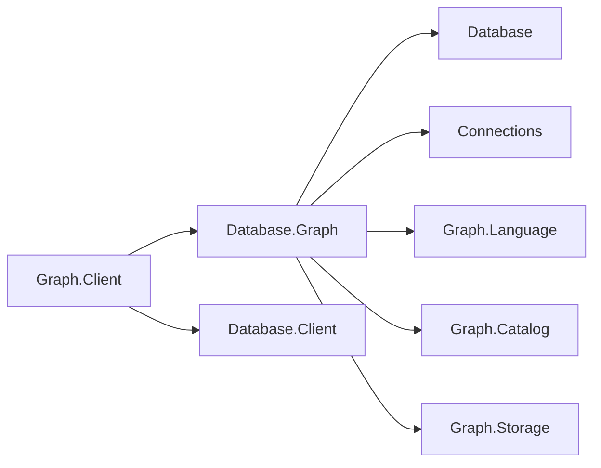
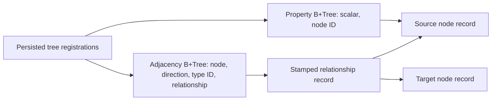
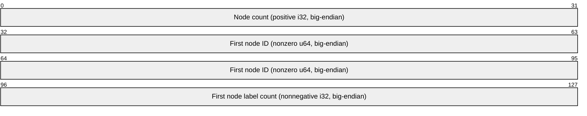
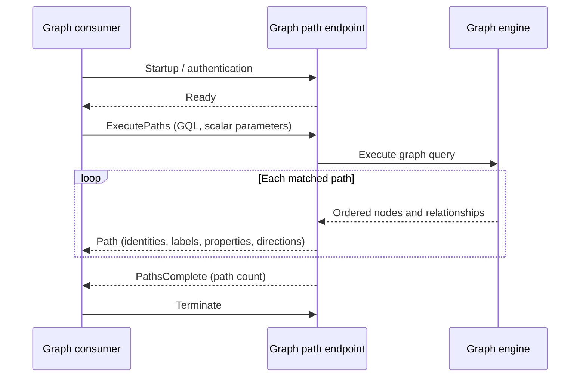

# Graph engine design

## String comparison and collation (#1025)

Graph remains ordinal-only. String property predicates use case-sensitive .NET
ordinal (UTF-16 code-unit) comparison; property index keys encode the same order.
Labels, edge types, property keys, and query variable bindings retain ordinal,
case-sensitive identity. Administrative database lookup remains
ordinal-ignore-case. SQL database defaults and `COLLATE` overrides do not apply
to GQL or graph storage. Configurable graph collation is deferred; no case or
accent folding is applied to stored labels or property values.

## Composition and frozen contracts

The fifth database engine follows Documents' parser/planner/executor composition and Blob's
engine-owned lifecycle. `GraphDatabaseEngine` is the public factory and engine; the engine, its
database (`GraphDatabase`), session, transaction, server and builder are public sealed types, the
first five leaves of the area root's bases ([Concrete types](#concrete-types-concrete-types-plan-phase-4-1260)),
while the planner, executor, server session and storage strategy are internal. Its dependencies
are the area root, Connections and the Graph.Language, Graph.Catalog and Graph.Storage packages. Storage uses
shared Storage, Transactions and Indexing rather than another pager, journal or lock manager.

| Package | Responsibility |
| --- | --- |
| `Database.Graph` | Engine, sessions, typed operations, planning, scalar/path execution, and graph protocol server |
| `Database.Graph.Client` | NuGet-only scalar and path client over the shared connection pool; references Graph and Database.Client |
| `Database.Graph.Language` | ISO GQL subset, AST and syntax/capability diagnostics |
| `Database.Graph.Catalog` | Snapshot-visible labels, types, property keys, index metadata and ownership |
| `Database.Graph.Storage` | Record encoding, kernel adapter, adjacency and property B+Trees |

The engine references the area root, transport abstraction and its model packages; the protocol
and security contracts arrive through the area's root composition. These are dependency edges:

`GraphDatabase` takes an explicit `GraphDatabaseSession` for each data operation. Every entry point
checks the session's database identity; sharing an engine or database name is insufficient.
`GraphSchema.Open(database, session)` returns a `GraphSchema` bound to that exact database and
session. Its operations join the session transaction. #1228 changed `GraphSchema.GetIndexesAsync`
(a breaking change) to return `GraphSchemaResult<GraphIndexMetadata>`, a read-only list that also
carries the read's warnings. Administrative database lifecycle remains on the engine; no GQL AST
can select a server, another database, or another graph.

## Physical records and adjacency

Each logical database owns `graph.dat`, `graph.log` and `graph.bak`, in the directory
`<RootPath>/<storage name>` when it is file-backed (see "Database names and directories" below).
All records start with the
shared 16-byte little-endian writer/deleter transaction stamp. The graph payload's byte 16 is the
kind, byte 17 is format version 3, bytes 18–25 are a nonzero unsigned 64-bit identity and bytes
26–33 hold the entity's increasing revision. Formats 1 and 2 are refused before record recovery writes,
with COHDBG017 and the remedy to recreate the database; no upgrade path exists. Graph
identities are reserved from the shared storage sequence allocator, so rollback does not recycle
an identity. Database-local IDs must always be paired with the correct session.

| Page owner / kind | Payload after the stamp |
| --- | --- |
| Owner 0, catalog | Catalog-specific version, discriminant and encoded definition; see Graph.Catalog's format |
| Owner 2, kind 1 | Common graph header, label count and strings, then scalar property map |
| Owner 2, kind 2 | Common graph header, source ID, target ID, catalog type GUID, type string, scalar property map |
| Owner 2, kind 3 | Common graph header, indexed label and property key |
| Owner 1, kind 4 | Zero stamps, kind/version, tree object ID, signed 64-bit root page; 34 bytes total |

Counts and fixed integers are little-endian. Strings use BinaryWriter's UTF-8 encoding with a
7-bit encoded byte-length prefix. Property maps are ordered by ordinal key and preserve scalar
type tags. The exact tag table and index tuple encodings live in
[Graph.Storage DESIGN.md](../../Assimalign.Cohesion.Database.Graph.Storage/docs/DESIGN.md), which
is the format reference for another reader. Properties support null, Boolean, string, integral,
decimal and finite floating point values. Records fit one shared slotted page; oversized records
are rejected before publication. Large graph properties/chunking are deferred.

The adjacency B+Tree keys (node ID, direction, catalog type GUID, relationship ID), pointing
to the relationship's packed record location (page ID << 16) | slot. A relationship has outgoing
and incoming entries, including a self-loop. The engine resolves a simple type by catalog name;
Boolean type expressions select the visible catalog IDs they accept. Wildcard/untyped hops read
all types. Statement-local selections are cached per pattern and invalidated by INSERT type
discovery. Fixed and quantified hops reverse direction when expanding left of the anchor.
The overlay indexes newly created edges by the same node/direction/type tuple, so irrelevant
pending edges add no physical candidates. Self-loops appear once for both-direction reads.
Dropping a relationship type checks only that catalog ID's outgoing ranges and stops at the first
in-use edge; existing schema handoff tests cover the refusal and concurrent deletion paths.

The diagram shows the references stored by the adjacency and property trees; relationship records
carry endpoint identities referring to node records.

A filtered incident lookup costs O(t log E + r) index work for t selected type/direction ranges
and r retained entries in them, decoding k visible references; deterministic identity ordering adds O(k log k) CPU work. Direct
traversal uses these same selections and ordering with O(Vvisited) visited state. A label scan
examines node records and sorts its matches. A property equality anchor instead seeks its
shared B+Tree in `O(log N + candidates)` after locating index metadata, then sorts its matches.
Index numeric keys normalize
integral, decimal and finite floating point values through double conversion. Full scalar comparisons
filter index candidates using exact reduced numeric fractions across all numeric types, including
floating operands, so key collisions cannot change equality or lose adjacent large integers.
All node creation, replacement and deletion paths maintain property indexes. The sealed
GraphStore exposes UpdateNodeAsync and UpdateRelationshipAsync; GraphDatabase adds no public
update verb. Its GQL SET/REMOVE stages use a statement-local working copy, so rows observe earlier
rows and items evaluate left to right, while publishing one replacement per updated entity at
statement completion. Later scans, index seeks, traversals and endpoint functions consult that
working copy. Every binding is refreshed after an update stage, including nested lists/maps/paths;
updated entities retain read-only label and property collections when returned to callers.
Refresh traverses shared composites once per stage, memoized by reference identity, copying only
branches containing touched identities and retaining unchanged lists and maps. Refreshed maps
remain `ReadOnlyDictionary`. Scalar evaluation resolves entity leaves through the current working
copy, preserving left-to-right reads without rebuilding composites per row or assignment.
INSERT reserves stable identities from storage, stages the complete entities, then inserts their
final working copies once, nodes before relationships. A cascade discards pending relationship
updates just as explicit relationship deletion does; the affected count includes explicit targets.

Each persisted replacement tombstones the old record and moves every property-index entry or
both direction-specific adjacency entries (also for a self-loop) to the new location in one physical bracket.
The identity directory retains all versions newest first, ordered by the format-3 revision on
reopen. Older snapshots retain the old records and index entries; rollback removes replacements
and restores old stamps. Purge reclaims only versions no snapshot can see; reclaimed or reused
references are discarded during lookup and subsequent publication. The process fixture checks
committed updates and an in-flight indexed-name update through index seeks and label scans.

SET NULL removes a property; INSERT still stores explicit NULL. Map replacement removes absent
keys and map merge preserves them. Labels and keys reuse INSERT catalog discovery and resulting
property-set validation. Type-exact no-ops write no version and count zero. The mutation count is
created entities plus distinct entities changed at any point, counting an entity created then
updated once. Restoring an original value later still counts and publishes that entity, preserving
Snapshot first-updater-wins conflicts. An entity whose assignments were all no-ops skips
replacement. Row-returning mutations carry the same count over
the existing ResultComplete frame. EXPLAIN
describes update stages and their targets without executing them.

Autocommit runs at ReadCommitted and pins its statement snapshot. Every mutation entry point,
including typed creates/deletes and catalog/schema writes, retakes a ReadCommitted snapshot
after taking the writer lock. A GQL write then replans against it using the
already normalized, captured parameter bindings, so queued
increments serialize. Refresh replaces only the statement view and retains the existing
snapshot pin: its earlier horizon still protects the newer view from pruning, without writing
another transaction begin or rollback to the journal. Explicit Snapshot writers retain first-updater-wins. Relationship insertion
checks latest endpoint existence, so a concurrent endpoint property replacement does not abort it.

Behavior references (consulted, no code copied), relative to C:/Source/repos/neo4j/neo4j:
`community/cypher/interpreted-runtime/src/main/scala/org/neo4j/cypher/internal/runtime/interpreted/pipes/SetOperation.scala:103-108`
removes NULL properties; `community/kernel/src/main/java/org/neo4j/kernel/impl/newapi/Operations.java:3116-3119`
requires both the same value type and equal value for a no-op;
`community/kernel/src/main/java/org/neo4j/kernel/impl/api/state/EntityStateImpl.java:68-75`
retains assigned values in transaction state, including a restored original value.

### Database names and directories

A file-backed database's directory is `<RootPath>/<storage name>`, where the storage name is the
invariant lower case of the database's name (#1392). Database names compare ignoring case, so every
spelling reaches that one directory on every OS: on Linux an open of `SALES` finds `sales`, a create
of `SALES` after `sales` is refused as existing, and a drop of `SALES` drops `sales`.

- **Why a pure function, not a scan.** Before #1392 the engine scanned the root for a directory
  whose name matched ignoring case. That cost a directory scan per open, create and drop, and on a
  case-sensitive file system it was ambiguous when `sales` and `Sales` both existed. The directory
  is now computed from the name by `DatabaseFileNames`, the function every model shares (the area
  design, `3.3, has the rejected alternatives).
- **One name rule on every OS.** 1 to 128 ASCII letters, digits, `_`, `-` and `.`; no leading,
  trailing or doubled dot; no Windows device name before the first dot. The rule used to be the
  platform's invalid file-name characters, so `a:b` was valid on Linux and refused on Windows.
- **Enumeration** takes each directory under the root that is a lower-case valid name holding
  `graph.dat`, so it skips a case-variant directory made outside the engine. Such a directory is
  outside the contract: on Windows and macOS the file system resolves an open's lower-case path to
  it.
- **A database is its data file.** An open needs `graph.dat` too, so a directory without it, left
  by an interrupted create or drop, is not found (`DatabaseNotFoundException`). A create claims
  the directory, so it refuses that one with a message that names the leftover, and a drop
  removes it. `TryGetDatabase` is a lookup, so a name that breaks the rule is not found rather
  than refused.
- **The reported name** is the spelling the storage header kept from the database's create,
  whatever spelling opened or listed it.
- **In memory** the engine's `DatabaseMemoryFiles` keys the `graph` file set by the same storage
  name.

`GraphDatabaseNameTests` pins each case in memory and on disk, asserting the exact directory names
it leaves with ordinal comparison, so the tests prove the mapping on Windows, whose file system
folds case, as on Linux.

### Interrupted creation (#1421)

An initialized data file opens with OpenOrCreate for its journal and backup, completing
creation interrupted before either sidecar existed. Declared provisioning uses this same
open path. Create refuses an existing incomplete file set with COHDBG018 in
DatabaseException.Diagnostics and an OpenDatabaseAsync recovery instruction. A leftover
directory without a data file retains DatabaseNotFoundException on open, with COHDBG018
and a drop/recreate remedy; create and declared provisioning return the structured error.
A truncated data file receives the same coded refusal before any sidecar is created.
Ambiguous files are preserved for diagnosis instead of silently erased. Storage's own
format refusal still handles an initialized header in an unsupported format. This changes
file opening and error reporting, not record encoding or the model format.

## Transactions, atomicity and recovery

One `TransactionCoordinator` per database owns MVCC, logical undo, journal durability, lock
management and physical statement brackets. A conservative database writer lock serializes writers
through their logical commit or rollback; readers use snapshots. Metadata and affected graph
records are checked against the latest committed view after lock acquisition, so a stale writer
cannot create an orphan endpoint or bypass a newer schema constraint. The engine's latest
snapshot excludes committed contexts still tracked between lock release and untracking
(#1665), mirroring Documents' filter (db1a2e3bf) while preserving caller-owned writes and
excluding every other tracked context; node/relationship metadata conflicts, label/type
in-use checks and property-metadata validation all use it. Catalog/store latest snapshots
already filter to active contexts for property-key deletion, metadata/record conflicts
and index creation/population/deletion. PostgreSQL likewise ends transaction visibility
before lock release (`src/backend/access/transam/xact.c:2425-2430`).

Node creation and label/key metadata participate in the same logical transaction. Relationship
creation writes its record and both adjacency entries in one physical bracket. Deleting a node
with `DETACH DELETE` tombstones its incident relationships, adjacency and property entries with
the node atomically. Plain GQL `DELETE` refuses a still-connected node. `DELETE r,a` first deletes
explicitly selected relationships, then checks the nodes. The frozen typed `DeleteNodeAsync`
contract explicitly cascades and is implemented that way. Any statement failure rolls back the
owning logical transaction. An autocommit statement's transaction is its own; an explicit session
transaction is aborted as a whole and stays aborted until the caller rolls it back, as
[Failed statements in explicit transactions](#failed-statements-in-explicit-transactions-1188)
describes.

Snapshot and ReadCommitted isolation are supported. ReadCommitted captures and pins a statement
snapshot, so metadata and each hop of a traversal share a visibility horizon. Serializable is
rejected rather than silently weakened. Explicit transactions use the existing session API;
GQL transaction-control syntax is outside the profile. Wire transactions are deliberately deferred:
`BEGIN`/`COMMIT`/`ROLLBACK` do not parse and reserved `Transaction` byte 9 is rejected with
`ProtocolViolation`. No connection-level transaction API is exposed. Results materialize before
the statement transaction is released, so result iteration cannot race record reclamation.

Open defers the storage checkpoint, performs physical WAL recovery, then invokes coordinator
record scrub, opens catalog/store indexes, purges unproven index writers using the same recovery
plan, and checkpoints last. The process fixture exits after committed graph/index creation and
after uncommitted detach/insertion page write-back, without disposal. Restart must recover the
committed path and index, remove partial nodes/types/edges, and undo partial tombstones; it then
reopens a second time to verify the recovery checkpoint.

### Failed statements in explicit transactions (#1188)

A statement that fails inside an explicit transaction aborts the whole transaction. Graph storage
cannot undo one statement: a statement writes catalog definitions, records and index entries
through separate physical brackets, and `Database.Transactions` undoes a writer only as a whole
transaction, with no savepoints. The SQL session's contract, where the failed statement writes
nothing and the transaction stays active, is therefore unavailable, and the session follows Neo4j:

1. The failure rolls the transaction's work back at once and releases its locks, so the aborted
   transaction blocks no other writer while it waits for the caller. (When the undo itself fails,
   the kernel keeps the writer lock until its version-purge pass completes the undo; see
   `Database.Transactions` DESIGN.md, "Ending a transaction".)
2. The transaction stays the session's `CurrentTransaction` and reports `TransactionState.Faulted`.
   Every later statement on the session fails with `COHDBG007`: GQL text or requests, typed
   `GraphDatabase` operations, traversals and `GraphSchema` calls. `BeginTransactionAsync` fails
   with `COHDBG007` too. The error names the original failure in its message (`Cause: ...`) and
   carries it as `InnerException`. A refused statement does not change the transaction, and an
   aborted transaction refuses text before parsing it.
3. `RollbackAsync` succeeds, leaves none of the transaction's writes, and returns the session to
   autocommit. Disposing the transaction or the session ends it the same way. A rollback of any
   transaction that did not commit may be repeated and raises nothing: one already rolled back,
   one a failed statement aborted, and one whose commit the kernel aborted (a commit record that
   could not be written). So a catch-block rollback after a failed commit never hides the
   commit's error. A rollback of a committed transaction is refused, because it cannot do what it
   says.
4. `CommitAsync` fails with `COHDBG007`, commits nothing, and ends the transaction (`RolledBack`);
   every later commit fails the same way, with the same cause, and so does a commit after the
   session's teardown ended the transaction (since phase 4 of the concrete-types plan, when the
   root transaction base took over the state machine; before it a later commit reported "The
   transaction is RolledBack.").
   A commit the kernel aborts throws `DatabaseTransactionAbortedException`, as a statement's kernel
   abort does, and leaves the transaction `Faulted` and ended. A commit whose record was written
   but could not be made durable is not an abort: it throws
   `DatabaseTransactionCommitUnconfirmedException` and leaves the transaction `Committed`
   (`Database.Transactions` DESIGN.md, "A commit record that was written but not made durable").
   Its message leads with the model's code on every path, the explicit commit and an autocommit
   statement's own commit alike (owner decision 24 of 2026-10-06, #1272):
   `COHDBG012: Database '{name}' went offline while a transaction was committing: ...`, built by
   the root's `DatabaseTransactionCommitUnconfirmedException.Create(code, database, cause)` in
   `GraphDatabase.TranslateKernelFailure`, now an instance member so it knows the database, with
   the kernel's `TransactionCommitUnconfirmedException` as its inner exception. Before #1272 this
   path carried the kernel's message alone.
5. Every failure of a statement that started counts: parse diagnostics, planning and execution
   errors, ownership refusals, kernel aborts such as conflicts and deadlocks, cancellation while
   the statement runs, and (on the wire) a result the server cannot encode or deliver.
   Pre-execution planning failures such as an unbound parameter follow the same rule, in
   ordinary execution and EXPLAIN alike. Failures
   that come before a statement starts leave the transaction unchanged: argument validation (null
   or whitespace text; a null label list, or a null, empty or whitespace label or relationship
   type, on the typed `GraphDatabase` writes; an invalid traversal specification, reported as
   `COHDBG001` before the traversal starts), a session of another database (`COHDBG005`), a token
   canceled before the statement starts, a non-GQL request, and the refusal of a second
   concurrent operation on the session. A definition `GraphSchema` saves is validated by the
   catalog inside its statement, so a rejected definition is a failed statement.
6. Autocommit statements are unaffected: a failure ends only its own statement transaction.
7. A rollback or commit observes its cancellation token only before it starts: a token canceled
   by then throws `OperationCanceledException` and leaves the transaction as it was. One that has
   started runs to completion. A rollback stopped half way would keep the writer lock, and a
   commit stopped half way would only become a kernel abort of work the caller asked to keep;
   PostgreSQL likewise holds interrupts through `AbortTransaction`
   (`backend/access/transam/xact.c:2854-2861`), and Neo4j's `commit` and `rollback` take no
   cancellation.
   A rollback or commit that started always ends the transaction. Until #1226 a journal or
   storage failure could leave the context active behind a failed rollback, and the session then
   kept the transaction `Faulted` until a later rollback completed. The transaction kernel now
   completes a started rollback whatever fails (a lost abort record is ignored, and a failed undo
   is retried by the kernel with the writer's locks held), and it aborts a commit it cannot
   complete. The kernel still refuses a rollback before it starts when the database is closing:
   once the manager's disposal begins, a rollback fails with `ObjectDisposedException` (the
   disposal flags itself before it claims any end, so no end refused during the close fails any
   other way). That refusal leaves the context active only until disposal's own abort ends it, so the
   `Faulted` end-failure state and its `COHDBG007` message were removed, and the stateless guard
   that remains covers the case: once a rollback throws with the context active, the session
   refuses statements in the ended transaction ("being committed or rolled back"), another
   `RollbackAsync` fails the same way while the close runs and is accepted once the close's abort
   ended the context, and a `CommitAsync` commits nothing the caller rolled back: it fails with
   `ObjectDisposedException` while the database closes, or reports the `Faulted` state once
   disposal's abort ended the context.

The session's explicit-transaction lifecycle, where Faulted is the new state:

The reference engines agree on the failure and the refusal; they differ only on COMMIT. Citations
are to Neo4j commit `54a7dcf7c25` and PostgreSQL commit `85f55534e80`, under each repository's
`community/` and `src/` trees respectively.

| Behavior | Neo4j (followed) | PostgreSQL | Graph |
| --- | --- | --- | --- |
| A statement fails | Any failure, compilation included, marks the transaction for termination (`cypher/cypher/.../ExecutionEngine.scala:232-245`); every error classification rolls back (`common/.../Status.java:983-1005`); Bolt marks the transaction failed (`bolt/.../tx/TransactionImpl.java:130-145`) | Any error aborts the block into `TBLOCK_ABORT`, "failed xact, awaiting ROLLBACK" (`backend/access/transam/xact.c:171`) | Aborted; its work is rolled back at once |
| Later statements | Refused as terminated (`kernel/.../coreapi/TransactionImpl.java:529-535`, `fabric/query-router/.../RouterTransactionImpl.java:478-486`); Bolt answers every request but RESET with IGNORED or FAILURE (`bolt/.../fsm/StateMachineImpl.java:143-153`) | Rejected with SQLSTATE 25P02 before parse analysis (`backend/tcop/postgres.c:1150-1164`) | `COHDBG007`, checked before parsing |
| BEGIN | Refused with the rest in Bolt's failed state | 25P02: BEGIN is no transaction exit statement (`backend/tcop/postgres.c:2945-2958`) | `COHDBG007` |
| ROLLBACK | Succeeds, repeatably, on any transaction that is no longer open, a committed one included (`kernel/.../coreapi/TransactionImpl.java:210-214`, `kernel/.../KernelTransactionImplementation.java:1184-1194`, `RouterTransactionImpl.java:268-275`) | Ends the block; abort processing is already done (`xact.c:4272-4280`) | Succeeds, repeatably, on any transaction that did not commit; refused after a commit |
| COMMIT | Rolls back and throws `Terminated` (`KernelTransactionImplementation.java:1206-1210`, `1291-1303`; `RouterTransactionImpl.java:219-225`) | Ends the block and reports the tag ROLLBACK without an error (`xact.c:4133-4139`, `backend/tcop/utility.c:636-641`) | `COHDBG007`; nothing commits; the transaction ends |

COMMIT follows Neo4j: a caller awaiting `CommitAsync` must not see success when nothing committed.
A Bolt driver sends RESET after a failure; `RollbackAsync` plays that part here. ROLLBACK departs
from Neo4j in one case: Neo4j ignores a rollback of a committed transaction, and Graph refuses it,
because a rollback that returns normally promises that none of the transaction's work persists.

Reading a label or relationship type the database does not have is not a failed statement (#1228,
following Neo4j). A read probe such as `MATCH (n:Missing) RETURN n` or
`GraphSchema.GetIndexesAsync("Missing")` returns no rows and a `COHDBG010` or `COHDBG011` warning,
and the explicit transaction stays active with its earlier writes, as
[Unknown labels and relationship types in reads](#unknown-labels-and-relationship-types-in-reads-1228)
describes.

The graph protocol has no transaction control, so a wire session runs inside an explicit
transaction only when its host opens one on the server session's engine session
(`DatabaseServerSession.DatabaseSession`, through `GraphDatabaseServer.Sessions`). The server hands
parsing and request validation to
that engine session, so a parse failure or an entity projection on `Execute` aborts the
transaction exactly as the same failure does in process. A statement whose result the server
then cannot encode or deliver (for example a property value the wire codec has no encoding for)
fails for the client after its operation completed, so the server aborts the transaction before
it writes the `ExecutionFailure`, as Bolt marks its transaction failed on any failure of a request,
result streaming included (`bolt/.../fsm/StateMachineImpl.java:156-162`). An empty statement is
rejected before it reaches the session and changes nothing. Each refusal is an `ExecutionFailure` whose message starts with `COHDBG007`, on
`Execute` and `ExecutePaths` alike, and the session stays ready.

## Planning, execution and bounds

### Linear composition (#1145)

The planner validates each source-ordered stage against its incoming scope. LET adds bindings; FOR/UNWIND retains a proven node or relationship element kind from COLLECT, homogeneous entity lists and compatible result branches, while unproven or mixed elements stay Value bindings; a RETURN/NEXT or WITH boundary retains only referenceable projected columns, including entity kinds, optionality, composite possibilities and Int64 COUNT metadata. Carried columns use binding names independently of displayed source text; duplicate carried names are COHDBG015 during planning, including EXPLAIN. MATCH anchors prefer carried entities. An INSERT introduces its label and relationship-type names for later stages without retaining negative token-cache entries. Unknown names empty only their MATCH stage.

WITH WHERE validates independently of ORDER BY expression reuse. DISTINCT or aggregation restricts it to projected bindings; other WITH predicates also see incoming bindings. An out-of-scope reference or aggregate in WHERE is COHDBG001 during planning; aggregate aliases remain usable. MATCH declares every comma-separated pattern part before validating its maps. Inline maps are predicates on the complete bound clause: available inputs can filter early, while references to later pattern parts wait until the clause is fully bound, including anonymous elements and either expansion direction. Only literal/parameter equalities supply property-index seeks, so a deferred predicate cannot narrow the scan candidates. INSERT/CREATE maps may reference only the incoming scope (COHDBG001 otherwise). Member access on value bindings admits maps and entities and propagates the accessed value's composite/entity shape; known scalar owners are COHDBG003 during planning, and invalid runtime containers are COHDBG013.

Behavior consulted, no code copied, relative to C:/Source/repos/neo4j/neo4j: community/cypher/front-end/ast/src/main/scala/org/neo4j/cypher/internal/ast/Clause.scala:1723-1724,1965,1998-2030; front-end/rewriting/src/main/scala/org/neo4j/cypher/internal/rewriting/rewriters/PropertyPredicateNormalizer.scala:35-41; front-end/ast/src/main/scala/org/neo4j/cypher/internal/ast/semantics/SemanticPatternCheck.scala:101-103; front-end/ast/src/main/scala/org/neo4j/cypher/internal/ast/semantics/SemanticError.scala:725; front-end/ast/src/main/scala/org/neo4j/cypher/internal/ast/semantics/SemanticExpressionCheck.scala:495 and interpreted-runtime/src/main/scala/org/neo4j/cypher/internal/runtime/interpreted/commands/expressions/Property.scala:43-79 (the latter paths are also under community/cypher).

The executor materializes every stage eagerly in source order and acquires the writer lock before any stage when the statement contains a write. Each stage shares the 100,000-row bound; FOR fan-out uses the same AddBinding guard as path matching. Candidate expansion has its separate budget. Statements observe their own writes at both supported isolation levels. NEXT after a write without RETURN seeds one empty binding. Entity-kind proofs and nullable element shapes survive WITH/NEXT and nested list access. COLLECT omits null operands; nullable literal elements retain optional path restrictions. Runtime FOR elements and carried MATCH/DELETE bindings are checked before graph operations: incompatible values raise COHDBG013, while scalar binding rejections remain COHDBG003 during planning. The pipeline uses typed dispatch without reflection or runtime code generation.

MATCH and OPTIONAL MATCH execute as source-ordered joins over a nullable binding table. Each
`GraphMatchClausePlan` records its paths, clause-local predicate, optional flag, newly declared
variables and unsatisfiable flag. The planner validates WHERE immediately after that clause's
declarations and chooses fresh anchors from that clause's predicate only. Nodes bound by earlier
paths or clauses take precedence over every label scan or index seek at any pattern position;
otherwise a bound relationship supplies its adjacent endpoint, trying both orientations for an
undirected pattern. Each input row runs all paths of a clause, then its WHERE; mandatory joins
discard failures and optional joins preserve exactly
one row with explicit NULL entries for all new variables when none survives. The initial table has
one empty row, including for a leading OPTIONAL MATCH. Earlier variables are preserved, and
trail uniqueness resets for every path. Both the 100,000 materialized-binding limit and the shared
1,000,000 candidate-expansion budget apply across clauses. A null-bound node or relationship
refuses a later pattern before reading candidates, including when it is not the selected anchor.

Property access and RETURN expressions over null-extended variables yield NULL using #1140/#1141's
existing three-valued and exact numeric rules. DELETE ignores NULL and does not count it. INSERT
requires a non-null node endpoint (COHDBG003); statement rollback removes any prior writes, and a
failure aborts an explicit transaction. Null extension itself succeeds and leaves transactions active.
ExecutePaths rejects a variable bound only by optional clauses with COHDBG001 during planning,
even when every row would match, because a Path frame requires a first node. A variable bound or
subsequently constrained by a mandatory clause is projectable. These implement the owner's path
default. The old GqlQueryExpression constructor/view is retained; the engine reads the ordered Stages facade.
No catalog format or wire encoding changes are involved.

Behavior consulted, no code copied, relative to `C:/Source/repos/neo4j/neo4j`:
`community/cypher/interpreted-runtime/src/main/scala/org/neo4j/cypher/internal/runtime/interpreted/pipes/OptionalExpandAllPipe.scala:54-68`
null-extends an empty expansion or null source, and `:174` filters candidates before fallback;
`OptionalPipe.scala:30-42` returns one row with explicit null bindings on empty input.
`community/cypher/cypher-planner/src/main/scala/org/neo4j/cypher/internal/compiler/planner/logical/steps/leafplanner/argumentLeafPlanner.scala:33-37`
plans from existing node or relationship arguments before a fresh scan, and
`OptionalExpandAllPipe.scala:51-56` expands from the source node in the input row.

RETURN (#1141) evaluates the same expressions as WHERE after matching and mutation. A standalone
RETURN starts with the executor's one empty binding. The planner validates every projection and
parameter before data access, expands star in first-declaration order (path assignment, then
interleaved nodes/relationships), and records each expression's name and static result kind.
Aliases name columns exactly; unaliased parsed expressions use normalized source text. The
[language design](../../Assimalign.Cohesion.Database.Graph.Language/docs/DESIGN.md#return-expressions-and-duplicate-elimination-1141)
records the owner's naming default and the limits of the ISO 14.11 check. Final names, implicit
and explicit, must be unique under ordinal case-sensitive comparison; the second occurrence
raises located planning error COHDBG015 before reads or mutations, including EXPLAIN and empty
matches. Path-request shape diagnostics retain precedence over duplicate names. Behavior consulted,
no code copied: Neo4j `community/cypher/front-end/frontend/src/main/scala/org/neo4j/cypher/internal/frontend/phases/parserTransformers/scoping/VariableCheckerUtil.scala:434-444`
(relative to C:/Source/repos/neo4j/neo4j) reports the second duplicate result column.

DISTINCT runs on projected tuples, after writes have completed for every input binding. It uses
NULL equality, ordinal strings, exact numeric value equality across CLR tags, entity IDs and
ordered path identities. Reduced fractions preserve transitivity and hash consistency for
large integers, decimals and subnormal floats. Comparisons (=, <>, !=, <, <=, >, >=), inline
property matching and IN use this same exact numeric equality and ordering: 0.1m differs from
0.1d, 1 equals 1.0, and an Int64 above 2^53 is never rounded to compare with a Double.
NULL comparisons remain UNKNOWN while DISTINCT groups NULLs. Overflowing numeric text such as
`1e999` fails parsing with GQL0004. Non-finite AST literals and parameters, including NaN,
fail planning with COHDBG003; internal value equality groups NaNs consistently across float/double
and hashes, and treats signed zeros as equal. This #1141 owner choice changes #1140 comparison
promotion; grouping (#1147) reuses it, and #1145 must also. Arithmetic promotion remains unchanged.
Reference behavior consulted, no code copied, relative to C:/Source/repos/neo4j/neo4j:
`community/values/src/main/java/org/neo4j/values/storable/Value.java:162` delegates ordinary
non-NaN predicate equality to value equality, `IntegralValue.java:77-95` shares numeric equality
and exact mixed ordering, and `community/cypher/interpreted-runtime/src/main/scala/org/neo4j/cypher/internal/runtime/interpreted/pipes/DistinctPipe.scala:78`
uses value equality for grouping. Cohesion rejects NaN at its public planning boundary.
First representatives retain their actual values and types. ALL preserves multiplicity. These
implement the owner's duplicate-equality default; no persistent state or catalog version changes.
GraphProjectionPlan and GraphDistinctPlan both have EXPLAIN mappings and description rows.

The owner's Execute default is a conservative static gate over planned column kinds. The wire
request marks its scalar requirement internally; the executor checks it after binding and planning,
before writer locking, reads or writes. Node, relationship or path columns fail with COHDBG001
and the existing ExecutePaths guidance, even for empty matches. Collection and CASE result
kinds propagate possible entities through the closed planner dispatch (#1146). EXPLAIN
bypasses execution and continues to return scalar description rows for entity projections.

WHERE executes the scalar grammar in
[Graph.Language](../../Assimalign.Cohesion.Database.Graph.Language/docs/DESIGN.md#scalar-where-expressions-1140):
OR/XOR/NOT, null/truth tests, arithmetic, concatenation, list membership and string predicates.
Only TRUE keeps a binding; evaluated non-Boolean conditions raise COHDBG013. CLR arithmetic
faults become that same code in DatabaseException.Diagnostics, with code-free Message.
Filtering finishes before result materialization or mutations, so the server sends value
errors as ExecutionFailure before ResultHeader and the pooled scalar session remains usable.
Arithmetic promotion is Double for floating operands, otherwise Decimal for ulong/decimal, otherwise
checked Int64 (division truncates toward zero).
Integral remainder by -1 is always 0, including Int64.MinValue, while its division by -1
keeps COHDBG013 (PostgreSQL `src/backend/utils/adt/int8.c:584-594`).
All recursive nodes check the stack; Boolean runs are n-ary. Index anchoring and required
unknown-name inference descend only through AND.
IN evaluates the entire list before comparing membership, preserving errors after a matching
item. A match still wins over NULL; without a match, a NULL operand or item yields UNKNOWN
(the empty list is always FALSE). This follows Neo4j's `ListLiteral.scala:36-45` and
`CachedIn.scala:38-49` under `community/cypher/interpreted-runtime/src/main/scala/org/neo4j/cypher/internal/runtime/interpreted/commands/`.

`GqlQueryParser` builds `GqlQueryStatement`; `GraphPlanner` resolves labels, relationship types,
variable kinds and access paths; `GraphPlanExecutor` applies that plan. The planner considers
scalar literal/parameter inline properties and equality predicates joined by `AND` for every node position in a
pattern. It can anchor at the middle or end, expanding right and then left with appropriately
reversed directions. Bound variables from earlier comma-separated paths or earlier MATCH and
OPTIONAL MATCH clauses take precedence over a fresh scan or index seek. Every selected candidate
still passes labels, property predicates and bindings.

Named scalar parameters (#1138) bind through #1102's shared `ParameterBindings` helper.
Each execution copies the request map and matches normalized bare names ordinally, before any
data read or writer lock. COHDBG001 names an unbound reference, COHDBG003 rejects unsupported
or non-finite values, and COHDBG014 rejects normalized-key collisions, including unused ones.
Map values are literal/parameter expressions evaluated before creation and property matching;
WHERE threads the same bindings through its scalar evaluator. All references are validated even
on empty matches or skipped branches. EXPLAIN runs the same binder and planner without writes.
The [language dialect](../../Assimalign.Cohesion.Database.Graph.Language/docs/DIALECT.md#named-scalar-parameters)
records sigils, case rules, runtime type preservation and the remaining syntax boundaries.
`GraphDatabase.TypeOf` promotion is reused without normalizing runtime values: an Int32
parameter satisfies an Int32 schema key and reads back as Int32, while Decimal compares with
integral stored values. This implements the owner's default, pending confirmation.

Non-null parameters in inline maps or either side of a WHERE property equality supply index
anchors, just as literals do; null supplies no anchor. Plans are rebuilt on every execution.
Any future plan cache must recompute anchors that depend on parameter values. Execute and
ExecutePaths bind the existing named scalar map on wire 2.0 without changing frame encoding;
unbound parameters return ExecutionFailure carrying COHDBG001 and leave the connection ready.

Label expressions (#1139) follow one anchor rule: only a node's `Labels` can choose a label scan or
a property index, and the parser fills `Labels` only for a pure conjunction (`:A`, `:A&B`,
`:A:B`), whose every match carries each listed label. A disjunction (`:A|B`), negation (`:!A`) or
wildcard (`:%`) leaves `Labels` empty, so `(n:A|B {k: 1})` and `(n:!A {k: 1})` plan an anchor with
no label and no property and scan every node; anchoring on `A`'s index would silently drop the `B`
or non-`A` rows. A `WHERE` labeled predicate (`n:A`, `n IS [NOT] LABELED A`) is a Boolean primary,
never an equality, so `MATCH (n) WHERE n:A AND n.k = 1` also plans no index property. The
executor evaluates the expression on every candidate node, and a relationship pattern's expression
against visible catalog type names before seeking their adjacency ranges. `GraphLabelEvaluator` validates each expression before execution:
an unknown kind, a null operand, name or operand list, a conjunction or disjunction with fewer than
two operands, or `Labels`/`Type` that disagree with the expression are `COHDBG001`. Every name a
match reads, including those under `!` and `|`, resolves against the catalog at the statement's
snapshot, and a chain that repeats a name resolves it once; a name the database does not have
matches nothing and is reported as a warning, not an error (see
[Unknown labels and relationship types in reads](#unknown-labels-and-relationship-types-in-reads-1228)).
`Undirected` and `LeftOrRight`
constrain neither end of a stored edge; insertion takes only `Outgoing` and `Incoming`, one type,
and a label conjunction. Storage cannot hold an empty or all-whitespace label, relationship type or
property key, and a delimited name such as `(n:" ")` or `{" ": 1}` can spell one, so insertion
rejects each with `COHDBG001` before anything is written; matching on such a name finds no catalog
entry, so no element carries it and a read warns (`COHDBG010`/`COHDBG011`).

Label expressions and `WHERE` predicates have no length or nesting limit (#1139 follow-up, owner
decision 2026-10-02: do what Neo4j does; the evidence is in the
[language design](../../Assimalign.Cohesion.Database.Graph.Language/docs/DESIGN.md#chain-length-and-nesting-1139-follow-up)).
A conjunction or disjunction of labels, and an AND, OR or XOR chain of predicates, is one n-ary node, and the
engine evaluates it with a loop that stops at the first operand that decides it, under three-valued
logic for `AND` (false, otherwise unknown, otherwise true). Validation, name collection and the
anchor's equality search walk with an explicit stack. Anchor selection reads the visible indexes
at most once per clause (`GraphStore.GetIndexes`, grouped by label) and that clause's `WHERE`
chain's equalities once, keeping each variable's first non-null value per key; each node then tries,
for each distinct label in order, only the keys that label has an index on. Planning each clause
therefore costs time linear in its `E`
equalities, its `D` pattern labels and properties and its `I` visible indexes, plus for each node the
indexes its own labels carry, never the product of labels, equalities and indexes. Across `C`
clauses, listing and grouping visible indexes costs at most `C` times `I`. Neo4j's leaf
planner likewise groups predicates once and visits only each label's own index descriptors
(`NodeIndexLeafPlanner.scala`:184, :201, :248-296). Selection agrees with a per-pair search: the
first label with an index on a key the node has a value for, then that label's key whose value comes
first, inline properties before `WHERE` equalities. A node carrying more than 16 labels is tested
through a hash set built once per evaluation. Only label and predicate evaluation recurse, where the
tree nests, and each descent calls `RuntimeHelpers.EnsureSufficientExecutionStack`. A statement
whose parse (`GQL0009`), plan or evaluation needs more stack than the executing thread has left
fails with `COHDBG008`, statement too complex (ISO SQLSTATE 54001; Neo4j's transient
`StackOverFlowError`, GQLSTATUS 51N37). A caller that runs `GraphQueryRequest.FromGql` itself gets
the failure before any statement starts. Text the session parses (`ExecuteAsync(string)`, the wire)
is part of its statement (#1188), and so is a typed request whose statement already carries
`GQL0009`: a parse, plan or evaluation out of stack is a failed statement and, like any other,
aborts an explicit transaction (`COHDBG007` until the caller rolls back; see
[Failed statements in explicit transactions](#failed-statements-in-explicit-transactions-1188)).
The session stays open. Over the wire's `Execute` seam the
failure is an `ExecutionFailure` that keeps the connection ready; on the `ExecutePaths` seam a
terminal statement rejection before the first path also keeps Graph.Client's connection ready.
Failures after path output still discard the connection. Planner messages quote at
most 256 UTF-16 code units of a label expression, cut so that no surrogate pair is split.

Two storage limits remain, recorded here rather than hidden behind the language. A node's labels
and properties, or a relationship's type and properties, share one graph record of at most 8,092
bytes (`GraphRecordCodec`), so the number of distinct labels one node can carry is bounded by their
encoded size, and an indexed property value must fit the 1,016-byte index key. Past either limit the
store throws `GraphElementTooLargeException` before it writes anything for the element, and the
engine fails the statement with `COHDBG009`, element too large: the operation aborts like any other
statement failure (an explicit transaction is aborted until the caller rolls back) and the session, in process and over the
wire, stays open. A search for a value too long for its index matches nothing, since no write can
store one. Neo4j instead spills labels to dynamic label records and long properties to property
chains, which this store's format does not yet have. Defining a new label or relationship type
checks identity uniqueness by listing every definition (`GraphCatalog.SaveDefinitionAsync`),
so a statement that introduces N new labels costs time quadratic in N (measured in Release: 1,000
new labels in one `INSERT` take 7.5 s, 2,000 take 42 s). Neither limit counts expression length;
both are follow-up storage items.

GQL patterns include quantified relationships and parenthesized subpaths; the sum of finite upper bounds (or unbounded lower bounds) is at most 64 relationships. Each matched path is a trail: an edge
identity is used at most once within that path; a node may recur. Separate comma-separated paths
have separate edge sets and share variable bindings. This makes a three-edge cycle a valid
three-hop result but forbids reusing its first edge on a fourth hop. At most 100,000 intermediate
path matches materialize per pattern, and a statement examines at most 1,000,000 node/edge
candidates, including dead ends; either overflow fails with `COHDBG004`, never silent truncation.
Cancellation is observed during expansion and materialization. Repeated node/relationship
variables enforce identity equality, and conflicting variable kinds fail before execution.

### Indexed adjacency and expansion work (#1532)

Each hop selects direction and catalog type IDs before decoding relationships or allocating
path states, including quantified bodies and TraverseAsync. Relationship bindings/properties and
safe target-node constraints still run before a viable descent, with deferred references retaining
their existing final checks. The statement ExpansionBudget has separate physical and viable
counters: physical includes visited anchor candidates and selected relationship candidates as DFS
visits them, after type/direction selection from storage or the overlay; loading a range charges
nothing. Viable counts hops passing trail, binding, relationship and safe node
checks before copying state. Physical work keeps the 1,000,000 safety cap, including dead ends.
Its COHDBG004 message includes actual physical and viable totals; no EventSource counters are added.
The 100,000-binding and 64-hop caps remain. Public TraverseAsync uses the filtered lookup without
a candidate-expansion cap; traversal work budgets belong to #1533 (D4). The #1533 budget redesign and external R4/SF10
acceptance remain separate work; filtering does not guarantee a bound on genuine matching fan-out.

EXPLAIN's Expand detail names the adjacency tuple, effective seek direction and type expression,
physical/viable counting rules and physical limit. EXPLAIN does not execute, so these are counting
semantics, not invented runtime totals; EXPLAIN ANALYZE remains unsupported. Tests inspect actual
per-budget totals and the store's internal decode counter. They also cover replacement/rollback,
old snapshots, journal replay, self-loops, cancellation between ranges, deterministic retention
across a commit between directions and independently running reader/writer loops with overlap
counters. B+Tree OpenCursor still materializes a selected key/reference range under its own latch;
#1542 owns incremental, cancellable collection inside that kernel call. Incident enumeration owns
no writer locks; the current materialized cursor holds no pages or latches and disposal releases
nothing, so these tests make no resource-release claim. The store's mutation-gate entry documents
lock and latch order; no new lock, friend grant or public interface is introduced.

Behavior consulted, no code copied: Neo4j
community/kernel/src/main/java/org/neo4j/kernel/impl/newapi/DefaultRelationshipTraversalCursor.java:67-75
passes RelationshipSelection into the store cursor, and :217-218 applies it to transaction-state
added relationships (relative to C:/Source/repos/neo4j/neo4j).

### Quantified expansion (#1144)

GraphPathShape validates both AST representations and lowers juxtaposed node constraints and
parenthesized bodies into boundary nodes and repeated segments. Shape validation uses an explicit
stack; cycles and repeated path instances in one walk fail with COHDBG001 before any recursive walk.
Direct AST subpath depth above 128 also fails; parsed text is bounded only by the GQL0009 stack guard.
Bounds over 64, nested repetitions, conflicting chain/element lists and quantified INSERT ASTs
also use COHDBG001. Text insertion quantifiers are GQL0002. Parenthesized INSERT paths are outside
the insertion grammar and are refused before writes. No catalog/storage format change is needed.

The executor's DFS frontier and continuations live on the heap. Each incident cursor resumes after
one child, so live search states scale with depth rather than sibling fan-out; storage incident
buffers and materialized results retain their existing budgets. For a fixed hop, target node checks
precede copying the trail for descent. Each state carries the trail's relationship identity set, source-ordered entities, group lists and the actual pattern/property
pair for every occurrence. This mapping replaces positional indexing: repeated properties and
anonymous elements are checked correctly after full-clause binding, including forward references.
Fixed chains recheck node maps in source order, then relationship maps in source order, regardless
of anchor, preserving the base matcher's short-circuit behavior. Quantified paths recheck maps in
reverse encounter order (expansion goes right then left; constraints at a boundary are encountered
in source order); entries within each map retain their declared order.
Zero repetitions conjoin the outer boundary nodes; a Min=0 body's unknown labels/types cannot
set MatchesNothing on the clause, although their warnings are retained.

Only outer singleton nodes/relationships can anchor. Expansion proceeds right, then left, and
prepends leftward entities and group elements to restore source order without changing stored
relationship endpoints. Group lists retain node/relationship kind through FOR/UNWIND and projection
boundaries, including result-preserving expressions and container access at each depth; RETURN *
and WITH * include them. Inner property maps that reference a group, direct group member access, group deletion and mixed singleton/group declarations are COHDBG003.
ORDER BY resolves group provenance through projection aliases inside compound expressions and
container access, so `COALESCE(rs,rs).w` and `[rs][0].w` reject a projected group alias with
COHDBG003 during ordinary planning and EXPLAIN.

Finite upper-bound sums and unbounded lower-bound sums cannot exceed 64. An unbounded repetition
explores at most 64 successful hops; an unused 65th relationship passing direction, type,
bound-variable identity and its own property checks (including deferred maps)
raises COHDBG004 before testing its endpoint. Failed filters do not trigger the hop cap, and
LIMIT cannot suppress it. AddBinding and the shared statement ExpansionBudget also apply to
every repeated branch. The internal per-budget OnConsume test hook cancels deterministically
after expansion begins; tests assert the consumed count. The isolated high-fan-out allocation test
samples live bytes after incident loading to pin bounded retained search state for fixed and
quantified edges. No partial wire output precedes failure.

EXPLAIN emits Expand details `quantifier={min,max}; body_hops=n; trail=True` (empty max means
unbounded). The existing Path frame represents every length, including one node with no edges.
The composite capability check precedes the existing Execute entity-result gate, so an unnegotiated
group list receives static COHDBG016 even on an empty match. A Max=0 group is provably empty
and projects as `[]` when negotiated. A possibly nonempty list of entities retains COHDBG001
with a message naming lists of nodes or relationships; scalar results after FOR/UNWIND travel
through the existing codec. In-process list/aggregate results preserve real entities. No new capability or encoding
is introduced. The [language design](../../Assimalign.Cohesion.Database.Graph.Language/docs/DESIGN.md#quantified-paths-1144)
records the ISO and Cypher deviations and reference-engine evidence.

`TraverseAsync` implements the frozen `GraphTraversal` contract separately: breadth-first traversal,
an explicit nonnegative maximum depth, a visited-node set seeded with the start, and no repeated
nodes. It excludes the start even when a cycle or self-loop reaches it. Selected incident edges are ordered
by identity, making the breadth-first result deterministic. Its result contains visited nodes;
GQL's projected `a,r,b` values expose the actual frozen `GraphNode`/`GraphRelationship` objects
through `DatabaseRow.GetValue`. Property projections return scalars. This does not add a path member
to the frozen traversal contract.

`GraphPathsQueryRequest.FromGql` selects real path execution through the existing
`GraphDatabaseSession.ExecuteAsync(GraphRequest)` capability. Both row and path requests derive
from `GraphRequest`, whose private protected constructor fixes their result shape. The returned `GraphPathsQueryResult.Paths` contains
materialized `GraphPath` objects from the matcher's bound entities and traversal sequence, under
the same pinned snapshot as scalar execution. Exactly one projection is required: a node variable
produces a singleton path, a relationship variable produces its stored source and target nodes,
and a named path (`MATCH p = (a)-[r:KNOWS]->(b) RETURN p`) preserves traversal order, including
reverse traversal and legal cycles. Properties, labels, types and database-local identities are
the actual engine values. DISTINCT deduplicates the projected binding by entity/path identity
before conversion to GraphPath; star is accepted when exactly one named binding is in scope.
Optional-only bindings, computed projections, multiple projections, multi-binding star, mutations
and catalog queries are rejected as path requests before execution. This new request/result pair adds no members to
existing public interfaces and does not infer paths from scalar rows.

The [supported-clause matrix](../../Assimalign.Cohesion.Database.Graph.Language/docs/DESIGN.md#supported-clause-matrix)
is the single executable-language inventory: MATCH, OPTIONAL MATCH, WHERE, LET, FILTER, FOR/UNWIND, RETURN/NEXT, WITH, INSERT, CREATE (compatibility
extension), DELETE, DETACH DELETE, SHOW (catalog extension), GROUP BY and LABEL EXPRESSION.
COUNT, SUM, AVG, MIN, MAX, COLLECT_LIST and collect execute with implicit or explicit grouping.
Core scalar functions and CAST execute as described below; graph selection and language DDL are not advertised. ORDER BY, OFFSET, SKIP and LIMIT execute
after RETURN, as described below. Label/type/index management is the
session-bound C# schema API. The ISO decision and conformance corpus are documented alongside the
parser; this is a bounded ISO subset, not a full conformance claim.

### Core functions, planning and the transaction clock (#1148)

The [language function table](../../Assimalign.Cohesion.Database.Graph.Language/docs/DESIGN.md#core-scalar-functions-and-cast-1148)
is the spelling/signature record. Immutable function and CAST AST nodes participate in every
expression walk, projection/entity shape proof, structural grouping key and EXPLAIN rendering.
Static enum switches define signatures and evaluators, preserving NativeAOT without reflection.
Parsed scalar arity shares aggregates' GQL0002 rule; hand-built invalid calls are COHDBG001.
Provably incompatible kinds (including group lists) fail planning with COHDBG003 naming the
function; dynamic wrong kinds and conversion/domain failures use COHDBG013. Unknown calls
are GQL0010. Strict NULL arguments return NULL before kind/domain checks. The main walk
checks each reference once, carrying the enclosing function; evaluation uses fixed argument
locals and formats function names only on errors. KnownFunctionKind proves non-integral
toBoolean arguments, Boolean numeric CAST and temporal MATCH/INSERT properties incompatible
(COHDBG003), including EXPLAIN and empty inputs.

Capture: GraphDatabaseSession.BeginTransactionCoreAsync reads one UTC instant from the existing
EngineOptions.TimeProvider or TimeProvider.System before Coordinator.BeginAsync. Autocommit
captures at that same point in GraphDatabase.BeginOperationAsync; an explicit transaction
reuses its saved instant. Carrier: GraphDatabaseTransaction.TransactionStart and
GraphOperation.TransactionStart, independently of TransactionContext, which ReadCommitted
replaces for each statement snapshot. Reader: an explicit GraphEvaluationContext argument
at every evaluator call, including MATCH maps, projection stages, grouping and sort keys.
Every stage and statement of a transaction shares the instant. CURRENT_DATE reads its UTC date;
CURRENT_TIMESTAMP reads the UTC DateTimeOffset. This mirrors SQL #1120's recorded seam; no
public option, interface, assembly reference or visibility grant is added. The test clock
advances on every GetUtcNow read so per-row or per-stage capture fails the regression.

abs/ceil/floor/round preserve numeric CLR types (unsigned inputs become Decimal), unlike
Neo4j's Float ceil/floor/round results. Round ties go away from zero. Exact comparisons remain
unchanged. sqrt/ln/log domain errors are COHDBG013. Strings use Unicode code points for length
and zero-based Cypher substring, invariant casing, and bounded ordinal replacement. Empty-search
replacement inserts at every boundary, including both ends, as Neo4j StringValue.java:197
does; the expanded size is checked before allocation. CAST shares
SQL's fractional rejection, nonzero floating underflow checks (SqlStandardCasts.cs:206-249),
direct decimal-text REAL conversion (:161) and optional timestamp fraction (resources/Database/Assimalign.Cohesion.Database.Sql/src/Internal/Types/SqlCastText.cs:27); Cypher conversions truncate and return NULL for unparsable text.
DateOnly and DateTimeOffset gain predicate and total ordering; total order places zoned timestamps then
dates between paths and strings (Neo4j storable/ValueGroup.java:56-65). PropertyScalar checks storage admissibility, so computed
dynamic temporal properties raise COHDBG013 inside the transaction rather than a storage ArgumentException.

Function result shapes drive Execute's static entity gate before writer admission or mutation.
nodes/edges/relationships and startNode/endNode entity outputs are rejected there; scalar
reads such as nodes(p)[0].name pass. LET endpoint bindings retain their proven Node kind for
ExecutePaths. Depth-one nodes/edges/relationships elements are proven non-null, including
through LET/WITH aliases and FOR expansion. labels/keys/properties use existing negotiated composite values, with ordinal
labels/keys and snapshot-correct endpoint nodes. Materialized value failures precede ResultHeader,
allowing exact pooled-session reuse. No catalog, storage or wire format change is needed.
GraphFunctionTests, GraphFunctionWireTests and the profile's one-live-case-per-name guard pin
these behaviors and both temporal regressions.

### Aggregates and grouping (#1147)

GraphGroupingPlan records the non-aggregate RETURN keys and the distinct aggregate expression
shapes. GraphPlanner validates placement, nesting and grouped scope before reads or writer
locking. An explicit GROUP BY must name exactly the non-aggregate RETURN items or use equivalent
input expressions; a plain variable resolves to a RETURN name first. Aggregate aliases are rejected.
The ISO empty grouping set `()` is valid when there are no non-aggregate keys. Omission derives the
same keys. A mixed expression can reference a grouping key or a grouped entity's properties,
but cannot introduce an ungrouped binding. ORDER BY sees aggregate aliases after grouping.
EXPLAIN maps the record to GroupAggregate with key count and aggregate expressions, without
evaluating arguments. Path requests retain the existing COHDBG001 projection message.

After matching and mutations, GraphGrouping hashes keys using GraphRowComparer's exact
numeric and composite equality. A group holds computed key values and statically typed
aggregate state; it exposes no arbitrary source row. Evaluation resolves grouped expressions
by structural shape, avoiding AST rewriting or assembly-boundary changes. ORDER BY excludes
cached expressions referencing shadowed input names from both projection and grouped-key lookup;
RETURN and aggregate operands keep their original input scope. Groups retain first
input order. One cached scope index serves every RETURN and ORDER BY item, avoiding quadratic
key-index allocation for wide projections. Each aggregate consumes non-null values; optional null-extension rows count
for COUNT(*) only. DISTINCT inside aggregates uses GraphValueComparer. MIN/MAX prepare keys
once per candidate and use the shared total order. Numeric totals remain exact until final
promotion; mixed integer/floating SUM converts the exact integer quotient once. Exact Decimal SUM
retains the largest input scale; only AVG searches for a rounded Decimal result. Floating-to-Decimal
shadow conversions check the range before conversion, avoiding per-row overflow exceptions.
Non-numeric SUM/AVG messages name the aggregate under COHDBG013. Running Double averages avoid
intermediate sum overflow. Count is Int64 in values
and column metadata. Other aggregate metadata retains unknown (DatabaseType.Null) because
property groups can have heterogeneous result types. Full typing and empty-input rules are in
the [language design](../../Assimalign.Cohesion.Database.Graph.Language/docs/DESIGN.md#aggregates-and-grouping-1147).

The existing 100,000-binding bound caps hash-group and DISTINCT cardinality; grouping and LIMIT
never bypass matching's bounds. COLLECT_LIST additionally checks depth 64, 65,536 total values
and 16,777,216 encoded bytes while appending. Its wire result requires graph.composite-values;
no new capability is added. Negotiated value tag 7 preserves Decimal scale without changing
the shared sortable scalar codec. Numeric and collection overflow uses COHDBG013
before any result header, so failures roll back mutations and preserve pooled-session reuse.
Aggregate syntax adds no catalog data or on-disk format; no catalog version changes.

### Ordering and paging (#1142)

GraphPlanner binds sort keys against projected names and source bindings. DISTINCT admits only
projected values, including a projected entity under any alias. Structural expression matching
ignores source spans and requires literal type and value to match. A per-plan structural hash
index caches subtree hashes, keeping ORDER BY planning linear in expression size and observing
cancellation while indexing and validating. Computed aliases that may hold entities permit label
tests, with runtime COHDBG003 for a non-entity value, following #1140.
GraphSortPagePlan records keys and validated non-negative Int64 offset/limit counts, including
named parameters; invalid dynamic graph counts are COHDBG013 before reads or writer locking;
non-finite and unsupported CLR inputs are COHDBG003 during binding.
EXPLAIN maps SortPage and SortKey records explicitly and never executes the stage.

The executor materializes all matches and applies every mutation before projecting. The common
row/path tail eliminates duplicates, caches each sort key once, sorts, offsets and limits before
converting entity/path columns to GraphPath results. Paging never reduces the mutation set or
the 100,000-match / 1,000,000-candidate bounds: LIMIT 1 over the cap remains COHDBG004 (owner
default). The cap test uses 317 nodes in a cross-product; the performance case orders 10,000
bindings and checks the first ten rows. Each map key, including maps nested inside lists or
maps, gets canonical ordinal key/value arrays during key materialization. Map comparisons use
those arrays without re-sorting or allocating.
Mixed numeric comparisons cross-multiply fixed 192-bit limbs (the maximum product is 162 bits)
and compare binary exponents, preserving exact CLR numeric order without heap allocation.
Sorting checks cancellation before it starts and throughout comparisons (including nested
values), and unwraps List.Sort's comparer cancellation
so statement rollback and session/transaction state follow the ordinary cancellation path.
Sorting uses static comparison with no reflection.

NULL defaults to last ASC / first DESC, with per-key NULLS FIRST/LAST overrides (owner default,
diverging from Cohesion SQL's NULL-first ASC). Exact numeric comparison agrees with equality,
IN and DISTINCT. The total ascending family order is map, node, relationship, list, path,
string, Boolean, number, NULL. Lists are lexicographic; maps compare count, sorted ordinal keys,
then values; nested NULL sorts last. Strings compare ordinally and entities by identity.
Neo4j behavior references and full language rules are recorded in
[Graph.Language ordering design](../../Assimalign.Cohesion.Database.Graph.Language/docs/DESIGN.md#ordering-and-paging-1142).
Standalone ORDER BY/page statements remain COHDBL001 (owner default, T2). WITH ordering executes in its projection stage; aggregate ordering follows that stage's grouping. No public interface, catalog or wire format changes.

### Conformance corpus timing (#1140 fix pass)

Measured on Windows ARM64, Snapdragon X2 Elite (12 logical processors), .NET SDK 10.0.401,
in Release. Base `194faa5e9` was extracted inside the worktree and built from source without
switching branches. The fixed branch has 73 isolated cases; the base has 27. Temporary
Stopwatch instrumentation separated parsing, engine creation, database/session creation and
seeding, query execution plus assertions (including mutation verification), and disposal.
Each process ran only `Profile_AdvertisedClauses_AllHavePassingExecutionCasesAsync`, with
`--no-build --no-restore`. Four alternating base/branch pairs passed. The first pair overlapped
the end of the Debug suite and is reported separately; the table uses independent medians of
the remaining three measurements for each case. All temporary instrumentation was removed.

The slowest case medians, including setup and teardown, were:

| Revision | Case | Complete case (ms) | Query and assertions (ms) |
| --- | --- | ---: | ---: |
| Base | First Alice-to-Bob `KNOWS` match returning name and weight | 249.51 | 26.51 |
| Base | `SHOW LABELS` | 242.78 | 2.11 |
| Base | Delete Isolated and verify | 147.35 | 9.39 |
| Fixed | First Alice-to-Bob `KNOWS` match returning name and weight | 613.31 | 31.49 |
| Fixed | `WHERE a.age * 2 = 84` | 433.11 | 0.17 |
| Fixed | `WHERE a.name + 'x' = 'Bobx'` | 289.33 | 0.39 |

Complete corpus times (s) were base 2.281 / 1.585 / 3.425 and fixed 1.023 / 4.072 / 12.387;
the initial pair was 12.257 / 13.604, with maximum individual cases 5.166 / 6.405.
The complete-case variation comes from engine lifecycle and host scheduling: the two engine
construction/disposal implementations are unchanged from the base. For example, the fixed
12.387 s run spent 7.802 s constructing engines, 3.947 s disposing, 0.435 s creating/seeding
databases, 0.117 s parsing and 0.086 s executing/verifying queries. Each case creates an engine
with four dedicated worker threads and seeds a new graph. The first query also pays first-use
compilation costs. Its median execution increased by 4.98 ms; every other common case's median
execution increase was at most 0.331 ms. These measurements show no material query regression
requiring an evaluator change for performance.

The old 30-second cancellation source surrounded the entire corpus, including every fresh
engine, seed and teardown; #1140 expanded that work from 27 to 68 cases before this fix added
five more. Its budget was therefore spent chiefly on repeated fixture lifecycle and first-use
work, sensitive to host load. The per-case 30-second budget isolates parsing, setup and execution;
no individual case approached it in these measurements.

### Unknown labels and relationship types in reads (#1228)

A read names a label or relationship type the database does not have when the catalog has no
visible definition of that name at the statement's snapshot. Owner decision of 2026-10-03: follow
Neo4j, where such a read returns no rows with a WARNING notification rather than an error. The
statement does not fail, so it never aborts an explicit transaction
([#1188](#failed-statements-in-explicit-transactions-1188)): a probe for a label that does not exist
yet keeps the caller's transaction and its earlier writes.

- **Matching.** An unknown name is a label no node carries, or the type of no relationship, and
  every expression evaluates with it: `(n:Missing)`, `(n:A&Missing)` and `WHERE n:Missing` match no
  node, `(n:A|Missing)` matches the `A` nodes, and `(n:!Missing)` and
  `WHERE n IS NOT LABELED Missing` match every node. A label is not a relationship type, so
  `WHERE r:A` on a relationship and `WHERE n:T` on a node name unknown tokens of the variable's kind.
  Neo4j's token resolution likewise leaves an unresolved name out of its semantic table without an
  error (`cypher-planner/.../compiler/planner/ResolveTokens.scala:80-105`).
- **The warning.** A read-only statement reports each unknown name in its result's `Diagnostics`:
  `COHDBG010` for a label (Neo4j `Neo.ClientNotification.Statement.UnknownLabelWarning`, GQLSTATUS
  01N50) and `COHDBG011` for a relationship type (`UnknownRelationshipTypeWarning`, 01N51), each a
  `Diagnostic` of `DiagnosticSeverity.Warning` whose message quotes the name, cut to 256 UTF-16 code
  units (`common/.../kernel/api/exceptions/Status.java:346-355`,
  `neo4j-notifications/.../NotificationCodeWithDescription.java:190-199`). Neo4j's
  `CheckForUnresolvedTokens` reports every unresolved `LabelName` and `RelTypeName` in the statement,
  under negation and disjunction included (`CheckForUnresolvedTokens.scala:61-88`), into a set keyed
  by name and source position (`InternalNotificationLogger.scala:43-49`). Graph pattern names carry
  no source position, so a name is reported once per kind, at its first mention, clause by clause:
  each clause's patterns path by path (labels, then relationship types), then its `WHERE`. A
  warning for a name first met in a labeled predicate carries that predicate's span
  (`DiagnosticLocation.Absolute`); a pattern name's has none. `DatabaseResult.Diagnostics` stays null
  for a statement with nothing to report. The warning travels on a row result (`DatabaseResultSet`), on
  `GraphPathsQueryResult`, and on the result of a statement with no projection.
- **Writes.** `INSERT` still defines new labels and relationship types. A write whose `MATCH` names
  an unknown name empties that MATCH stage, so following `INSERT` or `DELETE` stages act on no rows until a resetting NEXT: the statement
  succeeds having written nothing (an affected count of 0, or an empty row result for
  `INSERT ... RETURN`) and reports no warning, because Neo4j checks unresolved tokens only when
  `query.readOnly` (`CheckForUnresolvedTokens.scala:53`). Schema writes still
  require the definition they change: `CreateIndexAsync`, `DropLabelAsync` and
  `DropRelationshipTypeAsync` of an unknown name fail with `COHDBG002`, a failed statement.
- **Snapshot.** Resolution uses the statement's snapshot, so a transaction sees the labels and types
  its own earlier statements or stages created, and another session sees them only after the commit. Earlier INSERT stages introduce names for planning, invalidating any earlier negative token-cache result.
- **No wasted reads.** A pattern that requires an unknown name, a node conjunction (`:A`, `:A&B`,
  `:A:B`) or a relationship's type, can match no element, so the plan records that it matches
  nothing and the executor empties that MATCH stage without scanning the store. The `WHERE` form does
  the same: a non-negated labeled predicate with a pure conjunction among the clause's top-level
  `AND` operands (`WHERE n:Missing`, `WHERE n.k = 1 AND n IS LABELED A&Missing`, `WHERE r:Missing`)
  is never true, so under three-valued `AND` the clause keeps no row and the plan reads nothing.
  Without this, `MATCH (n) WHERE n:Missing` would scan every node and, past 1,000,000 candidates,
  fail with `COHDBG004` and abort the explicit transaction it was meant to keep. Neo4j treats both
  forms alike, planning a label scan from the selections' `HasLabels` predicates
  (`cypher-planner/.../steps/leafplanner/labelScanLeafPlanner.scala:45`). A name under `!`, `|` or
  `IS NOT LABELED` can be true for an element without it, so it leaves the plan as it is. The flag
  empties only the incoming rows of a mandatory MATCH stage; a later NEXT after a write may seed a new empty row. An unsatisfiable optional clause sets
  its local flag, reads no candidates and binds its new variables to NULL. Its read-only warnings
  still travel with scalar and path completion; required names in a later mandatory clause may
  still empty the statement.
- **Schema reads.** `GraphSchema.GetIndexesAsync(label)` returns `GraphSchemaResult<GraphIndexMetadata>`,
  a read-only list with a `Diagnostics` list: for an unknown label, no indexes and the same
  `COHDBG010` warning. Neo4j's schema API returns an empty list for a label token that does not exist
  (`kernel/.../coreapi/schema/SchemaImpl.java:142-154`); its core API has no notification channel.
  A null label is an `ArgumentNullException` before the read starts.
  `GraphSchemaResult<T>.Diagnostics` is empty, never null, when the read reports nothing: it is a
  new collection property, and .NET's design guidelines rule out a null collection.
  `DatabaseResult.Diagnostics` keeps its existing null-when-empty contract, so a caller tests `Count`
  on the schema result and null on a statement result until the concrete-type redesign of the
  Database models settles one convention. The other schema reads take no name (`GetLabelsAsync`,
  `GetRelationshipTypesAsync`) or a definition identity (`GetPropertyKeysAsync`, empty for an
  unknown identity, unchanged).
- **Traversal.** `TraverseAsync` resolves `GraphTraversal.RelationshipType` through the catalog before its
  filtered adjacency lookup, so an unknown type visits nothing; its node stream has no diagnostics, so it reports no
  warning.
- **The wire.** A negotiated 2.0 client receives successful rows without warnings. In 2.1 with diagnostics agreed, Diagnostics (14) carries Warning/Error entries before ResultComplete or PathsComplete, and before Error on a statement failure. Information is never sent. GraphResultSet exposes scalar warnings; GraphPathResult.Diagnostics exposes path warnings after EOF. The server session remains ready after statement failures; the path client retains the rental after a terminal statement rejection before path output and discards it on later failures.

## EXPLAIN operator vocabulary (#1104)

EXPLAIN is a Cohesion extension, not ISO GQL or a D3 Cypher alias. The session validates and
plans the wrapped graph statement, then returns its description before acquiring a writer lock,
matching nodes, expanding relationships or inserting/deleting elements. An explicit transaction
may commit afterward with its node and relationship counts unchanged. The result uses the fixed
[Execution columns](../../Assimalign.Cohesion.Database.Execution/docs/DESIGN.md#plan-descriptions-1104),
with both count fields null in T1.

| Operators | Meaning |
| --- | --- |
| `Match`, `Insert`, `Delete`, `DetachDelete` | Statement intent; details include residual filtering and an unsatisfiable-match flag |
| `Match`, `OptionalMatch` below the root | Ordered matching clauses when there are several clauses or an optional; details include the local filter, unsatisfiable flag and new bindings null-extended on optional failure |
| `ExpandPath` | One chosen finite MATCH pattern |
| `NodeScan`, `LabelScan`, `IndexSeek` | Its actual anchor node ordinal, label, property and equality value; a seek reports the catalog index name (or physical label/property identity if catalog metadata is absent) |
| `Expand` | One relationship expansion, in executor order: right of the anchor, then left; includes edge ordinal, direction and type/label expression |
| `InsertPath`, `InsertNode`, `InsertRelationship` | Intended insertion shapes and labels/types; a pure insertion has no read anchor |

Nodes are depth-first pre-order; expansion nodes form a chain below their anchor. Each model
owns its operator names. The closed plan switch and test-only record-enumeration guard require
future plan types to add a mapping and one EXPLAIN case.

Execute admits EXPLAIN even when the wrapped RETURN projects an entity, such as
`EXPLAIN MATCH (a:Person) RETURN a`, because the returned values are scalar description rows.
Existing ResultHeader/ResultRow/ResultComplete frames carry them. ExecutePaths returns the coded
`COHDBG001` error and keeps the server session ready; raw protocol tests send another request
on that same session. Graph.Client also retains the connection after this terminal rejection
before path output. EXPLAIN ANALYZE and PROFILE are deferred and fail at parse time.

## Catalog introspection (C2)

`GraphSchema.Open(database, session)` already supplies in-process discovery of labels, relationship
types, property keys and indexes. C2 preserves that API and makes the same catalog reachable
through textual requests on `GraphDatabaseSession`, whose
`DatabaseLanguageSession<GraphRequest>` base supplies the language capability. Dedicated
`SHOW` statements are Cohesion GQL extensions, not ISO conformance claims. A catalog definition is
not a graph node: exposing it through `MATCH` would invent graph identities and relationships and
would reserve labels in the user graph. `SHOW` instead returns a typed result set with no fabricated
graph elements or persisted system data.

`GraphDatabaseServer.Create(engine, options)` exposes these statements to the existing generic
model-owned catalog exchange over the shared `Database.Client` connection infrastructure. The composition root supplies an
`IDuplexConnectionListener` through `GraphDatabaseServerOptions.Listener` and owns the engine lifecycle;
the server owns the listener and its accepted sessions. Startup authentication binds each connection
to one database. Typed scalar result columns and rows use the Graph-owned codecs, including GUID
identities and nullable ownership values. The same `Execute` exchange now serves scalar `MATCH`,
`CREATE`, `DELETE` and `DETACH DELETE` through the engine session; ownership, cycle and mutation
validation remain engine responsibilities. Entity and path projections use `ExecutePaths`, which
dispatches a `GraphPathsQueryRequest` and writes one `Path` frame for each real engine path,
followed by `PathsComplete`. Ordinary `Execute` rejects unsupported entity-shaped values instead
of producing scalar stand-ins. [Graph.Client](../../Assimalign.Cohesion.Database.Graph.Client/docs/DESIGN.md)
provides typed access to both exchanges. The catalog contracts below remain unchanged. No existing
interface gained a transport member.

Each statement has a fixed ordered column contract. All name columns are strings, identity columns
are GUIDs, and `IS_REQUIRED` and `IS_UNIQUE` are Booleans.

| Statement | Columns in result order |
| --- | --- |
| `SHOW LABELS` | `DATABASE_NAME`, `LABEL_ID`, `LABEL_NAME` |
| `SHOW RELATIONSHIP TYPES` | `DATABASE_NAME`, `RELATIONSHIP_TYPE_ID`, `RELATIONSHIP_TYPE_NAME` |
| `SHOW PROPERTY KEYS` | `DATABASE_NAME`, `DEFINITION_TYPE`, `DEFINITION_ID`, `DEFINITION_NAME`, `PROPERTY_KEY`, `DATA_TYPE`, `IS_REQUIRED` |
| `SHOW INDEXES` | `DATABASE_NAME`, `LABEL_ID`, `LABEL_NAME`, `INDEX_NAME`, `PROPERTY_KEY`, `IS_UNIQUE` |
| `SHOW OBJECT OWNERSHIP` | `DATABASE_NAME`, `DEFINITION_TYPE`, `DEFINITION_ID`, `DEFINITION_NAME`, `OBJECT_TYPE`, `OBJECT_NAME`, `OWNER`, `OWNING_SCHEMA` |

`DEFINITION_TYPE` distinguishes `LABEL` from `RELATIONSHIP TYPE`, including when both have the same
name. `DATA_TYPE` is the declared shared `DatabaseType` name, or null for an unconstrained key;
observed property values do not invent a declared type. Current node-property indexes are nonunique,
so `IS_UNIQUE` is false. Storage pages and physical index registrations stay internal. Definition
names and their child names retain the catalog's ordinal ordering; label definitions precede
relationship-type definitions. Definitions remain discoverable when the last graph element is gone.

Ownership follows SQL's `COHESION_SCHEMA.OBJECT_OWNERSHIP` vocabulary: `OBJECT_TYPE`, `OBJECT_NAME`,
`OWNER` (`Adhoc` or `Schema`) and nullable `OWNING_SCHEMA`. The owning schema is the compiled/schema
authority, never a graph namespace. Label and relationship-type rows report their persisted owner.
Property and index metadata has no independent ownership field: its rows report the parent
definition's authority because catalog mutation enforcement checks that parent. `OBJECT_TYPE` is
`LABEL`, `RELATIONSHIP TYPE`, `PROPERTY KEY` or `INDEX`; the definition identity disambiguates children.

The executor reads all definitions and children using the operation's existing pinned MVCC snapshot.
Snapshot transactions retain their original visibility; ReadCommitted and auto-commit statements
observe catalog changes at statement start. Own uncommitted definitions are visible in the same
transaction, other sessions cannot see them, and rollback leaves no virtual rows behind. Dropping a
definition removes its property/index/ownership rows from fresh snapshots. Results are computed at
execution time and never materialized into the graph's persistent record space.

`SHOW` always targets the session's logical database. There is no database qualifier, server listing,
graph selection, filtering, projection, or mutation composition in this bounded extension. An
attempt to append a mutation clause returns `GQL0007: Graph catalog introspection is read-only.`
before any writer lock or data mutation; hand-built ASTs have the same protection. Unsupported
read composition returns the ordinary syntax/binding diagnostic. Since no synthetic graph objects
are created, ordinary graph writes cannot address or change these result rows.

## Metadata and diagnostics

Labels, relationship types and discovered property keys persist even when the last data object is
deleted. Discovery sees the session snapshot. New data introduces ad-hoc definitions. A supplied
property definition can require a value and its database scalar type; adding a constraint
validates existing objects first. Unsigned integer values map to the next wider signed database
type (`byte` to Int16, `ushort` to Int32, `uint` to Int64, `ulong` to Decimal); persisted CLR types
remain unchanged. Unsupported property types are refused. Dropping an in-use label/type is refused. Schema ownership is
enforced on drop and every alter/index/property-metadata path with `DatabaseObjectLockedException`,
naming the object, owning schema and operation. An initial directly marked definition is supported
to exercise that enforcement path; compiled provisioning is not included.

| Code | Meaning |
| --- | --- |
| `COHDBL001` | Unsupported language capability, reported on the parsed statement |
| `GQL0001`–`GQL0006` | Parser syntax/literal/bound errors; see language design. `GQL0005` is the sum-of-repetition-bounds limit of 64 relationships |
| `GQL0007` | Attempt to mutate catalog introspection results |
| `GQL0008` | A Cypher arrow (`-->`, `--`) directly after a pattern element, which GQL reads as a comment |
| `GQL0009` | Groups, unary expressions, CASE or collection constructors nested deeper than the parsing thread's stack; `GraphQueryRequest.FromGql` and the engine report it as `COHDBG008` |
| `GQL0010` | Unknown function spelling, reported while parsing |
| `COHDBG001` | Invalid hand-built function arity or unbound argument; invalid pattern, variable binding, label expression, predicate or traversal specification, including an insertion that names `\|`, `!`, `%` or an either-direction edge, a binary `AND`, and a chain with fewer than two operands |
| `COHDBG002` | Unknown label or relationship type in a schema write (`CreateIndexAsync`, `DropLabelAsync`, `DropRelationshipTypeAsync`), a failed statement. A read never reports it; see `COHDBG010` and `COHDBG011` |
| `COHDBG003` | Proven incompatible function argument kind; schema/data mismatch, restricted deletion or invalid graph mutation |
| `COHDBG004` | Path materialization, candidate-expansion or 64-hop trail limit exceeded |
| `COHDBG005` | Session/database binding mismatch |
| `COHDBG006` | Storage failure translated at the engine boundary |
| `COHDBG007` | The session's explicit transaction is aborted by a failed statement: a statement, BEGIN or COMMIT is refused until a rollback completes; the message and `InnerException` name the original failure |
| `COHDBG008` | Statement too complex: parsing, planning or evaluating it needs more stack than the executing thread has left (ISO SQLSTATE 54001). The statement fails and the session stays open; Graph.Client retains the connection after a terminal rejection before path output |
| `COHDBG009` | Element too large: a node's labels and properties, or a relationship's type and properties, exceed the 8,092-byte graph record, or an indexed property value exceeds the 1,016-byte index key. Nothing is written for the element; the statement fails and the session stays open |
| `COHDBG010` | **Warning**, not a failure: a read-only statement or `GetIndexesAsync` names a label the database does not have at the statement's snapshot. No node carries it, so the read returns the rows the expression still matches (none for a required label), reports this `DiagnosticSeverity.Warning` diagnostic in `DatabaseResult.Diagnostics` or `GraphSchemaResult<T>.Diagnostics`, and leaves an explicit transaction active. Neo4j's `UnknownLabelWarning`, GQLSTATUS 01N50. Not sent over protocol 2.0 |
| `COHDBG011` | **Warning**, not a failure: the same for a relationship type the database does not have; no relationship has it. Neo4j's `UnknownRelationshipTypeWarning`, GQLSTATUS 01N51. Not sent over protocol 2.0 |
| `COHDBG012` | The database is offline (#1243): a durable flush of its journal or data file failed. Every operation is refused with `DatabaseOfflineException` until `OpenDatabaseAsync` reopens it; `Unavailable` on the wire. The storage's `StorageOfflineException` (`COHDBS002`) is the inner exception ("Storage operations") |
| `COHDBG013` | Value error (#1140): non-Boolean conditions, invalid arithmetic, concatenation, container, index or field types, invalid paging counts, function/CAST kind or value failures, unsupported computed property values, zero divisor, overflow or non-finite result. Reused by #1142, #1146, #1147 and #1148; structured Diagnostic, code-free Message, composed as CODE: message on protocol 2.0 |
| `COHDBG014` | Multiple map keys normalize to the same bare parameter name |
| `COHDBG015` | Duplicate final result column name, implicit or explicit, under ordinal case-sensitive comparison; rejected during planning before execution |
| `COHDBG016` | A composite result requires graph.composite-values; ExecutionFailure before ResultHeader, preserving the authenticated session |
| `COHDBG017` | Unsupported graph record or tree-registration format, including format 2: opening is refused before logical recovery scrub with the remedy to recreate the database. Graph.Storage carries the code on StorageCorruptionException; the engine preserves it as an Error in DatabaseException.Diagnostics with a code-free Message. No upgrade path exists |
| `COHDBG018` | Interrupted creation left missing or truncated files; open completes missing sidecars, otherwise preserve files for diagnosis and drop/recreate |
| `COHDBI001` | `Database.Indexing`'s code, carried unchanged: opening a database whose property-index pages are in a B-tree page format this engine does not read (format 1, written before #1194) fails with "Database 'x' cannot be opened. COHDBI001: …", checked before recovery's scrub, so a cleanly closed database's files stay as they were (a crashed one has had only the storage layer's journal redo and undo, and keeps its journal) |
| `COHDBS001` | `Database.Storage`'s code, carried unchanged: opening a database whose file set is in another storage format (#1251) fails with "Database 'x' cannot be opened. COHDBS001: …", the storage's `StorageFormatException` as its inner exception, refused before its journal is read, so the files stay as they were |

Planner rejections carry stable codes in `DatabaseException.Diagnostics`, with Error severity
and source offsets wherever the AST has a location. Their Message has no code prefix; the
Graph server composes `CODE: message` for ExecutionFailure from that carrier; [negotiated diagnostics](#negotiated-statement-diagnostics-1105) add structured delivery.
Text and parsed typed requests with error diagnostics throw `DatabaseParseException` with
every diagnostic in source-offset order and the existing first-error Message. Graph path
factories use the same contract. Unknown labels in reads retain #1228's empty-result/warning
semantics; this change does not turn them into failures. Warnings are never exceptions
or message prefixes: they are `Diagnostic` objects with a `Code` and `DiagnosticSeverity.Warning` on
a successful result. Kernel aborts cross the engine
boundary as `DatabaseTransactionAbortedException`; deadlocks retain their specialized subtype.
Ownership uses the shared dedicated exception rather than an invented graph ownership code.

## Lifecycle and delivery

Engine construction starts WAL-flush, page-writeback, checkpoint and version-purge workers, exposed
through `Workers` and named `{engine}/wal-flush`, `{engine}/page-writeback`, `{engine}/checkpoint`
and `{engine}/version-purge`; the root engine base pumps each on a dedicated thread named for the
worker. State is Running, Faulted while a worker keeps failing, and Disposed once disposal begins.
Disposal is idempotent and in the root base's order: dispose the servers, stop and join the worker
pumps, dispose the workers (last attached first), then abort outstanding transactions, durably
flush and close each database. The coordinator's logical commit goes through the
storage's commit gate (`Storage.EnsureCommitDurable`), so under grouped durability a commit
waits for the flush worker's group flush; `GraphWorkerResilienceTests` shows the failing fsync of
a grouped commit running on the flush worker's thread.

A worker failure never ends a worker (#1268). Each worker catches per database: a failed
checkpoint, page write-back or group flush of one database is reported
(`DatabaseEngineWorker.ReportFailure`, the worker's `Fault`), the pass goes on to the next
database, and later passes skip that database for `DatabaseEngineWorker.FailureBackoff` (one
second, PostgreSQL's error sleep, `src/backend/postmaster/checkpointer.c:286-346`,
`bgwriter.c:154-205`) while every other database keeps the worker's full pace (#1268 review); the
first pass that finishes that database's work clears its record. A failure that took a database offline — a
failed durable flush (#1243) or drain of the journal's append buffer (#1252), or a header slot
write that failed (#1268), after which no checkpoint could truncate its journal — is not the
worker's: every later operation is refused
with `COHDBG012`, the workers skip the database, and the engine lists it in `OfflineDatabases`.
The root engine base's pump runs a worker again after the backoff if its loop ever ends early, and
the engine then reports Faulted until disposal; a `DatabaseEngineWorker`, the only kind the engine
attaches since phase 4 of the concrete-types plan, records a failed pass instead and its loop lets
nothing escape. Before #1268 one unexpected exception ended a worker for good.
`GraphWorkerResilienceTests` covers each case, a group flush's drain and its fsync both. It also
isolates its worker races from other test collections. The header-write fault regression commits
all setup writes with size-triggered checkpoints disabled, then arms the fault before enabling
the existing journal-size trigger. It waits for the header-failure counter and offline state,
and enables the healthy database's trigger only after capturing its committed journal length.
This prevents a timed checkpoint from taking the database offline before the setup INSERT;
the refusal, unchanged-file, single-fault and eleven-recovered-node assertions remain intact.
The suite also
checks that a database whose checkpoints keep failing leaves the other database a pace a
worker-wide backoff cannot reach: over a shared six-second window more than twice the backoff's
checkpoints, the floor that fails every worker-wide backoff or stall of one backoff a pass, with
the median second's share of the no-fault checkpoints as a secondary signal. A smaller worker-wide
slowdown can pass; the deterministic signal that would catch it is required follow-up work (the
SQL engine's DESIGN.md, "Engine-owned background workers"). It also checks that a writer queued
for the database writer lock when the database goes offline (a
header slot write, a journal fsync or a journal drain failing) gets the coded refusal at once
instead of waiting for the reopen: an offline database undoes nothing, so the writer holding the
lock keeps it, and the coordinator ends every lock wait instead
(`TransactionCoordinator.AbandonLockWaits`, wired to the storage's offline hook).

**A failure that persists takes the database offline (owner decisions 25 of 2026-10-06 and
42 of 2026-10-07).** When
the checkpoint, page write-back, write-ahead flush or version-purge worker keeps failing on one
database for `WorkerFailureWindow` across at least `WorkerFailureMinimumPasses` failed passes in a
row (engine options, 100 s and three by default since owner decision 42 of 2026-10-07, which
replaced decision 35's count of a hundred passes: the window of Neo4j's ten failed checkpoints,
`community/kernel/src/main/java/org/neo4j/wal/checkpoint/CheckPointScheduler.java:41-42`, at its
ten-second checkpoint check, `CheckPointThreshold.java:40`, measured on the engine's clock from
the first failed pass, so every worker gives up about that long after its first failure: about
100 s for a failing checkpoint, page write-back or write-ahead flush, about 101 s for a version purge's
full pass and about 102 s for a deferred undo, where the count took about 100 and 92 minutes;
the root `DESIGN.md`, "Why time, not a count"),
the root worker base asks the engine to give up on it, and
`GraphDatabaseEngine.TakeDatabaseOfflineCore` takes the database's storage offline with the
`StorageOfflineCause` that names the worker (`CheckpointFailures` and its siblings). A second checkpoint in a row
that fails while the database's journal holds `JournalSizeLimit` bytes (an engine option; zero, the
default, means four times `CheckpointJournalSize`, 1 GiB at its default) takes it offline with
`JournalSizeLimit`; one failure of a journal that reached the cap with no failure at all (#1283)
is retried like any other. Either way the database goes offline through the #1243 machinery: every
operation is refused with `COHDBG012`, its lock waits end, nothing more is written to it, and the
engine lists it in `OfflineDatabases` until `OpenDatabaseAsync` reopens it (a hosted engine's
application reopens it with backoff, owner decision 22). The engine takes it offline on a thread-pool thread, never the worker's,
so a give-up that waits for a hung fsync of that database holds back none of the others, and it
finds the database in its published snapshot, without its registry lock, so it never waits for
another's open. Once the database is offline, or whenever it closes, the engine ends every
worker's failure record of it, so the engine reports `Running` at once and a reopened database
starts a new streak; a database already offline or closed is not counted.
`GraphWorkerResilienceTests` pins it: a checkpoint failure that persists takes only its
database offline once it lasted the window across the minimum of passes (on a clock the test
moves; the minimum of passes inside the window leaves it online), a journal past the cap does on its second
failed checkpoint in a row, one transient failure of a journal already past the cap does not,
and a transient failure under the window does not (the window starts again once a checkpoint
finishes). A database opened from a copied file set, whose storage carries the original's name
in its file header, goes offline for its own write-back failures, never the original: the
write-back and flush workers visit the engine's databases and report under the database's
name, not the storage's (owner decision 25 review). The
suite's other engines set the minimum of passes and the journal cap out of reach, since
they keep a database failing on purpose.

**A database closed outside the engine is skipped, then forgotten** (owner decision 33 of
2026-10-06, #1289). A database its holder disposed (directly; `session.Database` is the same
instance) stays registered only until its close ends. The close then tells the engine
(`GraphDatabaseEngine.ForgetClosedDatabaseCore`, through the root's shared
`DatabaseRegistry.Forget`), which stops tracking it, so a later `OpenDatabaseAsync` opens it again
from its files: a new instance with every committed node and relationship. An in-memory database
reopens with its graph too, because the engine keeps each in-memory file set's streams until its
own disposal releases them (`DatabaseMemoryFiles`) and the open copies the closed streams' bytes
and runs the same recovery over them (#1272); before #1272 an in-memory reopen got empty storage.
While the close runs, an open waits for it (the root `DatabaseEngine.OpenDatabaseAsync`),
`TryGetDatabase` does not report the database, a create of its name is refused as existing, and a drop or the engine's
disposal waits for the close, so nothing reuses the files under it. Before decision 33 the
database stayed registered until it was dropped, and the open refused it with
`ObjectDisposedException`. The forget reads the engine's lock-free instance snapshot and takes the
engine's lock only through a bounded `Monitor.TryEnter` loop: a drop, an offline reopen and the
engine's disposal dispose a database while holding that lock, and that disposal waits for a close
a holder started, so a forget that blocked on the lock would deadlock with them. The same wait
means a holder's close that stalls (a fsync that does not answer) stalls the engine's other
registry operations until it ends, and a drop's token is not observed meanwhile (root
`DESIGN.md`, "A stalled close stalls the engine's registry").

For the window between the close and the forget the workers skip the database:
`GraphDatabase.IsClosed` reads the base's disposed flag, `GraphDatabaseEngine.IsOpen` is false
for the closed database, the version-purge worker skips it in its pass and
in its trigger wait, and the checkpointer skips it
through the model's `IsCheckpointDue`, which is false for a closed database (the pass is the
engines' shared one, and its `IsOpen` check covers only a checkpoint that raced the close). A
close that was not idle leaves the journal untruncated: when its retry of a deferred undo still
fails, the close keeps that writer in flight (#1226), so the closed storage stays due for a
checkpoint it refuses. The flush and write-back workers skip it too (`GraphDatabase.IsClosed`), and
an `ObjectDisposedException` from a close that raced their visit is tolerated through
`IsOpen(GraphDatabase)` rather than recorded. Until owner decision 25's review they visited the
engine's storages rather than its databases, and reported under the storage's name, which a
storage reads from its file header: a database opened from a copied file set carries the
original's, so its persistent failures would have taken the original offline. Before the skips, the version-purge worker failed on
the closed database's disposed coordinator every pass (21 failed passes in half a second at 20 ms
intervals); and when the checkpointer had a failure recorded for a database whose close was not
idle, every poll handed a lane the refused checkpoint, which kept the failure recorded. Either way
the engine reported `Faulted` for good and `Database.Hosting` reported it degraded until the
engine was recreated; the Graph server does not read the engine's state, so it kept serving. The
workers do what PostgreSQL's background workers do with an object dropped under
them: check that it still exists and skip it quietly (autovacuum,
`src/backend/postmaster/autovacuum.c:998-1000`, `:1859-1868`, `:2510-2513`; the checkpointer's
canceled fsync requests, `src/backend/storage/sync/sync.c:400-411`, `:492-503`). A close here
happens outside the engine, which learns of it only when it ends, so until then the workers read
the database's own flag where PostgreSQL reads the cancellation.
`GraphWorkerResilienceTests.DisposeAsync_DatabaseClosedOutsideTheEngine_ShouldLeaveTheEngineRunningAndItsServerServing`
closes a database under 20 ms worker intervals and asserts that every pass succeeds, no worker
records a failure, the engine is `Running`, a server over the engine starts and serves a handshake
and a write to the other database, and the open opens the closed database again with its nodes.
`OpenDatabaseAsync_DatabaseClosedOutsideTheEngine_ShouldReopenItWithItsNodes` closes it both
ways, in memory and on disk, with a node of an uncommitted transaction: the reopened instance is
new, holds the committed nodes and not the uncommitted one, takes writes, and a second close and
open keeps them.
`GraphWorkerResilienceTests.CheckpointWorker_FailingDatabaseClosedWithAWriterInFlight_ShouldEndItsFailureAndLeaveTheEngineRunning`
records a checkpoint failure for a database whose page writes fail, closes it with a rolled-back
transaction's undo deferred behind a bracket that holds every page, and asserts that the
checkpointer's failure ends and the engine runs again (before the checkpointer's skip it stayed
`Faulted` for the test's 30 seconds).

Names are single path components, directory lookup is case insensitive, and enumeration includes
persisted databases not yet open in memory. Root-builder `AddGraph` captures a deferred
engine factory without Hosting dependencies. Engine packages ship in the App.Database framework;
Graph.Client ships separately as a NuGet-only package, with all solution, CI and release-inventory
entries. Model security policies, replication, Hosting/ApplicationModel changes and compiled-schema
provisioning remain out of scope. The graph server uses the shared authenticator rather than adding
graph-specific authentication contracts.
No reflection or runtime code generation is used.

### Storage operations (#1243, #1254, #1226)

**A failed fsync takes the database offline (#1243).** When a durable flush of the
database's journal or data file fails, the storage goes offline (`Database.Storage`
DESIGN.md, "A failed durable flush takes the storage offline") and nothing more is written to
the file set, closing included — PostgreSQL's `PANIC` on a failed WAL fsync (`issue_xlog_fsync`,
`src/backend/access/transam/xlog.c:9877-9937`; the commit critical section in
`RecordTransactionCommit`, `src/backend/access/transam/xact.c:1470-1583`; and `data_sync_retry`
off, `src/backend/storage/file/fd.c:3966-3987`), scoped to the database. The statement whose
commit flush failed gets `DatabaseTransactionCommitUnconfirmedException`, its message leading with
`COHDBG012` (owner decision 24). Every later operation —
a new session, a GQL statement, a typed `GraphDatabase` call, BEGIN, and the COMMIT or ROLLBACK
of a transaction open at the failure — is refused with `DatabaseOfflineException`, code
`COHDBG012`, carrying the storage's `StorageOfflineException`; the offline check runs before the
generic storage translation, so it is never reported as `COHDBG006`. `GraphDatabaseServer`
answers a statement on an existing session, and a handshake for the database, with
`Unavailable` and the coded message. The workers skip the database; closing its sessions and
transactions writes nothing. A storage bracket whose commit record was written before its flush
failed is reported as unconfirmed, never refused (`StorageOfflineException.CommitRecordWritten`).
The engine stays `Running`; `GraphDatabaseEngine.OfflineDatabases` names the database, and
`Database.Hosting` reports the application unhealthy while it is listed.
`GraphDatabaseEngine.OpenDatabaseAsync(name)` disposes the offline
instance without writing and reopens the file set, whose recovery keeps the unconfirmed commit if
its record's bytes reached the media and aborts every transaction that was open.
`GraphStorageOperationsTests` covers it in process and over the wire, with a fault-injecting
strategy over durable in-memory handles, reopening with and without the unconfirmed record's
bytes.

**Buffer pool and checkpoint options (#1254).** `GraphDatabaseEngineOptions` (and
`GraphDatabaseEngineBuilder`) carry `BufferPoolCapacity` (32 MiB; whole 8 KiB pages, at least
1 MiB), `CheckpointJournalSize` (256 MiB; zero for time only; not negative) and
`CheckpointInterval` (5 minutes, was 30 seconds), all validated by `Create`. The checkpoint worker
checkpoints a database when its journal reaches the size (its storage wakes the worker at once)
or when the interval passed and its journal received records, looking at most once a second
otherwise, through the transaction coordinator's apply gate so a sustained load cannot keep it
out. The worker never waits for the gate: a statement that holds it runs the checkpoint as it
ends (`TransactionCoordinator.TryCheckpoint`), so a long statement in one database cannot stop
the other databases' checkpoints. An open database costs up to about 33 MiB of pool memory once
it touched that many pages; an in-memory one also holds its data and its journal (up to the
checkpoint size, briefly twice that while the buffer doubles past it, released by the
checkpoint). The reasoning is in `Database.Storage` DESIGN.md ("Capacity", "Checkpoint
triggers").

**Deferred undo is retried on its own backoff (#1226).** The version-purge worker retries a
rollback's failed undo about 100 ms after the deferral, then at doubling delays up to
`MaintenanceInterval`, so a transient failure releases the database writer lock within about a
second (`Database.Transactions` DESIGN.md). A retry that fails makes the engine report
`Faulted`; the first pass with no failure and no undo still deferred clears it. A full pass that
fails keeps the database's failure until a later full pass completes: the retries between full
passes do not redo its work (owner decision 42 review; Sql DESIGN.md, "Deferred undo is retried
on its own backoff"). That later full pass is the database's own retry, a `FailureBackoff` after
the failure, not the next `MaintenanceInterval` (owner decision 46), so a full pass that keeps
failing gives up at about 101 s, like the other workers.

## Composite values and wire framing (#1146)

Graph owns the public GraphValueCodec in src/Protocol, shared by the server and Graph.Client
through their existing reference. This takes the issue's public codec option; no internal
type was promoted, interface, friend grant or project reference added. Both expressions and
wire ship together because #1105 has landed. GraphProtocol.CompositeValues registers one
capability, graph.composite-values, alongside diagnostics, with no protocol version bump.
GraphPathResult and Path frames are unchanged. No catalog/storage format changes occur:
composites are transient query values, and stored properties and index keys stay scalar-only.

With the capability, each Execute/ExecutePaths parameter is one GraphValueCodec component.
ResultHeader's column type keeps its DatabaseType identity in bits 0–6; bit 7 marks a column
that may contain composites. An unmarked column remains one self-delimiting DatabaseValueCodec
component, with no extra bytes even on a negotiated session. A marked column starts with tag 0
and one scalar tuple component, or tag 1 and a little-endian i32 byte length followed by one
GraphValueCodec component. Unsigned and Decimal scalars use the latter form to preserve their
CLR types and Decimal bits, including scale. Their header markers are learned from materialized
rows before ResultHeader; earlier rows are revalidated if a marker changes their framing.
The underlying query metadata remains DatabaseType.Null. Without negotiation, parameters and
rows retain their tuple bytes. Possible composite projections raise COHDBG016 statically before
writer locking, reads or mutations, including skipped CASE arms and empty matches.

Constructed values enforce depth, aggregate count and real encoded-byte bounds during evaluation,
inside the statement transaction, with COHDBG013. Parameters enforce the same bounds while
planning with COHDBG003. Header byte sizes are checked before writer locking; row byte sizes are checked during materialization before commit. Thus
bounds cannot first refuse a write in wire encoding; the same authenticated session stays reusable.
Untagged scalar results have no encoding preflight pass, per-row stream or per-value writer. One reusable
tuple writer allocates only the outgoing row array. Composite results reuse one stream and binary
writer across rows, and the same tuple scratch writer across scalar components.

Component tags: 0 = scalar (i32 byte length, then exactly one DatabaseValueCodec component),
1 = list (i32 item count, then recursive components), 2 = map (i32 entry count, then each
i32 UTF-8 key byte length, key bytes, recursive value). Tags 3/4/5/6 preserve Byte/UInt16/
UInt32/UInt64 in 1/2/4/8 little-endian bytes because the scalar component codec has no unsigned
tags. Tag 7 preserves Decimal as the four little-endian Int32 values from decimal.GetBits,
validating reserved flag bits and scale 0–28 before constructing it. The negotiated representation
preserves scale for parameters, nested values and scalar result columns. Unnegotiated scalar
tuples retain the shared codec's numeric representation. All counts/lengths are little-endian signed nonnegative Int32. Maps require unique
ordinal keys and strict UTF-8. Lists decode to object?[]; maps to read-only ordinal dictionaries.
Scalar component runtime types are preserved, including Decimal and finite floating elements.

One component permits depth 64 (root depth zero), 65536 total values including root, and
16777216 encoded bytes. A row fits the same frame byte limit. The decoder checks depth,
aggregate counts, remaining minimum bytes and lengths before allocating a container/string.
Malformed scalar/composite payloads, duplicate keys, invalid UTF-8, unknown tags, trailing
bytes or exceeded bounds are ProtocolViolation, for request parameters and result rows alike.
Encoding is explicit/static and uses no reflection, JSON serializer or runtime code generation.

Expression semantics and reference-engine evidence are in
[Graph.Language DESIGN](../../Assimalign.Cohesion.Database.Graph.Language/docs/DESIGN.md#conditional-expressions-and-composite-values-1146).
No new plan record is needed: expressions stay in GraphProjectionPlan and EXPLAIN renders
their syntax; the existing closed projection gate propagates entity-valued result branches.

## Graph wire family

`GraphProtocol.Family` fixes the graph vocabulary for an accepted connection. Shared
`ProtocolChannel` handles framing and validates every type against the bound family; Graph owns
all request/result payloads. The endpoint selects Graph before startup. No model discriminator is
added to startup, and a connection or client pool cannot change families. Other endpoints may use
the same model-scoped bytes for other meanings; shared codes 1–4 and 10–13 retain their meanings;
Diagnostics uses shared byte 14, and 15–63 remain reserved. Bytes 5–9 retain Graph's deployed catalog exchange. The path extension
uses 64–66. This follows the shared lexer/parser and per-model grammar precedent.

Version **2.1** uses the [shared capability negotiation](../../Assimalign.Cohesion.Database.Protocol/docs/DESIGN.md#negotiated-statement-diagnostics-1105),
retaining the major-2 baseline introduced by #1126. Unknown major versions receive shared
`UnsupportedVersion`; compatible negotiation chooses the smaller server/requested minor. The wire envelope is unsigned 32-bit big-endian payload
length, one type byte, then the payload. The length excludes the five-byte header and cannot exceed
16,777,216. Integers below are big-endian. A string is a nonnegative signed `int32` UTF-8 byte length
followed by those bytes. There is no padding.

| Byte | Direction | Payload |
| --- | --- | --- |
| 5 (`Execute`) | Client → server | GQL string; `int32` parameter count; repeated parameter-name string, `int32` encoded-value byte length, value bytes |
| 6 (`ResultHeader`) | Server → client | `int32` column count; repeated column-name string and one type byte: DatabaseType in bits 0–6, negotiated composite-column flag in bit 7 |
| 7 (`ResultRow`) | Server → client | One value per column: unmarked scalar tuple component; marked tag 0 plus scalar, or tag 1 plus little-endian Int32 length and GraphValueCodec component |
| 8 (`ResultComplete`) | Server → client | `int64` affected count; -1 for read-only statements, mutation count for writes, including writes returning rows |
| 9 (`Transaction`) | Client → server | Reserved legacy identifier; server rejects it with `ProtocolViolation` |
| 64 (`ExecutePaths`) | Client → server | The same GQL/parameter payload as byte 5, requesting path-shaped results |
| 65 (`Path`) | Server → client | Ordered node and relationship sequences in the format below |
| 66 (`PathsComplete`) | Server → client | Exactly eight bytes: nonnegative `int64` count of Path frames in this exchange |

Without graph.composite-values, catalog parameters and tuples retain `DatabaseValueCodec` encoding; the precise scalar tags,
numeric transforms and variable-length escaping are specified in
[the unchanged SQL scalar wire encoding](../../Assimalign.Cohesion.Database.Sql/docs/WIRE-PROTOCOL.md).
The catalog response is Header, zero or more Row frames, Complete; command responses may have only
Complete. A shared Error ends the current exchange without Complete. Existing SHOW statements and
their ordered column contracts above remain supported by `GraphDatabaseServer`. Its channel is
bound to `GraphProtocol.Family` once, before the handshake. Path messages transport the engine's
real `GraphPathsQueryResult`, without changing the existing payload definitions. A path response
contains zero or more Path frames and one PathsComplete; a shared Error terminates either exchange
without a completion frame. Statement errors leave the server session ready. Negotiated Diagnostics precedes Error, ResultComplete or PathsComplete. Graph.Client retains scalar warnings on GraphResultSet and path completion warnings on GraphPathResult.Diagnostics after EOF. Malformed or out-of-order frames are protocol violations. Server/client acceptance tests use the
production `GraphDatabaseServer` and `Graph.Client` over `Connections.InMemory`.

### Path payload

A Path payload consists of the following fields, with no trailing bytes:

1. `int32 nodeCount`, followed by `nodeCount` node records in traversal order.
2. `int32 relationshipCount`, followed by `relationshipCount` relationship records in traversal order.

The other family layouts remain prose-only. `Execute` (5) and `ExecutePaths` (64) share one
payload: bytes 0–3 hold the signed 32-bit big-endian statement length `S`, the statement starts at
byte 4, and bytes `4 + S`–`7 + S` hold the signed 32-bit big-endian parameter count. Each parameter
then starts at some byte `Q` with a signed 32-bit big-endian name length `N` at `Q`, `N` name bytes
at `Q + 4`, a signed 32-bit big-endian encoded-value length `V` at `Q + 4 + N`, and `V` value
bytes at `Q + 8 + N`: one GraphValueCodec component when graph.composite-values is negotiated,
otherwise one scalar tuple component. Pattern property maps remain scalar-only.
`ResultHeader` (6) starts with its signed 32-bit big-endian column count at
bytes 0–3; each repeated column has the same four-byte name length and name bytes followed by one
type byte: DatabaseType in bits 0–6, negotiated composite-column flag in bit 7.
`ResultRow` (7) contains one value per header column from byte 0 through the payload end.
Unmarked columns retain self-delimiting scalar tuple bytes. A marked column starts with tag 0
plus one scalar tuple component, or tag 1 plus a little-endian i32 length and GraphValueCodec bytes.
Negative/truncated lengths and trailing row bytes are ProtocolViolation. Lists materialize as
object?[] and maps as read-only IReadOnlyDictionary<string, object?>. Values permit depth 64,
65,536 values and 16 MiB; rows fit 16 MiB too. Clients refuse composite parameters locally
without negotiation. The `ResultComplete` (8) encoder emits one signed 64-bit big-endian affected count at
bytes 0–7. `Transaction` (9) is reserved and has no accepted graph payload. `PathsComplete` (66) is
exactly a nonnegative signed 64-bit big-endian path count at bytes 0–7 with no trailing bytes.

A valid Path always contains a first node, so its payload has an exact 16-byte fixed prefix. At
payload-local bytes 0–3 (bits 0–31) is the positive signed 32-bit node count in big-endian order;
bytes 4–11 (bits 32–95) are the first node's nonzero unsigned 64-bit identity in big-endian order;
and bytes 12–15 (bits 96–127) are that node's nonnegative signed 32-bit label count in big-endian
order. Its length-prefixed labels and property map follow, then any remaining node records, the
relationship count, and the repeated relationship records described below. The packet view below
shows this exact fixed Path prefix; all variable and repeated tails remain in prose.

A node record contains `uint64 id`, `int32 labelCount`, that many label strings, then a property map.
A relationship record contains `uint64 id`, `uint64 fromNodeId`, `uint64 toNodeId`, relationship-type
string, then a property map. Identities are nonzero, database-local unsigned integers; their entire
64-bit range is preserved. Counts are nonnegative and bounded by the remaining payload before
allocation. Each path contains at least one node and exactly one fewer relationships than nodes.
Relationship `i` connects node `i` and node `i+1`; either direction is permitted. From/To always
retain the graph's stored edge direction, including during reverse traversal. A one-node path has
zero relationships; repeated nodes, cycles and self-loops remain representable.

A property map is `int32 propertyCount` followed by property-name string and tagged value for each
property. Names are ordinal and unique within the map; map entry order is not significant. Graph's
scalar tags preserve the existing engine's numeric runtime types, including unsigned types absent
from the shared catalog tuple codec. Their precise payloads are:

| Tag | Value | Bytes after tag |
| --- | --- | --- |
| 0 | null | None |
| 1 | false | None |
| 2 | true | None |
| 3 | string | Length-prefixed UTF-8 string |
| 4 | byte | One unsigned byte |
| 5 | sbyte | One two's-complement byte |
| 6 | Int16 | Two-byte two's-complement integer |
| 7 | UInt16 | Two-byte unsigned integer |
| 8 | Int32 | Four-byte two's-complement integer |
| 9 | UInt32 | Four-byte unsigned integer |
| 10 | Int64 | Eight-byte two's-complement integer |
| 11 | UInt64 | Eight-byte unsigned integer |
| 12 | Single | Four-byte IEEE-754 binary32 bit pattern |
| 13 | Double | Eight-byte IEEE-754 binary64 bit pattern |
| 14 | Decimal | Four 32-bit words: low, middle, high 96-bit unsigned coefficient limbs, then flags |

For Decimal, flags bit 31 is the sign, bits 16–23 hold the scale 0–28, and all other bits must be
zero. Its value is `(-1)^sign × coefficient / 10^scale`. Each word is big-endian; limb order is low,
middle, high. Single and Double must be finite. Unknown tags, duplicate property names, malformed
lengths/counts, zero IDs, disconnected relationships and extra path bytes are protocol violations.
Node labels and relationship types remain model strings; no fake table schema is introduced.

After Ready, the path client sends ExecutePaths and consumes zero or more Path messages followed
by one PathsComplete, or a shared Error with no completion. Requests are serialized. The completion
count must match received paths; zero matches requires count zero. Each path fits one frame.
The client enumerates those frames through a `DatabaseStreamingExchange` and
`ExecuteStreamingAsync`, keeping the shared connection lease until enumeration completes or is
disposed. Consuming PathsComplete or a terminal statement Error before any Path permits reuse;
an Error after path output discards the connection. Cancellation or
early disposal before terminal consumption leaves the exchange incomplete and discards the
connection. Engine materialization is bounded by the existing traversal limits; the client does
not promise unbounded graph traversal. Codecs perform static, explicit encoding and decoding with
no reflection or runtime serializer metadata.

The sequence shows the graph-owned path exchange within the shared connection lifecycle:

## Phase 29: deferred hosting composition

The owner-approved [Database hosting composition](../../../../docs/programs/DATABASE_HOSTING_DESIGN.md)
is implemented as `AddGraph(name, engine => ...)` on
`IDatabaseApplicationBuilder`. This replaces `AddGraphDatabase`. The engine name is the
verb's first argument (owner decision 52 of 2026-10-09): the verb reserves it through the root
seam's named `AddEngine(name, factory)`, so a duplicate fails at the call, and the builder
created for it reports it as `Name`; no options type carries the name (B3 of the engine extensibility design). The model callback
runs during application Build and receives the sealed `GraphDatabaseEngineBuilder`.
It sets the engine's settings on `Options`, a `GraphDatabaseEngineOptions` with the complete
option set, including `FileSystemPath? RootPath`, durability and worker intervals; it neither
binds configuration nor accesses a service container. Since B3 the builder has the SQL builder's
engine-level shape:

- `Options` is values only. `Build` copies it before anything is created and checks the copy, so a
  change made after the build began never reaches the engine; the properties that mirrored the
  options on the builder are gone.
- `AddDatabase(name)` declares a database the engine owns. The build opens it, or creates it when
  `OpenDatabaseAsync` throws the root's `DatabaseNotFoundException`, in declaration order, after the
  workers and servers are attached; a failure disposes the engine. A second declaration of the same
  name (ignoring case) is refused at the call, and the built engine refuses to drop a declared
  database with `DatabaseObjectLockedException` (owner decision 56 of 2026-10-09), worded as the
  SQL engine words it.
- `AddServer(Action<GraphDatabaseServerOptions>)` creates a `GraphDatabaseServer` over the
  engine from options the callback configures, and disposes the listener the options carry when
  the server cannot be created. The server keeps its own copy of the options, as the engine does.
- `Build()` bridges `BuildAsync(CancellationToken)` on the thread pool; the token is observed
  before the engine is created and before each declared database. Factories and declarations
  reject mutation after the first build attempt.

`AddWorker` and `AddServer` take factories typed over the engine
(`Func<GraphDatabaseEngine, DatabaseEngineWorker>`,
`Func<GraphDatabaseEngine, DatabaseServer>`) whose engine argument exists before
the factory runs, so a model-specific factory needs no cast. A factory runs when
its product is attached, so it sees the products attached before it; every worker
is attached before any server. The engine schedules custom workers through the
root `DatabaseEngineWorker` base, and refuses a worker whose name another worker
of the engine has. The engine owns successful factory products and cleans them up
on subsequent construction failure. Nested servers must front that exact engine.
The application snapshots each engine's Servers for start/stop; disposing the
engine disposes its servers and custom workers.

`GraphDatabaseEngine.Create(name, options)` remains the standalone entry point; it keeps a copy of
its options, and every option refusal names the engine and the option
(`Graph engine '{name}': CheckpointJournalSize must not be negative.`).
Application factory registrations are application-owned; instance registrations
remain caller-owned, including their nested components. All four named database
operations now take `DatabaseName`, with the existing implicit string conversion
preserving ordinary literal call sites. Empty/default names are rejected.

The explicit requirement for StorageStrategy superseded the draft's statement
that this model lacks a storage injection parameter. The internal
`GraphStorageStrategy` provides create/open/drop, existence and discovery using
the existing `GraphStorage` product. It overrides RootPath without allocating
default files; returned storage is engine-owned and the strategy itself is
borrowed. Durability is supplied explicitly, and opening must defer
checkpointing until engine recovery. Default file/memory selection remains
unchanged. Since phase 4 of the concrete-types plan the strategy is
`internal abstract` (D9): no shipped code implemented the former public
`IGraphStorageStrategy`, so the options and builder property are internal and
only this assembly's test doubles (fault-injecting and recording) supply one.

`GraphDatabaseEngine.CreateBuilder(name)` exposes the model builder for the
concrete hosting builder's `AddEngine(name, build => ...)` overload. The consumer
assigns resolved configuration/service values, registers nested server/worker
factories, and returns `Build()`; the model package still never sees DI. The
builder implements no root interface: no Hosting code consumed
`IDatabaseEngineBuilder`.

## Concrete types (concrete-types plan, phase 4, #1260)

The model is the second to adopt the root bases
([plan](../../../../docs/programs/DATABASE_CONCRETE_TYPES_PLAN.md) `7). Its public types
are sealed leaves; it has no public interface left, and no `Abstractions/` folder. Its
child roots collapsed the same way: `GraphCatalog` and `GraphStore` are sealed types behind
their `Open` factories.

| Type | Base | Was |
|---|---|---|
| `GraphDatabaseEngine` | `DatabaseEngine` | a sealed `IDatabaseEngine` |
| `GraphDatabase` | `DatabaseInstance` | `IGraphDatabase` and the internal `GraphDatabaseInstance` |
| `GraphDatabaseSession` | `DatabaseLanguageSession<GraphRequest>` | an internal `IDatabaseSession` |
| `GraphDatabaseTransaction` | `DatabaseTransaction` | an internal `IDatabaseTransaction` |
| `GraphDatabaseServer` | `DatabaseServer` | a sealed `IDatabaseServer` |
| `GraphDatabaseServerSession` (internal) | `DatabaseServerSession` | an internal `IDatabaseServerSession` |
| `GraphDatabaseEngineBuilder` | none | `IGraphDatabaseEngineBuilder` and its internal implementation |
| `GraphSchema` | none | `IGraphSchema`, the static `GraphSchema` and the internal `GraphSchemaSession` |
| `GraphStorageStrategy` (internal abstract) | none | `IGraphStorageStrategy` |

- **Typed surface without casts.** The engine re-exposes `CreateDatabaseAsync`,
  `OpenDatabaseAsync` and `GetDatabasesAsync` typed (`GraphDatabase`) with `new` members over
  the base's public members; a database re-exposes its `Engine` and `CreateSessionAsync`
  (`GraphDatabaseSession`); a session its `Database`, `CurrentTransaction` and both
  `BeginTransactionAsync` overloads (`GraphDatabaseTransaction`); the server its `Engine`. Each
  `new` member awaits or reads the base's public member and casts once, so the base's checks
  always run. `TryGetDatabase(DatabaseName, out GraphDatabase)` is a typed overload of the base's
  lookup, not a `new` member: an `out var` call binds it, and an explicitly typed
  `out DatabaseInstance` binds the base's. The typed operations (`CreateNodeAsync` and its
  siblings) and `GraphSchema.Open` take a `GraphDatabaseSession` and a `GraphDatabase`.
- **What the bases own now.** The engine base owns the name, the model, the workers' pumps (the
  model no longer compiles `shared/DatabaseEngineWorkerPump.cs`), the state fold, composition and
  the disposal order; the database base owns the disposed flag; the session base owns the session
  state, the session's transaction, the "already active" check and the statement hold (the model's
  former reservation flag and operation set, at most one statement at a time); the transaction base
  owns the whole end state machine, the admission of statements (the model's former operation
  counter) and the abort; the server base owns the lifecycle. The model supplies its vocabulary:
  `COHDBG007`, `COHDBG012`, the kernel calls and the translation of the kernel's exceptions. It
  keeps its per-statement rule (#1188): a failed statement aborts the explicit transaction through
  the base's `AbortAsync`, and a statement holds the session from its start to its end.
- **What changed for a caller** (plan `6.4): a closed session fails every operation with "The
  session is closed." (was "The graph session is closed."); BEGIN refuses a closed session, then
  an active transaction or operation, then a canceled token, before the isolation-level and offline
  refusals, which came first; on an offline database BEGIN from the session that holds an open
  transaction fails "already active" (was `COHDBG012`), and a canceled token is refused by
  `CreateSessionAsync`, both execute seams and BEGIN before `COHDBG012`, and so are the seams'
  argument errors, a null request and a blank statement (the typed operations keep their order);
  BEGIN refuses a transaction the kernel ended under its caller with `COHDBG007`, where it
  reported the disposed database; BEGIN and both execute seams refuse a closed session as closed
  before they check its database, so a closed session of a dropped or closed database reports "The
  session is closed." where it reported `ObjectDisposedException` (the typed operations and the
  schema surface check the database first and still report it); every commit of an aborted transaction reports
  `COHDBG007` with the cause, a second commit and a commit after the session's teardown included
  (both reported "The transaction is RolledBack."), and a commit after the session closed an
  active transaction names "The session closed before the transaction ended."; a commit while a
  statement of the transaction runs fails with "An operation of the transaction is still running;
  commit after it completes." (was "Dispose every graph operation before committing its
  transaction."); a statement refused while the caller's commit or rollback runs says
  "operation" where it said "statement", and one refused after the caller's own end says the
  transaction "ended before the operation started" where it reported `COHDBG007` without a
  cause; a transaction whose session closed while its database was offline reports `Faulted`
  (was `Active`); a session that fails to close reports "The session failed to close." (was "One
  or more graph operations failed to close."); and the engine's disposal aggregate is "One or
  more components of engine '{name}' failed to close." (was "One or more graph engine components
  failed to close."), with the databases that fail to close as one component, nested in "One or
  more graph databases failed to close." when there are several. The engine's guards check an
  empty name, then disposal, then the token, and the model's single-file-name-component rule after
  them (it checked the whole name, then the token, then disposal); `GetDatabasesAsync` checks
  disposal when it is called; a blank engine name is refused by `Create` and
  `CreateBuilder` (`ArgumentException`, parameter `name`; it was the options' `EngineName` until B3); a worker whose name another worker of the engine
  has is refused (the model never checked names); each worker's pump thread is named for the
  worker (it was `{engine}/{kind}`); and a null session or database given to a typed operation or
  `GraphSchema.Open` is an `ArgumentNullException` (it was `COHDBG005`).

## Diagnostics

The create core accepts the root's explicit `object? creationState` parameter (#1349 review).
This model's public create uses null/defaults; the root continues to own validation and
create telemetry, with no per-call options allocation or additional model event.

The model raises its own events through one internal event source, named for the assembly:
`Assimalign.Cohesion.Database.Graph` (`src/Internal/EventSource/GraphDatabaseEventSource.cs`;
database event-sources plan, batch B5). It reports the wire server and its sessions, the index
recovery of a reopened database, and the wire statement that fails to parse. A statement's
outcome, the engine, its databases and its workers are the root source's
(`Assimalign.Cohesion.Database`); kernel transactions, locks and storage are the Transactions and
Storage sources'. The SQL, Key-value and Blob servers write events 1-9 with the same ids, names
and payloads from their own sources (plan, D2), so one provider list and one log query cover the
four servers.

| Id | Event | Level | Keyword | Payload |
| --- | --- | --- | --- | --- |
| 1 | `SessionAccepted` | Verbose | `Sessions` | `engineName`, `sessionId`, `activeSessions` (this one included, as the accept loop counted them) |
| 2 | `SessionRejected` | Warning | — | `engineName`, `reason` (`SessionLimit`), `activeSessions`, `maxSessions` |
| 3 | `HandshakeRefused` | Warning | — | `sessionId`, `database` and `principal` (as the startup named them, cut to 256 characters; empty before it was read), `code` (the `ProtocolErrorCode` name), `detail` (the error frame's message, cut to 1024 characters) |
| 4 | `HandshakeTimedOut` | Warning | — | `sessionId`, `timeoutMilliseconds` (the timeout lapsed anywhere in the handshake: at a read, or while the database opened, a frame was written, the authenticator ran or the session was created) |
| 5 | `SessionClosed` | Verbose | `Sessions` | `sessionId`, `reason`, `durationMilliseconds` (zero for a session accepted while the event was off) |
| 6 | `SessionProtocolViolation` | Warning | — | `sessionId`, `exceptionMessage` (cut to 1024 characters) |
| 7 | `SessionFaulted` | Error | — | `sessionId`, `exceptionType` (full name), `exceptionMessage` |
| 8 | `SessionCleanupFailed` | Warning | — | `sessionId`, `exceptionType`, `exceptionMessage` |
| 9 | `SessionsAborted` | Warning | — | `engineName`, `sessions`, `drainTimeoutMilliseconds` |
| 10 | `IndexRecoveryStart` | Informational | — | `database`, `abortedWriters` (the writers the journal's analysis found aborted) |
| 11 | `IndexRecoveryStop` | Informational | — | `database`, `status` (`Success`, or `Error` for a recovery that threw), `durationMilliseconds` (written when the recovery ends, whatever ended it) |
| 12 | `StatementParseFailed` | Error | — | `sessionId`, `database`, `code` (an offline refusal's model code; empty otherwise), `exceptionType` |

`SessionClosed`'s `reason` is `PeerClosed`, `Terminated`, `IdleTimeout`, `Shutdown` (the
graceful drain closed it at a frame boundary), `HandshakeTimedOut`, `HandshakeRefused`,
`ProtocolViolation`, `Cancelled` (the server stopped or aborted the session mid-frame),
`ConnectionAborted`, `TransportFailed`, `Faulted`, or `Unknown` (an out-of-memory failure, which
the pump does not catch). The handshake refuses with `ProtocolViolation` a first frame that is
not Startup and an answer that is not AuthenticateResponse, with `UnsupportedVersion`,
`DatabaseNotFound` and `AuthenticationFailed`, and with `Unavailable` an offline database
(#1243). `SessionFaulted` is the catch-all that used to leave only an internal-error frame; the
handshake timeout and the session-close failures were silent before.

**A peer that hangs up is not a fault** (plan D9). A transport failure from the peer's side
reaches the pump as the TCP driver's raw `SocketException`, a `ConnectionException`
(`ConnectionResetException`, `ConnectionAbortedException`), or an `IOException` that wraps one.
The four servers classify it with one rule, in identical private copies (`TransportCloseReason`,
plan D2), and close the session with `TransportFailed` or `ConnectionAborted`, writing no
`SessionFaulted` and no error frame. A bare `IOException` stays a fault: it can be the storage
device's. The TCP driver reports a reset its receive sees as the end of the stream, so a session
idle in its ready loop that the peer resets closes as `PeerClosed`; a reset that fails a send the
pump is blocked in raises the raw `SocketException`, which was a `SessionFaulted` (Error) before
this rule. Under the duplex contracts (#1459) a transport signals `ConnectionClosed` as soon as it sees
the close, and the session's lifetime follows that token, so a reset can also end the blocked read
or write as a cancellation the server did not request: the pump reports it as `TransportFailed`
too, and keeps `Cancelled` for the server's own stop or abort. **A session leaves the server once**: its cleanup releases its resources in a `try`
and completes the session with the server in the `finally`, so a disposal that throws, which
still propagates, neither leaves `current-server-sessions` raised nor skips `SessionClosed`, and
its `MaxSessions` slot is freed.

Every open of an existing database writes `IndexRecoveryStart` and `IndexRecoveryStop` around
`GraphStore.RecoverIndexesAsync`, from the constructor that recovers it; a create writes neither.
The stop is written from a `finally`, so a recovery that throws still closes the activity its
start opened on the opening flow (event-source.md rule 8): without it, every later event on that
flow, the root's failed open among them, would be nested under a recovery that never ended. The
root's failed open reports the failure itself.

`StatementParseFailed` closes the gap the root's statement events leave on the wire path: the
server parses a statement inside the delegate it hands `ExecuteStatementAsync`, before the root
session sees a request, so a statement that fails to parse or validate there (a GQL syntax
error or an empty statement) is written here once and
propagates unchanged. The delegates catch only `DatabaseException` and `DatabaseTypeException`,
the failures the session answers as statement failures; any other exception is an unexpected
fault, which the pump reports once, as `SessionFaulted`. The in-process text path parses inside
the root call, so the root's `StatementFailed` reports it and this event does not.

Counters, maintained whether or not anyone listens and updated on accept, rejection and close
only, never per frame or row: `current-server-sessions` (gauge: up when the accept loop
registers a session, down when the session's completion removes it), `total-server-sessions`,
`total-rejected-sessions`.

Every write sits behind `IsEnabled(level, keywords)`; a session reads its start timestamp only
while `SessionClosed` is on, and a recovery reads its own only while its start is written. No
payload carries statement text, parameter values or authentication evidence; principal names are
kept as identifiers. A parse failure is written by its code and type only, never its message (the
area's failure rule, `docs/resources/Database/DESIGN.md`, "Diagnostics"): the parser's diagnostic
quotes the token it stopped at. A string a peer sent can reach a payload before authentication,
and a frame may hold 16 MB, so the handshake's `database` and `principal` are cut to 256
characters and a `detail` or violation message to 1024,
marked with `...` (event-source.md rule 11). `GraphDatabaseEventSourceTests` checks the name,
the strict manifest, the gauge's return, the counters, that no write allocates while nobody
listens, events 1-7 and 9 once each with their payloads over real sessions on the in-memory
driver (every handshake refusal code, a timeout at a read and inside the authenticator, the
bound on an oversized startup), a reopen with an aborted writer (a `Success` stop), a GQL syntax
error over the wire (event 12 once, by code and type; the root's `StatementStart` and
`StatementFailed` not at all for that session) and in process (the root's `StatementFailed` once,
event 12 not at all), and a peer that resets its TCP connection while its session idles and while
the server writes (a transport reason, never `SessionFaulted`; the write case, reset once the
peer's unread pongs stop growing, accepts only `TransportFailed` or `ConnectionAborted`, so it
fails if the reset stops reaching a send). Not yet driven by a real
operation: `SessionCleanupFailed` (no test double makes the session's own close fail) and a
recovery that throws (no fault-injection seam reaches `RecoverIndexesAsync` inside the open), whose
`Error` stop is checked by a direct write.

## Connection contracts

The server accepts `IDuplexConnection` values through `IDuplexConnectionListener`:
framed database traffic requires the byte-pipe contract. The transport listener's live
`Connections` collection is observational; the server owns every connection it accepts,
performs its I/O, and drains, aborts or disposes it during shutdown. Disposing the listener
alone does not close accepted connections. `ConnectionClosed` signals local close, abort,
peer close and, at the latest, completion of connection disposal.

### Breaking changes from 10.0.0-preview.1 (#1459)

`GraphDatabaseServerOptions.Listener` changes from `IConnectionListener?` to
`IDuplexConnectionListener?`. Changing the property's getter and setter signatures breaks
preview.1 binaries and source that supplies a listener typed only as `IConnectionListener`.
This preview break is accepted under owner decisions 15 and 58. Rebuild consumers and use
`IDuplexConnectionListener` for listener variables and custom implementations. Custom listeners
can derive from `DuplexConnectionListener`, supply `Id`, and implement `AcceptCoreAsync`
returning `ValueTask<IDuplexConnection>`; the base handles shared accept dispatch and live
connection tracking. Custom byte-pipe connections derive from `DuplexConnection` or implement
`IDuplexConnection`. Built-in duplex listeners already satisfy the new contract. Database wire
framing, handshake and model messages are unchanged.

## Session execution (#1576, 2026-10-16)

`GraphDatabaseSession` derives from `DatabaseLanguageSession<GraphRequest>`. It offers typed
and text execution; a foreign-model request fails compilation. `GraphRequest` owns its typed
`Statement` and optional `Parameters` over the memberless `DatabaseRequest` root. Results
use the model-neutral `DatabaseResult` family. Lifecycle and explicit transactions remain
on `DatabaseSession`.

ProtocolPayload string decoding uses strict UTF-8. The shared startup/error reader refuses invalid
sequences with ProtocolException; the server reports fatal ProtocolViolation and closes the session.
Model statement, parameter-name and result-header strings use that same shared strict reader.

## Diagnostic completion (#1103 review)

Typed catalog mutations carry GQL0007 with the query location and an unprefixed message;
the protocol server composes CODE: message once. Invalid GraphPaths projections and SHOW
compositions carry COHDBG001 with query.Location, including early executor rejections
before GraphPlanner runs.

### Wire request rejection carriers (second #1103 review)

Empty wire text retains ParseFailure and leaves an explicit transaction active. Its
DatabaseParseException carries GQL0001 over the complete empty/whitespace text span. Entity or
path projections sent through Execute carry COHDBG001 on GraphPlanningException with the query
span. An unexpected ExecutePaths result uses the same invalid-request code and the current
exchange's complete text span, retained by the serial session pump because results have no AST.
Rejected scalar results preserve their complete diagnostic list on DatabaseException; the first
error supplies the unprefixed message. Error frames compose CODE: message once; parser messages
already containing their code retain their existing format. No codes are added.

## Negotiated statement diagnostics (#1105)

The shared protocol is 2.1. Startup optionally appends the client's capability names;
Ready returns the agreed version and the two-sided intersection. A negotiated 2.0
session retains empty Ready and the existing model and Error bytes. An empty Ready
from an older endpoint means 2.0 with no capabilities. Different majors are refused.
Capability names are ordinal and append-only; model names are scoped with the
lowercase endpoint family followed by a dot. The core owns `diagnostics` and frame 14.

SQL and Graph register `ProtocolCapability.Diagnostics`. When agreed, one Diagnostics
frame carries the bounded Warning/Error list immediately before Error on failure,
or immediately before ResultComplete (PathsComplete for graph paths) on success.
Information, including SQL0100, is never sent. Error and result payloads are unchanged.
Statement failures leave the server session ready. Model clients validate diagnostic
ordering and preserve every code, severity, message, nullable offset and source line.

Diagnostic overflow is preflighted before output and retains a source-order prefix plus
COHDBP001 with exact retained/omitted counts; the original Error category/message or
successful result is preserved and the session stays reusable. Both the 4,096-entry
and 1 MiB bounds include the notice. See [wire policy](../../Assimalign.Cohesion.Database.Sql/docs/WIRE-PROTOCOL.md#negotiated-statement-diagnostics-1105).
