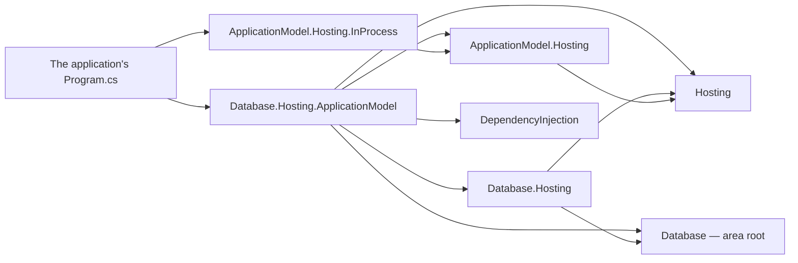

# Assimalign.Cohesion.Database.Hosting.ApplicationModel — Design

> **Status (2026-11-02, #1785):** Database joins the restarted Application Model through the
> EmailHub integration's shape. The instance-side contracts and decisions are
> [ApplicationModel.Hosting](../../../../libraries/ApplicationModel/Assimalign.Cohesion.ApplicationModel.Hosting/docs/DESIGN.md);
> [Database.Hosting](../../Assimalign.Cohesion.Database.Hosting/docs/DESIGN.md) owns engine construction and host ordering.

## Purpose

`builder.Services.AddResource(name, resource => ...)` makes an ordinary Database application a
managed resource instance. Its selected platform client publishes its manifest, restores the
state the gateway kept, and carries the gateway's calls to the instance. With no named platform,
the application runs unmanaged with its code-defined state and AddResource registers nothing.
An environment naming a platform the application did not opt into is refused at registration.

## References

The package references Database, Database.Hosting, DependencyInjection, Hosting and
ApplicationModel.Hosting only. COHRES001 sanctions the exact runtime-module reference by the
integration package's name, with no exemption property. Applications reference the platform
hosting packages they opt into; the integration carries no transport or gateway. Arrows mean
"references".

## Composition

A managed AddResource call registers one singleton `IHostService` factory. Database.Hosting runs
it once when Build invokes the container's lifecycle factories, after freezing the engine/server registry
and creating all AddService products. It creates these pieces:

| Piece | Role |
| --- | --- |
| `DatabaseResourceOptions` | A sealed leaf of `ApplicationInstanceOptions`, adding only `Name`. The base supplies platform selection, deployment, AddAction, JsonContexts and CreateActions. |
| `DatabaseResource` (internal) | An `IApplicationInstance` with provider `Database`, the resource name, a new instance key, the environment's deployment, exactly the added actions in order, and no health contributors. |
| `ApplicationInstanceControlPlane` | The actions and their state, with JSON content resolved through the added actions' source-generated contexts. Duplicate action names fail composition. |
| `ApplicationInstanceService` | Publishes and restores in StartingAsync, opens the selected platform client in StartAsync, and closes it and stops lease renewal in StopAsync. |

An action may be an instance or a factory over the application's provider. CreateActions runs each
factory once, in order (Hosting D21); factory-created actions cannot be disposable, and disposable
collaborators belong in Services. Supplied action instances remain borrowed. The service itself
is owned by Database.Hosting and disposed once in the services phase, before engines. Its factory
is invoked directly, so the provider does not capture the service for disposal.

## Lifecycle

1. **Build provisions the engines.** Model factories open, recover and migrate declared databases
   inside DatabaseApplicationBuilder.Build. Inline work completes before Build returns; populated
   migrations may continue on engine-owned workers, with their existing admission gates.
2. **StartingAsync publishes and restores.** Once the host starts, every lifecycle service's
   StartingAsync completes before any service or server starts. The manifest repeats the deployment
   and exposes the added actions; the publication answer's snapshots are restored before serving.
   Publication or restore failure fails start. A lease is renewed until stop (Hosting D14).
3. **StartAsync opens the control plane.** Start order is AddService registrations, container
   IHostService registrations, the optional reopen service, then servers. The resource service
   opens the platform client after restore, before any Database server listens (Hosting D15/D19).
4. **Health and servers accept.** Hosting binds health to the runtime's http assignment when a
   gateway is named (T3-28), after the resource service opens and before model servers start.
   Each model server uses its named assignment (sql, documents, graph, kv or blob) only when its
   options carry no explicit listener. AddResource adds no wire server. The in-process platform
   currently assigns only http, so wire listeners still need explicit addresses there.
5. **Stop drains servers first.** The host reverses the complete order. Servers stop accepting and
   drain while the control plane remains open; then the reopen and container services stop. The
   resource service closes its client and stops renewing before AddService services stop.

Gateway StopAsync and Completion leave the Database application Started and accepting connections
(G37/G40). G42 DisposeAsync stops the gateway run, then disposes the owned platform. The platform
owns workload shutdown, so gateway disposal is the end-to-end test's shutdown criterion.

The gateway's startup window includes Build's open, recovery and inline schema migration, since
publication cannot begin until they finish. Database's host StartupTimeout bounds service start
only and supplies no construction timeout.

## Decisions

**D1 — One explicit integration.** Database.Hosting stays a plain host with no ApplicationModel
reference. This package is a public App.Database member; an Sdk.Database application calls
AddResource without another integration package reference. A gateway declares a Database resource
generically with `builder.AddResource("Database", "orders-db")`, without loading this area.

**D2 — The environment selects a platform.** The base options read platform and deployment through
Core's AppEnvironment, including each in-process program's own scope. UseInProcess and other
platform verbs opt into clients; no platform means no registration. No ambient instance registry
or generated manifest exists (Hosting D1/D19).

**D3 — No Database-owned actions yet.** The retired `database.add-database` and
`database.add-principal` commands do not fit the snapshot-restore model (ApplicationModel.Hosting
D3): a write is restored on every instance, and database data and principals live in each
instance's durable catalog. Only the application's added actions are exposed. Database management
actions need an owner design follow-up rather than replaying catalog mutations as snapshots.

**D4 — No health contributors yet.** The instance reports an empty collection. No gateway consumes
instance health yet (ApplicationModel.Hosting open question 2; Gateway G18). Database.Hosting's
existing health/admin behavior stays separate. The owner will decide aggregation and readiness.

**D5 — Concrete-first and AOT.** DatabaseResourceOptions is a sealed public leaf with an internal
constructor; no new public interface or shipped friend grant exists. The internal resource carries
only public instance properties; neither new type introduces nonpublic instance state requiring a new debugger proxy. Content
uses JsonApplicationContentSerializer.Create with exactly the added JSON contexts, with no
reflection fallback. The package raises no events and needs no EventSource.

## Open questions

1. **Named endpoint allocation — owner: ApplicationModel, E-AM1.** Database consumes sql, documents, graph, kv and blob runtime assignments when present. InProcessInfrastructure still assigns only http and one HTTP loopback endpoint output; that endpoint now serves Database health. Dependents continue passing wire addresses as literal settings until platforms allocate named endpoints and report per-endpoint outputs.
2. **Readiness — owner: ApplicationModel.Gateway (G18).** The gateway counts the first publication as ready, in StartingAsync before Database servers listen, so a dependent can deploy before Database accepts connections.
3. **Startup window — owner: gateway application.** Publication waits for Build's open, recovery and schema migration; the gateway's startup window must cover that work.
4. **Database-owned actions — owner: Database.** Define management operations that fit instance snapshot restore and each instance's durable catalog before adding actions.
5. **Instance health — owner: ApplicationModel.Hosting/Gateway.** Settle health aggregation (Hosting open question 2; Gateway G18) before Database contributes health.
6. **Publication-to-open window — owner: ApplicationModel.Hosting/Database.** AddService services always start after publication and restore but before the control plane opens. A slow service widens Hosting open question 7's window, and Database users cannot reorder these services as Web and EmailHub users can.
7. **Instance health and actions — owner: Database, T3 EN-A2/EN-A3.** HTTP health now binds the platform's http endpoint in Hosting, with the existing readiness gate and loopback-only namespaced probes. Mapping those observations to application-instance contributors and adding read-only Database actions remain separate runs.
