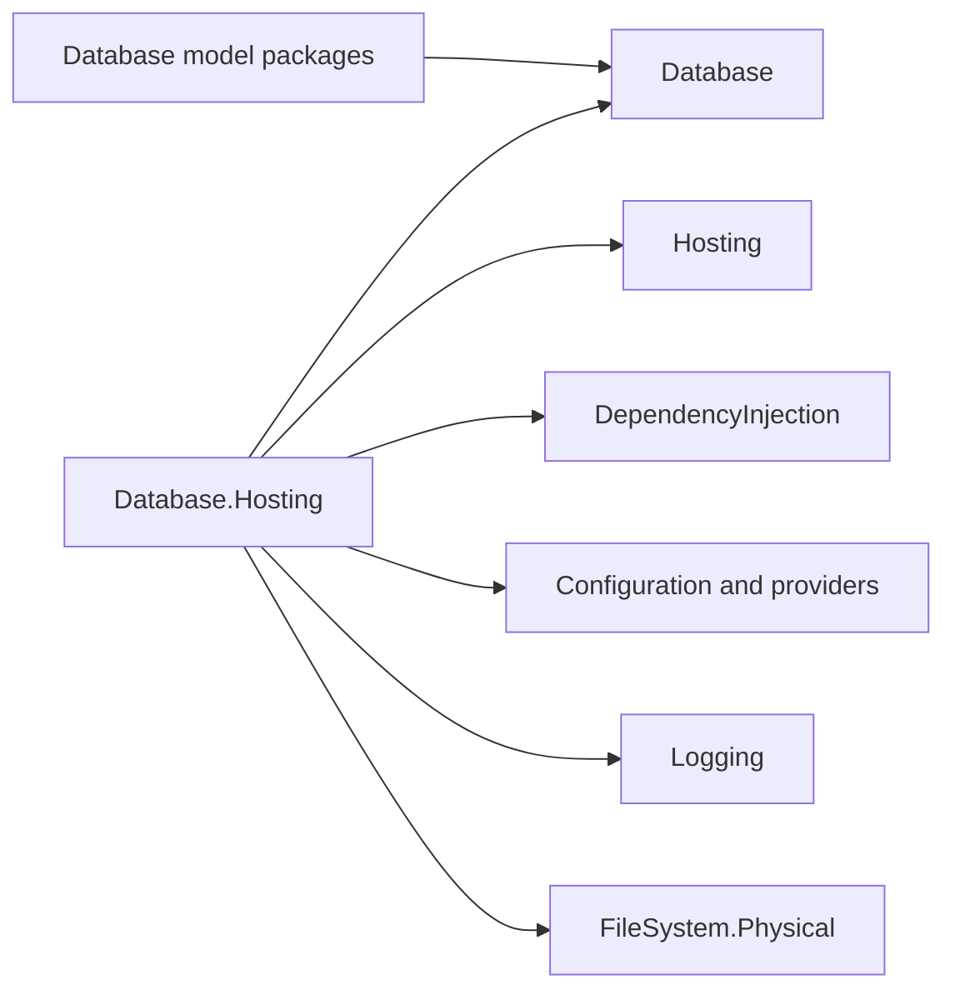
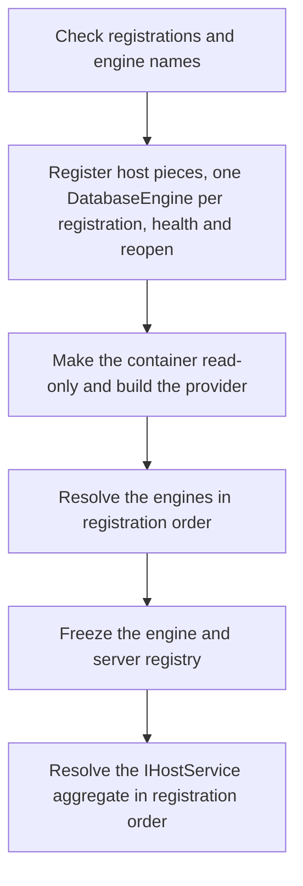

# Assimalign.Cohesion.Database.Hosting — Design

## Journal admission health (#1283)

DatabaseInstance.IsJournalAdmissionPaused folds pure reads of live per-storage admission state;
health reads do not create pauses. The checkpoint worker and admission paths observe thresholds.
Health is Degraded while paused, with journalAdmissionPauseCode=CK06006,
journalAdmissionPausedDatabaseCount and journalAdmissionPausedDatabases. Existing health
transition events 16/17 use reason JournalAdmissionPaused:CK06006. Worker faults can also
degrade health; offline storage keeps its Unhealthy priority. A successful checkpoint clears
the pause without reopen inside the failure window. Persistent worker failures retain the
100-second default offline window while paused; that fence wakes all parked writers, and reopen
recovers the database. A non-failing pending pause never goes offline merely because time passes. Reads retain ordinary snapshot and locking rules. Root close wakes
paused writers before cleanup, including raw catalog callers.

## Joint SQL migration health (#1447, SQ-A3)

Hosting keeps its model-neutral Provisioning observation: every unpublished deferred SQL job is Degraded
while pending/running; CS03402 leaves health Degraded with the database online at its old schema.
Successful explicit retry restores Healthy. SQ-A5 (#1778) supersedes decision 49a's CS03104 offline
step failure for every deferred job and adds no Hosting model reference or automatic retry.
Constraint scans report an unknown total until completion; health omits totalRows while unknown.
Provisioning remains the observed reason after a preparation failure, so health tracing deduplicates
that continuing Degraded condition while health data carries CS03402.

## Composition

Phase 29 implements the owner-approved [Database hosting design](../../../../docs/programs/DATABASE_HOSTING_DESIGN.md), including its nested-engine corrections. The public path is `DatabaseApplication.CreateBuilder(args)` → Add intent → one-shot `Build()` → engine access / `RunAsync()`. There is no composition `Use` method or application-builder `AddServer`.

The root builder accepts borrowed engines and named, dependency-free engine factories receiving the application context (`AddEngine(name, factory)`). Model packages supply `AddSql`, `AddDocuments`, `AddGraph`, `AddKeyValue`, and `AddBlob` twice, with one shape: as `extension(IDatabaseApplicationBuilder)` members (`builder.AddSql(...)`), and as component integrations on `builder.Services` (`builder.Services.AddSql(...)`, §Composition through the container); each takes the engine name as its first argument and an `Action<XEngineBuilder>` (owner decision 52 of 2026-10-09). Their callbacks run at Build against a model engine builder created for that name; worker and server factories run after that engine exists, and every model engine opens or creates the databases its builder declares before its build returns, a SQL engine provisioning their schemas too (§Provisioning, below). Since B3 of the engine extensibility design the five builders share one shape: `Options` (values only, copied at the engine's build; no options type carries an engine name), `AddDatabase`, `AddServer(options => …)` beside `AddServer(engine => …)` for the models with a server (Sql, KeyValue, Graph, Blob), `AddWorker`, and `Build`/`BuildAsync`. Hosting never references a model package, resolves model services, or binds model configuration. The concrete hosting overload of the same shape, `AddEngine(name, factory)`, receives the built host-level pieces explicitly (`DatabaseApplicationBuildContext`, below).

`COHRES001` reserves the exact `Database.Hosting` reference for named exemption holders, with
`Database.Testing` the standing holder. `COHRES002` allows `Database.Hosting` to reference other
same-area libraries except `Database.Testing`, `Database.Refs`, `Database.Runtime`, and test,
example, sample and fixture projects. `COHRES004` keeps shared `Hosting` libraries out of the
area root and feature libraries. The old model's Database integration was removed in #1869.

## Platform binding and HTTP health (#1790)

When `COHESION_GATEWAY` is nonblank, each model server's options snapshot defaults a missing
listener from its named runtime endpoint (`sql`, `documents`, `graph`, `kv` or `blob`). An
explicit `Listener` or `Listen(Uri)` wins. The common root resolves the endpoint during model
validation, after the timer and session-limit checks and before the missing-listener refusal.
Hosting receives an already constructed server. The root privately uses `Connections.Tcp` and
shares the stateless binder with `Database.Tcp`. Hosting adds no model reference or public composition seam. See the
[root design](../../Assimalign.Cohesion.Database/docs/DESIGN.md#named-platform-endpoints-1790).

The concrete builder's AddHealthEndpoint(Uri) configures one plain HTTP listener; the last call
wins. Registration validates an endpoint URI, literal IP address or localhost and refuses HTTPS
without a certificate source. At Build, when `COHESION_GATEWAY` is nonblank, an `http` assignment
with a plain HTTP scheme and a literal IP address or localhost overrides that value (#1790).
Event 19 names both endpoints when the assignment replaces a different explicit endpoint.
A malformed or missing assignment is
unset under Core's TryGetEndpoint contract; absent an explicit value, no listener is composed.
An assignment with an unsupported scheme or DNS bind host is skipped with informational event 18,
which names the assignment, its endpoint and scheme. The explicit endpoint is kept, or no health
listener is composed, so an unusable implicit health assignment cannot prevent engine availability.
Explicit `AddHealthEndpoint` input remains strictly validated. With `COHESION_GATEWAY` unset or
blank, only an explicit `AddHealthEndpoint` call configures a health listener.

`AppEnvironment.TryGetEndpoint` reads the bind scheme from the runtime contract. The name `http`
alone does not determine that scheme.

Build registers the internal DatabaseAdminEndpointService as a singleton IHostService factory in
Services, before closing the container. The factory runs after the engine/server registry exists,
after every application lifecycle service, before the reopen service and model servers. It starts a private
Web host and awaits its bind, so a bind failure fails the outer start and rolls back prior services.
Socket bind failures carry structured CK07102 on DatabaseException and retain the original Web
HostStartupException with its SocketException cause; cancellation still propagates unchanged.
Event 15 still reports the original Web host failure exactly once.
Shutdown drains model servers before stopping health; async disposal owns the private Web host.
The Web.Hosting/Web.Health dependencies and their App.Database assemblies remain private.

| Code | Condition | Carrier |
| --- | --- | --- |
| CK07102 | HTTP health listener socket bind failed | DatabaseException.Diagnostics; original Web host failure and socket cause retained |

The existing /healthz, /readyz and /livez routes and /cohesion/v1 aliases retain their health and
transport-peer policies: namespaced routes admit loopback peers only; bare routes admit remote
probes; forwarded headers never grant access. Readiness remains unavailable until the outer host
is Started, after every model server confirmed accept. Liveness omits that readiness-only gate.
Other /cohesion/v1 paths remain forbidden. Endpoint binding preserves existing event identities,
wire messages and store formats. The observations below supplied the old model's instance health contributors (#1790) until #1869 removed that integration.

## Transport-neutral health observations (#1790)

DatabaseApplicationContext.GetHealthAsync returns immutable DatabaseHealthObservation snapshots from the
same evaluation core as HTTP health. Every model reads DatabaseEngine.OpenDatabases: health
never opens, reopens or waits for a database, and takes no engine lock. It excludes closing
instances, keeps offline open instances, and reads pending reopens after each engine's snapshot.
A stored database never attempted by this process is absent in every model. FailedOpens retains
a failed stored open, including manual reopen with ReopenOfflineDatabases=false, as Unhealthy.
Each record supplies reason, failureCode when present, reopenFault (exception type only), failedAt
(invariant UTC round-trip string) and reopenAttempts (consecutive failures). Exception messages
never enter health detail. Successful open/create/drop, absence or disposal clears the record.
Open instances outrank pending reopens, which outrank failed-open records: one component per name.
An offline instance keeps its cause and merges pending reopen attempts and fault; an online
instance stays Healthy despite a stale pending entry.
GetDatabasesAsync retains each model's enumeration semantics,
including opening stored Documents, Graph and Blob databases through recovery.

HealthComponentNames builds live membership synchronously from the registry frozen at Build,
each engine's OpenDatabases, its pending reopens and FailedOpens. Discovery evaluates no health, awaits no
work, blocks on no database lifecycle operation and tolerates a custom inventory failure by
keeping that engine's name. Build runs no health pass, emits no health transition event, and
needs no discovery cancellation token.
Pending reopens are published as immutable snapshots when membership or reported detail changes,
so discovery and health never acquire the reopen service's scheduling monitor. FailedOpens likewise
publishes immutable snapshots on change; health and discovery take no engine completion gate.
Engines follow registration order; within each engine, databases follow ordinal ignore-case
component-name order in both discovery and complete observations; database.accepting is last.
Consumers re-read membership to follow opens and drops. A retained database component that is
no longer open, pending or recorded answers Unhealthy, "not open".

The public names are `engine/<escaped engine>`,
`database/<escaped engine>/<escaped lowercase database>`, and `database.accepting`.
Each segment is URI-escaped separately; engine identity is ordinal and engine registration
rejects invalid UTF-16. Only ASCII database letters are lower-cased, matching the storage-name
fold on the built-in models' ASCII names while preserving custom names such as K and the Kelvin
sign as distinct components. Open snapshots, offline entries and pending reopens use this same
component spelling. Single-component lookup compares the complete component name ordinally.
Engine observations retain engine-scoped state, workers and counts, excluding provisioning.*,
offline.* and failedOpen.* database detail. Running is Healthy, Faulted is Degraded, and Disposed or unknown
is Unhealthy. Database status preserves Offline over journal admission pause over provisioning
over Healthy. Pending reopens remain Unhealthy with cause, attempts and last exception type.
Held schemas are Degraded with failureCode, hashes and refused steps. Diagnostic values are
invariant strings and provisioning detail retains the existing 4,096 UTF-16-unit bound.

The all-component GetHealthAsync evaluates engines independently. Its single-component overload
evaluates only the named engine; database.accepting evaluates only the host gate, with no
inventory. Both public forms propagate cancellation of the caller's token, including with zero
engines. Other evaluation exceptions except OutOfMemoryException become Unhealthy for that engine's components, naming
exception types only; other engines and database.accepting remain independent. The single form
also rejects a null, empty or white-space name with ArgumentException. The HTTP aggregate keeps
its existing throwing-check behavior, descriptions and data; Web.Health folds a throwing check.
A disposal observed after the inventory read fails closed for components and the HTTP aggregate.
Documents, Graph and Blob are evaluated in database-name order, preserving provisioning indices
and the provisioning and journal-pause lists. OutOfMemoryException propagates from discovery
and evaluation rather than becoming an inventory failure.
The component path does not construct the aggregate description. Partial checks do not replace
the aggregate transition observer's view of other engines.

/readyz is the minimum over all contributions; /livez is the minimum over engine and database
contributions. database.accepting alone is the host's accept gate, not readiness: Healthy only
when the outer host is Started, after every server confirmed accept. A host with no servers
still follows that host gate. Tests pin aggregate/component status parity across the condition
matrix. The HTTP routes and their Ready/Live tags remain unchanged.

The builder reserves and registers DatabaseApplicationContext and IDatabaseApplicationContext
through the same factory returning the application's context, alongside configuration,
environment and logging. The application owns the non-disposable context; the provider must
never own it. ValidateOnBuild does not invoke the factory before the context exists.

## Build and configuration

Build consumes the builder before user code runs, even if construction fails. Registration methods and the service container reject late mutation, and so does the logging builder once Build built its factory. The `Options` host settings are copied at Build and cannot alter the application later. The root builder has no live `Engines` property. `DatabaseApplicationOptions` holds host policy only: its borrowed `Engines`, `Servers` and `Services` lists, the `DatabaseApplication(options)` constructor and `CreateBuilder(options)` were deleted (owner decision 54 of 2026-10-09), so there is one registration path per kind of thing (`AddEngine`, `AddService`, and a server on its engine's builder).

### Host-level pieces (owner request of 2026-10-08)

The builder exposes the four host-level pieces `WebApplicationBuilder` exposes, as the same concrete types, created the same way when the builder is created (`Web.Hosting`'s `WebApplicationBuilder` constructor):

| Builder member | Type | Created | At Build |
| --- | --- | --- | --- |
| `Environment` | `HostEnvironment` | from `Options.Environment` (`production` when unset) and `Options.ContentRootPath` | registered as `IHostEnvironment`; the application context's `Environment` |
| `Configuration` | `ConfigurationManager` | empty; `CreateBuilder(args)` adds the default sources | registered as `IConfiguration`; owned and disposed by the application |
| `Logging` | `LoggerFactoryBuilder` | empty | built once into the application's `LoggerFactory`, registered as `ILoggerFactory`, owned and disposed after the provider |
| `Services` | `ServiceProviderBuilder` | `EnableDynamicCode = false`, `ValidateOnBuild`, `ValidateScopes` | checked, given the three infrastructure registrations above and a factory for the application's context, made read-only, built once into the application's `ServiceProvider` |

The root `IDatabaseApplicationBuilder` gains none of them: model packages and other feature code compose against the root without the container, configuration or logging (COHRES004, `resource-areas.md`). The engine factories of `AddEngine(name, factory)` run at Build, after the container closed, so their `DatabaseApplicationBuildContext` carries the built counterparts, not the builders: `Environment` (`HostEnvironment`, the builder's instance), `Configuration` (`ConfigurationManager`, the builder's instance), `Services` (the built `ServiceProvider`; the DependencyInjection library's provider type is public, so the context names it rather than `IServiceProvider`) and `LoggerFactory` (the built `LoggerFactory`). One build context exists per application, and every named factory receives it.

`CreateBuilder(args)` adds the default configuration sources when it creates the builder, in order: optional `appsettings.json` and `appsettings.{Environment}.json` under the content root, environment variables prefixed `COHESION_CONFIG__`, then the caller's arguments, as Web adds them; later values win, and a provider the application adds afterwards wins over all of them. Environment uses the existing Hosting default; `Local` remains `Local`. JSON reload is disabled. `CreateBuilder()` and `new DatabaseApplicationBuilder(options)` start with an empty configuration, as Web's do. The manager loads each provider as it is added, so a provider that fails to load fails the call that added it, not Build, and a provider added after Build loads into the running configuration; engine factories read the configuration once, at Build, so nothing is recomposed. The default sources' physical file system is allocated when the builder is created and owned by the application from Build, which disposes it after the configuration.

The content root `CreateBuilder(args)` reads those files under is `AppContext.BaseDirectory`: the overload creates fresh options and loads the sources before it returns, so a plain application cannot set the path for it. `Options.ContentRootPath`, like `Options.Environment`, applies to `new DatabaseApplicationBuilder(options)`, and only as the builder is created: both are read into `Environment` then, a later change to `Options` changes neither, and Build's options snapshot takes both from `Environment`, so the application's options and its context never disagree.

`Build` creates the application's one service provider and one logger factory. `Services` and `Logging` are the concrete builders, so a caller can still build them directly: `((IServiceProviderBuilder)builder.Services).Build()` yields a separate provider the application never uses, which creates its singletons a second time and is the caller's to dispose, and `builder.Logging.Build()` yields a separate logger factory, after which the application's own Build fails because the logging builder builds once. `WebApplicationBuilder` exposes the same two builders the same way; the deferred facades they replace (below) refused both calls.

*Before the owner request,* the builder exposed `IConfigurationBuilder Configuration` and `IServiceProviderBuilder Services` as deferred registration facades that loaded nothing until Build, refused their own `Build`, and took the environment and content root from the options at Build; the build context carried `IConfiguration` and `IServiceProvider` only, and there was no logging builder (the enabled-resource telemetry built a factory nothing used). Every `CreateBuilder` overload loaded the default sources at Build.

One Cohesion service provider is built with `EnableDynamicCode = false`, `ValidateScopes = true`, and `ValidateOnBuild = true`. This selects the interpreted resolver on JIT and NativeAOT. Hosting permits closed factories and instances only, rejects implementation-type/open-generic activation, and reserves `IHostEnvironment`, `IConfiguration` and `ILoggerFactory` for the application's own pieces, which Build registers as borrowed instances. Model construction uses explicit assignments rather than reflection-based binding. Engine factories must not return provider-owned services; lifecycle factory forwarding has the idempotent-disposal caveat below.

Root engine factories observe preceding engine registrations. They cannot depend on later registrations. Every engine is registered by name (owner decision 52 of 2026-10-09): a borrowed engine by its own `Name`, a factory by the name its registration gives, which the factory's product must match exactly (ordinal). A builder verb refuses a name already held by a `DatabaseEngineRegistration` in `Services`, so a duplicate is refused at Add; Build checks every registration's name again before any factory runs, which is where a duplicate registered through `builder.Services.Add<Model>(...)` is refused, because a component integration cannot read the container; the nameless factory overload, whose product's name could only be checked once the factory had returned, is deleted, because a model's factory now opens and provisions databases, which a duplicate engine must never reach (the duplicate would have run against the same data path). Names are nonempty, valid UTF-16, case-sensitive, and unique across models. `Context.GetEngine(name)` returns a borrowed reference, typed as the root base; the root's static extension `Context.GetEngine<TEngine>(name)` returns it as the model's engine (`SqlDatabaseEngine`, …).

## Concrete types (concrete-types plan, phase 6, #1262)

The module composes the root bases, not interfaces: the area deleted every root engine-model interface in phase 6 (`database-area.md`; the plan's rows 3 to 13). `IDatabaseApplicationBuilder.AddEngine` takes a `DatabaseEngine`, or (since B1) a name and a `Func<IDatabaseApplicationContext, DatabaseEngine>`, and the hosting builder's own overloads and the context's `Engines`, `Servers` and `GetEngine` follow. What the retype changed in the module:

- **A server's engine is `server.Engine`**, the base's field, where the module read `server.Context.Engine`; the server context is gone.
- **Provisioning was a flag check** until B1 deleted it: `DefaultDatabaseProvisioner` opened or created the database, refused one whose `DatabaseInstance.SupportsSchemaProvisioning` was false, and called `DatabaseInstance.ApplySchemaAsync`; it had tested the database for `IDatabaseSchemaProvisioner` before phase 6.
- **Health and the reopen service read every engine's offline cause** through `DatabaseEngine.GetOfflineError`; until phase 6 they did so only for an engine of the root base (`engine is DatabaseEngine`), and an engine of the interface alone reported none. The reopen service reads the engine's state without guarding it, because the base folds `State` from its own fields and never throws.
- **Health no longer describes a worker whose loop failed.** It reported an engine `Faulted` with no failing worker as a registered worker whose loop escaped, "degraded until it is disposed". Only a worker that implemented the deleted `IDatabaseEngineWorker` without the base could do that; every worker derives from `DatabaseEngineWorker`, whose loop lets nothing escape. An engine reported `Faulted` with no failing worker (a worker that recovered between the two reads) is still degraded, with the generic description. Every worker now reports `failureCount`; only a failing one adds `consecutiveFailures` and `fault`.
- **The engine base enforces the nested-server rules.** `DatabaseEngine.AttachServer` refuses a server that fronts another engine and a server attached twice, so Build no longer checks a nested server against its owner or against the other nested servers. Every server reaches the application through its engine since B1 deleted the borrowed `Options.Servers` input.
- **The test doubles derive from the bases** and implement only the protected cores (`RecordingEngine`, `RecordingServer`, `RecordingEngineWorker`, the controlled-start servers; the `ProvisioningEngine` double left with the provisioner in B1). Their create core accepts the root's non-generic `object? creationState` parameter, passed explicitly by the common create NVI; null selects model defaults. A double's state is the base's: a test faults an engine by failing a pass of its worker, and disposes it to make it `Disposed`; a double's server stop core runs once, and never after a failed start, so a host's rollback of a server whose start failed reaches no core.

## Nested servers and ownership

Application Build flattens each engine's `Servers` snapshot in engine/attachment order. Engines own these servers and dispose them before workers and databases. The application drives their Start/Stop through `DatabaseServerHostService` but never enrolls them for a second disposal. A server must front its owning engine, which the engine base enforces when the server is attached. Every server reaches the application through its engine: the borrowed `Options.Servers` input path is deleted (owner decision 54). Duplicate lifecycle references fail Build; conflicting engine names fail at registration.

| Input | Disposal owner |
| --- | --- |
| `AddEngine(instance)` | Caller |
| Root or hosting `AddEngine(name, factory)` / model Add verb (either spelling) | Provider, after every lifecycle service |
| Model builder worker/server factory | Engine |
| `AddService(instance)` | Caller |
| `AddService(factory)` | Provider if disposable, before engines |
| Container `IHostService` factory | Provider if disposable, before engines |
| Other provider-created service | Provider |
| Provider instance registration | Caller |
| Configuration and default configuration file system | Application |
| Logger factory and service provider | Application |

A factory transfers a fresh product, and cleans up partial allocations if it throws before returning. Detectable borrowed/owned aliases are rejected. An engine the provider created but Build refuses (a product whose name is not the registered one) is disposed by Build at once, because the provider captures only what a factory returns. Build compensation disposes the provider, which disposes every engine and service its factories created in reverse creation order, then the logger factory, configuration, and file system. Synchronous Build bridges asynchronous cleanup on a worker without capturing the caller's synchronization context. Original construction exceptions are preserved; cleanup failures produce an aggregate with the original first. Files created by a factory are never silently deleted.

## Runtime lifetime

Every lifecycle service is an unkeyed singleton `IHostService` registration in `Services`:
`AddService(instance)` is an instance registration, `AddService(factory)` a factory registration
closed over the application context, as `WebApplicationBuilder`'s are. Scoped and transient
lifecycle registrations fail Build with an error naming the registration; implementation-type
registrations remain refused. Keyed registrations are not lifecycle services. After the engines
exist and the engine/server registry is frozen, Build resolves the `IHostService` aggregate once,
in registration order, and pairs each product with its descriptor to refuse a null product, one
object registered twice or also attached to an engine as a server, and a factory product that is
already another registered product. The lifecycle list is the application's registrations in
registration order, the health listener when configured, the optional reopen service, then servers
in engine/attachment order. Shutdown reverses that complete order: servers drain before services
stop. All lifecycle `StartingAsync` callbacks finish before any service starts. Engine open,
recovery and inline schema migration have already completed inside Build; deferred migrations can
continue on engine workers.

*Until 2026-11-23* `AddService` kept its own registry: its registrations started before every
container registration, whatever the call order, and Build invoked container lifecycle factories
itself so the provider never captured their products. Both registries are now the container, so
one order, registration order, rules both, as in Web.

The provider owns what its factories create. Engines are created first, then lifecycle services,
so the provider's reverse-creation disposal runs the reopen service, the lifecycle services in
reverse order and then the engines; provider singletons an engine factory resolves are created
before that engine and disposed after it. The application then disposes the logger factory, the
configuration and the content root. Instance registrations remain borrowed and are never disposed
by the application. A throwing factory fails Build, which disposes the provider and the
infrastructure, aggregating cleanup failures with the original construction failure first.
Provider disposal continues past disposer failures in reverse creation order: it propagates one
failure unchanged and aggregates several in an AggregateException
(`ServiceProviderEngineScope.DisposeAsync`), which the application keeps whole, and outer cleanup
continues with the remaining infrastructure in either case.

A forwarding lifecycle factory (`sp => sp.GetRequiredService<X>()`) hands the provider an object it
already owns; the provider disposes a captured object once. Use `AddService(instance)` or an
instance registration when ownership must stay with the caller.

## Composition through the container (2026-11-23)

The builder follows `WebApplicationBuilder`: every composition input is a registration in
`Services`, and there is no parallel private registry (`resource-areas.md`, "Hosting composition").

- **An engine is a `DatabaseEngineRegistration` singleton instance.** The type lives in the area
  root, so model packages can create one without a container reference. It carries the engine's
  name and either a borrowed engine or an ownership-transferring factory over
  `IDatabaseApplicationContext`. `AddEngine(engine)`, `AddEngine(name, factory)`, the root
  `IDatabaseApplicationBuilder.AddEngine` shims (which every `builder.Add<Model>` verb calls) and
  the model packages' component integrations all register one. A factory registration of a
  `DatabaseEngineRegistration` is refused, because its name would be unknown until it ran, and
  `DatabaseEngine` itself is reserved: an engine is registered by name.
- **Model verbs are component integrations too.** Each model package declares
  `builder.Services.Add<Model>(name, configure)` in `src/Properties/ComponentIntegrations.cs` with
  the `Factory` template over a hidden `<Model>Components.CreateEngineRegistration(name, configure)`
  (`ComponentModel/`), because the engine name is a required argument (owner decision 39 of
  2026-10-10). The generator projects the verb into every compilation that references the model and
  `DependencyInjection`, as every `Sdk.Database` application does through the App framework's
  analyzer. No change to `ComponentIntegrationAttribute` was needed. The
  `extension(IDatabaseApplicationBuilder)` verbs stay: they reserve the name at the call and are the
  spelling templates, documentation and the v2 design use.
- **Build turns each registration into a `DatabaseEngine` registration, in order**: a borrowed
  engine as an instance, an owned one as a factory. It resolves the `DatabaseEngine` aggregate once,
  so the provider invokes the factories in registration order; each factory sees the engines
  registered before it (the context's registry is refrozen before each one), checks the token, and
  its product is checked for null, aliasing, its name and its model. Lifecycle factories can resolve
  `IEnumerable<DatabaseEngine>` from the container.

Build's order:

Build checks every registration and every engine name before any engine factory runs, registers
the host pieces, one `DatabaseEngine` per registration, the health listener and the reopen
service, closes the container and builds the provider, resolves the engines, freezes the registry,
and resolves the lifecycle services.

*Why it waited.* `resource-areas.md` recorded Database.Hosting as not yet migrated because its
explicit registries continued past a failing disposal and aggregated it, and engine factories
observe preceding engines. The provider has since gained continue-and-aggregate disposal, and the
module controls resolution order, so neither holds.

## Provisioning (B1 of the engine extensibility design)

SQL completes an interrupted empty creation during its engine build (#1158). The model validates
the empty data/catalog state and finishes dbo and the format marker before publication. A catalog
with user data and no marker is refused.

Decision 49a defers populated-table work to SQL's engine-owned worker. Hosting reads the root
`DatabaseInstance.Provisioning` observation without referencing SQL: operation/object,
one-based position and total, pending/running, rows processed/total when known, and failure code.
A pending/running database makes aggregate health Degraded. Offline databases retain their
existing Unhealthy precedence. Completion removes the observation and restores Healthy when no
other condition prevents it. Health data uses `engine.N.provisioning.M.*` entries. Enabled tracing reports changes in the
observed database condition once, with transition deduplication described under Diagnostics.
Health in every model reads OpenDatabases, a copy of its published instance snapshot, without entering the
engine's recovery monitor. During automatic reopen, the reopen service's pending entry represents
the recovering database until its replacement is published; health can still report that state
and other databases' provisioning progress. Enumeration observes cancellation even for an empty snapshot.

The concrete `DatabaseApplicationBuilder.Build(CancellationToken cancellationToken = default)` passes
its caller's token through the root application context and the concrete build context to engine
factories; AddSql passes it into SQL Build. The host's
shutdown wait and service lifecycle start after Build, so no runtime shutdown token exists here.
Callers that need shutdown during Build provide their process-lifetime token. There is no new
timeout or Hosting dependency on a model. Cancellation disposes owned products already built.
The root `IDatabaseApplicationBuilder.Build()` stays parameterless, matching all 18 areas (O34;
owner decision 2026-10-11). Its explicit implementation forwards to the concrete Build without a
token. `Program.cs` retains the concrete builder returned by `DatabaseApplication.CreateBuilder` when
it needs cancellable construction; model factories still read `IDatabaseApplicationContext.BuildCancellationToken`.

The module holds no schema knowledge and provisions nothing. A model's engine builder declares the databases its engine owns, and the engine's own build opens or creates each of them and completes inline provisioning before it returns (`docs/programs/DATABASE_ENGINE_EXTENSIBILITY_DESIGN.md` §5.2 and §5.3). The model verb's factory runs that build inside the application's `Build()`. Servers start when the application starts, after inline work and reservation of deferred tables. Deferred provisioning can continue while the server accepts work: affected-table admission waits for completion, while other tables remain available.

Every deferred SQL migration retains a metadata lease from Build until worker completion. Definition
DDL is refused during that whole interval, including time queued behind other databases on the
engine-wide provisioning worker. Taking the lease in Build prevents unrelated DDL from invalidating
the migration at worker start. Pending new relation names also refuse session creation or table
rename with CS03404. A planning/space refusal leaves the old database online; a later successful
apply or already-applied rollback Build clears the failure observation and restores Healthy when
no other condition prevents it. Precise page/tree space accounting belongs to the SQL worker; Build
checks only the metadata floor, so populated Build stays constant-time in table size.

- **What was deleted** (owner decisions 49 to 54 of 2026-10-09): `Provision(engine, schema)` and `Provision(engineName, schema)`, `AddDatabase(engine, name, schema)` and `AddDatabase(engineName, name, schema)`, `Schemas`, their validators, and the internal `DefaultDatabaseProvisioner` host service that opened or created a database and applied a compiled schema in `StartAsync`, under `StartupTimeout`.
- **The cost, revised by decision 49a and SQ-A5:** open and recovery run in application Build, outside StartupTimeout. Cheap steps run there only when the plan has no deferred work; a deferred plan prepares its complete target jointly. Build accepts a caller cancellation token. Populated-table data-scaling steps run on the engine-owned worker after Build has reserved their tables.
- **Failed inline provisioning fails Build.** The model's build disposes its engine before it throws, and the application's Build rollback disposes every product built before it.
- **Failed deferred provisioning retains the old schema online.** Build may already have returned. Invalid existing rows or another preparation failure discard the unpublished target, report `CS03402` and retain Degraded health. Unrelated databases continue serving. A later explicit apply or Build may retry; storage-safety latches retain Unhealthy precedence and the existing reopen policy.

`DatabaseApplication` remains `Host<DatabaseApplicationContext>` and its context remains `HostContext`. `Run`, `RunAsync`, and `AsService` use the Hosting extensions. Embedded applications can use engines immediately after Build, or Run to wait for host shutdown without a listener.

The application permits one start lifecycle. Repeated Start while started is a host no-op; restart after Stop or a failed start is rejected through the protected start hook, including interface/Run paths. Stop before first Start does not consume the attempt. Concurrent Start/Stop/Dispose is unsupported; concurrent Dispose calls alone share one cleanup task. Dispose is idempotent, stops if needed, and attempts all application-owned roots after failures. Provider/configuration outlive products that depend on them. Sessions remain caller-owned and must finish before application disposal. Borrowed SQL/KeyValue servers may terminally close their listeners during Stop despite remaining caller-owned for disposal.

Health observes distinct engines, states and workers from the frozen runtime registry.

Health also reports offline databases (#1243). Failed fsync, journal drain, header slot write,
worker give-up or journal-cap enforcement refuses requests until reopen while the engine stays
Running. Health merges an offline instance's cause with its pending reopen's attempts and fault
into one component. An online instance outranks a stale pending reopen. Aggregate keys
engine.N.offlineDatabaseCount, engine.N.offlineDatabases and offlineDatabaseCount count only
offline databases, including pending reopens; engine.N.offline.M carries name, cause and, after a
failed reopen, reopenAttempts and reopenFault (exception type only). Failed-open records have
separate engine.N.failedOpenDatabases and engine.N.failedOpenDatabaseCount keys and a total
failedOpenDatabaseCount, emitted when records exist. Their engine.N.failedOpen.M detail and
component description say the open failed; the aggregate says each needs repair and an explicit
open (OpenDatabaseAsync). The reopen service discovers offline instances and does not retry these
records. A failed manual reopen, including with ReopenOfflineDatabases=false, retains its record
until successful open/create/drop, absence or disposal clears it. Exception messages never enter
health. Hosting has no remote reopen command (the #1243 owner decision remains open).

Held SQL declarations (#1779) remain online with Degraded health. Provisioning.Detail carries
both schema hashes and every refused step; health includes it in the description and the
engine.N.provisioning.M.detail data value beside failureCode. CS03405 identifies an unsafe
rollback, including re-adding a dropped column; CS03105 identifies a never-seen destructive
change without opt-in. Build succeeds and runs no migration step or declared script. Verify
remains the strict pipeline path (CS03103). Redeploying the stored schema clears the hold.
HealthDegraded and HealthRestored append failureCode and detail to their payloads; detail is
bounded to 4,096 UTF-16 code units including the ellipsis for both events and health (description
and detail data), with a surrogate-safe cut. The SQL engine's declaration retains a hold across
offline/reopen, rewrite and refused explicit apply while the stored hash remains held. A restart
with the stored or a successfully published newer declaration clears it.
Restoration on a later observation carries the prior condition's code/detail. A new application's
observer starts fresh and does not invent a restoration event for an earlier process.

## Reopening offline databases (owner decision 22 of 2026-10-06)

A running application reopens a database its engine reports offline by itself, with exponential backoff and jitter, until the reopen succeeds or the application stops. It is the module's own lifecycle service, `Internal/DatabaseReopenService`, registered at Build after the other services and before the servers (so it starts before them and stops after they drained), and owned by the application. `DatabaseApplicationOptions` configures it: `ReopenOfflineDatabases` (on by default; off leaves every offline database to the operator and composes no service; a failed manual reopen retains its Unhealthy failed-open record until successful open/create/drop, absence or disposal clears it), `ReopenInitialDelay` (one second, the engines' worker failure backoff) and `ReopenMaximumDelay` (one minute), validated at Build (the initial delay positive, the maximum at least the initial delay and at most `DatabaseApplicationOptions.MaximumReopenDelay`, the longest a timer waits) and copied with the other host settings.

- **It reopens through the engine's own path.** The service polls each engine of the frozen registry (the server-fronted ones included) for `DatabaseEngine.OfflineDatabases`, at most once a second, or once per initial delay when that is shorter. A database it finds is reopened through `DatabaseEngine.OpenDatabaseAsync`: the engine closes the offline instance, which writes nothing, and opens the database again from its files, so the open's recovery decides every commit that was not confirmed (#1243), the decision-33 path a caller of `OpenDatabaseAsync` takes. The reopen returns the engine's new instance to the engine's registry; servers resolve databases by name, so their next session gets it.
- **Backoff and jitter.** The first attempt waits a random time between half the initial delay and the initial delay; after the n-th failed attempt the next waits between half and all of `min(maximum, initial × 2^n)`. A reopen that keeps failing is tried less and less often, and two databases that failed together do not retry in lockstep. RavenDB's database landlord retries a database whose start failed after a randomized delay the same way (`src/Raven.Server/Documents/DatabasesLandlord.cs:1504-1510`), and lets the next access load a database whose load faulted (`:831-835`).
- **A database that flaps keeps its backoff.** The service remembers each successful reopen for its carry-over window. A database found offline again within that window starts its new episode at the step after the last one its previous episode reached (`min(maximum, initial × 2^k)`, k the attempts of its earlier episodes), not at the initial delay; one found later starts over. A fault the reopen does not clear (a version purge or page write-back that keeps failing after recovery succeeded) therefore takes the database offline and back less and less often, instead of every few seconds with a full recovery under the engine's lock each time and in-flight commits failed as unconfirmed. Before the review it started over at the initial delay, and a version-purge fault made the database flap.
- **The carry-over window is tied to the engine's (owner decision 48 of 2026-10-08, as its review revised it; the formula awaits the owner's acceptance).** It is the database's engine's `DatabaseEngine.WorkerFailureWindow`, plus the longest `Interval` among the engine's `Workers` that can take a database offline (every kind but `IndexMaintenance`, which never does, owner decision 47), plus `ReopenMaximumDelay` (`GetCarryOverWindow`), saturating at `TimeSpan.MaxValue` rather than overflowing; it depends on the engine, not on the episode. A worker's give-up comes no sooner than the engine's window after its first failure on the reopened database (100 s across at least three failed passes at the defaults, owner decision 42, whichever worker fails: about 101 s for a version purge's full pass since decision 46 and about 102 s for a deferred undo), and that first failure comes only when the worker's own pace brings it to the database: a version purge's full pass runs on one engine-wide `MaintenanceInterval` timer (a minute by default), so it first fails up to a minute after the reopen, and a checkpoint is due a `CheckpointInterval` after the storage opened (five minutes by default; `Storage.IsCheckpointDue` is time-backstopped from the open) unless its journal passes the size trigger first. `ReopenMaximumDelay` is at least every backoff step, so it covers the backoff to the pass that gives up, the give-up on the thread pool and the service's poll of up to a second. At the defaults the window is 100 s + 5 min + 1 min, 460 s, at every step: a time-triggered checkpoint give-up reaches the service about 404 s after the reopen at the latest, and a version purge's about 163 s. It is never shorter than `ReopenMaximumDelay`, which covers a device failure that takes the database offline again at once. *As decision 48 first landed,* the window was the engine's window plus the backoff step the episode reached, at least `ReopenMaximumDelay`, measured from the reopen: 102 s after a one-step episode. A version purge carried its backoff over only when its first full pass after the reopen fell in about the first second, a time-triggered checkpoint never did, and a miss reset the level, so the window never grew. *Before decision 48* the window was `ReopenMaximumDelay` alone, a minute by default, so no worker give-up at the defaults carried its backoff over. *Not bounded by any reopen-anchored window:* a page write-back fault surfaces at the first write after the reopen, however late; the alternative (the engine records the give-up streak's first-failure time on the offline error, and the backoff carries over when that streak began within `ReopenMaximumDelay` of the reopen) is an owner call (concrete-types plan §12).
- **Only the instance the service reopened carries its backoff over.** The service remembers the `DatabaseInstance` its reopen returned. A database found offline with a remembered reopen is first checked, off the loop's thread because `TryGetDatabase` takes the engine's registry lock, to be that instance: the engine still holds it (an offline instance is still held, so the check finds it). A database dropped and created again under the same name within the window, or reopened by someone else, is another instance; its entry drops the remembered level and starts at the initial delay, counted from when it was found. The `OfflineDatabaseFound` event of such an entry is written once the check settled its delay.
- **Databases are reopened side by side.** Each database's attempt runs on the thread pool, and the loop goes on without awaiting it: an attempt that hangs (a recovery stuck in its device) holds back that database only, while the loop keeps finding and reopening the others, other engines' included. One attempt or check per database runs at a time. Before the review the loop awaited each attempt in turn, so one hung recovery held every other database's reopen and stopped discovery.
- **It never reopens a database that was dropped.** Before its first attempt the service lets go of a database its engine no longer lists: someone reopened it, dropped it, or its holder closed it (decision 33: the engine forgets it). After a failed attempt the engine no longer lists the database either, because its failed open left it closed, so the service keeps it until a reopen succeeds; a reopen that reports `DatabaseNotFoundException` means it was dropped meanwhile, and the service lets it go. A disposed engine's databases are let go.
- **A database reopened elsewhere is let go at the next poll.** While a database whose attempt failed is not listed offline, each poll also checks whether its engine holds it open again (`TryGetDatabase`) and online (not in `OfflineDatabases`): an operator or another caller reopened it. The service then lets it go ("it was reopened elsewhere") and makes no further attempt, so health turns `Healthy` within a poll instead of after the backoff, which can be as long as `ReopenMaximumDelay`. The check waits for the engine's registry lock, which an open holds through its recovery, so it runs on the thread pool like an attempt, never on the loop's thread, and is awaited until the stop signal only. Health reads OpenDatabases without an engine lock in every model and reports the service's pending entry until the poll lets it go; it never invokes open or recovery.
- **Health stays unhealthy until the reopen.** The service's pending reopens (`GetPendingReopens`) are part of the health contribution above, so a database whose reopen keeps failing stays `Unhealthy`, with its cause and attempts, though its engine no longer lists it; health turns `Healthy` with the successful reopen. The engine ends its workers' failure records of a database once it took it offline, and again when the reopen closes the offline instance (owner decision 25 review), so the engine reports `Running`, not `Faulted`, and health is not left `Degraded` by the failure that took the database offline.
- **Stop never waits for it.** Every wait observes the service's stop signal, and an attempt or check runs on the thread pool and is awaited until that signal only: a stop during a backoff returns at once, and a stop during an attempt returns without it. The loop waits for its attempts and checks in flight as it ends, each of which ends at the stop signal. The attempt then finishes on its own (an engine's open runs to its end under the engine's lock, and the engine's disposal waits for that lock), and its outcome is still written to the event source. A failure of the loop itself is written and the next poll goes on: nothing ends the loop before the application stops.
- **An embedded application that never starts** reopens nothing: the service runs between Start and Stop, like the servers. Its health still reports the offline databases.
- **Tests.** `DatabaseReopenTests` runs a real in-memory SQL engine whose database a registered checkpoint worker takes offline through the engine's own escalation (a window of one tick across two failed passes, owner decisions 25 and 42: the helper runs two failing passes a millisecond apart). Reopen faults are injected through the service's internal `Reopen` hook, which wraps the engine's reopen, because the engines' storage strategies, where device faults are injected, are internal to their models: offline, unhealthy with `CheckpointFailures`, failing reopens, the fault clears, reopened and healthy with its rows; a reopen that keeps failing waits at least half of each backoff step and stays unhealthy; a stop during a ten-second backoff, and during an attempt that hangs, returns within two seconds; a database dropped before its first attempt, or after a failed one, is never reopened; a database an operator reopens after a failed attempt is let go and health is `Healthy` within two and a half seconds, with no second attempt; a database taken offline again right after each of four reopens waits longer each time (the fourth at least half of `initial × 8`); a worker that first fails one interval after the reopen and gives up a window later keeps the backoff (an engine scaled down the way the defaults relate: workers paced at 1.5 s, a window of 500 ms and a maximum delay of 1.2 s; the give-up comes past the window decision 48 first landed with, owner decision 48 review); a database dropped and created again within the window, then taken offline, starts over at the initial delay; and the window is 460 s at the defaults, at least the engine's window plus a checkpoint interval plus two backoffs and a second, and at least the same with a maintenance interval, ignores an index-maintenance worker paced at a day, and saturates for a worker paced at `TimeSpan.MaxValue`; one engine's attempt that hangs leaves another engine's database to be reopened, and health names only the hanging one; the off switch. The helper takes a database offline through the engine's queued give-up and waits for it, and no longer runs a second worker pass to end the worker's record: the engine ends it.

## Diagnostics

The module raises its own events through one internal event source, named for the assembly: `Assimalign.Cohesion.Database.Hosting` (`src/Internal/EventSource/DatabaseHostingEventSource.cs`, owner decision 22). Every finding, reopen attempt and outcome is one event, so an application's logging, through `Assimalign.Cohesion.Logging.EventSource`, logs each under the category `Assimalign.Cohesion.Database.Hosting`; a library describes its own behavior through an event source and takes no logging dependency (`.claude/rules/event-source.md`).

| Id | Event | Level | Payload |
| --- | --- | --- | --- |
| 1 | `OfflineDatabaseFound` | Warning | `engineName`, `database`, `cause` (the `StorageOfflineCause` name, or `Unknown`), `delayMilliseconds` (until the first attempt) |
| 2 | `ReopenAttempted` | Informational | `engineName`, `database`, `attempt` (from one) |
| 3 | `ReopenSucceeded` | Informational | `engineName`, `database`, `attempts` |
| 4 | `ReopenFailed` | Warning | `engineName`, `database`, `attempt`, `exceptionType` (full name), `exceptionMessage`, `retryMilliseconds` |
| 5 | `ReopenAbandoned` | Informational | `engineName`, `database`, `reason` (dropped, closed or reopened elsewhere, or its engine disposed) |
| 6 | `ReopenLoopFailed` | Error | `exceptionType`, `exceptionMessage` |
| 7 | `ApplicationBuilt` | Informational | `hostId`, `engines`, `servers`, `services` (all non-server hosted services, including container services and the optional reopen service) |
| 8 | `ApplicationStarting` | Informational | `hostId` |
| 9 | `ApplicationStarted` | Informational | `hostId`, `durationMilliseconds` |
| 10 | `ApplicationStartFailed` | Error | `hostId`, `exceptionType`, `exceptionMessage` |
| 11 | `ApplicationStopped` | Informational | `hostId`, `durationMilliseconds` |
| 12 | `ApplicationDisposeFailed` | Error | `hostId`, `failureCount`, `exceptionType`, `exceptionMessage` (first collected failure) |
| 15 | `AdminEndpointFailed` | Error | `endpoint` (scheme and authority only), `operation` (`Start`, `Stop`, `Dispose`), `exceptionType`, `exceptionMessage` |
| 16 | `HealthDegraded` | Warning | `hostId`, `engineName`, `database`, `reason` (`Provisioning`/`Offline`/`Open failed`), `cause` (offline cause or empty), `operation`, `objectName`, `position`, `stepCount`, `rowsProcessed`, `totalRows`, `failureCode`, `detail` (4,096 characters) |
| 17 | `HealthRestored` | Informational | same as 16; the condition and last observed progress that cleared |
| 18 | `HealthEndpointAssignmentSkipped` | Informational | `assignment` (`http`), `endpoint` (scheme and authority only), `scheme` |
| 19 | `HealthEndpointOverridden` | Informational | `explicitEndpoint`, `platformEndpoint` (scheme and authority only) |

Health transition tracing (#1349, #1790) observes database health through the open-instance inventory,
failed-open records and provisioning state, with no SQL dependency or new public seam. The first enabled observation
of an unhealthy condition writes 16. Later observations write only on a change of reason or
offline cause or database instance, or write 17 when the database is observed healthy again.
Pending-to-running,
step changes and row progress alone do not repeat a degraded transition. Offline has precedence
over provisioning. Failed joint preparation keeps the old schema online with a failed
Provisioning observation (CS03402). Independent storage-safety latches retain Offline precedence;
`ProvisioningFailure` denotes only an in-memory publication fault after the catalog commit.
Joint row counts restart at each table and phase. Operation, object name and position retain the
job's first operation throughout preparation and do not identify later table work. Reopen-service pending entries
remain Offline through recovery. A failed-open record writes 16 with reason "Open failed" and
empty cause/progress fields, using the existing payload. Its clearing writes 17 on the next
observation, including after drop, absence or disposal. Other dropped/closed databases or disposed
engines are forgotten, never reported as restored. Healthy first observations write nothing.

This is Hosting's observed transition stream: a condition that begins and ends between health
observations cannot be reported without a new model subscription seam, which this change does
not introduce. Each application has its own lazily allocated observer. The health core captures
its existing inventory, instance, provisioning and offline-cause reads into an enabled-only
observation; tracing makes no additional engine calls and adds no cancellation point. An empty
application still returns Healthy for a cancelled token. A core exception or cancellation passes
through unchanged; disposal or cancellation after its final read cannot replace its result.

Core checks remain concurrent. Successful observations update transition state and enqueue whole
batches under one short gate; one emitter drains those batches outside the gate. A listener may
reenter health: its check enqueues and returns, and its events follow the rest of the outer batch.
Overlapping checks use the latest-started successful observation: after it is recorded, an older
check's later completion cannot overwrite it, although that caller still receives its own result.
This orders recorded observations, not atomic snapshots of concurrently changing engines.
Deduplication retains database identity, including while a pending reopen temporarily has no
inventory instance, so a replacement with the same name/reason/cause degrades again.
Restored carries the last observed condition, not a fabricated final row count; absent progress
uses position/count zero and row counts -1. Progress identifiers are bounded to 256 characters
plus an ellipsis. No user exception text is included. Health results and precedence are unchanged.

With tracing disabled, `CheckAsync` returns its existing core directly, with no observer,
extra inventory pass, semaphore, timer or async wrapper. A paired allocation test invokes the
real public check and that same core against a real SQL engine, taking the minimum of three
warmed 100-call rounds and requiring zero added bytes in Debug and Release. The transition
tests pause a real deferred CHECK, race health polls for at least 150 ms and 32 completed calls,
assert exact payloads and no event 0, reenter from a listener, capture the gated database before
releasing the worker (an open after failure schedules another attempt), then test completion, failure
and offline/reopen transitions. Review coverage also checks disposal, empty and late cancellation,
exception identity, same-name replacements, reentrant batches and overlapping observations.
An identical public-path probe against archived `95d3a7d56` covers empty, healthy and offline
applications: Release adds zero bytes per check, and Debug allocates 16 fewer bytes after
removing the result local from the async state machine. Probe, provenance and logs are under
`_out/provisioning-review`.

The existing host lifecycle hooks
report actual start/stop transitions; repeated start/stop no-ops write nothing. The shared host's
`OnStartFailedAsync` hook (#1441, owner decision 2026-10-11) writes event 10 once per accepted failed start,
after rollback and the host's transition to `Failed`, on direct start and complete-run paths. The
hook receives the failure the caller receives, including a normalized startup timeout; it preserves
that failure. Caller cancellation and rejection by `OnStartingAsync` (including a second lifecycle)
write no event 10. This includes non-empty aggregates whose flattened inner exceptions are all
cancellations when the caller token is cancelled; mixed aggregates containing a genuine failure,
empty aggregates and cancellations without caller cancellation still write event 10.
An already-cancelled start writes neither event 8 nor 10 and consumes no lifecycle;
a later uncancelled start is still allowed. Reporting runs on a dedicated background thread with the shared host's fixed
one-second budget and independent cancellation token. A late hook fault is observed without changing
the propagated failure or a later start's record. A hook failure or reporting timeout is attached by the shared host to the original exception's
`Data` when writable (see the [Hosting DESIGN](../../../../libraries/Hosting/Assimalign.Cohesion.Hosting/docs/DESIGN.md)), so diagnostics cannot replace the startup failure. Start and stop
measure their own operation only while an Informational listener is attached; a listener attaching
mid-operation sees zero duration. These are lifetime names, not EventSource Start/Stop activity pairs.
Disposal reports its aggregate once, before throwing it; repeated disposal shares that same result.
Admin start/stop/disposal exceptions are recorded and rethrown unchanged, except socket bind
failures gain structured CK07102 while retaining the original cause chain; expected cancellation is
silent. Disabled lifecycle and admin hooks allocate zero bytes and read no timestamp.

No counters: the attempts are on the health contribution. The engine's own events (a worker's failures, the database it took offline) are on the root's `Assimalign.Cohesion.Database` source. `DatabaseHostingEventSourceTests` checks the name, strict manifest, real reopen and application transitions, disposal and admin bind failure, exact payloads, and disabled-write allocations. The test project disables
tiered compilation in Debug and Release so paired measurements use one JIT tier under
CPU pressure; time-based warmup cannot ensure the background compiler has finished.

The public static `CreateBuilder(name)` on each model engine provides deferred standalone composition and the bridge for hosting-aware engine factories that also need nested servers. It returns the model's sealed engine builder (`SqlDatabaseEngineBuilder`, …), whose `AddServer` and `AddWorker` factories receive the model's engine typed, since phase 4 of the concrete-types plan, and whose `Options` and `AddDatabase` are the same on every model since B3. Configuration and service reads still occur in the hosting callback, outside the model package.

## Standalone admin control plane (#1431)

The admin listener serves `/cohesion/v1` and every path below it only
for transport peers at `127.0.0.1`, `::1`, or IPv4-mapped `127.0.0.1`. Other, absent, and non-IP
remote endpoints receive 403; the status makes the development-only restriction explicit. Forwarded
headers do not establish locality. The guard precedes Database's own namespaced health mappings.

Bare `/healthz`, `/readyz`, and `/livez` remain open for orchestrators and load balancers. Loopback
probes keep the Database health report and its server-accepting readiness gate.

This is a behavioral breaking change from 10.0.0-preview.1 (owner decision 46, accepted on
decision 15's preview terms): a reachable
standalone admin listener previously accepted remote control-plane requests without credentials.

Model server factories supply `IDuplexConnectionListener` instances to their model options. Each server owns accepted `IDuplexConnection` sessions and closes them during its drain; listener disposal does not transfer connection ownership to the hosting module.

## Dedicated test actors (#1285)

Deadline-dependent peers and busy test drivers use the linked Storage test helper's LongRunning threads. Ordinary async driver continuations stay on their actor scheduler, without changing SynchronizationContext. Existing deadlines of 25 seconds or more are hang guards. Runner settings impose no parallel-thread cap. See the [scheduling audit](../../Assimalign.Cohesion.Database.Storage/docs/TEST-HYGIENE-AUDIT.md) for every original Task.Run site, the exact journal counters and the physical index-work guards.

Reference consulted: RavenDB test/StressTests/Voron/InvalidReleasesOfScratchPages.cs:39–68 and :71–103 use LongRunning stress drivers. No code was copied.

## Error and construction conventions (#1470)

Exception messages and format templates are generated from `src/Properties/ErrorMessages.resx`;
format arguments use the current culture. Cancellation and abort templates used during normal
cleanup are cached before reuse. Error identities remain separate from message text where a
structured diagnostic carrier exists. Standard .NET guards retain their argument names and exception types.

## Health-check builder construction (#1470)

Composition uses the public sealed `HealthChecksBuilder` in `Assimalign.Cohesion.Web.Health`,
with its public parameterless constructor. The standalone `HealthChecks.CreateBuilder()` factory
is removed. Existing `IHealthChecksBuilder` adapters, duplicate-name checks and immutable service
snapshots are preserved; Database's admin endpoint uses the same public constructor. No Database
interface, protocol, format, diagnostic code, event or counter is added or changed.

The rules audit aligns private test identifiers while preserving health checks, reopen behavior and hosted-service ownership. No runtime composition or public contract changes follow from those test naming edits.

## Debugger inspection (#1470)

Eligible concrete source types use private nested debugger views of reviewed public/protected
state; existing inherited display/proxy pairs are reused. See the shared
[debugger convention](../../Assimalign.Cohesion.Database/docs/CONVENTIONS.md#debugger-inspection).
Views return stored composition references and identity only; synchronized host state, callbacks, lifecycle operations and service resolution are omitted.
Runtime APIs, methods, allocation budgets, persistent formats and wire behavior are unchanged.
