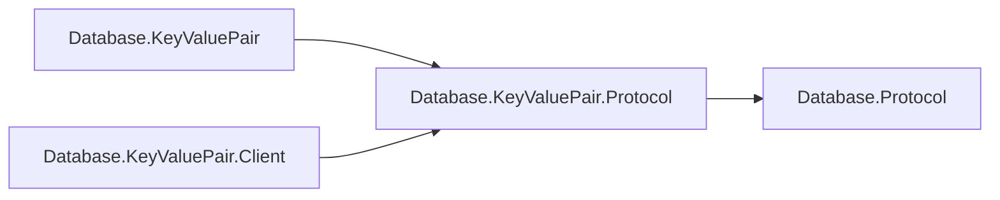

# Assimalign.Cohesion.Database.KeyValuePair.Protocol design

This independently consumable contract library owns KeyValuePair framing payloads, validation and transferred values. It references only shared Database.Protocol. The engine and client use the same CLR DTO types and family singleton; there are no duplicate DTOs or type forwarders. Model request, planner, executor, catalog, storage and server state remain engine-owned.

The arrows show references:

Wire bytes, limits, malformed-payload behavior and exception text are preserved. Span-based codecs and explicit value handling remain trimming and NativeAOT compatible; no reflection serializer or dynamic discovery is introduced. The ProtocolMessageFamily is defined exactly once in this assembly. Existing codec tests live in this project's tests; engine/server/client integration tests retain their existing owners.

## KeyValuePair diagnostic conventions (#1470)

Exception and diagnostic templates use the project's build-generated `ErrorMessages` resources.
Parameterized templates format with the current culture; abort/cancellation templates used in
normal cleanup are cached. The [Database error-code registry](../../Assimalign.Cohesion.Database/docs/ERROR-CODES.md)
assigns this family its two-letter prefix and categorized five-digit identities.
Existing SQLSTATE meanings, numeric wire error kinds, frame layouts and disk formats are preserved.
Structured diagnostics keep their code outside the message. Compiler diagnostic identifiers and
standard .NET argument guards retain their own contracts.

## Shared scalar function identifier

`KeyValueFunctionName` is a generated readonly value object with implicit string conversion,
ordinal-ignore-case equality and ASCII identifier validation (letter/underscore first, then
letters/digits/underscores). Default is refused by engine and client function boundaries.
It adds one public top-level type (with its generated nested JSON converter) without adding frames, capabilities, protocol versions or references.
The engine owns function metadata/resolution and the client owns CALL construction; both use
this shared name grammar. No function implementation or catalog enters this contract package.
