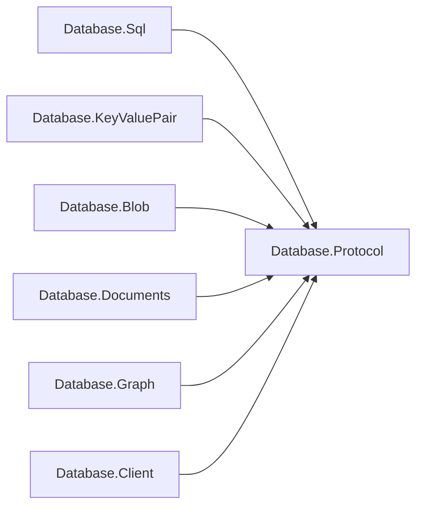
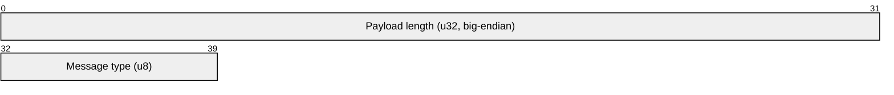
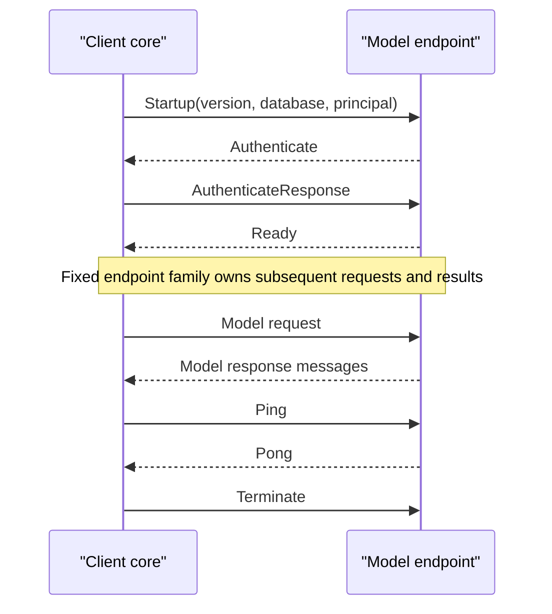
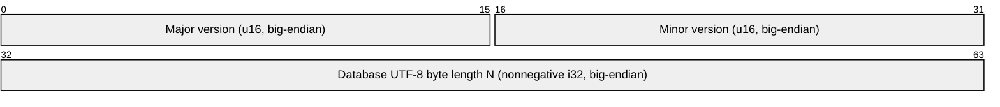

# Database.Protocol design

## Mechanism and model policy

This child root owns the frame envelope, shared payload primitives, startup and
authentication exchange, session lifecycle, error taxonomy, and version negotiation.
It has no model dependencies. As with Database.Language's TokenLexer,
QueryLanguageProfile and QueryParser, and Database.Types' Diagnostic, mechanism is shared while each model supplies
its own grammar: here that grammar is its message family and payload codecs.

The dependencies point from model policy toward the shared mechanism.

Each model package owns its message identifiers, encode/decode routines, and exchange
ordering. Each model's Client package owns result materialization. Database.Client
owns pooling, handshake, framed exchanges, and connection health. Each model server
continues to own its accept loop and session state machine.

## Envelope and primitives

Every frame begins with a five-byte header. Header bytes 0–3 (bits 0–31) are the
unsigned 32-bit payload length in big-endian order, and byte 4 (bits 32–39) is the
unsigned 8-bit message type. The payload starts at byte 5, and the declared length
counts only those payload bytes, not the header. Payloads are limited to 16,777,216
bytes. Readers check the length before allocation, require the entire declared
payload, distinguish clean EOF between frames from truncation, and reject oversized
declarations. Every writer applies the same bound before it writes anything (below). Framing imposes no logical-object
buffering or transfer policy. The packet view below shows the two fixed header fields.

`ProtocolPayload` provides signed i32/i64, unsigned u16, and strings encoded as
`i32 UTF8-byte-length + UTF8 bytes`. Invalid UTF-8 (including truncated sequences, overlong
encodings and surrogate code points), negative lengths and out-of-bounds reads fail
with ProtocolException. Codecs are direct span operations, with no reflection,
Microsoft.Extensions dependencies, serialization discovery, or generated runtime code.

## Numbering and the family seam

The endpoint selects the model before accept. Startup has no model discriminator.
A connection serves one model and one database throughout its lifetime. A client
must choose the endpoint for the family it speaks; the protocol cannot discover a
misconfigured endpoint without the deliberately deferred handshake discriminator.

| Identifier | Owner / meaning |
| --- | --- |
| 0 | Reserved, invalid |
| 1 | Core: Startup |
| 2 | Core: Authenticate |
| 3 | Core: AuthenticateResponse |
| 4 | Core: Ready |
| 5–9 | Model family, preserving deployed identifiers |
| 10 | Core: Error |
| 11 | Core: Ping |
| 12 | Core: Pong |
| 13 | Core: Terminate |
| 14 | Core: Diagnostics, gated by `diagnostics` |
| 15–63 | Reserved for future shared mechanism |
| 64–255 | Model family |

A single contiguous model range would have renumbered deployed messages unnecessarily.
Instead, 5–9 remain endpoint-scoped legacy slots, and new families use 64–255.
Different endpoints may assign the same byte differently. There is never a union of
families or a per-message registry lookup on one session.

`ProtocolMessageFamily` copies its identifier set, rejects duplicate and reserved
identifiers, and has no mutators. `ProtocolChannel` permanently binds one family to
one stream and validates incoming and outgoing identifiers against that family and
the core. Model server sessions create the channel exactly once. Client pools select
one family when composed and reject exchanges belonging to another family. Payload
interpretation belongs exclusively to that endpoint's model codec. Unknown identifiers
are protocol violations; session code reports Error(ProtocolViolation) and closes.

`ProtocolFrameReader.Create` and `ProtocolFrameWriter.Create` return the low-level
stream reader and writer, for diagnostics, framing tests and a server's at-capacity
rejection (one Error frame written before any session or channel exists). They
deliberately do not dispatch payloads or infer model semantics. Applications use
ProtocolChannel for their endpoint's validated exchange.

## Frame reader and writer types

`ProtocolFrameReader` and `ProtocolFrameWriter` are public abstract classes, not
interfaces: the Database area is concrete-first (`.claude/rules/database-area.md`).
Each has a variant set. The stream reader and writer behind `Create` encode the
envelope; every other leaf decorates one of them:

| Leaf | Assembly | Adds |
| --- | --- | --- |
| stream reader / writer (internal) | Database.Protocol | the envelope; on the reader, the declared-length bound |
| `ProtocolChannel`'s family reader / writer (private) | Database.Protocol | the family check in both directions |
| `ClientFrameReader` / `ClientFrameWriter` (internal) | Database.Client | a closed pipe's `InvalidOperationException` becomes `IOException` |
| Blob's error reader / frame writer (private) | Database.Blob.Client | closed pipes, and on the reader Error frames, become `DatabaseClientException` |

Because leaves live in three assemblies, the constructors are `protected`. The public
members (`ReadFrameAsync`, `WriteFrameAsync`, `FlushAsync`, `DisposeAsync`) are
non-virtual and call `protected abstract` cores (`ReadFrameCoreAsync`,
`WriteFrameCoreAsync`, `FlushCoreAsync`); `DisposeAsyncCore` is a `protected virtual`
lifecycle hook whose default does nothing, so a view over a shared reader or writer
(Blob's) does not override it. The `Create` factories replace the former
`ProtocolFraming` static class, the `Aes.Create()` shape.

**The writer's payload bound is the base's (owner decision 29 of 2026-10-06).** The public,
non-virtual `WriteFrameAsync` refuses a payload longer than
`ProtocolFrameHeader.MaxPayloadLength` with a `ProtocolException` before it calls the core
(rule 4: public members own argument validation), so every writer refuses an oversized payload
the same way and before anything reaches the transport: the stream writer, the channel's family
writer, the client decorators, and any leaf another assembly adds. Until then the check sat in
the stream writer's core, the one writer that encodes the envelope, which a leaf that did not
forward to it skipped. The bound now runs before every core, so the error order is fixed: **a
frame that fails both the bound and `ProtocolChannel`'s family check reports the bound**; a frame
that fails only the family check still reports the family. The bound is thrown by the call
itself, not through the returned task, as the channel's family check is. `ProtocolFramingTests` pins both
(`WriteFrame_OversizedPayload_EveryWriterShouldRefuseBeforeItsCore`,
`Channel_OversizedPayloadOutsideTheFamily_ShouldReportTheBoundFirst`). The reader's bound stays
in the stream reader's core, where the declared length is decoded. The other public members add
no check of their own.

## Diagnostics

The child root reports through one internal event source named for its assembly,
`Assimalign.Cohesion.Database.Protocol` (`src/Internal/EventSource/ProtocolEventSource.cs`): a
Verbose frame trace under the `Frames` keyword (`0x1`), so a tool takes it alone with
`dotnet-trace collect --providers Assimalign.Cohesion.Database.Protocol:0x1:5`. A frame carries its
message type and payload length, never its payload.
The protocol writes no failure events (a frame failure is its catcher's, below); the conventions
every Database source shares are in the area's
[`DESIGN.md`](../../../../docs/resources/Database/DESIGN.md#diagnostics-one-event-source-per-assembly).

| Id | Event | Level | Keyword | Payload |
| --- | --- | --- | --- | --- |
| 1 | `FrameRead` | Verbose | `Frames` | `messageType` (the `ProtocolMessageType` name, or its number for a model identifier), `payloadLength` |
| 2 | `FrameWritten` | Verbose | `Frames` | `messageType`, `payloadLength` |

**The stream leaves write the events, from their cores.** `ProtocolStreamFrameReader` and
`ProtocolStreamFrameWriter`, the leaves `Create` returns, are the only ones that touch the
transport, so they write `FrameRead` and `FrameWritten` at the end of `ReadFrameCoreAsync` and
`WriteFrameCoreAsync`. Every other leaf in the table above decorates a stream leaf through its
public member, so writing at every layer would report one wire frame two or three times (a
client's response passes the client decorator, the channel's family reader and the stream reader);
written in the stream cores, a frame is reported once, where it crosses the transport, and the
public bases carry no tracing and no check of their own type. A frame the channel's family check
refuses on read was still read from the transport and is reported; one it refuses on write never
reaches the transport and is not reported. An application's own leaf over another transport is not
traced. `FrameRead` follows a complete frame; the clean end of the stream writes nothing, and nor
does a truncated or oversized frame, which the core refuses. `FrameWritten` follows a completed
stream write, before an explicit writer flush; the stream may already have flushed on write.

**The trace allocates nothing while nobody takes it.** The stream cores are already asynchronous
methods, so the trace adds one `IsEnabled(Verbose, Frames)` check per frame and no wrapper, task
or allocation; the public members return the core's task unchanged. Plan decision D6 keeps
ordinary writers free of process-wide per-frame counter updates: SQL writes one frame per row,
and shared atomics would contend between sessions. Exact transport counters count only batched
writers' stream write calls and explicit flush calls, including failed attempts. Pool counters
cover batched writer buffers and borrowed payloads, excluding ordinary writers' temporary arrays.
Frame failures (`ProtocolException`) are not events here: the server
session or the client that catches one reports it, with its session or connection.

`ProtocolEventSourceTests` checks the name, the strict manifest, one event per frame through a
`ProtocolChannel` (and through a transport that completes asynchronously), nothing without the
keyword, and that the reader and writer allocate no more than their stream cores while nobody
listens (zero bytes per frame in Release). The allocation tests measure every call without an
await and fail if one did not complete synchronously, so the per-thread allocation count cannot
miss work that moved to another thread.

## Terminal close contract and TCP conformance (#1087)

### Bounded batches and borrowed payloads (#1539)

`ProtocolFrameWriter.CreateBatched` copies complete frames into one pooled batch, bounded by
bytes (64 KiB by default) and frame count (32). A frame larger than the batch byte bound is
written alone; every frame retains the 16 MiB limit. There is no aggregate result cap.
`ProtocolChannel(batchWrites: true)` selects these defaults. Callers serialize writes, flushes
and disposal, flush at result and latency boundaries, and await transport writes for
backpressure. Disposal discards an unfinished batch. Buffers stay owned by the writer until
pending I/O completes and are cleared before return on success, failure and cancellation.
FrameWritten events are emitted after successful transport writes, once per enclosed frame.
A failed batch write (including cancellation before copying any bytes) or standalone oversized
write faults the batched writer. Later writes and flushes throw IOException, since the accepted
frames may have been sent partially or not at all. Disposal still returns its cleared batch
without retrying or sending any subsequent frames. A separate flush failure after a successful
batch write does not fault it: complete frames were written, so a session can still attempt
its terminal notice after soft-stop cancellation of the final handshake flush (#1087).

`ReadFrameAsync` still returns owned memory. The optional `SupportsBorrowedPayloads` capability
and `ReadBorrowedFrameAsync` scope reader-owned pooled memory to a synchronous consume callback.
The existing optional operation now accepts that callback and returns whether a frame was read;
no separate public release seam or shipped friend grant is needed. A consumer decodes or copies
retained values within the callback. The reader clears and returns the rental in finally before
the read completes, including callback failures, so backpressure and idle connections retain no
payload rental. The stream reader and channel family reader support it; unsupported decorators
explicitly refuse it. Lengths are validated before renting, and only the declared slice is exposed.
The single read flow must be joined before disposal; no lock is held across transport I/O.

The source lazily publishes `transport-write-calls`, `transport-flush-calls` and
`pooled-buffers-in-use`. Backing values are maintained without a listener. The first two count
attempted Stream operations exactly, including failures; generic streams do not expose their
internal flush policy. For DuplexPipeStream each write also flushes, so the sum is the number
of pipe flush requests. Twenty small frames plus completion fit one transport write and one
explicit flush, independent of row count. Ownership, byte/count bounds, partial frames and
backpressured cancellation have deterministic tests in ProtocolBatchTests.

Each frame's header and payload cross the Stream boundary in one WriteAsync. The stream may
flush on write (DuplexPipeStream does), so an explicit FlushAsync does not promise batching.
The writer rents contiguous payload storage and returns it only after the write completes,
including cancellation and failure, with clearArray: true because payloads include row data and
authentication evidence; empty frames use the existing header buffer. DuplexPipeStream hides its
PipeWriter, so writing directly into GetMemory would require a new transport surface or a broader
pipe-based channel API. The contained stream writer retains that extra copy.

After a terminal Error, every model completes connection Output before disposal can abort the
transport send pump. A single ShutdownDrainTimeout budget covers write, flush, completion and
peer-input drain. After output completion, a separate TerminalDrainLinger (two seconds by default)
bounds the peer-close wait; an unread pooled notice does not consume the whole outer budget.
Both timer options are positive, finite and within the runtime timer range. Hard abort or expiry aborts blocked transport I/O, which teardown joins before
releasing its registrations and connection. Soft stop allows the shutdown notice to drain.
Over-capacity rejections use the same close sequence and remain tracked until disposal ends.
This is a server-side rule over the existing Connections contract, independent of #1086.

Conformance includes the real client opening an absent database over TcpConnectionFactory and
TcpConnectionListener: at least 200 consecutive DatabaseNotFound errors for each of SQL, Graph,
Key-Value, Blob and Documents, with no Internal or ProtocolViolation substitution. SQL and
Key-Value also require 200 TCP cases each for UnsupportedVersion, AuthenticationFailed,
MaxSessions Unavailable, idle eviction and graceful-drain Unavailable. The unsupported-major
case uses the public protocol; typed clients exercise admission failures and queued notices.
Controlled transports cover blocked/cooperative writes, flush, output completion, deadline
abort, joining pending completion, and rejection cleanup for all five servers.

## Shared exchange and payloads

The shared handshake precedes every model-specific exchange, as shown here.

Startup is `u16 major + u16 minor + string database + string principal`. In its fixed
prefix, bytes 0–1 (bits 0–15) are the big-endian unsigned 16-bit major version, bytes
2–3 (bits 16–31) are the big-endian unsigned 16-bit minor version, and bytes 4–7
(bits 32–63) are the database string's nonnegative big-endian signed 32-bit UTF-8
byte length `N`. The `N` database bytes start at byte 8; the principal's nonnegative
big-endian signed 32-bit UTF-8 byte length follows at byte `8 + N`, followed by that
many principal bytes.
The packet view below shows the startup payload's fixed eight-byte prefix.

The existing trust handshake sends an empty Authenticate and AuthenticateResponse;
authenticators receive response evidence as opaque bytes. Ready is empty only for negotiated 2.0.
Ping, Pong, and Terminate have empty payloads. Error is `u16 code + string message`.
Codes are append-only: Internal=0, UnsupportedVersion=1, AuthenticationFailed=2,
NotAuthorized=3, DatabaseNotFound=4, ParseFailure=5, ExecutionFailure=6,
TransactionAborted=7, ProtocolViolation=8, Unavailable=9, ConnectionFailure=10. Statement failures can
leave a session ready; framing, handshake, or ordering violations terminate it.
`ConnectionFailure` is the one client-local code: the client core raises it when the transport
dial fails, and no server sends it (the client core reads an error frame that carries it as a
`ProtocolViolation`). It shares the taxonomy so a client exception carries one code
type, as SQLSTATE class 08 holds `08001` (`sqlclient_unable_to_establish_sqlconnection`), which
a client raises (PostgreSQL `src/backend/utils/errcodes.txt:108`; postgres_fdw raises it when it
cannot reach its remote server, `contrib/postgres_fdw/connection.c:661-666`).

## Version decision

ProtocolVersion.Current advances **2.0 -> 2.1** for #1105, the one T1 minor bump.
The earlier 1.0 -> 2.0 bump (#1126) changed Documents projections to Document frames.
TryNegotiate still refuses different majors and selects the lower minor. All five
models share startup and negotiate 2.1; only SQL and Graph adopt Diagnostics.
Documents keeps its structured model Failure frame, while Blob and Key-Value have
no Diagnostics capability. No catalog or storage format changes in this item.

## Negotiated statement diagnostics (#1105)

The shared protocol is 2.1. Startup optionally appends the client's capability names;
Ready returns the agreed version and the two-sided intersection. A negotiated 2.0
session retains empty Ready and the existing model and Error bytes. An empty Ready
from an older endpoint means 2.0 with no capabilities. Different majors are refused.
Capability names are ordinal and append-only; model names are scoped with the
lowercase endpoint family followed by a dot. The core owns `diagnostics` and frame 14.

SQL and Graph register `ProtocolCapability.Diagnostics`. When agreed, one Diagnostics
frame carries the bounded Warning/Error list immediately before Error on failure,
or immediately before ResultComplete (PathsComplete for graph paths) on success.
Information, including CS00009, is never sent. Error and result payloads are unchanged.
Statement failures leave the server session ready. Model clients validate diagnostic
ordering and preserve every code, severity, message, nullable offset and source line.

### Startup extension and Ready

The unchanged Startup prefix is `u16 major + u16 minor + string database + string principal`.
For 2.1, append `u16 capabilityCount + capabilityCount * string name`. An absent
extension is an empty list. The 2.0 decoder stops after principal, accepting a 2.1
Startup; a 2.0 client sends the original four fields. Ready in 2.1 is
`u16 major + u16 minor + u16 capabilityCount + capabilityCount * string name`.
Both lists allow at most 64 unique names of 1..128 ASCII characters from
`a-z`, `0-9`, `.` and `-`; the extension/Ready bound is 16,384 bytes. Trailing
bytes, duplicates, malformed UTF-8, unsupported versions and unsolicited agreements
are ProtocolViolation; the client discards a failed handshake's transport.

`ProtocolMessageFamily` registers immutable capability descriptors alongside model
identifiers. A model capability begins with its lowercase family name and a dot;
it can gate only that family's identifiers. `ProtocolChannel.Negotiate` selects
the intersection, and `SetAgreement` applies it exactly once. Read and write gates
reject Diagnostics, and any model capability's added frames, until agreed. A
capability may describe a payload extension with no new frame. Graph composite
values (#1146) register `graph.composite-values` here without another version bump. Existing frames
must keep their baseline encoding when the relevant capability was not agreed.

### Diagnostics payload

All numbers are big-endian. The payload is `i32 entryCount`, followed by entries:
`u8 severity + string code + string message + i32 start + i32 end + i32 line`.
Severity is Warning=1 or Error=2; other values are invalid. Both offsets are -1
for an unlocated diagnostic, otherwise 0 <= start <= end; end is exclusive and
line is one-based. Entry order is the producer's source order. The maximum is
4,096 entries and 1,048,576 encoded bytes. Counts, truncation, invalid strings,
invalid spans/lines, trailing bytes and size violations throw ProtocolException,
translated by the endpoint/client to ProtocolViolation. Outbound overflow follows the explicit prefix-and-notice policy below.

Outbound SQL and Graph diagnostics are preflighted before any result or Error output.
If the filtered Warning/Error list exceeds 4,096 entries or 1,048,576 encoded bytes,
the endpoint retains the longest leading prefix that fits both limits with a final
Warning notice, code CK07001. The notice counts toward both limits and states the
retained count, original filtered count and omitted count. Once an entry does not fit,
it and every following entry are omitted, even if a later entry would fit. Entries
are never shortened. A 4,097-entry list of small diagnostics therefore keeps the first
4,095 and the notice; a first entry larger than the byte limit leaves only the notice.
The original failure still sends exactly one Error with its original error category
and message. Success still sends its result and normal completion with the bounded
warning list. Overflow alone never terminates the session or changes transaction state.
Malformed incoming diagnostic frames remain fatal protocol violations.

Null diagnostic codes and messages encode as zero-length strings; zero-length strings
decode as null. An empty diagnostic code is never a valid code. Unlocated offsets
remain null. Ready.Capabilities and Diagnostics.Entries reject null at construction
and through init/with assignment. Capability-name byte lengths are checked against
the 128-character ASCII bound before decoding or allocating a name string.

Protocol owns ProtocolDiagnostic and ProtocolDiagnosticSeverity with no Language
or Types reference. Servers translate their carrier; the shared client maps the
wire values into the existing DatabaseException.Diagnostics collection. Success
result objects expose the ProtocolDiagnostic values directly. Codecs use checked
span reads and static encoding, with no reflection or runtime discovery.

## Extending a model

Define a model-owned identifier enum, a single immutable family, codecs, and its
ordering rules. Bind that family at endpoint accept and client pool composition.
Use shared ProtocolPayload primitives where appropriate, and document the exact
wire payload in the owning model package. Add transport-independent conformance
coverage through Connections.InMemory and terminal-close coverage through loopback TCP.
Models do not add payload policy to this core.

ProtocolException is this child root's independent exception type. Servers translate
it to the shared wire taxonomy; the client core translates it to DatabaseClientException.
Transports remain outside this package and outside engine packages.

All model endpoints reject invalid shared payload strings; no model intentionally relies on
replacement decoding in ProtocolPayload.
SQL, Graph, KeyValuePair and Documents use it for model statement text and protocol identifiers.
Blob already uses a strict bounded metadata reader and uses this reader in its shared handshake.
Decoder failures become ProtocolException and the server sends fatal ProtocolViolation, then closes.

## Execute transaction status (#1540, D5)

SQL and Graph advertise the shared `transaction-status` capability in protocol 2.1. Startup Ready
keeps its version/capability payload. When negotiated, each Execute (also Graph ExecutePaths)
ends with an existing Ready frame (byte 4) after ResultComplete/PathsComplete or a statement Error.
Its payload is exactly one ASCII byte: `I` idle, `T` explicit transaction active, `E` explicit
transaction failed. No new message identifier, protocol version or on-disk format is introduced.
Unnegotiated peers retain their original bytes. Ping/Pong and terminal connection errors have no
postamble. Malformed status payloads use CK07002 and are protocol violations.

The capability also defines parameterless reset: Execute byte 5 carries the usual length-prefixed
UTF-8 `ROLLBACK` followed by a zero Int32 parameter count. Success is ResultComplete byte 8 with
an Int64 affected count of zero, then Ready `I`. An error or any other completion/status discards
the connector. Clients never determine transaction state by recognizing user command text.

PostgreSQL reports the same idle/active/failed distinction after a command cycle in
`src/backend/tcop/dest.c:268-281` and `src/backend/access/transam/xact.c:5058-5090` (local PostgreSQL
clone). This copies the state contract only; no source code is copied.

## Error and construction conventions (#1470)

Exception messages and format templates are generated from `src/Properties/ErrorMessages.resx`;
format arguments use the current culture. Cancellation and abort templates used during normal
cleanup are cached before reuse. Error identities remain separate from message text where a
structured diagnostic carrier exists. Standard .NET guards retain their argument names and exception types.

## Debugger inspection convention

Protocol debugger views filter private framing/session machinery and project only reviewed public/protected names, versions, capability flags, already-materialized collections and relationships. They do not perform stream I/O, decode payloads, negotiate capabilities or materialize a new collection. Error/Exception subclasses and EventSource types remain excluded.

Concrete eligible types carry their own concise display and private nested DebugView at the end of the type; an effective inherited display/proxy pair is reused. Projections are public read-only members of that private view and never reveal private/internal data. Empty views use the constant type name. Debugger attributes and nested infrastructure add no public API, instance fields to existing runtime types, storage/wire format change or successful-path work.
