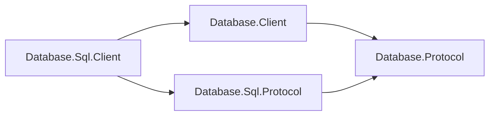

# Database.Sql.Client — Design

## Terminal TCP conformance (#1087)

The real SqlClient and model server run missing-database handshakes on InMemory and
loopback TCP for at least one second and 200 consecutive coded refusals per transport. The
tests assert DatabaseNotFound and ConnectionFailure kind and reuse a one-slot pool to expose leaked failed rentals.
TCP also covers 200 authentication and capacity refusals through the typed client, 200
unsupported-major handshakes through the public protocol (production clients send Current),
and 200 idle and graceful-stop notices surfaced by the next concrete-client operation.

## Contract-only dependencies

Direct references are Database.Client, Sql.Protocol, Database.Types, Database.Protocol and Connections. Wire contracts live in each model Protocol assembly, shared by client and engine. This client has no engine, area-root, storage, transaction, indexing, model parser or schema reference. Cache.Client remains an empty placeholder. Engine-free trimming and NativeAOT coverage lives in Database.Client/samples/Assimalign.Cohesion.Database.Client.AotSample.

## Client exception ownership

`SqlClientException` derives directly from `System.Exception`. It preserves constructors, wire codes, inner exception and connection-usability behavior. Its locally declared Diagnostics is never null: explicit diagnostics are defensively copied into a read-only snapshot, stably ordered by offset with unlocated entries last. SQL and Graph wrappers copy from DatabaseClientException or their own nested client exception. Documents retains its explicit diagnostics parameter and returns an empty collection when none was supplied. Engine-side DatabaseException remains in the area root; catching it intentionally no longer catches remote client failures.

CREATE/DROP SCHEMA (#1030) travel through the existing execute exchange. Wire coverage pins
cross-connection namespace visibility, RESTRICT failure, CASCADE's retained external table,
and stable missing/reserved/protected namespace and unsupported-syntax diagnostics. Errors
leave connections usable; no client API or payload format changes.

ALTER TABLE rename/default/nullability actions (#1122) use the existing execute exchange.
Wire tests pin renamed query results, signed defaults on omitted inserts, and failed NOT NULL
validation as ExecutionFailure with a reusable connection. No client API or payload changes.

Non-recursive WITH queries and INSERT/UPDATE/DELETE (#1116) travel through the
existing SQL execute exchange. Wire tests pin results, exact affected counts and
recursive/modifying-body ParseFailure diagnostics, preserving connection reuse
and stored rows after rejection. No client API or wire payload changes.

Blank derived output names fail planning with COHSQLE013 and arrive as an
ExecutionFailure with ConnectionUsable true. The connection and an explicit
transaction remain usable; the wire regression verifies pending writes and rollback.

Boolean predicate errors (#1190) retain ExecutionFailure, COHSQLE003 diagnostics and
connection reuse over InMemory and TCP. Coverage includes every clause, supplied string
parameters and explicit transactions; failed writes preserve rows. No protocol changes.

## Constraint diagnostics (#1666)

SqlConnection preserves the existing ExecutionFailure category and exposes the single
constraint diagnostic through SqlClientException.Diagnostics: COHSQLE037 (23505) for
uniqueness, COHSQLE038 (23514) for CHECK/domain checks, COHSQLE039 (23503) for foreign
keys; NOT NULL stays COHSQLE024 (23502). Read Diagnostics[0].Code for the engine code;
SqlClientException.Code remains the protocol error category. Negotiated diagnostics retain
the statement span and message. Without diagnostics negotiation, the composed message
still starts with the engine code. The connection and explicit transaction remain usable.
Both-transport tests assert rollback of earlier rows in multi-row INSERT, INSERT SELECT and
upsert failures. There is no API or wire-format change.

## UPDATE final foreign-key state (#1667)

Both transports pin dangling-reference rejection without writes, moving self-references,
and consistent mutually referenced key swaps, with NO ACTION and RESTRICT under Snapshot
and ReadCommitted. Tests begin through the existing server-session API to choose isolation;
the UPDATE, error, result and COMMIT exchanges all use the wire. No protocol changes.

## INSERT ... ON CONFLICT (#1118)

Existing execute/query exchanges carry inserted-plus-updated affected counts and RETURNING
rows. DO NOTHING-skipped proposals return no row. Wire tests cover InMemory and TCP,
untargeted inserts without unique indexes, and reusable connections after arbiter,
repeated-row and constraint failures (ExecutionFailure) or excluded spellings (COHDBL001
ParseFailure). There is no client API, payload or protocol change.

## Derived relations and DML predicate subqueries (#1113, part b)

The existing query and command exchanges carry derived-table results and
UPDATE/DELETE predicate-subquery affected counts. Server materialization preserves
the existing column metadata and error taxonomy; no wire format changes. The
subquery wire corpus covers a renamed derived join and both DML statement kinds.

FROM-less SELECT (#1373) uses the existing query exchange, including scalar/IN/EXISTS
children and aggregate results. Both transports verify the implicit row and empty filters.
No client API or wire payload changes.

## Correlated children (#1113, part a)

Existing exchanges carry per-outer-row EXISTS, IN and scalar results and correlated
DML affected counts without a protocol change. A later outer row's scalar cardinality
failure arrives as ExecutionFailure with ConnectionUsable true; the next query on
the same connection succeeds. NativeAOT checks exercise correlation in process and
through the client.

## Parameter contract (#1102)

SqlParameterCollection strips one leading sigil and keeps ordinal case-sensitive bare
names; `$name`, `@name` and numeric names such as `$1` follow the
[shared parameter contract](../../Assimalign.Cohesion.Database.Language/docs/DESIGN.md#parameter-contract-1102).
Add and the indexer continue to replace a previously normalized name. A raw request
map containing two keys for one bare name is rejected by the server with COHSQLE023.
An unbound reference fails with COHSQLE020 before rows are accessed; wire execution
failures keep the connection usable, including on empty tables. No protocol changes.

## Character metadata (#1437)

SQL result-header format 2 carries name, DatabaseType and nullable MaxLength. Both SqlColumn and
DatabaseClientColumn retain the length. A CHAR(n) column reports Character (19) with n; its row
value remains the padded CLR string, so GetString/GetValue and parameter round trips preserve
padding. The header's Int32 -2 discriminator refuses older payloads. Rebuild client and server
together; the shared handshake and row tuple encoding are unchanged.

The SQL client owns parameter encoding, response decoding and materialization,
typed commands/results, and error/telemetry mapping. It delegates dialing,
startup/authentication, framing, and pooling to the shared client.

Expression defaults and referential SET actions (#1121) use existing result frames.
Client coverage verifies arithmetic ADD COLUMN backfill, SET NULL visibility on a second
connection, and CURRENT_TIMESTAMP assigned to TIMESTAMP with DateTime metadata and value.
Cancellation coverage distinguishes volatile defaults evaluated during writes from immutable
defaults evaluated during DDL; both use the current operation token, and failed immutable
declarations publish no table.

## Family position

The SQL client references shared mechanics and its model's codecs:

| Package | Role |
| --- | --- |
| Database.Sql.Client | SQL materialization and typed APIs |
| Database.Client | Pooling, handshake, framed exchange lifetime |
| Database.Sql.Protocol | SQL identifiers and payload codecs |
| Database.Protocol | Shared framing and immutable family binding |

Other model clients do not depend on this package.

## Set operations (#1114)

Set roots and query operands use the existing execute exchange with common-typed column
names and values. InMemory and TCP cases exercise UNION ALL, INTERSECT and EXCEPT ALL,
combined OFFSET/FETCH, IN bodies and reusable coded parse/planning failures. Result metadata
still carries no nullability field. No client API or wire format changes.

## Explicit NULL placement (#1112)

The existing execute exchange carries results ordered with per-key NULLS FIRST/LAST,
including outer ordering over derived outputs. Wire tests assert all four direction and
placement combinations; GROUP BY ordinals keep COHDBL001 with a reusable connection.
No protocol or client API change is needed.

## Pagination (#1107)

OFFSET/FETCH, OFFSET before LIMIT and TOP use the existing SQL execute exchange and
result metadata. SqlPagingWireTests verifies exact windows and column names/types over
InMemory and TCP, plus coded parse/count refusals and subsequent connection reuse.
INSERT, UPDATE and DELETE TOP retain COHDBL001 naming DML TOP; bare FETCH arithmetic
receives SQL0003, matching the language grammar.
No wire or client API changes.

## Expanded joins (#1109)

LEFT null values, N-way, CROSS, comma and USING results use the existing SQL frames and
production materializer. No nullability field or frame-writing change is introduced.
Wire tests run every join case over InMemory and loopback TCP, pin exact values and
multiplicities, and retain RIGHT/FULL/NATURAL and qualified-wildcard exclusions. USING
wildcard alias/ordinal ordering, decimal common-type values in both input orders, qualified
types and cleared character lengths use the same production frames and materializer.

## System relation joins (#1106)

Stored/system, system/system and grouped catalog joins use the existing SQL exchange.
Wire tests pin exact rows and String/Int64 metadata; there is no protocol format change.

## Identity values (#1123)

Identity DDL, omitted-column INSERT and typed generated results use the existing execute
exchange and integer codec. ALWAYS violations carry COHSQLE025 as ExecutionFailure and leave
the connection usable. No client API or protocol shape changes.

## T1 scalar and clock wire behavior (#1120)

The 42 scalar names and temporal arithmetic use existing SQL value and metadata
frames. Wire tests cover every family, UTC transaction clock equality and a coded
SQRT domain failure followed by successful reuse of the same connection. No wire
format or client API changes.

## SQL-owned exchange

`SqlClient.Create` binds the pool to `SqlProtocol.Family`.
`SqlExecuteExchange` derives from `DatabaseProtocolExchange<DatabaseClientResult>`:
it encodes parameters with `DatabaseValueCodec`, writes the execute request,
consumes SQL's header/data/completion exchange, and materializes values.
`SqlConnection` projects this result into `SqlResultSet`.

`SqlProtocolConnectionExtensions`, an `extension(DatabaseConnection)` block, provides
the same operation as `ExecuteAsync` on a rented `DatabaseConnection` bound to SQL's
exact family instance. It stays an extension because the connection lives in
Database.Client, which references no model package.
`DatabaseClientResult` and `DatabaseClientColumn` moved to this package's
namespace. Typed SQL APIs and protocol 2.0 wire behavior are unchanged.

`Database.Sql.Protocol` supplies codecs without parsing SQL or inspecting plans.
Both engine and client consume that contract assembly independently; the client's
dependency closure contains no SQL engine, catalog or storage implementation. The model's
[design](../../Assimalign.Cohesion.Database.Sql/docs/DESIGN.md) defines wire ownership.

## Typed literal wire values (#1110)

DATE, TIME, TIMESTAMP, TIMESTAMPTZ, day-time INTERVAL and X binary literals use the existing
DateOnly, TimeOnly, DateTime, DateTimeOffset, TimeSpan and byte[] tuple encodings and DatabaseType
metadata. N strings remain String. No protocol format changes. SQL0008 content errors and
COHDBL001 year-month exclusions arrive as ParseFailure and leave the connection usable.
TIMESTAMP assignment returns Kind Unspecified; TIMESTAMPTZ preserves its offset, following the
[dialect normalization rule](../../Assimalign.Cohesion.Database.Sql.Language/docs/DIALECT.md#timestamp-normalization-1110).

## Explicit casts (#1119)

The expanded built-in CAST matrix uses the existing scalar type tags and result metadata.
Wire tests cover float, temporal, interval, UUID, BYTEA, JSON and JSONB values, canonical text,
conversion refusals and connection reuse after a floating arithmetic overflow. JSONB remains
validated UTF-8 bytes with byte equality; there is no new wire encoding.

## RETURNING and affected counts (#1117)

ExecuteAsync receives and buffers RETURNING rows before discarding them and returning
the affected count, so it has the same row-transfer and buffering cost as QueryAsync.

SqlResultSet preserves ResultComplete's long AffectedCount: -1 for SELECT, n for a
write including RETURNING. QueryAsync is the rows-plus-count verb, ExecuteAsync returns
the count and discards rows, and ExecuteScalarAsync reads the first returned cell.
Observers see both row and affected counts. The existing exchange already materializes
both values; no new verb or frame is needed. Server-side projection errors precede any
result header and leave the connection usable. Results survive a later ROLLBACK.

## Typed projection

Column names map to ordinals once, shared by every result record. First column
wins duplicate names; ordinal access reaches every value. Exact runtime types are
returned directly; widening getters use `Convert.ChangeType` and invariant
culture, without reflection. Incompatible access produces `InvalidCast`.

Parameter collection names strip a leading `@` or `$`; bare names travel on the
wire. SQL parsing remains the server's responsibility.

## Lifecycle, errors, and telemetry

The typed connection captures its immutable database name when it receives the shared lease
(#1313). Operation diagnostics can finish after disposal returns that lease, whose members then
refuse access. The cached name keeps diagnostics independent of the returned rental.

Disposing a typed connection returns its shared authenticated session; disposing
the client closes its pool. Connections support one exchange at a time.

`SqlConnection.AbortAsync` discards a rental and closes its session instead of
returning it to the pool. Use it when SQL session state cannot be reset, including
a failed ROLLBACK or uncertain COMMIT. It delegates to the shared client's discard
operation and is not cancellable. Discarding prevents session leakage; it cannot
undo an already published transaction.

SQL transactions currently use ordinary `BEGIN`, `COMMIT` and `ROLLBACK` commands
on one connection. The wire protocol does not expose a durable transaction token,
status lookup or replay deduplication. A connection loss after the server publishes
COMMIT but before the response reaches the client has an unknown outcome. Client
exceptions do not promise that a failed COMMIT left no writes. The SQL mapper
documents and enforces this boundary by faulting its scope/store and refusing replay;
see its [reconciliation contract](../../Assimalign.Cohesion.Database.Sql.Mapping/docs/DESIGN.md#commit-outcome-and-reconciliation).

**Known gap (#1540):** end or roll back an explicit transaction before disposing a connection.
The pool currently preserves unfinished transaction state, which the next renter can inherit.
Server-reported transaction status and rollback on pool return belong to #1540 (and P8 #1264).
The skipped `DisposeAsync_WithExplicitTransaction_ShouldRollbackBeforeNextRental` regression
records that required behavior. A disposed core lease rejects SQL extension calls permanently,
even when its authenticated session is rented again.

In-process sessions carry engine codes in `DatabaseException.Diagnostics` (#1103).
The SQL server preserves the existing `CODE: message` Error text. On a negotiated 2.1 diagnostics session, client exceptions also retain the complete structured carrier. Cancellation tests that execute sessions directly
assert structured codes, while their wire counterparts keep their original text assertions.
CAST value failures follow the same contract: invalid text carries COHSQLE022 (PostgreSQL
22P02), numeric overflow COHSQLE002 (22003), and division by zero COHSQLE001 (22012).
Protocol 2.0 clients retain the composed code prefix and ExecutionFailure category; a value
failure keeps the connection usable. In-process regression tests assert code and source span.

Negative and fractional LIMIT/OFFSET counts retain COHSQLE018 in the composed wire text.
The Int64 row-window tests (#1100) assert that prefix alongside ExecutionFailure and connection
reuse, aligning their expected text with the carrier convention added by #1103.

NOT NULL failures retain COHSQLE024 (SQLSTATE 23502) in the composed wire message,
with the unchanged column-specific missing-default or explicit-NULL detail. DEFAULT
VALUES, DEFAULT items and UPDATE DEFAULT use that same contract. SqlInsertValuesWireTests
covers success, syntax rejection and constraint rejection over InMemory and loopback TCP,
then queries and writes on the same connection to verify it remains usable.

`SqlClientException : Exception` maps stable wire codes to SQL error kinds
and retains the original code. The shared pool invalidates incomplete exchanges,
including cancellation and decoder failure. Completed parse/execution failures
keep the connection reusable.

Application function cancellation follows the statement token (#1419): an
`OperationCanceledException` from a scalar, any aggregate phase or a domain CHECK is
`COHSQLE007`, naming the function, unless the server statement's own token is canceled.
This includes application calls inside SQL functions and SQL domains, and plan-time calls in
LIMIT/OFFSET, seek bounds and constant folding. The coded error is
an `ExecutionFailure` with `ConnectionUsable = true`; the next command uses the same
connection. Actual server cancellation retains the existing session teardown behavior.
An explicit transaction also stays active: BEGIN, an earlier write, a coded function failure,
a later write and COMMIT retain both successful writes and none from the failed statement.
The DEFAULT cancellation fixture uses a separately named Immutable faulting scalar,
retaining default-evaluation cancellation/token and connection-reuse coverage.
Column DEFAULT expressions also admit Stable/Volatile functions since #1121.
The cancellation wire theories cover that sequence and verify its committed state from a second
connection, as well as checking the token on every planning and execution callback.

A failed dial reaches `ConnectAsync` as the core's `DatabaseClientException` with
`ProtocolErrorCode.ConnectionFailure` (owner decision 39; the core's `DESIGN.md`,
"Lifecycle and errors"). The mapper translates it like a handshake rejection, to
`SqlClientErrorKind.ConnectionFailure` with `ConnectionUsable` false, and the core
exception, which keeps the transport's exception, is the inner exception. A canceled
dial throws `OperationCanceledException` unchanged (`SqlClientDialFailureTests`).

Observers receive synchronous primitive callbacks before execution, on completion,
and on failure. Observer exceptions are swallowed so telemetry cannot change the
command outcome. An observer derives from the abstract `SqlClientObserver`, whose
three hooks are `protected internal virtual` with empty bodies: an observer overrides
only the hooks it records, and only the owning `SqlConnection` fires them.

## Diagnostics

The client reports through one internal event source named for its assembly,
`Assimalign.Cohesion.Database.Sql.Client` (`src/Internal/EventSource/SqlClientEventSource.cs`),
written by `SqlConnection`'s one command path. Start and stop carry the `Commands` keyword (`0x1`).
The Key-Value client's source has the same ids, names and payloads, so one query reads both.

| Id | Event | Level | Keyword | Payload |
| --- | --- | --- | --- | --- |
| 1 | `CommandStart` | Verbose | `Commands` | `database`, `parameterCount` |
| 2 | `CommandStop` | Verbose | `Commands` | `database`, `status` (`Success`, `Error` or `Cancelled`), `rowCount`, `affectedCount` (both -1 unless `Success`), `durationMilliseconds` |
| 3 | `CommandFailed` | Error | — | `database`, `errorKind` (`SqlClientErrorKind`; empty for an uncoded failure), `code` (the wire code; empty for an uncoded failure), `exceptionType`, `durationMilliseconds` |
| 4 | `ObserverFailed` | Warning | — | `database`, `callback` (`OnExecuting`, `OnExecuted` or `OnFailed`), `exceptionType`, `exceptionMessage` |

**Every start has a stop** (the area's convention, `docs/resources/Database/DESIGN.md`,
"Diagnostics"): the command writes its end from a `finally`, before its observer hears of it. A
failure writes event 3 and then `CommandStop` with `Error`: a coded failure the server or the
connection raised (`SqlClientException`, with its kind and code) or an uncoded one (an overlapping
exchange, a disposed connection: kind and code empty). A cancellation, which is how a timeout
surfaces, writes `CommandStop` with `Cancelled` and no failure. The failure is captured by an
exception filter that declines it and written from the `finally`, so it reaches the caller unchanged.
A command fails with an Error whatever its cause, a statement the server rejects included (owner
question Q1 of the event-source plan). As `System.Net.Http`'s `RequestStop`, `CommandStop` is
written only for a command whose `CommandStart` was written, so a listener that attaches mid-command
sees no stop without its start; event 3 is written either way.

**The failure rule.** The statement text and the parameter values are never written (Q3), and nor is
the server's message: a parse error's quotes a fragment of the statement, a literal included
(`Malformed numeric literal '…'`), so event 3 writes the error kind, the wire code and the
exception's type only (the area's failure rule). Event 4 makes visible an observer failure the
client swallows; the command's outcome is unchanged, and the hook's own exception keeps its message.
The connection itself is the shared core's (`Assimalign.Cohesion.Database.Client`). No counters: a
process-wide count updated per command would be a contention point. The command path already takes
the timestamp its observer receives, so the events add only `IsEnabled` checks while nobody listens.

`SqlClientEventSourceTests` checks the name, the strict manifest, a succeeding and a failing command
under an observer whose every hook throws (each event once, in order, with its payload, the failure's
stop after it, no statement text and no server message), a cancelled command (a `Cancelled` stop and
no failure), that start and stop need the `Commands` keyword, and, by direct writes, an uncoded
failure (empty kind and code) and a stop written only after a written start. The test assembly's
observers override the hooks as `protected internal`, which the project's test-only
`InternalsVisibleTo` requires (CS0507); an application overrides them as `protected`.

## AOT and non-goals

Encoding and materialization are hand-written, with no reflection or code
generation. Transports are typed options, never string-named plugins. Full result
materialization is SQL client policy; an incremental API can be added here
independently. Parsing, ORM behavior, retries, and explicit wire transactions
remain outside the current surface.

## Concrete types (concrete-types plan, phase 5, #1261)

The package has no public interface left and no `Abstractions/` folder
([plan](../../../../docs/programs/DATABASE_CONCRETE_TYPES_PLAN.md) §7, "P5, as landed").

| Type | Shape | Was |
|---|---|---|
| `SqlClient` | sealed; `Create(SqlClientOptions)` over a private constructor | the static `SqlClient` factory, `ISqlClient` and the internal `DefaultSqlClient` |
| `SqlConnection` | sealed; internal constructor; moved out of `Internal/` | `ISqlConnection` and the internal `SqlConnection` |
| `SqlClientObserver` | abstract; protected constructor; `protected internal virtual` hooks with empty bodies | `ISqlClientObserver` |
| `SqlProtocolConnectionExtensions` | `extension(DatabaseConnection)` block | an old-style `this IDatabaseConnection` extension |

- **Why the observer is abstract.** It is an inverted seam (`database-area.md`, rule 2): the
  application supplies it through `SqlClientOptions.Observer` and the connection fires it; no
  observer ships. Its constructor is protected because applications derive from it (rule 3),
  and it carries the deviation marker. Because the hooks have empty bodies, an observer overrides
  only what it records; one that implemented the interface had to implement all three.
  `SqlClientTests.QueryAsync_WithPartialThrowingObserver_ShouldKeepEachCommandOutcome` covers a
  one-hook observer that throws.
- **Typed surface.** `ConnectAsync` returns the sealed `SqlConnection`, which wraps the core's
  sealed `DatabaseConnection`; nothing casts. `Settings` reads the core's settings.
- **What changed for a caller.** `ISqlClient` and `ISqlConnection` become `SqlClient` and
  `SqlConnection` (the Sdk.ApplicationModel `EnabledWeb` fixture and Studio's SQL workspace were
  retyped), and an observer overrides `protected` hooks instead of implementing public ones.
  An observer cannot forward to another observer instance: outside this assembly the hooks are
  protected (CS1540), so an application that needs several sinks fans out inside one subclass
  (plan §7, "P5, as landed", owner review 38).
  The sealed `SqlConnection` shares its name with `Microsoft.Data.SqlClient.SqlConnection`; a
  file that imports both namespaces aliases one (plan §11, R11).
- **Disposal is final for the instance.** The pool now reuses an internal connector behind a new core lease on
  every rent (#1313); `SqlConnection` keeps its own disposed flag, as `GraphConnection` and
  `BlobConnection` do: after `DisposeAsync` or `AbortAsync` every command throws
  `ObjectDisposedException` before the observer runs, and a second dispose or an abort does
  nothing. Before the P5 review a stale `SqlConnection` ran its commands on whichever caller had
  rented the session next, and a second dispose returned that caller's rental
  (`SqlClientTests.QueryAsync_AfterDisposeAndReRent_ShouldThrowObjectDisposedException`).

## Aggregate modifiers (#1115)

COUNT/SUM DISTINCT and ordered STRING_AGG use the existing statement/result framing.
The live wire corpus verifies values, nullable String metadata and independent aggregate
slots; excluded grouping/window forms continue to report usable-connection COHDBL001.
There is no client ABI or protocol change.

## E4 SQL definitions

Typed-literal wire theories run over both InMemory and loopback TCP. Temporal, interval,
binary and national-string values retain the same runtime types and metadata. Malformed
literals (SQL0008), year-month forms (COHDBL001) and interval overflow retain their parse
diagnostics and permit a subsequent query on the same connection.

Function/domain DDL and calls use the existing statement transport and server environment without
client ABI or wire-format changes. Dependency/admission refusals retain leading COHSQLD codes in
execution-failure messages and leave connections usable. SqlDomainWireTests exercises SQL-defined
functions in SELECT, WHERE, CHECK and DEFAULT alongside SQL domain enforcement.

## Duplex transport composition

`ConnectionFactory` accepts `IDuplexConnectionFactory`. The shared client reads and writes
framed bytes through the returned `IDuplexConnection`; the common `IConnection` root carries
identity, features and lifecycle only. TCP, InMemory and TLS-layered duplex factories satisfy
this contract. The pool owns each established connection and disposes it when discarded or
when the pool closes; transport disposal has signaled `ConnectionClosed` before it completes.

### Breaking changes from 10.0.0-preview.1 (#1459)

`SqlClientOptions.ConnectionFactory` changes from `IConnectionFactory?` to
`IDuplexConnectionFactory?`. Changing the property's getter and setter signatures breaks
preview.1 binaries and source that supplies a factory typed only as `IConnectionFactory`.
This preview break is accepted under owner decisions 15 and 58. Rebuild consumers and use
`IDuplexConnectionFactory` for factory variables and custom implementations. Custom factories
can derive from `DuplexConnectionFactory`, implement `ConnectCoreAsync` returning
`ValueTask<IDuplexConnection>`, and produce a `DuplexConnection` implementation. Built-in TCP,
InMemory and TLS-layered duplex factories already satisfy the new contract. Database wire
framing, handshake and model messages are unchanged.

## Declaration modifier failures (#1438)

The server parses every SQL declaration and CAST against the shared modifier ranges before any
catalog mutation. SQL0005 and the column/domain/function parameter or return-type name travel in
the existing ParseFailure message; SqlClientException reports ParseFailure with ConnectionUsable
true. No client ABI or wire format changes. Typed schema and declared-script validation happen at
host declaration/Build, before a server starts; these host APIs have no remote declaration verb.

Recognized but unsupported temporal precision uses COHDBL001 in the same ParseFailure exchange,
including CAST, naming the declaration and modifier. FLOAT(p) returns the resolved Float32
(1..24 bits) or Float64 (25..53 bits) in catalog queries and result headers; bare FLOAT stays
Float64. Invalid FLOAT precision remains SQL0005. INTERVAL field/range qualifiers, including
SECOND(p), likewise report COHDBL001 at every declaration site and CAST, naming the complete
qualifier; no-precision forms are also unsupported. Neither path changes the wire format.

## Negotiated statement diagnostics (#1105)

The shared protocol is 2.1. Startup optionally appends the client's capability names;
Ready returns the agreed version and the two-sided intersection. A negotiated 2.0
session retains empty Ready and the existing model and Error bytes. An empty Ready
from an older endpoint means 2.0 with no capabilities. Different majors are refused.
Capability names are ordinal and append-only; model names are scoped with the
lowercase endpoint family followed by a dot. The core owns `diagnostics` and frame 14.

SQL and Graph register `ProtocolCapability.Diagnostics`. When agreed, one Diagnostics
frame carries the complete Warning/Error list immediately before Error on failure,
or immediately before ResultComplete (PathsComplete for graph paths) on success.
Information, including SQL0100, is never sent. Error and result payloads are unchanged.
Statement failures leave the server session ready. Model clients validate diagnostic
ordering and preserve every code, severity, message, nullable offset and source line.

DatabaseClientResult.Diagnostics and SqlResultSet.Diagnostics expose negotiated ProtocolDiagnostic values. SqlClientException retains the shared core exception and copies its existing diagnostics carrier.

Set-operation type mismatches reuse COHSQLE003 (42804), retaining the one-based output
position and both types. INSERT set-source width/type errors use the same exchange and
leave the connection usable.

## Read-only persisted views (#1124)

View DDL, SELECT/JOIN sources and INFORMATION_SCHEMA.VIEWS use ordinary SQL
requests and typed result sets. A table-only write against a view is ExecutionFailure;
the connection stays usable. The wire format and client API are unchanged.

## Distinct, truth tests and LIKE ESCAPE (#1111)

Existing SQL frames carry predicate truth tables and bound ESCAPE parameters on both
transports. Invalid escape sequences (COHSQLE034) and non-Boolean truth tests
(COHSQLE003) are ExecutionFailure responses; data and the connection remain usable.
A volatile application function that raises a stack refusal deterministically pins
execution-time COHSQLE004 over the wire, including a reusable connection.
Invariant LIKE work exhaustion uses the existing located ExecutionFailure diagnostic
COHSQLE040 and leaves the connection reusable (#1166). The real session lifetime token
reaches row-time LIKE without an application function; disconnect cancellation closes
the session on both InMemory and TCP. Its regression holds a hook inside Match,
asserts entry, waits for the server lifetime token after disconnect, then releases
matching. Reverting LIKE token routing must produce StatementStop Error instead of
Cancelled. The test uses AOT-compatible UnsafeAccessor seams without a public API
or friend-assembly grant. No client API or protocol format changes are needed.
