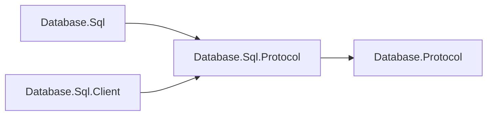

# Assimalign.Cohesion.Database.Sql.Protocol design

This independently consumable contract library owns Sql framing payloads, validation and transferred values. It references only shared Database.Protocol. The engine and client use the same CLR DTO types and family singleton; there are no duplicate DTOs or type forwarders. Model request, planner, executor, catalog, storage and server state remain engine-owned.

The arrows show references:

Wire bytes, limits, malformed-payload behavior and exception text are preserved. Span-based codecs and explicit value handling remain trimming and NativeAOT compatible; no reflection serializer or dynamic discovery is introduced. The ProtocolMessageFamily is defined exactly once in this assembly. Existing codec tests live in this project's tests; engine/server/client integration tests retain their existing owners.

## Execute transaction status (#1540, D5)

SQL and Graph advertise the shared `transaction-status` capability in protocol 2.1. Startup Ready
keeps its version/capability payload. When negotiated, each Execute (also Graph ExecutePaths)
ends with an existing Ready frame (byte 4) after ResultComplete/PathsComplete or a statement Error.
Its payload is exactly one ASCII byte: `I` idle, `T` explicit transaction active, `E` explicit
transaction failed. No new message identifier, protocol version or on-disk format is introduced.
Unnegotiated peers retain their original bytes. Ping/Pong and terminal connection errors have no
postamble. Malformed status payloads use CK07002 and are protocol violations.

The capability also defines parameterless reset: Execute byte 5 carries the usual length-prefixed
UTF-8 `ROLLBACK` followed by a zero Int32 parameter count. Success is ResultComplete byte 8 with
an Int64 affected count of zero, then Ready `I`. An error or any other completion/status discards
the connector. Clients never determine transaction state by recognizing user command text.

PostgreSQL reports the same idle/active/failed distinction after a command cycle in
`src/backend/tcop/dest.c:268-281` and `src/backend/access/transam/xact.c:5058-5090` (local PostgreSQL
clone). This copies the state contract only; no source code is copied.

## Sql diagnostic conventions (#1470)

Exception and diagnostic templates use the project's build-generated `ErrorMessages` resources.
Parameterized templates format with the current culture; abort/cancellation templates used in
normal cleanup are cached. The [Database error-code registry](../../Assimalign.Cohesion.Database/docs/ERROR-CODES.md)
assigns this family its two-letter prefix and categorized five-digit identities.
Existing SQLSTATE meanings, numeric wire error kinds, frame layouts and disk formats are preserved.
Structured diagnostics keep their code outside the message. Compiler diagnostic identifiers and
standard .NET argument guards retain their own contracts.

## Rules audit after main cleanup

The model protocol extension container is partial. Its public Family and message extensions,
identifiers, capabilities and encoded payloads are unchanged.
