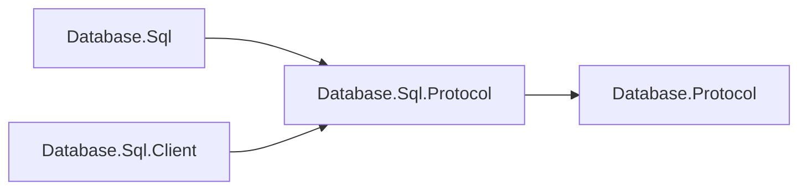

# Assimalign.Cohesion.Database.Sql.Protocol design

This independently consumable contract library owns Sql framing payloads, validation and transferred values. It references only shared Database.Protocol. The engine and client use the same CLR DTO types and family singleton; there are no duplicate DTOs or type forwarders. Model request, planner, executor, catalog, storage and server state remain engine-owned.

The arrows show references:

Wire bytes, limits, malformed-payload behavior and exception text are preserved. Span-based codecs and explicit value handling remain trimming and NativeAOT compatible; no reflection serializer or dynamic discovery is introduced. The ProtocolMessageFamily is defined exactly once in this assembly. Existing codec tests live in this project's tests; engine/server/client integration tests retain their existing owners.

## SQL outbound stream (#1724)

sql.outbound-stream is independent of bulk and adds CopyTo 80, CopyStart 81, CopyData 82 and
CopyComplete 83 and empty CopyAcknowledged 84. All five identifiers are defined in the SQL family and gated by negotiation.
CopyTo carries the existing Execute payload with zero parameters; CopyStart is empty. CopyData
contains 1..16,384 uninterpreted UTF-8 export bytes. The server awaits one empty CopyAcknowledged
after each CopyData; the consumer sends it only after delivering the bytes. This one-frame window
bounds even an unbounded transport queue and makes disconnect/cancellation release the snapshot.
CopyComplete is exactly two big-endian Int64
nonnegative counters: data rows (excluding header), then total CopyData bytes. Each row needs
at least its LF, so rows cannot exceed bytes. CK07005 refuses
invalid parameters, frame/acknowledgment order, chunk limits, truncated streams and malformed/mismatched counters.
Structured Diagnostics may immediately precede a terminal Error or completion. An incomplete or
malformed response never certifies a reusable connection. A statement Error before CopyStart does:
its snapshot is already released, and the client throws while preserving the transaction. Late
Errors discard the transfer because delivery acknowledgments may still be outstanding. If
transaction-status was negotiated, existing Ready follows completion/Error, as with Execute.
The SQL exchange requests this status explicitly through DatabaseProtocolExchange's constructor;
it does not extend the shared client's 5/64/69 automatic recognition. No shared protocol/client
edits or version bump are needed. The exchange changes neither transaction nor retained state.
Peers without the capability keep existing Execute bytes; ordinary COPY returns CS05094.

## Execute transaction status (#1540, D5)

SQL and Graph advertise the shared `transaction-status` capability in protocol 2.1. Startup Ready
keeps its version/capability payload. When negotiated, each Execute (also Graph ExecutePaths)
ends with an existing Ready frame (byte 4) after ResultComplete/PathsComplete or a statement Error.
Its payload is exactly two bytes: ASCII `I` idle, `T` explicit transaction active or `E` explicit
transaction failed, then a retained-session-state byte (`0` clean, `1` requires reset). Other
lengths and retained-state bytes are malformed (CK07002). This replaces the former one-byte
payload and public record without a compatibility reader (#1717). The existing transaction-status
capability gates it; no new identifier, protocol version or on-disk format is introduced.
Unnegotiated peers retain their original bytes. Ping/Pong and terminal connection errors have no
postamble. Malformed status payloads use CK07002 and are protocol violations.

The capability also defines parameterless reset: Execute byte 5 carries the usual length-prefixed
UTF-8 `ROLLBACK` followed by a zero Int32 parameter count. Success is ResultComplete byte 8 with
an Int64 affected count of zero, then Ready `I`. An error or any other completion/status discards
the connector. Clients never determine transaction state by recognizing user command text.

PostgreSQL reports the same idle/active/failed distinction after a command cycle in
`src/backend/tcop/dest.c:268-281` and `src/backend/access/transam/xact.c:5058-5090` (local PostgreSQL
clone). This copies the state contract only; no source code is copied.

## Sql diagnostic conventions (#1470)

Exception and diagnostic templates use the project's build-generated `ErrorMessages` resources.
Parameterized templates format with the current culture; abort/cancellation templates used in
normal cleanup are cached. The [Database error-code registry](../../Assimalign.Cohesion.Database/docs/ERROR-CODES.md)
assigns this family its two-letter prefix and categorized five-digit identities.
Existing SQLSTATE meanings, numeric wire error kinds, frame layouts and disk formats are preserved.
Structured diagnostics keep their code outside the message. Compiler diagnostic identifiers and
standard .NET argument guards retain their own contracts.

## Rules audit after main cleanup

The model protocol extension container is partial. Its public Family and message extensions,
identifiers, capabilities and encoded payloads are unchanged.

## Debugger inspection

Concrete source types with explicit nonpublic instance state use a private nested DebugView
and debugger display/proxy attributes. The view is the last member in the same type file and
exposes only reviewed public/protected state through read-only properties. Exception and
EventSource types remain excluded. A type with no state to filter keeps its normal member view;
a type whose base supplies both debugger attributes inherits that view.

Inspection does not perform I/O, take lifecycle locks, mutate state, invoke application callbacks,
or materialize lazy results. The additions are debugger metadata and nested helper types; existing
instance fields, runtime operations, error identities, data formats and protocol contracts do
not change. SDK and Studio source are outside this rule's scope.

Protocol data carriers whose only storage is public/protected data or compiler-generated
auto-property backing keep the normal debugger member view. No new protocol projection or wire
member is introduced.

## Retained session reset (#1717)

The last statement Ready certifies both transaction state and retained session state. SQL reports
currval/lastval entries or timeout settings different from the session reset values; Graph and
Documents always report zero retained state. ProtocolMessageFamily declares ResetStatement
(SQL: DISCARD ALL; Graph/Documents: null). Pool return sends ROLLBACK only when needed, then
rechecks the new Ready before sending the declared reset only for retained state. Reuse requires
Idle plus zero retained state. A clean idle return performs no exchange. A failed, malformed or
timed-out reset discards the connector. Startup Ready, Ping/Pong and unnegotiated framing stay
unchanged. The strict two-byte payload is covered by codec and scripted/live transport counters.
