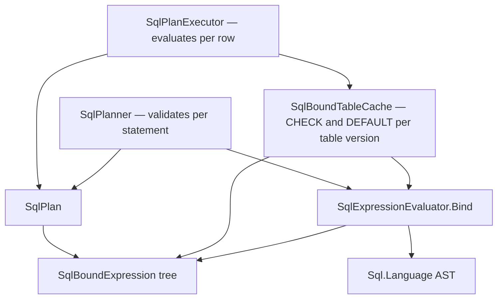
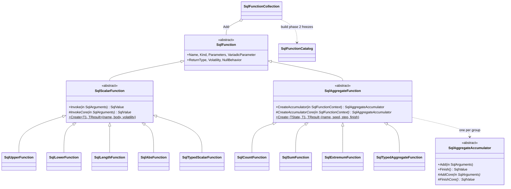
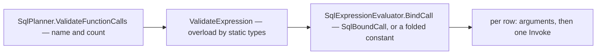
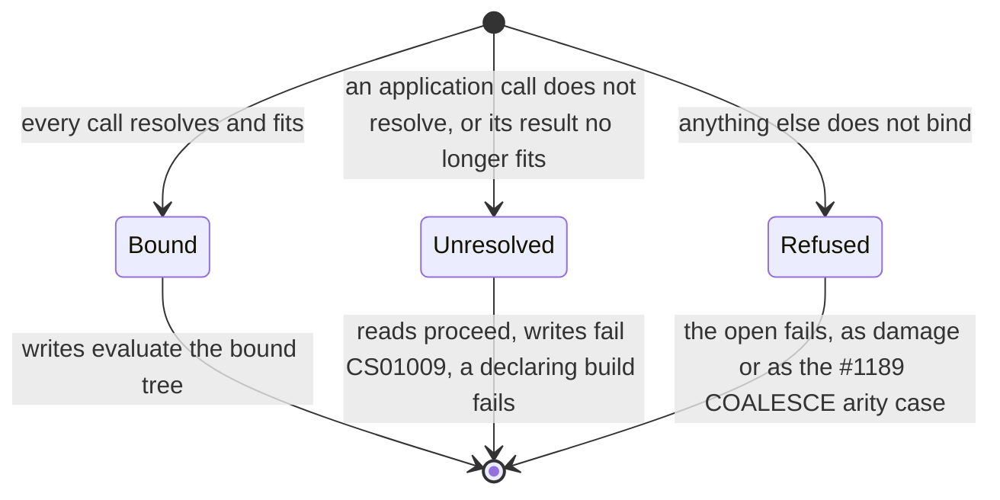
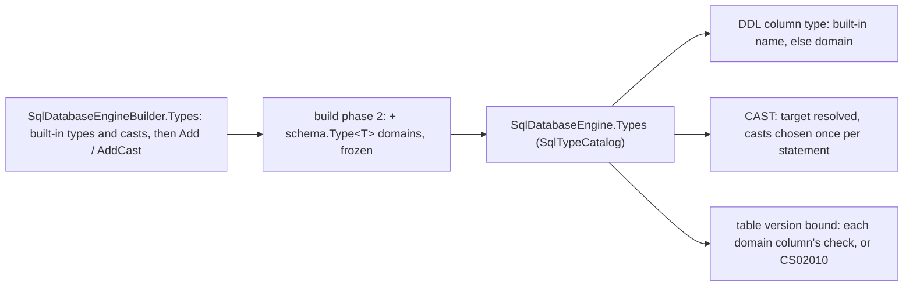
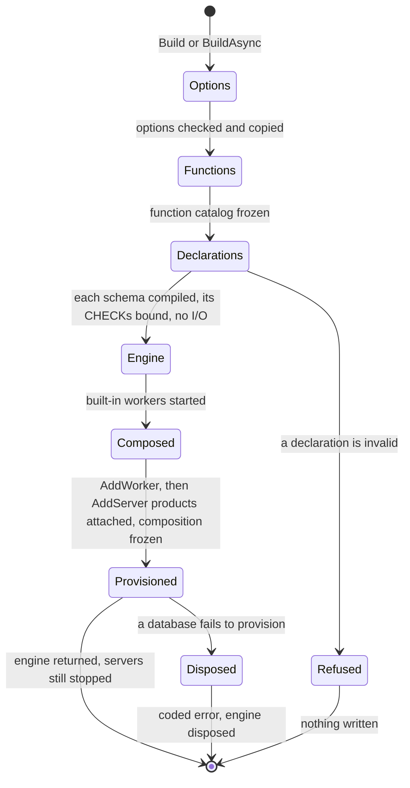
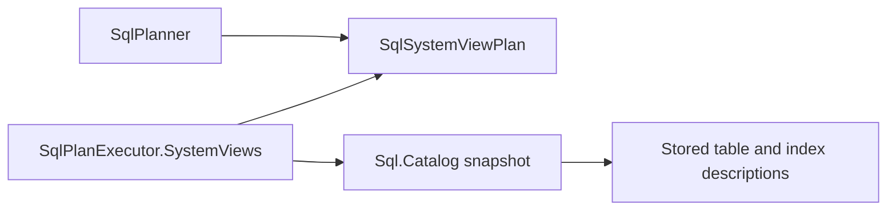
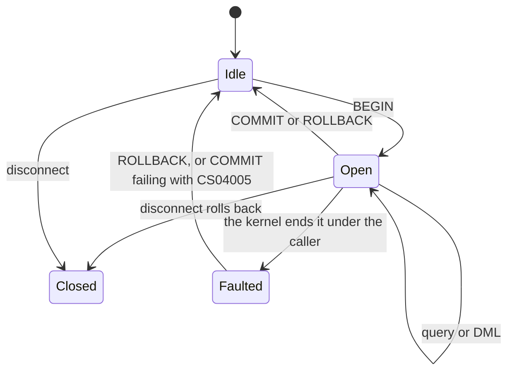
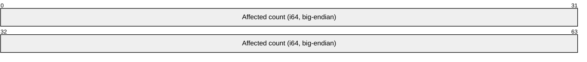

# Assimalign.Cohesion.Database.Sql — Design

## Joined DML planning and execution (#1714, SQ-UF2)

The DML binder reuses SELECT's source namespace and join rules, seeding a distinct target binding
at physical slot zero. SqlDmlSource retains the association SqlJoinPlan and TargetBinding index;
Execution carries that binding's storage row location and writer stamp per association rather than inferring
identity from projected values or a user key. Physical columns remain target-then-source, including
hidden USING inputs. SET destinations stay target-only; SET values, WHERE and explicit RETURNING
source references bind to combined slots. Bare RETURNING * follows PostgreSQL by expanding the
target, then each source in namespace order (parse_target.c:1301-1321), allowing duplicate names.
SqlDmlSource retains visible output ordinals separately from physical association slots so USING
emits its merged keys first and hides duplicate right keys. Source metadata
preserves type modifiers, collation and LEFT nullability. ON excludes the target/other comma items;
WHERE children receive the combined correlation scope. CTE reachability, function validation and
provisioning admission visit sources, and EXPLAIN descends into the association plan.

Execution drains source relations and target/source associations through one statement snapshot
before evaluating SET or writing. Association plans use SELECT predicate pushdown and transient
costing with the target pinned as the outer input. Safe target-only WHERE terms select target
seeks; mandatory target/source equalities drive source index probes or the existing budgeted
hash build. EXPLAIN exposes those access paths and algorithms. The full WHERE remains a residual.
Equality-driven hash or seek steps are formed one at a time in written source order. For example,
`UPDATE t SET v = b.v FROM a, b WHERE t.id = b.tid AND b.aid = a.id` visits |t| * |a|
pairs before reaching b's hash. Write `FROM b, a` to make these equality joins linear in the
input sizes. Both orders return correct results; general join-order search belongs to #1629.
The pushed target filter runs before retaining target identities. Collection keeps the writer
stamp from the original decode, avoiding a second whole-row read. Internal statement counters
record association reads separately from total row reads, which also include stamp checks and
tombstone pre-images, and record peak retained target identities. Target/association collections
follow plain UPDATE/DELETE's existing unbudgeted retention; StatementMemoryBudget currently
accounts for join hash builds, not these DML collections.
Costing rewrites source-derived relations through the same identity map as WITH definitions, so
volatile CTE sources materialize once. A private join-frame identity slot retains the original decoded
target array by reference; a local map associates it with physical location and writer stamp.
Equal unkeyed rows and self joins therefore retain distinct identities. UPDATE rejects a second
association for any target with CS05068 before SET evaluation, even when source values are equal.
DELETE keeps the first enumerated source association per physical target; the chosen source and
RETURNING order are unspecified. Cascade retries reuse this collected set rather than rerunning
volatile sources. Source values remain from collection; UPDATE RETURNING substitutes only the
new target columns, while DELETE RETURNING uses the old target columns.

Target rows take sorted exclusive locks before constraint preparation. The apply gate rechecks
every collected target's original location and writer before writes; a concurrent committed
change fails with the existing first-updater-wins transaction conflict rather than following a
replacement row. Snapshot retention prevents reclamation while collection waits. The existing
UPDATE final-state, domain, CHECK, foreign-key, unique-index and DELETE cascade helpers enforce
constraints; all effects and RETURNING preparation stay in the existing statement undo bracket.
The joined statement mark precedes WITH/subquery materialization; failures release only new grants
after undo, preserving earlier transaction grants. Offline storage retains locks. Source intents
precede target write intents and use release-before-wait preparation. DELETE re-acquires source
intents at every bounded cascade retry while reusing its collected volatile associations.
The same outer mark and root plan cover wrapper grants during cascade back-off; the optional
joined scope uses the existing join-only state slot, without growing ordinary statement objects.
Joined UPDATE prepares source, wrapper and reference intents as one try/release/wait unit, so a
reference-table wait also releases new target read intents before FK DDL requests target X.
Plain UPDATE and DELETE keep separate async state machines and apply closures without association
state, preserving their ordinary allocation budget.
Scans/cursors dispose before row-lock waits; row/parent/key locks precede the apply gate and
storage/index latches. Cancellation, callback failures and result preparation unwind these owners.
No new interface, visibility grant, reference, persistent format or wire message is introduced.

| Code | Condition |
| --- | --- |
| CS05068 | An UPDATE target has more than one matching source association; no row is written. |
| CS05069 | Direct RIGHT, FULL or parenthesized joined DML source requires an unsupported target-outer execution tree; no row is read or written. |
| CS05070 | FULL JOIN requires a safe mandatory hash equality; refused during binding before either input is read. |

Namespace rules follow PostgreSQL analyze.c:602-621,2560-2578; the owner's cardinality rule
deliberately differs from nodeModifyTable.c:2599-2608 (first-update behavior).

## Fixed-pass worker tests (found during #1365)

`VersionPurgeRefusalTests.RunIteration_RefusalKind_ShouldDistinguishForeignStorageFromProgress`
owns a separate `SqlVersionPurgeWorker` through `CheckpointPace.Own`. Its exact pass and
failure counts are driven only by the test. Using an engine-owned worker allowed its live
pump to invoke the same callback beside explicit iterations: a full Debug run observed
thirteen callbacks for twelve requested passes. A fixture assertion excludes registered
workers; no assertion or production scheduling behavior is relaxed. Real-pump refusal and
owed-pass coverage remains in the other cases. This follows the existing short-refusal
fixture in the same class and closes a test-hygiene gap related to #1285. No engine behavior
was copied from another database, and no language, protocol, format or error-code change applies.

## Worker lane isolation (#1279)

Checkpoint, page write-back, WAL group flush and version purge run one database's work at a
time on worker-owned dedicated lanes, with no process-wide scheduling atomic. Idle runners
retire after 30 seconds.

Admission is round-robin, starting after the last database admitted, including after a
collected WAL flush rechecks late commits. The working cap is 64 non-stuck operations per
engine and worker kind. An operation releases its admission slot after four worker intervals,
clamped to 1–4 seconds (the checkpoint poll is at most one second). It retains its lane and
storage ownership until I/O returns. A hard ceiling of 128 dedicated threads (twice the cap),
including parked and stuck runners, bounds replacement cost. Capacity deferral and each newly
stuck lane report observational failures and root event 35, naming the database and worker kind;
these reports never take a database offline or replace an unresolved operational fault.
Warnings repeat at most once per second per database. At the hard ceiling progress waits for a
runner to return, with an explicit health signal rather than silent loss of maintenance.

Idle visits check pending grouped commits, the constant-time dirty-page count, deferred undo,
and owed full purge passes on the pump. They allocate nothing and dispatch no lane. SQL/Key-Value
index stubs dispatch only through their internal test hook until a real maintenance body exists.
A detached write-back completion wakes collection without advancing other databases' interval;
the next regular write-back deadline remains absolute, including a stuck-detection timeout.
The completion-pacing regression holds a real completed lane through `AfterDatabase`, then
owes new dirty peer pages after their lanes have settled and snapshots their exact two visits
on the collecting pump pass. `BeforeDatabase` forces idle work due, including follow-up batches;
using it here or reading live visit counts after a delayed test continuation confuses that
injected work or a later regular interval with the completion being tested. Both base and
review implementations preserve the same pacing; the test retains the exact count and also
requires the dirty peers to remain unattempted on the completion pass.
Work deferred by capacity remains owed and can use reclaimed slots on these early wakes. Runner parking and result publication
share one critical section. Provisional and published SQL/Key-Value data file sets keep the same
lane identity; a published database waits for an outstanding provisional catalog flush before
flushing that catalog itself. The provisional collection path also rechecks later registrations.

Disposal continues joining every lane before storage closes. Root event 36 names each database
and worker kind still running, once per second while disposal waits. **Open owner question:
bounded disposal** would need retained storage ownership for abandoned I/O; no timeout abandons
I/O or closes its storage. The defaults (64 slots, 128 threads, 30-second idle retirement and the
1–4-second stuck threshold) need owner review against expected database counts and device latency.


A collected WAL flush rechecks later commit registrations before the group window; provisional
SQL/Key-Value file sets do the same, preventing a reset signal from leaving construction to self-help.
Only the pump collects outcomes and calls the root failure/reporting methods, preserving per-database
backoff, give-up fault retention and observational purge refusals. Purge retry and refusal state
is pump-owned; lanes return full-pass, undo and reclamation facts. A full pass becoming due while
an earlier lane runs remains owed and wakes the pump after collection. SQL/Key-Value provisional flushes also use lanes, keeping a
stalled constructor from holding back published databases. Engine disposal joins all lane runners
before closing storages. Lock order is the root pass gate, then the lane monitor; no lane monitor
spans model/apply/storage locks, failure reporting or observer callbacks.

The shared DatabaseLaneWorker publishes opt-in DatabaseWorkerPass observations for all kinds.
Checkpoint failure tests assert requested waits, due visits, completed work and runner availability
at publication, including a delayed observer; elapsed times are diagnostic. Deferred-undo tests
require a recorded undo-only worker completion, a positive-work DeferredUndoCompleted event and a
released writer with 30-second hang guards,
independently of the hour-long full-maintenance interval.
Checkpoint due evidence remains optional checkpoint-specific data. Resilience tests hold the actual
page-write/fsync faults (purge/index use the internal dispatch hook), require K = 4 healthy
positive-work completions while exactly one runner remains held, and assert lane-wait counters.
Page-write setup holds dispatch while preparing the dirty page, then releases it into the device gate.
A 30-second hang guard bounds each phase; elapsed durations are diagnostic only. After release,
the held worker must complete and clear any stuck-lane advisory before a second stall exercises disposal. They do not credit
committer self-help or a statement's
checkpoint as worker progress. Cancellation, completion, failed thread start, capacity and disposal
are exercised in the non-parallel lane stress tests. Each runner starts without caller ExecutionContext and restores a clean context after each job,
preventing apply-gate reentrancy or other AsyncLocal state from crossing databases.
SQL/Key-Value index compaction remains a stub: the test hook performs counted page write-back
on its lane and pairs the result with collection. Grouped-commit resilience uses worker flush
and self-help events; hung-checkpoint progress uses a 30-second hang guard instead of a short
throughput window. Slow-cadence, producer and observer regressions cover runner pauses.
Completion-wake regressions inspect the collected pass rather than live counters after an await;
a paused observer cannot credit later regular ticks to that completion. Provisional-flush waits
use the same 30-second hang guard, with self-help outside it; a controlled three-second pump
pause covers provisional collection and publication.
Large-definition reclamation stress retains every operationally failed visit and pump backoff
request. A slow-lane regression allows a stuck advisory and requires it to clear after draining.
No public type, visibility grant, project reference or storage format changed. Storage exposes
its pending-commit and dirty-page scheduling hints without exposing buffer-pool frames.

## Result diagnostics (#1264)

SQL command and row results return a non-null Diagnostics collection, empty when there is
nothing to report (#1264). SQL wire diagnostic framing is unchanged: empty diagnostics emit no frame.

## Persisted quoted view text (#1235)

The shared lexer now treats `"a""x"` as one delimited identifier (`a"x`). The base engine could
persist that text as column `a` with alias `x` when there was no separating space. Such a base
view can rebind differently or fail after reopen. There is no stored-text migration or legacy
lexer: recreate affected views using `"a" "x"` or `"a" AS "x"`. The Sql.Language DIALECT records
this parsing boundary; the catalog encoding and storage format are unchanged.

## Wrapped child failures and abort evidence (#1364)

Otherwise unclassified `StorageException` subclasses and ordinary I/O, including wrapped
and aggregate causes, use `CS06041`. Offline and format refusals retain their specific codes.
Attached-index damage leads with `CK06003` and retains `CK06102` and `CS06041`;
other index failures use `CS06041`. Begin, statement, commit and rollback share classification.
Create and open also code child failures before publication. Known format refusals retain their
authored types, messages and source diagnostics. Snapshot release and transaction abort preserve
the exact coded statement exception, including its corruption type. The model EventSource
records secondary cleanup failures as `TransactionCleanupFailed`. Transaction refusals retain
their own code. Real device-read regressions cover slot, journal and storage-transaction failures
through both wrapper shapes, plus a failed abort notification. All added work is on error paths;
successful-statement allocation behavior is unchanged.


## Wire contract ownership

`Assimalign.Cohesion.Database.Sql.Protocol` owns this model's wire messages, codecs, family singleton and transferred value shapes (5 public types). Both engine and remote client reference that one assembly. Its public namespace and RootNamespace equal its project name. Engine requests, planning, catalog, storage and server lifecycle stay in `Assimalign.Cohesion.Database.Sql`. This extraction preserves wire bytes and validation; moved public types intentionally change namespace and assembly identity with no forwarders.

Wire result preparation is scoped to writing statements (#1651). SqlResultPreparation encodes
and size-checks the header and every row inside DML's ApplyStatementAsync, before its physical
undo bracket closes, autocommit CommitAsync or explicit EndStatement. This includes INSERT SELECT,
upsert, UPDATE, DELETE and RETURNING. Enumeration and disposal also finish there. DDL and
transaction control have a fixed zero-count completion, prepared before invoking their execution
or commit. An encoding or size failure therefore precedes any write commit and result frame;
DML rolls back only this statement, preserving earlier explicit-transaction work. A committed
write is never reported as an ordinary statement failure. The pre-commit write ordering follows
PostgreSQL's output-before-commit ordering (src/backend/tcop/postgres.c:1297-1360 and
src/backend/access/common/printtup.c:360).

Read-only SELECT, EXPLAIN, system views and SHOW encode one frame at a time during delivery,
after materialization and statement admission have ended. A late encoding, enumeration or
disposal failure ends the exchange with ExecutionFailure, even after partial result frames.
The client discards partial columns and rows; the connection and any explicit transaction stay
usable because the statement wrote nothing. Uncoded result failures use CS05045; already-coded
failures retain their diagnostics. Transport failures during delivery remain terminal on both
paths, as do malformed incoming parameters. Embedded execution allocates no wire buffers.
The optional wire preparation reference lives once in the shared statement metrics, so copies
of SqlStatementContext captured by scan iterators and filtering closures do not each grow.
Execution clears that reference on success or failure before delivery, keeping retained metrics
from retaining encoded payloads.

There is no aggregate encoded-result cap on either path. Results are already fully materialized;
a 64 MiB cap adds a functional limit without bounding their existing memory. Writes additionally
retain encoded payloads until delivery, accepting that memory cost to preserve statement atomicity;
reads retain only the current encoded frame. Every header/row is bounded by
ProtocolFrameHeader.MaxPayloadLength (currently 16 MiB). Size refusals use CS05045 / SQLSTATE
54000 and report the encoded size and frame limit. Variable-width sizes include UTF-8 and zero
escapes and are measured before allocating encoded columns. The row scratch buffer is at most one
frame; header encoding uses a temporary growable buffer (less than twice the frame limit) plus
one encoded column name, and string encoding may use one column's UTF-8 sort key (at most one
frame). Collection/array overhead and existing materialized values are additional. Streaming
write execution will need a different storage/buffering design.

## Model component boundaries

Catalog, Storage and the empty Security satellite projects are consolidated into Assimalign.Cohesion.Database.Sql. Public Catalog and Storage types keep their existing namespaces and live under src/Catalog and src/Storage; their assembly identity is now Assimalign.Cohesion.Database.Sql. Internal component types live under src/Internal/Catalog and src/Internal/Storage and declare Assimalign.Cohesion.Database.Sql.Internal.

Engine-owned storage strategies, row/entry codecs and catalog-aware persistence glue live in src/Internal/Engine/Storage; the architecture test enforces strategy placement there. TransactionRecordSpace implementations and physical location-packing helpers belong to the Storage layer (src/Internal/Storage, or nested within a public Storage type); adapter placement is also enforced. This refines the original fold folder map without changing namespaces, members or behavior.

The dependency direction remains engine → Catalog → Storage → shared kernel. Storage-folder types must reference neither Catalog-folder nor engine types; Catalog-folder types must reference no engine types. The build exports the actual compiler inputs, and this model's architecture test recompiles them with Roslyn and checks resolved type/member symbols by their declaring source folders, including partial and generated types. Referenced types also pass a per-layer containing-assembly allowlist seeded from the retired satellite csprojs at a64426436: Storage permits shared Storage, Transactions, Indexing and the actual BCL reference pack; Catalog additionally permits the area root and Types. Engine code is unrestricted. See the area README for the common placement and assembly rules. Build-generated resource accessors and assembly metadata are shared infrastructure, outside the three layers. No new shipped-assembly visibility grant, wire or disk format, diagnostic code, or behavior is introduced.


## RETURNING execution (#1117)

Existing INSERT, INSERT SELECT, UPDATE and DELETE plans retain bound Returning
projections. Binding shares SELECT projection metadata, naming and target qualifier
checks; INSERT sources never enter that scope. Function validation includes every
projection, and aggregates fail before reading rows with CS05017.
RETURNING disables immutable constant folding so even foldable calls run per written
row inside apply, after index checks, rather than during planning.
EXPLAIN includes the expanded RETURNING projection count and names in every DML
node's detail. INSERT SELECT retains its original plan instance without RETURNING.

The executor shares SELECT row projection and binary ownership handling. It evaluates
each returning row after its mutation and index checks inside ApplyStatementAsync,
so an evaluation failure rolls back the entire statement even in an explicit transaction.
Projection runs while the database's apply gate is held: a slow application function
in RETURNING stalls other writers on that database. Every returned row is buffered
until apply ends.
DELETE filters cascade work by direct target locations. Results are materialized before
commit/delivery and carry the direct affected count; ordinary query sets retain -1.
ResultComplete already carries that value. No new plan wrapper, public interface,
visibility grant, persisted text, storage version or protocol change is needed.

## CHECK qualifier declarations (#1191)

New CHECK declarations resolve table and schema qualifiers against the constrained table,
using the same case-insensitive identity as query binding. An unknown qualifier fails DDL
validation with located CS01015, before publication, including CREATE, ADD CONSTRAINT and
ADD COLUMN. Bare, table-qualified and schema-qualified column names remain valid. The CHECK
syntax walk validates this against catalog identity locally; it needs no new language AST
constructor or shipped-assembly visibility grant. BindPersistedCheck retains its older lenient
qualifier contract, so previously accepted stored predicates still open and enforce their checks.
Declared and imperative schemas with an already-applied hash also retain that qualifier contract.
Engine build binds other declaration rules before I/O, then provisioning validates qualifiers only
for a new or changed hash, after reading the catalog and before any migration step. The validation
cache tracks strict qualifier validation separately, so a previously lenient bind cannot authorize
a later application of that hash after another schema replaces it.
Stored-table query conformance covers SELECT, WHERE, GROUP BY, HAVING, ORDER BY, alias hiding
and nested references alongside the existing join, correlation and DML suites.

## Invalid statement declarations (#1192)

UPDATE binds each target ordinal only once and rejects repeated assignments with CS01019,
including DEFAULT and empty inputs. A shared internal declaration validator rejects repeated
columns in PRIMARY KEY, UNIQUE and FOREIGN KEY child lists before key deduplication, catalog
publication or index construction, for CREATE and ALTER ADD CONSTRAINT. It uses the same
case-insensitive identity as column binding and names the column and constraint. A second
PRIMARY KEY declaration is refused with CS01019, including mixed inline/table declarations
and ALTER ADD CONSTRAINT or ADD COLUMN on an existing primary key, or repeated PRIMARY KEY
clauses on one added column. PostgreSQL rewriteHandler.c:1166 uses 42601 for repeated
whole-column assignments; parse_utilcmd.c:2773-2779 uses 42701 for repeated PK/UNIQUE
columns, and :2378 uses 42P16 for multiple primary keys. Repeated FK child columns are
rejected more strictly than PostgreSQL; repeated referenced columns are also refused with
CS01019 (PostgreSQL tablecmds.c:13982-13989 uses 42830). CREATE TABLE IF NOT EXISTS
skips declaration checks when the table exists, preserving it unchanged (PostgreSQL
parse_utilcmd.c:202). The live invalid-statement conformance corpus checks both execution
boundaries, statement atomicity, connection usability, existing CS00005 type limits and
CS05017 aggregate placement. No public API or persisted representation changes.

## Identity execution (#1123)

CREATE and ADD column planning validate the identity mode, integer type, nonzero increment,
START range, DEFAULT exclusion and one-column limit before catalog writes. ADD checks no live
rows under the existing exclusive DDL lock. Typed schema reconciliation refuses identity facets
with SqlSchemaMigrationException / CS03105 and "Nothing was changed.".
Identity metadata implies NOT NULL; COLUMN_DEFAULT remains null. INFORMATION_SCHEMA appends
seven identity fields after DATETIME_PRECISION, preserving its previous ordinals.

The common INSERT VALUES / INSERT SELECT path allocates omitted or DEFAULT identity values
before any column's NOT NULL/default validation or application of the row write set, independent
of the identity column's ordinal. BY DEFAULT UPDATE DEFAULT shares that path;
ALWAYS rejects explicit INSERT values and every UPDATE assignment with CS03025. Explicit
BY DEFAULT values leave the counter untouched; existing indexes enforce any later collision.
All rows are materialized before application, so range exhaustion inserts nothing. Existing
plans and EXPLAIN mappings remain sufficient.

SqlCatalog.AllocateIdentity reserves up to 32 values per durable catalog commit, separate from
the data transaction and table record. It holds only the catalog's existing metadata lock and
adds no coordinator lock or table replacement. Rollback or a failing constraint consumes values;
allocation order does not imply commit order. After reopen, allocation skips every reserved
value, including unused ones, so no returned value is reused after a crash. This follows the
nontransactional and ahead-of-use logging pattern in PostgreSQL sequence.c:690-729,808-849
(local reference clone), with one database-wide catalog cursor instead of per-session caches.
The block size 32 is an implementation choice; the final block is shortened to the column's
direction-dependent bounds: ascending 1 through the type maximum, descending the type minimum
through -1 (PostgreSQL `src/backend/commands/sequence.c:1462,1494,1529`). Planning, catalog
validation, allocation and INFORMATION_SCHEMA use these same bounds. Exhaustion names the
column, SQL type and limit once, with the catalog exception retained as its cause.
Int128 intermediates make all counter arithmetic checked independently
of SQL expression arithmetic. Table DROP retires the counter atomically; recreate begins at START.
The unreleased record-space format advances **14 -> 15**, table extension **4 -> 5**, with no
upgrade path. No new interface, visibility grant, project reference or wire format is introduced.

The common column parser refuses explicit NULL with NOT NULL, PRIMARY KEY or IDENTITY
in either order using CS00003 and the column name, including table primary keys. ALTER of
an existing primary key uses that coded refusal too. SERIAL/BIGSERIAL/SMALLSERIAL are
rejected when SQL or native domains are created, with CK00001 and an IDENTITY suggestion.

## RIGHT normalization and grouped namespaces (#1525, SQ-J1)

RIGHT [OUTER] JOIN executes by swapping physical children and applying LEFT's ON and
null-extension rules. Bindings and physical column slots retain the written order. The whole
written left subtree becomes nullable; RIGHT USING keeps its output slot on the left but
reads the common-typed right value and collation, including right spelling under case-insensitive equality.
Unqualified merged columns and qualified physical columns keep separate metadata and values.
PostgreSQL src/backend/parser/parse_clause.c:1731-1751 supplies the RIGHT representative rule;
src/backend/optimizer/prep/prepjointree.c:3668-3686 performs the corresponding child swap.

An optional internal tree preserves mixed chains, comma precedence and parenthesized groups.
Ordinary flat INNER/LEFT/CROSS queries retain their executor and costing path. Normalized
trees use an explicit postorder work stack, retain each child only through consumption by
its parent, and run complete ON/WHERE residuals. They conservatively retain input predicates
at their written level and never reorder the first pair. A two-leaf RIGHT may seek into its
written left input; proven safe mandatory equalities use the existing budgeted hash table,
including composite inner subtrees. Hash-bound subtree output feeds the table as it is produced, so budget exhaustion stops production before a complete intermediate is retained; nested builds share and unwind the live statement grant. Unsupported hash conditions use buffered nested loops.
EXPLAIN nests JoinStep nodes by physical association and names RIGHT-to-LEFT normalization.
Its traversal emits the complete physical outer subtree before a correlated inner IndexSeek,
in both EXPLAIN and EXPLAIN ANALYZE, including when the outer input is a derived query.
ON subqueries capture the namespace before later USING merges or null extension can alter it.

Unaliased parenthesized joins retain their component namespaces. An aliased group lowers to
a derived SELECT * with the same bag and visible columns, hiding its components. Canonical
rendering spells that alias as a derived query, with the existing complete column-alias-list rule and 32-level derived binding limit. Group walks retain stack guards. No existing identifier quoting changes, public
bridge, interface, project reference, disk format or wire message is introduced.
Derived-first groups retain their association through canonical rendering, CREATE VIEW and
database reopen, including when nested aliased groups render as derived SELECTs.

Direct RIGHT or grouped join trees in UPDATE FROM / DELETE USING fail CS05069 before reads
or mutation: this run preserves the target-outer identity invariant. A derived SELECT source
containing RIGHT executes through the existing materialization path with the target pinned.
FULL follows the physical and eligibility contract below.

## FULL physical joins (#1525, SQ-J2)

FULL [OUTER] JOIN uses the normalized tree without swapping its written children. Binding
requires at least one mandatory hash equality between the children and proves the complete
ON condition non-throwing with the existing hash-safety rules. CS05070 refuses other forms
before reading either input, even when an input is empty. This includes inequality-only/OR
conditions, unproven calls, arithmetic, subqueries, CHAR-only keys and derived text without
a stored-codec Unicode guarantee. No merge executor, nested-loop FULL fallback or spill is
introduced. Computed USING COALESCE and proven identity/widening casts can supply hash keys
in later joins or grouped inner subtrees. PostgreSQL optimizer/path/joinrels.c:1157-1180
likewise refuses FULL when it cannot produce a merge/hash path.

Column-only equalities retain direct ordinal extraction; operand-analysis sets and expression
vectors are allocated only for computed keys, with earlier column keys backfilled when a vector
first becomes necessary. The Release allocation guard retains the pre-FULL ordinary-equijoin
extraction budget of 1,040 bytes per call.

Both physical sides become nullable. USING keeps one output in written USING order, with
COALESCE of both common-typed inputs, the resolved equality collation for text, and retained
identical domain identity. The merged column is nonnullable only when both inputs were
nonnullable before this FULL; qualified inputs remain separate nullable physical columns.
PostgreSQL parser/parse_clause.c:1739-1756 supplies the COALESCE rule.

The existing chained hash table retains each build row independently, including duplicate and
NULL-key rows. NULL keys stay outside bucket chains. A separate bool array tracks matches,
with one flag per retained entry; growth copies flags and reserves old plus new arrays before
allocation. A flag is set only after complete ON evaluation is TRUE. After every outer row is
matched or null-extended, unmatched build entries are emitted once with the outer slots NULL.
An empty outer still builds and drains the inner. WHERE remains above both null extensions.
PostgreSQL executor/nodeHashjoin.c:578-592,634-679,729-756 uses the same ON-match distinction
and separate unmatched/null-key drain; no code was copied.

The statement grant charges the table object (104 bytes including new tracking/evaluator
fields), bucket/entry arrays, the aligned tracking array header/payload and retained rows.
Nested tables share the live grant. Success, budget refusal, evaluation failure and cancellation
release every reservation. CS05067 is unchanged. Only hash-build state is bounded: existing
outer/intermediate/result materialization retains its existing contract. The build side is
always the written right child, including when an index exists. EXPLAIN names FullHashJoin and
unmatched=both in JoinStep detail; ANALYZE retains candidate-pair counts rather than emitted
unmatched-row counts. Deterministic 64/640-row fixtures compare 4096/409600 loop candidates
with 64/640 FULL hash candidates, with identical paired values and 128/1280 stored row reads.

Direct FULL DML sources follow CS05069 before reads/writes; derived SELECTs containing FULL
use existing target-pinned materialization. In-process, InMemory/TCP, live clause conformance,
parser round trips and the NativeAOT sample exercise these contracts. No public boundary,
reference, persisted format, protocol frame or metadata field changes.

## N-way joins (#1109)

ORDER BY aliases following a wildcard count its visible output columns after USING merges;
ordering execution slots still begin after the full physical source row.

FROM binds each comma item's join tree separately before any row is read. ON scopes contain
only that item's inputs through the current step. SqlJoinPlan retains stable physical slots,
an ordered SqlJoinStep list and one access path per step; USING hides right names only from
unqualified lookup and derives wildcard order independently of physical slots. Its merged
column binds a separate common-typed expression for unqualified lookup and wildcard output;
qualified columns retain their original types. LEFT uses the coerced left value; INNER prefers
an unchanged common-typed input. Common-type selection follows PostgreSQL parse_clause.c:1676-1733
and parse_coerce.c:1393-1437. Identical domains preserve their identity and registered casts;
mixed domain/base inputs use the common base type (parse_coerce.c:1360-1387).
Differing types or modifiers clear length, precision and scale (parse_coerce.c:1648-1678);
incompatible categories or missing implicit casts fail planning with
CS01015, including on empty inputs. Later USING and ON steps consume these merged expressions.
Computed merged keys do not acquire physical index probes. Ordinary equality and collation
precedence remain unchanged. Grouping compares bound column values so qualified inputs and
coerced merged names cannot accidentally share a key slot with different types.

Execution is left-deep in written order. Only the first INNER pair may swap for an index;
later steps seek into the added input, and LEFT always preserves its left side. Each LEFT
step tests its own residual before deciding whether to extend an unmatched row with NULL.
Proven non-throwing single-binding WHERE conjuncts also filter inputs before pair allocation and
choose equality/range access through the SELECT selector (#1521). WHERE restrictions on a
LEFT step's nullable binding remain above the join; right-only ON restrictions may filter
that input. Pushdown admits comparisons, IS [NOT] NULL, BETWEEN, IN and LIKE over
columns, constants and supplied parameters only when every operand and operation is
proven unable to raise an evaluation error. Comparisons require compatible types and a
fixed collation; text comparisons require an index-backed collation. LIKE requires a
validated constant/parameter pattern and escape. Text predicates over derived outputs
remain residual because those values lack stored rows' valid-Unicode guarantee; unknown
column types likewise provide no safety proof. Standard identity and widening numeric
casts qualify only without target modifiers; narrowing, text-to-number, domain and
application casts do not. The only admitted calls are text LENGTH/CHAR_LENGTH/
CHARACTER_LENGTH and the six captured transaction-clock forms. Volatility metadata alone
never proves error safety. Arithmetic, other calls, row-dependent LIKE patterns/escapes,
lazy scalar forms without a safety proof, subqueries, outer references and deferred
failures stay at their original level, preserving short-circuit errors even for rows
discarded by another input or join key. Complete ON and WHERE residuals still run. Compatible mandatory
equijoin equalities propagate exact constants transitively across INNER inputs, and only
from preserved to nullable inputs across LEFT. Floating keys and incompatible text
collations/types never infer constants. A full unique WHERE seek takes priority when
choosing the first INNER pair's driver. Each input filter uses one scratch ordinal frame,
without the correlated-expression cache. Both constant and correlated seeks verify the
planned catalog index identity; a detached or same-name replacement tree scans instead.
EXPLAIN includes the driving input's IndexSeek and bounds. This follows PostgreSQL's
singleton restriction placement (optimizer/plan/initsplan.c:3261-3315), volatility boundary
(initsplan.c:2952-2981), and outer-join reduction boundary
(optimizer/prep/prepjointree.c:3266-3290). Catalog inputs use #1106's one captured image and
never take object locks or index paths. Stored inputs lock once each in ObjectId order.
Metrics retain ordered JoinAccessPaths (AccessPath renders them separated by semicolons),
even when empty inputs skip enumeration. A single backing slot holds a scalar or join paths,
and stored-only planning creates no join output map or flattened-walker enumerators, preserving
the existing ReadCommitted allocation budget. EXPLAIN emits a JoinStep child for every step,
with its scan or correlated seek. Grouping and subqueries use this same input plan. RIGHT and grouped trees follow the normalization contract above.

Pass-through projections carry source nullability, including all LEFT right columns.
Delivery transfers the final fresh index inner; every earlier input retained by a later loop
detaches only selected binary cells. Null-extended outer rows follow the same ownership rule.
No interface, visibility grant, project reference, reflection or protocol frame is added.
The unreleased storage format advances 13 -> 14 for the canonical FROM shape; older files
are refused without an upgrade path. DIALECT.md records syntax and the retained t.* gap.

## Type-name resolution (#1108)

Column planning consumes SqlColumnDefinition.ResolvedType for built-ins, as CAST already did;
only unresolved domain names pass through the engine catalog. Shared SqlTypeModifiers supplies
ISO multi-word names and the D1 SQL Server lexical aliases to SQL, typed schemas and SDK
extraction. The schema statement renderer accepts the same closed built-in name set as typed
declarations and reconstructs arguments from validated parts.

Catalog columns still store DatabaseTypeInfo without lexical aliases or new fields. Per the
unreleased-format policy data-storage format advances 12 -> 13, refusing older files without
an upgrade reader. Canonical schemas advance v6 -> v7 too, since an earlier NCHAR CustomType
could name a domain stored as String and now normalizes to Character. NCHAR stores padded
Character and length, following #1437. DATETIME,
DATETIME2 and DATETIMEOFFSET add no SQL Server range/rounding behavior; every temporal
precision, 7 included, and INTERVAL field restrictions stay unsupported under #1438.

## Boolean search conditions (#1190)

WHERE (including UPDATE/DELETE and FROM-less SELECT), JOIN ON, HAVING and ON CONFLICT
DO UPDATE WHERE require BOOLEAN. The shared planner check uses StaticOperandType with
binder inference as its fallback, so arithmetic, CASE results, aggregates and supplied
parameters fail before reading even an empty relation. AND/OR/NOT operands, searched
CASE conditions and IS TRUE/FALSE/UNKNOWN operands use the same rule, including ORDER BY output aliases. The error is
CS02003 (SQLSTATE 42804), names the construct and retains its source span. This follows
PostgreSQL src/backend/parser/parse_coerce.c:1163-1184 without implicit non-Boolean coercion.
Untyped NULL remains UNKNOWN; a typed non-Boolean NULL expression is refused. Every CASE result
and COALESCE alternative in a Boolean position is checked, including unreachable alternatives.
Valid Boolean input string literals are coerced only in Boolean positions (PostgreSQL
src/backend/utils/adt/bool.c:37-109); text columns and parameters retain their declared types.

Matches, logical chains, NOT and searched CASE also check values at runtime. Correlated
branch preparation shares the check before selecting or evaluating another branch.
Boolean short-circuiting and simple CASE value comparisons retain their existing rules.
Invalid stored view predicates now fail binding with the same diagnostic; catalog/storage
encoding is unchanged. SQL function declarations run the Boolean-position walk; stored bodies
retain the load-only binding path, with CS02003 isolated as a SqlBoundFailure. Legacy invalid
CASE/logical operands and changed application return types therefore fail on invocation, while
the database opens. Logical nodes, NOT and searched CASE conditions retain runtime error spans.
The generic Matches runtime backstop on a bound root has no source span; known-type
statement roots are checked with their AST spans during planning.
No interface, visibility grant, reflection or dynamic code is added.

## Request parameters (#1102)

Each execution copies request parameters into an ordinal, bare-name dictionary using
Execution's stateless shared source. Missing parameters fail while validating/binding
expressions, before data rows are read or written, with CS01020 and the reference's
span. Collisions after one-sigil removal carry CS01023. Group keys compare bare
names. Transaction control bypasses planning, so the session applies the same
normalization before BEGIN, COMMIT or ROLLBACK can change state. A collision leaves
that state unchanged. The [shared parameter contract](../../Assimalign.Cohesion.Database.Language/docs/DESIGN.md#parameter-contract-1102)
and SQL language DIALECT define syntax, key matching and the unchanged AST shapes.
Numeric names use ASCII digits only; Unicode numeric references fail parsing before a
matching map key can bind. `$0`, `$01` and names beyond Int64 remain exact string keys.


## Fixed-length character identity (#1437)

`DatabaseType.Character` (19) is CHAR/CHARACTER, distinct from String (VARCHAR/TEXT).
`SqlType.Char(n)` and the parser reuse shared `SqlTypeModifiers` validation; bare CHAR is CHAR(1).
`SqlCastConverter.ApplyModifiers` pads assignments, parameters, defaults, domain values and function
results to n Unicode scalar values, rejects non-space assignment overflow with CS02012, and
truncates explicit casts. The registry has 124 standard casts after #1119, including CHAR/text conversions and
the TEXT conversion pairs mirrored for CHAR. CHAR-to-text strips trailing U+0020.

The private `SqlCharacter` value retains identity through expression evaluation, subqueries and
INSERT SELECT while public rows and wire payloads expose padded CLR strings. `SqlValueComparer`
compares and hashes its trimmed text under the resolved collation. Every index path calls
`SqlRowCodec.AppendKeyValue`, which trims before encoding and collation folding; rows encode padded
strings. Thus grouping, DISTINCT, sorting, joins, uniqueness, foreign keys and seeks share identity.
No reflection, dynamic code, new interface, project reference or visibility grant is required.

`SqlRowCodec.RecordSpaceFormatVersion` advances **11 -> 12** for the new catalog type and CHAR index
identity. The Indexing page format and shared tuple string encoding do not change. Earlier databases
are refused; recreate them. The canonical schema advances **v5 -> v6** in runtime and SDK together;
fixed-length columns persist Character and their length, so CHAR/VARCHAR changes plan AlterColumn.

Result columns expose `MaxLength`. SQL result-header **format 2** starts with Int32 -2, then count,
then each name, shared type byte and Int32 length (-1 for no declared length). Earlier headers are
refused. The shared handshake and row tuple encoding are unchanged; rebuild client/server together.
INFORMATION_SCHEMA reports CHARACTER plus length; COHESION_SCHEMA TYPES, DOMAINS and FUNCTIONS
retain CHAR(n) in the existing type-name/signature fields.

LIKE uses padded CHAR input, while its text pattern, concatenation and text casts strip CHAR padding.
LENGTH counts unpadded Unicode scalars for CHAR. Domains and function parameters/results keep the
padding rule. PostgreSQL behavior and differences are specified with source anchors in DIALECT.md.
The file-backed session/wire tests repeat these contracts after reopen; the NativeAOT smoke tests
exercise CHAR output, casts, length, concatenation, LIKE, seek and column metadata.

Join probes preserve both CLR strings and `SqlCharacter` values whole until index normalization:
assignment bounds must not discard a longer collation-equivalent comparand. Scalar and aggregate
binding share parameter coercion nodes, applying declared CHAR bounds (and domain checks) before
STRICT dispatch, even when the argument already has Character storage identity. This covers the
single-argument, inline-buffer and pooled aggregate paths without adding conversion work to numeric
aggregates. The resolved scalar and aggregate conversion paths also enforce CHAR widths when
storage types match: native domain checks can enter these paths without a bound argument wrapper.
CHECK's application-function type validator recognizes CHAR and TEXT as comparable character types.
Runtime unary-sign errors name Character, matching the planner's diagnostic instead of exposing the
private wrapper's CLR name.

Validation-only ALTER COLUMN compares the exact padded CLR values, not wrapper references or SQL
trailing-space-insensitive equality. Every CHAR length change requires validation, including widening;
non-null values that would be repadded cause refusal before metadata publication. Empty or all-null
columns may change length. Code-first changes on populated tables defer that validation to the existing
provisioning worker. Rewriting remains #1447's responsibility, sharing #1265's machinery; this change
does not invent a metadata-only repadding behavior or a separate rewrite implementation. Both the
definition-rewrite and changed-padding refusals name the column and direct callers to an explicit
table-copy migration, identifying #1447 as the in-place rewrite work.

BETWEEN binds independent comparands for its lower and upper comparisons, matching PostgreSQL
`src/backend/parser/parse_expr.c:1325-1341`; round 2 leaves that implementation unchanged. IN separates
candidates containing table-column references, including references nested inside expressions. They bind
as independent equality comparisons (inequalities joined by AND for NOT IN), matching
`parse_expr.c:1163-1176,1253-1295`. Only a group with more than one non-column candidate uses a common
character type, considering the left operand first (`:1182-1190`). Among CHAR, TEXT and VARCHAR the
first non-unknown type wins: `parse_coerce.c:1397-1440` replaces it only for a one-way implicit cast,
and `src/include/catalog/pg_cast.dat:313-325` makes these string casts implicit in both directions.
All-unknown inputs select TEXT (`parse_coerce.c:1444-1456`). VARCHAR shares String identity with TEXT
here. Untyped string literals and statement parameters do not set the running type.

The binding site supplies `SqlBindingContext`: Table for statement/table-CHECK scopes, Function
for SQL parameter frames, and Domain for domain VALUE (including the synthetic check function on
reload). `ReferencesTableColumn` is an instance query on that scope; the former syntax-only
`SqlPlanner.ReferencesAnyColumn` is removed. Function parameters and domain VALUE retain their
declared types and participate in the common-type group even though their named slots use
`SqlCatalogColumn` metadata. PostgreSQL represents them as `Param` (`executor/functions.c:491-505`)
and `CoerceToDomainValue` (`commands/typecmds.c:3603-3618`), not the Vars separated by
`parse_expr.c:1163`. Thus `'a ' IN (text_b(), p)` is FALSE for a CHAR parameter containing `'a'`,
and the same predicate over domain VALUE rejects `'a'`; the common TEXT comparison trims CHAR.
Table columns, including a real column named VALUE, still compare independently. The context
survives ordering-scope copies. This changes neither slot evaluation nor constant folding: SQL
parameters and VALUE remain invocation-dependent reads, while supplied statement parameters
remain fixed values.

The bound IN group carries that comparison identity, so CHAR-selected groups convert even typed
TEXT/VARCHAR values to CHAR comparands without padding or truncating to any operand's declared width
(`parse_coerce.c:1583-1585`, typmod -1). Constant and parameter comparands acquire that identity once
during binding; computed values acquire it during evaluation. Each independent comparison retains
its own coercions and collation. The common group evaluates its left operand once; the boolean-tree
path evaluates it per comparison, as the equivalent explicit comparisons do. BETWEEN still evaluates
its shared operand once. VARCHAR/TEXT, domain/base and differing DECIMAL-scale control probes remain
unchanged.

Historical script function signatures accept storage code 19 (Character) when recovering a dropped
domain's signature from its receipt. A later catalog generation must not make the same declaration
unopenable. That review left its unreleased formats 12, v6 and result-header 2 unchanged;
#1108 advances the current storage/schema formats as recorded above.

The SQL engine (area architecture: [docs/resources/Database/DESIGN.md](../../../../docs/resources/Database/DESIGN.md)
§3.3): parse (`Sql.Language`) → plan (`SqlPlanner`) → execute (`SqlPlanExecutor`)
against shared storage, with the catalog (`Sql.Catalog`) as schema authority.

## Pagination (#1107)

FETCH and TOP normalize to existing Limit/Offset fields, sharing EvaluateCount and every
table, join, grouping, DISTINCT, system-view and CTE planning/execution path. The AST's
LimitSyntaxKind supplies FETCH/TOP count-diagnostic names and persisted-query equivalence.
No extra plan, executor, interface, reference or visibility grant is introduced.
The unreleased data-storage format advances 18 -> 19: new PERCENT/TIES unsupported
vocabulary now quotes those identifier names in canonical persisted expressions.
SqlT1StorageFormatTests demonstrates the format-18 CHECK drift and pins refusal on reopen.
There is no upgrade reader. SQL-visible grammar and limits live in DIALECT.md.

## Ordering output values (#1024)

`src/Internal/Planning/SqlPlanner.Ordering.cs` binds aliases and standalone numeric ordinals to
projection indexes for stored tables, system relations, joins and groups.
Unqualified aliases take precedence over source columns, including inside
scalar ordering expressions. Qualified references and aggregate operands retain
their source scope. Invalid numeric ordinals fail during binding, even for an
empty input; compound constants such as `1 + 1` remain scalar expressions.

The executor evaluates each projection and its ordering keys in one pass. Source
values are available while keys are evaluated; only completed outputs and fixed
keys survive that iteration. Grouped queries use the
same binding against completed group outputs. The planner compiles each ordering
key once, in the ordering scope (`SqlExpressionEvaluator.ForOrdering`): a node bound
to an output becomes a slot read (`SqlBoundSlot`) at the ordinal after the source
row, and the key's collation follows the projection's source, fixed before any row
is sorted ([Bound expressions](#bound-expressions-e1)). Nothing reconstructs language
AST nodes or requires cross-assembly internal access. Sorting is stable, with NULL first ascending and
last descending by default, followed by DISTINCT and LIMIT/OFFSET. Explicit NULLS FIRST/LAST
overrides placement per key independently of direction (#1112). Binding resolves the default
to SqlBoundOrdering.NullsFirst; the shared comparer applies direction only to non-NULL
values. Ordinary, correlated, grouped and aggregate-input ordering use this comparer,
including DISTINCT aggregate representative selection. Outer derived-table outputs use
ordinary alias, ordinal and source bindings. Structural aggregate/query equality includes
placement. Format 24 fences the newly storable NULLS text in view bodies; formats through
23 are refused at open, without an upgrade reader. Canonical rendering preserves explicit
modifiers rather than normalizing them to defaults. The exact syntax contract
and execution evidence are in
[DIALECT.md](../../Assimalign.Cohesion.Database.Sql.Language/docs/DIALECT.md).

## Exact ROUND (#1661)

Exact ROUND with a negative scale uses remainder arithmetic to decide from the discarded
digits once, following PostgreSQL numeric.c:11683-11756 (round_var) and OQL ROUND (#1137).
Dividing first can round a value just below a midpoint onto that midpoint; for example,
ROUND(4.9999999999999999999999999999, -1) is zero. Midpoints at every scale -1 through -28
round away from zero for both signs (#1661).

## Set-operation operator (#1114)

SqlSetOperationPlan implements SqlRelationPlan, publishing synthesized common-typed outputs
to subquery, derived, CTE and INSERT-source consumers. Each operand binds through PlanQuery;
CTE reachability, function validation, deferred-schema admission, aggregate scope discovery
and EXPLAIN descend through both operands. All FROM-less SELECT operands use the constant-row plan (#1373).
Each CTE body collects its direct SELECT operand identities once in a reference-equality set;
projection metadata uses membership checks, keeping FROM-less set-chain planning linear.
Combined ordering binds output names and ordinals directly, without source-expression lookup.
USING's category/implicit-cast rule is reused, with unknown handling and a set-specific mismatch
message (CS02003 / 42804). Literal strings retain unknown provenance until the pair
chooses its type; explicit TEXT casts remain typed (PostgreSQL parse_coerce.c:1397 and
analyze.c:2357). Unconstrained CHAR preserves its value without the declaration default
CHAR(1), following varchar.c:284-286. Identical domains survive; differing types or modifiers clear typmods. Collation
provenance is captured only while binding set operands, derived or CTE bodies, keeping ordinary
stored SELECT allocation unchanged. Outputs carry no left input expression or physical ordinal.

Execution materializes operands in child SqlSubqueryValues frames under one SqlStatementContext,
detaches retained binary values and restores Character identity before common-type conversion.
Conversion and calendar promotion precede GroupKeyComparer hashing. Hash sets implement UNION
DISTINCT; right-side counts implement INTERSECT/EXCEPT ALL multiplicities, following PostgreSQL
src/backend/executor/nodeSetOp.c:128-160. The existing stable sort and Int64 row-window helper
apply to completed rows. Set binding uses iterative postorder; compatible same-quantifier
UNION nodes reuse the left operand list to build one N-way node (PostgreSQL
prepunion.c:1380-1420), retaining pairwise type and collation decisions. Such chains retain
O(total input) rows with no repeated prefix copying; remaining recursive execution levels
check the stack for CS05004. Other nodes cost O(L+R) rows and membership state,
plus O(N log N) sorting; streaming and spilling remain non-goals. Structural SameQuery equivalence
includes set operators, quantifiers, operands, WITH and tails for view canonicalization.

CORRESPONDING remains a contextual exclusion. UNION/INTERSECT/EXCEPT were profile keywords,
so identifier canonicalization and the storage format are unchanged. No public interface,
visibility grant, project reference, dynamic code or wire-format change is introduced.

## Quantified scalar subqueries (#1718)

SqlQuantifiedComparisonExpression retains its scalar operand, comparison operator,
ANY/SOME/ALL spelling and query body. Planning registers the body as an existing typed
set slot; SqlBoundQuantifiedComparison folds the ordinary comparer over that slot.
ANY/SOME uses OR and ALL uses AND with UNKNOWN preserved and the empty-set identity
FALSE/TRUE (PostgreSQL src/backend/executor/nodeSubplan.c:244-269,399-427).
Scalar folding evaluates the operand once for a nonempty set and skips it for an empty
one; preparation also skips correlated scalar children of that operand. Independent
subqueries retain eager statement preparation.
Comparison folding stops at a deciding result; the existing set materializer still
reads child output first, once per statement for independent children and per frame
for correlated children. Lazy correlated preparation follows CASE/COALESCE/Boolean
branches as before. No query, transaction or read view is opened by scalar evaluation.

Ordinary value comparison and CHAR comparand binding are reused, including CS02055
for compared incompatible non-NULL values and left explicit COLLATE precedence.
The Boolean result carries no text collation. Child width validation reuses CS05013;
name errors retain CS01015. No diagnostic identity is allocated.
Query walkers include the body for functions, aggregate levels, CTE reachability,
view equivalence and provisioning admission. Row values, arrays and the previously
excluded expression positions stay excluded. ANY/SOME retain their contextual
vocabulary rows for array refusals and stable persisted identifier quoting, so
no persisted contract or wire version changes. No public interface, construction
bridge, assembly grant or project reference is added.

## Subquery and insert-source operators (#1021)

Non-recursive WITH (#1116) binds every definition in declaration order and resolves
unqualified read names before the catalog. Targets and schema-qualified reads keep
catalog resolution; self-references and names matching later siblings fall back to
stored tables. Only a missing future relation receives CS01026 (PostgreSQL
src/backend/parser/parse_relation.c:1463-1487). CTE bindings have schema-less
qualifier identities and conflict with same-named relations like aliases
(parse_relation.c:120-168,241-279,461-470). A qualified column may still correlate
to an enclosing stored relation, including a DML target. A dependency closure
selects reachable definitions while still binding unused ones.
An iterative read-reference walk establishes reachability before binding count
values or seek bounds. Unused bodies still bind names, types and functions, while
skipping those evaluations; their unused plans never execute. Referenced bodies
retain the existing count evaluation and index selection paths.
CTE scope fields live in one optional state object, allocated only for WITH;
stored-only execution retains its existing allocation budget. Each definition uses
the existing SqlDerivedRelation output contract, preserving types and collation
provenance. One executor cache materializes uncorrelated relations by identity for the
whole statement; correlated derived relations rematerialize per outer frame. SqlWithPlan pre-materializes reachable definitions before the input's
first write, under the same statement context. Binary values detach on retention
and delivery. EXPLAIN maps WITH and constant-source plans. Scalar/aggregate bodies
without FROM use one implicit row, as do top-level queries, set operands, views, derived tables
and scalar/IN/EXISTS children (#1373). All bodies,
including unused constant bodies, reject aggregates in WHERE during planning
(CS05017; PostgreSQL src/backend/parser/parse_agg.c:407).
No interface, project reference or internal grant is added.

Data-storage format 16 was introduced because the new SEARCH and MATERIALIZED
vocabulary entries change canonical persisted identifier text: a CHECK previously
stored as `search >= 0` now stores `"search" >= 0`. DEFAULT expressions and SQL
function bodies use the same renderer. SqlSchemaProvisioner compares persisted
CHECK text ordinally with the newly canonicalized declaration, so a format-15
catalog would report constraint drift despite an equivalent expression tree.
SqlCteStorageFormatTests persists both old spellings through the SQL-independent
catalog, demonstrates that exact Verify drift, and pins the format-15 open refusal.
No catalog tuple layout or wire payload changes; there is no upgrade path.

DEFAULT assignment (#1193) uses this same insertion path. The planner binds a whole
`SqlDefaultExpression` to an internal `SqlBoundDefaultItem` at its target ordinal;
the executor skips that source slot so the ordinary omitted-column pass supplies
the cached catalog default, NULL, or the NOT NULL failure. Explicit NULL remains an
assigned slot. `INSERT ... DEFAULT VALUES` lowers to exactly one empty bound row with
no target ordinals, after validating an optional target list. UPDATE consumes the
same instruction through the same column-default resolver for each matching row.
These markers never reach scalar evaluation. Cached literal and function-call defaults
keep their existing binding, coercion and per-assignment evaluation, without parsing
catalog text during statement planning or execution. All row constraints and statement
atomicity remain on the shared INSERT/UPDATE paths; identity allocation (#1123) should
extend the omitted-column resolver so these forms inherit it. No format, protocol,
project-reference or visibility boundary changes.

Both the missing-default resolver and explicit-NULL coercion raise CS03024
(SQLSTATE 23502, not_null_violation), preserving their existing message texts. Each
failure carries one error diagnostic naming the column and no source span, because
these execution paths have no source location. PostgreSQL raises this category at
`src/backend/executor/execMain.c:2268-2274`. NOT NULL is complete for #1653.

`src/Internal/Planning/SqlPlanner.Subqueries.cs` binds each child SELECT in a lexical scope chain and lowers its use sites to typed slots, numbered from zero across the
statement (`SqlSubquerySlot`); the enclosing expressions bind each use site to a
read of its slot (`SqlBoundSubquery`, `SqlBoundInSubquery`). `SqlSubqueryPlan` owns
those child plans and the enclosing relation plan. `src/Internal/Execution/SqlPlanExecutor.Subqueries.cs`
executes each child with the enclosing `SqlStatementContext`, materializes its
results, and stores a scalar's value (a NULL when it returned no row), an EXISTS's
Boolean or an IN's value list in the execution frame's `SqlSubqueryValues` under the slot
while the enclosing plan runs, as PostgreSQL stores an init plan's output in a
`PARAM_EXEC` parameter. Expression evaluation never opens a query, session,
transaction, or read view. Grouping's expression-ordinal bindings hold for
subqueries in HAVING and aggregate arguments, because the slot binding runs first.

Repeated scalar-subquery, EXISTS and quantified-comparison group keys match by complete
query-body structure through the persisted-view `SameQuery` comparer, never node identity.
Operators, quantifiers and negation must agree; scalar operands retain the ordinary bound-column
grouping rules. IN keys also compare their bodies. Identically written correlations in the same
scope match. Correlation binding recognizes the complete repeated key before checking grouped
outer columns, so SELECT, HAVING and ORDER BY read its retained group value; an identical child
inside a different expression does not suffice. Unproven or different keys stay distinct and
ungrouped references retain CS05017. This follows PostgreSQL's whole-expression `equal()` check
in `src/backend/parser/parse_agg.c:1451` before its ungrouped-column walk. No persisted format changes.

Scalar children require one output column and at most one row; an empty result
is a typed null. IN children require one column and preserve SQL three-valued
membership, including unknown for nonmatches against a null-containing set and
false for membership in an empty set. EXISTS tests row existence. Output types
and string collations cross the materialization boundary. Nested system-relation joins request the shared catalog image through the same
relation resolver as outer system sources. INSERT sources use that resolver too.

`SqlInsertSelectPlan` holds the destination binding and a query source. Its
executor reads the entire source before staging any destination writes, so
self-inserts read the original statement snapshot exactly once. Source width and
declared type compatibility are validated before execution, including empty
sources; value conversions use the literal insert rules. Both insert forms call
the same preparation, default/nullability/CHECK/FK/UNIQUE validation, locking,
index maintenance and transactional apply path.

`SqlCorrelatedSubqueryPlan` registers children that consume an enclosing scope.
The binder resolves local names before walking lexical parents, preserving local
ambiguity and alias shadowing. Bound outer references retain a frame identifier,
typed row expression and source metadata. SELECT/ON, grouping and DML loops await
child execution before synchronous scalar evaluation; each frame owns row-local
slots, and a statement cache retains only independent child results. CASE,
COALESCE and Boolean preparation follows lazy branches and retains condition values
within that evaluation frame so volatile calls are not repeated. Projection and
ordering freeze child values per outer row before sorting. Grouped references bind
to grouping slots; ungrouped outer columns fail with CS05017 naming the column.
Aggregate levels use the lowest variable or aggregate dependency, descending into
nested query bodies and adjusting levels as PostgreSQL `parse_agg.c:646-690,762,850`
does. Outer-only aggregates report CK00001 before grouped-column validation,
including explicitly and implicitly grouped ancestors; a nested local dependency
keeps a mixed aggregate local. A nested aggregate's dependency summary is consumed
once, avoiding repeated argument walks. Arguments of an aggregate of the grouped level
read source rows, including its ungrouped columns (`parse_agg.c:1385-1405`).
Grouped outer columns compare bound grouping values and types, including USING
merges and coercions (`parse_clause.c:1722`), rather than physical lookup ordinals.
Access-path selection uses the bound scope,
so an outer-only predicate cannot narrow an inner index. No correlation-value memoization, child
execution metric, per-row child seek or semi/anti-join rewrite is introduced.
EXPLAIN maps CorrelatedSubqueries and retains each complete child subtree.
Derived siblings still require LATERAL; references to enclosing query scopes execute.
Relation sources bind once per lexical SELECT scope: namespace construction and
relational planning reuse the same source plans and metadata, so derived nesting
never re-plans bodies or consumes discarded subquery slots. Every nested query
checks statement cancellation before planning. Only uncorrelated derived relations
may cache materialized rows across evaluations within a statement; correlated
derived relations evaluate again for each enclosing frame.
Independent derived relations share statement materialization, and each body has
its own frame so it cannot replace the enclosing row. All children receive the exact
SqlStatementContext; they open no transaction or read view. Binary delivery copies
retained values on every use. The ordinary stored-only SELECT keeps its original
evaluator layout and synchronous execution path, preserving its allocation budget.
PostgreSQL's source references and SQL-visible errors are recorded in DIALECT.md.
Parsing and planning enforce at most 32
subquery levels, counting derived bodies too. UPDATE SET, VALUES, CHECK/DEFAULT and LIMIT/OFFSET expression
subqueries, recursive/nested CTEs and lateral joins remain
outside the profile. Every FROM-less SELECT uses one implicit row, with ordinary filters, aggregation and row windows. Subquery resolution binds
each use site to its slot number when the statement is planned; it needs no
language-assembly friend access or public AST constructors. See [DIALECT.md](../../Assimalign.Cohesion.Database.Sql.Language/docs/DIALECT.md#subqueries-and-query-source-inserts-1021)
for the exact supported forms and semantics.

## Derived sources and DML WHERE subqueries (#1113, part b)

`SqlRelationReference` is the closed public AST variant base for named and derived
relations. `SqlFromItem` and `SqlJoinClause` retain that relation directly; DML and
DDL targets remain named tables. `SqlDerivedTableReference` carries the body,
required alias and optional complete output-name list. No interface, assembly
reference or visibility grant is added. Admission, canonical rendering, expression
depth, function validation and persisted-tree equivalence visit the body.

The internal `SqlRelationPlan` contract exposes typed outputs for every query
plan. Subquery binding, derived binding and INSERT source validation share that
contract instead of maintaining separate closed switches. A `SqlDerivedRelation`
is the third source kind on the N-input seam: it has output columns and a child
plan, with no object ID, index or fabricated stored table. The executor materializes
uncorrelated bodies once per statement and reevaluates correlated bodies for each
enclosing frame, always with the enclosing statement context. Buffered delivery
detaches retained binary cells under the existing ownership rules.
EXPLAIN emits DerivedTable with the complete child subtree.
Single derived inputs use the same relation consumer as N-way joins.
Their EXPLAIN root is Select with a DerivedTable child; only multiple relations
emit NestedLoopJoin and JoinStep. Output metadata follows the projected expression
(PostgreSQL `parse_relation.c:1715-1721`): qualified USING references keep physical
types; unqualified merged outputs keep their common type and shared domain.
COLLATE over a column captures that bound column's metadata, preserving its domain
and type modifiers even when an inner relation has a same-named column of another type.
Projection collation candidates retain provenance, so default-only computed text
does not become a declared override. Declared source columns and explicit inner
COLLATE become declared strength (2); ties between declared collations keep the
existing left-operand rule. IN/NOT IN expression types are Boolean while
their subquery slots retain the membership element type. Empty or whitespace-only
derived output names and partial or excessive output-name lists fail planning with
CS05013, before row reads, preserving wire sessions and open transactions.
Admission visits derived bodies and waits for deferred table/index publication
before binding, including when EXPLAIN wraps the query.

UPDATE/DELETE WHERE use the same independent and correlated subquery bindings as SELECT;
their existing mutation plans consume typed slots. Children read the pre-statement
snapshot and session writes, and failure occurs before mutations. The existing
FK/cascade and transaction paths remain responsible for mutation atomicity.
Correlated predicates evaluate for each candidate row before target mutations begin.
Outer derived-output ordering and combined set operations execute (#1112/#1114). There is
no catalog representation change, so no format bump or upgrade path is needed.

## EXPLAIN operator vocabulary (#1104)

The ordinary binder plans the wrapped data statement once and applies transient probe costing.
For plain EXPLAIN the session returns `SqlPlanner.Describe` before calling the data executor. It retains its normal
statement admission and transaction bracket, so an explained mutation writes nothing in
autocommit or an explicit transaction. SQL and its client use existing result frames unchanged.
Deferred-provisioning admission recursively walks `SqlExplainExpression.Statement`, including
its joins and subqueries, before binding or capturing the automatic snapshot. EXPLAIN therefore
waits on the same reserved tables as its data statement and describes the published schema.
The shared eight-column contract lives in
[Execution](../../Assimalign.Cohesion.Database.Execution/docs/DESIGN.md#plan-descriptions-1104).

The description follows the chosen internal plan, in depth-first pre-order. These names describe
SQL's combined operators, not a shared or independently executable algebra:

| Operators | Meaning |
| --- | --- |
| `Select`, `TableScan`, `IndexSeek` | Bound projection/filter/order/distinct/window above the chosen table access; seeks name the catalog index and equality-prefix/range bounds |
| `NestedLoopJoin`, `HashJoin`, `JoinStep` | N-way written-order join; each JoinStep describes its kind and has its own scan or correlated index seek child |
| `Group` | Group keys, aggregates, HAVING and result modifiers above the actual input plan |
| `With` | Reachable CTE materializations in declaration order, followed by the enclosing input |
| `Materialize` | One named CTE's complete definition plan, evaluated once per statement |
| `CteScan` | Read of an already materialized schema-less CTE relation |
| `Constant` | One implicit input row for a FROM-less SELECT; detail includes filter, order_keys, distinct, limit and offset |
| `SystemView` | A qualified virtual relation; no fabricated stored-table access |
| `DerivedTable` | Aliased materialized query source with its complete child plan; a single source has a Select parent |
| `Subqueries` | Uncorrelated child plans in execution order, followed by the enclosing input |
| `CorrelatedSubqueries` | Frame-local child plans evaluated for outer rows, followed by the enclosing input |
| `Insert`, `InsertSelect`, `Update`, `Delete` | Intended mutation and target; a source query or chosen target scan/seek is a child, never executed by EXPLAIN |
| `CreateTable`, `DropTable`, `AddColumn`, `AlterColumn`, `DropColumn`, `AddConstraint`, `DropConstraint`, `CreateIndex`, `DropIndex`, `Definition` | Complete internal DDL mappings, including SQL function/domain definitions; EXPLAIN DDL remains refused at parse time |

Details include each bound ordering key's direction and effective NULLS FIRST/LAST placement,
plus bound seek values with invariant formatting, quoted character values and
hexadecimal binary values. Estimates and actual row counts
are always null in T1. All mappings use closed type switches; the test guard enumerates every
concrete `SqlPlan` record, and every item adding one supplies a mapping plus an EXPLAIN case.

## Typed literals (#1110)

Sql.Language validates and normalizes temporal, binary and day-time interval literal text
before planning. The binder evaluates each literal once as a constant; result typing and
static operand typing preserve its storage type, and access-path extraction uses the same
evaluator as residual predicates. Literal DEFAULT binding preserves the type before coercion,
including compiled-schema and domain validation; mismatched typed defaults fail before mutation.
Omitted values, explicit DEFAULT and ADD COLUMN missing tails use the same bound constant.
Binary ownership is established where a shared value enters a row. Materialized results
transfer those rows without copying their cells. GetValue and GetBytes expose the delivered
bytes, so a caller changing a parameter after execution or a returned cell cannot change
another cell, later row, function call, DEFAULT assignment or stored value.

| Source | Delivery ownership |
| --- | --- |
| Bound literal, folded immutable call or caller parameter | The evaluator copies binary values when supplying a row, including INSERT/UPDATE rows. |
| SQL function body or native scalar result | The call's delivered result is copied. Body/argument computation does not copy intermediate binary values. |
| CASE, COALESCE, identity CAST or domain argument | Delivery follows the selected operand; predicate computation continues to share read-only values. Application and built-in casts copy their converted binary result. |
| Converted literal DEFAULT, including an ADD COLUMN missing tail | DefaultValue copies the cached value once per supplied row. Expression defaults use evaluator delivery. |
| Scalar subquery or grouped key/aggregate slot | Delivery copies the retained slot value for each use, including native aggregate results. |
| Repeated projections and join fanout | An owned cell's first projection transfers it; repeated projections detach. Join delivery copies selected retained outer/buffered-inner columns, including indexed inputs retained by later steps; the final indexed inner decodes afresh and transfers. Predicates, discarded candidates and unprojected columns never copy. |
| Stored Binary/JsonBinary component, by scan or seek | SqlRowCodec reads a fresh nonempty array and transfers it. Only the decoder's shared empty array is replaced at this source. |
| System/catalog views | Enumerators emit strings and immutable scalars, including rendered DEFAULT text; none exposes a catalog byte array. Binary expressions over these views use the same evaluator delivery. |

The scan and index-seek paths both call DecodeRow/SqlRowCodec.Decode. Even an index-covered
projection fetches the stored row; this engine has no heap-free index-only materialization.
DatabaseKeyReader.ReadBinary delegates to KeyComponentEncoding.ReadEscaped, whose nonempty
List.ToArray result is new on each read. Its empty result is Array.Empty<byte>(); SQL replaces
only that shared empty value. No storage/index value cache retains decoded binary payloads.
SqlBinaryOwnershipTests verifies repeated reads and covered seeks, and separately calls the
row codec twice before result construction for Binary and JsonBinary. Measured with the
benchmark's QB and QBS cases (100,000 rows, five iterations, Release, Windows arm64), a stored
256-byte BINARY cell adds no copy (1,431 B/row against 1,711 B/row for a blanket copy at result
construction), and each projected binary constant pays one (four 256-byte constants: 2,048 B/row).

COLUMN_DEFAULT renders the resolved temporal/binary value with a typed prefix, including
plain-string defaults persisted previously. Other expression defaults keep their canonical text.

The [timestamp normalization rule](../../Assimalign.Cohesion.Database.Sql.Language/docs/DIALECT.md#timestamp-normalization-1110)
owns comparison, CAST and assignment behavior: zone-less clocks are UTC when meeting instants,
and instant-to-clock/date/time uses UTC. Stored TIMESTAMP kinds normalize to Unspecified;
TIMESTAMPTZ keeps the written offset. SqlTemporalText preserves DATE and timestamp plain-string
assignment acceptance, then delegates normalized date/offset text to public SqlLiteralText;
typed literals use its strict readers directly. No session zone or assembly access grant is added.
The #1648 storage regression launches isolated Unix child test processes with TZ set to
America/Phoenix (UTC-7) and Asia/Tokyo (UTC+9); zone identity, base offset and a plain .NET parse
verify each setting before SQL inserts and reads both winter and summer values. Windows
reports an explicit skip because it has no supported per-process local-zone override; the
Linux CI leg is authoritative. The parent process and OS zone remain untouched.

No catalog record changes. SqlCatalogColumn.DefaultLiteral still contains canonical SQL;
previously accepted string and signed numeric defaults resolve identically, including after reopen.
New typed spellings were previously unparseable, so no existing persisted text changes meaning.
Typed literals require no record-space format change. There is no upgrade path.

## Bound expressions (E1)

The planner compiles every scalar expression a plan evaluates — a WHERE or JOIN
condition, a projection, an ORDER BY key, a grouping key, an aggregate's operand,
HAVING, an UPDATE assignment, a VALUES row — once per statement into an engine-owned
`SqlBoundExpression` tree (`src/Internal/Expressions/`), and the executor's
`SqlExpressionEvaluator` walks that tree for every row. A persisted CHECK compiles, and
a persisted DEFAULT converts, once per table version instead. This is PostgreSQL's executor shape: `ExecInitExpr` compiles
an expression once per execution, and `ExecInitFunc` binds a call's function then, not
per row (`src/backend/executor/execExpr.c:2696`). Phase E1 of
`docs/programs/DATABASE_ENGINE_EXTENSIBILITY_DESIGN.md` (decision 70); it changes no
public API and no behavior.

Who uses what, each arrow reading "references": the executor reads only bound trees,
from the plan or from the table version's cache, and only the binder reads the AST.



- **What binding resolves.** A column reference becomes its ordinal (`SqlBoundColumn`);
  a grouping key, an aggregate's result or a completed output that ORDER BY names
  becomes a slot read (`SqlBoundSlot`, the aggregate slot); a parameter its supplied
  value (`SqlBoundParameter`); a literal its parsed, boxed value (`SqlBoundConstant`);
  a call the overload it resolved to in the engine's function catalog (`SqlBoundCall`,
  with `COALESCE` the lazily evaluated special form `SqlBoundCoalesce`; see
  [Functions (E2)](#functions-e2)); a subquery the slot its plan fills
  (`SqlBoundSubquery`, `SqlBoundInSubquery`); and every comparison — `=` and the other
  comparison operators, BETWEEN, IN, LIKE, a simple CASE — the collation it uses. The
  unbound evaluator did each of these on every row: a case-insensitive scan of the
  column list per reference, a signature lookup and argument match per call, a parse
  and a box per literal, and a search of both operand trees, allocating an iterator per
  node, for every comparison's collation. The language AST is never rebuilt: a bound
  CAST refers to the CAST node for its resolved target, and nothing constructs a
  `Sql.Language` node (`general-rules.md`, `InternalsVisibleTo`).
- **One scope type.** `SqlExpressionEvaluator` is both the binding scope (the row's
  columns and join bindings, the statement's parameters, the slots a grouping or an
  ordering bound whole expressions to, the statement's subquery slots, the database
  default collation) and the evaluator. The planner binds through the scope it
  validated with; the executor evaluates through `ForExecution`, which needs only the
  statement's `SqlSubqueryValues`. `Evaluate(SqlExpression, row)` binds and evaluates
  once, for what the planner computes before any row exists (a LIMIT count, a seek
  bound, a parameter's type).
- **Binding raises nothing evaluation raised only when it reached a node.** An
  unsupported typed construct (text rejects recognized non-executing functions at parse time), an
  aggregate outside a grouping plan, a call whose arguments its signature refuses, a
  parameter with no supplied value, a column that does not resolve in a scope planning
  did not validate, and a literal its type cannot hold each bind as a `SqlBoundFailure`
  that raises the same exception, freshly constructed, when evaluated. So a statement
  over an empty table, or one whose short circuit or CASE skips the node, succeeds
  exactly as before, and an overflowing literal still codes as `CS02002` at the
  evaluation boundary and as a conversion failure under CAST. The walk checks the stack
  as it descends, so a tree the thread cannot walk fails with `CS05004` here.
- **Binding costs less stack per level than parsing.** `Bind` is a thin dispatcher and
  each node kind binds in its own non-inlined helper, so a level costs the walk two
  small frames and the operand candidates, collection-expression buffers and closures
  live only in the helper that needs them. In an optimized build the binder walks a
  tree more than twice as deep as the parser reads one on the same thread, so the
  parser, not the binder, limits how deeply a statement or a persisted CHECK nests. The
  first E1 binder kept every case in one recursive frame and refused statements 10 to
  23% shallower than the parser had read them, so a CHECK that opened on a thread
  before E1 could fail to open on it. `Statement_DeepestOnThread_ShouldBeLimitedByTheParser`
  and `BindCatalog_CheckTheParserReadsBack_ShouldBindOnTheSameThread` pin the order.
- **Collations in one pass.** Each node's collation candidate (the collation and its
  priority: COLLATE 3, an explicitly collated column or a subquery's value 2, an
  implicitly collated column 1) is computed from its operands' as the binding walk
  returns, so a statement binds in time linear in its size however deeply its
  comparisons nest. Two shapes resolve when the comparison runs instead
  (`SqlDeferredCollation`): a term under `IN (subquery)`, whose collation was the
  subquery's when it returned rows and the operand's when it returned none, and a term
  whose collation failed to resolve, which still fails only when the comparison is
  reached. A COLLATE over such a term resolves the collation it names when it is bound,
  so the comparison does not look it up by name. The planner's own collation questions
  (seek bounds, join equalities, a subquery's output collation) keep the plan-time
  rule, under which a subquery is opaque.
- **Persisted CHECK and DEFAULT.** `SqlPlanExecutor.BindPersistedCheck` binds the
  loaded predicate against the table version and returns its tree, which
  `SqlBoundTableCache` keeps in `SqlBoundCheck.Bound` and every session writing the
  version evaluates. A DEFAULT binds once per table version too
  (`SqlPlanExecutor.BindDefault`, kept in `SqlBoundTable.DefaultValues`): its literal
  converted to the column's type, a `SqlBoundConstant` that every decoded row lacking
  the column and every INSERT omitting it reads, where each use converted the text
  before. A DEFAULT that does not convert, which DDL never stores, binds as a
  `SqlBoundFailure` that fails each use as before, so the table still opens. Bound
  trees and converted values are shared; binary defaults are copied when delivered into a row.
  Failure nodes construct a new exception per throw, so sharing the cache across threads is safe.
- **Allocation.** Literals and parameters are boxed once per statement instead of per
  row; predicates return shared boxed Booleans; `COUNT(*)` accumulates a shared boxed
  sentinel; a projected value already of its declared type is not converted and boxed
  again. Results that are computed still box once into the `object?[]` row, until the
  row representation changes. Binding allocates no closure for a node that binds: each
  deferred failure is built by a factory that takes what it captures, because a lambda
  over a parameter or a switch-scoped local allocates its closure on entry to every
  call, failure or not.
- **Name lookups beside expressions.** An index-driven join reads the inner columns of
  its seek prefix from the plan (`SqlJoinIndexPath.InnerColumns`) instead of finding
  each by name for every outer row. Foreign-key checks and cascades use the key
  projections bound beside the CHECK trees in `SqlBoundTable` (#1366).
- **Planner walkers.** `SqlPlanner.Children` returns the shared empty sequence for a
  node without operands and a chain's or call's own operand list, so the walkers that
  visit every node of every statement no longer allocate an iterator per leaf. With the
  bound VALUES row and CHECK and closure-free binding, an INSERT of three parameters
  into a checked table allocates 2.4 KB (14%) less per statement (Q7 below).
- **Not in E1.** A bound call carried no argument coercions: the built-ins took any
  argument type and converted nothing. Overload resolution over typed signatures,
  which introduces them, arrived with phase E2 ([Functions (E2)](#functions-e2)).

**Measurement.** `samples/Assimalign.Cohesion.Database.Sql.Benchmarks` is the program's
§10 NativeAOT statement benchmark: an in-memory engine, a 100,000-row table, one warm-up
and five measured iterations per case in each process, wall-clock nanoseconds per row
(Q1 to Q3) or per statement (Q7) and the measuring thread's bytes
(`GC.GetAllocatedBytesForCurrentThread`). Q7's CHECK calls the built-ins `LENGTH` and
`ABS`; E2 added the registered-function cases (Q4 to Q6, Q7R, Q8 and Q8C, see
[Functions (E2)](#functions-e2)). Published for win-arm64 from
`27db14c7` and from E1 (after its review fixes) with the same harness and flags, and run
as four alternating process pairs at high priority pinned to cores 8 to 11 (unpinned
runs on the shared machine varied by up to 2x with the cores a process landed on and
the load beside it, while their processor time did not). Each cell is the range of the
four runs' medians:

| Case | Statement | Baseline ns | E1 ns | Baseline bytes | E1 bytes |
| --- | --- | --- | --- | --- | --- |
| Q1 | `SELECT UPPER(name), ABS(id), LENGTH(name) FROM t` | 1,603–1,842 | 1,239–1,356 | 1,076.6 | 1,015.6 |
| Q2 | `SELECT id FROM t WHERE ABS(id) > 10` | 1,541–2,089 | 1,046–1,231 | 1,252.6 | 927.6 |
| Q3 | `SELECT g, COUNT(*), SUM(v), AVG(v), MIN(s), MAX(s) FROM t GROUP BY g` | 1,922–2,071 | 1,439–1,719 | 1,257.1 | 1,041.8 |
| Q7 | 100,000 autocommitted `INSERT`s under `CHECK (LENGTH(name) > 0 AND ABS(v) < 1000000000)` | 13,341–15,620 | 11,841–12,805 | 17,087 | 14,719 |

By the median of the per-process medians E1 is faster in every case: Q1 by 23%, Q2 by
31%, Q3 by 21% and Q7 by 11% (12% over a separate six-pair Q7 run). Q7's gain is close
to run-to-run variance, so a single Q7 process can overlap the baseline, as one in an
earlier campaign did; bytes per row are deterministic and lower in every case. Most of a
row's cost is the scan and materialization around the expressions, which E1 does not
change.

## T1 scalar execution and transaction clocks (#1120)

The existing reflection-free function catalog now executes the complete 42-name T1
scalar surface. Stateless SqlScalarFunction leaves carry arity, parameter, result,
NULL and volatility metadata. Numeric/temporal pseudo-type rules live on the leaf
and are read by the same resolver for planning and output typing. NULLIF and EXTRACT
join COALESCE/CASE/CAST as evaluator forms (decision 66); the parser normalizes
SUBSTRING/TRIM/POSITION onto calls. Immutable calls fold and persisted CHECKs retain
resolved identities. Format 18 quotes newly executable function names and
BOTH/LEADING/TRAILING in persisted CHECK, DEFAULT and function-body text (for
example, `sign >= 0` becomes `"sign" >= 0`). SqlT1StorageFormatTests demonstrates
format-16 canonical CHECK drift and its open refusal. No upgrade reader exists.

Definition dependency/volatility walks and correlated preparation descend through
every evaluator form. NULLIF applies equality's CHAR comparand normalization while
preserving its first value (PostgreSQL `src/backend/parser/parse_expr.c:1083`).
Temporal CHECK arithmetic and calendar comparison share the planner's type rules;
unsupported temporal operators are refused before execution, including alternatives
inside CASE/COALESCE, and guarded again at runtime. TIMESTAMPTZ arithmetic checks
the UTC range and retains the written offset only when its local clock is representable.
Constant EXTRACT/DATE_TRUNC fields are validated during planning for every operand
type. INTERVAL field extraction retains normalized TimeSpan components, a documented
PostgreSQL departure. Integer arithmetic with NULL retains BIGINT metadata.
CREATE/ALTER TABLE accept variable-free expression DEFAULTs, including Stable/Volatile
calls nested under evaluator forms (#1121). ADD COLUMN freezes a nonvolatile expression
into its missing-value literal; a volatile default requires an empty table (CS03027).

String-producing scalars cap output and Unicode work buffers at 1,048,576 UTF-16 units.
UPPER/LOWER apply the same bound; LENGTH/CHAR_LENGTH count without allocating a rune
buffer. CONCAT checks binary-to-hex expansion before formatting as well as joined length.
LPAD/RPAD bound two units per requested scalar; REPLACE counts nonoverlapping matches
and bounds the expanded length before allocating. CONCAT/CONCAT_WS bound the joined
length, and slicing/trimming/reversal bound their input work buffers. Long loops
observe cancellation. Allocation failures are translated to CS02002. PostgreSQL's
equivalent preallocation check is `src/backend/utils/adt/oracle_compat.c:199-206`.

SqlDatabaseSession captures one UTC instant from EngineOptions.TimeProvider at
explicit transaction start, or when beginning an automatic statement transaction.
SqlDatabaseTransaction retains it; SqlStatementContext carries it to planning.
The statement's SqlFunctionEnvironment and bound calls retain the same instant
for seek-bound evaluation and row execution. SqlFunctionContext.TransactionTimestamp exposes it to application functions and
passes it through SQL function bodies, whose shared bound trees take the invoking
statement's clock, never their bind time. Correlated children inherit the statement
environment. This capture/carrier/reader shape is the reuse point for #1121, #1137
and #1148. The existing TimeProvider seam remains internal (decision 42); no public
clock option, interface, reference or visibility grant is added.

NOW(), CURRENT_TIMESTAMP, CURRENT_DATE, CURRENT_TIME, LOCALTIME and LOCALTIMESTAMP
are therefore stable for the whole statement (and the whole explicit transaction).
A join input's plan-time seek bound and its run-time filter read that same captured
instant, even if the engine clock advances between planning and row evaluation.

The environment keeps one immutable clock environment for reuse by statements with
the same transaction instant. A competing transaction can replace the cache entry;
retained environments keep their own clocks. Execution scopes use that environment
without adding a clock field to every evaluator, preserving the stored-query allocation budget.

Temporal operators share static validation and runtime dispatch, and DATE midnight
joins the existing TIMESTAMP/TIMESTAMPTZ UTC equality and hashing classes. Calendar
CASE/COALESCE results promote to their common temporal type. Numeric and temporal
range/domain failures preserve the #1069 execution codes. DIALECT.md owns signatures,
Unicode scalar semantics, temporal normalization and the recorded PG deviations.

## Functions (E2)

The engine's functions are one public family, and the built-ins are leaves of it: an
application's function and `UPPER` are registered, resolved, called and coded the same
way. Phase E2 of `docs/programs/DATABASE_ENGINE_EXTENSIBILITY_DESIGN.md` (§4.1 to §4.7 and
§4.10, owner decisions 60 to 67, 70 and 71 of 2026-10-09), in two parts: part 1 moved the
built-ins onto the family; part 2 binds a compiled schema's `table.Check` to it before any
file is touched, gives a stored definition that names a function the engine no longer
registers a coded failure instead of a failed open, and lists the catalog in
`COHESION_SCHEMA.FUNCTIONS`. Public bases live in `src/Functions/` (`SqlValue`, a value
object, in `src/ValueObjects/`); the standard library, the typed shorthands and resolution
in `src/Internal/Functions/`.



The leaves below the two seams are internal and sealed; an application derives its own
from the same seams, or calls `Create`. A call travels like this, each arrow once per
statement except the last:



- **Shapes** (`database-area.md`). `SqlFunction` is a variant set with a `private
  protected` constructor; `SqlScalarFunction`, `SqlAggregateFunction` and
  `SqlAggregateAccumulator` are inverted seams the engine drives and applications
  implement, with `protected` constructors. Each public member is non-virtual and owns
  the count check, the strict short-circuit and exception coding before one call of its
  `protected abstract …Core`. Metadata is field-backed and fixed at construction. What a
  built-in needs, an application leaf has too: `IsNeverNull` (a projection of a bare call
  is not nullable, as `COUNT`'s) is a public init-only member a leaf sets in its
  constructor, `SqlType.AnyNumeric` is public, and `SqlValue.Compare` is the engine's value
  order `MIN` and `MAX` use. Only the standard library's diagnostic call forms
  (`ABS(numeric)`) and `ABS`'s static result rule stay internal init-only members of the
  base; #1120 tightens the text signatures and retains numeric polymorphic result rules. The typed shorthands are static; their leaves override non-generic
  cores, so no generic virtual method exists. The four abstract bases carry the deviation
  marker. `SqlType`, the collections and the catalog are sealed; no interface is added.
  `SqlFunctionVolatility.Volatile` is the enum's zero value, so `default` is the safe
  category (decision 63).
- **The value ABI.** `SqlValue` is 32 bytes: a reference (text, binary), a 16-byte inline
  payload (every other storage type, `decimal`, `Guid` and `DateTimeOffset` included)
  and its `DatabaseType`; `default` is NULL. Accessors are strict (`AsInt64` of an INTEGER
  throws `InvalidCastException`, `The value is INTEGER, not BIGINT; read it with the
  accessor of its type.`), because the engine converts each argument to its parameter's
  type first. A value the engine reads from a row keeps the box it came from in the
  reference slot, so handing an argument back (`UPPER` of a number, `MIN`) boxes nothing,
  and a BOOLEAN result becomes one of two shared boxes, as the evaluator's predicates do.
  `SqlValue.Compare` compares two values of one type on their payloads, in the order the
  engine's comparer gives their row values and with the comparer's result (−1, 0 or 1 for
  numbers of every width; `MIN` over text compares the two strings under the collation and
  nothing else), and values of two types through that comparer.
  A binary value is read-only (`AsBinary` and `GetBinary` return `ReadOnlyMemory<byte>`):
  its bytes are a stored row's or a caller's parameter, and a typed function over `byte[]`
  receives a copy. `SqlArguments` is a ref struct over the call's values and its
  `SqlFunctionContext`: the database, the call's input collation (resolved when the
  statement was bound) and the statement's cancellation token. Both have public
  constructors, so a test can call a function with a collation or a token. The context has
  a nullable DateTimeOffset TransactionTimestamp (#1373): the explicit transaction's BEGIN instant,
  or the autocommit statement's own start. Scalar calls, aggregate creation and aggregate row calls
  receive that same instant, including table and domain CHECK evaluation. The public four-argument
  constructor supplies a timestamp directly; the three-argument constructor and default return null
  because no statement or transaction context exists. Aggregate row helpers require the timestamp argument.
- **Registration.** `SqlDatabaseEngineBuilder.Functions` starts with the standard library,
  added through the same public `Add` (`SqlStandardLibrary.Register`). `Add` refuses
  (`ArgumentException`) a name that is not an identifier, a special form, a keyword, a type
  name (`INT`, `DATE`), a quantifier or date-time value word (`ANY`, `SOME`,
  `LOCALTIMESTAMP`), or a name the dialect reserves for a built-in that does not execute
  yet (`RANK`, `LEAD`, `NTILE`, ...), which would fail the application's build the day the
  engine ships it; and (`InvalidOperationException`) a name and parameter-type list already
  registered, a built-in's included; an overload of a standard-library name that takes a
  number of arguments the built-in takes (decision 62: a built-in's parameters are
  concrete text or numeric pseudo-types, so an application must not shadow a built-in, in stored CHECKs too). The new T1 names are reserved at every arity; the original UPPER/LOWER/LENGTH/ABS names still permit disjoint arities, such as `upper(TEXT, BIGINT)`;
  a scalar and an aggregate under one name, which keeps aggregate recognition a name lookup;
  and any call once the build began. Parameter types
  compare by storage type, as PostgreSQL ignores type modifiers in a signature. Build
  phase 2 freezes the collection into `SqlDatabaseEngine.Functions`, a case-insensitive
  `FrozenDictionary<string, SqlFunction[]>`; `SqlDatabaseEngine.Create(name, options)` runs the
  standard library alone. The catalog is engine-wide: every database of the engine sees
  it (decision 61), through the `SqlFunctionEnvironment` (catalog and database name) each
  open database's `SqlBoundTableCache` holds and every statement plans with.
  `SqlDatabaseEngineBuilder.Types` holds the built-in types and casts and the
  application's domains and casts (E3, see [Types, domains and casts (E3)](#types-domains-and-casts-e3)).
- **Resolution** (`SqlFunctionResolver`, PostgreSQL's `func_get_detail` and
  `func_select_candidate`). The planner's pre-pass checks every call's name and count
  before it binds the catalog: a name outside the catalog is `Unknown function '<name>'.`
  unless the SQL profile declares it (`NULLIF`, `TRIM`, ...), which still fails only when
  evaluated; a count no overload takes is `CS01006`, worded from the overload set
  (`takes exactly 1 argument or '*'`, `Accepted: COUNT(*) or COUNT(value)`). Then, in
  each expression's validation, the candidates by count are costed by their arguments'
  static types (`SqlExpressionEvaluator.StaticTypeOf`): nothing for an exact type or an
  argument the plan cannot type (a NULL literal or parameter), one step per widening along
  INT8 → INT16 → INT32 → INT64 → DECIMAL → FLOAT64, one for REAL → FLOAT64 (PostgreSQL's
  implicit float4 → float8; nothing widens to REAL, which would lose digits, and nothing
  converts to or from text), ten for a pseudo-type, one for a variadic overload.
  The unique cheapest wins; none is `CS01006` (`has no overload that accepts argument
  types (TEXT)`), a tie `CS01008` (SQLSTATE 42725). An integer literal is typed by its
  magnitude, INTEGER when it fits and BIGINT otherwise, as PostgreSQL types one
  (src/backend/parser/scan.l:1335-1348). Both planner operand inference and the literal evaluator
  use that same type. Inside a grouping, a grouping
  key or an aggregate result has the type it has over the input row (the group scope
  types a slot through the source scope, only when asked), so `describe(COUNT(*))` calls
  `describe(BIGINT)` as PostgreSQL's does. `ANYELEMENT` arguments of
  one call must agree; `name(*)` matches only a parameterless aggregate and `COUNT()` is
  not `COUNT(*)`. When the candidates by count are one overload over `ANY` and at most one
  `ANYELEMENT`, as every built-in scalar is, no type is computed, so resolving a deep
  nest of built-in calls stays linear and costs the walks no stack. A call whose choice or
  polymorphic result needs its arguments' types types each argument once, for both
  (`TypeCall`), and the scope remembers each call it typed as another call's argument,
  forgetting them when the planner adds a subquery slot, so a nest of such calls also plans
  in time linear in its depth: typing the arguments once to choose and again to type the
  result had doubled the work per level (depth 20 took seconds, and planning does not
  observe cancellation). A statement whose calls take only columns, constants and
  parameters allocates nothing for the memory.
- **Evaluation.** `SqlBoundCall` holds the overload, its bound arguments, each argument's
  conversion target (null when every parameter is a pseudo-type; for a fixed signature the
  array is computed once with the function and shared by every bound call), the call's
  collation and the database (and the first argument's target, read without the array). Per
  row the evaluator evaluates every argument (one stays in the recursive frame; more go to a
  4-slot inline buffer of objects) and returns NULL without a call when the function is
  strict and a value is NULL. A call of one argument, the shape of every standard-library
  scalar and the most common application one, then goes to the function's internal
  `InvokeResolved(object, …)`, one frame that converts the value, makes the coded call and
  checks the result, and holds that one `SqlValue`, the call's `SqlArguments` and the result
  and no buffer for its prologue to clear; a call of none, a shape only an application's
  function has, makes the coded call over an empty argument list from a frame of its own, with
  nothing to evaluate, test or convert and no buffer either, as `COUNT(*)` adds a row; more
  arguments go to a non-inlined helper that converts them into an `[InlineArray(4)]` buffer
  (a pooled array past four) and calls `InvokeResolved(in SqlArguments)`. The shape is chosen
  by the number of arguments alone. Each value is widened to its parameter's type unless it
  has that type already, as a column of the type always does; NULL, text, BIGINT, INTEGER and
  NUMERIC row values convert inline and the other types out of line (`SqlValue.FromObject`),
  keeping the row's box. The context is built in place inside the arguments. Both entry points
  code failures as the public `Invoke` does but skip the count the planner matched, check the
  result where the core wrote it and return it as the row's object: a result with a reference
  (text, or an argument handed back) inline, a computed BIGINT boxed inline and any other
  computed value boxed out of line, once, as a built-in's always was. A built-in and an
  application's function take this one path; there is no other, so whatever the path costs,
  an application's leaf costs the same and gains from every change to it. The executor's
  evaluator carries the statement's cancellation token for the context only when the engine
  registers an application function (`SqlFunctionCatalog.HasApplicationFunctions`), the only
  kind that reads it, so a
  statement of an engine with the standard library alone shares the evaluator and
  allocates none, as before E2.
- **The result is checked** against the declaration, which plans, result metadata and outer
  calls rely on (`SqlFunction.CheckResult`, after `InvokeCore` and `FinishCore`): one
  comparison when it has the declared type, made on the result's type where the core wrote it
  (`HasDeclaredResultType`), so the value is not copied to be checked; anything else goes to
  an out-of-line check. A value of a type that widens to the declared one implicitly
  (INTEGER for BIGINT) is converted; a JSON result may be text and a JSONB one bytes; an
  `ANYELEMENT` result must have its call's `ANYELEMENT` arguments' type (an aggregate's is not
  checked: it has no arguments at `Finish`; `ABS` keeps its own rule); and a function that
  sets `IsNeverNull` may not return NULL. Anything else fails the statement as `CS05007`
  (`Function 'lying' failed: The function returned TEXT, but it declares BIGINT.`), where it
  used to reach clients with metadata that contradicted the value, or fail later uncoded.
- **The typed shorthands.** `Create<T1..T4, TResult>` and `Create<TState, T1, TResult>` map
  CLR types to SQL types when they run and are strict by default; with
  `SqlNullBehavior.CalledOnNullInput` every parameter must be a reference or nullable type
  (refused at `Create` otherwise, `declare it 'Int64?'`), and receives `null` for NULL. A
  typed aggregate called on NULL input folds its NULL rows too.
- **Exceptions.** Whatever a core throws other than cancellation of the statement itself,
  `InsufficientExecutionStackException`, `OutOfMemoryException` or a `DatabaseException`
  becomes `CS05007` (`Function 'clamp' failed: ...`, SQLSTATE 38000), the original as
  its inner exception; a `DatabaseException` passes unchanged, so a built-in's own
  codes (`ABS` of the BIGINT minimum is `CS02002`) are what they were, and an
  application function raises an error of its own code the same way (a message that leads
  with `APP001:` reaches the client unchanged). The statement
  fails like any coded failure: it writes nothing and an explicit transaction stays
  usable, the session's statement-atomic rule. `OperationCanceledException` passes through only
  when the statement's own token is canceled, regardless of the token the exception carries.
  Scalars and aggregate Add use the existing `SqlArguments.Context.CancellationToken`;
  aggregate creation uses its `SqlFunctionContext`. The executor passes its token to an internal
  Finish overload, including for an empty group. No public signature changes, extra accumulator
  state or per-row allocations are needed. Direct public Finish has no statement and codes
  application cancellation as a function failure, even if creation supplied a canceled token.
  Direct public calls with the default context have no statement to cancel, so application
  cancellation is `CS05007`; callers can already supply a token through `SqlFunctionContext`.
  No token-taking Invoke overload is added. Domain checks, SQL function bodies and SQL domain
  CHECKs retain the same token through nested calls; a native failure keeps the native function's
  name. A coded failure while folding an immutable call remains a call and is retried during execution.
  Statement cancellation stops binding immediately without retry.
  PostgreSQL likewise distinguishes cancellation using backend state
  (`src/backend/tcop/postgres.c:3575-3631`, `QueryCancelPending` and timeout indicators); E3's
  `IsCastFailure` is the local precedent and now shares the function predicate.
- **Folding.** An `Immutable` call whose arguments are all constants or parameters is
  computed while binding with the operation's token and replaced by its value (`evaluate_function`,
  `src/backend/optimizer/util/clauses.c`); one that throws is kept and fails when a row
  reaches it. A sign over a constant binds as the constant it spells (part 2), as
  PostgreSQL's grammar reads `-5` as the constant -5 (`doNegate`, `src/backend/parser/gram.y`),
  so `ABS(-5)` folds too; a sign that fails over its constant (`-(-9223372036854775808)`)
  is kept and fails per row, over an empty table not at all, as before. `Stable` and
  `Volatile` calls run per row. An index seek is never bounded by a comparand that calls a
  `Volatile` function, whose value could change between the plan and a row.
  Shared SQL bodies (including each cached collation) and domain/table CHECKs fold with the
  token of the declaring statement, opening operation or first use that binds them. Column
  DEFAULTs fold only during declaration; catalog loading binds their trees without evaluation.
  The cached trees retain no token; calls that remain use the evaluating statement's token.
  Collation cache misses serialize compilation and publish only successful bodies, so a canceled
  binding cannot cache its exception or token for a waiting or later statement. Literal DEFAULT
  conversion remains cached and applies only built-in storage coercion; a domain check runs when
  the value is assigned. A canceled refresh after definition DDL has published leaves the cache
  pending; the next statement or provisioning operation rebuilds it with its own token.
- **Aggregate modifiers (#1115).** DISTINCT and input ordering wrap the accumulator ABI in
  the executor, including application aggregates. Coerced tuples use SqlValueComparer equality
  and each argument's collation. Ordered calls buffer evaluated values and keys, prepare key
  subqueries, sort stably with the ordinary ordering comparator, then add to the accumulator.
  Aggregate and outer sorts poll the statement token at entry, completion and at most every
  32 key evaluations/comparisons; runtime-wrapped comparer cancellation keeps its original
  OperationCanceledException. Correlated ordering and buffered key preparation also poll.
  Ordered DISTINCT retains one tuple per class, choosing the first sorted representative.
  Scalar modifiers and DISTINCT keys outside the argument list fail with CS05032.
  STRING_AGG and ISO LISTAGG are ordinary catalog aggregates with nullable Text results,
  called on NULL input: skip NULL values, omit NULL delimiters, and trim Character inputs.
  JSON needs an explicit text CAST. Delimiters are literals or parameters. Their StringBuilder
  limit is checked on every append and during ordered buffering before sorting. Result
  collation comes only from the value argument. All walks and persisted equivalence include
  ordering/quantifiers, while collation derivation excludes sort keys. Format 22 fences the
  new function identifier quoting; no old-format reader or boundary grant is introduced.
  Persisted equivalence normalizes explicit ALL to default while rendering retains ALL.
  LISTAGG requires nonempty WITHIN GROUP ordering even for quoted names; missing or inner
  ordering fails with CS00003 before input is read.
- **Aggregates.** The planner recognizes an aggregate call by its name in the catalog and
  resolves its overload over the input row (`SUM` and `AVG` take the numeric pseudo-type
  `SqlType.AnyNumeric`, so `SUM(text)` is `CS01006` while planning). `SqlGroupAggregate` carries
  the overload, its bound arguments (none for `name(*)`) and conversion targets; the
  grouping executor creates one accumulator per group per aggregate call through
  `CreateAccumulator`, adds each row (a strict aggregate skips a row with a NULL
  argument, a one-argument one before converting anything; `COUNT(*)` has no argument to
  test) through the internal `AddResolved`/`AddCoded`, the public `Add` without the checks
  the planner already made, and calls `Finish` once per group, the implicit empty group
  included. The per-row add holds no `SqlValue` in its own frame: a one-argument call hands
  its value, evaluated once, to the accumulator's internal `AddResolved(object, …)`, one frame
  that converts it and makes the coded call (an integer that does not fit its parameter is
  `CS02002`, as the evaluator codes one); `COUNT(*)` adds through one that builds no
  argument; more arguments go through a buffered helper. Every aggregate takes these paths.
  A projected `COUNT` is non-nullable because its function says so (`IsNeverNull`), not
  because of its name.
- **Where a call may appear.** A CHECK resolves each call in the engine's catalog: an
  aggregate or a name outside it is `Function '<name>' is not supported in CHECK.`, and DDL
  admits only an `Immutable` function (decision 64), naming its volatility otherwise; ad-hoc
  DDL and the schema session apply the same rule. A function declared to return BOOLEAN is
  a predicate by itself (`CHECK (is_email(email))`). An application function's result must
  also fit where the predicate uses it, which the evaluator would otherwise refuse on every
  row: a comparison, `BETWEEN` or `IN` operand of a type its other operand (a literal, a
  column or another call) compares with, and an arithmetic operand that is a number
  (`Function 'is_email' returns BOOLEAN, where the CHECK needs a number.`,
  `SqlFunctionResultMismatchException`); built-ins and operands the plan cannot type are not
  checked, so no predicate DDL accepted before is refused. A stored CHECK binds against the
  catalog of the engine that opens the database and is not held to the volatility rule
  again.
- **Declared CHECKs bind before any file** (part 2, design §5.2 phase 3). A compiled
  schema's `table.Check(name, sql)` (`Sql.Schema`) carries its SQL text as written. The
  engine builder's phase 3, after the catalog is frozen and before the engine exists, binds
  every declared CHECK (`SqlSchemaProvisioner.BindDeclaredChecks`), deferring qualifier identity
  until provisioning knows the recorded schema hash:
  the text must parse, under the engine's nesting limit, as exactly one expression, so no
  text can close the constraint's parentheses and declare more than the schema shows, and
  must parse as one inside the parentheses the DDL embeds it in, so a trailing `-- comment`
  or an unterminated `/*` cannot swallow the closing one and fail after files exist
  (`SqlPersistedExpression.ParseDeclaration`); every column and function must resolve, every call's count
  and types must match an overload (`SqlPlanner.ValidateDeclaredCalls`, then
  `ValidateCheck` over a table shaped from the compiled columns); and every function must
  be `Immutable`. A refusal is `CS03101` naming the engine, the database, the table and
  the constraint, with the binder's error as the reason and inner exception (`... CHECK
  constraint 'ck' on table 'customers' does not bind: Unknown function 'slugify'. Register
  it on the engine's builder (SqlDatabaseEngineBuilder.Functions) before Build. Nothing was
  opened or written.`). An imperative `SqlDatabase.ApplySchemaAsync` binds the same way
  before any step runs and refuses with `CS03105`; the apply or verify a build runs
  skips that bind when the schema's hash is both already applied and the one the engine declares
  for the database. New or changed hashes validate qualifiers before any step; already-applied
  hashes bind qualifiers leniently like stored predicates (#1191). Phase 3 already bound the
  remaining rules against the same catalog and parser options. The SDK reads the text without
  parsing it (it references no SQL parser and never sees the engine's functions), so a
  CHECK that names a registered function compiles into the artifact and is validated here.
- **A stored definition that names an unregistered function** (part 2, decision 65,
  design §4.10, extended by E4). A CHECK stores canonical SQL and the resolved identity
  of each function call. Binding pins each call to that identity, so another overload
  added by SQL or a later engine build cannot replace it. A missing recorded signature,
  a changed result that no longer fits the predicate, or a function that is no longer
  Immutable leaves the definition unresolved. `SqlBoundTableCache` reports the recorded
  call; it never falls back to resolving the text against the current overload set.
  Only special forms such as `COALESCE` have no function identity; their invalid shape
  remains the damaged-definition case described in #1189.
  Found, the CHECK binds as *unresolved* (`SqlUnresolvedDefinition`): the
  database opens and its reads proceed; its bound tree is a failure that raises
  `CS01009` (SQLSTATE 42883) on every write that evaluates it, whatever the row,
  naming the constraint, the table and the call as the definition makes it (`CHECK
  constraint 'ck_email' on table 'dbo.customers' calls function 'is_email(TEXT)', which this
  engine does not register, so the constraint cannot be evaluated and the write is refused.
  ...`). A DELETE evaluates no CHECK and runs; an unrelated DROP COLUMN runs (the
  definition's columns come from its text); `DROP CONSTRAINT` removes it. An engine that
  declares the database verifies its stored definitions as provisioning's last step
  (`SqlBoundTableCache.FindUnresolved`) and fails its build with a `SqlSchemaMigrationException`
  led by `CS01009` that names the engine and the database too; the application that
  declares the database is the one that removed the function, so its deploy fails before
  the engine accepts work. PostgreSQL likewise fails at use, not when it loads its catalog,
  when a function's implementation is missing (`src/backend/utils/fmgr/fmgr.c`).
- **The catalog as rows** (part 2, decision 66). `COHESION_SCHEMA.FUNCTIONS` lists the
  engine's catalog, one row per overload in registration order (the standard library
  first), then the special forms: `FUNCTION_NAME`; `FUNCTION_KIND` (`SCALAR`, `AGGREGATE`,
  `SPECIAL FORM`); `PARAMETER_TYPES` (`BIGINT, BIGINT, BIGINT`; `TEXT ...` for a variadic
  tail; `*` for an aggregate called as `name(*)`; empty for none); `PARAMETER_COUNT`;
  `RETURN_TYPE`; `VOLATILITY` (NULL for an aggregate, which is never folded or admitted in
  a CHECK, so a tool does not read `SUM` as non-deterministic); `NULL_BEHAVIOR` (`RETURNS
  NULL ON NULL INPUT` or `CALLED ON NULL INPUT`, ISO's routine characteristics); and
  `IS_BUILT_IN` and `IS_SQL_DEFINED`. A special form has
  no signature, so its type, volatility and NULL-behavior columns are NULL. Native rows
  come from the frozen engine catalog; SQL-defined rows use the statement's catalog image.
  It is read-only like every system
  relation (see [Virtual system relations](#virtual-system-relations-c1)).
- **Special forms** (decision 66). `COALESCE`, `NULLIF`, `CASE`, `CAST` and `EXTRACT` are
  grammar, not catalog functions, and `Add` refuses their names. `COALESCE` evaluates
  lazily, so an argument after the first non-NULL one never raises its error.
- **Thread safety.** One function instance serves every session of every database of the
  engine; a function must be stateless or thread-safe. Accumulators are per group and
  never shared.

What a stored CHECK becomes when its table version binds, at open or on first use (part 2):



| Built-in | Leaf | Parameters → result | Behavior (#1120) |
|---|---|---|---|
| `UPPER`, `LOWER` | `SqlUpperFunction`, `SqlLowerFunction` | `TEXT` → `TEXT` | non-text inputs fail planning |
| `LENGTH` | `SqlLengthFunction` | `TEXT` → `BIGINT` | Unicode scalar length |
| `ABS` | `SqlAbsFunction` | `ANYELEMENT` → integers `BIGINT`, else the argument's type | a non-number fails planning; the BIGINT minimum is `CS02002` |
| `COUNT` | `SqlCountFunction` ×2 | `()` called as `COUNT(*)`, and `ANY`, → `BIGINT` | never NULL; 0 for an empty group |
| `SUM`, `AVG` | `SqlSumFunction` | numeric → `NUMERIC` | decimal accumulation; overflow is `CS02002` |
| `MIN`, `MAX` | `SqlExtremumFunction` | `ANYELEMENT` → `ANYELEMENT` | compares under the context's collation |

**Behavior that moved.** #1120 makes UPPER/LOWER text-only with TEXT results; numeric inputs fail planning with CS01006. The other T1 leaves and special forms are documented in DIALECT.md. `SUM` and `AVG` over a
non-numeric argument fail planning with `CS01006` (`Accepted: SUM(numeric)`) instead of
an uncoded message, a `char` parameter included, even over an empty table where they used
to return NULL; aggregate `DISTINCT`, `ALL` and input `ORDER BY` execute through the
catalog-aware planner and executor described above; a parameter of a
CLR type the codec does not store widens losslessly when a function receives it (`byte` to
SMALLINT, `char` to TEXT, so `UPPER(@p)` over a `char` returns the upper-cased string where
it returned the `char` unchanged); and an unknown column under a sign reports `Unknown
column` rather than `CS02003`. `ABS` keeps its static type over a non-number (the
argument's), so `SUM(ABS(text))` and a `CASE` that mixes it with a number are still refused
while planning. Part 2: a
database whose stored CHECK calls a function the opening engine does not register opens
(its writes to that table fail with `CS01009`) where its open used to fail as a damaged
catalog; an engine build that declares such a database fails with `CS01009`; a declared
CHECK that does not bind fails the build with `CS03101` before any file, where it used
to fail the provisioning step that ran its DDL; and a sign over a constant binds as a
constant. The review of E2: an application overload that would shadow a built-in, and a
reserved, type or quantifier name, are refused at registration; a call over a grouping key
or an aggregate result resolves by its type (it was ambiguous, `CS01008`, for an
overloaded function); a REAL argument widens to a DOUBLE parameter; a result of another
type than declared is `CS05007` or widened; a stored CHECK whose application function
changed its result, or that calls a standard-library name no built-in takes, opens and
fails writes with `CS01009` where the open failed; DDL refuses a CHECK in which an
application function's result does not fit a comparison or an arithmetic operand; and an
aggregate's `VOLATILITY` in `COHESION_SCHEMA.FUNCTIONS` is NULL.

**The NativeAOT guard** (`samples/Assimalign.Cohesion.Database.Sql.AotSample`, part 2). It
registers a typed scalar of every `Create` arity over text, BIGINT, NUMERIC, BOOLEAN and UUID,
a typed aggregate over a reference-type state, a hand-written scalar (`clamp`) and aggregate
(`median`), and strict and non-strict (`CalledOnNullInput`) functions, hand-written
(`is_missing`) and typed (`or_none`); declares a schema
whose `table.Check` calls one; runs the same statements in process and over the wire through
`Sql.Client` on the in-memory driver (results compared value and CLR type, the CHECK's
refusal, `CS05007`, `COHESION_SCHEMA.FUNCTIONS` and a folded parameterized call); and
exits 1 when a check fails. E3 added a domain with a check (`email`, a declared column of
it, and its refusal), a domain with application casts to and from it (`cents`, under
`CAST(CAST(Score AS cents) AS TEXT)`), a built-in cast from text to DATE, UUID-to-TEXT
conversion (built-in since #1119), and a `CAST` no cast performs refused while planning (`CS02011`), in process and over the wire. It promotes the trim and AOT analyzer diagnostics to errors and
has ILC treat every warning of its whole-program analysis as an error, reported at its
source (`IlcTreatWarningsAsErrors`, `TrimmerSingleWarn=false`); it is published for
win-arm64 by hand and for linux-x64 in CI (`resource-database.yml`), which runs the binary,
as it does a small-table smoke of the statement benchmark, and fails either publish on any
`warning IL2xxx`/`IL3xxx` in its output.

**Not yet.** The `FunctionCatalogFrozen`,
`PersistedDefinitionUnresolved` and `FunctionFailed` events (§8 of the design, the
EventSource track's); an uncast string literal for a DATE, TIME, TIMESTAMP, INTERVAL or UUID
parameter (E3's cast registry converts text to those types under `CAST`, so
`day_of_year(CAST('2026-02-01' AS DATE))` resolves, or a [typed literal](#typed-literals-1110) supplies the matching temporal type: see
[Types, domains and casts (E3)](#types-domains-and-casts-e3)); a widening
to REAL (a decimal or integer argument for a REAL parameter loses digits, so it stays an
owner decision); a typed shorthand of no or two arguments for an aggregate, and an empty
group that runs `finish`, which a hand-written leaf covers; and `SELECT f(1)` without
`FROM`, which this dialect does not parse yet. Domains and casts are E3, SQL-defined
functions E4.

**Measurement (E2, the design's §10).** The E1 harness, extended with E2's cases, published
NativeAOT for win-arm64 from `ff07eb5a` (with `-p:SqlBenchmarkBaseline=true`, which compiles
out the cases that register functions) and from E2 part 2; alternating process pairs at high
priority pinned to cores 8 to 11, the median of the per-process medians, on a shared machine
other builds were using. Two campaigns of eight pairs ran every case; a third ran sixteen pairs
of Q1 to Q3 and Q6C only. Q4 is Q1 with a registered `Create<string, string>` function for
`UPPER`; Q5L and Q5T call the same `UPPER` work as a hand-written leaf and as a typed leaf; Q6
projects `ABS(-5)` and Q6C, its control, the constant `5`; Q7R is Q7 with the registered
immutable `has_text(name)` for `LENGTH(name) > 0`; Q8 builds an engine over a file-backed
50-table schema already applied (compile, create, open with recovery, skip), and Q8C the same
schema with a CHECK over a registered function on every table. Nanoseconds per row (Q1 to Q6),
per statement (Q7) or per build (Q8), campaign 1 / campaign 2:

| Case | `ff07eb5a` | E2 | Change | Bytes per row, statement or build |
| --- | --- | --- | --- | --- |
| Q1 | 1,309 / 1,277 | 1,311 / 1,309 | +0.2% / +2.5% | 1,015.6 → 1,015.6 |
| Q2 | 1,191 / 1,114 | 1,179 / 1,196 | −1.0% / +7.4% | 927.6 → 927.6 |
| Q3 | 1,658 / 1,571 | 1,673 / 1,658 | +0.9% / +5.6% | 1,041.8 → 1,040.4 |
| Q4 | — | 1,303 / 1,328 | Q1 −0.7% / +1.4% | 1,015.6 |
| Q5L | — | 1,199 / 1,267 | | 951.6 |
| Q5T | — | 1,164 / 1,292 | Q5L −2.9% / +2.0% | 951.6 |
| Q6 | 1,277 / 1,229 | 1,121 / 1,080 | −12.2% / −12.1% | 959.6 → 911.6 |
| Q6C | 1,068 / 1,102 | 1,123 / 1,094 | +5.1% / −0.7% | 911.5 → 911.5 |
| Q7 | 11,841 / 11,967 | 11,853 / 11,818 | +0.1% / −1.2% | 14,687 → 14,711 |
| Q7R | — | 12,090 / 11,947 | Q7 +2.0% / +1.1% | 14,329 / 14,255 |
| Q8 | 7.22 / 6.51 ms | 7.16 / 6.48 ms | −0.8% / −0.5% | 4,287,176 → 4,227,376 |
| Q8C | — | 9.26 / 8.94 ms | Q8 +29% / +38% | 6,073,200 |

The third campaign, sixteen pairs: Q1 1,231 → 1,265 (+2.8%), Q2 1,062 → 1,072 (+0.9%), Q3
1,463 → 1,481 (+1.3%), and the control Q6C 1,027 → 1,059 (+3.1%). The design's gates: Q1 to Q3
within 5% of `ff07eb5a` in campaigns 1 and 3, while campaign 2 put Q2 at +7.4% and Q3 at +5.6%
with the identical-code control moving between +5.1% and −0.7% across campaigns, which is the
noise floor of this machine; no bytes are added per row; Q4 is within 2% of Q1, and a typed leaf
costs what a hand-written one does; and Q6 costs nothing per row, since `ABS(-5)` folds to the
constant Q6C projects (at `ff07eb5a` it did not fold and cost 48 bytes and about 15% more per row).
Q7 still grows by the 24 bytes per statement part 1 added (the planner's and the binding
scope's function environment and cancellation token). Q8 is unchanged by E2; Q8C's extra 2.1 to
2.5 ms is 40 to 50 µs per declared CHECK per build: phase 3 binds it, the open binds the stored
one, and the apply's skip test compares their canonical forms, each a parse. Part 1's first
version had passed an instance method as a LINQ predicate in the planner's aggregate check,
allocating a delegate per checked value (168 bytes per Q7 statement); the checks walk their
children by index instead.

**The review's re-measurement.** The same harness and method, published from `ff07eb5a` (b),
part 2's head `9bc25a8a` (p) and the reviewed head (e), on a machine other agents were loading
(every case ran about 50% slower than in the campaigns above, so only the ratios mean anything).
Medians of per-process medians, nanoseconds per row:

| Campaign | Q1 | Q2 | Q3 | Control Q6C |
| --- | --- | --- | --- | --- |
| 8 three-way rounds, every case, e / b | +2.5% | +2.6% | +2.4% | −3.4% |
| 16 two-way rounds, e / b | +6.0% | +4.7% | +6.0% | +0.6% |
| 16 two-way rounds, e / p | +0.8% | +0.7% | −1.1% | −2.6% |

The review's changes cost nothing measurable on the per-row path (e against p is inside the
control's spread); E2 as a whole sits at the 5% gate against `ff07eb5a`, under it in one campaign
and just over it for Q1 and Q3 in the other, so the gate still wants a quiet machine. No bytes are
added per row (Q1 1,015.6, Q2 927.6, Q3 1,040.4 against 1,041.8). Q4 is within 3.6% of Q1; Q5T
and Q5L agree; Q6 costs nothing per row (911.6 bytes against Q6C's 911.5, −10.4% against
`ff07eb5a`). Q7 adds 8 bytes per statement to part 2's 24 (the evaluator's one field for typing
memory) and Q7R saves 16 (a BOOLEAN result's shared box). Q8 and Q8C measure as part 2 does in
time, but under NativeAOT a build allocates about 160 KB more than at `9bc25a8a` (4.36 MB against
4.20 MB) while the JIT build allocates 18 KB less: publishing variants pins the difference to
`src/Internal/Execution/SqlPlanExecutor.Constraints.cs`, whose new checks do not run in Q8, and the same tree with an
instrumented harness drops to +35 KB, which points at ILC code generation (inlining and stack
allocation decisions); that attribution was a hypothesis, not an identified cause.

**Disposition (#1374, 2026-10-21).** The owner-directed current-tree reproduction after
#1198/#1366, published Release win-arm64 with ILC mstat/map output, measured Q8 at
5,592,872 NativeAOT bytes/build and 5,344,232 JIT bytes/build (minimum of three rounds
after warm-up); it cannot reproduce the historical 4.20/4.36 MB pair because B2 has
replaced that Build path and table binding now includes foreign keys. The historical
delta, including the later unexplained −34 KB below, is retired as superseded rather
than an active allocation target; the maps do not establish an inlining or stack-allocation
cause, and the original ILC attribution remains unproven.

**The shared call path.** A NativeAOT profile of Q1 after the review put about 3% of the
statement, some 19 ns per call, on the path every call takes between the row and the function's
own work, and none of it in any function. The path was made cheaper for every function at once,
as the Evaluation, result-check and Aggregates bullets above describe: one frame per
one-argument call that converts, calls and checks, with no buffer of four values for its
prologue to clear, and none for a call of no arguments either; the common row types converted
and a value's reference returned inline; the result checked where the core wrote it, not
copied; the grouping executor's per-row add inlined into its loop with each aggregate shape
adding through the accumulator's own frame and `COUNT(*)` scanning no arguments for NULL; and
`SqlValue.Compare` comparing two values of one type on their payloads, where `MIN` and `MAX` had
boxed both back to objects. Nothing is reserved to the standard library: the path is chosen by
the number of arguments alone, and an application's leaf takes it with every check.

Measured by sampling, since the wall clock of this shared machine cannot resolve a few percent:
the symbol-bearing NativeAOT publishes of `ff07eb5a` (with the same harness, compiled with
`SqlBenchmarkBaseline`), of `43e3ae90` (E2 after the review, before this change) and of this
change, each run for 150 iterations of one case at high priority on cores 8 to 11, the runs of
the three interleaved in a rotating order, while a user-mode sampler suspended the measuring
thread about every millisecond and symbolized its stack from the native PDB, inline frames
included. Each sample belongs to the first frame from the leaf that is the engine's, and three
measures count E2's share, because inlining moves work from one frame to another:

- **The call path:** samples whose first engine frame is one of the path's own (the
  evaluator's call frames, the grouping executor's add, the conversions, arguments and
  context, the coded call, the result check and `SqlValue.Compare`); function bodies, value
  comparisons, allocation and GC are not.
- **With the calling frame:** the call path and the samples whose leaf is the frame it is
  called from or inlined into, `EvaluateCore` in Q1 and the grouping loop
  (`ExecuteGroupAsync`) in Q3. This change inlines the per-row add into that loop, and the
  native PDB puts most of the inlined instructions on the call's line, so the call path's own
  count misses them: the loop's own share of Q3 is 1.6% with this change against 1.2% at
  `43e3ae90` and at `ff07eb5a`, about 8 to 13 ns per row.
- **All function work:** the call path, the calling frame, the function bodies and the value
  comparisons, which no inlining can move work out of.

Each is what E2 adds over `ff07eb5a`, as a share of all samples, of the non-GC samples, and in
nanoseconds per row (the share times the run's nanoseconds per row). The medians of six runs
per build and case of this change, and the review's five of its first version, `5f52710e`, run
the same way on the same day (the paths Q1 and Q3 take are the same in both):

| Case and measure | `43e3ae90` → this change: share | Non-GC share | ns per row | The review's runs at `5f52710e` (share / non-GC / ns) |
| --- | --- | --- | --- | --- |
| Q1, the call path | 2.47 → 1.02 points (−59%) | 6.31 → 2.49 (−61%) | 52.7 → 19.9 (−62%) | −54% / −45% / −56% |
| Q1, with the calling frame | 2.24 → 0.84 (−63%) | 5.55 → 1.83 (−67%) | 49.9 → 15.7 (−69%) | −58% / −51% / −64% |
| Q1, all function work | 2.46 → 1.03 (−58%) | 6.24 → 2.42 (−61%) | 58.0 → 22.4 (−61%) | −69% / −67% / −71% |
| Q3, the call path | 3.72 → 1.67 (−55%) | 7.27 → 2.92 (−60%) | 90.8 → 40.2 (−56%) | −57% / −59% / −61% |
| Q3, with the calling frame | 3.60 → 2.11 (−41%) | 7.09 → 3.68 (−48%) | 89.9 → 53.9 (−40%) | −52% / −49% / −46% |
| Q3, all function work | 3.57 → 1.51 (−58%) | 6.84 → 1.78 (−74%) | 103.0 → 46.7 (−55%) | −85% / −85% / −68% |

E2's addition falls by 40% to 85% on every measure in both sets of runs, and by half or more
on all but two: Q3 counted with its grouping loop, 40% to 52%, since the inlined add's cost
stays in the loop; and Q1's call path over non-GC samples in the review's runs, 45% (61% in
these). Per call, Q1's three calls (`UPPER`, `ABS`, `LENGTH`) cost the call path about 6.6 ns
each against 17.6 at `43e3ae90`, and Q3's five aggregate calls about 8.0 ns against 18.2
(10.8 ns with the loop's share). No case calls a function of no arguments; that path now does
less than at either earlier build (no buffer, no frame for the arguments and no NULL scan).

At `ff07eb5a` an aggregate was one method of the executor's (`AggregateState.Add`), all of which
counts as the function's work, so Q3 has no call path there. The runs of one binary spread by up
to a factor of two in share (core frequency and the load beside them, at times the whole
machine during these runs, move the memory-bound scan and the compute-bound path differently),
so only the medians of many runs mean anything. At `43e3ae90` Q1's path was the one-argument
`InvokeScalar` frame (1.0% of samples), `InvokeResolved` with its result copies (0.75%), and
`FromObject` and `ToObject` out of line (about 0.5% each); Q3's was `AddRow`'s frame (1.6%),
`ToObject` inside `SqlValue.Compare` (0.6%), `FromObject` (0.5%), `COUNT(*)`'s NULL scan of no
arguments (0.4%) and the coded add (0.4%). With this change Q1's path is the one-argument
frame (1.1%: its prologue and conversion, and the check and return) and `EvaluateCall` (0.4%,
which at `ff07eb5a` was the whole path, 0.5%); Q3's is the accumulator's one-argument add
(1.1%), `COUNT(*)`'s (0.3%) and `SqlValue.Compare` (0.3%). The value comparisons `MIN` and `MAX`
make take 2.6% to 3.1% of Q3 across the three sets of runs with this change against 3.3% to
3.5% at `ff07eb5a`, since two strings no longer pass the comparer's type tests.

Timed as before (alternating process rounds, rotating order, high priority, cores 8 to 11, the
median of the per-process medians), eight three-way rounds of every case at `5f52710e`, the
first version of this change, nanoseconds per row:

| Case | `ff07eb5a` | `43e3ae90` | `5f52710e` | Over its process's Q6C: `ff07eb5a` / `43e3ae90` / `5f52710e` |
| --- | --- | --- | --- | --- |
| Q1 | 1,885 | 1,961 (+4.0%) | 2,005 (+6.4%) | 1.258 / 1.393 (+10.8%) / 1.281 (+1.8%) |
| Q2 | 1,614 | 1,743 (+8.0%) | 1,726 (+6.9%) | 1.112 / 1.141 (+2.6%) / 1.104 (−0.7%) |
| Q3 | 2,183 | 2,466 (+13.0%) | 2,437 (+11.6%) | 1.364 / 1.715 (+25.7%) / 1.480 (+8.5%) |
| Q6C | 1,458 | 1,418 (−2.8%) | 1,512 (+3.7%) | the control |

The function-free control moved by 6.5 points between two builds whose Q6C path is the same, so the
raw medians resolve nothing at this size; each process's case over its own Q6C (the same scan and
decode of the same rows, without a function) removes the process's own speed, and by it the
change takes Q1 and Q2 back to `ff07eb5a` and Q3 most of the way, and against `43e3ae90` is −8.1%
on Q1, −3.2% on Q2, −13.7% on Q3 and −12.1% on Q4. Sixteen two-way rounds of Q1 to Q3, Q6C and
Q7 against `43e3ae90` (the same within half a point without the one round another build ran
beside): Q1 −5.4% (faster in 12 of 16 rounds, paired −6.4%), Q2 −0.4%, Q3 −5.4% (12 of 16,
paired −4.2%) and the control Q6C −0.9%. The review's own rounds against `43e3ae90` found
nothing slower: Q1 −6.0%, Q4 −9.8%, Q5L −8.3% and Q5T −2.1% over six rounds, with the control
Q6C at −7.6%; Q8C's +26% in an eight-round campaign, which two rounds beside another session's
tests made, was +1.3% (paired −2.0%) over sixteen. Q7 is unresolved within this machine's ±10%
noise, not measured: it was slower in 9 of the 16 rounds above (+2.5%) and in 18 of 30 with the
review's rounds pooled (+1.3% to +11.9% by campaign, a sign test's p about 0.18), while Q7R,
the same inserts with a registered function in the CHECK, is flat (−0.1%, paired −0.5%) and
no mechanism is known (the CHECK's calls take the cheaper path); a profile of Q7's inserts on a
quiet machine would settle it. No bytes are added
per row or statement (Q1 1,015.6, Q2 927.6, Q3 1,040.4, Q4 1,015.6, Q6 911.6, Q7 14,759.2 as at
`43e3ae90`), and Q4 sits within 4.4% of Q1 in-process. Q8 and Q8C allocate about 34 KB less per
build than at `43e3ae90` (4,252,464 bytes against 4,287,784, and 6,032,344 against 6,065,848),
in every process; it is not explained, and like the 160 KB the review's re-measurement describes
it points at ILC code generation rather than at an allocation the change removes.

## Types, domains and casts (E3)

A domain and a built-in type resolve through one catalog, and the engine's conversions and
an application's run from one registry. Phase E3 of
`docs/programs/DATABASE_ENGINE_EXTENSIBILITY_DESIGN.md` (§4.8, §4.2's `SqlType`, §4.11, owner
decision 68 of 2026-10-09: domains and a cast registry; physical base types, collations and
operators stay closed). Public types live in `src/Functions/` beside the function family
(`SqlType`, `SqlCast`, `SqlCastContext`, `SqlTypeCollection`, `SqlTypeCatalog`); the built-in
casts and the type-name rules in `src/Internal/Types/`.



- **A domain** (`SqlType.CreateDomain(name, baseType, check?)`, PostgreSQL's `CREATE DOMAIN`,
  `src/backend/commands/typecmds.c`) is a name over a built-in base type, with its length,
  precision and scale, and an optional check: an `Immutable` scalar function of one argument
  that takes the base type (its storage type, an implicit widening of it, or a pseudo-type)
  and returns BOOLEAN, the rule E2 holds a CHECK's functions to (decision 64). A native registration's
  name is an ASCII identifier, the rule the typed schema, `Sdk.Database` and the DDL renderer apply, that is
  not a keyword, a built-in type name or alias, or a pseudo-type's name, since a built-in name
  resolves first. A domain over a domain is refused in this iteration. A
  function parameter or result of a domain type is its base type for resolution and signature
  identity, as `func_get_detail` reduces one. SQL-defined domains also admit delimited names with
  punctuation. Function type text retains its quotes until resolution, so separators inside a
  quoted type name remain part of that name. Persisted parameter and result type spellings quote
  domain names, so a domain named `VARCHAR(1)` remains distinct from the built-in `VARCHAR(1)`
  after reopen. Cast keys encode each domain name independently.
- **One catalog** (open-closed). `SqlDatabaseEngineBuilder.Types` starts with the built-in
  types and casts; `Add` registers a domain and `AddCast` a cast, refusing a built-in type, a
  second domain of a name, a cast that names a domain the collection does not register, a second
  cast of the same source and target (a built-in's included, so the standard library, which
  registers first, cannot be replaced), and anything once the build began. Those are the only
  refusals, and they bind the standard library's registrations as they bind an application's: an
  application may add a cast between two built-in types the standard library does not convert
  (`BOOLEAN` to `INTEGER`), as PostgreSQL's `CreateCast` checks who owns the
  types, not who registers (`src/backend/commands/functioncmds.c`). `Contains` answers as the
  frozen catalog's `Find` resolves, built-in aliases included. Build phase 2 adds the
  domains the declared schemas declare and freezes the collection into
  `SqlDatabaseEngine.Types`, engine-wide like the function catalog (decision 61); every open
  database's `SqlFunctionEnvironment` carries it. DDL (`CREATE TABLE`, `ADD COLUMN`) and `CAST`
  read a built-in name through `SqlTypeNames` first and fall back to the catalog
  (`SqlTypeCatalog.Resolve`); a domain takes no type arguments, and a name neither resolves is
  `CS02010` (SQLSTATE 42704) while planning, in DDL and in `CAST`.
- **Storage.** A column of a domain stores its base type: the row codec, key encoding and
  on-disk format do not change. The catalog's column record keeps the domain's name
  (`SqlCatalogColumn.DomainName`, table-record extension version 4), which introduced
  data-storage format 7. The [current format gate](#execution-model) refuses earlier databases.
- **Checks on write.** A table version binds each domain column once (`SqlBoundTableCache`,
  `SqlBoundDomain`): its check as a `SqlBoundCall` over the column's value. A write evaluates it
  where the value is assigned, as PostgreSQL's `ExecEvalConstraintCheck` does
  (`src/backend/executor/execExprInterp.c`): an INSERT, INSERT ... SELECT included, for every
  column, its default included; an UPDATE for the columns it sets; `ADD COLUMN` for the default
  each existing row takes. First the base type's length, precision and scale bound the value, as
  `coerce_to_domain` applies the base type's modifier before the check
  (`src/backend/parser/parse_coerce.c`) and as a `CAST` to the domain does. Since #1418 the
  shared modifier routine rounds NUMERIC before testing precision (`CS02002`) and applies
  the assignment character-length rule (`CS02012`); the check sees that bounded value.
  Plain columns use the same routine ([Declared column bounds](#declared-column-bounds-1418)).
  Then the check: only FALSE refuses the value, so a strict check passes NULL without a call:
  `SqlConstraintViolationException` of kind `DOMAIN`, naming the domain and the table.
- **An unregistered domain at reopen** (decision 65's rule, applied to types). When the engine
  that opens a database registers no domain of a stored column's name, or one over another
  storage type, length, precision or scale than the column stores (a column keeps the bound it
  was created with, which a `CAST` to the changed domain would no longer apply), the column binds
  as unresolved: the database opens, reads proceed and so do
  writes that do not assign the column (an UPDATE of another column, a DELETE), and a write that
  assigns it fails with `CS02010`, naming the column, the table and the domain. An engine
  that declares the database fails its build with it instead (`FindUnresolvedDomain`,
  provisioning's last step).
- **The cast registry** (`pg_cast`'s `castfunc` and `castcontext`, `src/include/catalog/pg_cast.h`).
  A `SqlCast` maps a value of its source's storage type to its target's;
  `SqlCast.Create<TSource, TTarget>` maps the CLR types as the typed function shorthands do
  and refuses a CLR type that is not its SQL type's storage. The engine's conversions
  (`SqlStandardCasts`) register through the same AddCast and resolve in the same catalog.
  Typed shorthands create ordinary storage pairs. JSON and JSONB share CLR string/byte[]
  representations with TEXT/BYTEA, so their built-in entries use the assembly-local constructor;
  no public API, visibility grant or new storage wrapper is needed. The bound CAST retains
  the source SQL identity so JSON-to-scalar pairs are refused during planning, rather than
  being accidentally treated as text casts. All 19 shared SQL types are covered by the
  [dialect matrix](../../Assimalign.Cohesion.Database.Sql.Language/docs/DIALECT.md#explicit-conversion-cast-1022-e3).
  CAST text reads temporal and interval input through public SqlLiteralText. TIME and INTERVAL
  plain-string assignment use those same readers (#1422), including trimmed input, day-time
  unit/clock/ISO intervals and bare signed seconds. PostgreSQL defaults an unqualified interval
  number to seconds (src/backend/utils/adt/datetime.c:3625-3657); '12' therefore stores twelve
  seconds rather than twelve days. DATE and timestamp assignment retain SqlTemporalText.
  Typed schema TimeSpan defaults render signed total seconds with a seconds unit through the
  existing Sql.Schema/SDK shared renderer, preserving every tick while supplying valid text to
  this same assignment reader. Zone-dependent conversions follow
  the [timestamp normalization rule](../../Assimalign.Cohesion.Database.Sql.Language/docs/DIALECT.md#timestamp-normalization-1110).
  Canonical output is shared with concatenation. REAL/DOUBLE exact conversions parse shortest
  round-trip text before Decimal modifiers. NUMERIC-to-REAL parses the exact Decimal text directly
  to Single, avoiding a DOUBLE midpoint and second rounding (PostgreSQL numeric.c:4691-4696).
  Integer targets refuse fractions; non-finite floats are range failures, CS02002/22003
  (float.c:1267-1270). Backslash-free BYTEA input encodes the original text, including surrounding
  whitespace (bytea.c:230-231); the hex form retains its separate trimmed-input grammar.
  INTERVAL output uses PostgreSQL's postgres-style day units and omits a zero clock after days
  (datetime.c:4675-4694,4875-4890). TimeSpan normalizes mixed-sign fields to one duration before
  formatting, and every emitted form still passes through SqlLiteralText on input.
  JSON input uses JsonDocument at depth 128 and strict UTF-8, with no reflection or JsonSerializer.
  JSON text is preserved; JSONB is the same validated UTF-8 without normalization, so equality
  stays byte equality. A future binary format needs a migration. INSERT's existing unvalidated
  JSON-text acceptance is unchanged. Binary-producing casts detach delivery through the same
  ownership path as application casts, including folded/shared constants and empty arrays.
- **Allocation-free cast lookup (#1422).** The frozen cast index uses a value key holding storage
  ordinals and case-insensitive domain names. Lookup preserves domain-to-domain, domain-to-base,
  storage-to-domain and storage-to-base precedence, with no formatted or normalized key strings.
  Binding allocates only its result vector; deterministic tests measure the minimum of three
  allocation rounds for both individual lookup and full storage-vector resolution.
- **CAST** binds once per statement (`SqlBoundCast`): the target type, and one cast per storage
  type of the value it may convert, chosen in this order: from the operand's domain when the
  plan knows it (a domain column, or a `CAST` to a domain), then from the value's storage type;
  for a domain target, to the domain before to its base type. A value of a domain cast to that
  same domain takes no cast, the domain's own casts to and from its base type included:
  PostgreSQL relabels it (`find_coercion_pathway`, `src/backend/parser/parse_coerce.c`), and the
  length, precision, scale and check still apply. A value of the target's storage type with no
  entry needs none (PostgreSQL's binary-coercible pair). Then the target's length, precision and
  scale apply (PostgreSQL's separate length coercion), then a domain target's check, whose
  refusal is the `SqlConstraintViolationException` of kind `DOMAIN` a write raises (its `Table`
  is empty; PostgreSQL raises 23514 for both). A row looks nothing up.
- **A CAST no cast performs** is refused while planning when the plan knows the operand's type
  (a literal, a column, a `CAST`, a predicate, a call's result type, a bound subquery, or the
  binder's inferred CASE, COALESCE, unary-sign or arithmetic result):
  `CS02011` (SQLSTATE 42846), PostgreSQL's "cannot cast type ... to ..." from
  `transformTypeCast` (`src/backend/parser/parse_expr.c`), the same over an empty table as over a
  populated one. CAST reuses the binder's existing result inference, including aggregate slots,
  while parameter-dependent result types keep evaluation-time checks. Parameters in CASE conditions
  do not make a statically typed result dynamic. NULLIF still has no bound result type: its existing
  CK00001 language refusal precedes planning. PostgreSQL checks the transformed operand's type in
  src/backend/parser/parse_expr.c:2764-2788. Before E3 the parser refused these targets outright; E3 made every built-in
  type a target, so the planner owns the refusal.
- **Failures.** A `FormatException`, `OverflowException` or `InvalidCastException` a conversion
  throws is the value's fault: `CAST from X to T failed: ...`, with the original as its inner
  exception. Built-in NUMERIC conversion reports `CS02002` when text cannot fit Decimal
  exactly after rounding to any declared scale, as do its modifier overflows. Anything else, other than a
  `DatabaseException`, an exhausted stack or memory, is a fault of the conversion's code:
  `CS05007` (`Cast TEXT AS cents failed: ...`), the code decision 71 gives a function that
  throws, so the session and an explicit transaction stay usable. That includes an
  `OperationCanceledException` the statement did not ask for: a conversion never receives the
  statement's token, and a raw cancellation would end a wire session. The rule is the same for
  the built-ins and an application's casts, scalar functions, aggregates and domain checks.
- **A cast from a domain depends on the expression's shape.** The plan knows an operand's domain
  only for a column of the domain or a `CAST` to it, under any `COLLATE`: `CAST(amount AS TEXT)`
  runs the domain's cast, but `CAST(COALESCE(amount, 0) AS TEXT)` and `CAST(CASE ... THEN amount
  END AS TEXT)` have the base type and run its cast. PostgreSQL avoids the question by ignoring
  such casts; whether to keep them, refuse them in `AddCast` until expression typing carries
  domains, or type more shapes is an owner question. A cast to a domain does not depend on the
  shape: it is chosen by the value's storage type.
- **Contexts in this iteration.** Only `CAST` consults the registry, and it applies an entry of
  any context. Assignment coercion (`CoerceForColumn`) and overload resolution keep their rules,
  so `Assignment` and `Implicit` are recorded for the phase that applies them.
- **The typed schema.** `table.Column(selector, sqlType)` declares a column of a domain or a
  built-in type name as written, and `schema.Type<T>(t => t.Decimal(p, s))` lowers to a domain
  named for `T` over `NUMERIC(p, s)`, every member of `T` declared with it (Sql.Schema's DESIGN).
  Build phase 2 registers a schema's domains in the engine's catalog (a domain the application
  registers already, of the same name and base type, is the same domain; another is refused,
  `CS03101`); phase 3 resolves every declared column type, refusing a name the catalog does
  not know or a type not stored as its member is, before any file. The statement renderer writes
  the declared name into the DDL after checking its shape. An imperative
  `SqlDatabase.ApplySchemaAsync` needs the engine to register the schema's domains already
  (`CS03105` otherwise). The migration planner's `AddDomain` and `DropDomain` steps render no
  statement: a domain declared by the typed schema is engine-registered. E4 SQL domains
  are database catalog objects and reopen through the merged type environment.

**E3 scope.** E4 subsequently added SQL `CREATE DOMAIN`, domain `NOT NULL` and literal
`DEFAULT`, and the `COHESION_SCHEMA.TYPES` and `DOMAINS` views. The remaining exclusions are
a domain over a domain; casts in assignment
coercion or overload resolution (an uncast string literal still does not reach a DATE
parameter: PostgreSQL types it `unknown` and resolves it to the parameter, `parse_func.c`'s
`func_select_candidate`, which the design's narrow lattice does not, and which is an owner
question); a volatility on `SqlCast`, which a phase that runs casts
in a CHECK, an index or a generated expression, or applies `Implicit` contexts, needs first;
a `COHESION_SCHEMA` view of casts; and JSON-to-scalar casts.

## Modifier admission (#1438)

The parser validates modifiers for columns, domain bases and function signatures before planning,
using the same internal SqlTypeModifiers source as CAST, SqlTypeNames, SqlTypeCatalog,
SqlType.Decimal/VarChar, Sql.Schema and Sdk.Database. This source is linked with
CohesionSharedSource; no public helper, interface, visibility grant or engine dependency is added
to the schema package. TryResolveBuiltIn passes decimal's first argument once, as precision,
so NUMERIC(p,s) no longer also carries a spurious MaxLength. Explicit precision defaults scale
to zero consistently. Invalid catalog resolution reports the shared reason as defense in depth.

DIALECT.md records precision 1..28, scale 0..precision, and explicit string/binary length
1..10485760. Bare VARCHAR/TEXT retain their unbounded meaning; CHAR defaults to one and pads (#1437).
Invalid SQL modifiers are CS00005 naming the column, domain, function parameter/result or CAST
target. Text execution throws DatabaseParseException; the server sends ParseFailure and keeps the
connection usable. Declared scripts parse in Build before database I/O, so the same failure precedes
any script effects. Typed schema declarations use their existing UnsupportedType validation enum;
COHSQLS codes remain reserved for script receipts/ownership. There is no persisted-catalog upgrade
or compatibility reader: nothing has shipped. The full-definition ALTER COLUMN form is covered;
PostgreSQL's TYPE/USING syntax remains unsupported.

Raw compiled decimal metadata follows the same shared scale normalization: precision with no
scale resolves to scale zero. Compiled snapshots canonicalize it before hashing, and provisioning
resolves it identically before comparing the catalog. Apply, the already-applied skip, Verify and
reopen therefore agree. Type-drift messages show every compared field (`MaxLength`, `Precision`,
`Scale`) explicitly, including `null`, rather than formatting a null scale as zero.

This normalization advanced the runtime/SDK document to v5; #1437 advances it to
`cohesion/database-schema/v6` for Character identity. A v4
NUMERIC(3) declaration could record scale:null while applying scale zero, so rereading it must
not silently change its hash. The schema format gate refuses every earlier document with
SqlSchemaValidationException (InvalidDocument, schema.format), naming both formats and the
rebuild/recreate remedy. SQL checks applied markers and pending targets before opening the data
file set, and checks a replacement document before Apply/Verify compares hashes or plans work.
The gate reads only the format; it never validates a pre-normalization hash or reconciles an old
identity. Both catalog records retain a versioned document. Record-space format 12
introduced Character identity and its trimmed index keys; format 18 gates canonical
identifier quoting, without changing these document envelopes.

FLOAT(p) selects Float32 for 1..24 bits and Float64 for 25..53 bits; bare FLOAT stays Float64.
The shared resolver supplies that storage identity everywhere, including domain bases, function
signatures, CAST and provisioning of typed SQL names. Catalog metadata records REAL or DOUBLE,
with INFORMATION_SCHEMA reporting REAL or DOUBLE PRECISION; no decimal modifier remains.
Precision 0 or greater than 53 is CS00005 with PostgreSQL's bit-range reason. Temporal precision
is recognized but lacks fractional-second rounding, so declarations, scripts and CAST fail closed
with CK00001 naming the object and modifier. Malformed arguments still use CS00005. The wire
keeps its ParseFailure category and usable connection. See DIALECT.md for the PostgreSQL difference.

INTERVAL field qualifiers (the six individual fields and seven PostgreSQL X TO Y ranges), with
optional precision on SECOND, follow the same unsupported-modifier path. The parser consumes the
complete qualifier at columns, domain bases, function signatures and CAST; shared validation
reports CK00001 with the object and qualifier before provisioning or script execution. Typed
SQL names and SDK extraction use that rule too. Delimited domain names remain identifiers.

## Declared column bounds (#1418)

`SqlCastConverter.ParseNumericText(text, target)` is the shared text-to-NUMERIC conversion:
it rounds the digit string to the declared scale before constructing an exact Decimal.
`SqlCastConverter.ApplyModifiers(value, target, isExplicit)` then applies the shared length,
precision and scale bounds to values of the storage type. `CoerceForColumn` uses both for plain
columns and domain base types; INSERT VALUES, INSERT ... SELECT, UPDATE, and ADD COLUMN
validation all reach that path. A DEFAULT converts and bounds once when
its table version binds, using the same assignment rule for an omitted INSERT value and the
missing-field backfill. CAST calls it with `isExplicit: true`, then evaluates a domain check;
assignment evaluates its domain check after coercion too. Bounds therefore affect the values
CHECK, foreign-key and unique-index enforcement sees, before any physical write. The helper
uses ordinary BCL scalar and span operations, with no reflection or runtime code generation.

The planner's `TryAddPredicate` call is comparison coercion for an access path. If bounding
changes or rejects the comparand, it leaves the original comparison to residual evaluation
instead of building a seek that could omit qualifying rows. `JoinProbeValues` preserves
character probes whole: a longer string can compare equal under the index's collation, as
`e` plus an ignored combining accent can compare equal to `e`.

- **Characters.** A declared length counts Unicode scalar values, so a surrogate pair is one
  character and truncation never splits it. Assignment to `VARCHAR(n)`, `CHAR(n)` or
  `CHARACTER(n)` rejects an overlong value with `CS02012` (SQLSTATE 22001), except when every
  character past the limit is an ASCII space (U+0020): those spaces are discarded. An explicit
  CAST truncates to the declared length even when the discarded characters are not spaces.
  This is PostgreSQL's `varchar()` and `bpchar()` distinction
  (`src/backend/utils/adt/varchar.c:264-268`, `:605-609`); its character-boundary clipping and
  excess-space check are at `:633-647`. Bare VARCHAR/TEXT have no declared length limit; bare CHAR has length one.
- **CHAR is distinct and padded.** See the fixed-length character identity section above (#1437).
- **NUMERIC/DECIMAL.** A declared scale rounds with midpoint ties away from zero before testing
  precision. `NUMERIC(p)` means scale zero; `NUMERIC(p,s)` requires the rounded value to have
  magnitude below `10^(p-s)`. Thus `1.235` becomes `1.24` in `NUMERIC(3,2)`, while `9.995`
  rounds to `10.00` and fails with `CS02002` (SQLSTATE 22003, numeric field overflow).
  Text is rounded directly from its digits before constructing a Decimal. The discarded
  digit determines whether the retained magnitude increments, independently of the sign, so
  negative ties round away from zero too. The rounded text alone must fit Decimal exactly;
  parsing the original with `Convert.ToDecimal` can silently round first and change the answer.
  For example, `'1.23499999999999999999999999995'` into NUMERIC(4,2) is `1.23`, and
  `'9.94999999999999999999999999999'` into NUMERIC(2,1) is `9.9`, without a false overflow.
  CAST, DEFAULT, domain and plain-column assignment, text-source INSERT ... SELECT,
  string parameters and ADD COLUMN's missing-field backfill all use the shared conversion.
  PostgreSQL applies exactly that order in `apply_typmod`
  (`src/backend/utils/adt/numeric.c:7693-7750`); `round_var` carries a half digit at
  `:11720-11748`. A bare NUMERIC/DECIMAL requires text to fit the existing `System.Decimal`
  representation exactly, without rounding. Text whose rounded value still does not fit, or
  unscaled text that cannot fit exactly, fails with `CS02002`. The grammar for quoted numeric
  text is the existing CAST grammar: trim surrounding whitespace, accept an optional leading
  sign, then digits with an optional decimal point followed by digits. Exponents, grouping and
  leading/trailing decimal points are rejected in every text conversion path. An unquoted
  numeric DEFAULT keeps SQL literal syntax, including exponent notation; its original numeric
  text reaches the same exact rounding routine. This does not add arbitrary-precision storage.
  A declared scale of 28 requires no rounding of a value Decimal can represent. Target-scale
  padding is not promised. Declaration validation now gives CAST, domains and column metadata
  the same precision range 1..28 and scale range 0..precision (#1438). Bare NUMERIC retains the
  full Decimal representation, including representable 29-digit coefficients. Converter tests
  still cover rounding at the coefficient and scale limits directly, without admitting invalid
  precision-29 declarations into a catalog.
- **Errors.** `SqlEvaluationException` retains the existing message-prefix convention:
  `CS02012` for character assignment overflow and the existing `CS02002` for numeric
  modifier overflow or an inexact Decimal representation after any target-scale rounding.
  DEFAULT and domain context is appended without hiding the leading code.
  CAST's built-in NUMERIC conversion carries `CS02002` for both failures too; invalid source text and an inexact
  conversion to an integer keep their existing conversion failures. PostgreSQL lists 22001
  and 22003 in `src/backend/utils/errcodes.txt:200` and `:197`. The server sends
  `ExecutionFailure` with the same coded message, the SQL client keeps its connection usable,
  and the existing statement-atomic rule leaves an explicit transaction active.

This closes the plain-column gap and removes the separate DEFAULT and domain bound checks.
It also corrects the earlier CAST, DEFAULT and domain behavior: all rejected extra numeric
scale instead of rounding, and CAST rejected overlong strings instead of truncating. Binary
lengths keep their existing rejection rule; explicit character truncation does not apply to
binary values. Stored row bytes and canonical DEFAULT text retain their existing formats.

## Compiled-schema provisioning

Namespace targeting (#1030) remains fixed at dbo for compiled declarations and migration SQL.
SqlNamespaceNames.Default is the shared spelling used by runtime and SDK rendering. CREATE SCHEMA
creates a SQL namespace only; a compiled schema's name remains its ownership identity and never
selects a namespace. dbo is an Adhoc namespace record seeded only by StampNewCatalog, and SQL
refuses its removal because provisioning requires it. Creation commits dbo before the final format
marker, so every crash image accepted as format 24 contains dbo; earlier images retain the
interrupted-create completion path described under the format rule. An open commits only to finish such an empty creation.

Provisioning belongs to this model (owner decisions 49 to 58 of 2026-10-09, B1 of
`docs/programs/DATABASE_ENGINE_EXTENSIBILITY_DESIGN.md`). It has two entry points over one internal
`SqlSchemaProvisioner` per database: the engine builder completes inline work and reserves deferred
work for every database it declares before its build returns (next section), and the typed `SqlDatabase.ApplySchemaAsync(SqlCompiledSchema,
CancellationToken)` applies a schema imperatively, for tools, Studio and tests (decision 53). The
public member checks disposal, a null schema and the token first, then refuses an offline database
(`CS04004`). Until B1 the root `DatabaseInstance` carried the capability
(`SupportsSchemaProvisioning` over a virtual `ApplySchemaCoreAsync`) and a hosting service applied
a root `CompiledSchema` through it; decision 50 deleted all three. Before a
schema is applied, the provisioner requires the same logical
database name, and a shape the shipped SQL DDL surface can represent. It then
reconstructs or reads the last canonical catalog state, uses
`SqlSchemaMigrationPlanner` from `Database.Sql.Schema` for deterministic ordering/destructive gating, and
`SqlMigrationScriptGenerator` for parser-validated engine requests. Supported
steps are table, column, and secondary-index add/drop, plus validation-only column changes;
operations requiring a rewrite and advanced objects (principals/grants) fail before execution rather than
recording a false applied hash. Foreign keys and checks now render into provisioning
DDL and persist in the table catalog; unique declarations use unique indexes. Every message names
the engine and the database. A plan the planner refuses (a destructive step the schema does not
allow) and a schema that would adopt a table or index it did not create lead with `CS03105`,
before any step runs; a failed step leads with `CS03104` and names "step k of n" and its
operation. A failed apply whose token was canceled throws `OperationCanceledException` once its
completed steps are compensated: a canceled commit surfaces as the aborted transaction of the step
it interrupted, so the token decides, not the failure's type. The skip checks the cached declaration hash and catalog DDL generation. When either differs,
`Verify` describes the first live object that differs (a missing table, column, constraint or
index, an undeclared one, or a column's type, nullability or default).

### Provisioning hardening (B2)

The B2 core introduced format **8** (superseded by format **9** for 49a below): format 7's rows and index pages are unchanged, but the catalog
counter now persists its DDL generation, and every chunk of the applied-schema document carries
the generation it describes. The counter advances in the same storage transaction as each catalog
change, regardless of ownership. A table reservation and its publication are separate commits and
advance it separately. Unchanged maintenance writes do nothing; recording the applied-schema
marker does not advance it. An older database is refused by the existing format gate, with no
upgrade or legacy counter reader. If catalog decoding fails before reaching an older database's
format marker, the engine reads only the unchanged marker tuple and invokes that same gate. This
failure-only read adds no traversal to a successful open and preserves the actionable `Unavailable`
wire refusal. A marker-free catalog containing one genuine old counter tuple is refused as format 1;
duplicate counters and malformed or ambiguous markers remain corruption. The failure-only marker
reader skips unfamiliar record kinds when a valid marker exists, allowing newer formats to reach
the actionable format refusal; without a marker, unfamiliar kinds remain corruption.

The marker retains the canonical document for migration history, alongside `{hash, generation}`.
After the open-time document format gate, equal declared hash and current generation return immediately: no ownership scan, snapshot,
document deserialization, serialization or SHA-256 in the provisioning phase. Declaration identity
is computed before I/O in Build phase 3; immutable retained `SqlSchema` declarations cache their
compiled schema, and compiled schemas cache their document and hash. A fresh declaration still has
to be compiled and hashed once. The instance-local `CatalogWalkCount` hook covers every provisioner
catalog traversal; its own assembly's tests assert zero on the second Build. Schema's own tests
assert its identity computation counters stay at one on repeated reads and compilation.
The provisioner caches the checked immutable document references; replacing a marker or pending
target through the catalog requires another format check. Current-format damaged markers still
follow the existing live-catalog reconstruction path; another document format never does.
The required open-time binding pass also retains its first unresolved CHECK and domain at that
generation. Post-provisioning declaration validation reuses those results until DDL changes the
generation, avoiding two further table walks on an unchanged Build. Its internal
`ValidationWalkCount` stays zero after reopen; an ad-hoc DDL invalidates the cached validation.

A different hash with the same generation can use the recorded document after validating its
hash. A moved generation never trusts that document: planning starts from the live schema-owned
objects. Ad-hoc objects survive reconciliation and still cannot be adopted. Even unrelated ad-hoc
DDL forces this path; a zero-step plan refreshes the marker. Verify mode reports the changed state
without writing it. After all statements, the live catalog is checked once more against the
declaration, so a concurrent name collision cannot be recorded as convergence. The marker is
saved last with the generation captured before that check, which the catalog checks
under its metadata lock. A failed or crashed multi-statement apply leaves earlier committed steps
visible; recovery restores their counter atomically with their DDL, and the next Build plans only
the uncommitted tail. There is no multi-statement atomicity claim.

The snapshot covers ordered columns, storage types and bounds, named SQL types/domains, effective
primary-key nullability, literal DEFAULTs, composite primary keys, ordinary and unique indexes,
foreign keys with delete actions, and CHECK predicates. Equivalent DEFAULT and CHECK text retains
the desired spelling so the planner does not invent changes. The desired CLR row identity and
primary-key name are retained when the catalog's corresponding structure matches; neither is SQL
catalog metadata. E3 domains are engine registrations made before provisioning, so registered
declared domains are included in the snapshot even when no table exists; their planner operations
emit no DDL. Principals/grants and ALTER metadata requiring rewrites remain explicitly refused.

`table.Default(selector, value)` renders a typed C# value through the schema package's shared
renderer; `table.DefaultSql(selector, sqlLiteral)` supplies a raw SQL literal. Strings are values
on the typed path, so `Default(row => row.Status, "it's pending")` records `'it''s pending'`.
Both paths store literal text in `CompiledSchemaColumn.DefaultLiteral`; equivalent rendered text
has the same canonical document and hash. The document now uses `cohesion/database-schema/v8`
for normalized decimal identities; typed defaults keep the shape introduced in B2.
The engine validates one literal before writing anything and
resolves its column's effective type, including a domain's base type. Preflight calls the same
`SqlPlanExecutor.ResolveDefault` conversion as CREATE TABLE and ADD COLUMN, which uses
`SqlCastConverter.ParseNumericText` and `ApplyModifiers` for numeric rounding and effective
length, precision and scale bounds. Conversion failures and values outside those bounds fail
Build with `CS03101` before either file set exists; finite and underflow checks for floating
defaults apply here too. Valid rounding, Unicode character lengths and excess-space trimming
therefore agree with DDL. The renderer emits canonical SQL; expressions/functions are refused,
and `DEFAULT NULL` has the same live meaning as absence. The compiled document format is
`cohesion/database-schema/v8`; B2 introduced `defaultLiteral` in v4. Null defaults
are omitted from canonical JSON. A non-null literal can backfill an added required column, subject to the planner's
existing destructive-change opt-in. SDK extraction renders C# compile-time constants with the
same schema renderer and preserves the same text and hash.

Compiled-schema negative defaults admit exactly one unary-minus node over an integer or
floating literal, including `-7` and `-1.2500`. Provisioning retains this literal-only
contract. SQL DDL and persisted-default loading also accept arithmetic, nested signs,
CAST and scalar calls (#1121). Compiled temporal values and UUIDs use quoted invariant
text; SQL DDL additionally admits typed literals such as `DATE '2026-01-01'`.

Binary defaults use a quoted `\x` prefix followed by an even number of hexadecimal digits;
the typed renderer writes uppercase digits. This follows PostgreSQL's bytea hex marker
(`src/backend/utils/adt/bytea.c:201-224`), with no octal or whitespace alternative. DEFAULT
conversion alone decodes the bytes and enforces the column's length bounds; general text-to-binary
assignment is unchanged. #1119 adds explicit BYTEA CAST input independently. The table-version cache keeps the converted bytes privately
and clones them whenever a default is delivered, including backfill of older rows, so caller
mutation cannot change subsequent defaults.

`SqlProvisioningHardeningTests` captures Sql's crash-storage strategy after every committed step of
a migration containing all eight executable add/drop operation kinds, including a unique-index
drop, DEFAULT columns, domains with bounds, primary keys, CHECKs and foreign keys. Every recovered
engine Build's plan must equal the remaining suffix and its final marker must equal the declared
hash and current generation. A separate compiled-schema test covers unique-index creation and a
composite primary key, which the retained builder does not declare.

### Deferred data-scaling steps (B2, decision 49a)

If cancellation interrupts the handoff after cheap-step locks were released, compensation owns a
fresh transaction. An ended reservation is never reused to acquire compensation locks.
Hosting's existing offline-reopen policy still applies, including its backoff when the same
database fails again. The provisioning worker itself makes one attempt per scheduled migration.
The invalid-row test observes the original instance through the storage's offline hook: opening
it after Build can reopen the crash fixture's seed image and lose the migration under test.

Build probes each affected table's physical allocation through `Storage.HasOwnerPages`, a
constant-time query that does not copy the owner page directory. It runs creation, nullable column
addition, drops, and work on empty tables inline. Populated-table index creation, constraint
validation, required-column addition, additions of columns whose domains carry checks, and validation-only column tightening run on the engine's
`SqlProvisioningWorker`. `SqlDatabaseBuilder.RunMigrationsInline = true` keeps all work in Build.
Imperative `ApplySchemaAsync` remains inline. Nullable additions validate their immutable missing
value once; existing rows continue to resolve that value from the catalog without a rewrite.
Column additions on the same table retain declaration order: once an addition is deferred,
every later addition to that table follows it on the worker, including nullable additions.

Decision 77 (#1443) makes every `DROP TABLE` unpublish inline and reclaim afterwards. The
statement, typed migration, compensation and declared-script paths all use the catalog's single
publication transaction. It deletes the table/index metadata and writes kind 14, a reclamation
intent naming the retired object identity. A script's statement receipt shares that commit.
None walks data or index pages during Build, including `RunMigrationsInline` and imperative
schema application. Cost depends on schema metadata, not the dropped table's row/page count.

### Deferred table reclamation (decision 77)

`SqlVersionPurgeWorker` owns cleanup because it already manages unreachable storage and retries
maintenance failures. It runs one batch of at most 32 data/index pages per pending table per pass,
after deferred undo, and wakes on a drop, database open, or at most 25 ms while pending. The
engine's Build-complete gate prevents a batch during schema/script reconciliation. The provisioning
worker remains independent: its old snapshot can postpone reclamation, but reclamation never
takes its apply gate or table reservations. DROP against a pending table waits through the existing
admission/lock-manager path; ordinary ownership and dependency refusals still apply afterwards.

Before this change, DROP's Exclusive object lock excluded writers (IntentExclusive) but plain
SELECT did not take a table lock. An in-flight scan could skip pages the statement freed; the
iterator's type/owner checks avoided decoding a reused page as the old table. Cleanup now waits
for every potentially older reader. After observing committed catalog unpublication, discovery
allocates and ends a fresh logical transaction as a fence. Both `Manager.OldestActive` and the
coordinator's open contexts must be newer than that fence. Discovery receives a snapshot of committed
retired identities from the catalog's own locked state, loaded at open and updated after DROP and
retirement commits. It never reads a slotted catalog page. The metadata lock ends before the fence
transaction begins and before any data-page reclamation. Using DROP's begin sequence would be
unsafe for a snapshot begun during DROP. In addition, a per-statement epoch lease spans planning
through result materialization; every lease at or before discovery must end, even if another flow
rolls its transaction back mid-scan. No newly bound statement can resolve the retired identity.
The catalog is not historical MVCC: an old transaction issuing a later lookup sees the absence;
an already bound scan retains all its rows and tree pages until it finishes. This conservative
database-wide horizon may retain space for an unrelated old snapshot; it never blocks that
snapshot's work. It complements the version-purge prune bound without exposing a new Transactions
API. PostgreSQL uses a different fence: `RelationDropStorage` schedules deletion
(`src/backend/catalog/storage.c:203-231`), `smgrDoPendingDeletes` executes it at transaction end
(`:662-736`), and DROP holds AccessExclusiveLock (`src/backend/commands/tablecmds.c:1575`).

Only the reclaimer's private run lock and retired page write locks cover its page walk. Short
allocator/directory/journal critical sections retain the storage kernel's normal synchronization;
no shared SQL apply gate, live table lock or catalog lock covers batch I/O. Every free is WAL-covered,
removes its owner tag and enters the FSM only after commit. Recovery rebuilds owner directories
and the FSM from recovered headers, so an interrupted batch is either undone or absent from the
next batch. The worker deletes its dedicated catalog intent page only after all data commits are
durable; a crash before this deletion merely discovers zero remaining pages. There is no separate
progress cursor to commit incorrectly. Object identities are never reused, so CREATE with the same
name is independent, including after a reopen. Closing cancels and joins a batch before closing
storage; the durable intent resumes on the next open. Memory and file strategies use the same path.

SQL data/catalog format **11** (formerly 10) requires kind 14 and table owner tags on all newly
allocated index pages, including split siblings/roots and abandoned allocations. The engine refuses
older formats; the storage header and B-tree node formats are unchanged. The kind-14 tuple
codec belongs to the catalog alone. The review's narrow catalog snapshot/completion API carries
identities, never record locations or a mutable collection; no friend assembly grant is added.
The #1443 review kept format 11 unchanged; #1437 advances it to 12 for CHAR. Pending space alone does **not** report Degraded: the requested catalog is complete
and the database is usable. Existing worker failure health still applies to actual cleanup failures.
EventSource IDs 23/24 report reclamation started/completed with engine, database and retired id;
completion includes pages reclaimed by that process (after a crash it counts remaining work).

`SqlTableReclamationTests` forces batches during Build and verifies zero reclamation for typed and
scripted empty/populated drops. Its real worker tests cover name reuse, multiple drops, old snapshots,
mid-scan rollback, shutdown and 49a reservations. Three concurrent sessions repeatedly CREATE/DROP
tables with 6,000-character defaults in memory and on disk until minimum DDL and worker counters
are met, with a time ceiling; every retired identity is reclaimed and cumulative worker failures
remain zero. The durable-image recorder covers every write through an actively interrupted batch,
its rollback/retry, the final data commit before retirement, and I/O inside retirement. Every image
reopens through both session and `Database.Sql.Client` paths, verifies replacement rows/index seeks,
reuses freed pages, and compares both FSMs with a full page-header walk. Synchronous and grouped
durability model power loss; None models only its documented process-crash guarantee, retaining OS
writes without promising that unflushed bytes survive power loss. Client tests additionally
check exact FSM accounting and physical file-length stability when the freed pages are reused.
The Release/NativeAOT `Q8D` benchmark records both full Build (including open/recovery) and its
provisioning DROP phase; decision 77 in the program design records the measurements.

The catalog's format-9 pending intent contains the complete target document/hash, operation kind,
table, object name, original one-based execution position and total. Its transaction commits
before the first cheap step, so a crash after any publication can resume by database name alone.
Cancellation and compensation retain that target for retry; a different target is refused until
the recorded migration completes. The prior applied marker stays untrusted while an
intent exists; only the transaction recording the fully reconciled target clears the intent.

```mermaid
stateDiagram-v2
    state "Pending: durable target and ordered steps; table locks reserved" as Pending
    state "Running: DDL with row progress" as Running
    state "Done: applied marker and pending removal commit together" as Done
    state "Failed: database offline; CS03104; intent retained" as Failed
    [*] --> Pending
    Pending --> Running
    Running --> Done
    Running --> Failed
    Running --> Pending: "Restart or cancellation"
    Failed --> Pending: "Next open retries"
    Done --> [*]
```



Before Build returns, one read-only transaction reserves exclusive lock-manager table locks for
the pending tables and any FK parent needed by their DDL. The worker keeps that transaction until
completion or cancellation. Reservations cover the remaining migration as a set: a later table
cannot accept work ahead of its pending step. Tables outside that set continue to serve reads,
writes and DDL. The request admission walk uses those same lock-manager locks before planning
or capturing an automatic transaction snapshot, including joins, subqueries and FK parents in
CREATE TABLE and ALTER ADD COLUMN/CONSTRAINT. Parent unique-key binding therefore observes the
completed migration. PostgreSQL likewise locks the referenced relation before checking its key
(`src/backend/commands/tablecmds.c:10171-10177,10304`); no implementation is copied. Admission introduces
no second waiting graph. The final marker uses the catalog's generation check and retries a
concurrent unrelated DDL change; it never waits for the global DDL interlock while holding tables.

Index population commits bounded 64-version brackets, releasing the coordinator's statement apply gate between
batches. Counts and scans run on the worker. Unpublished trees never enter a catalog directory,
including through checkpoints or another table's DDL. Restart discards their in-memory identity
and rebuilds from scratch; abandoned pages follow ordinary DROP INDEX reclamation (future vacuum),
as `BTreeIndexManager.DropIndexAsync` does. Completed steps survive a later failure and are omitted
by B2's complete-catalog reconciliation. A failed step takes only its database offline with
`CS03104` and keeps the intent for the next open, even without a fresh schema declaration.
Catalog publication merges only affected registrations under its metadata lock. Independently
finished trees therefore cannot erase one another through stale full-directory snapshots.
Every new description requires its matching registration in the same catalog commit.
There is no separate registration-save API: checkpoint and shutdown persist committed
catalog state without exporting the index manager's directory. A stale snapshot therefore
cannot attach a dropped tree to a same-name replacement published without a registration;
such incomplete publication is refused before any catalog write.

`DatabaseInstance.Provisioning` carries immutable model-neutral observations: kind, table,
position/total, pending/running, counted rows and optional failure code. Hosting reports Degraded
until completion, then Healthy; offline takes precedence over provisioning. The SQL event source reports each deferred step and throttled progress (see Diagnostics).

Build and BuildAsync accept cancellation. Hosting passes the caller's application Build token
through `IDatabaseApplicationContext.BuildCancellationToken`; the host's runtime shutdown lifecycle
has not begun at Build, so its caller must supply the shutdown token. Recovery observes it in
journal initialization/replay, page reconstruction and transaction scrub, and between checkpoint
phases. An interrupted logical scrub fences the unpublished database's storage from shutdown
writes (`RecoveryInterrupted`), preserving classification records for the next open. Database
disposal cancels and joins its worker work before closing storage.

Tightening now has an executable DDL path: a full `ALTER COLUMN` definition may change nullability,
length or precision while retaining storage type, scale, collation, domain and DEFAULT. Existing
values must already satisfy the new definition; changes that need value conversion remain refused.
Code-first type spellings resolve before comparing storage, domain identity and scale;
`VARCHAR(20)` to `VARCHAR(10)` and `DECIMAL(18,2)` to `DECIMAL(10,2)` therefore reach that
validation-only path. Build classifies tightening from resolved length and precision bounds,
including declarations whose compiled raw modifier fields are null.
PostgreSQL's table-rewrite validation separates not-null/constraint checks from rewritten tuples
(`src/backend/commands/tablecmds.c:6186,6511,6594`, `ATRewriteTable`); Neo4j's background population exposes
`POPULATING` and `FAILED` (`community/kernel-api/src/main/java/org/neo4j/internal/kernel/api/InternalIndexState.java:29,43`).
These are behavioral precedents, not copied implementations.

### Declared databases: the engine builder's build phases

`SqlDatabaseEngineBuilder` declares the databases its engine owns
(`AddDatabase(string, Action<SqlDatabaseBuilder>?)`, `AddDatabase(SqlSchema)`); a
`SqlDatabaseBuilder` holds one database's default collation, typed schema and
`SqlProvisioningMode` (`Apply`, the default, or `Verify`, decision 55). `BuildAsync` is the primary
path; `Build()` bridges it on the thread pool, so it never captures the caller's synchronization
context. A database name must follow the area's one name rule (#1392: 1 to 128 ASCII letters,
digits, `_`, `-` and `.`; no leading, trailing or doubled dot; no Windows device name), because
the database's files live in a directory named for it under `RootPath`: `AddDatabase` refuses
`..`, `a/b`, `a:b` and the like at the call, on every OS alike, and the engine's create, open and
drop cores refuse them after the root base's checks (`DatabaseFileNames`, shared with every model
since the B3 review; before it, a SQL `DropDatabaseAsync("../x")` deleted the directory beside the
root). A declaration of `SALES` opens a database created as `sales`: names ignore case, and the
directory is the lower case of the name ("Names and files", below). The phases, each seeing only
what earlier ones produced:



1. **Options.** `Options` are checked (the checks of `Create`) and copied, so a later change cannot
   reach the engine; `Create(name, options)` copies too, which fixed the write-back worker reading the
   caller's `PageWriteBackBatchSize` on every pass. The options carry no engine name (B3): the
   engine is `Name`, and each option refusal names it (`SQL engine '{name}': …`).
   `PageWriteBackInterval` and `PageWriteBackBatchSize` must be positive (the B3 review, as on
   every other model): a zero interval spun the write-back worker's wait, and a zero batch failed
   every pass until the failure policy took the databases offline.
2. **Function catalog.** `Functions`, the standard library and the application's registrations,
   is frozen into the engine's `SqlFunctionCatalog`; registration closed when the build began
   ([Functions (E2)](#functions-e2)). `Types` is frozen into the engine's `SqlTypeCatalog` after the declared schemas' domains (`schema.Type<T>`) join it ([Types, domains and casts (E3)](#types-domains-and-casts-e3)).
3. **Declarations.** Each declared schema is compiled, and each of its `table.Check` predicates is
   bound to the frozen catalog as its DDL will bind it (decision 64; [Functions (E2)](#functions-e2)).
   Each declared column type resolves to the frozen type catalog too. A schema that does not
   compile, declares a principal (decision 58), declares a domain that conflicts with a registered
   type, declares a column of a type the catalog does not know or does not store as its member's,
   declares a DEFAULT that cannot convert to that effective type or fit its bounds,
   or declares a CHECK that does not bind (not exactly one predicate, an unknown column or function, a call no
   overload accepts, a function that is not `Immutable`) is refused here with `CS03101`, naming
   the table and its column or constraint, before any file is touched: the engine, whose creation makes the
   root directory, does not exist yet.
4. **Engine.** Created; its built-in workers attach and start.
5. **Composition.** The `AddWorker` products attach, then the `AddServer` products (a server is
   created stopped; `AddServer(Action<SqlDatabaseServerOptions>)` lets the model create a
   `SqlDatabaseServer` from the options it configures), and composition is frozen.
6. **Provisioning**, in declaration order. Open, or create (`DefaultCollation ?? Collation.Binary`)
   when the database does not exist; an existing database whose collation is not the declared one
   (an unset declaration meaning `Binary`) is refused with `CS03102`, because a key's collation id
   cannot change (decision 56). Then `Apply` skips a schema whose cached hash and catalog DDL generation match its marker,
   and otherwise plans and applies it with compensation; `Verify` runs
   no DDL and creates nothing, and refuses a missing database or any difference with `CS03103`.
   A declaration without a schema only ensures the database exists. Last, every stored
   definition must bind to the catalog (decision 65): a CHECK, declared or ad hoc, that calls a
   function this engine does not register fails the build with `CS01009`, naming the engine,
   the database, the table, the constraint and the call. Opened by an engine that does not
   declare it, the same database opens and only the writes that evaluate that CHECK fail.
7. **Return.** A failure in phases 4 to 6 disposes the engine (servers, workers, open databases)
   before the build throws; the worker pumps are joined.

The engine keeps its declared databases: `DropDatabaseAsync` of one is refused with
`DatabaseObjectLockedException` (operation `DROP DATABASE`, decision 56), because the declaration
owns it, and the message names the engine and says to remove the declaration first. For the same
reason the imperative `SqlDatabase.ApplySchemaAsync` refuses (operation `APPLY SCHEMA`) another
schema than the one a declared database is declared with: the engine's next build would plan it
away, or refuse it as destructive. A database declared without a schema, and one the builder did
not declare, accept any schema. A database declared twice is refused at the second `AddDatabase`,
including one its own callback declares again. The provisioning codes are a new family,
`CS03101` to `CS03105`, each a `SqlSchemaMigrationException` whose message leads with the
code and names the engine and the database; the stored-definition verification's failure is the
same exception led by `CS01009`, the code its writes would raise, so one code names one cause. The provisioning events are the SQL event source's,
added by the EventSource track.

`SqlDatabaseServer` keeps a copy of its `SqlDatabaseServerOptions`, checked when it is created, as
the engine keeps a copy of its options: an `AddServer(configure)` callback that captured the options
object cannot change a running server, or bypass the session-limit check, afterwards.

Retained table, column, index and constraint names share the parser's delimited
identifier contract. The renderer preserves bare ordinary names and double-quotes
reserved words or names containing spaces and literal dots. Catalog names contain
the identifier value without its delimiters. Embedded double quotes and null
characters fail before deployment because the current lexer does not support
those identifier forms. The mapper uses the same retained names, so its quoted
DML binds the objects deployed by this renderer without another naming convention.

Each DDL request remains self-committing under the catalog's established rule.
Apply and Verify first attempt the provisioner's semaphore with a zero timeout. Contention throws
the existing `DatabaseObjectLockedException`, with the database/schema name and `APPLY SCHEMA`
or `VERIFY SCHEMA` operation, before any catalog work or wait. The same reservation covers a
deferred migration: Build transfers it to the worker, which releases it only after lock cleanup.
Even an equal-schema imperative apply is refused while another apply or its worker is active.
The internal deferred-open path may return the already scheduled target without waiting.

An inline apply holds the database's internal DDL admission interlock from its initial catalog check
through its final marker, compensation and lock cleanup. Ordinary session DDL is refused with
`DatabaseObjectLockedException` while it is held; an apply likewise refuses before changing
anything if ordinary DDL is already running. This fail-fast admission avoids a second waiting
graph outside the lock manager. It excludes unrelated DDL too, an intentional cost of protecting
names that do not have an object id yet and keeping the planning snapshot stable.

The apply also owns a read-only coordinator context solely for table locks. Each DDL statement
uses that context's sequence for Exclusive table locks (including referenced parents), while
its data and catalog work keep their original per-statement commits. A new table is locked
after id reservation and before catalog publication. Those locks stay held through every step,
the final marker, and reverse compensation, then the read-only context rolls back to release
them. PostgreSQL likewise takes `AccessExclusiveLock` on a new relation and retains it to
transaction end (`src/backend/commands/tablecmds.c:1112-1118,1390-1394` in the reference clone).
This engine's simple MVCC readers remain lock-free; writers to an affected table wait on its
existing table-lock protocol. Readers and writers on unrelated tables continue, and no coordinator
apply gate is held between statements. The lifetime protects compensation: no other session can
commit a row or a dependent index on a newly created table before compensation can drop it.

Provisioning refuses a table or index that appears after planning, even when its
generated CREATE uses `IF NOT EXISTS`: an operation that created nothing must not
enter the compensation list and later delete an independently created object.
Ordinary ad-hoc `IF NOT EXISTS` keeps its no-op behavior.
On a later failure, completed reversible steps run their compensating requests
in reverse order and the applied-schema marker remains unchanged. The marker is
written only after all steps succeed, and a repeated apply is a no-op only when
the stored hash and DDL generation match the declaration and current catalog. Full atomicity
for a destructive multi-statement migration is deliberately not claimed: the
current catalog has no transaction spanning DDL statements, and irreversible
data loss cannot be compensated. That kernel seam is recorded as the remaining
gap rather than hidden behind the content hash.

### Provisioning wait inventory (B2 second review, #1355)

The provisioner's semaphore and the coordinator's physical statement gate have different
lifetimes. Serializing whole migrations with a waiting semaphore hid a cycle: apply A held
`a_first` and waited for transaction T's `z_existing`, while T's owner awaited apply B, which
waited for A's semaphore. Zero-timeout admission removes that edge, including after transfer to
the worker and throughout compensation. `SqlProvisioningAdmissionTests` observes A's actual
lock-wait event before B, proves the worker holds its reserved table, and repeatedly checks
immediate refusal for at least 150 ms and ten attempts, with a ten-second ceiling. T commits
before A or the paused worker finishes; both migrations then converge and T's row survives.

Every synchronization wait reached by these paths has the following owner and termination rule:

| Wait or retry | Apply, worker and compensation rule |
|---|---|
| Provisioner semaphore | Apply and Verify use `WaitAsync(0, token)` and refuse contention. The worker inherits ownership and never reacquires it. Compensation stays inside its owner's reservation. |
| DDL admission monitor | Its critical section only checks/updates the schema name and statement count. Ownership contention throws immediately. Inline apply keeps the apply lease through compensation and cleanup; the worker never requests it. A deferred step waits cancellably for a definition metadata lease to clear, without failing the migration. Definition DDL never waits for transaction locks while holding that lease. |
| Table, referenced-parent, row and index-key locks | Real waits use `LockManager.AcquireAsync` with a live transaction sequence, so the wait-for graph and cycle detector see them. Apply keeps a read-only owner across its self-committing DDL. Handoff reserves pending tables and FK parents in object-id order before publication; the worker reuses that owner. Caller/worker cancellation and database-offline abandonment also end waits. |
| Coordinator statement gate | Acquired after transaction-lock pre-acquisition, with cancellation. Its holder performs one physical bracket; the lock manager rejects a request that would wait while that gate is held. Worker index population releases it after each batch of at most 64 versions. Table reclamation runs outside this gate in batches of at most 32 retired pages. Other inline data work can scale with table size; the gate is not a wall-clock deadline. |
| Catalog, index and storage metadata/page monitors; journal durability | Internal critical sections perform finite local work and do not await SQL transaction locks. Physical page ownership conflicts fail immediately. Group commit waits at most its configured batching window before flushing itself; journal durability failures take the database offline. Synchronous filesystem I/O has no hard completion deadline, so cancellation does not promise an OS-I/O timeout. |
| Final worker marker retry | An unrelated DDL generation change retries the optimistic comparison/save, checking worker cancellation each iteration. It never waits for the DDL interlock while holding table reservations. Sustained unrelated DDL can delay convergence until cancellation. |
| Compensation and reservation rollback | Compensation traverses the finite completed-step list in reverse, with `CancellationToken.None` so caller cancellation cannot interrupt cleanup. It retains the live lock owner, or creates a fresh one if handoff already ended that owner. Any reacquisition is still a lock-manager wait, detectable and offline-abandonable, with no extra semaphore/DDL lease wait. The read-only reservation has no row versions to undo; statement cleanup drains its admitted physical work before rollback. |
| Worker build/queue triggers and stop join | `_ready` and `_signal` observe engine cancellation; build completion needs no lock held by the worker. Database disposal cancels the migration, executes an unclaimed queued migration's cleanup or joins the claimed migration's completion before closing storage. The join inherits the cleanup/I/O limits above. |

PostgreSQL makes the same distinction between internal lightweight locks without deadlock
detection and transaction locks with detection (`src/backend/storage/lmgr/README:20-35` in the
reference clone). This is a behavioral reference; no implementation was copied.

### Object ownership and the schema package

SQL namespaces (#1030) carry the same DatabaseObjectOwner and OwningSchema as tables and indexes.
Namespaces created by declared scripts retain that schema's ownership identity; ordinary session
CREATE SCHEMA creates Adhoc namespaces. Script receipts retain their quoted S: identities.
They are independent catalog descriptions, never compiled-schema declarations. DROP SCHEMA takes
Exclusive object locks with DdlLockOwner in ObjectId order on all contained tables and external
children whose incoming foreign keys will be removed, before taking the definition metadata lease.
It then captures the catalog again and compares namespace, contained-table, external-child and
index instances with the original enumeration. Changed contents receive CS05013 with a retry
remedy; normal statement cleanup releases every lock. Namespace, table and index ownership is
checked against that revalidated set before publication, naming DROP SCHEMA in the existing
ownership diagnostic. Table/index/constraint DDL cannot publish while the lease is held, including
CREATE TABLE's durable reservation. A deferred worker step encountering a definition lease waits
cancellably for its release. CREATE SCHEMA and other definition DDL acquire no transaction locks
under their leases, so they cannot strand a worker holding its table reservations.

CASCADE delegates the whole multi-record mutation to one SqlCatalog.DropSchemaAsync call, then
removes live index directories after commit. The session requests reclamation for DROP SCHEMA as
for DROP TABLE; one durable intent per table survives failure and restart. The executor adopts
each surviving external child's bound CHECK and DEFAULT expressions from its previous instance;
the next write does not reparse unchanged definitions. After catalog commit, binding adoption
and live index-directory removal use CancellationToken.None; every child and index is attempted
before cleanup failures are aggregated. DROP TABLE and DROP INDEX share the directory cleanup;
ALTER's post-commit binding also ignores caller cancellation, and rename attempts every affected
table before aggregating failures. DROP COLUMN binds its projected definition before publication
with the caller's token, then adopts that binding after commit without refolding. The session
delivers the committed result after this mandatory cleanup even if the caller canceled, so a
retry cannot repeat an already committed DDL change (#1246). RESTRICT, locks, ownership and the CASCADE
drop set use SqlPlanExecutor.Schemas.ObjectsInNamespace over a catalog snapshot. Future views
(#1124) must extend this one SQL-side enumeration and its revalidation; the catalog's commit-time
check remains an independent invariant guard.
Incoming external FKs are removed while external tables survive, following PostgreSQL's constraint
dependency direction (src/backend/catalog/pg_constraint.c:304-324). Typed external child ownership
blocks this metadata change too. SQL namespace checks stay in planning/execution, preserving the
bare catalog API's independent use. Reads and DML in missing namespaces retain CS01014;
CREATE TABLE, unguarded DROP TABLE, ALTER TABLE and table-qualified CREATE/DROP INDEX use
CS01028 (3F000). DROP TABLE IF EXISTS retains its no-op and declared-script absence receipt.
PostgreSQL anchors are namespace.c:673-683,3605-3616, tablecmds.c:1498-1506,4534-4539,
utility.c:1480-1483 and namespace.c:526-531.

AUTHORIZATION and nested schema elements are rejected with CK00001. Atomic nested statements
would require a separate DDL execution contract because each existing statement self-commits.
Record-space format 26 has no upgrade reader: export older databases, recreate and explicitly
CREATE SCHEMA for non-dbo table namespaces before importing. Namespace records are not synthesized.

The area root carries only the model-independent ownership contracts (`DatabaseObjectOwner`,
`DatabaseObjectLockedException`). `Database.Sql.Schema` owns SQL declarations, the standalone
`SqlCompiledSchema` with its canonical document and hash, compiled tables/indexes/constraints,
validation, serialization, migration plans, and `SqlSchemaMigrationResult`. The engine references this thin
package; the schema package never references the engine or its storage/transport.

Live sessions create `Adhoc` tables and indexes. The provisioner's private
session carries the compiled schema name as `ProvisioningSchema` in an internal
statement context, so catalog creation persists `Schema` ownership and that name
as `OwningSchema` in the object's first durable record. `SqlCatalogTable.Schema`
remains the separate SQL namespace (for example, `dbo`). Only that internal
session may execute `DROP TABLE`, `ALTER TABLE ADD COLUMN`, `ALTER TABLE DROP
COLUMN`, or `DROP INDEX` against its schema's objects. Normal sessions receive
`DatabaseObjectLockedException` with the object, compiled schema exposed as
`OwningSchema`, and refused operation; row DML remains available. Compensation
uses the same private session and preserves the existing reversible-step policy.

DDL re-reads catalog ownership after acquiring the exclusive object lock. If a
table was dropped and its name reused while the statement waited, the acquired
lock covers the old object id: the statement rejects a schema-owned replacement
and requires a retry for any other replacement before changing metadata or rows.
Index drops likewise refresh their description after the wait. Missing-table
paths fail directly rather than issuing an unlocked catalog mutation by name.

Schema reconciliation compares only objects owned by the applying schema. Ad-hoc
tables and ad-hoc indexes coexist with it and do not create false drift or become
implicit destructive migration targets. A desired name that collides with an
ad-hoc object is rejected before applying any steps; adoption requires a future
explicit policy. Table creation uses the catalog's reserve/build/publish lifecycle,
including its ownership metadata, through `SqlCatalog.ReserveTableAsync` and
`SqlCatalog.PublishTableAsync`; ordinary `SqlCatalog.CreateTableAsync`
stays ad-hoc. The catalog persists descriptions;
the engine continues to authorize session operations against schema-owned objects.

## DML relation qualifiers (#1106)

UPDATE SET values and UPDATE/DELETE predicates bind against the target relation, just as
SELECT expressions do. An alias hides the base name; an unknown or hidden qualifier fails
planning with located CS01015 before any row changes, leaving an explicit transaction
active. This follows PostgreSQL `src/backend/parser/parse_relation.c:3759`. Correlated and uncorrelated
UPDATE/DELETE WHERE subqueries execute, including aggregates inside child queries;
aggregates outside children remain rejected. UPDATE SET subqueries
retain CK00001.

## Virtual system relations (C1)

The catalog is the sole data source for seven `INFORMATION_SCHEMA` relations and
five Cohesion extensions. Their complete MVP column matrix is in
[DIALECT.md](../../Assimalign.Cohesion.Database.Sql.Language/docs/DIALECT.md#system-view-matrix-c1).
Every row describes an object in the session's current database. The catalog
name columns contain that database's name; schema qualification continues to
select a SQL namespace, never another database. `TABLES` lists stored tables as
`BASE TABLE`; these virtual relations have no catalog table records to list.

SCHEMATA (#1030) reads SqlCatalogSnapshot.Namespaces outside the per-table loop, preserving empty
namespaces and one row per namespace. It joins through the existing SqlRelationSource seam and
statement capture; no join operator knows its name. CATALOG_NAME is the statement database;
SCHEMA_NAME keeps the catalog spelling. SQL owner principal, character set and path columns are
NULL because those facilities do not execute. This is separate from compiled object ownership.

### The relation seam and statement snapshot

`SqlPlanner.ResolveRelation` is the single read-source caller of `SqlSystemViews.Find`.
It resolves a closed `SqlRelationSource` value over existing stored-table or virtual-column
metadata, with no source allocation. `SqlRelationBinding` adds the reference and joined-row
offset for joins; a single-relation evaluator retains the original AST reference in the same
reference slot, avoiding a binding wrapper or array. Qualifier lookup, joins and grouping use that
metadata; only stored sources acquire object locks or supply secondary-index paths. An
indexed stored input can be probed with virtual rows as the outer input on either logical
side. Adding a registered system relation needs no join-specific code. Single-source
system queries retain a separate
`SqlSystemViewPlan`, carrying the view identity, projection, predicate, ordering,
distinct/count mode, and limit/offset. `SqlSelectPlan` still means a stored
table, and `SqlCatalogTable` has no virtual/system flag. This keeps physical
access paths and object locks meaningful instead of inventing a dummy object id
or storage location for metadata. No existing public interface changes.

`src/Internal/Execution/SqlPlanExecutor.SystemViews.cs` projects catalog descriptions to rows at query
time and applies the same expression evaluator and SELECT semantics as table
queries: column and expression projection, aliases, parameters, `WHERE`,
`ORDER BY`, `DISTINCT`, grouping/aggregates, `LIMIT`, and `OFFSET`. The existing
planner limits on joins and subqueries also apply.
Rows use the ordinary materialized result and wire codecs, so metadata is
available over `SqlDatabaseServer` without a separate protocol operation.

`SqlCatalog.CaptureSnapshot()` returns the catalog-owned sealed
`SqlCatalogSnapshot`, capturing tables and their index descriptions together under the
catalog's existing metadata lock. The capture is read-only, carries no storage
handle, and has no disposal lifetime. A snapshot transaction
retains the capture taken at begin; auto-commit and `ReadCommitted` statements
capture when the binder first resolves a system relation. `SqlStatementContext` is an internal
readonly struct: it fixes the MVCC row snapshot at construction and stores the lazy catalog
image in the existing shared `SqlStatementMetrics` state. Every context copy and nested plan
uses that same state,
so subqueries, derived tables, CTE bodies, DML predicates and INSERT sources (and future set operands, view
bodies) inherit capture without an AST walk. Ordinary
stored-only statements never capture metadata or allocate a context/source/binding wrapper;
the Release ReadCommitted allocation regression retains the pre-join per-query budget.
Executing a system plan without a catalog
image is an internal-invariant `DatabaseException`, even with empty inputs.
All system rows for that statement use that one
capture, including referenced-key resolution. Catalog publication cannot split
a table from its constraints or indexes during a metadata read. Later statements
see completed DDL according to their isolation level, so `DROP TABLE` removes
the table, its columns, constraints, indexes, and ownership rows from fresh
snapshots. There are no metadata rows in the user record space and no persisted
system-view cache to reconcile.

The dependency split keeps virtual relation binding and execution in SQL while
the catalog remains the source of stored object descriptions:



### Deliberate extension: index metadata

ISO `INFORMATION_SCHEMA` has no general index relation. Cohesion exposes
`COHESION_SCHEMA.INDEXES`, with one row per ordered index key column. Repeating
the table/index identity on each key row supports ordinary column projection,
filtering, and ordering without parsing a vendor-specific DDL string or encoded
column list. `IS_UNIQUE` and `IS_PRIMARY_KEY` are `YES`/`NO`; the latter
distinguishes the catalog's primary-key enforcement index from other unique
indexes. Physical root pages and index-manager registrations stay internal.
This explicit extension namespace avoids presenting a MySQL `STATISTICS` or
PostgreSQL `pg_indexes` compatibility contract that Cohesion does not implement.

### Deliberate extension: object ownership

`COHESION_SCHEMA.OBJECT_OWNERSHIP` has one row per table or index, identified by
its table identity, `OBJECT_TYPE` (`TABLE` or `INDEX`), and `OBJECT_NAME`.
`OWNER` preserves the catalog values `Adhoc` and `Schema`; `OWNING_SCHEMA` is
the compiled schema's name for code-provisioned objects and null for ad-hoc
objects. It remains distinct from `TABLE_SCHEMA`, the SQL namespace. Index
ownership is reported from the index itself, so an ad-hoc index on a table does
not accidentally inherit that table's provisioning ownership.

These concepts have no ISO counterpart. A separate Cohesion relation keeps
non-standard fields out of `INFORMATION_SCHEMA.TABLES`, preserving the documented
column ordering for tools that map `SELECT *` positionally. The accepted cost
is an additional metadata query when a client needs provisioning ownership.

### Deliberate extension: the function catalog

`COHESION_SCHEMA.FUNCTIONS` (E2 part 2, owner decision 66) has one row per function
overload of the engine's catalog, the standard library first and the application's
registrations after it, then one row per special form (`COALESCE`, `NULLIF`, `CASE`,
`CAST`, `EXTRACT`), so a tool sees the whole call vocabulary in one relation; its columns
are in [Functions (E2)](#functions-e2). Native registrations are frozen at engine build;
persisted SQL functions come from the same statement catalog image as every other system
relation. TYPES and DOMAINS combine frozen native types with the image's SQL domains. ISO's `ROUTINES` and
`PARAMETERS` describe schema objects a session creates, which engine functions are not
(they are code, not persisted, and no DDL drops them), and PostgreSQL's `pg_proc` is a
vendor catalog; the design of record names the relation `sys.functions`, and it lives in
the extension namespace instead, for the reason the two relations above do: no vendor
compatibility contract is implied.

### Standard vocabulary and the MVP boundary

This is a documented subset of ISO 9075-11's information schema, not a claim to
implement every standard view, column, or SQL domain. Identifiers and descriptive
text use the shared `String` type; standard `yes_or_no` values are strings
`YES`/`NO`, not Boolean values. Cardinal numbers use nonnegative `Int64` values,
with ordinal positions starting at one. These conventions follow the
[information-schema type definitions](https://www.postgresql.org/docs/17/infoschema-datatypes.html)
and [column metadata conventions](https://www.postgresql.org/docs/18/infoschema-columns.html)
documented by PostgreSQL's implementation of the standard.

`COLUMNS.DATA_TYPE` reports the canonical SQL name of the catalog's shared type
identity. The catalog does not preserve the original alias spelling (`INT`
versus `INTEGER`, for example), so this surface cannot reconstruct it. Declared
length, precision, scale, nullability, and default text come from catalog fields
(the default is canonical SQL, with temporal/binary literals rendered from their resolved value);
unknown or inapplicable facts are null, including an unknown character octet
bound. Cohesion types without an ISO spelling, such as `JSONB`, retain their
documented dialect name.

Primary keys and unique constraints project the catalog's enforcing indexes;
foreign keys and explicit checks project persisted constraint descriptions.
For older catalog records with `PrimaryKeyColumns` but no index marked
`IsPrimaryKey`, the constraint views infer the name `PrimaryKey_<table>` from
that existing primary-key declaration, appending `_1`, `_2`, and so on until
the name does not collide case-insensitively with a recorded index or constraint
on that table. This fallback does not invent an index row or index ownership;
separately recorded unique indexes remain `UNIQUE`.
The catalog does not name `NOT NULL` declarations as separate check objects:
their nullability is exposed by `COLUMNS`, and no synthetic check names are
invented. This is a deliberate MVP limitation relative to the standard's
[check-constraint convention](https://www.postgresql.org/docs/18/infoschema-check-constraints.html).
Foreign keys store referenced columns rather than an index identity. The views
resolve those columns to the primary key first (including the legacy fallback),
then to a matching unique index ordered deterministically by name. Foreign keys
report `MATCH_OPTION = 'NONE'`, `UPDATE_RULE = 'RESTRICT'`, and
`DELETE_RULE = 'RESTRICT'` or `'CASCADE'`.
Constraints are enforced immediately and are not deferrable.

Constraint names remain unique within a table, as the catalog already requires,
rather than within the entire SQL schema. Consequently `CHECK_CONSTRAINTS` and
`REFERENTIAL_CONSTRAINTS` can contain ambiguous repeated constraint identities
if callers reuse names on different tables; `TABLE_CONSTRAINTS` and
`KEY_COLUMN_USAGE` carry table identities. This existing catalog limitation is
not changed by introspection; the same portability consequence is described in
[PostgreSQL's information-schema notes](https://www.postgresql.org/docs/18/information-schema.html).
Metadata currently follows the engine's database visibility boundary; per-object
privilege filtering belongs to SQL security (D2).

### Read-only names

`INSERT`, `UPDATE`, `DELETE`, and all supported table/index DDL targeting a
system relation fail with `DatabaseException` and the stable message
`System view '<SCHEMA>.<VIEW>' is read-only.` The view name in the diagnostic is
canonical uppercase, for example `INFORMATION_SCHEMA.TABLES`. The wire server
returns `ExecutionFailure` with that message and keeps the connection usable.
`CREATE TABLE` collisions are refused by the same rule, including
`IF NOT EXISTS`; `DROP TABLE IF EXISTS` and `DROP INDEX IF EXISTS` do not turn
the refusal into a no-op. Persisted user views are likewise read-only targets;
table-only statements name the view kind, including IF [NOT] EXISTS forms.

## Persisted read-only views (#1124)

SqlCatalogView is a distinct relation source identity with an existing derived query
materializer. It preserves namespace qualification and supports outer ordering/windowing without
impersonating a CTE. The body uses an independent planner and execution frame: caller CTEs,
correlation scopes, subquery slots and materialization caches cannot leak into it. Each view
reference materializes once per statement under that statement's MVCC context. No view merging
or predicate pushdown is performed; each reference costs O(body rows).

SqlPersistedExpression.LoadQuery uses the existing parser and ceiling options. The base-typed
renderer and SameQuery prove canonical round trips. CREATE serializes bound column references
with their resolved relation qualifiers and expands projection stars at every level. Merged
USING values retain their chosen source and coercions. USING facet mismatches add a coercion
to the unconstrained common type, following PostgreSQL
`src/backend/parser/parse_clause.c:1680-1700`. For a CHAR modifier relabel the canonical text uses
`CASE WHEN TRUE THEN source ELSE NULL END`: bare CAST AS CHAR would mean CHAR(1), whereas the
CASE preserves the complete value and clears only the output modifier. The canonical text and
ordered resolved call vector preserve those bindings across ADD COLUMN. Rebinding rejects any column identity
absent from the recorded C: dependencies (CS03033), following PostgreSQL
`src/backend/rewrite/rewriteDefine.c:61`'s persistence of the transformed tree. A
ConditionalWeakTable parses once per immutable view; a per-catalog generation cache binds the
closed body once, with SqlBindingEntry's cancellable compilation and no application callback
under the cache lock. Persisted calls bind to their recorded signatures. CREATE records resolver
choices in the actual input, grouping and output-alias ordering scopes. Cached plans use scans
for both stored-table access and joins, so index replacement cannot reuse a stale key path.
LIMIT/OFFSET/FETCH retain bound expressions evaluated once at each relation execution's startup,
following PostgreSQL `src/backend/executor/nodeLimit.c:348`. Count descriptors are optional references,
so absent windows do not enlarge the ordinary stored-query plan or its allocation budget. Runtime evaluation supplies the
current statement's transaction instant and cancellation. Binding never folds application calls.
Execution checks for a bound row window before creating its evaluator. Cancellable INSERT,
index-seek SELECT and aggregate statements with application functions registered therefore add
zero startup bytes compared with dispatch directly to the same statement cores (Release, tiering off).
The guard binds both plans before measuring; planner validation and optional costing are outside
its counters. It records each round's raw totals and Gen0 collections, plus process architecture
and runtime, after all measurements so failure diagnostics do not allocate inside a measured round.
Catalog opens parse all views; every recoverable body binding failure is deferred to a read of
that view, with a coded view-local exception retaining the original cause. OperationCanceledException, InsufficientExecutionStackException, OutOfMemoryException,
StorageException (every subtype, including offline, format, journal and slotted-page failures),
and IOException propagate, including through inner exceptions and aggregates. At open, stack
exhaustion reaches the existing larger-stack advisory; on reads it reports CS05004 and
StatementTooComplex. Unrelated queries, metadata
and DROP remain usable. Set, CASE and COALESCE outputs carry collation metadata only for
character/string result types. The existing bind-time system-relation
capture seam is re-entered for cached bodies so each caller retains its own catalog image.

View body caches retain immutable catalog images by source-definition identity. Equivalent
captures share bindings. COLUMNS reads frozen view columns from its own catalog image without
binding a body; reference capture always reads the binding's own table image. Historical image
entries are weak and stay alive with their retained captures; ordinary view reads use a
DDL-generation fast path. No snapshot generation API or friend grant was added for this purpose.

Views freeze names/types/modifiers/domains/collations for COLUMNS. Every view column reports
IS_NULLABLE = YES without binding a body: PostgreSQL view attributes have no NOT NULL constraint
(`src/backend/catalog/information_schema.sql:674-676`). The format-23 view column record stores no
nullability flag; query binding still derives current source nullability. Scalar-subquery slots
and function outputs preserve complete precision, scale and length before contract comparison (PostgreSQL
`src/backend/nodes/nodeFuncs.c:345`, `src/backend/commands/view.c:300`). Scalar output descriptors are captured inside the child
lexical scope before restoring the parent, including correlated column projections. ALTER
COLUMN refuses
changes to type, length, precision or scale for any column a view reads, both in the executor
and catalog publication (CS03302; PostgreSQL `src/backend/commands/tablecmds.c:15612-15624`).
CASE and COALESCE preserve a modifier only when all alternatives have the same type, domain and modifier;
an absent ELSE or an unconstrained/different argument clears it. NULLIF retains its first
argument's modifier. Set operands capture complete output descriptors in their own lexical
scopes, including function calls, and apply the same agreement rule per column. Identical domains
survive CASE, COALESCE and sets, including scalar-subquery and function outputs (PostgreSQL
`src/backend/parser/parse_coerce.c:1360-1363,1658-1660` and
`src/backend/nodes/nodeFuncs.c:327-336,389-480`, `src/backend/parser/parse_coerce.c:1648-1678`).
OR REPLACE compares that full contract and may append columns only, following PostgreSQL `src/backend/commands/view.c:266-325`.
Table/column renames refuse dependencies because this engine stores textual relation names.
Dependency collection retains stored table identities and referenced input columns, including
predicates and nested queries, along with direct view/function/domain identities. ORDER BY
output aliases contribute only their projection's dependencies (PostgreSQL
`src/backend/parser/parse_clause.c:2016`). Transitive guards follow the current view graph, so
OR REPLACE does not retain obsolete dependencies. Both SQL admission and catalog publication
enforce dependency guards. DROP SCHEMA RESTRICT counts views and CASCADE removes external
dependent views as well as contained views; DROP VIEW CASCADE removes the dependent view
closure. Dependency errors name the view and use CS03302 (PostgreSQL
`src/backend/catalog/dependency.c:1163-1170`). Schema-apply failures retain that diagnostic and
dependent name in their outer migration message. Deferred typed migration admission follows
persisted table identities through views.

Views join TABLES, COLUMNS, OBJECT_OWNERSHIP and INFORMATION_SCHEMA.VIEWS; catalog snapshots
contain their immutable descriptions. Session DDL creates Adhoc views; declared scripts use
Schema ownership and atomic V: publication and absence receipts. View CREATE/DROP is
self-committing and returns CS04003 in explicit transactions. Format **23** gates kind **17**
with no upgrade path. The encoded record is limited to **8,092 bytes** and rejected before
publication if larger. MATERIALIZED, recursive, temporary and updatable views, options and CHECK
OPTION remain excluded. The dialect records the complete executable surface.

## ALTER TABLE renames and column facets (#1122)

SET/DROP NOT NULL reuse the full-definition column executor, retaining live-row validation,
PK/identity protection and one replacement publication. SET/DROP DEFAULT share CREATE's
admission and conversion path, including signed/typed literals and scalar function calls.
Function results satisfy INSERT's assignment rule before publication (CS05013 naming the
column; PostgreSQL heap.c:3409). Facets resolve the column's actual domain: DROP re-inherits its
default and explicit NULL keeps the override marker (rewriteHandler.c:1305-1313; heap.c:2466-2475);
only these facet plans permit a default change. The immutable column carries both its current
insert default and a frozen missing-value literal. ADD captures the latter, and every subsequent
replacement preserves it. A type narrowing validates the frozen literal even when no live rows
remain, then binds it under the replacement type in the same DDL publication; a conversion
failure is coded and names the column. Retained invisible versions therefore still decode.
SqlBoundTable binds separate default and missing-value arrays;
all row decode paths use the frozen array. Reads never run an insert-time function default.

Rename takes the target Exclusive lock, then incoming child Exclusive locks in ObjectId order,
including stale-definition and ownership checks after waits. The existing lock manager detects
cycles among related DDL; a victim leaves no publication and permits retry. Catalog renames
pre-encode and rewrite the table, affected FK records and column index metadata in one catalog
transaction, then publish the complete cache directory and generation. IDs, physical ordinals,
rows, identity counters and physical index registrations remain stable. Generated object names
stay unchanged. Table-name changes with retained declared-script object claims refuse with
CS03302 naming the script, preserving forward-only receipt verification. CHECK column-reference tokens are rewritten and canonically rendered/rebound
before commit, using the WHERE carrier and CeilingParserOptions for every persisted CHECK.
Strings and function/type/collation names are untouched. Every republished child version is bound
before the DDL returns. Name collisions report CS05013 with the conflicting name.
The planner brackets the complete binding pass with the catalog's DDL generation, including
nested queries, joins and EXPLAIN. If publication overlaps planning, it discards the plan or its
binding error and retries with fresh scopes, CTE state and subquery slots before execution.
Stable planning allocates no catalog capture, preserving the stored-query allocation budget.
The system views retain their separate transaction-time snapshot. A lock-free SELECT racing
a rename therefore uses one generation of table and index metadata. DEFAULTs bind without
column scope and function bodies bind only parameters; persisted row expressions exclude table
subqueries, so this base has no dependent canonical FROM text. Future views add their guard in
#1124. SQL format 17 / table extension 6 persist the default/missing split without a legacy reader.

Crash-point tests reopen every recorded storage write/flush around parent and column renames
and require complete old or new FK metadata. Ordered lock-wait tests prove stale writers refuse
all six actions; a related-table cycle exercises deadlock detection and retry. Explicit-transaction
DDL remains CS04003 and preserves pending DML. No new public interface, assembly grant,
record kind, wire message, reflection or runtime code generation is introduced.
PostgreSQL references: tablecmds.c:3903-4062 (column identity), :4329-4385 (relation name),
:8201-8268 (default), and heaptuple.c:151-180 (frozen missing values).

## UPDATE final foreign-key state (#1667)

Multi-row UPDATE and ON CONFLICT share BuildConstraintUpdates: outgoing and incoming
NO ACTION/RESTRICT probes exclude old replaced heap versions and contribute every final
replacement. A removed parent key cannot authorize a new child; a self-reference can move
with its key, and mutually referenced keys can swap if the final state is consistent.
Incoming checks permit an old key retained by another replacement. UPDATE tombstones all
replaced row/index versions before inserting any new versions in the same rollback bracket,
so unique entries also validate the final state during a swap. Snapshot and ReadCommitted
use the same pending view. Wire regressions select isolation via the existing server-session
API because SQL BEGIN deliberately has no isolation clause; UPDATE/results use both transports.

## INSERT ... ON CONFLICT execution (#1118)

Binding rejects duplicate whole-column SET targets before execution (PostgreSQL
src/backend/rewrite/rewriteHandler.c:1168). Live unique entries pointing at missing or
undecodable heap rows raise StorageCorruptionException, never a serialization retry.

The shared VALUES/DEFAULT VALUES/SELECT path evaluates each proposal's defaults and its
conflict projection in source order (PostgreSQL src/backend/executor/nodeModifyTable.c:4497,2980).
Proposed CHECK, NOT NULL and domains run before key lookup; FK validation uses only rows
actually written. Updated
rows reuse UPDATE coercion/defaults, assigned-domain checks, CHECK/FK validation,
released-reference locks, incoming-reference RESTRICT and MVCC/index tombstone/reinsert
helpers. All writes and RETURNING projections share one ApplyStatementAsync bracket.
DO NOTHING and false/UNKNOWN filters produce no row or affected count.

The conflict plan selects all matching unique column-set indexes or one named unique index;
untargeted DO NOTHING selects all unique indexes. The plan also retains the complete unique-index
directory. After acquiring IX, execution compares its immutable metadata identities with the
live directory; a create, drop or replacement during the wait aborts retryably before defaults
or identity allocation. Index-only DDL does not replace the table definition, so its existing
identity check alone cannot protect arbiter binding. Gated tests cover all three changes.
The parser supplies EXCLUDED, so binding
target-plus-proposed rows needs no visibility grant or public internal type. A per-index/key
pending map models successful earlier proposals and rekeys in source order. Repeated effects
raise CS05036 before publication; arbiter failures use CS03035. Encoded index equality
supplies collation, NULL and temporal identity unchanged. For self-referencing FKs, the existing
referential-action pending-update view excludes replaced heap versions and supplies final
values to FK and incoming-reference checks. A removed key cannot authorize a new child; a
self-reference moved with its key validates against the final row.

After object intent locks, statements without requested side-effecting defaults acquire the keys of
**every unique index of every proposal**, sorted and deduplicated, before live arbitration.
Each proposal's encoded keys are reused for hashing, lookup and pending inserts.
BTreeIndex.FindLiveEntryAsync re-grants those locks outside the apply gate. When a proposal
or conflict assignment requests an identity or a default containing a non-immutable function
call, each proposal evaluates its defaults and acquires all its unique keys in a sorted batch
before latest-state lookup and conflict projection. The binder records non-immutable calls
recursively, including sequence-like application functions; STABLE is conservatively treated
as side-effecting. Constants and immutable expressions retain the complete up-front batch.
The table retains only IX, allowing unrelated upserts and plain INSERTs to progress.

**Release and retry arbitration (#1668).** Before the first proposal, execution takes an
allocation-free statement mark with LockManager.MarkStatement that is never reassigned, plus a
retry mark at the same boundary. DO UPDATE takes a live conflict's row with TryAcquire
before reading it or evaluating its WHERE filter; a false/UNKNOWN filter keeps that row locked
and unchanged. DO NOTHING takes no conflicting-row lock: the arbiter key protects its visibility
check (PostgreSQL nodeModifyTable.c:1207-1211). An all-conflict DO NOTHING has no writes to protect
and releases its new arbitration grants after those checks, so an open no-op transaction blocks
neither UPDATE of that parent nor a child INSERT referencing it. Pre-statement grants remain held.
If refused, ReleaseSince gives back every resource first granted after the retry mark, including
all earlier proposals' keys and rows. AcquireAsync then waits for the row through the normal
deadlock detector, cancellation and storage-abandonment path. Its row grant is kept, a new mark
is taken after the grant, and the entire arbitration restarts at proposal one. Later back-offs
retain rows kept by earlier waits. After a successful statement, every row kept by a completed
wait stays locked until the transaction ends, even when final arbitration no longer conflicts
with it; for example, the holder may commit a rekey or delete under ReadCommitted. Snapshot checks
the waited row for a committed update/delete and aborts retryably even
when the key is now absent; ReadCommitted looks up the newest committed state. Rollback has
undone row/index stamps before the holder releases its locks, so a rollback waiter proceeds
as if the holder never wrote. Cancellation is checked at every restart. Each restart holds a
superset of the rows it waited for, and a waited-for row's prior holder has finished. The restart
holds those rows before taking keys, the canonical UPDATE/DELETE order, and TryAcquire re-grants
its own row immediately. Two contenders therefore cannot repeatedly hand the same row back and
forth. Gated LockWaitStart/LockWaitStop cases pin both the same-key schedule and disjoint proposal
key sets arbitrating through id versus email; both increments apply exactly once.

Conflicting rows are already held when replacement old/new keys are acquired in a sorted
batch. Outgoing and released FK parent rows also use TryAcquire before their existing
lock-protected validation; contention releases the same mark, waits, and restarts. Thus no
row wait retains this statement's new keys. A resource held before the mark stays held,
including any mode upgrade acquired during the statement: ReleaseSince never downgrades it.
Earlier transaction work remains protected and can still participate in ordinary deadlocks.
Reversed multi-row upserts can still deadlock while acquiring keys (especially source-ordered
defaults). Retained waited rows also permit row-against-row deadlocks when multi-row upserts
reach rows in opposite orders; the lock manager chooses a retryable victim. This is the residual
exposure of retaining locks to avoid symmetric back-off livelock (PostgreSQL
src/backend/executor/execIndexing.c:85-95). Callers roll back/retry the victim transaction. Consistent input row order reduces
that exposure, as PostgreSQL advises in doc/src/sgml/mvcc.sgml:1546-1555.

Every exception before ApplyStatementAsync begins releases grants acquired since the original
statement mark and rethrows, including cancellation during or after a wait, CS05036,
CHECK/NOT NULL violations and an unhandled deadlock. This also releases rows retained by completed
waits, so a failed upsert does not keep its new rows or arbiter keys locked while its explicit
transaction stays active. Pre-statement grants and their upgrades remain protected. Once apply
begins, this cleanup never runs, even if apply fails; ordinary transaction-duration locking applies.

Discarding arbitration is safe: proposals, pending index effects, affected-row identities and
replacement records are only in-memory preparation. No target heap/index mutation, version-store
ledger entry, data apply bracket or RETURNING projection exists before the final
ApplyStatementAsync. A restart re-enumerates proposals, so identities and non-immutable
defaults are evaluated again (identity gaps are intentional, and independent catalog identity
reservations may already be durable); pending state is rebuilt from
scratch. The one final bracket writes and projects each affected row once. Gated conformance
cases pin multi-row replay, identity/function allocation, RETURNING, pre-statement grants,
cancellation, commit/rollback and both isolation levels. The apply gate's no-wait rule and
two-phase locking for written data are unchanged. No new interface or visibility grant is used.

The reference is PostgreSQL's ExecInsert retry at
src/backend/executor/nodeModifyTable.c:1146-1172, ExecOnConflictUpdate through
ExecOnConflictLockRow at :2918-2920 and :2846-2874 (Snapshot abort versus fresh arbitration on
UPDATE/DELETE), and check_exclusion_or_unique_constraint in
src/backend/executor/execIndexing.c:882-901 (end the index scan, wait for the transaction, retry).
Cohesion discards the whole unapplied batch; PostgreSQL retries its current tuple.

**Plain INSERT lock order (#1668).** ExecuteInsertRowsAsync takes shared FK parent-row
locks before unique keys, so a parent key-changing UPDATE can finish while INSERT waits;
the gated self-referencing case ends with the existing latest-parent serialization abort,
without a deadlock victim. No plain INSERT change is needed; general referential cycles
and locks from earlier transaction work keep their existing deadlock semantics.

A live conflict newer than Snapshot visibility fails retryably for either action, including
autocommit Snapshot. ReadCommitted skips it for DO NOTHING or updates the latest committed
row for DO UPDATE. FK validation then refreshes ReadCommitted committed visibility as well, so
a parent committed with that newer row is visible while other in-flight parents remain excluded.
Own writes remain visible. Rollback clears the winner's index entries
before its locks release, allowing a waiting insertion. PostgreSQL anchors are
nodeModifyTable.c:377-405 (snapshot visibility), :1108 (proposed constraints), :2826-2830
(repeated effects), :2935-2950 (visibility and WHERE); arbiter set equality is
optimizer/util/plancat.c:1036-1060. DIALECT specifies the NULL-key difference and retries.
No persisted grammar, identifier quoting, catalog format, wire format, public interface,
project reference or InternalsVisibleTo change is required.

## Execution model

- **Binding, transient costing and the plan/execute split.** `SqlPlanner` binds the AST against
  the catalog into a small `SqlPlan` IR and rejects everything outside the
  [declared dialect](../../Assimalign.Cohesion.Database.Sql.Language/docs/DIALECT.md)
  *at plan time with precise messages*. The IR
  remains deliberately thin. Bounded probe costing chooses physical paths after binding
  without changing the executor seam (#1522, D3). That promise paid out with index adoption: the IR gained exactly one
  node family (`SqlAccessPath` on SELECT, UPDATE and DELETE plans — scan | index seek) and the
  executor seam did not move.
- **Unknown functions and wrong argument counts fail before binding (#1068,
  #1189).** `SqlPlanner.Plan` walks the whole statement
  (`ValidateFunctionCalls`), subqueries, DML values and RETURNING projections, `CHECK` predicates and
  `DEFAULT`s included, and checks every call before it binds the catalog or
  reads a row: a name outside the engine's function catalog and outside
  `SqlLanguageProfile.Instance.Functions` and the recognized-unsupported vocabulary is `CS01016`, `Unknown function '<name>'.`, and a
  call whose argument count no overload of its function accepts fails with
  `SqlEvaluationException` `CS01006` (the overload by type is chosen once a scope
  types the arguments, [Functions (E2)](#functions-e2)). The
  evaluator used to discover an unknown name per row, so the same statement failed
  on a populated table and succeeded on an empty one, and it evaluated an argument
  only when a call had exactly one, so `ABS(1, 2)`, `UPPER()` and `COALESCE()`
  returned NULL and a CHECK built on one never fired. The walk resolves a call's
  arguments before the call itself, as PostgreSQL's parse analysis does
  (`transformFuncCall` transforms the arguments and then `ParseFuncOrColumn`
  resolves the function, `src/backend/parser/parse_expr.c`), so the innermost bad
  call is the one reported. A recognized name that does not execute yet (`NULLIF`,
  `TRIM`, ...) is absent from the executable profile and rejects at parse time with
  `CK00001`; it is not also reported as an unknown function (#1103).
- **One catalog of functions (#1189, E2).** The engine's `SqlFunctionCatalog` holds
  every executable function, the standard library's and the application's alike
  ([Functions (E2)](#functions-e2)). Its readers are the planner walk above; the
  expression binder, which resolves each call against it once when the expression is
  bound and keeps the overload in the bound call (a tree bound outside planning gets
  the same `CS01006` when the call is evaluated), so the evaluator calls the
  function, never looks up a name, per row; the grouping planner and aggregate
  detection; CHECK validation; and persisted-definition binding (below). The rule
  follows PostgreSQL's function resolution: `func_get_detail` keeps only candidates
  whose argument count matches, and a call none accepts is `function ... does not
  exist`, SQLSTATE 42883, with the detail "No function of that name accepts the given
  number of arguments" (`src/backend/parser/parse_func.c`, `ParseFuncOrColumn` and
  `func_lookup_failure_details`). `COALESCE` is a special form outside the catalog; it
  takes one or more operands, as PostgreSQL's grammar does (`COALESCE '(' expr_list
  ')'` in `gram.y`), where ISO requires two; the dialect records the deviation. The T1
  functions of #1120 are new standard-library leaves, each carrying its own types,
  NULL rule and volatility. Until E2 the executable functions were an internal frozen
  table of ten signatures, and seven readers switched on an enumeration of the
  built-ins; E2 deleted both, with the SQL parser's own list of aggregate names.
- **Aggregates in UPDATE, DELETE and RETURNING.** `PlanUpdate` and `PlanDelete` reject an
  aggregate in an assignment or a `WHERE` filter while planning (`Aggregate
  functions are not allowed in UPDATE SET.` / `... in WHERE.`), as `PlanSelectCore`
  does for a SELECT's `WHERE` and `JOIN ... ON`, and as PostgreSQL's
  `check_agglevels_and_constraints` does for `EXPR_KIND_UPDATE_SOURCE` and
  `EXPR_KIND_WHERE` (`src/backend/parser/parse_agg.c`, SQLSTATE 42803). The statements
  write one row at a time, so no group exists for the aggregate to summarize; without
  the check they succeeded over an empty table and failed per row, uncoded, over a
  populated one. The arity walk runs first, so a wrong count still reports
  `CS01006`. Every DML RETURNING list uses the same CS05017 aggregate refusal,
  because it projects one written row at a time.
- **Access-path binding and probe costing (#1522).** The planner flattens the WHERE clause's top-level `AND`
  conjuncts into per-column sargable predicates — `column op comparand` where
  the comparand is plan-time evaluable (literal/parameter, no column
  references), non-null, and coercible to the column's storage type; `BETWEEN`
  contributes its two bounds — then binds candidate indexes by **equality
  prefix** over its leading key columns (ties prefer a usable range
  bound, then uniqueness, then name — deterministic), extended by range bounds
  on the next key column. **Range sargability is a type matrix**: only types
  whose evaluator comparison order provably equals the key codec's byte order
  (integers, decimal, boolean, temporal types and strings under matching
  byte-expressible collations) get range seeks; floats, Guid, binary and json remain equality-only.
  String predicates with expression/index collation mismatch scan. Everything else — `OR` at the top level,
  computed columns, column-to-column comparisons, null comparands — falls
  back to the per-object scan. Scalar-subquery comparands also scan because
  they are not plan-time evaluable. **The full WHERE always remains the residual
  predicate**, re-evaluated on every fetched row, so access-path selection
  can cost performance but never correctness. UPDATE and DELETE use the same
  selector with their own relation evaluator, so aliases and qualified keys resolve
  identically to the residual predicate (#1274). A caller may supply its own scope
  and applicable conjunct set for access selection.
- **DML target materialization (#1274).** UPDATE and DELETE fully drain the chosen
  seek or scan before taking sorted row locks, then sorted unique-key locks, then
  entering the apply gate. Tree read latches end before residual/subquery evaluation;
  the cursor is disposed even on evaluation failure or cancellation. Materialized
  targets give Halloween protection when SET moves keys within the sought range.
  The final-state `BuildConstraintUpdates` validation and `EnsureLatestVersion`
  first-updater-wins checks are unchanged. A bound access path whose tree was
  detached or whose catalog identity changed (including reuse of its name for a
  different key) falls back to the residual-filtered scan; a catalog-registered but missing
  maintenance tree still refuses writes. PostgreSQL similarly drives ModifyTable
  from its outer child plan (`src/backend/executor/nodeModifyTable.c:4442,4497`);
  Cohesion reuses its existing SELECT seek and retains its two-phase write discipline.
- **Seek execution is snapshot-anchored.** The executor drives the B+Tree
  cursor incrementally through bounded batches (#1542), passing cancellation at open and on every move. DML still drains all targets before apply for Halloween safety. The cursor reads through the **statement snapshot** (the `BTreeIndex.OpenCursor(snapshot,
  …)` overload — the same snapshot the equivalent scan filters through, which
  is the equivalence anchor under ReadCommitted's per-statement re-capture),
  unpacks each visible entry's packed row location, fetches the row, and
  re-checks the row's stamps against the same snapshot (defense in depth:
  entries mirror row stamps by the maintenance discipline, so a divergence is
  a bug this filter contains rather than surfaces; a dangling entry under an
  invisible stamp is skipped, never fetched wrongly). **A dangling entry is
  told from an unreadable row by a positive check (#1342):** the fetch is
  `Storage.TryReadRecord` with the table's object id as owner, which skips an
  entry whose row was reclaimed beneath it (its slot deleted or reverted, its
  page freed, or the page reallocated to another table or as an index node)
  and throws for a row page that fails its checksum or cannot be read. Until
  #1342 the fetch skipped on any `StorageException`, so a corrupt page dropped
  its rows from the result instead of failing the statement. A row the fetch
  returns is the table's, so one that does not decode fails the statement too
  (#1362; "Error model" below). Prefix ranges ride the
  codec's order preservation: every composite key starting with prefix `P`
  sorts in `[P, successor(P))`; bound inclusivity maps to prefix-successor
  arithmetic on the encoded component. Per-statement observability
  (`SqlStatementMetrics`: access path + records examined) is the behavioral
  proof surface — the planner suite asserts an indexed equality seek examines
  O(matches) records while the equivalent scan examines O(table). `AccessPath`
  reports the last access path executed in the statement, including nested work;
  an indexed cascading DELETE therefore reports its constraint seek (`constraint-seek:<index>`)
  rather than the original target access path.
- **Row format: MVCC stamps + object-id-prefixed tuple, in per-object page
  chains (since record-space format version 3; the current format is the one `SqlRowCodec.RecordSpaceFormatVersion` names).**
  Every data record is `[writer u64][deleter u64]` — a fixed 16-byte version-stamp header, the
  B+Tree leaf-entry design adopted for the record space — followed by the
  shared tuple codec payload (#854): the owning table's object id, then one
  self-describing component per *physical* column, live or dropped, in
  physical-ordinal order (see "DROP COLUMN marks the column dropped" below). Why a fixed binary prefix and not
  tuple components (the rejected alternative): (a) stamps in front never
  disturb ADD COLUMN's missing-tail decode, which depends on absent
  components being *trailing*; (b) fixed width makes tombstoning a same-length
  in-place write — a delete can never relocate a record; (c) stamp reads don't
  pay tuple-decode costs on the scan hot path. Since format version 3 the
  tables of a database still share one record *space* but not one page
  stream: rows land on pages tagged with their table's object id (the storage
  layer's per-owner chains), so **a table scan touches only its own table's
  pages** — O(table), not O(database) — and `DROP TABLE` unpublishes the identity
  and durably schedules its data/index pages for asynchronous reclamation after the
  reader horizon (decision 77; the record-byte layout is unchanged from version 2). The
  object-id prefix is now an integrity check, not a filter: every read meets
  only its own table's records, so a prefix naming another object is a damaged
  record and fails the statement (#1362).
- **Scans are snapshot-visible.** Every scan filters through the statement's
  snapshot: a version is visible when `IsVisible(writer)` and its deleter — when
  stamped — is *not* admitted (a visible tombstone reads as absence). Updates
  write version chains in the record space itself: tombstone the old version in
  place, insert the new one, both stamped with the writing transaction's
  sequence — so exactly one version of a logical row is visible per snapshot by
  construction, versions are WAL-covered like all record writes (restart keeps
  them correct for free), and aborted stamps revert physically with the page
  images. Deletes tombstone (older snapshots keep the row until the purge
  worker reclaims below every live horizon). ADD and DROP COLUMN change only the
  catalog (#1023 and #1241). A rewrite copies live versions into a fresh owner and
  rebuilds its indexes atomically (#1265); existing versions never move within an
  owner, so a location (page, slot) remains a version's identity for its whole life — what index entries, row locks and the version store's ledger all
  key on.
- **Format rule (data-storage format version, catalog-persisted): exactly one
  format, no upgrade path.** The catalog stores the format version of the whole
  data file set, rows and the index trees that ride it (a kind-4 record for
  versions 1–3, a kind-8 record from version 4). The engine reads and writes
  format 26 only: format 6's stamped rows in per-object page chains whose index keys use the
  temporal identity encoding (#1099, below), in index trees of B-tree page format
  2, which order entries by key, entry reference and writer (#1194,
  `Database.Indexing` DESIGN), decoded through each table's physical column
  layout, which the catalog's table record carries (including extension version 3's
  dropped physical ordinals, later domain/ownership/resolved-call fields, and the
  current format's durable reclamation intents, index owner tags and kind-15 SQL namespaces). Earlier versions are history —
  1 = the pre-MVCC unstamped layout, 2 = stamped rows in the shared page stream,
  3 = per-object chains with the `DateTimeKind` and offset inside temporal keys
  (written through 10.0.0-preview.1), 4 = format 5's rows over index trees of
  B-tree page format 1, ordered by key alone (owner decision of 2026-10-02: the
  page format change takes no upgrade path either), 5 = format 6's rows and
  trees with no physical layout in the catalog, whose DROP COLUMN spliced the
  column out of every stored version (#1237; the catalog format change takes no
  upgrade path either, #1152). A format-5 table record (extension version 2)
  still loads, so that the gate below, not a decode error, refuses the database.
  Creation commits the optional default collation, then dbo, then the format marker.
  Interrupted creation (#1158) uses the transient sql.create file: exactly UTF-8 COHSQLCREATE1 followed
  by LF, durably flushed after the data file is claimed and before its first header write.
  The claim must exist for a complete data header to qualify as interrupted creation. Without
  it, a lost catalog is indistinguishable from acknowledged catalog-only DDL: data pages and
  even the data journal can still be empty. Completion checkpoints data, then removes the claim
  before publishing the database. The checkpoint also fences a stale claim directory entry
  after a crash. No format bump is needed: the claim is consulted only for marker-free catalogs
  (RecordSpaceFormatVersion == 1), which carry no format number. Older engines harmlessly
  ignore the claim, so a bump would fence no interrupted catalog and would unnecessarily
  refuse every intact format-26 database. Claim-file creation and deletion are not directory-fsynced.
  A lost create loses the proof and refuses adoption; a lost delete leaves a stale claim fenced
  by the checkpointed data header. Neither permits adopting committed data as creation.
  Create and open complete a marker-free catalog only when the catalog-owned internal
  shared predicate admits creation metadata (the initial object-id counter, optional collation
  and dbo only), and a read-only probe proves the data set is still empty. The probe reads at
  most the initial two data pages and runs any necessary WAL recovery on isolated copies.
  Its header must retain the initial page count, generation and zero LSN/sequence floors;
  later checkpoints cannot be mistaken for creation. Its journal and backup must still be empty:
  lifecycle WAL must not be discarded. The durable claim, rather than an empty page scan,
  distinguishes initialization from a lost catalog after acknowledged empty-table DDL. Missing journals/backups are refused
  before write access with CS03401, preserving acknowledged commits and partial drops.
  Transient probe I/O failures surface as retryable inspection failures, never as missing-catalog
  damage with backup advice. Storage header offsets remain local internal format constants in SQL;
  the owning storage constants are internal to another assembly, whose boundary is not widened.
  A sub-header data file with no catalog content, or a sub-header catalog beside initial empty
  data, is restartable only with empty journal and backup images. Plain open refuses this
  unfinished claim with CS03401 and names CreateDatabaseAsync as the remedy; create
  and declared application Build restart it with the requested collation. A short data file beside
  existing catalog or journal state is instead preserved for investigation: retrying create cannot
  safely restart it. A creation-only catalog beside non-empty data uses the missing-catalog
  preserve/restore refusal, with no drop advice. A retried create
  applies its requested collation to every proven interrupted create, including after dbo;
  plain open keeps a committed collation or uses the declaration's collation, then Binary.
  Drop explicitly deletes sql.dat, then other *.dat files, before recursive directory removal.
  No user data is upgraded. Tables or other user metadata without a marker retain
  the existing format-1 refusal and remedy. An explicit old marker is always refused.
  **The format gate reads an existing catalog alone.** An unsupported marker is
  refused before the data set opens, preserving its files for the engine that wrote
  them. A populated data set without a catalog, or beside creation-only metadata, is
  refused by the read-only probe before any data file is opened for write.
  Every catalog, regardless of size, first opens through read-only source handles with private
  write overlays. Physical redo and torn-journal truncation affect only the overlays. The header,
  catalog marker and recorded schema formats are checked before either real file set opens for
  writing, so every format refusal leaves all original files byte-identical. This lets the engine
  that wrote them recover and export their data with its original journals.
  `SqlDataStorageFormatTests` pins both cases: clean images stay byte-identical,
  and a crashed format-3 image keeps all of its files and
  still recovers (its uncommitted writer scrubbed) once its own engine opens it.
  **Decision (owner, 2026-10-01): no upgrade path while the line is
  pre-release.** #1099's first implementation rebuilt temporal indexes on open
  and carried UNIQUE duplicates the new identity exposed; it was withdrawn
  together with the earlier in-place stages (1 → 2 stamping, 2 → 3 chain
  relocation), and upgrades are designed fresh in #1152 (in-place or offline,
  duplicate handling, crash safety, progress). **Downgrade fence:** engines
  before format 4 never compared the marker against a newer version, so the
  format-4 marker is a record kind their catalogs refuse to load; they fail the
  open instead of writing format-3 keys into a format-4 database. Format-4
  engines compare the marker for equality, so they refuse a format-5 database as
  written by a newer engine, and format-5 engines refuse a format-6 one the same
  way (they would refuse its extension-3 table records first). **Behind the gate, the index manager checks the trees
  themselves (#1194).** `Database.Indexing` owns the B-tree page format and checks
  every tree's root page when `SqlDatabase` attaches the catalog's
  registrations, before recovery's scrub or checkpoint writes anything. A marker
  that does not describe its trees — a damaged root, or pages another engine build
  wrote — fails the open with `SqlDataStorageFormatException` ("uses data-storage
  format 6, but one of its index trees does not: CK06101: …", the index manager's
  `IndexFormatException` as its inner exception), and the files are left
  byte-identical. `SqlDataStorageFormatTests` pins both refusals with real format-1
  index pages. **Below the gate, each file set has its own storage format (#1251).**
  The storage refuses a file set in another storage format with
  `StorageFormatException` (`CK06001`) when it opens, before recovery reads its
  journal. A database has two file sets, so `OpenDatabaseAsync` carries the refusal
  in `SqlDataStorageFormatException` naming the database and the file set: "Database
  'x' cannot be opened: its catalog file set 'x/catalog' was refused. CK06001: …"
  (or its data file set 'x'). The server forwards it to the client like the gate's
  own refusals, and the files stay byte-identical.
- **Schema evolution (#1023):** `ADD COLUMN` validates the literal default and
  current rows under the exclusive object lock before publishing the complete
  replacement definition in one catalog transaction. Backfill is resolved at
  read time from frozen missing-value column metadata, independent of the current insert default; no existing row bytes, locations or
  MVCC stamps are changed. `SqlRowCodec` reports how many fields were physically
  present, and the executor resolves only the missing tail, on both scans and
  index seeks. Explicit NULLs remain NULL. Default conversion is shared with
  omitted-column INSERT values, applies the assignment length and numeric bounds
  ([Declared column bounds](#declared-column-bounds-1418)), and rejects overflow and
  nonfinite floats. Validation scans are O(table); there is no physical backfill or
  cross-storage row/catalog commit.
  A crash before catalog publication leaves the old definition; after publication
  the same persisted default resolves old rows on reopen. Constrained additions
  still build enforcing indexes durably before publication; a crash can leave
  unpublished index pages, never a partly backfilled table.
  Bound plans retain their immutable definition; later statements bind the full
  new definition even with an older row snapshot. NOT NULL without a default
  fails if any current row exists; historical deleted versions can still read
  NULL under an older snapshot after an addition to a currently empty table.
  `DROP COLUMN` marks the column dropped in the catalog and rewrites no row
  (#1241), described in the next item. DDL is self-committing and refused in explicit
  transactions. Schema-owned tables retain their existing live-session DDL guard.
  The persisted default is the canonical SQL text of its literal (`'it''s'`, `5`,
  `TRUE`), and the value every read and INSERT coerces comes from the table
  version's bound form, parsed once (see [Persisted definitions](#persisted-definitions-canonical-text-parsed-once)).
- **DROP COLUMN marks the column dropped; no version is rewritten (#1241).**
  The catalog keeps each table's physical column layout (`SqlCatalogTable`): the
  live columns, in order (`Columns`), and the physical ordinals of the dropped
  ones (`DroppedColumnOrdinals`). A row version stores one component per
  physical ordinal (`PhysicalColumnCount`) up to its last live column, and a
  live column's component sits at `GetPhysicalOrdinal(i)`. DROP COLUMN removes the column from the live list
  and adds its physical ordinal to the dropped list, in one self-committed
  catalog record (`SqlCatalog.DropColumnAsync`). The executor takes the
  table's Exclusive lock, runs the constraint checks and calls the catalog
  (`SqlPlanExecutor.ExecuteDropColumnAsync`): no scan, no apply-gate hold and no
  data write, so the statement is O(1) in the table's size and no writer of any
  table waits on it. This is PostgreSQL's dropped-attribute design:
  `pg_attribute.attisdropped` (`src/include/catalog/pg_attribute.h:139-140`) is
  set by `RemoveAttributeById`, "the guts of ALTER TABLE DROP COLUMN", which
  rewrites no tuple (`src/backend/catalog/heap.c:1692-1732`, reached from
  `ATExecDropColumn`, `src/backend/commands/tablecmds.c:9355`; documented at
  `doc/src/sgml/ref/alter_table.sgml:1546-1552`).
  - *Every decode path skips dropped ordinals.* `SqlRowCodec.Decode` walks the
    physical components up to the bound definition's `PhysicalColumnCount` and
    skips each dropped one with `DatabaseKeyReader.Skip`, which materializes no
    value, as `heap_deform_tuple` walks a dropped attribute by its stored length
    (`src/backend/access/common/heaptuple.c:1254`). A record that ends early was
    written before the columns it lacks were added; that missing tail resolves
    from the bound defaults as before (PostgreSQL: `getmissingattr`,
    `heaptuple.c:1360-1365`), and since physical ordinals ascend with the live
    columns the stored columns are always a prefix. Scans, index seeks, the
    latest-state constraint reads, constraint backfills (ADD CONSTRAINT, ADD
    COLUMN), cascade walks and index builds all decode through `DecodeRow`.
    Everything above the codec already works on `Columns`, which holds live
    columns only: `SELECT *` and the planner's name resolution, INSERT without a
    column list, the wire result header, CHECK and DEFAULT binding
    (`SqlBoundTableCache` binds by name against the live columns),
    INFORMATION_SCHEMA and COHESION_SCHEMA, and the persisted definitions, whose
    CHECK text and index and constraint column lists name columns, never
    ordinals. PostgreSQL filters dropped attributes at the same layers:
    `expandTupleDesc` for `*` (`src/backend/parser/parse_relation.c:3181`) and
    `NOT a.attisdropped` in `information_schema.columns`
    (`src/backend/catalog/information_schema.sql:782`).
    `INFORMATION_SCHEMA.COLUMNS.ORDINAL_POSITION` numbers the live columns 1..n,
    as the SQL standard's drop renumbers them; PostgreSQL reports `attnum`, gaps
    included (`information_schema.sql:672`), and that is the one place this
    engine does not follow it.
  - *Writes store NULL at a dropped ordinal.* `SqlRowCodec.Encode` writes a
    one-byte NULL component for every dropped ordinal ahead of the last live
    column, as PostgreSQL's INSERT and UPDATE target lists carry a NULL for a
    dropped attribute (`src/backend/optimizer/prep/preptlist.c:446-455`), and
    stops after the last live column: a dropped ordinal behind it needs no
    component, because a record that ends early decodes as a missing tail and
    every column added later takes an ordinal past it. A dropped value's space
    comes back as its rows are updated and the versions that hold it are purged,
    the behaviour `alter_table.sgml:1546-1552` documents. The NULL is a per-row
    cost: each dropped ordinal ahead of a live column adds one byte to every
    version written afterwards and lowers the largest storable row
    (`SlottedPage.MaxRecordSize`) by as much, as PostgreSQL's dropped attributes
    keep their null-bitmap bits in every new tuple (`doc/src/sgml/limits.sgml:133-136`).
    Stopping at the last live column keeps repeated ADD/DROP of a trailing
    column free for rows (`SqlDropColumnTests`' row-size test: a row 58 bytes
    under the limit stays writable after a hundred such cycles, where a NULL per
    dropped ordinal made its UPDATE fail at 8,134 bytes). A definition bound
    before a trailing drop reads that column from the missing tail of a version
    written after it, rather than from a stored NULL; no statement decodes that
    pairing (next items).
  - *ADD COLUMN appends a physical ordinal.* A new column takes
    `PhysicalColumnCount`, after every live and dropped ordinal (PostgreSQL:
    `relnatts + 1`, `tablecmds.c:7445-7446`). A column re-added under a dropped
    column's name is a different column: versions written before it read it from
    their missing tail (its default, or NULL), never the dropped values, which
    stay behind the dropped ordinal.
  - *Dropped ordinals are never reclaimed.* A physical ordinal names one column
    for the life of the table. Reusing it would decode the dropped value into
    the new column, from every version that still stores it: live, tombstoned,
    or pinned by an older snapshot. PostgreSQL keeps a dropped `pg_attribute`
    row and its `attnum` for good and counts it against the column limit
    (`doc/src/sgml/limits.sgml:133-134`). Here the bound is the catalog record:
    each dropped ordinal costs the table record one five-byte integer component,
    and a definition that outgrows one record is refused (`EnsureStorable`). For a
    table with dropped columns the refusal counts them and names the remedy,
    calling RewriteTableAsync (or recreating the table and copying its rows), since a fresh owner starts
    without dropped ordinals (`SqlCatalogDroppedColumnTests`: a two-column table
    reaches the bound after 1,588 ADD/DROP cycles, where PostgreSQL stops at
    "tables can have at most 1600 columns", `tablecmds.c:7445-7452`).
    Compacting the layout would need a rewrite that moves every version to the
    new layout and rebuilds every index and version-store location, which is
    what PostgreSQL's rewriting forms do (`tablecmds.c:6041-6066`, and why they
    are not MVCC-safe, `alter_table.sgml:1563-1566`). No such rewrite exists; one
    added later must replace the layout in the same recoverable unit as the
    versions.
  - *Replacements keep the layout.* Every catalog alteration (ADD/DROP COLUMN,
    ADD/DROP CONSTRAINT) carries the dropped ordinals forward, and
    `SqlCatalog.PublishTableAsync` refuses a replacement that does not keep the
    current layout as its prefix (same dropped ordinals, every live column in
    place; it may only append), and a new table published with dropped columns.
  - *Crash safety.* The catalog commit is the drop's only durable step. A crash
    before it reopens on the old definition, one after it on the new one, and
    every stored version decodes correctly under either, because no row changed
    and no ordinal moved. `SqlDropColumnTests` records a crash point after every
    durable write the statement makes (`CrashCaptureSqlStorageStrategy.RecordCrashPoints`)
    and reopens each. Run against the former in-place rewrite (#1237), the point
    between the catalog commit and the rewrite's durable commit reopened on the
    new definition with every row's values shifted into the wrong columns: 770
    wrong values and failed seeks at that one of its five crash points (base
    3f379cca). The drop now writes only the catalog's commit (four crash points
    in the same run, the first before it and the rest after it), and every crash
    point reads back exactly the model.
  - *Concurrent readers.* A single-table SELECT still takes no table lock (see
    "SELECT statements take no locks" under the execution model), so it can
    overlap a DROP COLUMN, bound to either definition, and both decode every
    version onto the right columns: one bound after the drop skips the dropped
    component of a version written before it, and one bound before the drop
    still sees the dropped column, with the values of the versions its snapshot
    sees. A version written after the drop is never visible to it: the
    statement's snapshot is captured when its `SqlStatementContext` is built,
    before `SqlQueryExecutor` plans it, and every later writer of the table waits
    for the drop's Exclusive lock, so it commits after the drop's catalog commit.
    No value of another column ever appears in a column. PostgreSQL takes
    AccessExclusiveLock for DROP COLUMN as a change "visible to concurrent
    SELECTs" (`tablecmds.c:4714-4724`), which waits for the AccessShareLock every
    SELECT holds (`parse_relation.c:1533`). The layout makes that wait
    unnecessary for correctness here, so DROP COLUMN does not block readers.
    Run against the former rewrite, `SqlDropColumnTests`' concurrent readers
    read 20,821 rows with values in the wrong columns, and 5 more statements
    failed, in 243 SELECTs over four drops (base 3f379cca; the counts vary by
    run, and the issue's reviewers measured 12,495 wrong rows in 11 SELECTs). Writers and
    joins take intent locks, which wait for DROP COLUMN's Exclusive lock; one
    bound to the old definition then fails with "changed while the statement was
    waiting".
  - *What it replaced.* #1237 made DROP COLUMN splice the column out of every
    stored version in place, inside the database-wide apply gate, after the
    catalog drop self-committed on its own file set. That left the two gaps the
    last two items close (#1241), and its O(table) scan held the gate every
    writer of every table waits on. The splice (`SqlRowCodec.WithoutColumn`,
    `SqlPlanExecutor.CollectColumnSplices`) and `DatabaseKeyReader.BytesConsumed`,
    which existed only for it, are gone.
- **Expression evaluation** is interpretive with SQL null propagation (nulls
  reject predicates, comparisons with null are null, `AND`/`OR` are three-valued
  and skip the right operand once `FALSE AND` or `TRUE OR` decides the result),
  overflow-checked BIGINT arithmetic for exact integers and promotion to decimal
  otherwise, collation-aware comparisons, iterative cancellable `LIKE`
  (`%`/`_` and explicit/default ESCAPE), null-safe `IS [NOT] DISTINCT FROM`,
  Boolean truth tests (`IS [NOT] TRUE/FALSE/UNKNOWN`), `CASE`, `BETWEEN`, `IN` (lists), `IS NULL`, parameters (`@name`
  bound by bare name), the special form `COALESCE`, and every scalar of the engine's
  function catalog (`UPPER`, `LOWER`, `LENGTH`, `ABS` and the application's own,
  [Functions (E2)](#functions-e2)). It walks the bound
  expression tree the planner compiled once per statement, not the language AST
  ([Bound expressions](#bound-expressions-e1)).
- **Arithmetic faults are coded statement failures (#1069).** Division or
  modulo by zero raises `SqlEvaluationException` with `CS02001`; a result,
  operand, literal, aggregate or CASE/COALESCE value outside its numeric type
  raises it with `CS02002` (the dialect's arithmetic fault contract). Each
  operator, negation and `ABS` codes its own fault at the source. The evaluator's
  entry point, `Evaluate`, then converts any remaining `ArithmeticException`
  from the expression tree (an oversized literal, for example), so no raw runtime
  fault leaves evaluation. Recursion runs through `EvaluateCore`, below that
  boundary, so `CAST` still reports an operand it cannot represent as a
  conversion failure. Aggregate accumulation, the result-type normalization of
  projected values, and store assignment into an integer or `DECIMAL` column
  (`CoerceForColumn`) code their own overflow the same way. A nonzero REAL or
  DOUBLE divisor that converts to Decimal zero is out of range, not a division
  by zero, because zero is judged on the operand as supplied. `SortRows` unwraps
  the `InvalidOperationException` the runtime sort puts around a throwing
  comparer, so incomparable `ORDER BY` keys fail the statement with the
  comparer's own `DatabaseException` instead of ending a wire session. The
  exception is an internal `DatabaseException` whose `Diagnostics` carry the code and
  unprefixed detail. The root statement-failure event reads that carrier without parsing
  Message. Evaluation runs in a write statement's first phase, before any
  physical bracket opens, so a fault writes nothing. The session's ordinary
  failure path then applies: auto-commit rolls back, and an explicit transaction
  stays active.
- **The engine's nesting limit and its backstop (#1151).** The owner's decision of
  2026-10-01 takes a middle course between SQL Server and PostgreSQL (the rule and
  the comparison are in the dialect's "Expression nesting limit"): genuine nesting
  counts against one configurable limit, an `AND`/`OR` chain is one n-ary
  `SqlLogicalExpression` that counts once, and the stack checks below are the
  backstop. `SqlDatabaseEngineOptions.ExpressionNestingLimit` (also on the engine
  builder) defaults to 256 and must lie within 32..4096; `SqlDatabaseEngine.Create`
  validates it before any worker starts and captures it in a private
  `SqlQueryParserOptions`, so a later change to the options object changes nothing.
  Every session parses statement text with it (`SqlQueryRequest.FromSql` with the
  engine's options), and refuses a typed request whose
  `SqlQueryStatement.ExpressionNestingDepth`, the nesting its own parser measured,
  exceeds it, with the `CS00006` the engine's parse would have reported, so the
  limit holds on every seam. A request over a subquery taken out of a parsed
  statement carries no parser's measure and is held to the depth of its own tree,
  which is what the walks recurse through. The `FromSql` overload that takes
  `SqlQueryParserOptions` is public, so a typed caller parses with the engine's
  limit and accepts exactly what the text seam accepts; the overload without options
  parses at the default 256. `SqlDatabaseEngineBuilder.ExpressionNestingLimit` is the
  sealed builder's form of the option: it reports 256 until the value is set, and
  `Build()` carries it to the engine it creates. A value outside 32..4096 fails in
  `Build()`, not in the setter, with the `ArgumentOutOfRangeException` that
  `SqlDatabaseEngine.Create` throws (`Build` creates its engine through the same
  validation). **Reversed at phase 4 of the concrete-types plan:** the owner's ruling of
  2026-10-02 kept the builder an interface "meant to be implemented elsewhere", which this
  paragraph recorded, and its 2026-10-03 narrowing kept the limit an ordinary interface
  member every implementation had to supply; decision D5 of 2026-10-04 made the builder sealed
  with an internal constructor (`.claude/rules/database-area.md`), which supersedes both and
  #1232. The test builder written outside the repository (`ExternalEngineBuilder`) went with
  the interface, and its cases (the range refused in `Build`, both ends of it accepted, the
  value carried to the engine) are retested against the sealed builder
  (`SqlExpressionDepthExecutionTests`). A
  parse that runs out of stack (`CS00007`) is not a syntax error: `FromSql` raises
  it as `CS05004`, like any other walk out of stack. Text the engine generates
  rather than receives (persisted definitions, schema-migration statements) parses
  at the 4096 ceiling: the executing engine's limit still applies to a migration's
  requests, and a definition stored under one engine's limit opens under any other.
- **Walkers iterate chains.** Every walker reaches an `AND`/`OR` chain's terms
  through `SqlPlanner.Children` or iterates `Operands` itself, so it recurses once
  per level of the tree and never once per term: the evaluator's `EvaluateLogical`
  runs the terms first to last and stops at the first that decides the result, which
  is the order and stopping point of the nested binary operators it replaces, and
  three-valued logic gives the same result (#1069's short-circuit contract). The
  sargable and join-equality collectors read every term of a conjunction, a nested
  parenthesized conjunction included, CHECK validation requires every term to be
  Boolean, `StaticOperandType` and `GroupExpressionType` type a chain as Boolean, and
  grouping and persisted-definition equivalence compare operator and term count.
- **Every recursive walk checks the stack (#1151).** The parser bounds how deep a
  statement nests, not how much stack the thread that runs it has, and a configured
  limit of up to 4096 admits trees that no default thread can walk. So every walker
  that recurses over an expression tree calls
  `RuntimeHelpers.EnsureSufficientExecutionStack()` before it descends: the
  binder's system-relation resolver (`ResolveRelation`), the planner's validators and
  binders (`ValidateFunctionCalls`, `ValidateExpression`, `StaticOperandType`,
  `ContainsAggregate`, `ContainsCast`, `ReferencesAnyColumn`, `RejectColumnReferences`,
  `ContainsStar`, the sargable and join
  equality collectors, ordering alias binding, grouping binding, `SameGroupExpression`,
  `GroupExpressionType`, the subquery source walk and `PlanSubqueries`), the
  expression binder (`SqlExpressionEvaluator.Bind`), the evaluator (`EvaluateCore`,
  `FindCollation`), CHECK validation
  (`ValidateCheckSyntax`), and persisted-definition binding and comparison
  (`SqlPersistedExpression.Bind`, `AreEquivalent`, `SqlBoundTableCache`'s column
  collector). `SqlPlanner.Children` documents the rule for the next walker.
  `LIKE` matching uses iterative backtracking with bounded search memory and
  cancellation checks, so its stack use is independent of the values. The tree-walk check costs a stack-pointer
  comparison per node; a tree within the default limit trips it only on a thread
  created with a small stack. `SqlDatabaseSession.ExecuteAsync`
  turns the resulting `InsufficientExecutionStackException` into
  `SqlEvaluationException` with `CS05004` (ISO SQLSTATE 54001, statement too
  complex), so it takes the ordinary failure path above instead of ending the
  process; over the wire it is an `ExecutionFailure` and the session stays ready.
  The tests prove each check without risking the test process:
  `SqlExpressionDepthExecutionTests` runs a walk of a 128-level tree, and of a
  1,000-term chain over one, with a few KB of stack left before the check would
  fail, measured on that thread with `RuntimeHelpers.TryEnsureSufficientExecutionStack`.
  A walker that checks as it descends throws within its first levels; one that did
  not check would carry on into the runtime's reserve, which a 128-level walk fits
  inside, and complete, so a missing check fails the test rather than the test
  process. Under a 4096 limit, a 3,000-level statement runs on a 64 MB thread and
  fails with `CS05004` on a small one, whether its parse or a later walk is what
  runs out (`Engine_HighLimit_ShouldRunOrFailWithStatementTooComplex`). A later walk
  must also spend less stack per level than the parser, so that on any thread the
  parse is what refuses a statement too deep for it and a definition the open can read
  back it can also bind: `Statement_DeepestOnThread_ShouldBeLimitedByTheParser` finds
  the deepest statement of six shapes a 1 MB thread runs and requires the next depth
  to fail in the parser (`CS00007`). Calibration and verification dispatch through the
  same worker frame on one dedicated thread; a thread-identity assertion guards that
  invariant. The persisted-CHECK calibration uses the same dedicated-thread helper.
  The debug build's parser frames are large enough
  that only an optimized build, which CI runs, can expose a walk costlier than the
  parser.
- **Signs require numbers; unary plus is the identity (#1068 follow-up).** The
  evaluator returns a unary-plus operand unchanged (value and CLR type; NULL
  propagates), while negation still widens exact integers to BIGINT, and
  `GroupExpressionType` reports the matching result types. A sign whose operand is
  not a number raises `SqlEvaluationException` with `CS02003`. When the operand's
  type is fixed by the plan — a string or Boolean literal, a column, a predicate,
  `||`, `UPPER`/`LOWER`, a CAST, a bound scalar subquery — `SqlPlanner.ValidateExpression`
  raises it before execution (`StaticOperandType`), so the result does not depend on
  whether the table has rows; it and `CS01005` (below) are the planner's own
  coded rejections, and count evaluation and stack checks can also raise
  `CS02001`/`002`/`004` while planning. A parameter, CASE or other operand only
  its value types fails when evaluated, with the same code and message.
- **VALUES rows and LIMIT/OFFSET counts have no column scope (#1165).** Both are
  evaluated once, against an empty row: a VALUES row before the INSERT writes
  anything, a count while planning. ISO SQL forbids a column reference in an
  INSERT's table value constructor. The planner used to bind no VALUES expression,
  and the executor evaluated each one with the target table's columns in scope, so
  `INSERT INTO u (id, a) VALUES (id, 1)` resolved `id` to ordinal 0 and indexed the
  empty row; the `IndexOutOfRangeException` was not a `DatabaseException`, so over the
  wire it reached the `Internal` catch-all and closed the session. Now
  `SqlPlanner.ValidateScopelessExpression` checks every expression of every VALUES row,
  and each count, before anything executes. It rejects a column reference anywhere
  (under a sign, CAST, CASE, aggregate or function call, qualified or not) with
  `SqlEvaluationException` `CS01005`, which names the reference and the clause
  (ISO SQLSTATE class 42, syntax error or access rule violation). It then rejects an
  aggregate and `*` with uncoded messages naming the clause, and runs
  `ValidateExpression` against an empty column scope, which raises `CS02003` for a
  sign over a non-numeric literal or parameter and `CK00001` for a subquery. The
  column check runs first, so `-a` and `SUM(a)` report the column, not the
  operand type or the aggregate. Every row is checked before planning returns, so a
  fault in a later row leaves the earlier rows unwritten. As defense in depth,
  `ExecuteInsertAsync` evaluates VALUES with an empty column scope too, so its
  evaluator can never resolve an ordinal the empty row does not have.
  Parameters and expressions over literals and parameters are unchanged. A count
  with a column reference already failed while planning, as `Unknown column`, or,
  inside a subquery, as an error result: `PlanSubqueries` turned the child's
  `Unknown column` into `SqlUnsupportedQueryException`, which `SqlQueryExecutor`
  returns as a `DatabaseResultStatus.Error` result carrying `CK00001`'s
  correlated-subquery diagnosis. It now throws `CS01005` at every nesting level,
  for a reference to the subquery's own columns or the outer query's: ISO SQL's
  fetch-first count is a simple value specification, which no column of any scope
  reaches. (Explicit outer qualifiers also parse and fail planning with `CS01005`.) A `*` in
  a count now reports `'*' is not allowed in LIMIT.` (or `OFFSET`) instead of the
  evaluator's `Expression 'SqlStarExpression' is not supported by the executor yet.`
  A whole `DEFAULT` item instead maps to the target column's omitted-value path (#1193);
  it is not a column reference or scalar operand. The niladic datetime functions
  `CURRENT_DATE`, `CURRENT_TIME` and `CURRENT_TIMESTAMP` also parse as names, because
  they take no parentheses; `RejectColumnReferences` reports an unqualified name
  spelled as one of them as the unsupported function (`Function '<name>' is not
  supported by the executor yet.`, the message `NOW()` gets at evaluation), not as
  a column, until the parser gives them a function node.
- **Bounded SELECT execution (#1523, slice 1).** Stored-table and system-view
  matches feed projection and key evaluation directly, without a source-row list.
  Unordered scans allocate only their output list, keeping sort state off the
  ordinary lookup path and preserving its existing allocation budget.
  An unordered non-DISTINCT LIMIT stops after OFFSET + LIMIT qualifying rows;
  LIMIT 0 reads none. Ordered non-DISTINCT LIMIT 0 also reads none: the row
  collector is complete at construction, so no projection or key is evaluated.
  The independent-volatile fallback is the exception: it lists, sorts and projects
  every input before the window. Each evaluated row still reports its expression failures,
  while unvisited rows are not evaluated. ORDER BY with a positive non-DISTINCT LIMIT
  evaluates every input but retains a max-heap of at most OFFSET + LIMIT outputs
  and fixed key tuples, then sorts that heap. The input ordinal breaks key ties
  to preserve the full sort's stability, collations and independent NULL placement.
  Deferred ordering collations retain full sorting; ordering and DISTINCT capture
  resolved collations from qualifying rows before a later rejected row clears the
  correlated frame. Empty grouped/correlated sorts still resolve collations, as
  before; ordinary empty SELECTs skip ordering resolution as their base path did.
  Independent volatile outputs in ordinary SELECTs without output ordering dependencies
  retain full source sorting followed by projection in sorted order before pagination,
  preserving the base's call order/count (PostgreSQL
  `src/backend/optimizer/plan/planner.c:6649-6662` postpones independent volatile outputs).
  Other projections and keys evaluate together in input order, projection first;
  errors can therefore precede errors a sort-first path used to report.
  The final projection checks the statement token before early stop completes,
  preserving caller cancellation and statement-deadline translation.
  The heap follows the reversed-bound principle in PostgreSQL
  `src/backend/utils/sort/tuplesort.c:2482-2523`; its storage grows from actual
  retained rows, never from the requested count. It appends until the bound and
  heapifies only on overflow, avoiding heap work when LIMIT covers the input
  while keeping the exact bound (rather than PostgreSQL's 2x staging at
  `tuplesort.c:1126-1144`). The internal statement metric `PeakOrderedRows`
  measures actual collector retention through execution, independently of scan
  decode/projection allocations. DISTINCT keeps the full ordering
  and deduplication path before pagination. Group and set operators share bounded
  final ordering, but aggregation states, set operands, join inputs/results and
  correlated grouped outputs still materialize. A full sort remains in memory.
  `SqlMaterializedResultSet` contains completed output rows before delivery;
  snapshot, locks and reader-epoch ownership remain statement-scoped. Ordered index
  access, pull/batch result delivery, mid-stream errors and granted spilling are
  deferred slices; this change adds no public option, visibility grant or wire frame.
  Per-input decode, projection and key arrays remain; decode column pruning and
  reusable key scratch/admission-only allocation are follow-ups.
- **Row-window counts retain Int64 semantics (#1100).** The planner accepts
  nonnegative integers through `Int64.MaxValue`, as PostgreSQL evaluates its
  offset and limit as Int64 (`src/backend/executor/nodeLimit.c:369-399`). After
  ordering and `DISTINCT`, stored-table/join, system-view and grouped execution
  use bounded collection or the private `ApplyRowWindow` helper. The helper clamps
  counts to actual rows and removes excluded ranges in place, avoiding a copy.
  The heap bound saturates OFFSET + LIMIT at Int64.MaxValue, without narrowing or
  preallocating from either count. A large limit keeps all remaining rows and a
  large offset keeps none. Count evaluation and invalid-count diagnostics stay
  in the planner. The live conformance corpus and Sql.Client wire tests cover
  every plan shape, zero and small windows, the Int32 and UInt32 boundaries, and
  `Int64.MaxValue`, including combined limit/offset counts.
- **Transactions (MVCC session binding, §3.8).** Every statement — explicit
  transaction or auto-commit — runs under a `TransactionContext` from the
  database's transaction manager, whose sequences come from the storage's own
  counter (one namespace). The shared `Database.Transactions.TransactionCoordinator` owns
  the composition (manager + lock manager + record-space version store +
  journal-bound log). The instance's thin `TransactionSource` resolver (the index manager's delegate since #1258)
  resolves a context's *current statement bracket* and retains the engine's
  `DatabaseException` for a missing pairing. Commit flows
  through the manager: its journal-bound log appends the commit record and
  awaits durability (which, by journal ordering, also covers every statement
  bracket the transaction committed non-durably); rollback is **logical** —
  the version store's ledger physically undoes the writer's stamps before its
  locks release. Auto-commit statements ride a one-statement manager
  transaction, so visibility semantics never fork. Isolation: `Snapshot`
  (default) fixes the statement snapshot at begin, `ReadCommitted` re-captures
  per statement, after the session begins a snapshot pin that holds that
  capture's floor until the statement ends
  ([Read-committed statement pins](#read-committed-statement-pins-1363));
  `Serializable` is **rejected** until conflict detection
  exists (never run weaker than requested). Kernel aborts surface wrapped in
  the root's `DatabaseTransactionAbortedException` (deadlock victims:
  `DatabaseTransactionDeadlockException` — retryable by construction, an
  `ExecutionFailure` on the wire, session stays usable). A commit whose record
  was written but could not be made durable is not an abort: the transaction
  is `Committed`, and the commit throws the root's
  `DatabaseTransactionCommitUnconfirmedException`, which is not retryable
  (`Database.Transactions` DESIGN.md). On every database
  open the coordinator runs `TransactionRecovery.Analyze` over the recovered
  journal (the storage strategy defers the open-time checkpoint for exactly
  this) and scrubs every unproven writer's stamps out of the record space —
  the open-time bulk form of `VersionStore.PurgeWriterAsync`, one pass
  instead of one scan per writer because the in-memory ledger died with the
  process; the checkpoint worker checkpoints data storages *through the
  coordinator*, so truncating checkpoint records carry in-flight logical
  sequences. DDL in auto-commit mode flows to the catalog, which self-commits on its own storage
  (see the catalog DESIGN.md for why DDL-in-DML is out of MVP scope), and
  interlocks with row writers through table-grain intent locks (below).
- **Shared record-space composition (#918).** `SqlTransactionRecordSpace`
  supplies row reads, transactional updates/deletes, and the existing packed
  location codec to `RecordSpaceVersionStore` in `Database.Transactions`.
  `SqlRowCodec` retains SQL tuple encoding, while
  its stamp operations delegate to the shared `RecordVersionStamp` contract
  ([layout](../../Assimalign.Cohesion.Database.Transactions/docs/DESIGN.md#record-stamp-prefix-the-16-byte-contract)).
  `BTreeRecordVersionIndex` in Indexing binds each live secondary index to the
  shared undo ledger. Recovery ordering is unchanged: check the data-storage
  format, re-attach indexes, analyze and scrub records, scrub indexes with the
  same classification, then complete the deferred checkpoint.
- **Write statements execute in two phases; the physical bracket is per
  statement (§3.8's migration path).** Phase one — no physical bracket: scan
  through the statement snapshot, collect targets, acquire an IntentExclusive
  table lock and an Exclusive lock per target row through the lock manager
  (asynchronous waits, cancellation-honoring; deadlocks detected here,
  requester-closes-cycle). **Lock-key scheme:** row locks key on
  `LockResource.Entry(objectId, packed page/slot location)` — the same packed
  identity the version-store ledger uses, and the same `LockResource` space
  the B+Tree's hashed key locks live in, so index and row locks cannot alias.
  Phase two — the coordinator's **apply gate** (one writer statement applies
  at a time per database): open the statement's storage bracket, **re-validate
  every target against its current stamps** (the latest-state check under the
  exclusive lock — the B+Tree uniqueness-discipline precedent; a snapshot-only
  check would admit write skew), apply, and commit the bracket *non-durably*
  (the transaction's commit record owns durability through journal ordering; a
  statement-level failure still rolls the bracket back physically). A target
  tombstoned by a concurrently *committed* transaction fails the statement
  with the retryable conflict — **first-updater-wins**; under `ReadCommitted`
  this is deliberately stricter than PostgreSQL's re-evaluation (the statement
  aborts rather than re-targeting the new version — retry is the policy). A
  cascade finds its child rows in latest state, not through the snapshot, so
  under `Snapshot` (and `Serializable`) a cascade that reaches a child version
  the transaction's snapshot does not see fails the same way
  ([Cascades under a fixed snapshot](#cascades-under-a-fixed-snapshot-1370)).
  **Why the apply gate and not concurrent appliers with page-conflict retry
  (the recorded page-conflict fallback decision):** page locks release at
  statement end either way, so the gate costs only intra-database physical
  apply parallelism — which page-grain single-writer never had — while
  concurrent appliers reintroduce unbounded retry loops and page-vs-row wait
  cycles the lock manager cannot see. Revisited when per-object page chains
  landed (format version 3): chains remove data-page conflicts *between
  tables*, but writer statements still share the current write page within a
  table, the free-space map, and journal append ordering — the gate stays,
  and a per-object relaxation remains a measured-need follow-up, not a
  default. SELECT statements take no locks and no bracket: readers never block
  writers, and physical read/write interleaving is unchanged from the
  page-grain engine (a known storage-layer constraint, not widened by this
  design).
- **Two file sets per database:** the data set and the catalog set — both via
  the engine's storage strategy, so file-backed and in-memory composition stays
  symmetric.

### Names and files (#1392)

Every strategy maps a database's name through the area's one shared function,
`DatabaseFileNames` (root design, "A database's name maps to its files through one
shared function"). On disk a database is one directory under `RootPath`, named for
the invariant lower case of its name:

```
<RootPath>/
└── sales/            database created as "Sales", "sales" or "SALES"
    ├── sql.dat       data file set
    ├── sql.log
    ├── sql.bak
    ├── catalog.dat   catalog file set
    ├── catalog.log
    └── catalog.bak
```

- **Every spelling is one database.** Create, open, drop, the builder's declarations
  and the strategy's existence checks all map the caller's spelling to the same
  directory, so on Linux an open of `SALES` finds `sales` instead of creating a
  second, empty database, and a create of `SALES` after `sales` is refused as
  existing whether `sales` is open or not. Before #1392 `FileSystemSqlStorageStrategy`
  built `<RootPath>/<name>/<name>.dat` from the spelling it was given.
- **The catalog is a file set, not a name.** A strategy member takes the database
  name and a `catalog` flag; the strategy picks the set (`sql` or `catalog`). The
  catalog used to be the storage named `<name>.catalog`, in the same namespace as
  database names, so a database named `sales.catalog` was the catalog of `sales`. A
  drop deletes the database's directory, both sets at once. A database whose data set
  exists without its catalog set is completed only when it has no allocated user pages;
  otherwise it is refused with `SqlDataStorageFormatException`. A directory without the data set, which
  an interrupted create or drop leaves, is no database: an open does not find it, a
  create refuses it with a message that names the remedy (a stale catalog set must
  never meet a new data set), and a drop deletes it.
- **The reported name.** A created database reports the name its create used; an
  opened one reports the spelling its data set's storage header kept from the create
  (`DatabaseFileNames.GetOpenedName`), whatever spelling opened it. The catalog set's
  header is labeled `<name>/catalog`, which no database name can be, and refusals name
  it that way.
- **In memory** the engine's `DatabaseMemoryFiles` keys each set by the database's
  storage name and the set, so the same rules hold without a file system.
- **The name rule** (1 to 128 ASCII letters, digits, `_`, `-` and `.`; no leading,
  trailing or doubled dot; no Windows device name before the first dot) is the same
  on every OS, and the refusal message starts with the rule.

`SqlDatabaseNameTests` pins each case in memory and on disk, asserting the exact
directory and file names it leaves (ordinal comparison, so the tests prove the
mapping on Windows, whose file system folds case, as on Linux).
`DatabaseFileNamesTests` pins the rule and the mapping as pure functions: every
UTF-16 code unit is tried, and the verdicts are literals, never read from the
running platform.

## Secondary indexes

The CREATE INDEX memory regression reads storage's existing encoded pre-image accounting at
commit through test-only UnsafeAccessor methods. An index of at least ten buffer pools must
keep pre-images below 2% of its fixed 8 KiB page bytes, spill none, and release them after commit;
with the configured pool this accounts for at most 12% of index bytes in page buffers and
pre-images. Whole-process live-heap deltas cannot isolate those structures across runtimes.

`CREATE [UNIQUE] INDEX` / `DROP INDEX` are end-to-end: dialect (the DIALECT.md
matrix), plan nodes, catalog metadata, and B+Tree trees through
`Database.Indexing`'s manager — **on the same database file set** (index pages
ride the data storage's transactional page surface; no new file assets). The
engine is the Indexing child root's first real consumer; the split of duties is
unchanged: the tree is physical, the catalog owns persistence (schema
description + exported registrations), the engine binds them.

- **DDL flow.** CREATE INDEX takes the table's Exclusive lock (DDL-blocking
  build — in-flight writers finish first, Indexing's documented no-online-rebuild
  posture), builds inside one gated **durably committed** bracket (the
  self-committing DDL posture: the catalog record commits independently and must
  never describe a tree a crash could revert), walks **every stored version** and
  inserts entries carrying the version's original writer/deleter stamps — so
  snapshots older than the index read exactly what the row scan shows them —
  then persists metadata + registrations in **one catalog self-commit** (the two
  must never tear: a registration without a description is an unused tree; a
  description without a registration would promise uniqueness no tree enforces).
  Crash windows leave only orphaned tree pages — safe leaks, never a
  half-attached index. DROP INDEX inverts the order (catalog first — the
  authoritative drop — then the in-memory directory) under the same lock; DROP
  TABLE drops its indexes' metadata/registrations atomically with the table
  record and DROP COLUMN on an indexed column is rejected (drop the index
  first — entries key on the column's values).
- **Bounded build validation (#1444).** Inline CREATE INDEX, constraint backing trees and
  deferred builds all validate uniqueness before catalog publication by walking the completed
  tree through the incremental cursor. Adjacent live encoded keys must differ; deleted history
  stays available to older snapshots. Validation uses latest-state visibility under the table
  Exclusive lock, including when the DDL transaction began before a committed writer. No key
  locks or full key set are acquired. Workspace is one cursor batch (at most 64 keys of at most
  `BTreeIndex.MaxKeyLength` bytes), its continuation/descent fences and the previous owned key,
  independent of row count. Existing pool and spillable pre-image budgets bound physical build
  buffers separately. Duplicate, cancellation and storage failures use the existing unpublished
  tree cleanup; deferred brackets remain durable before the single publication. Deferred
  CREATE UNIQUE INDEX and UNIQUE/PRIMARY KEY constraint backing builds both construct the whole
  tree before failing on a duplicate. The trade-off is an extra tree pass and detecting a
  duplicate after construction. An oversized key encountered during construction can therefore
  take precedence over an earlier duplicate in storage order. Inline CREATE UNIQUE INDEX reports
  the smallest duplicated live key in encoded index order, rather than the first duplicate in
  storage order; its safe scalar diagnostic follows that key. PostgreSQL likewise checks key
  equality during sorted unique builds before the row-reference tiebreaker
  (`src/backend/utils/sort/tuplesortvariants.c:1655-1698`) and excludes dead tuples from the
  uniqueness check (`src/backend/access/nbtree/nbtsort.c:440-443`). Retained-workspace tests use a 4,096-row,
  900-character table over a 1 MiB pool and require less than one quarter of its decoded bytes
  (1,843,200 bytes) in every round. Process-wide GC heap deltas cannot attribute runtime,
  worker or shared-pool retention to the statement. Null-by-default internal observers instead
  weakly track decoded row arrays, their wide strings and constructed/validated key arrays.
  After a blocking compacting collection, the test charges surviving payloads, a conservative
  four-pointer header allowance per object, and the entire configured pool. Observer bookkeeping
  is test-owned. The six paths also retain an unrelated 8 MiB array after setup: it cannot affect
  this attributed bound. Sampling covers the midpoint and last cursor key before workspace
  release. Row-list and cursor-key-list mutants exceed the same bound; restoring streaming
  passes. Physical journal/pre-image budgets remain guarded by storage tests. Release-only
  minimum-of-three allocation comparisons independently reject full hex-key sets. The
  observers allocate nothing while disabled; the stored-query allocation budget is unchanged.
- **Write-path maintenance mirrors the row-version discipline exactly.** INSERT
  adds entries stamped with the writer's sequence; DELETE stamps entry deleters
  (tombstones — old snapshots keep seeing them); UPDATE tombstones the
  old-location entries and inserts new-location entries, the index image of the
  in-space version chain. Every effect is recorded in the version-store ledger,
  so **logical rollback undoes index stamps through the ledger** (physical erase
  of aborted inserts, deleter-clear of aborted tombstones — the Indexing
  `EraseAsync`/`ClearDeleterAsync` undo surfaces), and the open-time recovery
  scrub purges unproven writers out of every tree in one walk
  (`BTreeIndexManager.PurgeWritersAsync`, driven by the same
  `TransactionRecovery.Analyze` classification that scrubs the record space).
  The ledger route was chosen for live rollback (surgical, O(transaction
  effects)) and the tree walk for open-time scrub (the ledger dies with the
  process) — both end in the same physical operations.
- **The lock-ordering rule** (uniform across INSERT/UPDATE/DELETE so cycles stay
  detectable and rare): phase one acquires the adjacent tables' IntentShared
  locks in object-id order, then the table's IntentExclusive lock, then row
  Exclusive locks sorted by packed location, then **parent-row Shared locks
  sorted by (object, entry)** for the outgoing foreign keys the statement takes
  on and for the ones it releases, then
  **unique-index key locks sorted by key hash** (`IndexKey.Hash`, the same FNV-1a
  identity the B+Tree locks internally). Object-grain locks are intent-only
  across classes one and two, and intent modes are mutually compatible, so only
  the entry-grain classes can conflict. Inside the apply gate the B+Tree
  re-acquires the key lock as a same-owner re-grant that completes synchronously
  — **no lock wait can ever occur while the gate is held** (a wait there would be
  invisible to deadlock detection; since #1390 the coordinator's lock manager refuses a
  request that would wait there, so a statement that missed a pre-acquisition fails
  instead of stalling every writer of the database). Non-unique indexes take no key locks. Key
  locks and row locks share the `LockResource.Entry` space; a hash/location
  collision only over-locks, and the class ordering keeps acquisition globally
  consistent. **The first deliberate exception is the cascade walk**, which locks
  rows in discovery order because the closure it is discovering is what
  determines the lock set. D2 / #1420 makes that whole unapplied preparation release new
  grants before waiting and restart afterward; see "Cascade lock retries" below. The second is ON CONFLICT: proposal unique keys precede nonblocking row arbitration, and a contended row releases new grants before waiting and restarting; see INSERT ... ON CONFLICT execution above.
- **Uniqueness = the B+Tree's latest-state check under the exclusive hashed-key
  lock** (never snapshot visibility — write skew; the recorded #851 lesson).
  Violations surface as the area root's `DatabaseException` at the model
  boundary (`IndexUniqueViolationException` translated — the child-root error
  policy); the statement's bracket has rolled back, the session stays usable.
  Unique keys treat nulls as values (stricter than ANSI; consistent with the
  codec's nulls-first ordering — documented dialect decision). Every ORDER BY sorts in
  memory after its access path; indexes never supply result order. Physical index order
  places NaN last and distinguishes signed zeros, while the value comparator places NaN
  below other non-NULL numerics and equates signed zeros. Future sort elision needs
  comparator equivalence as well as matching NULL placement.
- **A failed statement's pages are restored where no seek sees them half done** (#1371).
  A multi-row `INSERT` (or `INSERT ... SELECT`, `ExecuteInsertRowsAsync` in
  `src/Internal/Execution/SqlPlanExecutor.InsertSelect.cs`) inserts every earlier row and its entries, splitting
  leaves as it goes, before a later row fails the unique check; the coordinator then
  rolls the statement bracket back, which rewrites each touched page in place from
  its pre-image. Until #1371 that rewrite took no tree latch, and a concurrent seek
  read cleared leaves: it failed with `StorageIOException` "Page 0 is the file header"
  (a zeroed entry, visible to every snapshot, whose reference unpacks to page 0),
  returned no row for a committed key, or reported the root as `IndexCorruptionException`.
  Every one-second run of `SqlUniqueViolationRollbackRaceTests`' first workload failed
  against `f17d8bc0` (40 of 40, Release); none of 40, nor a 40-second run, fails now. The
  same rewrite cleared the table's current heap page, which the failed rows share with
  the newest committed rows, and a seek that reached a committed entry then found its row
  "reclaimed" (`TryReadRecord` false) and skipped it without an error. The first fix,
  which latched only the index pages, still missed committed rows from range seeks 56 to
  247 times a minute beside failing inserts and committing updates (#1371 review), and
  the test's heap-page race (a committer and failing inserts sharing the write page,
  readers seeking the newest keys) failed 3 of 3 runs against it. The fix is in the
  index and storage layers, not here: the tree's latch is a `StoragePageLatch` the
  rollback holds while it restores the tree's pages (`Database.Indexing` DESIGN, "A
  rollback restores the tree under its latch", which also records the open question of
  whether index pages should be physically rolled back at all; PostgreSQL leaves an
  aborted statement's index entries for later pruning), and every page is restored in
  one copy that the row read confirms against and repeats when a restore overlapped it
  (`Database.Storage` DESIGN, "No reader sees a rollback's restore half done"). The
  executor's apply and rollback path is unchanged, and a reclaimed-row skip in the seek
  (`TryReadRecord` returning false for page 0) would only have hidden the torn read.
- **Registrations publish only with index DDL.** The catalog requires exactly one
  matching B-tree registration per new index description in the same publication.
  Root splits never move a tree's root page (#1159, `Database.Indexing` DESIGN), so
  checkpoint and instance disposal have no registration export or save backstop.
  They persist the directory already committed by DDL. Removing separate publication
  prevents a dropped index's stale registration from attaching to its replacement.
- **Seeks over duplicated keys** (#1159): an index over a low-cardinality column,
  and every UNIQUE index whose rows are updated (each UPDATE retires one entry
  and adds another under the same key), holds runs of equal keys that span leaf
  splits. Seeks, the UNIQUE check, and FOREIGN KEY lookups in both directions
  reach every entry of such a run; `SqlIndexDuplicateKeyTests` pins seek-versus-
  scan equivalence for indexes built by `CREATE INDEX` (over insert-only rows
  and over UPDATE/DELETE history) and maintained by DML.
- **Index maintenance descends to its entry** (#1194): the trees order entries by
  key, then the row version's location (the entry reference this engine passes),
  then the writer, so tombstoning a row version's entries and the logical undo of
  a ROLLBACK find each entry in one descent however long its key's run. An
  `ON DELETE CASCADE` over one parent's children is linear in the child count
  (`SqlCascadeFanOutTests` compares physical B-tree entry-directory reads per child for
  four 4,000-child cascades and one 16,000-child cascade in the same tree, below 2× growth;
  it also checks that the bystander survives). The former process-CPU ratio is removed (#1285).
  The UNIQUE insert now prunes safely dead versions on its single cached descent
  (#1195, #1239), so hot updates keep flat physical work when no old snapshot
  retains the history. The coordinator also prunes all registered trees. Measurements and
  the design are in the `Database.Indexing` DESIGN ("Entry order").

## Engine-owned background workers

The worker resilience tests observe Storage event 8 (PendingCommitsFlushed) for each create
and reopen and require no event 9 (GroupCommitWindowMissed). This proves the worker served
construction without a wall-clock latency assertion. Reopen receives an unproven writer so its
recovery scrub must commit; an unchanged clean open may require no grouped flush.
The listener filters process-wide events by names reserved to the SQL worker resilience
suite, including its failing, healthy and provisional databases, to prevent cross-test matches.

The group-commit flusher serves both published databases and provisional file sets (#1275).
It captures the storage snapshot before the instance snapshot, then flushes uncovered storages
without taking the engine lock: create/open holds that lock while its construction commits wait
on the durability gate. Published instances retain per-database failure/backoff handling.
Provisional offline storages are skipped, disposed storages from failed construction are tolerated,
and other provisional flush errors reach the constructing commit without a worker failure record.
Only SQL and Key-Value use this provisional pass; Documents, Blob and Graph retain self-help
while opening.

The engine is a **data machine**: `Create(name, options)` returns it operational, with
the six-worker inventory already pumping — one dedicated background thread per
worker, spawned by the constructor and joined on dispose. Nothing outside the
engine schedules, claims, or configures these loops (the 2026-07-13 redesign
deleted the #902 claim handshake — see the root DESIGN.md); the root base's
`DatabaseEngine.Workers` view of them is observational (name, kind, cadence). Since phase 4 of
the concrete-types plan the engine is a leaf of the root `DatabaseEngine`: its constructor
attaches the six built-in workers through the base's `AttachWorker`, which starts each pump on a
thread named for the worker, and the base stops the pumps and releases the workers on disposal
(the checkpointer's lanes end in its release hook, `DisposeAsyncCore`).
Workers iterate lock-free snapshots of published databases, rebuilt when databases
open or close; passes tolerate racing a drop. The group-commit flusher also serves
the provisional storage snapshot described above:

- **`SqlWriteAheadFlushWorker`** — signal-driven group-commit flusher. Every open
  storage's `OnCommitPending` hook sets one engine-level event; a pass resets the
  event first (a mid-pass registration re-arms it) then calls
  `FlushPendingCommits()` per storage. Only does work under
  `SqlDatabaseEngineOptions.Durability = Grouped`; the default stays synchronous
  per-commit fsync.
- **`SqlPageWriteBackWorker`** — paced `WriteBackDirtyPages(batch)` per storage per
  pass (`PageWriteBackInterval`/`PageWriteBackBatchSize`).
- **`SqlCheckpointWorker`** — checkpoints each file set of every open database when
  it is due (#1254): its journal reached `CheckpointJournalSize` (256 MiB by
  default; the storage's `OnCheckpointNeeded` hook sets the engine's checkpoint
  signal, which wakes the worker at once), or `CheckpointInterval` (5 minutes by
  default, was 30 seconds) passed since its last checkpoint and its journal received
  records since. Otherwise the worker wakes at most once a second to look. A busy
  storage (`StorageTransactionException`) is retried at the next look; an offline
  database is skipped; any other failure of one database's checkpoint is reported, the
  pass goes on to the next database, and the worker retries after its failure backoff
  (#1268, below). The data file set checkpoints **through the database's
  transaction coordinator**, which takes the statement apply gate, so a sustained
  statement load cannot keep the checkpoint out, and the truncating checkpoint record
  carries every in-flight logical transaction's sequence (recovery classification
  survives truncation); the catalog file set has no logical transactions above it
  and checkpoints directly.
- **`SqlVersionPurgeWorker`** — **live** (#910): per pass, per open database, it
  retries the logical undo of any aborted writer whose rollback-time purge
  failed (`VersionStore.PurgeWriterAsync`) and physically reclaims versions no
  snapshot can reach (`VersionStore.PruneAsync` below the safe prune bound —
  the minimum snapshot floor of every open transaction, anchored above the
  recovered sequence namespace after a reopen, or the manager's oldest-active
  bound when idle; the manager's bound alone would let a live pinned snapshot
  lose a version it can still read). Cadence: `MaintenanceInterval` for the full
  pass; a deferred undo is retried sooner, on its own backoff (#1226): the
  coordinator's `OnUndoDeferred` wakes the worker, which retries about 100 ms after
  the deferral and then at doubling delays up to `MaintenanceInterval`
  (`TransactionCoordinator.NextDeferredUndoRetry`/`RetryDeferredUndo`). A pass
  failure flips the engine to `Faulted` without stopping service — unpurged
  versions cost space, never consistency — and the worker keeps running: before
  #1226's backoff a failure escaped the worker's pump loop and stopped the worker for
  good, leaving every deferred writer holding its locks until the database closed. The
  stub-era seam was untouched, as designed: activation changed the worker body and
  nothing else.
- **`SqlIndexMaintenanceWorker`** — retains its inventory/test-hook seam for future
  empty-page reclamation. Dead-entry pruning (#1195) already runs in the shared
  coordinator's version-purge pass under the apply gate; this worker does not
  schedule the same work twice.

**Lifecycle (create → use → dispose):** the worker threads live exactly as long
as the engine. Disposal signals the pumps, joins the threads *before* closing
storages (no worker pass may touch a database being disposed), then durably
flushes and closes every open database — an embedded consumer gets identical
durability with no host and no composition at all (R10). A worker fault flips
the engine's observational `State` to `Faulted` without stopping service — a
faulted worker never compromises correctness (grouped commits self-help within
the window; a checkpoint that cannot run leaves the journal untruncated), but the
owner can observe the engine runs degraded. (Previously the fault was thrown from
`StopAsync`; with lifecycle members gone, `State` is the reporting surface —
throwing from `DisposeAsync` would be hostile to `await using`.)

**A worker failure never ends a worker, and one database's failure slows no other (#1268
and its review).** Every worker catches per database: a failure of one database's checkpoint,
write-back or flush is reported for that database (`DatabaseEngineWorker.ReportFailure`, which
sets the worker's `Fault`) and the pass goes on to the next database. Later passes skip the
failing database until `DatabaseEngineWorker.FailureBackoff` has passed (one second,
PostgreSQL's sleep after a background-worker error, `src/backend/postmaster/checkpointer.c:286-346`,
`bgwriter.c:154-205`), and then retry it, while every other database keeps the worker's full
pace; the first pass that finishes that database's work clears its record, so `State` is
`Faulted` exactly while a worker holds a failure. A checkpoint deferred to a running statement,
or a busy storage, keeps the record of a database that failed and records nothing for one that
did not. Before the review the backoff was the worker's: while one database's page writes kept
failing, a second database got at most one checkpoint a second (a probe with a 256 KiB size
trigger measured 6 truncations in 6 s instead of 458, and a journal peak 700-884 times the
trigger). The five engines' resilience tests now read an opt-in internal checkpoint pass record
(#1284). Each pass records every database's visit or skip reason, its backoff, lane wait requests
and elapsed time, and the preceding pump trigger wait and unconditional backoff. The record
retains names rather than database instances and the worker keeps no history. Publication follows
lane cleanup, outside lane and failure monitors. Pending pump waits are local to their thread so
an explicit concurrent pass cannot consume another thread's wait.

Tests require every pass to visit the healthy database with no backoff, and a backing-off database
to consume no lane waits. They run until
failure retries, skips and healthy completions have all occurred, after a minimum duration and
before a diagnostic ceiling. Producer batches are bounded until a new header proves a healthy
checkpoint, including one a statement completed after deferral. Requested waits make worker-wide backoff, a stall while skipping a
failed database, and an extra 250 ms pump pause deterministic failures, independent of writer
throughput or scheduler latency. Lane wait elapsed time remains available for diagnosis.

Unconditional pump delays use one internal wait operation observed through the root's existing
test grant; a test-only adapter connects it to the model-local record. Model test projects reference
the root test assembly for that adapter. Its source guard embeds the pump and lane sources and
rejects raw blocking waits outside their observed operations, so a direct WaitOne or Sleep cannot
bypass the record. No shipped API, interface or visibility grant is added.
The old six-second checkpoint floor and median timing ratio are removed: the SQL test passed an
injected 250 ms pause before this change. Observation uses concrete types and delegates and stays
NativeAOT- and trimming-safe.

A failure that took a database offline (a failed durable flush, #1243, a failed drain of the
journal's append buffer, #1252, or a failed header slot write, #1268) is not the worker's: the
workers skip that database and the engine lists it in `OfflineDatabases`. The engine's pump runs a
worker again after the backoff if its loop ever ends early (since phase 4 every worker the
engine attaches derives from `DatabaseEngineWorker`, whose loop lets nothing but an
`OutOfMemoryException` escape, so the frame is a backstop; before it, a worker that implemented
`IDatabaseEngineWorker` alone could escape it, and the engine then reported `Faulted` until
disposal). Before #1268 the pump caught outside the worker's loop, so one
unexpected exception — a page write the checkpoint could not make, a deferred checkpoint's
failure handed back by the coordinator — ended that worker for good, and the reproduction
left the journal at 332,278 bytes ten seconds after the fault cleared.

**A failure that persists takes the database offline (owner decisions 25 of 2026-10-06 and
42 of 2026-10-07).** When
the checkpoint, page write-back, write-ahead flush or version-purge worker keeps failing on one
database for `WorkerFailureWindow` across at least `WorkerFailureMinimumPasses` failed passes in a
row (engine options, 100 s and three by default since owner decision 42 of 2026-10-07, which
replaced decision 35's count of a hundred passes: the window of Neo4j's ten failed checkpoints,
`community/kernel/src/main/java/org/neo4j/wal/checkpoint/CheckPointScheduler.java:41-42`, at its
ten-second checkpoint check, `CheckPointThreshold.java:40`, measured on the engine's clock from
the first failed pass, so every worker gives up about that long after its first failure: about
100 s for a failing checkpoint, page write-back or write-ahead flush, about 101 s for a version purge's
full pass and about 102 s for a deferred undo, where the count took about 100 and 92 minutes;
the root `DESIGN.md`, "Why time, not a count";
a pass that fails both file sets counts once), the root worker base asks the engine to give up on
it, and `SqlDatabaseEngine.TakeDatabaseOfflineCore` takes the data file set offline with the
`StorageOfflineCause` that names the worker (`CheckpointFailures` and its siblings). A second checkpoint in a row
that fails while one of the database's journals holds `JournalSizeLimit` bytes (an engine option; zero, the
default, means four times `CheckpointJournalSize`, 1 GiB at its default) takes it offline with
`JournalSizeLimit`; one failure of a journal that reached the cap with no failure at all (#1283)
is retried like any other. Either way the database goes offline through the #1243 machinery:
the catalog file set follows through the data set's hook, every operation is refused with
`CS04004`, its lock waits end, nothing more is written to it, and the engine lists it in
`OfflineDatabases` until `OpenDatabaseAsync` reopens it (a hosted engine's application reopens it
with backoff, owner decision 22). The engine takes it offline on a thread-pool thread, never the worker's,
so a give-up that waits for a hung fsync of that database holds back none of the others, and it
finds the database in its published snapshot, without its registry lock, so it never waits for
another's open. Once the database is offline, or whenever it closes, the engine ends every
worker's failure record of it, so the engine reports `Running` at once and a reopened database
starts a new streak; a
database already offline or closed is not counted. Until the decision a failure that never cleared
was retried every second for as long as the process ran, and the journal grew until the disk
filled. `SqlWorkerResilienceTests` pins it: a checkpoint failure that persists takes only its
database offline once it lasted the window across the minimum of passes (on a clock the test
moves; the minimum of passes inside the window leaves it online), a journal past the cap does on its second
failed checkpoint in a row, one transient failure of a journal already past the cap does not,
and a transient failure under the window does not (the window starts again once a checkpoint
finishes). The
suite's other engines set the minimum of passes and the journal cap out of reach, since
they keep a database failing on purpose.

Cadence knobs live here, on `SqlDatabaseEngineOptions` — the engine owns the
loop, so cadence is engine configuration; observers read it through
`DatabaseEngineWorker.Interval`.

A database disposed outside the engine (directly, or through a session's
`SqlDatabaseSession.Database`) stays registered only until its close ends (owner decision 33 of
2026-10-06, #1289). The close then tells the engine (`SqlDatabaseEngine.ForgetClosedDatabaseCore`,
through the root's shared `DatabaseRegistry.Forget`), which stops tracking it, so a later
`OpenDatabaseAsync` opens it again from its two file sets: a new instance with every committed
row. An in-memory database reopens with its rows too: `InMemorySqlStorageStrategy` keeps both
file sets' streams for the engine's lifetime (`DatabaseMemoryFiles`), and the open copies the
closed streams' bytes and runs the same recovery over them (#1272); before #1272 an in-memory
reopen got empty storage and silently lost every row. The engine's disposal releases the bytes
(`InMemorySqlStorageStrategy.Release`), so a disposed engine still referenced holds none of its
databases. While the close runs, an open waits for it
(the root `DatabaseEngine.OpenDatabaseAsync`, which honors its token), `TryGetDatabase` and the
enumeration do not report the database, a create of its name is refused as existing, and a drop
or the engine's disposal waits for the close, so nothing reuses the files under it. A drop and an
offline reopen wait while holding the engine's lock, as the drop's own close always did, so a
holder's close that stalls (a data fsync that does not answer) stalls every create, open, drop,
lookup, enumeration and handshake of the engine until it ends, and the drop's token is not
observed during that wait (root `DESIGN.md`, "A database closed outside its engine is
forgotten"). Before
decision 33 the database stayed registered until it was dropped, and an open handed back the
closed instance, whose use threw `ObjectDisposedException`. The forget reads the engine's
lock-free instance snapshot and takes the engine's lock only through a bounded
`Monitor.TryEnter` loop: a drop, an offline reopen and the engine's disposal dispose a database
while holding that lock, and that disposal waits for a close a holder started, so a forget that
blocked on the lock would deadlock with them. `SqlEngineContractTests` covers the reopen in
memory and on disk, closed directly and through a session (the reopened instance is new, holds
the committed rows and not an uncommitted one, takes writes, and a second close and open keeps
them), and the window: with the close held in its shutdown checkpoint by a data fsync that does
not answer, every worker's pass succeeds and skips the database, the lookup misses it, a create
is refused, an open waits and then reopens it, and a drop waits and then drops it.

For the window between the close and the forget every worker skips it:
`SqlDatabaseEngine.IsOpen` is false for it (`SqlDatabase.IsClosed`), the flush, write-back and
version-purge workers do not begin it, and the checkpointer never finds it due. Before phase 4
the open test read only the registration, so the version-purge worker failed on the closed database's disposed transaction manager every pass
and the checkpointer on its disposed journal once it was due, and the engine stayed `Faulted` for
good (the closed-database fault the Blob model's phase-4 review found; `SqlEngineContractTests`,
`SqlDatabaseServerTests`). The checkpointer's skip covers a close that is not idle too: when the
close keeps a writer in flight (a deferred undo it could not finish, #1226), the data journal
stays untruncated and the closed storage refuses its checkpoint with
`StorageTransactionException`, which the open test does not cover, so without the skip a
checkpoint failure recorded for the database before the close would never end
(`SqlWorkerResilienceTests.CheckpointWorker_FailingDatabaseClosedWithAWriterInFlight_ShouldEndItsFailureAndLeaveTheEngineRunning`,
the case the KeyValuePair, Graph and Documents suites carry).

## Storage operations (#1243, #1254, #1226)

**A failed fsync takes the database offline (#1243).** When a durable flush of either file
set fails — the commit's journal fsync, a group flush, a checkpoint's data flush — the storage
goes offline (`Database.Storage` DESIGN.md, "A failed durable flush takes the storage
offline"), and the other file set goes offline in the same moment: each storage's `OnOffline`
hook calls the other's `Storage.TakeOffline` before the failing call returns, so no file of the
database changes after the failure. (Until the #1243 review the other set followed only when
something next read the database's offline state, and in between the page write-back worker
rewrote the catalog's data file after a data-journal fsync failure.) This is
PostgreSQL's rule: a failed WAL fsync is `PANIC` (`issue_xlog_fsync`,
`src/backend/access/transam/xlog.c:9877-9937`), the commit record's flush runs in a critical
section (`RecordTransactionCommit`, `src/backend/access/transam/xact.c:1470-1583`), and with
`data_sync_retry` off a data-file fsync failure is `PANIC` too
(`src/backend/storage/file/fd.c:3966-3987`), because a retried fsync can report success for
writes the operating system already dropped. The engine stops the database, not the process:

- The statement whose commit flush failed gets `DatabaseTransactionCommitUnconfirmedException`
  (the kernel's `TransactionCommitUnconfirmedException` inside it, and the storage's
  `StorageOfflineException` inside that). Its message leads with `CS04004` on every path, the
  explicit COMMIT and an auto-commit statement's own commit alike (owner decision 24 of
  2026-10-06, #1272: `SqlDatabase.CreateUnconfirmedCommit`, through the root's
  `DatabaseTransactionCommitUnconfirmedException.Create(code, database, cause)`); before #1272
  these paths carried the kernel's message alone.
- Every failure after a commit record was appended fences storage, including an exception from
  the grouped durability callback or a handle losing durable-flush support. Catalog commits and
  schema-state saves use this same storage fail-stop path; cached catalog reads also refuse once
  offline, so stale counter or chunk locations cannot be reused before recovery. A failure before
  the commit record rolls the bracket back and leaves its counters unchanged and online.
- A DDL statement that meets the offline storage is classified exactly (#1272). DDL commits
  durable brackets in the catalog and data file sets as it goes (catalog writes, and
  `ApplyStatementAsync(..., durable: true)` for index builds), so a prefix of it may survive the
  reopen. The rule counts what a reopened database **shows**, not every durable byte. Each
  catalog commit that publishes, alters or removes a definition (`PublishTableAsync`,
  `AddColumnAsync`, `DropConstraintAsync`, `DropColumnAsync`, `DropTableAsync`, the catalog's
  `CreateIndexAsync` and `DropIndexAsync`) is recorded on the statement's metrics
  (`SqlStatementMetrics.SelfCommits`, through `SqlPlanExecutor.SelfCommitAsync`), and a bracket
  whose commit record was appended before its flush failed is flagged
  (`StorageOfflineException.CommitRecordWritten`). A DDL statement that committed at least one
  recorded catalog change, or whose failing bracket had written its commit record, gets
  `DatabaseTransactionCommitUnconfirmedException` led by `CS04004`: part of it may survive.
  One that met the offline storage before any of that (it waited for a lock while another
  statement's fsync failed, the database was already offline, its transaction's begin was
  refused, or only unreachable steps had committed) gets `DatabaseOfflineException`, and a retry
  is safe. The unreachable steps are durable but are not recorded: CREATE TABLE's
  `ReserveTableAsync` persists only the object-id counter (the table stays invisible until
  `PublishTableAsync`, and a retry reserves a new identity), and the index trees CREATE TABLE,
  ADD CONSTRAINT and CREATE INDEX build before their catalog commit are orphaned pages until it
  (the build's own remarks call them a safe leak). Until #1272 every self-committing statement
  that met the offline storage was reported as unconfirmed, so a caller looked for an effect that
  could not exist; the first cut of #1272 still counted the reservation and the pre-publish trees,
  which the engines-track review found and this rule removed. One conservative case remains: a
  pre-publish tree bracket whose own commit record was written before its fsync failed is
  reported unconfirmed through `CommitRecordWritten`, the rule every bracket follows, although
  the table or index cannot survive. PostgreSQL draws the same line: only the commit record's
  flush, inside the commit's critical section, leaves an outcome unknown
  (`RecordTransactionCommit`, `src/backend/access/transam/xact.c:1470-1583`, `XLogFlush` at
  `:1544`); an error before it aborts the transaction.
- Every later operation on the database is refused with `DatabaseOfflineException`, code
  `CS04004` (`Diagnostics` and the existing `Code` getter), carrying the storage's
  `StorageOfflineException`: a new session, every statement on an existing one, BEGIN, and the
  COMMIT or ROLLBACK of a transaction that was open at the failure. A statement already
  running fails with the same error when it next reaches the storage.
- `SqlDatabaseServer` answers a statement on a session opened before the failure, and a
  handshake for the database, with `Unavailable` and the coded message.
- The workers skip the database, and closing its sessions and transactions writes nothing: an
  open transaction's rollback is left to recovery. A handle of the closed instance keeps getting
  the coded refusal after a reopen: a transaction's `CommitAsync` and `RollbackAsync` check the
  offline state before its own state.
- The engine stays `Running`; `SqlDatabaseEngine.OfflineDatabases` names the database, and
  `Database.Hosting` reports the application unhealthy while it is listed.
- `SqlDatabaseEngine.OpenDatabaseAsync(name)` is the way back: on an offline database it
  disposes the offline instance (which writes nothing) and opens the file sets again. Recovery
  keeps the unconfirmed commit if its commit record's bytes reached the media and undoes it
  otherwise, and aborts every transaction that was open. A process restart does the same, since
  the server opens a database on its first handshake.

`SqlStorageOperationsTests` fails the commit's journal fsync through a fault-injecting storage
strategy whose handles support durable flushes, runs every worker's pass with a checkpoint due
before any session operation, checks every refusal in process and over the wire, closes the
sessions, checks that neither file set changed byte for byte, and reopens twice: once with the
journal as written (the commit survives) and once with only the bytes a durable flush confirmed
(it does not). Two more tests fail one file set's journal fsync — the data set's on a commit,
the catalog set's inside `CREATE TABLE` — and check, with no engine call in between, that the
other set is already offline and that a pass of every worker leaves its files byte for byte
unchanged (a second database in the same engine shows the pass would have written). A theory
fails each fsync of `CREATE TABLE`, `CREATE INDEX`, `DROP TABLE` and `ALTER TABLE ADD COLUMN` in
turn, reopens, and checks the caller was told unconfirmed every time, including the cases whose
effect survived. Three more pin the DDL classification (#1272): a `DROP TABLE` waiting for its
table's lock when another statement's fsync takes the database offline is refused with
`CS04004` and the table survives the reopen; a `DROP TABLE` confirms its catalog commit while
an unrelated statement holds the apply gate, and a later offline failure leaves its durable
reclamation intent to resume on reopen (decision 77); and a `CREATE TABLE`
that committed its identity reservation and then waits for the apply gate to build its
primary-key tree when the database goes offline is refused with `CS04004`, the table is absent
after the reopen, and the next table created skips the reserved identity, which proves the
reservation did commit.

**A failed header slot write takes the database offline too (#1268).** A checkpoint whose
header slot write fails leaves that slot possibly the newest generation on the media, so its
storage writes no header again in this process, and with no header write no checkpoint can
truncate the journal. The storage therefore goes offline exactly as a failed fsync takes it
(`Database.Storage` DESIGN.md, "A header write that fails after its slot write was issued"), and
the database with it: every later operation is refused with `CS04004`, whose message names
"a write of the file header" (`StorageOfflineException.Cause` is `HeaderWrite`). Before #1268 the
storage only refused later header writes while the database kept accepting commits; the
reproduction committed 200 rows after the fault and grew the journal from 16,688 to 3,339,088
bytes. `SqlWorkerResilienceTests` fails the checkpoint's header slot write on one database
through device faults that fire on the worker's own thread and checks the coded refusals, that
neither file set changes afterwards, that the slot write was tried once, that the other
database keeps being checkpointed, and that the reopen brings back every row committed before
the fault. The same suite fails a checkpoint's and a write-back's page writes (the worker
reports, backs off that database, and recovers once the fault clears, while the other
database's work goes on at full pace) and a group commit's drain or fsync (only its database goes
offline; the flush worker keeps serving the other database's grouped commits within the
group-commit window).

**A lock wait ends when the database goes offline (#1268 review).** An offline database undoes
nothing, so a transaction that holds a row lock when its database goes offline keeps it until the
reopen: releasing the lock without the undo would let the next holder build on versions that were
never undone. A writer queued for that row therefore waited until the reopen. The data file set's
offline hook now calls `TransactionCoordinator.AbandonLockWaits`, which fails every lock wait of
the database, and every later one, with the storage's offline error, which the session translates
into `CS04004`; a lock the table can grant at once is still granted, and the storage refuses
the work. `SqlWorkerResilienceTests` holds a row in an explicit transaction, queues an update of
the same row, checks before the fault that the update's transaction is open beside the holder's
and its statement has not completed, takes the database offline with a header slot write, journal
fsync or journal drain failure (#1252: the drain goes offline through the same hook), and checks
that the queued writer is refused within five seconds, naming the cause (before: it waited until
the reopen in every run). The check before the fault cannot show that the update reached the lock,
since the lock manager reports no waiters; an update still on its way ends the same way, because a
lock wait that begins after the database went offline is refused at once.

**Buffer pool and checkpoint options (#1254).**

| Option | Default | Validation |
| --- | --- | --- |
| `BufferPoolCapacity` | 32 MiB (4,096 pages) per database's data file set | Whole 8 KiB pages, at least 1 MiB; `Create` throws `ArgumentOutOfRangeException` |
| `CheckpointJournalSize` | 256 MiB; zero checkpoints by time only | Not negative |
| `CheckpointInterval` | 5 minutes (was 30 seconds); a time backstop that skips idle journals | Positive |

The catalog file set keeps a 128-page (1 MiB) pool (`SqlDatabaseEngine.CatalogBufferPoolPages`):
catalogs are small and hot. So an open database costs up to about 34 MiB of pool memory once it
has touched that many pages (buffers are allocated on first load), plus the data and journal
themselves for an in-memory database: its journal up to the checkpoint size, briefly up to twice
that while the in-memory buffer doubles past it, released when the checkpoint truncates it. The
defaults and their reasoning — PostgreSQL's 128 MB `shared_buffers`, 1 GB `max_wal_size` and
5-minute `checkpoint_timeout` — are in `Database.Storage` DESIGN.md ("Capacity", "Checkpoint
triggers"). The same options are on `SqlDatabaseEngineBuilder`. The configured capacity applies
to databases created and reopened.

The checkpoint worker visits the engine's databases in turn and never waits for a statement: when
one holds a database's apply gate, `TransactionCoordinator.TryCheckpoint` defers that database's
checkpoint to the statement's end, and the worker moves on. Each database's checkpoint, its data
set and then its catalog set, runs on a lane of its own, so a checkpoint that hangs in its device
holds back that database only (the engines' shared checkpointer, `Database` DESIGN.md). Before the #1254
review it waited for the gate without a bound, so a long statement in one database (an index
build, an `INSERT ... SELECT`) stopped every other database's checkpoints, and a probe's second
database grew its journal to 130 times a 4 MiB size in six seconds. A checkpoint stalls every
reader and writer of its database while it flushes ("Checkpoint triggers" in `Database.Storage`
DESIGN.md has the scale).

Persistent storage refusals (#1277) are reported once through the worker's per-database
failure path after at least three refused attempts spanning FailureBackoff on the engine clock
against the same blocked page and owning bracket. Not-due retries do not count. A changed blocker
or completion of the refused work resets the episode; unrelated writes and WAL activity do not.
This follows PostgreSQL's retry bound for the conflicting lock
(src/backend/access/heap/vacuumlazy.c:3205-3219). A busy full pass retries after FailureBackoff,
so a client bracket can clear without waiting a MaintenanceInterval. Close, drop or replacement
ends the episode. Reclamation tracks whether
a full purge is still owed: a successful reclamation batch between full passes clears its own
refusal report without waiting for the maintenance interval. This report sets the
observational worker fault until the work completes, but never starts the offline window or
increments its minimum-pass count or makes HasFailingWorker true (owner default). Clients remain
served throughout an observational refusal. A foreign-storage refusal is an operational error
and is reported immediately through the normal offline-capable failure path. The shared
checkpoint worker makes the same distinction; a statement-deferred foreign-storage checkpoint
failure reaches the next checkpoint call rather than being swallowed as busy.

Engine tests also force COMMIT's pre-append full-buffer drain to fail: no commit LSN is
assigned, the kernel transaction ends Faulted, storage goes offline with JournalFlush, and
the model's existing offline diagnostic reaches the caller. Reopen scrubs the uncommitted
writer. This is distinct from a failed drain after buffering COMMIT, whose outcome is
committed-unconfirmed. The journal-buffer fault helper uses only the public journal API.

**Deferred undo is retried on its own backoff (#1226).** A rollback whose undo fails keeps the
writer's locks until a retry completes it; the version-purge worker retries about 100 ms later,
then at doubling delays up to `MaintenanceInterval` (`Database.Transactions` DESIGN.md). A
transient failure releases a waiting writer in a few hundred milliseconds. A retry that fails
makes the engine report `Faulted`; the first purge pass that leaves that database no undo
deferred clears it, so a fault that passes leaves the engine `Running`. The purge worker reports
a failed retry with no backoff of its own (`ReportFailure(name, exception, TimeSpan.Zero)`): the
coordinator's schedule already paces each retry, so the retries keep the 0.1, 0.2, 0.4 … second
schedule, and a failing undo in one database delays no other database's retry (#1268 review;
before it, any failed pass slept the worker a second and held every database's retries with it).
A full pass that fails (its prune, or its own retry of a deferred undo) keeps the database's
failure until a later full pass completes: the retries between full passes do not redo the full
pass's work, so they report the database unfinished (owner decision 42 review; before it, such a
retry ended the streak, so a failing full pass never went offline while any database deferred an
undo). That later full pass is the database's own retry, a `FailureBackoff` after the failure,
not the next `MaintenanceInterval` (owner decision 46 of 2026-10-08): a full pass that keeps
failing reaches the failure window at about 101 s, like the other workers, where waiting for the
interval took its third failed full pass (120 s), and one whose fault cleared ends its record
within a backoff. Only that database's full pass runs early; the others keep the interval. The
worker schedules full passes and their retries on the engine's clock, the one the window is
timed on, and a retry runs the coordinator's whole pass, so while it keeps failing the
database's deferred undo is retried at least once a backoff besides its own schedule.
`SqlWorkerResilienceTests` fails a full pass alone through the worker's internal
`BeforeFullPass` hook, which no storage fault can do without failing the retries too.

## The SQL server runtime (`SqlDatabaseServer`)

Terminal shared Errors (#1087) use one ShutdownDrainTimeout deadline starting before the
write. The pump flushes the complete frame, completes connection Output, consumes remaining
peer input until close, TerminalDrainLinger or deadline, then disposes. Deadline and hard-abort callbacks abort the
transport to release tokenless output completion; teardown joins that I/O and detaches callbacks
before disposing their token sources. Abort is claimed atomically before lifetime cancellation;
no lock is held across callbacks or transport I/O. Soft stop permits the graceful notice to drain. A stop racing the final Ready flush
retains that notice after authentication, even before the ready loop begins.
Capacity refusals follow the same rule without creating a session. They enter the rejection
registry before I/O, and Stop joins them after joining the accept loop. Every resource release is
attempted even when an earlier disposal fails. This Database-side close rule unblocks #1087;
Connections.Tcp's transport disposal contract remains #1086.

The SQL TLS variant uses the production Connections.Security decorator over TCP. It remains
skipped for the Connections owner's #1086: the enabled probe returned Internal while awaiting
a frame instead of DatabaseNotFound after Database-only fixes. TlsConnection completes its
SslStream-backed output without completing the inner TCP output, so this area cannot guarantee
that fatal frame reaches the peer. The complete regression remains available for that owner.

TerminalDrainLinger defaults to two seconds and begins after output completion, including for
capacity refusals. It bounds only the peer-close wait; ShutdownDrainTimeout remains the outer
bound starting before any terminal write. An unread idle pooled client therefore cannot occupy
a MaxSessions slot or hold soft stop until the outer budget. Both options are positive, finite,
and at most 4,294,967,294 ms, checked at construction in every model. Rejection setup, including
linked-token creation and CancelAfter, is inside its cleanup boundary: setup failure still
disposes the transport and completes/removes the registry entry. ObjectDisposedException while
draining input means the transport closed, including a TLS reader closed by output completion;
it is not SessionCleanupFailed.

StopCoreAsync intentionally joins all session and rejection completions after hard abort,
without another timeout. Abort must release transport I/O, and teardown must join that I/O
before disposing its token sources, transport and engine session. Abandoning the final join
would release resources still owned by pending I/O. A transport or execution that ignores abort
can therefore delay the final join; ShutdownDrainTimeout bounds graceful work, not an unsafe
abandonment of cleanup. The controlled unwind gate verifies this ordering with the 20 s safety
token, without elapsed-time margins.

TerminalDrainTimedOut warns when the outer terminal deadline aborts a session. Event 26 carries
sessionId, drainTimeoutMilliseconds and suppressedCount, at most once per second per source.
The total-terminal-drain-timeouts counter counts every expiry, including suppressed warnings.
Normal peer-close linger expiry and a server hard abort do not emit this event.

The SQL model ships its own wire-protocol server: `SqlDatabaseServer`, a sealed
leaf of the area root's `DatabaseServer` base fronting exactly
one `SqlDatabaseEngine` (`Create(engine, options)`, options in
`SqlDatabaseServerOptions`). Servers are per-model by design: this type is
where SQL-specific wire behavior grows (typed relational payloads, SQL
transaction frames) as the protocol's model-specific surface lands; today
execution uses `SqlDatabaseSession`, whose
`DatabaseLanguageSession<SqlQueryRequest>` base supplies typed and text execution. "Running" lives here — the engine underneath has no
lifecycle; the server starts and stops around it.

### Why the machinery is Sql-internal — per-model duplication (2026-07-14, owner decision; the settled placement)

The server machinery — accept loop, session state machine and frame pump,
guardrails, two-phase drain — lives **inside this package** (`Server/` for the
public surface, `Internal/` for the pump and context), not in a shared library.
This is the fifth and final placement, and the history is deliberate evidence
discipline (each move recorded in the area DESIGN decision log): folded into
`Database.Hosting` (2026-07-12) → resurrected as a shared `Database.Server`
base (2026-07-13) → folded in here as premature abstraction from n=1
(2026-07-14), with an extraction trigger recorded for the second model server →
**the trigger fired the same day**: building `KeyValueDatabaseServer` supplied
the evidence, the evidence exceeded the prediction (even the execute pump
proved common, because model #2 rides the root's text-execute seam), and the
proven core was extracted back into `Database.Server` → **the owner reviewed
the evidence and chose per-model duplication anyway** (2026-07-14): the shared
library was removed, and each model package carries its **own full copy** of
the machinery. The trade-off was stated and accepted — model independence
(each model server free to evolve its pump, framing, and guardrails without
coordinating a shared base) outweighs the duplication/drift cost; **wire-behavior
parity is maintained by the protocol contract and per-model E2E suites, not by
shared code**. The copies are allowed to be textually near-identical today —
divergence over time is sanctioned, and no linked-source or shared-internals
mechanism may be used to fake the independence. The prediction-vs-evidence
table from the extraction is preserved in the area `DESIGN.md` §3.10. The root
bases (`DatabaseServer`/`DatabaseServerSession`, which every model's server derives from since
phase 4 of the concrete-types plan; the `IDatabaseServer`, `IDatabaseServerContext` and
`IDatabaseServerSession` contracts they implemented went at its phase 6) remain the **only
area-wide requirement** — every model derives from them its own
way against `Connections` and the `Database.Protocol` child root (via the
root's rollup).

### Composition seam

`SqlDatabaseServer.Create(engine, options)` — or the `AddSqlServer(engine,
configure)` builder verb — composes a server. The options carry one configured
`IDuplexConnectionListener` instance, not a listener factory. `StartAsync` explicitly
awaits `BindAsync` before it starts the accept loop or returns; a bind failure is
propagated only after the listener is terminally disposed, so a partially
acquired endpoint cannot remain live. `StopAsync` cancels the pending accept,
drains sessions within the configured budget, then terminally disposes the
listener. Listener ownership therefore transfers to the server when start is
attempted. Stop is terminal: restart symmetry is a fresh server with a fresh
listener, never reuse of the disposed pair.
`options.Authenticator` defaults to `DatabaseAuthenticator.AllowAll`
(`Database.Security`) — the MVP development posture, deliberately an explicit,
discoverable object rather than hidden server behavior. The engine is likewise
owned by the composition root: engines are data machines (create → use →
dispose), and the server never disposes its engine.

### The text-execute path

The server receives statement *text* and tuple-codec parameter bytes off the
wire; the bridge to the engine is the **language capability** —
`DatabaseLanguageSession<SqlQueryRequest>.ExecuteAsync(string, IReadOnlyDictionary<string, object?>?, CancellationToken)`
— whose core `SqlDatabaseSession` implements with the model's own parser
(`SqlQueryRequest.FromSql`). Parameters decode with `DatabaseValueCodec`
(`Database.Types`), one self-describing component per parameter; result rows
encode the same way, one component per column, so both directions ride the one
shared codec the client also speaks.

### Session state machine

`Connected → Startup received → Authenticating → Ready ⇄ Executing → Terminated`.
Guardrails baked into the options because they are DoS-critical (the HTTP/1.1
limits lesson, #791): unauthenticated connections are dropped after
`AuthenticationTimeout`; `MaxSessions` bounds concurrency (rejections use the
protocol `Unavailable` error); idle sessions are evicted; `StopAsync` drains
within `ShutdownDrainTimeout` then aborts.

Implementation decisions (carried over from the machinery's prior homes — this
record moves with the machinery):

- **Version negotiation:** an unknown *major* in `Startup` earns
  `UnsupportedVersion` and a close; the server then speaks
  `ProtocolVersion.Current` (minors are additive by the protocol's contract, so
  no per-minor branching yet).
- **Database binding** resolves on the server's one engine: already-open
  databases first (`TryGetDatabase`), then an open attempt; an exact
  `DatabaseNotFoundException` → wire `DatabaseNotFound` and close. A database
  the format gate refuses (`SqlDataStorageFormatException`, #1099) → wire
  `Unavailable` carrying the engine's refusal message and close, so a remote
  client learns the format found, the format supported and the remedy; the
  message is engine-authored and names only the database the client asked for.
  Other open failures propagate to the handshake's internal-error path. (The pre-per-model
  server probed a *list* of engines in registration order; one engine per server
  removed that ambiguity.)
- **Authenticate exchange (MVP):** the challenge frame carries no payload (the
  trust method); the client's response bytes pass to `DatabaseAuthenticator`
  as opaque evidence. Method-specific payload schemas arrive with real
  authenticators.
- **`MaxSessions` counts handshaking sessions too** — an unauthenticated
  connection holds a slot, otherwise the cap would not bound resource use at
  all. Over-limit connections get the `Unavailable` error frame immediately at
  accept and never become sessions.
- **Error taxonomy per exchange:** statement-level failures keep the session in
  Ready — `DatabaseParseException` → `ParseFailure`, any other
  `DatabaseException` → `ExecutionFailure` (an execution error is not a protocol
  violation). Evaluation faults (division by zero, numeric overflow) are
  `DatabaseException`s carrying a `COHSQLE` code, so they take this path and
  the session stays ready (#1069; before that fix a raw `DivideByZeroException`
  reached the `Internal` catch-all and closed the session, and so did the
  `InvalidOperationException` the runtime sort wraps around an `ORDER BY` key
  comparison that fails). A statement nested deeper than the engine's expression
  nesting limit (256 levels by default) is a `ParseFailure` (`CS00006`), and one
  within it whose parse or execution exhausts the server thread's stack is an
  `ExecutionFailure` (`CS05004`); before #1151 a 200,000-term expression
  overflowed the stack and ended the server process, every session with it. A
  10,000-term `AND`/`OR` predicate executes.
  A column reference in an `INSERT ... VALUES` row is a planning error coded
  `CS01005` and takes the same path (#1165; before that fix the
  `IndexOutOfRangeException` it raised during evaluation closed the session as
  `Internal`). A cascading delete of any depth is an ordinary statement; before #1164 one
  that cascaded through a 20,000-row self-referencing chain ended the process the
  same way (see [The cascade walk](#the-cascade-walk-a-worklist-not-a-recursion)).
  Framing/order violations (`ProtocolException`, malformed parameter
  components) → `ProtocolViolation` **and close**; anything unexpected →
  `Internal` and close. A child-root exception that escapes raw (for example a
  `StorageException` the engine failed to wrap) reaches the wire as `Internal`
  and closes the session — the engine's model boundary is where wrapping into
  `DatabaseException` belongs.
- **`ResultComplete` carries the result set's real `AffectedCount`** — the
  evidence-driven adjustment from the (since-reversed) shared-core extraction,
  kept in both models' copies: SQL's materialized query sets report `-1`, so
  SQL wire behavior is unchanged, while outcome-shaped sets elsewhere carry
  real counts.
- **Two-phase stop:** a *soft stop* token ends the accept loop and cancels reads
  at frame boundaries (idle sessions close immediately, telling the peer
  `Unavailable`); in-flight executions run on the session lifetime token and get
  the full drain budget. When the budget lapses, the *hard abort* token cancels
  executions and aborts connections. Session pumps own their errors — their
  completion tasks never fault, so drain is a plain `WhenAll`.

The server layer defines no exception root of its own: wire failures are the
protocol's (`ProtocolException`, mapped to wire error codes as above), and
engine failures are the area root's (`DatabaseException` family). Configuration
misuse (no listener, non-positive session limit, null engine) throws argument
exceptions at creation.

Server non-goals: no host-service adapter (`Database.Hosting` wraps
`DatabaseServer` generically through the root seam); no connection-level
replication endpoints; no special transaction frames (SQL transaction commands
use the existing `Execute` payload); no
TLS/transport policy — transport configuration stays in `libraries/Connections`
drivers, while the server owns bind-through-release lifecycle.

## Server-side statement and lock timeouts (#1231)

SqlDatabaseEngineOptions.StatementTimeout and LockTimeout default to zero (disabled).
SqlDatabaseSession exposes nullable overrides: null inherits the engine snapshot, zero disables
it, and a positive duration applies to subsequent statements. Both accept up to int.MaxValue
milliseconds; negative or larger values are refused before execution. Session configuration,
like statement execution, is single-threaded. SQL SET syntax is deferred.
The provisioner's private schema sessions explicitly set both timeouts to zero. Provisioning,
including deferred index builds, follows its caller/lifecycle cancellation instead of OLTP budgets.

The statement timer links cancellation into execution, including deferred-table admission,
planning, materialized reads, LIKE matching, application functions, cascades and physical applies.
It starts for each request after text parsing; cancellation remains cooperative. It disarms the timer before auto-commit and never supplies
a token to that commit, and SQL transaction-control requests do not arm either timer. A completed
execution or self-committing DDL retains #1246's commit/mandatory-cleanup boundary and delivers
its result even if a timer expires there. An explicit transaction's later commit has no statement
timer. Timer cancellation becomes SqlTimeoutException with CS05043 / SQLSTATE 57014 only
when the caller did not cancel; caller cancellation remains OperationCanceledException and
retains its existing locking behavior.
Mandatory post-self-commit binding, including CREATE/DROP FUNCTION and DOMAIN refreshes, uses
CancellationToken.None. Unindexed DELETE and both UPDATE apply loops poll every 64 rows, so a
deadline during eviction rolls back the existing physical bracket. Index registration cleanup
covers build and catalog publication and stops once publication commits; deferred builds track
registration before their creation bracket ends. UNIQUE/PRIMARY KEY publication follows the same rule.

LockManager.EnterLockTimeout scopes a duration to the execution flow, so nested BTreeIndex
unique-key acquisitions use the same policy. Each contended wait arms a fresh timer; granted
requests allocate no timer. Lock expiration becomes SqlTimeoutException with CS04044 /
SQLSTATE 55P03. Both errors carry a statement location and a public SqlState; existing negotiated
wire diagnostics carry the COHSQLE code and ExecutionFailure without a wire-format change.
The kernel's LockWaitStop outcome is Timeout for a lock timer, Cancelled for a statement token.
The cause that removes a queued wait fixes its exception and event outcome. A later statement
deadline cannot overwrite an earlier lock timeout while a continuation is delayed (PostgreSQL
src/backend/tcop/postgres.c:3590-3600).

A failed timed statement rolls back its physical bracket before returning. In an explicit
transaction the session then releases resources first granted since its statement mark; earlier
grants and upgrades of earlier resources remain held, as ReleaseSince specifies. Offline and
abandoned writers retain their grants for recovery/deferred undo. The transaction remains active
and usable. Auto-commit failure rolls back its entire context and releases all its locks.
No deletion-set ceiling is added: operators can bound a cascade by time. Graph, Documents,
KeyValuePair and Blob engine/session options are follow-ups; their ordinary lock waits remain
unlimited. The shared lock manager's scope is available without any visibility grant or interface.

The zero defaults and per-wait timing follow PostgreSQL guc_parameters.dat:1617-1625,2907-2915
and src/backend/storage/lmgr/proc.c:1407-1425. Error mapping and lock cleanup follow
src/backend/tcop/postgres.c:3599-3612. SQL deliberately keeps its own statement-atomic transaction
contract rather than PostgreSQL's failed-transaction state. SqlTimeoutConformanceTests covers
a cascade blocked by TimeoutProbeFunction, row/unique-key waits, caller cancellation, typed/text
execution, overrides and durable success across late expiration. SqlTimeoutRegressionTests covers
definition self-commits, 600-row unindexed apply evictions, publication timeout/retry, provisioning
and delayed lock continuations. LockTimeoutTests deterministically cancels between grant dequeue
and notification until its interleaving and outcome counters move, with a time ceiling.

## SQL transaction control and the B7 seam

Automatic commit follows the same cancellation boundary as every other engine (#1246):
once statement execution has completed, the session ends its context without forwarding the
caller token. A cancellation during that commit cannot change success into an abort; real
append and durability failures retain their existing outcomes. Explicit commit and rollback
observe cancellation only before their shared end starts. See the Transactions DESIGN,
"Ending a transaction", for the kernel rule. Catalog DDL that self-committed finishes
mandatory cleanup with `CancellationToken.None` and delivers its committed result even if the
caller canceled. A successful CREATE TABLE needs no retry; the table exists once after reopen.

The execution-completion case in `SqlCommitCancellationConformanceTests` cancels inside the
INSERT apply callback after its final effect, before coordinator/log commit entry. It proves
the session boundary by checking success, affected count and persistence across reopen. Its
late-flush and explicit-transaction cases are regression guards, not proof of that session fix.

The transaction also owns the #1120 start instant, captured once at BEGIN/API start.
Every statement context borrows it until commit or rollback; auto-commit captures
one per statement. The internal TimeProvider is the existing engine test seam.

`START TRANSACTION`, `BEGIN [WORK|TRANSACTION]`, `COMMIT [WORK|TRANSACTION]`,
`END`, and `ROLLBACK [WORK|TRANSACTION]` are ordinary SQL requests over the
existing wire `Execute` message. The parser maps these spellings onto the existing
Begin/Commit/Rollback commands (#1125), so END without a transaction reports the
canonical `CS04002` message, "COMMIT requires an open transaction." The session
dispatches their parsed AST before creating an auto-commit transaction. `BEGIN`
opens a coordinator context; subsequent queries and DML share that context and
its visibility snapshot. `COMMIT` awaits the coordinator's durable commit;
`ROLLBACK` undoes row and index versions and releases locks. Closing the session,
including EOF, explicit wire termination, or server shutdown, rolls back an open
transaction before releasing the session. The C# transaction API and SQL control
commands operate on the same scope. A rollback observes the caller's token only
before it starts; a started rollback always ends the transaction, even when the
journal rejects its abort record (#1226, `Database.Transactions` DESIGN.md,
"Ending a transaction"); since #1252 the record is lost with the failed drain of the
journal's append buffer that carries it, at the rollback or at a later drain such as the
next commit's, which also takes the database offline (`Database.Storage` DESIGN.md,
"The append buffer").

`SqlTransactionControlTests` drives `START TRANSACTION ... END` and
`BEGIN WORK ... ROLLBACK WORK` through `ServerTestHarness`, checking observer
visibility across commit and restoration after rollback. Malformed
`START TRANSACTION ISOLATION LEVEL SERIALIZABLE` returns wire `ParseFailure`
carrying `CS00003`, opens no transaction, and permits the next statement on the
same connection. Protocol responses synchronize these checks without fixed sleeps.

The session's transaction is the root `DatabaseSession`'s (concrete-types plan §6.4, phase 4):
the base registers the `SqlDatabaseTransaction` the session's BEGIN core creates and reports it
as `CurrentTransaction` until the caller ends it, so one transaction at a time is open on a
session. The transaction carries its MVCC context and, under `Snapshot`, the catalog capture
its system-view statements read (taken at BEGIN). The session's default isolation value is
`Snapshot`; BEGIN and auto-commit pass that value to the coordinator instead of embedding a
level at each call site. Before phase 4 the session kept a `Stack<SqlTransactionScope>` with
one root entry; B7 anticipates `SAVEPOINT name`, `ROLLBACK TO [SAVEPOINT] name`,
`RELEASE [SAVEPOINT] name`, and `SET TRANSACTION ISOLATION LEVEL ...`, and will add named
scopes and undo markers inside the one transaction, while isolation syntax sets the carried
value. B2 implements none of that syntax or savepoint undo machinery. `Serializable` remains
rejected by the existing C# seam until the coordinator supports serialization detection.

The session lifecycle below applies equally to SQL requests and C# transactions.



State misuse returns `DatabaseResultStatus.Error` with an error diagnostic, without
throwing or changing the active transaction. `CS04001` means nested `BEGIN`;
`CS04002` means `COMMIT` or `ROLLBACK` without an active scope. The wire maps
these to `ExecutionFailure` and includes the stable diagnostic code in its
message. The connection remains usable.

DDL still commits on the catalog's separate storage and cannot enlist in a user
transaction through the frozen catalog contract. `CS04003` therefore refuses
`CREATE`, `ALTER`, and `DROP` while a session transaction is open, before catalog
or data mutation. Auto-commit DDL retains its established durability contract.
This limitation and the unavailable interface seam are recorded in
`_out/phase4-b2-ESCALATIONS.md`.

`CS04004` means the database is offline (#1243): a durable flush of its journal or data
file failed, and every operation is refused with `DatabaseOfflineException` until the
database is reopened ("Storage operations", above). Unlike the three state codes it is an
exception, not a diagnostic, and the wire maps it to `Unavailable`. A DDL statement that had
committed a durable bracket of its own when the database went offline is reported as
`DatabaseTransactionCommitUnconfirmedException` led by `CS04004` instead, because part or all
of it may survive the reopen; one that had committed nothing is refused like any other statement
(#1272).

### The transaction's end state machine (concrete-types plan, phase 4)

`SqlDatabaseTransaction` and `SqlDatabaseSession` are sealed leaves of the root
`DatabaseTransaction` and `DatabaseSession`, which own the end state machine every model shares
(#1188, #1225, #1226): commit, rollback, disposal and the session's teardown pass one end gate
and never race into the kernel; a transaction that did not commit accepts any number of
rollbacks; a token is observed only before a commit or rollback starts (the commit's token no
longer reaches the coordinator); and a commit while a statement of the transaction still runs
is refused ("An operation of the transaction is still running; commit after it completes.")
and leaves it active. A statement is admitted into the transaction through the base's
operation admission, so a statement refused by a transaction that is ending or ended says why.

A statement stays statement-atomic: a failed statement (a constraint violation, an evaluation
fault, a wire result encoding or size failure, a deadlock victim) writes nothing and leaves the
transaction active, the owner's
2026-10-04 per-statement decision. Storage corruption and I/O failures abort through the base
and require rollback before further statements (#1364). A transaction the
kernel ended under its caller (its database was dropped or closed while the session held it)
reports `Faulted`, stays the session's transaction, and refuses statements, BEGIN (typed or as
text) and COMMIT with `CS04005` until the caller rolls it back:
"CS04005: The session's transaction is aborted; statements are refused until it is rolled
back." and, for a commit, "CS04005: The session's transaction is aborted and cannot commit;
nothing was committed.", each followed by " Cause: …" when there is one. `CS04005` is the
transaction-state family's next code (T001 to T003 are diagnostics, T004 the offline refusal);
like `CS04004` it is an exception, not a diagnostic, but a plain `DatabaseException`, so the
wire maps it to `ExecutionFailure` (`CS04004`'s `DatabaseOfflineException` maps to
`Unavailable`). Closing the session ends its open transaction as the session's teardown and
records the cause "The session closed before the transaction ended.", which a later commit
names. Before phase 4 the session dropped a transaction whose kernel state left `Active`, so a
statement after it ran in auto-commit, and a commit of an ended transaction said "Cannot commit
transaction in state '…'".

## Integrity constraints

Incoming references are cached by parent ObjectId in shared statement state (#1198),
once per table reached; cascade frames share that list. Outgoing parent resolution and
adjacent-table intent-lock batches are shared too, including SET NULL/SET DEFAULT fan-out.
Discovery costs O(reached tables × catalog definitions), independently of deleted row count.
The deterministic catalog-visit counters in `SqlCascadeCatalogTests` cover cascade
and restrict paths at 1 and 200 tables; wall time is supplementary output only.

Cache validity follows the object locks: preparation tries adjacent IS in ObjectId
order before own IX. A contended preparation releases its new grants before waiting,
then rebuilds the live graph and retries; earlier transaction and row grants stay held.
This prevents new preparation grants from cycling with FK DDL's own-X/parent-X order.
Catalog generation is validated under own IX, rebuilding incoming edges if publication
preceded that grant. Adding an incoming FK requires X on its referenced parent
(`LockReferencedTablesAsync`); removing or changing one requires X on its child. Adjacent
ADD COLUMN, FK removal and child DROP during a wait therefore refresh the graph and
continue before any row is read. A changed target definition invalidates the bound plan
and returns retryable `DatabaseTransactionAbortedException` with structured `CS04006`;
retry in a fresh transaction. This code is reserved for target-plan invalidation, not
adjacent cache refresh.

| Code | Meaning | Retry |
| --- | --- | --- |
| `CS04006` | The statement's target definition was changed, dropped or replaced during lock preparation | Retry in a fresh transaction |

Neither locked endpoint can change until transaction end. Row locks,
then sorted unique-key locks, precede the apply gate and storage/index latches; a cascade
locks a discovered row before preparing its adjacent tables, and no latch crosses a wait.
The cache expires at statement end even inside an explicit transaction. Snapshot's
BEGIN-time catalog image serves metadata relations; integrity checks use the live,
lock-protected definitions and latest-state row checks, never that older image.

Foreign-key child ordinals bind when their owning `SqlBoundTable` is built; referenced
ordinals and effective collations bind lazily in the parent's bound version (#1366).
The immutable constraint's column-list identity keys each projection, with weak keys
so replaced child constraints cannot accumulate in a long-lived parent. Parent and
child version changes invalidate their own projections independently, including an
unrelated DROP COLUMN that shifts logical ordinals. Concurrent first users publish
one projection under a private binding lock; it is released before any row lookup.
Statement edges request both projections lazily, after preparation has validated
the locked definitions; discovery and unused children bind no keys. They carry them
through cascade frames, final-state UPDATE checks, ON CONFLICT and SET actions. Index choice, reordered equality-prefix mappings
and live-index version wrappers are prepared once per statement/table or key;
seek encoding uses the bound index ordinals. Lookups and tombstones retain the unchecked
key builder; keys actually written still pass the checked builder (#1266).

The local ARM64 NativeAOT proxy deletes 2,000 indexed chain rows after warm-up,
using minimum allocation across three rounds: QC1 fell from 12,090 to 7,719 bytes
per deleted row and QC200 from 158,395 to 7,724. The extra catalog now contributes
one discovery pass per reached table, rather than a pass per row. These are local
proxies; the program's SF10 gate remains in cohesion-benchmarks (#1511). The post-lock-order
NativeAOT rerun reproduced the pre-fix head's Q8 Build allocation and remained below the
retained baseline, so no allocation redesign was needed.

ON DELETE supports CASCADE, RESTRICT, NO ACTION, SET NULL and SET DEFAULT (#1121).
Omitted SQL actions are NO ACTION; nondeferrable RESTRICT and NO ACTION both validate
the complete statement result. The cascade walk collects only CASCADE edges, with no
depth limit. Once its deletion set is complete, SET actions collect and lock surviving
child replacements through the same latest-state reads and snapshot crosscheck. A version
newer than a fixed snapshot fails first-updater-wins with the actual SET action in its diagnostic.
A row in the deletion set is never updated. Constraint checks see final replacements and
exclude deleted versions, including when SET DEFAULT resolves a new parent. ReadCommitted
referential updates validate parents through current visibility after waiting for a writer
(PostgreSQL src/backend/utils/adt/ri_triggers.c:2800-2813); Snapshot and Serializable keep
the fixed-snapshot crosscheck. Pending replacements are grouped once by table ObjectId and
indexed lazily by constraint key using SQL equality and collation. Self-reference candidate
keys are hashed once per constraint, so validation is linear in the candidate rows.
SqlConstraintTimingTests guards ADD CONSTRAINT, ADD COLUMN REFERENCES and one INSERT SELECT
at 10,000 and 50,000 rows (#1197). Internal statement metrics count self-reference candidate
visits and membership probes where they occur, plus scalar constraint-key comparisons in
hash equality and stored-key matching. Each statement must perform n candidate visits, n probes
and at most 2n key comparisons. Both DDL variants stream and validate one row at a time
(#1444), using a preliminary count pass only when provisioning needs progress totals. Without progress, validation through
the existing primary-key index reads n children and performs n-1 parent seeks with a
constraint-seek access path, giving O(n log n) index work; INSERT uses the batch hash set. Forward references
and a last-key ADD COLUMN default expose repeated linear searches. Equal-row-count process-CPU
ratios (five 10,000-row statements versus one 50,000-row statement, minimum of three rounds
after warm-up) are supplementary output only. Setup and verification are outside those blocks.
Collection, validation and physical replacement loops observe statement cancellation. Re-keying
a referenced child retains UPDATE's incoming-reference restriction. All old index entries
and row versions are tombstoned before replacement versions and indexes are inserted in
the one statement bracket; a CHECK, NOT NULL, FK or UNIQUE failure undoes the entire delete.
Compiled schema mappings explicitly refuse the three new actions instead of collapsing
them to RESTRICT; typed schemas retain RESTRICT/CASCADE only.

`UNIQUE` is a unique index, consistently across SQL syntax, catalog metadata and
`CompiledSchemaIndex(IsUnique: true)`. A separate compiled constraint kind would
duplicate both persistence and enforcement and permit the two paths to diverge.
Named `UNIQUE` declarations keep their name as the index name. Foreign keys and
checks are table constraint records; their names, ordered columns, reference
target, delete action and canonical check expression text are persisted in the
versioned table codec and recovered with the rest of the catalog (see
[Persisted definitions](#persisted-definitions-canonical-text-parsed-once)).

Table creation reserves an unpublished object identity, durably builds its
unique and primary-key backing trees, then publishes the table, constraints,
index metadata and registrations in one catalog commit. A crash before publish
can leave orphan tree pages, but cannot expose an unenforced declaration.
Adding column constraints or table constraints uses the same atomic publication
path after validating existing rows. Primary-key backing indexes carry an
explicit catalog marker; schema reconciliation keeps them separate from the
schema's declared secondary indexes.

Primary keys use the same physical uniqueness enforcement, with a persisted
`IsPrimaryKey` marker on their backing indexes. Schema reconciliation excludes
only those marked indexes from the declared secondary-index list; an explicitly
declared unique index over the same columns remains a separate schema object.
Compiled provisioning creates all tables and indexes before adding references,
so child-first names and cyclic reference graphs provision deterministically.

`SqlPlanExecutor` enforces checks and outgoing references on inserted or updated
rows, and incoming references on parent deletes or key changes. Checks reject a
false result; SQL unknown/null passes. Foreign keys with null components are
not checked (MATCH SIMPLE). A non-null child key needs a parent visible through
the statement snapshot. Delete defaults to `NO ACTION`; `CASCADE` collects the
transitive closure of child deletions into the same statement apply bracket (see
[The cascade walk](#the-cascade-walk-a-worklist-not-a-recursion) below); under a
snapshot fixed at the transaction's begin, every child version in that closure must
be one the snapshot sees
([Cascades under a fixed snapshot](#cascades-under-a-fixed-snapshot-1370)). Parent key
updates are restricted while referenced. `ON UPDATE` is unsupported and returns
`CK00001`.

Checks require Boolean predicates made from supported deterministic row
expressions. Parameters, subqueries, aggregates, unsupported functions and casts
are rejected when the DDL declares the check (`SqlPlanExecutor.ValidateCheck`), and so
is a function that is not `Immutable` (owner decision 64, E2); a call with arguments no
overload of its function accepts is rejected while the DDL is planned (`CS01006`,
#1189). A function declared to return BOOLEAN is a predicate by itself. The
load path binds a stored predicate with `BindPersistedCheck`, which resolves calls
against the engine's function catalog but does not apply the declaration rules again (see
[Persisted definitions](#persisted-definitions-canonical-text-parsed-once)). The
CHECK shape walk visits each node once, so its cost is linear in the predicate.
Multiple unnamed constraints receive distinct generated names. Cascades are collected before restriction checks; a child
already in the complete statement deletion set does not prevent that deletion,
so physical row order and declaration order do not change the result.

Enforcement uses the existing lock manager and coordinator. Unique keys acquire
transaction-duration key locks before entering the apply gate, then the B+Tree
checks current entry stamps, including winners committed after the caller's
snapshot. Two transactions cannot both publish the same unique key. Constraint
failures roll back the physical statement bracket, preserving earlier successful
statements in an explicit transaction. The exception is
`SqlConstraintViolationException`; callers can inspect the constraint name,
table name and safe offending value. Sensitive/raw binary values are omitted
where they cannot safely be exposed.

Uniqueness follows the existing index convention: null components participate
in the key, including its duplicate check. A single numeric or Boolean offending
value is carried when available; strings, binary values and composite keys are
omitted, including the encoded index exception that could disclose them.

**Referential enforcement locks parent rows, not reference graphs.** Every
constraint check needs one guarantee from the lock manager: *before a statement
reads a table's latest state for some key, every other writer of that key is
already decided* — committed, or rolled back with its undo complete. Two
conflicting locks on the **parent row** deliver it:

- A child writer (INSERT, or an UPDATE that sets a foreign key) takes `Shared`
  on the parent row version it matched, then re-checks that version's stamps
  under the lock. Holding it is what stops a concurrent parent delete from
  admitting an orphan; the stamp check is what rejects a parent the writer's own
  snapshot still sees but a committed transaction has already removed.
- A child writer that **releases** a reference — deleting the row (including as
  a cascade target), or changing its key away — takes the same `Shared` lock on
  the parent row it is giving up. This half is not symmetry for its own sake: a
  latest-state read treats an *undecided* tombstone as absence, so without it a
  parent delete concludes the row is unreferenced, commits, and is contradicted
  the moment the child's transaction rolls back and restores the reference.
  `ParentDelete_ConcurrentUncommittedChildDelete_ShouldNotStrandTheRestoredChild`
  is the regression guard. The cascade walk skips the edge it arrived by, whose
  parent row the statement already holds exclusively — that is also what keeps
  the constraint-lookup access-path metrics unchanged.
- A parent writer takes `Exclusive` on every row it deletes or re-keys **before**
  reading child tables for incoming references. `Shared` and `Exclusive` are
  incompatible, so by the time that read happens every child writer that acquired
  *or released* a reference to the row has been decided.

Table-grain locks stay intent-only: `IntentShared` on the adjacent tables a
statement reads for constraint purposes, which is compatible with other writers'
`IntentExclusive` and blocks only table-grain DDL, keeping parent definitions
stable for the life of the statement. A cascade walks the closure locking as it
descends — a row is exclusively locked before its children are read — because a
transitive closure cannot be pre-sorted (the walk itself is described under
[The cascade walk](#the-cascade-walk-a-worklist-not-a-recursion)).

**Why not component-wide exclusion (the rejected original).** The first cut took
`Exclusive` on every table in the transitive closure of the reference graph, in
object-id order, before row/key locks and the apply gate. It was correct and
could not deadlock, but in a normalized schema that closure is usually the whole
database, so a single foreign key serialized nearly every writer — the cost was
the feature, not an edge case. Narrowing to parent-row granularity buys back
that concurrency (`ForeignKeyComponent_ConcurrentWritesToDifferentTables_ShouldNotSerialize`
is the proof: writers of different tables in one component now overlap, and two
children may hold shared locks on the same parent row at once) and pays for it
in one place — **referential waits can now form wait-for cycles**, where the
closure's object-id ordering made them impossible. They surface as the lock
manager's requester-closes-cycle abort, the retryable
`DatabaseTransactionDeadlockException` the row-write path already produces, so
the failure mode is one callers must already handle. The MVCC alternative —
validating references optimistically and rechecking at commit — was not taken:
the coordinator has no commit-time validation hook, adding one would be a new
concurrency mechanism in `Database.Transactions`, and lock-based enforcement
reuses the machinery that already arbitrates every other wait in the engine.

**Until #1390 some of these cycles never surfaced.** The detector recorded a request's edges
when it queued, and a waiter's holders change while it waits. In one cycle the stress probe
caught, a cascade queued for a child row behind an `UPDATE` that re-parents the child; the
release of the row's holder granted the row to the update, queued first; and the update then
waited for the shared lock on the parent row the cascade holds. The cascade's only edge named
the holder that had left, so both statements waited until something canceled them. The #1370
review's stress runs saw two to five such waits pass 10 s per run, and the probe below saw 40 in
each of two 60-second runs on `19b1a495`: the members of ten two-transaction cycles, and the
statements queued behind them. Nine were cascade-against-child-writer cycles like this one (the
child writer's edge was the stale one seven times, the cascade's twice); the tenth was two child
writers in explicit transactions. The detector now reads its edges from the lock table as it
stands (`Database.Transactions` DESIGN.md, "The wait-for graph is read from the table"); the
lock order is unchanged. `SqlLockWaitTests` builds the cycle step
by step (an `UPDATE` of the child row stands in for the cascade's lock on it), and runs the
review's workload as a stress probe that fails on any wait of 10 s.

**A child writer's shared lock on a parent row queues behind a cascade's (#1390 review).** The
lock manager used to grant a shared request beside the shared holders of a parent row while a
cascade's exclusive request on it waited, so on one hot parent row a stream of child writers
kept the cascade waiting past 10 s. Its grants now respect the queue (`Database.Transactions`
DESIGN.md, "Grants respect the queue"): the waits are bounded, but the hot row's cascade still
makes no progress. The child writers queued behind it hold child rows, the cycle above forms
as soon as the cascade is granted the parent row, and the cascade is its victim; on one hot
parent row the probe's workers commit between about a third and nine tenths of what they
committed before. The measurements and
the owner decision they feed (the victim rule, or a cascade lock order without the cycle, such
as an update-mode parent lock taken before the child rows) are in that section. The lock order
is unchanged.

DDL constraint backfills are the exception that stays table-grain: `ADD
CONSTRAINT` / `ADD COLUMN` validate *every* existing row against latest state,
so they hold the `Exclusive` table lock on their own table plus the `Exclusive`
locks on every referenced parent — the same guarantee at table grain, and DDL is
rare enough that its cost is not the engine's concurrency story.

Both validation loops retain only the current decoded row. A provisioning count pass uses
that same locked latest-state view, then reports each streamed row. Self-references keep the
single-row candidate shortcut and indexed parent seeks; a parent key introduced by the same
statement has no published index yet and uses the existing constraint-scan fallback. That
fallback may cost quadratic work, but does not retain table-sized candidate rows or keys.

Reference lookups select the longest usable leading-column index prefix and
reorder equality values to match its column order. Partial prefixes retain a
residual comparison for remaining columns; they scan the table only when no
suitable index exists. A declared index
whose physical tree is missing fails closed.

### The cascade walk: a worklist, not a recursion

`ON DELETE CASCADE` collects a transitive closure of rows, and the depth of that
closure is the data's, not the schema's: a self-referencing table (an org chart, a
thread of replies, a list of versions) cascades as deep as its longest chain. The
walk (`SqlPlanExecutor.CollectCascadeDeletesAsync`) therefore keeps its path in an
explicit stack of frames on the heap and never recurses once per level. Until
#1164 it did: deleting the head of a 20,000-row chain overflowed the stack of the
thread running the statement (in a debug build 2,000 rows were enough on a 1 MB
thread), and a stack overflow cannot be caught, so one statement ended the process
and, over the wire, every session of the server with it. The nesting limit of
#1151 could not have covered it: expression depth is bounded by the text a
statement sends, cascade depth by rows already stored. So the cure is the shape of
the walk, not a limit — **a cascade has no depth limit**; its closure is bounded by
memory, like the deletion set it fills.

The worklist is the recursion with its frames moved to the heap, and nothing else
changed:

- **Order.** The walk is depth-first and pre-order. A row joins the deletion set,
  takes its exclusive row lock (and, the first time the walk reaches its table, the
  intent locks on the adjacent tables) and collects the references its deletion
  releases before any row below it is read. Its children are visited reference by
  reference — child tables in catalog order, each table's references in declaration
  order — then in the order the child lookup returns them, and a reference's
  matches are read only once every row below the previous reference has been
  collected. The deletion set's order — the order rows are locked in,
  checked for `RESTRICT` and applied in — is therefore the recursion's, and so is
  which `RESTRICT` violation a statement reports when its closure holds several
  (`Delete_TwoRestrictViolations_ShouldReportTheDepthFirstOne` pins it).
- **Cycles.** A row already in the deletion set is skipped, checked just before
  the walk would descend into it, so a cyclic cascade graph — a ring as deep as the
  table included — deletes each row once and terminates.
- **Memory.** A frame holds what a recursive call held: the row, the references
  into its table, and the materialized matches of the reference being walked. A
  frame leaves the path as soon as it hands out the last match of its last
  *cascading* reference — the last one that is `CASCADE` and whose key is not
  null in that row — because the recursive call had nothing left to do but pass
  over its `RESTRICT` references and return. A self-referencing chain therefore
  walks with one frame on the path however long it is, even when `RESTRICT`
  references into its table follow the self-reference, and the path grows only
  with rows that still have matches or cascading references left to visit (a
  second cascading reference into the same table keeps every level's frame, as it
  must). The deletion set, the row locks and the version ledger stay proportional
  to the rows deleted, as they always were.
- **Cancellation.** Every step observes the statement's cancellation token. Child
  lookups already observe it, but entering a row only takes its locks, and an
  uncontended grant does not check the token, so a wide fan-out from one lookup
  into a table with no cascading references would otherwise run to the end.

A deep cascade costs what its rows cost plus one child lookup per row, so the
referencing columns want an index (the lookup rule above); without one each level
scans the child table. `SqlCascadeDeleteDepthTests` is the regression guard: a
100,000-row chain deletes in process and over the wire on the default stack and
the connection keeps serving; a 20,000-row chain deletes on a 512 KB thread, rolls
back completely inside `BEGIN`, closes into a ring that deletes once, and still
fails whole on a `RESTRICT` reference at its far end; and a cascading reference
that follows a chain's self-reference is still walked for every row whose key is
not null (`Delete_ChainWithTrailingReferences_ShouldWalkEveryCascadingReference`).

### Cascades under a fixed snapshot (#1370)

A cascade reads a parent row's children in latest state once it holds the parent row's
exclusive lock (the referential-locking rule above), so it can reach a child version a
writer committed while the statement waited for that lock: a writer that updated the child
row, or inserted another child, held `Shared` on the parent row until it committed. Under
`ReadCommitted` that version is the statement's to delete, because the statement reads through
a snapshot of its own, and PostgreSQL's read-committed cascade deletes the latest version
too. Under `Snapshot` and `Serializable` the transaction's snapshot is fixed at begin and does
not see that version. Deleting it would remove a row version the transaction never read and
overwrite a concurrent update, which is the write-write conflict first-updater-wins refuses.

**The rule.** The walk takes each child row's exclusive lock and then, when the transaction's
snapshot is fixed, reads the version's writer stamp (`EnsureSnapshotSeesCascadeRow`). A writer
the snapshot does not see fails the statement with the retryable `TransactionAbortedException`
("Write-write conflict on 'dbo.c': ON DELETE CASCADE reached a row version written by
transaction N, which this transaction's snapshot does not see (first-updater-wins). Retry the
transaction."), which the session surfaces as `DatabaseTransactionAbortedException`. The walk
runs in phase one, before the apply bracket opens, so the failed statement wrote nothing: an
explicit transaction stays active, and an auto-commit statement rolls back. The writer is
usually decided by then: the parent row's lock waited for it, and an aborted writer's versions
are undone before its locks release. The exception is a statement whose snapshot holds a
parent version that a committed transaction has since replaced: child writers lock the
replacement, not the version the statement locked, so the walk can reach a child whose writer
is still in flight. The statement fails either way, here or at the stale parent's
latest-version check in phase two, which runs before any row below that parent is deleted
because the deletion set is built pre-order. That writer can also roll back while the walk waits
for the child's lock, and its undo deletes the version (or its failed statement's bracket
restores the page without it). The check reads the slot with `TryReadRecord`, and a version that
is gone fails the statement with the same conflict, naming no writer ("... reached a row version
that was rolled back after the walk found it ..."). Until #1390 it read the slot with `ReadRow`,
and the statement failed with the storage's exception: `SlottedPageException` for a deleted slot,
`ArgumentOutOfRangeException` for a slot past a restored page's last, or `StorageIOException`
("Page 7 is not allocated" in the step-by-step test on `19b1a495`) when the undo emptied the page
and freed it. The #1390 stress probe met it rarely (one `SlottedPageException` in its early runs,
none in six minutes of later ones), so `SqlLockWaitTests` builds the race step by step. A version the
transaction wrote itself is visible to its own snapshot, so a transaction that inserts children
and then deletes their parent still cascades. The rows a statement targets directly were found
through its snapshot and need no check.

**Why a conflict, not a re-read.** PostgreSQL decides the same way. Its cascade asks
`ri_PerformCheck` to detect new rows, which in a REPEATABLE READ or SERIALIZABLE transaction
runs the delete with the latest snapshot and the transaction snapshot as a crosscheck
(`src/backend/utils/adt/ri_triggers.c:1206-1211`, `:2810-2815`). `heap_delete` reports a row
the crosscheck does not see as updated (`src/backend/access/heap/heapam.c:2970-2975`), and
`ExecDelete` raises that as `ERRCODE_T_R_SERIALIZATION_FAILURE`, "could not serialize access
due to concurrent update" (`src/backend/executor/nodeModifyTable.c:1735-1738`). A child
inserted after the snapshot fails that crosscheck too, and fails here. The engine's policy is
already first-updater-wins with retry, so the cascade reuses that conflict rather than adding
a serialization-failure kind. Auto-commit runs at `Snapshot`, the session default, so an
auto-commit `DELETE` whose cascade waited for a child writer that began before it fails with
the conflict as well, where PostgreSQL's auto-commit default, READ COMMITTED, would delete the
new version.

**The defect it closes.** Until #1370 the cascade deleted the newer version anyway. The apply
removed its index entries through `BTreeIndex.DeleteAsync`, which matched each entry through
the transaction's snapshot. That snapshot does not see the version's writer, so the delete
matched nothing: the row was tombstoned with its primary-key entry still live, and every later
insert of the child's key failed as a `UNIQUE` violation. The read-committed form of the same
defect was the first cut of #1363
([Read-committed statement pins](#read-committed-statement-pins-1363)). The index side is
closed too: `DeleteAsync` tombstones the reference's live entry by its stamps, whoever wrote
it, because the caller's write lock decides which version it deletes, not its snapshot
(`Database.Indexing` DESIGN.md, "Lookups descend to their entry"). With the conflict in place
the Sql model no longer deletes a version its snapshot does not see, so the index rule is the
backstop for any write path that deletes a version it found in latest state.

`SqlCascadeSnapshotConflictTests` is the regression guard. At `Snapshot`, the #1363 repro and a
concurrent child insert, in an explicit transaction and in auto-commit, fail first-updater-wins,
leave the parent, every child and the child's primary-key entry live, and succeed on retry,
after which the deleted keys can be inserted again. A grandchild the writer updated or
inserted fails the same way one level down, naming the grandchild's table. A deleter whose
snapshot holds a replaced parent version fails at once on a child still in flight, without
claiming a commit, whether that writer then commits or rolls back. The read-committed form
deletes the new versions, and rolling it back restores them with their primary-key entries;
a `Serializable` context the coordinator begins fails like `Snapshot` (the session refuses a
`Serializable` BEGIN); and a cascade with no concurrent writer deletes a two-level closure,
children the transaction inserted itself included, at all three levels.

## Persisted definitions: canonical text, parsed once

Column expression defaults (#1121) retain canonical SQL and resolved call vectors and
reload through SqlQueryRequest.CeilingParserOptions. Binding is column-free, disallowing
parameters, subqueries and aggregates while admitting CAST and arithmetic. Immutable
defaults are evaluated and coerced during DDL so constant failures precede mutation;
the table cache retains those validated bindings instead of evaluating them again at publication.
Catalog open and later rebinds resolve expression trees without evaluating them, so changed native
implementations cannot make a DEFAULT block reads; only a write assigning it can fail.
Declaration checks storage type and bounds without enforcing row nullability. A NULL-producing
NOT NULL default is legal; actual INSERT/UPDATE assignment and ADD COLUMN over live rows
enforce NOT NULL. ALTER COLUMN compares canonical persisted default text directly, preserving
expressions through SET/DROP NOT NULL and full-definition validation-only alterations.
Immutable declaration results and stable frozen missing values reject nonfinite floats with
CS02002, as literal defaults do; volatile row values use ordinary assignment rules.
Stable and volatile trees run per assigned row with SqlStatementContext.TransactionStart,
including INSERT SELECT, explicit DEFAULT and ON DELETE SET DEFAULT. ADD COLUMN evaluates
a nonvolatile expression once into its frozen missing literal. A volatile addition to a
table with live rows reports CS03027 because physical rewrites belong to #1447; empty
tables admit it. SET/DROP DEFAULT never changes the frozen missing value. SQL format 20
gates the new persisted referential-action values; table extension 6 remains unchanged.

**The rule (owner decision, 2026-10-01: production-ready regardless of the
pre-release).** Every SQL expression the catalog persists is stored as canonical
SQL rendered from its parsed tree, never as the user's text: table/domain CHECKs,
column/domain DEFAULTs and SQL function bodies. Column expression DEFAULTs (#1121) take
this path, as do persisted view queries (#1124); a new persisted expression may
not store source text, parse it on a per-row or per-statement path, or grow a
second renderer or parser entry. The motivation is #1068: tightening the parser
made text that an older, more lenient parser had accepted unparseable, and because
the engine stored CHECK as written and re-parsed it on every validated write, such
a constraint would have failed every write to its table, with "drop the constraint
and add it again" as the only remedy.

- **One helper, `SqlPersistedExpression`.** `Canonicalize` renders the canonical
  text with `SqlExpressionRenderer` (Sql.Language), re-parses it, and requires the
  result to be structurally equal to the declared tree (`AreEquivalent`) before
  anything is stored; a mismatch fails the DDL as an engine defect instead of
  writing a definition that would not reload. `Load` parses persisted text as the
  predicate of a carrier query and requires it to be exactly one expression — a
  trailing clause or a second statement is damage, not a definition.
  `LoadDefaultValue` additionally requires one non-NULL literal. `Bind` resolves a
  loaded expression against the row shape it is evaluated over (below).
  BindConstraints canonicalizes CHECK; the planner canonicalizes DEFAULT expressions,
  so `DEFAULT 'it''s'` stores `'it''s'` and `DEFAULT +5` stores `5`. A literal DEFAULT's
  runtime meaning is unchanged: its value text is coerced to the column
  type exactly as before, and CREATE TABLE now proves that coercion succeeds for
  every column before it reserves the table, as ADD COLUMN already did, so a
  DEFAULT the column cannot store fails its DDL rather than every later INSERT
  that omits the column.
- **Persist resolved calls.** Alongside canonical text, format 10 stores the ordered
  preorder identity of every function call in table/domain CHECKs, column/domain DEFAULTs
  and SQL bodies. Repeated calls retain repeated entries; special forms are excluded.
  Each identity contains the normalized name and parameter signature, distinguishing
  pseudo-types and a variadic tail while normalizing aliases, bounds and domains to the
  registration signature. Literal-only defaults have empty vectors. Table tuples compact
  consecutive equal signatures into runs, then restore the complete vector on read; expansion
  is bounded by the canonical expression's length. On reload,
  `SqlDefinitionBinder.PinCalls` binds exactly those identities, never a newly preferred
  overload. DROP reads the same vectors. PostgreSQL stores `FuncExpr.funcid` and records
  its dependency (`src/backend/catalog/dependency.c:2008-2013`); parsed SQL body persistence
  and dependency collection are in `src/backend/catalog/pg_proc.c:374-375,664-667`.
- **Parse once per table version (`SqlBoundTableCache`).** The database owns one
  cache keyed by the `SqlCatalogTable` instance in a `ConditionalWeakTable`. A
  catalog table description is immutable and every change publishes a new
  instance, so the key *is* the table's schema version: ADD/DROP CONSTRAINT,
  ADD/DROP COLUMN and DROP + CREATE produce new keys, and a replaced version's entry
  is collected with it — invalidation is structural, with no hook to forget. A
  `SqlBoundTable` holds each CHECK predicate parsed, and compiled once to its bound
  expression tree (`SqlBoundCheck.Bound`, [Bound expressions](#bound-expressions-e1)),
  with the column ordinals a violation reports, and each literal DEFAULT converted to
  the column's type. A CREATE TABLE scalar-call DEFAULT binds a column-free tree whose
  result is evaluated and coerced for each omitted INSERT value (E4).
  `SqlPlanExecutor.ValidateRows` evaluates the cached trees, so a write resolves no column,
  function or collation of a predicate. `DecodeRow` reads historical literal defaults from
  cached values; INSERT evaluates a cached scalar-call tree or reads its cached literal.
  `EnsureCanDropColumn` re-binds
  the cached predicates against the remaining columns. A literal DEFAULT
  binds as its value, converted once (`SqlPlanExecutor.BindDefault`) by exactly
  the conversion each use applied to its text before; one that does not convert binds
  as a failure that each use raises, as before. No write, read or DML statement parses
  catalog text or reconverts a literal DEFAULT; `BindCount` lets tests prove it.
- **Binding is not re-validation.** DDL accepts a CHECK through
  `SqlPlanExecutor.ValidateCheck`: binding, plus the declaration rules (no casts,
  no sign over an operand the plan types as non-numeric). Loading binds it through
  `BindPersistedCheck`: columns and collations resolve (`SqlPersistedExpression.Bind`),
  every call binds to its recorded identity and is still Immutable, the predicate is a
  row expression (no parameter, subquery, `*` or aggregate) and a
  Boolean predicate over the functions the evaluator implements — what evaluating
  it needs. Immutable-only admission is checked on every bind, because an engine
  registration may have changed its volatility since declaration. Other declaration
  restrictions remain declaration-only. The engine that stored a predicate accepted it, so a
  later release that tightens a declaration rule must not turn the predicate into
  an open failure, as #1068's parser tightening would have done to stored text.
  `CHECK (-label IS NULL)` on a TEXT column, which DDL now rejects with
  `CS02003`, still opens and is enforced as stored; a row it cannot evaluate
  fails its own statement with the evaluator's coded error. The rule for future
  changes, apart from function identity and Immutable admission: **a rule that narrows
  what DDL accepts goes in `ValidateCheck` only; a
  change that removes the engine's ability to evaluate a construct a stored
  definition may hold (an evaluator function, an operator) is a catalog-format
  change** and needs a format version and a migration, never a silent open failure.
  `EnsureCanDropColumn` binds the same way, so a tightened rule cannot block an
  unrelated DROP COLUMN.
- **The amendment for application functions (owner decision 65, E2 part 2).** Removing
  the engine's ability to evaluate a stored construct is *not* a catalog-format change
  when the construct is a function an application registered: the application, not the
  engine build, decides which functions exist, and the failure is coded and scoped to the
  table. A stored CHECK whose recorded call is unavailable, no longer Immutable, or has
  a registered result that no longer fits where the predicate uses it binds as unresolved:
  the database opens, reads proceed, and
  each write that evaluates the CHECK fails with `CS01009` naming the function, the table
  and the constraint; an engine that declares the database fails its build with the same
  code. Native, built-in and SQL calls use the same identity lookup. A replacement
  overload is never a substitute for a missing recorded signature.
  Details in [Functions (E2)](#functions-e2).
- **Argument counts are binding, not a declaration rule (#1189).** A call whose
  argument count no signature of its function accepts has no value on any row: the
  evaluator used to evaluate no argument for it and return NULL, so `CHECK (ABS(c, 1)
  > 0)` admitted every row. Binding therefore resolves every call against the
  function catalog (`SqlPersistedExpression.Bind`, after the call's arguments), and a
  stored CHECK holding such a call fails the open with `CS01006`; since E2 lets an
  application overload a standard-library name for another arity, that holds for the
  special form `COALESCE`, and a function name's wrong arity is the amendment above. By the rule
  above that is a catalog-format change, and it takes no version bump only because
  format 4 is unreleased and has no upgrade path (#1152, owner decision of
  2026-10-01): engine builds before #1189 wrote format-4 catalogs that can hold such a
  CHECK, and none is carried forward. The open names the database, table and
  constraint and carries the coded error (the `SqlEvaluationException` is the inner
  exception of the definition's), and its hint is not the restore-from-backup one,
  since a backup holds the same definition: it says an engine build that did not
  check function arguments stored the constraint, and to drop or replace it with
  that build (`SqlPersistedExpression.UncheckedCallHint`). Once a format has shipped,
  a narrowing like this one bumps the format version through the format gate.
- **Linear validation.** `ValidateCheckSyntax` visits each node of a predicate once,
  passing each child the Boolean requirement its position imposes (AND/OR/NOT
  operands, and COALESCE arguments and CASE results when the call or CASE must be
  Boolean). It used to walk a Boolean operand once as a plain child and again as a
  Boolean one, which doubled the work per AND/OR level: once binding moved to open,
  a 24-term AND took 22 s to open, and a 40-term one did not finish its DDL in 100 s.
  `Check_LongConjunction_ShouldDeclareOpenAndEnforceInLinearTime` declares, reopens
  and enforces a 400-term AND. An AND chain is one n-ary node (#1151), so its
  length costs no nesting; what bounds it is the catalog record that holds the
  table's definition, 8,092 bytes with the CHECK text included, and a larger
  definition fails its DDL with a `SqlCatalogException` and stores nothing.
- **The nesting limit cannot strand a definition (#1151).** The DDL parses with the
  engine's configured expression limit, and `Canonicalize` re-parses the canonical
  text before storing it. The canonical text has the declared tree, and
  `SqlExpressionRenderer` adds at most one pair of parentheses around a node, so its
  parentheses nest no deeper than that tree, which the DDL already held to the
  limit; a definition the DDL accepted therefore always loads at open, even where
  the renderer adds parentheses the declaration did not have. Persisted text is
  parsed at the 4096 ceiling (`SqlQueryRequest.CeilingParserOptions`), never at the
  opening engine's limit: the limit governs which statements an engine accepts, not
  which databases it opens, so a CHECK stored by an engine configured at 1,000 opens
  and is enforced under the minimum of 32
  (`Check_StoredUnderHighLimit_ShouldOpenUnderLowLimit`). A CHECK of 254 signs over a
  column, which the renderer stores with 253 nested parentheses, declares, reopens
  and is enforced at the default limit (`Check_AtLimit_ShouldPersistReopenAndEnforce`).
  Canonical `AND`/`OR` chains render to the text the nested binary form rendered,
  so text stored before chains were n-ary reads back to the same chain. Reading the
  deepest definition back needs well under a default thread's stack in a release
  build (the parser's cost is in the Sql.Language design); on a thread with less, the
  parser reports `CS00007` rather than `CS00006`. `Load` and the bind then raise an
  `InsufficientExecutionStackException` that names the definition and says the
  catalog is not damaged, never the restore-from-backup hint, and the caller decides
  what it means: `BindCatalog` fails the open, adding that the database should be
  opened on a thread with a larger stack, while inside a statement (a DDL
  re-parsing canonical text, or a table version bound on first use) the session
  fails the statement with `CS05004` like any other walk out of stack.
- **When binding happens.** `SqlDatabase` binds every table right after
  the catalog opens and the format checks pass, before recovery or the index
  manager touch the data file set. Each DDL binds the version it publishes before
  the statement returns — CREATE TABLE before publishing it, ADD CONSTRAINT and
  constrained ADD COLUMN through the backfill's validation of the replacement it
  then publishes, and DROP COLUMN on the instance the catalog returns. DROP
  CONSTRAINT and unconstrained ADD COLUMN publish the catalog's own copy built from
  the same column and constraint instances, which adopts the bindings of the
  version it came from (`Adopt`) without parsing again. A version that reaches a
  statement unbound (a table a test created through the catalog directly) binds on
  first use.
- **Fail fast at open.** Canonical text always reloads, so a definition that does
  not parse, is more than one expression, has an unsupported DEFAULT shape, or no longer
  binds to its table means the catalog is damaged or came from an incompatible
  engine build. The open fails with `Database '<name>' cannot be opened.`, naming
  the table and the constraint or column and telling the operator to restore from
  a backup (a call that fails its signature has its own hint, above, and a call of
  an application function that no longer resolves is not damage at all: it opens,
  see the amendment above); nothing is half-opened, because binding precedes every other
  component. Canonical storage is part of data-storage format 4, which is
  unreleased, so there is no further version bump and earlier text is not
  migrated.
- **Earlier formats are refused before binding.** A format 1–3 catalog holds
  definitions as written — a DEFAULT as the literal's bare value — which binding
  would misread: `true` reloads as the Boolean literal `TRUE` (silently changing a
  TEXT default, even for old rows that lack the field), `+5` as `5`, and `abc` as
  a column reference reported as catalog damage. The format gate
  (`ThrowIfFormatIsNotCurrent`, see "Format rule") refuses every database not on
  the current format (`SqlRowCodec.RecordSpaceFormatVersion`; canonical since 4) before `BindCatalog` runs, so no
  pre-canonical definition is ever bound.
  `BindCatalog` runs after that gate on open and after the format marker is written
  on create; keep that order.
- **Compiled schemas.** A compiled CHECK keeps its author's spelling in the
  schema document and hash. `SqlSchemaProvisioner` compares it with the catalog
  by canonical form (`CanonicalCheck`), so reapplying an unchanged schema stays a
  no-op, and reconstructing the live schema reuses the desired spelling for a
  canonical-equal predicate so reconciliation plans no change for it.
- **`INFORMATION_SCHEMA`.** `CHECK_CONSTRAINTS.CHECK_CLAUSE` and
  `COLUMNS.COLUMN_DEFAULT` report the canonical text.

## Application composition (Phase 29)

`AddSql(string name, Action<SqlDatabaseEngineBuilder>)` is an
`extension(IDatabaseApplicationBuilder)` member in this model package, a shim over the root
seam's named `AddEngine(name, factory)` (owner decision 52 of 2026-10-09): the name is reserved when
the verb is called, and the factory creates `SqlDatabaseEngine.CreateBuilder(name)`, runs the callback
and builds, which provisions the declared databases. It returns the application builder. The
callback receives no application context: it runs during application Build, so a closure over
`builder.Configuration` reads the final configuration, and an engine that needs the container is
registered with the hosting builder's own `AddEngine(name, context => ...)`. No model registration
uses DI, configuration binding, Hosting, or a container. The model builder exposes the engine name
once (`Name`) and the settings as one options object (`Options`, replacing fourteen mirrored
properties), which its build copies; since B3 no options type carries an engine name. Direct
`SqlDatabaseEngine.Create(name, options)` stays supported for standalone use, and copies its
options too.

Workers and servers are nested deferred factories on the sealed builder, typed over
the SQL engine: `AddWorker(Func<SqlDatabaseEngine, DatabaseEngineWorker>)` and
`AddServer(Func<SqlDatabaseEngine, DatabaseServer>)`, so a server factory needs no cast
(`SqlDatabaseServer.Create(engine, options)`). Build creates the operational engine
first (`SqlDatabaseEngine.CreateUncomposed`, which leaves its composition open), then
composes through the engine's internal `Compose`: each worker factory runs when its
product is requested and attaches through the root base's `AttachWorker`, which starts
its pump on a thread named for it, then each server factory the same way, and the
engine's composition is frozen. The base refuses a worker whose name another worker of
the engine has, a product attached twice and a server that fronts another engine; the
shared builder state refuses a null product and disposes what a failed build leaves
unowned (`DatabaseEngineBuilderState`, plan §6.5). The former `AddSqlDatabase` and
sibling application `AddSqlServer` verbs are replaced by `AddSql` with nested
`AddServer`.

`SqlDatabaseEngine.Servers` exposes the resulting read-only server collection.
Application Build snapshots it for start/stop only. The engine owns these factory
products and disposes servers in reverse order before quiescing workers and closing
databases. Application-owned factory engines transfer ownership at successful Build;
instance-registered engines remain caller-owned. Failed factory construction cleans
up accepted products, rejected products, and the engine; independent cleanup failures
are aggregated. Async cleanup reached through synchronous Build/Dispose runs without
the caller's synchronization context. Database name operations now accept
`DatabaseName`, including SQL's collation-specific creation overload.

`SqlDatabaseEngine.CreateBuilder(name)` returns the sealed `SqlDatabaseEngineBuilder`,
whose constructor is internal. **Reversed at phase 4 of the concrete-types plan:** this
paragraph used to call the builder an "interface-first entry" (`ISqlDatabaseEngineBuilder`
over the root `IDatabaseEngineBuilder`), kept so a hosting-aware factory or a builder
written outside the repository could configure an engine through the interface. No
production code consumed `IDatabaseEngineBuilder`, and the owner's 2026-10-04 decision (D5)
made every model builder sealed, which supersedes the 2026-10-02 ruling, its 2026-10-03
narrowing and #1232. A hosting-aware factory configures the same sealed builder through
`AddSql`; the model still sees no DI or configuration contract.

## Diagnostics carrier and executable functions (#1103)

`DatabaseException.Diagnostics` is a non-null, read-only snapshot of the complete diagnostic
list, ordered stably by start offset (unlocated entries follow located entries). Legacy
constructors supply an empty list. `Diagnostic`, its severity and location enum remain plain
data in `Database.Types`; no reflection or runtime discovery is involved.

SQL, OQL and GQL text factories, including `GraphPathsQueryRequest.FromGql`, retain their
first-error Message and carry every diagnostic on `DatabaseParseException`. A session rejects
the same parsed typed statement with the identical exception contract; no error AST executes.
The documented SQL/GQL parser-out-of-stack translations remain engine complexity failures.
Planner rejections carry stable codes and AST offsets where available; codes are separate from
the in-process message. SQL and Graph compose `CODE: message` for ExecutionFailure;
[negotiated diagnostics](../../Assimalign.Cohesion.Database.Protocol/docs/DESIGN.md#negotiated-statement-diagnostics-1105) add structured delivery.

`QueryLanguageProfile.Functions` is the executable built-in set. Recognized non-executing
functions live in each language's unsupported vocabulary and report CK00001 at parse time.
The single function guard in each engine's execution-conformance suite requires live evidence
for every declared name and rejects evidence for undeclared names. OQL's
[temporary exemptions were removed by #1126](../../Assimalign.Cohesion.Database.Documents.Language/docs/DESIGN.md#function-declaration-and-diagnostic-delivery-1103).

## Error model

Execution and DDL refusals carry structured diagnostics at their source (#1653). The internal
SqlExecutionException covers cardinality, store assignment, DDL admission, persisted-expression
damage and executor invariants; scalar evaluation keeps SqlEvaluationException. CS02046–066
and their PostgreSQL SQLSTATE mappings are listed in the SQL dialect. Invalid store text reuses
CS02022, numeric overflow keeps CS02002, and NOT NULL keeps CS03024. Catalog DDL
guards use the same codes without depending on engine-layer types. An otherwise uncoded catalog
or plain DatabaseException escaping statement execution receives CS05060 (XX000); ownership
refusals receive CS03066 (42501), preserving DatabaseObjectLockedException metadata.
The session uses its existing catch slot to attach the enclosing statement span to unlocated
diagnostics, retaining a more precise current-statement expression span and concrete constraint/catalog/ownership
exception types. Already translated storage failures and aborted-transaction refusals retain
their exact exception identity and recorded cause (#1364). Open-time failures have no statement span. DEFAULT wrappers retain the inner
carrier and cause. Persisted CHECK/DEFAULT bindings and evaluations discard synthetic offsets before
statement fallback, as does compiled CHECK provisioning; numeric containment alone cannot establish provenance.
Definition dependency/native-drop codes CS03302/003 move from message
prefixes into the carrier, so the wire composes one prefix. Successful statements allocate no
diagnostics or additional async state. Messages at the changed executor sites use generated
resources; the remaining SQL resource migration is left to #1470.
Namespace failures retain CS01028/030 without embedded resource prefixes. Catalog script
receipt refusals likewise carry their existing CS03201 separately, so the generic statement
fallback cannot prepend an unrelated code; oversized receipts use CS05042.
The mappings follow PostgreSQL src/backend/utils/errcodes.txt:119,157,166-179,206,280,346-398,499-500;
no reference implementation code was copied. There is no public API, visibility-grant, storage
format or wire-format change.

Oversized encoded rows and index keys fail with `SqlEvaluationException` / `CS05042`,
mapped to SQLSTATE 54000 (program_limit_exceeded), naming the table, byte size and limit (#1266).
Catalog definition records and exhausted catalog DDL generations use the same code. Index-name
collisions use 42P07, constraint names retain 42710, and FK collation mismatches use CS02063 /
42P21. A replaced table uses CS04064 / 40001. Unknown declaration collations use 42704;
only loaded persisted collation failures imply XX001. Fresh CREATE VIEW rendering failures use XX000.
`SqlRowCodec.Encode` enforces `SlottedPage.MaxRecordSize` (8,092 bytes), covering every caller,
including script receipts. Referential SET NULL/SET DEFAULT records are encoded only after all
assignments to their final rows are collected, before the apply bracket. The checked index-key
builder uses Indexing's public `BTreeIndex.MaxKeyLength` (1,024 bytes), with no interface or
visibility grant. Every unique and nonunique write key is validated before DML apply; index
construction uses the same checked builder. Exactly-at-limit values
are accepted. Limits count the encoded representation, including stamps, delimiters and
collation transforms, rather than the source text length.

ON CONFLICT constructs unchecked keys for lock hashes and arbiter lookups, then encodes only
proposals that become writes. DO NOTHING and DO UPDATE can discard an oversized proposed row
or non-arbiter UNIQUE key; the final inserted or replacement row and its write keys must fit.
PostgreSQL likewise arbitrates before heap/index insertion
(`src/backend/executor/nodeModifyTable.c:1121-1232`). Tombstones and old-value lock hashes use
unchecked keys; delete preparation constructs only unique keys. Existing values are never
subject to a new-write size check.

These are statement failures: DML refuses them before physical writes, preserving an active
explicit transaction and a usable session. An index build refuses publication and cleans up its
unpublished tree. The wire carries ExecutionFailure through the existing frames. Upsert checks
remain inside the pre-apply release scope: sorted key locks precede try-acquired row locks;
refused rows cause new keys to release before waiting. A size refusal releases all new grants,
including rows retained after a completed wait, and preserves earlier transaction work and locks.
The coordinator gate and storage page latches are acquired only after this preparation succeeds.
The error code is structured in Diagnostics; only the wire writer adds the message prefix.
PostgreSQL rejects an oversized tuple before mutation using the same SQLSTATE in the local
reference clone, `src/backend/access/heap/hio.c:527-534`. Live size-limit conformance covers both
execution boundaries, statement atomicity, exact limits and a repeated, observed upsert row wait.

Storage I/O failures (StorageIOException or IOException) are DatabaseException with an Error
diagnostic CS06041 (#1364); corruption keeps DatabaseCorruptionException / CK06003.
Aborted-transaction refusals keep their own structured diagnostic and the original coded cause.
The documented SQLSTATE mappings are 58030 for I/O and XX001 for corruption; no new carrier
member is introduced. These failures abort an explicit transaction, retain the coded cause,
and require rollback before further statements. In autocommit the next statement can run.
The wire returns ExecutionFailure and preserves the session. Offline/unconfirmed commit
classification retains its existing precedence and outcome. Open failures in either the data
or catalog file set carry the I/O code, release opened resources and permit a later retry.

This follows PostgreSQL's ERROR corruption report in src/backend/storage/buffer/bufmgr.c:8866-8868,
and its report/transaction-abort/session-loop path in src/backend/tcop/postgres.c:4612,4629.
The implementation uses static type checks and the existing transaction abort mechanism.


Storage corruption is `CK06003` (#1160). The engine translates a
`StorageCorruptionException` into `DatabaseCorruptionException`, retaining the storage
cause and page id, naming the database and page, and advising restoration from a verified
backup. Its structured diagnostic crosses the existing wire execution-failure path; a
failed read never becomes an absent row, document, node, key or blob. Legitimate slot
reclamation still reads as absence. Create/open failures receive the same translation
from the root lifecycle after the model has released its resources. Storage format 4
reserves zero headers for entirely zero pages and identifies reclaimed pages separately.

Corruption translation searches coded inner exceptions and every aggregate branch with
`StorageCorruptionException.Find`; an existing `DatabaseCorruptionException` is retained.
This applies to read/statement and transaction failures as well as synchronous and deferred
create/open failures. A refused open retains any existing model diagnostics in addition to the
outer `CK06003`; Graph, Documents and Blob also carry their unrecoverable-files diagnostic
(`CG06018`, `CD06103` and `CB06004` respectively). The original storage exception remains
the inner cause, preserving its page context. Graph abort messages prefix a cause's code only
when the message does not already contain that prefix.

`DatabaseException` (area root) for everything user-facing: plan-time
validation and execution errors. Named integrity violations use
`SqlConstraintViolationException`, a `DatabaseException` carrying the constraint,
table and safe offending value. Both constructors create exactly one Error diagnostic:
CS03037 for UNIQUE, PRIMARY KEY and unique indexes (23505, unique_violation),
CS03038 for table CHECK and domain checks on writes, CAST and function arguments/results
(23514, check_violation), CS03039 for either direction of a foreign key refusal
(23503, foreign_key_violation), and the existing CS03024 for NOT NULL (23502).
The mappings follow PostgreSQL `src/backend/utils/errcodes.txt:237-240` in the local
reference clone. SQLSTATE is a documented mapping; the existing diagnostic carrier has no
SQLSTATE member. A caller-supplied unrecognized constraint kind uses the generic CHECK code.
The session attaches the enclosing statement span when available; construction without source
text leaves the diagnostic unlocated. Messages name the constraint and table and omit raw
unique keys and unrelated row values; OffendingValue retains its existing disclosure policy.
The existing server DatabaseException path sends ExecutionFailure, the code-prefixed message
and the negotiated diagnostic, keeping the session and explicit transaction usable. No public
member, visibility grant, storage/catalog format or wire format changes.
Parse failures
(`SqlQueryRequest.FromSql`, and therefore the session's text-execute seam) throw
the root's `DatabaseParseException` so callers — the wire-protocol server in
particular — can distinguish fix-the-text errors (`ParseFailure` on the wire)
from execution errors without model knowledge. Opening a database absent from the
storage strategy throws the root's `DatabaseNotFoundException`; opening one the
data-storage format gate refuses throws the internal `SqlDataStorageFormatException`
(a `DatabaseException`, format rule above); storage I/O failures carry CS06041; other open failures
retain their own error type. `SqlCatalogException` (a `DatabaseException`) surfaces
catalog violations unchanged. Arithmetic faults throw the internal
`SqlEvaluationException` (a `DatabaseException`) whose message leads with
`CS02001` (division by zero) or `CS02002` (numeric value out of range);
a sign over a non-numeric operand throws it with `CS02003`, from planning when
the operand's type is known there or the operand is a parameter whose bound value
is not a number, and a statement whose walk runs out of stack throws it with
`CS05004` (#1151). A column reference where no columns are in scope throws it
with `CS01005` (#1165), a function call whose arguments no overload of its
function accepts with `CS01006` (#1189), and one that several overloads accept
equally well with `CS01008`, all while planning. Whatever a function throws, other
than a `DatabaseException`, cancellation of the statement itself or an exhausted stack or memory,
throws it with `CS05007`, naming the function with its original exception inner (E2, #1419).
An `OperationCanceledException` is cancellation only when the statement's own token is canceled;
a default or unrelated token on the exception does not change that rule. It covers scalar calls,
aggregate creation/addition/finishing, engine domain checks and application calls inside SQL
functions and SQL domain CHECKs. An uncanceled statement's application cancellation is a coded
wire execution error, so the client's connection stays usable. A genuinely canceled wire statement
retains the existing session-cancellation behavior.

Planning uses the executor's existing token in every expression scope (#1419 review):

| Evaluation site | Cancellation context |
| --- | --- |
| LIMIT/OFFSET, including grouped and nested SELECTs | The statement's token in the scopeless evaluator |
| Index-seek comparands, including constant CASTs and domain checks | The statement's token while computing the bound |
| Immutable calls over constants or parameters in projections, predicates, joins, ordering, grouping, aggregate arguments, HAVING, VALUES and UPDATE assignments | The statement's token while folding, including function-domain argument/result checks and nested SQL calls |
| Shared SQL function/domain bodies, collation variants, table CHECKs and function-call DEFAULTs | The declaring/opening/first-use operation's token while folding; the current statement's token during later evaluation |
| Literal parsing, parameter binding, static typing and literal DEFAULT storage coercion | No application callback; domain checks and registered CAST conversions run through the evaluating scope |

Counts and seek bounds remain plan-time evaluations: threading the token preserves the existing
plan shape and evaluation order. Shared definitions also retain constant folding and their cached
bound trees; the token is passed into each binding request, not captured by the reusable binder.
The change adds no public signature, stored token in a shared definition or per-row allocation.

Shared binding waits use the waiting statement's token (#1419 second review). A canceled waiter
leaves immediately while the computing statement continues with its own token. Each SQL body and
effective collation, table version, and validation generation has a retryable `SqlBindingEntry`.
Its monitor only selects a producer and signals completion; binding and immutable application
callbacks run outside it. A successful tree is published after checking the producer's token.
An attempt that throws or is canceled publishes nothing, and a remaining or later caller retries
with its own token. Ordinary folding faults still retain the call for evaluation under the
existing deferral rule; they are a successful binding, not a cached compilation exception.
Concurrency tests observe managed-wait entry through a test-only synchronization context and
callback entry through a completion source; timeouts only bound a missing signal or completion.

Definition refresh first resolves and validates immutable metadata without executing callbacks,
then publishes that environment and its empty table cache together. Open and definition DDL
still prepare default-collation bodies eagerly, now after metadata publication and per body.
A concurrent statement that needs a body waits only for that body; an INFORMATION_SCHEMA query
or another collation can proceed. If preparation fails after DDL committed, the metadata remains
current and only the needed bindings retry. A table computation retains its original environment
and cache map, so completing after a refresh cannot populate the replacement map with an old tree.
Table and body hits read published values without taking a compilation monitor. Validation retains
only the latest generation's entry and takes a short lock to select it, never to walk the catalog.

The related statement-path audit found no other shared application compilation monitor:
`SqlFunctionCatalog` and `SqlTypeCatalog` use frozen dictionaries, collation names resolve to fixed
instances, and planner/evaluator expression maps are statement-local. The catalog and DDL admission
locks protect metadata and counters, without calling SQL binding or application functions. Schema
validation's cached hash is protected by the existing apply gate, which refuses competing applies
without queuing and is not taken by ordinary statements. SQL's
separate engine registry lock still spans database opening, including open-time binding; it is a
lifecycle limitation, outside an existing session's statement path. PostgreSQL similarly separates
function metadata from execution state and defers plan preparation (`src/backend/executor/functions.c:80-105`);
its session-local cache is not a cross-thread coordination implementation to copy here.

A write that would evaluate a
stored CHECK whose function the engine does not resolve throws it with `CS01009`
(E2 part 2). Character assignment overflow throws it with `CS02012` (SQLSTATE 22001);
numeric modifier overflow, after scale rounding, reuses `CS02002` (SQLSTATE 22003),
including under CAST and DEFAULT. A built-in NUMERIC conversion that cannot represent its
text exactly as Decimal after any target-scale rounding uses the same code
([Declared column bounds](#declared-column-bounds-1418)).
The codes are published in the dialect's diagnostics table. A persisted CHECK or DEFAULT that
does not load fails the open with a `DatabaseException` naming the database, table
and constraint or column; one whose call fails its signature carries the
`CS01006` error in its message and as its inner exception; one whose call names an
application function the engine no longer resolves does not fail the open (it binds as
unresolved, above), but fails the build of an engine that declares the database with a
`SqlSchemaMigrationException` led by `CS01009`. No runtime
`ArithmeticException` escapes expression evaluation. Provisioning a declared database fails with
`SqlSchemaMigrationException` led by a `COHSQLP` code (`Internal/Provisioning/SqlProvisioningCodes`):
`CS03101` a declaration refused before any file is touched, `CS03102` an existing database's
collation that is not the declared one, `CS03103` a `Verify` declaration that drifted or does not
exist, `CS03104` a failed schema step after compensation, `CS03105` an apply refused before
any step runs (a destructive step not allowed, or a table or index the schema did not create).

A row page the statement cannot read fails the statement with the storage
library's own error, on every access path: a page that fails its checksum or
whose slot geometry is malformed throws `StorageCorruptionException` (carrying
the page id), a page cut short or a pool with every frame pinned throws
`StorageIOException`, and a device read error its `IOException`. As for any other
statement failure, an auto-commit context rolls back and an explicit transaction
stays active. The scan always failed this way. The index seek (the SELECT seek,
the join probe and the constraint lookups all fetch through it) did not until
#1342: it read every `StorageException`
from the row fetch as "the row was reclaimed beneath its entry" and dropped the
row. Only a reclaimed row is skipped now, through the positive check
`Storage.TryReadRecord` makes (see "Seek execution is snapshot-anchored"), as
PostgreSQL's heap fetch returns "not found" for a dead line pointer and raises
`ERRCODE_DATA_CORRUPTED` for an invalid page. Corruption is translated to `DatabaseCorruptionException` (`CK06003`), naming the
database and page, and reaches the wire as `ExecutionFailure` without closing the session.
Other I/O failures retain their existing handling.
The read-only creation emptiness probe uses the same wrapped-corruption search before its
I/O catch, so direct, coded and aggregate corruption all refuse adoption of incomplete files.
The scan had the opposite defect: the version purge deleting a slot, or freeing
a page, while a statement scanned the table (an `UPDATE` or `DELETE` target scan,
a `SELECT` without a seek) failed the statement with "Cannot read a deleted
slot", an out-of-range slot index or "Page N is not allocated". The storage scan
now skips what was reclaimed beneath it and still fails on a page it cannot read
(Storage DESIGN, "Reading a record through a reference").

A row record that the page's checksum, type and owner checks pass and that still does not
decode fails the statement the same way, on every access path (#1362):
`StorageCorruptionException` carrying the page id, with the slot, the table and the defect in its
message. Both reads of a row, the seek's `TryReadRecord` with the table's object id and the scan's
owner-scoped iterator, find the record in a live slot of the table's own page chain, so it is not
another object's and was not reclaimed: a record too short for its stamps, an object-id prefix
naming another object, a malformed or truncated component, a component of another type than its
column's, and a value outside its type's range are all damage. `SqlRowCodec.Decode` throws
`DatabaseTypeException` for each, and `DecodeRow` (`src/Internal/Execution/SqlPlanExecutor.Defaults.cs`), which knows the
location, reports it. Until #1362 the codec returned null for the first two and the executor
dropped the row from the result, a malformed component failed with a `DatabaseException` or
`DatabaseTypeException` naming no page, and a component of another type decoded as a value of that
type, because the codec read whatever type the tag named rather than the column's. PostgreSQL
raises `ERRCODE_DATA_CORRUPTED` for a stored value that disagrees with its own header
(`src/backend/access/heap/heaptoast.c:740-760`), as the
Graph, Documents and Blob codecs here raise `StorageCorruptionException` for a malformed record.
Storage now confirms every owned record copy against the D1 frame seqlock, covering
forward writes, page clears, tombstones, compaction and rollback restores (#1365, #1372).
The decode therefore reports a malformed confirmed copy immediately. The earlier speculative
same-byte comparison and its extra reads are removed: a writer paused halfway through a page
mutation cannot make that partial image eligible for decoding. A genuinely reclaimed slot is
still absence at the storage read, before decoding. The original DatabaseTypeException remains
attached to the location-bearing StorageCorruptionException.
The index read before the row read remains protected by the tree cursor's latch.
The slot directory the read walks had a torn read of its own, below the decode: on ARM64 a scan
beside an insert could see the new slot count before the slot's entry and fail with "Slotted page
N is malformed" on a healthy page, which no re-read of the record reaches. The slotted page now
publishes the entry and the count in order (Storage DESIGN, "The slot directory is published in
order").
The latest-version check under the row lock makes the same split for the stamps it reads: a live
slot whose record is too short for them is damage, not the retryable write-write conflict it was
reported as. A write statement scans its targets before it takes their row locks, so a version it
decoded can be damaged by the time it holds the lock
(`Update_TargetDamagedWhileWaitingForItsRowLock_ShouldFailWithStorageCorruption`).

## The MVCC integration (scoped under #862)

The engine is the first adopter of the area's transaction-integration design
(`docs/resources/Database/DESIGN.md` §3.8), which closes the isolation split-brain in
four independently shippable steps:

1. **Binding — delivered (#907):** `SqlDatabaseSession` begins an
   `TransactionContext` on the database's transaction manager alongside the
   storage bracket (one shared sequence), paired through the coordinator's
   statement-bracket resolver; commit/rollback flow through the manager
   (journal-bound log), the storage transaction stays the physical WAL bracket.
   The carried `IsolationLevel` is real per-level snapshot semantics — see
   "Transactions" under the execution model. **Scope decision:** the MVCC
   composition is per **database**, not per engine — the journal binding,
   recovery analysis, and the `OldestActive` prune bound are properties of one
   database's journal and record space; a per-engine manager would couple
   unrelated databases' snapshot horizons.
2. **Row versions + visibility — delivered (#908):** rows in the shared record
   space carry writer/deleter `TransactionSequence` stamps (the B+Tree
   leaf-entry design — tombstone deletes, aborted stamps reverting via page
   images); scans filter through `TransactionSnapshot.IsVisible`, closing the
   dirty-read window. **Version-layout decision:** chains live *in the record
   space itself* (update = tombstone old + insert new) rather than copying old
   versions out to a side store — in-space versions are WAL-covered, so restart
   visibility is correct by construction, no stable row identity is needed
   (the rejected copy-out design required one to key chains across record
   relocation), and the purge worker reclaims dead versions where they lie.
   See "Row format" and "Format rule" under the execution model.
3. **Row-grain write conflicts — delivered (#909):** exclusive row locks via
   `LockManager` (the B+Tree uniqueness-lock precedent) replaced page
   conflicts as the user-visible surface — concurrent writers to disjoint rows
   of one table (and one page) both commit; same-row writers wait, then
   resolve first-updater-wins; deadlock victims surface as the root's
   retryable `DatabaseTransactionDeadlockException`; DDL interlocks with row
   writers via table-grain intent locks. See "Write statements execute in two
   phases" under the execution model for the bracket/gate mechanics and the
   recorded page-conflict fallback decision.
4. **Version purge — delivered (#910):** `SqlVersionPurgeWorker`'s body is
   real — aborted-writer undo retries plus physical reclamation below the safe
   prune bound; the worker slot was kept in the inventory precisely so this
   landed seam-stable (it did: the activation touched the body and nothing
   else). **Bound decision:** the prune bound is the minimum snapshot floor of
   every open transaction — never a statement-local view, and deliberately
   stricter than the issue's advisory `OldestActive` alone, which can reclaim
   a version a live snapshot with an older minimum still needs (the
   pinned-snapshot test is the proof). Because the bound never reads a
   statement-local snapshot, a read-committed statement keeps its snapshot's
   floor through a snapshot transaction of its own (#1363, below).

### Read-committed statement pins (#1363)

A statement in a `ReadCommitted` explicit transaction reads through the snapshot
`SqlStatementContext` captures once when it starts. That snapshot's floor can sit
below every active sequence: a writer that began before the reader's transaction
was still in flight at the capture, so the statement must keep seeing the versions
that writer tombstones. The transaction manager's prune bound counts a
read-committed transaction only at its own sequence (`Database.Transactions`
DESIGN.md, the prune bound), so once that writer committed, nothing held the
bound at the statement's floor: a purge pass reclaimed those versions while the
statement still had to reach them, and the statement returned fewer rows than its
snapshot holds.

`SqlDatabaseSession` therefore begins a snapshot transaction on the coordinator
before it builds the statement context, and rolls it back when the statement ends,
on every path: completion, a failed statement, a deadlock or conflict,
cancellation. Beginning the pin first makes its floor at or below the statement's,
and at or below that of any snapshot the transaction's context captures later in
the statement. The Documents, Graph and Blob operations pin the same way; a
snapshot transaction, and an auto-commit statement (which runs at `Snapshot`),
needs no pin, because the manager tracks its fixed snapshot. On an offline
database the pin is left to the reopen's recovery, as a failed auto-commit context
is.

The pin only holds the bound: the statement still runs under the transaction's own
context, never a `TransactionContext.PinStatementSnapshot` view. Phase two reads
that context's snapshot afresh where a write waited for a lock. A cascade that
waited for a child row's writer reaches the child version that writer committed
(the latest-state constraint read) and removes its index entries through
`BTreeIndex.DeleteAsync`, which matched the entry through the context's snapshot
until #1370. The first cut of #1363 handed the statement a pinned view as its
transaction, so that match ran through the statement's older snapshot, found
nothing, and left the deleted child's primary-key entry live: the child's key could
never be inserted again. `SqlReadCommittedSnapshotPinTests` pins that case
(`Cascade_WaitsForAChildWriter_ShouldRemoveTheChildsIndexEntries`). The same
cascade at `Snapshot` isolation left the entry live too, because the transaction's
snapshot is fixed there; that was older than #1363. #1370 closed it on both sides:
the cascade fails first-updater-wins before it deletes a version a fixed snapshot
does not see, and the index delete matches the reference's live entry by its stamps, so
no snapshot decides it
([Cascades under a fixed snapshot](#cascades-under-a-fixed-snapshot-1370)).

The probe that found it ran one statement per read-committed transaction from four
readers (a scan, an index seek, an index join and a nested-loop join over 120 rows
per table), two writers replacing and deleting rows in snapshot transactions held
open for up to two milliseconds, and a purge loop. Three 30-second runs lost
6,332, 5,406 and 4,278 rows in 3,505, 3,062 and 2,411 of 32,000 to 37,000
statements: in scans, index joins and nested-loop joins, never in index seeks,
whose window between capture and read is too short to hit often (the KeyValuePair
probe's point reads lost one key in about 516,000). With the purge loop stopped it
lost none; with the pin it lost none in two 30-second runs (about 60,000
statements). `SqlReadCommittedSnapshotPinTests` keeps
the probe as a two-second guard (`COHESION_DATABASE_RC_PROBE_SECONDS` lengthens it)
and reproduces the race deterministically: a join takes its table intent locks
after the statement captured its snapshot, so a table lock holds it there while
the older writer commits and a purge pass runs. Before the fix that join returned
two of the three rows its snapshot holds. The guard can also trip, rarely, on an
older physical race between the purge and a latch-free scan of the same page
(a `StorageCorruptionException` "Slotted page N is malformed", or a record the scan
skips as undecodable), which loses rows at `Snapshot` isolation too and does not
involve the pin: the #1363 review saw it about once in 150,000 probe statements
under a heavier load, and never in 30 consecutive two-second guard runs. It is
tracked separately.

The pin retains its kernel context and snapshot horizon, but uses
`TransactionCoordinator.BeginSnapshotPinAsync` (#1351): it contributes no begin,
commit or rollback rate and emits no Verbose kernel lifecycle events. It remains
in the current-transactions gauge and is released through the existing rollback
and disposal paths. Read-only pins append no lifecycle records (#1280).
The SQL reclamation fence also uses `BeginSnapshotPinAsync`: it only waits out older
readers after DROP, so reclaiming a dropped table adds no transaction or rollback rate.
Schema provisioner lock contexts remain counted ordinary transactions because they
hold locks. The diagnostics tests sum every increment over a bounded interval ending
after reclamation (or the reads), so a later idle sample cannot hide an increment.
Registered statement snapshots without kernel contexts remain a follow-up.
The original #1363 measurements on the in-memory engine (Release, one
process per run at high priority on four pinned cores, four alternating pairs,
median of seven rounds of 2,000 statements) a read-committed primary-key seek took
32.8 µs before the pin and 36.3 µs with it. The first cut's pin also cost time in
proportion to the database's history: its rollback scanned every committed
tombstone the purge had not reclaimed yet, and the lock manager's release walked
its whole table. With one earlier transaction's 50,000 or 200,000 deleted rows
still unreclaimed, that seek took 104 and 468 µs. A rollback now searches the
tombstones only for a writer with a ledger, and a release visits only the owner's
own locks (`Database.Transactions` DESIGN.md, the version store and the lock
manager), so the seek takes 34 and 15 µs against 32 and 20 µs before the pin. An
auto-commit seek, which paid the lock-table walk before #1363 too (96 and 321 µs),
takes 35 and 16 µs.

## Non-goals (current cut)

Identity columns execute, but general sequences, currval/lastval/SCOPE_IDENTITY, OVERRIDING,
RESTART, generation-mode changes and identity backfill on populated tables remain excluded
(#1123). Compiled typed schemas cannot declare identity metadata; SQL scripts can create
identity tables through the ordinary SQL executor.

NATURAL and LATERAL joins, qualified wildcards, UPDATE SET
subqueries, `Serializable`
isolation (rejected at begin), persisted statistics, standalone ANALYZE, hash spill,
and index-only result production (a seek always fetches the row).
(Row-level MVCC visibility and secondary indexes — DDL, write-path maintenance, and planner seek
adoption — were non-goals of earlier cuts and are now delivered; see "The MVCC
integration", "Secondary indexes", and the access-path bullets above.)

## Database scope conformance (A5)

Each session captures one database instance and its catalog/executor. Table
qualification selects a schema inside that catalog; it cannot select another
database or a server object. Database creation, enumeration, and deletion belong
to the host-owned `DatabaseEngine`, not to SQL session execution.

`SqlDatabaseScopeTests` guards this boundary using two databases with the same
table name and different values. Text and typed requests cannot read or mutate
the other database, and attempted `USE`, database DDL, database enumeration, and
server shutdown leave the binding and engine inventory unchanged. These are
behavioral tests; they do not use reflection or widen the session contract.

## AOT posture

Interpretive evaluation over an engine-owned bound tree of sealed node classes — no
runtime code generation, no reflection, no generic virtual methods. Values are boxed
scalars at this layer; span-based row codecs below.

## Model-owned wire family (#1015)

Sql.Protocol owns the Sql request and tabular result codecs; the shared protocol
contains only mechanism. [Wire format](WIRE-PROTOCOL.md) specifies every message and
scalar component for independent clients. The server binds SqlProtocol.Family
once on accept and retains its existing model payloads. The shared startup version advances
to 2.1 for #1105 negotiation, retaining #1126's major-2 Documents projection contract, and rejects incompatible majors before
authentication. Result materialization belongs to
Database.Sql.Client. The TCP Listen(Uri) extension lives in the optional Database.Tcp composition package; this engine references only generic Connections.

Payload offsets are zero-based and exclude the shared five-byte frame header. `Execute` (5)
starts with a signed 32-bit big-endian statement byte length `S` at bytes 0–3, followed by
`S` UTF-8 statement bytes at byte 4 and a nonnegative signed 32-bit big-endian parameter
count at bytes `4 + S`–`7 + S`. Each parameter beginning at byte `Q` has a nonnegative
signed 32-bit big-endian name length `N` at bytes `Q`–`Q + 3`, `N` UTF-8 name bytes at
byte `Q + 4`, a nonnegative signed 32-bit big-endian encoded-value length `V` at bytes
`Q + 4 + N`–`Q + 7 + N`, and `V` self-describing scalar-component bytes at byte
`Q + 8 + N`. `ResultHeader` (6) starts with the signed 32-bit big-endian format marker -2
at bytes 0–3 and a nonnegative signed 32-bit big-endian column count at bytes 4–7; each
repeated column has the same four-byte name length and UTF-8 name, then one unsigned
`DatabaseType` byte, then a signed 32-bit big-endian `MaxLength` (-1 when unbounded; 0 and
values below -1 are refused). `ResultRow` (7) concatenates one
self-describing scalar component per result field from byte 0 through the payload end, with
no count prefix. `Transaction` (9) is reserved and has no implemented payload; SQL
transaction commands travel as statement text in `Execute`.

`ResultComplete` (8) is the implemented family's one fixed-width payload. Its encoder emits
exactly eight bytes: bytes 0–7 (bits 0–63) are the signed 64-bit affected count in big-endian
order. SQL uses `-1` when the returned row stream is the count and otherwise reports the
statement's affected count. The packet view below shows that complete fixed-width payload.




## Collation (Phase 17, #1025)

The [approved collation design](../../../../docs/programs/COLLATION_DESIGN.md)
now executes across comparisons/LIKE, sorting, grouping and DISTINCT, and all unique
index writes/locks/seeks. Binary is the database default. The concrete engine
creation overload accepts a different default, which is persisted independently
from nullable column overrides. Column and expression `COLLATE` use pinned Unicode
17.0 byte transforms; original row spelling is preserved. Innermost explicit
expression overrides take precedence over column overrides and database defaults.

B+Tree keys, seek bounds, unique-key locks and backfill duplicate detection share
the same encoding. Expression overrides that differ from the indexed column scan.
Legacy Invariant is scan-only; new indexes and indexed constraints reject it clearly.
Grouping and DISTINCT use the effective collation for both equality and hashing.
Foreign-key string columns require equal effective collations so forward and reverse
checks agree. Default changes after table creation reject until index rebuild support
exists. Other model defaults are unaffected. See the design for the legacy
CompareInfo compatibility escalation and #1026 linguistic-collation boundary.

## Temporal key identity (#1099)

`TIMESTAMP` keys are wall-clock ticks without the `DateTimeKind`; `TIMESTAMPTZ`
keys are instants without the offset — the identity `SqlValueComparer` compares
by (explicit `DateTime.Ticks`/`DateTimeOffset.UtcTicks` branches, with matching
hashes for grouping and DISTINCT). Like collation, the rule is applied once, in
`SqlRowCodec.AppendKeyValue`, which every key path shares: B+Tree maintenance,
seek prefixes and range bounds, unique-key locks, and build/backfill duplicate
detection. The key is the Types identity form (`SpecifyKind(Unspecified)`,
`ToUniversalTime()`), so the component layout and decoding are unchanged; rows
keep the round-trip value encoding. Because key equality now equals evaluator
equality for both types, they are range-sargable and join-seekable. The rule
changed the on-disk key format to data-storage format 4, and a format-3
database is refused at open rather than rebuilt (format rule above; upgrades
are #1152); the dialect contract is DIALECT.md "Temporal value identity".

## Concrete types (concrete-types plan, phase 4, #1260)

The model is the last of the five to adopt the root bases
([plan](../../../../docs/programs/DATABASE_CONCRETE_TYPES_PLAN.md) §7). Its public types are
sealed leaves; it has no public interface left, and no `Abstractions/` folder.

| Type | Base | Was |
|---|---|---|
| `SqlDatabaseEngine` | `DatabaseEngine` | a sealed `IDatabaseEngine` |
| `SqlDatabase` | `DatabaseInstance` (and `IDatabaseSchemaProvisioner` until phase 6 deleted it) | `ISqlDatabase` and the internal `SqlDatabaseInstance` |
| `SqlDatabaseSession` | `DatabaseLanguageSession<SqlQueryRequest>` | an internal `IDatabaseSession` |
| `SqlDatabaseTransaction` | `DatabaseTransaction` | an internal `IDatabaseTransaction` |
| `SqlDatabaseServer` | `DatabaseServer` | a sealed `IDatabaseServer` |
| `SqlDatabaseServerSession` (internal) | `DatabaseServerSession` | an internal `IDatabaseServerSession` |
| `SqlDatabaseEngineBuilder` | none | `ISqlDatabaseEngineBuilder` and its internal implementation |
| `SqlAggregateExpression` | none | `ISqlAggregateExpression` over an internal positional record |
| `SqlStorageStrategy` (internal abstract) | none | `ISqlStorageStrategy` |

`SqlDatabaseEngineFactory`, a static class that forwarded to `SqlDatabaseEngine.Create`, is
deleted: the factory lives on the type. The test-only `CrashCaptureSqlStorageStrategy` is
`internal sealed`, since a public class cannot derive from the internal strategy base.

- **Typed surface without casts.** The engine re-exposes `CreateDatabaseAsync`,
  `OpenDatabaseAsync` and `GetDatabasesAsync` typed (`SqlDatabase`) with `new` members over the
  base's public members. The collation overload checks the name and null collation, then passes
  the collation explicitly through the base's protected creation NVI, which owns disposal,
  cancellation and lifecycle telemetry; a database re-exposes its
  `Engine` and `CreateSessionAsync` (`SqlDatabaseSession`); a session its `Database`,
  `CurrentTransaction` and both `BeginTransactionAsync` overloads (`SqlDatabaseTransaction`);
  the server its `Engine`; the server session overrides `DatabaseSession` covariantly. Each
  `new` member awaits or reads the base's public member and casts once, so the base's checks
  always run. `TryGetDatabase(DatabaseName, out SqlDatabase)` is a typed overload of the base's
  lookup: an `out var` binds it, an explicitly typed `out DatabaseInstance` binds the base's.
- **What the bases own now.** The engine base owns the name, the model, the workers' pumps,
  the state fold, composition and the disposal order (servers, the pumps and the workers, then
  the databases); the database base owns the disposed flag and the schema-provisioning
  capability; the session base owns the session state, the session's transaction and the
  "already active" check; the transaction base owns the whole end state machine; the server
  base owns the lifecycle. The model supplies its vocabulary: `CS04004` and `CS04005`,
  the kernel calls and the translation of the kernel's exceptions. It keeps its per-statement
  rule for ordinary errors; storage corruption and I/O abort the transaction (#1364). Statements do not take the
  session's operation hold.
- **What changed for a caller** (plan §6.4, asserted in `SqlTransactionContractTests`,
  `SqlEngineContractTests` and `SqlEngineCompositionTests`): BEGIN on an active session fails
  with "A transaction or operation is already active on this session." (was "A transaction is
  already active on this session."), before the Serializable and offline refusals; a transaction
  the kernel ended under its caller stays the session's transaction, reports `Faulted`, and
  refuses statements, BEGIN and COMMIT with `CS04005` until it is rolled back (the session
  used to drop it, so a statement after it ran in auto-commit, and its commit failed with
  "Cannot commit transaction in state …"); a canceled token is refused by `CreateSessionAsync`,
  BEGIN, both execute seams and `ApplySchemaAsync` before the offline refusal (`CS04004`),
  which was reported first; a commit or rollback with a canceled token never starts, and a
  started commit takes no token; a rollback is repeatable, a rollback after a commit fails with
  "The transaction is Committed; a committed transaction cannot roll back." and a commit of an
  ended transaction with "The transaction is {state}." (both were "Cannot … in state …"); a
  commit while a statement of the transaction runs fails with "An operation of the transaction
  is still running; commit after it completes." and leaves it active; closing the session ends
  its transaction with the cause "The session closed before the transaction ended.", which a
  later commit names in `CS04005`; a closed session fails with "The session is closed." (was
  "Session is not open. Current state: Closed."); a session that fails to close reports one
  `AggregateException` ("The session failed to close.", which no SQL path can provoke and the
  root suite pins); and the engine's disposal aggregate is
  "One or more components of engine '{name}' failed to close." (was "Engine disposal encountered
  failures."), with two or more databases that fail to close nested in one "One or more SQL
  databases failed to close.". The engine's guards check the name, then disposal, then the token
  (disposal used to come first, `TryGetDatabase` did not check the name, and open and drop
  observed no token), `GetDatabasesAsync` checks disposal when it is called, and a blank
  engine name is refused by `Create` and `CreateBuilder` (parameter `name`; it was the options'
  `EngineName` until B3). A worker's blank name is refused by its own
  constructor inside its factory ("A worker must have a diagnostic name." is gone), and the
  engine releases every worker last attached first (it used to dispose the checkpointer, then
  its factory workers).
- **A database closed outside the engine** is skipped by every worker until its close ends, so
  the engine stays `Running`, and is then forgotten, so the next open opens it again with its
  rows, in memory as on disk ("Engine-owned background workers", above). Until owner decision 33
  (2026-10-06, #1289) it stayed registered until it was dropped and refused its use with
  `ObjectDisposedException`.

## Diagnostics

Both SQL create overloads enter the root NVI, so root events 9 and 13 cover default and explicit
collations exactly once. The collation overload passes its existing `Collation` reference as the
root's opaque creation state; `CreateDatabaseCoreAsync` uses it, or `Collation.Binary` for null.
There is no ambient state, wrapper allocation or model-side event writer. Tests cover
base/typed/collation calls, reentrant listeners on the same or another thread, and an already
cancelled collation create whose first-chance exception callback creates a default binary database.
The callback regression failed with one match for `'a'` after inserting `'A'` under the former
thread-local handoff, and now finds zero.

Batch D part 2 (#1349, complete) instruments the B2/49a provisioning paths below. The
existing root provisioning observation remains the health contract; there is no public diagnostic
surface, new assembly reference or new counter.

The model raises its own events through one internal event source, named for the assembly:
`Assimalign.Cohesion.Database.Sql` (`src/Internal/EventSource/SqlDatabaseEventSource.cs`;
database event-sources plan, batches B5 and D). It reports the wire server and its sessions,
statement access paths, complexity refusals, DDL self-commits, extension registration, schema
provisioning and deferred migration work. A
statement's outcome, the engine, its databases and its workers are the root source's
(`Assimalign.Cohesion.Database`); kernel transactions, locks and storage are the Transactions and
Storage sources'. The Key-value, Graph and Blob servers write events 1-9 with the same ids, names
and payloads from their own sources (plan, D2), so one provider list and one log query cover the
four servers.
The conventions every Database source shares (the failure rule, the ending rule, peer hang-ups,
bounded peer-sent names) are in the area's
[`DESIGN.md`](../../../../docs/resources/Database/DESIGN.md#diagnostics-one-event-source-per-assembly).

| Id | Event | Level | Keyword | Payload |
| --- | --- | --- | --- | --- |
| 26 | TerminalDrainTimedOut | Warning | — | sessionId, drainTimeoutMilliseconds, suppressedCount |
| 1 | `SessionAccepted` | Verbose | `Sessions` | `engineName`, `sessionId`, `activeSessions` (this one included, as the accept loop counted them) |
| 2 | `SessionRejected` | Warning | — | `engineName`, `reason` (`SessionLimit`), `activeSessions`, `maxSessions` |
| 3 | `HandshakeRefused` | Warning | — | `sessionId`, `database` and `principal` (as the startup named them, cut to 256 characters; empty before it was read), `code` (the `ProtocolErrorCode` name), `detail` (the error frame's message, cut to 1024 characters) |
| 4 | `HandshakeTimedOut` | Warning | — | `sessionId`, `timeoutMilliseconds` (the timeout lapsed anywhere in the handshake: at a read, or while the database opened, a frame was written, the authenticator ran or the session was created) |
| 5 | `SessionClosed` | Verbose | `Sessions` | `sessionId`, `reason`, `durationMilliseconds` (zero for a session accepted while the event was off) |
| 6 | `SessionProtocolViolation` | Warning | — | `sessionId`, `exceptionMessage` (cut to 1024 characters) |
| 7 | `SessionFaulted` | Error | — | `sessionId`, `exceptionType` (full name), `exceptionMessage` |
| 8 | `SessionCleanupFailed` | Warning | — | `sessionId`, `exceptionType`, `exceptionMessage` |
| 9 | `SessionsAborted` | Warning | — | `engineName`, `sessions`, `drainTimeoutMilliseconds` |
| 10 | `StatementPlanned` | Verbose | `Statements` | `database`, `accessPath` (cut to 256 characters), `recordsExamined` |
| 11 | `StatementTooComplex` | Warning | — | `database`, `depth` (-1 when an execution stack backstop has no measured depth) |
| 12 | `DdlSelfCommitted` | Verbose | `Statements` | `database`, `commandType` |
| 13 | `ProvisioningStart` | Informational | — | `engineName`, `database`, `schema`, `schemaHash`, `mode` (`Apply`/`Verify`), `stepCount` (-1 before planning) |
| 14 | `ProvisioningStop` | Informational | — | `engineName`, `database`, `schema`, `schemaHash`, `stepCount`, `outcome` (`Applied`, `Skipped`, `Deferred`, `Verified`, `Error`, `Cancelled`), `durationMilliseconds` |
| 15 | `ProvisioningFailed` | Error | — | `engineName`, `database`, `schema`, `position`, `kind`, `code`, `exceptionType` (no message) |
| 16 | `ExtensionRegistered` | Verbose | — | `kind` (`Scalar`, `Aggregate`, `Type`, `Cast`), `name` (cut to 256 characters per identifier; a cast is `source -> target`) |
| 17 | *(retired)* | — | — | `IndexRegistrationsSaved` reported a separate registration save; B2 publishes an index's registration atomically with its description (#1355), so the id is retired, never reused |
| 18 | `DeferredStepBound` | Informational | — | `engineName`, `database`, `table`, `objectName`, `kind`, `position`, `stepCount`, `rowsProcessed`, `totalRows` |
| 19 | `DeferredStepProgress` | Verbose | — | same as 18 |
| 20 | `DeferredStepCompleted` | Informational | — | same as 18, `outcome` (`Applied`, `Error`, `Cancelled`), `durationMilliseconds` |
| 21 | `DeferredStepFailed` | Error | — | same as 18, `code` (`CS03104`), `exceptionType` (no message) |
| 22 | `ScriptApplied` | Informational | — | `engineName`, `database`, `script`, `hash`; never the script body |
| 23 | `TableReclamationStarted` | Informational | — | `engineName`, `database`, `objectId` (retired identity) |
| 24 | `TableReclamationCompleted` | Informational | — | same as 23, `pages` (durable data/index frees in this process) |
| 25 | `TransactionCleanupFailed` | Warning | — | `transactionId`, `exceptionType`, `exceptionMessage` (bounded to 1024 characters) |

`Sessions = 0x1`; `Statements = 0x2`. Provisioning has no keyword. Id 17 stays retired.

Each admitted Apply/Verify owns its Start/Stop on the same async flow, including the O(1)
already-applied skip. **Decision:** use the Informational pair with `Skipped`, accepting two
small events per repeated Build so a trace has one explicit outcome for every admitted call.
The skip still performs no catalog walk, serialization or hashing. Start precedes planning, so
its count is -1; Stop carries the rendered execution-step count (zero for skip/verify, -1 if
planning failed). A handoff stops with `Deferred` before the worker is scheduled. Admission
refusals and a repeated internal request for an already scheduled target are not new operations.
Cancellation closes the pair without a failure event. Stop is written only if Start was written.
A listener attached after entry can see a failure without an unmatched Stop.

Failures carry a code assigned at the known operation boundary and an exception type, never
exception text, SQL, literals or values. Position zero denotes validation, planning, handoff or
finalization rather than a DDL step; `Unknown` with an empty code is possible for a listener
attached after an unclassified operation began. An inline step reports the original exception
under compensation's wrapper. Failure capture never writes from an exception filter; the
finally reports after inline table-lock cleanup and DDL lease disposal, while admission is still
reserved. Synchronous listeners must not block waiting for that same admission reservation.

The worker reports Bound when it enters a step, and Completed once for each entered step,
including failure or cancellation. These are explicit lifetime names, so the Build/worker
handoff does not create a cross-flow activity. Pending work cancelled before any step begins
has no step lifetime. A marker failure after all steps uses kind `Finalize`, position zero,
and does not report the last successful step twice. Tables/objects/schema names are bounded to
256 characters plus an ellipsis. Positions/counts reuse the durable intent's original numbering;
unknown row counts are -1. Completed carries the latest exact progress even when no progress
event was due. A listener attached after entry receives subsequent enabled progress and
completion events, using the existing migration intent, current step and root progress snapshot.
Bound is not replayed; completion duration is zero when the informational event was disabled at
entry. This also covers attachment after the last row callback, and failure or cancellation
before any callback. Cancellation before step entry and finalization after a completed step
never synthesize another completion.

Progress writes the first executor callback, then at most one callback per second per step,
using a monotonic timestamp. It never starts a timer or schedules work; a fast large table
therefore emits one progress event. Only enabled Verbose tracing reads the throttle clock.
Step events/progress run while the worker owns its reserved table locks; callbacks can also
occur inside an executor's physical bracket. Listeners must not wait for work on those tables.
No deferred-step gauge is added: the existing root observation owns pending/running state,
and these events intentionally observe entered steps rather than counting durable pending intent.

Tracing state is allocated only when enabled. Reporting locals live in synchronous helpers;
Apply reuses the schema's cached hash instead of hoisting a duplicate reference, and Verify's
difference formatting is synchronous. This keeps the Debug async machine sizes unchanged.
The real-path allocation comparison uses an archived `95d3a7d56` baseline and the same probe
on each tree: 100 warmups, three 100-operation rounds, minimum complete-operation allocation,
tiered compilation off. It covers skip, verify, inline CHECK add/drop and a real deferred CHECK
with 130 rows, including reservation, scheduling, worker execution, cleanup and final marker.
The worker is claimed synchronously before the build-ready signal, using existing internal
entry points; no shipped measurement switch or visibility change was added. Probe and logs are
under `_out/provisioning-tracing`. The source tests also check zero allocation for 10,000 disabled
writes, real success/failure/cancellation payloads, late listener attachment, no event 0 or 17,
and throttling over more than one second of real row callbacks. Lifecycle coverage accepts one
or more progress events and validates each payload; scheduling delays can legitimately permit
another event, so only the dedicated throttle test asserts timing.

Behavioral references only (no implementation copied): PostgreSQL's command progress records
operation/target separately from mutable counters (`src/backend/utils/activity/backend_progress.c:20-57`),
and Neo4j distinguishes population, online and failed index states
(`community/kernel-api/src/main/java/org/neo4j/internal/kernel/api/InternalIndexState.java:25-43`).

`StatementPlanned` is written once when execution leaves a successfully planned statement,
including execution failure: only then are the existing `SqlStatementMetrics` access path and
record count final. A parse refusal, transaction-control command or unsupported plan writes none.
`DdlSelfCommitted` is written once if the statement committed at least one visible catalog change,
even if a later step failed; merely attempting DDL, or reserving an unreachable identity, is not
self-commit. These hooks reuse execution's metrics, add no timer or async wrapper, and convert
payloads only inside the source's keyword guard. Completion reporting uses a private synchronous
helper and the two complexity cases share one catch local, keeping tracing locals out of the
Debug async state machine. The review's real-path allocation test caught 24 additional bytes per
statement before this change. The disabled-hook test still runs 10,000 iterations and requires
zero bytes. A separate test parses and executes a real indexed SELECT through the public session
inside a snapshot transaction, requires synchronous completion and result disposal, and compares
the fewest bytes of three warmed 1,000-statement rounds in each of two arms: the current public
path with the source disabled, and a test-only request wrapper without the tracing catch/finally
calls. Both arms parse the same text with the session's current parser options and execute on the
same session through the current statement executor; static `UnsafeAccessor` bindings keep this
reference entirely in tests without widening shipped visibility. The reference keeps the existing
offline/stack error translation and non-diagnostic async locals. Its maintenance obligation is to
track changes to that non-diagnostic wrapper, not parser/planner/executor allocation counts.
A binding test invokes all three accessors directly once (parser options, statement execution and
`SelfCommitted`), outside exception filters, so a renamed private member fails the suite even when
successful queries never enter the reference wrapper's error path.
The measured difference must be zero in Debug and Release. Two SELECT projections with different
total allocations prove that no historical byte count is pinned. It covers
`ExecuteRequestAsync`, its `finally`, and event argument evaluation as well as the guarded helpers.

`StatementTooComplex` reports the text parser's nesting/stack diagnostic, the typed request's
nesting refusal, or the execution stack backstop, once, with no SQL text or exception message.
Depth is the parser's deepest level reached (it stops before entering a forbidden level), or -1
for an execution stack failure. `ExtensionRegistered` follows a successful registry insertion,
including built-in scalar and aggregate overloads, types and casts and schema-declared domains.
A rejected duplicate or a schema domain already present writes nothing. The shared standard
catalogs register once when first initialized; a builder's collections register their own entries.
Index registrations are no longer saved on their own: they publish with the index DDL that event 12
reports, so event 17 is retired.
No new counters.

`SessionClosed`'s `reason` is `PeerClosed`, `Terminated`, `IdleTimeout`, `Shutdown` (the
graceful drain closed it at a frame boundary), `HandshakeTimedOut`, `HandshakeRefused`,
`ProtocolViolation`, `Cancelled` (the server stopped or aborted the session mid-frame),
`ConnectionAborted`, `TransportFailed`, `Faulted`, or `Unknown` (an out-of-memory failure, which
the pump does not catch). The handshake refuses with `ProtocolViolation` a first frame that is
not Startup and an answer that is not AuthenticateResponse, with `UnsupportedVersion`,
`DatabaseNotFound` and `AuthenticationFailed`, and with `Unavailable` a database on a refused
data-storage format (#1099) or offline (#1243). `SessionFaulted` is the catch-all that used to
leave only an internal-error frame; the handshake timeout and the session-close failure were
silent before.

**A peer that hangs up is not a fault** (plan D9). A transport failure from the peer's side
reaches the pump as the TCP driver's raw `SocketException`, a `ConnectionException`
(`ConnectionResetException`, `ConnectionAbortedException`), or an `IOException` that wraps one.
The four servers classify it with one rule, in identical private copies (`TransportCloseReason`,
plan D2), and close the session with `TransportFailed` or `ConnectionAborted`, writing no
`SessionFaulted` and no error frame. A bare `IOException` stays a fault: it can be the storage
device's. The TCP driver reports a reset its receive sees as the end of the stream, so a session
idle in its ready loop that the peer resets closes as `PeerClosed`; a reset that fails a send the
pump is blocked in raises the raw `SocketException`, which was a `SessionFaulted` (Error) before
this rule. Under the duplex contracts (#1459) a transport signals `ConnectionClosed` as soon as it sees
the close, and the session's lifetime follows that token, so a reset can also end the blocked read
or write as a cancellation the server did not request: the pump reports it as `TransportFailed`
too, and keeps `Cancelled` for the server's own stop or abort. **A session leaves the server once**: its cleanup releases its resources in a `try`
and completes the session with the server in the `finally`, so a disposal that throws, which
still propagates, neither leaves `current-server-sessions` raised nor skips `SessionClosed`, and
its `MaxSessions` slot is freed.

Counters, maintained whether or not anyone listens and updated on accept, rejection and close
only, never per frame or row: `current-server-sessions` (gauge: up when the accept loop
registers a session, down when the session's completion removes it), `total-server-sessions`,
`total-rejected-sessions`.

Every write sits behind `IsEnabled(level, keywords)`, and a session reads its start timestamp
only while `SessionClosed` is on. No payload carries statement text, parameter values or
authentication evidence; principal names are kept as identifiers. A string a peer sent can reach
a payload before authentication, and a frame may hold 16 MB, so the handshake's `database` and
`principal` are cut to 256 characters and a `detail` or violation message to 1024, marked with
`...` (event-source.md rule 11). `SqlDatabaseEventSourceTests` checks the name, the strict
manifest, the gauge's return, the counters, that no write allocates while nobody listens, and
events 1-7 and 9 once each with their payloads over real sessions on the in-memory driver: every
handshake refusal code (the refused data-storage format over a file-backed engine), a timeout at
a read and inside the authenticator, and the bound on an oversized startup; a peer that resets
its TCP connection while its session idles and while the server writes (a transport reason, never
`SessionFaulted`; the write case, reset once the peer's unread pongs stop growing, accepts only
`TransportFailed` or `ConnectionAborted`, so it fails if the reset stops reaching a send); and a
connection whose disposal throws (`SessionClosed` once, the gauge
restored). `SessionCleanupFailed` is covered only by the allocation check: no test double makes
the session's own close fail yet.

## SQL-defined functions, domains and declared scripts (E4)

SqlDefinitionBinder admits CREATE FUNCTION expression bodies and CREATE DOMAIN definitions.
An internal sealed SqlExpressionFunction derives from E2's SqlScalarFunction, binds through the
E1 expression tree against a positional parameter frame, and checks the declared return bounds.
There is no reflection, runtime compilation or evaluation-time parsing. Reference analogues:
PostgreSQL src/backend/utils/fmgr/fmgr.c:253 (fmgr_sql), commands/functioncmds.c:1095-1098
(default attributes) and commands/typecmds.c:700 (DefineDomain).

One immutable per-database environment merges native and SQL definitions, rebuilt topologically
on open and definition DDL. Namespace collisions, recursive dependencies and declarations weaker
than their called functions are refused before publication. SQL functions default to Volatile
and CALLED ON NULL INPUT, while native shorthand keeps its strict default.
column DEFAULT calls may be Immutable, Stable or Volatile; CHECK calls must be Immutable. SQL domain columns use E3's existing
bounds and check path. Function metadata preserves domain names for parameters and results.
SQL functions accept the parser's delimited names; native registrations retain their identifier
name rule. Both paths retain the same reserved-name and overload admission checks.
The synthetic parameter columns used for declaration and every cached body binding also retain
those domain names, so casts inside a SQL body select domain-specific registrations just as a
domain column does, including after reopen. Result-domain validation resolves and caches the
check's argument conversion once, then uses the same converted invocation as argument and column
checks (for example, INTEGER widening to BIGINT). A strict check skips NULL; a check declared
CALLED ON NULL INPUT receives NULL, and the domain's NOT NULL rule still applies.
Bound domain-argument nodes coerce base bounds and validate each argument before STRICT tests
for NULL; an invalid domain argument still fails when another argument is NULL. A domain's
NOT NULL rejects a NULL argument before dispatch. STRICT still skips the body, and the scalar
leaf validates its result after execution. The same argument path covers native functions.
This follows PostgreSQL's domain coercion node (`src/backend/parser/parse_coerce.c:699-723`)
and argument evaluation before strict dispatch (`src/backend/executor/execExpr.c:2752-2791`).
Missing recorded calls and native signatures whose volatility no longer satisfies their stored
use produce unresolved bindings: open and ordinary reads succeed, but affected evaluation fails
with CS01009, and a declared database fails Build's generation-cached validation. This propagates
through SQL wrappers and domain CHECKs, including domains used by casts and function parameters
or results; short-circuit branches cannot bypass an unresolved CHECK.
Reopening with the compatible registration restores writes. New declarations still refuse
incompatible calls, and CHECK is Immutable-only on every bind.
Column expression defaults bind once and run when assigned. ADD COLUMN freezes nonvolatile
values in metadata and refuses volatile backfill over live rows, avoiding a physical rewrite.

The call's input collation becomes the SQL body's parameter collation, including an explicit
COLLATE at the call site; a call without an input collation uses the database default. Body
comparisons, LIKE and nested calls use it, and string results retain it for ordering and grouping.
Each SQL function caches a bound body per effective collation; a fixed-collation call prepares
its variant, including domain argument/result checks, during binding. Deferred collations use
the same cache, compiling each variant once and reusing it across rows and statements. PostgreSQL
sets parameter collation from the invocation in `src/backend/executor/functions.c:496-505`.

Format 10 extends 9 with record kinds 10-13. Bodies, checks and defaults follow the canonical
persisted-expression rule and carry their resolved call vectors. Function/domain metadata retains
domain dependencies and Adhoc/Schema ownership. DROP reads those recorded call identities and
domain dependencies, including column domain names. Definition DDL excludes
other catalog mutations while checking dependencies. It refuses native DROP (CS03303), dependent
DROP (CS03302) and invalid declarations (CS03301). Native DROP classification matches the
requested normalized name and parameter signature, not every overload sharing that name;
an unknown function signature is CS01009 (42883); a duplicate function is CS03065 (42723). No interface, new project reference,
shipped-to-shipped internal grant or assembly scanning was added.

Scripts use statement-granular recovery. An internal `ExecuteScriptAsync(request, publication)`
call carries the statement's expected object, exact preceding receipt and observed catalog
generation through its context. Ordinary catalog mutations retain their pre-E4 signatures;
explicit publication overloads take `SqlCatalogScriptPublication` before the final optional
CancellationToken. Under its metadata lock, the catalog compares the expectation with the actual
mutation and durable preceding state, derives the object claims itself, and atomically commits
metadata and the next receipt. Catalog and SQL compile one stateless identity encoder from the
catalog shared source: every schema, table, index, function and domain name is double-quoted,
with embedded quotes doubled. Function storage type codes remain separate signature components.
Publication, persisted targets, dependency keys and script ownership checks use this encoding
with the catalog's case-insensitive name rules; script names, digests and preceding receipt
snapshots retain exact comparison. A mismatched target or preceding receipt/generation is
`CS03201` before commit. `BeginScriptAsync` records the checksum before effects. Explicit
object-id reservations advance the generation without completing a statement; direct catalog
table creation completes it. An IF EXISTS drop verifies absence and completes its receipt
without advancing DDL generation. Data
statements add an MVCC receipt in the same logical transaction, in a reserved internal chain
(owner ulong.MaxValue, which the checked catalog allocator cannot hand out), never exposed as a SQL table. If data commits before catalog progress,
recovery finds that receipt and advances without replay. The ordinary row recovery protocol
handles these versions. The cold reconciliation path reads the committed receipt chain once; statement lookups use a hash set. Forward-only receipts are retained; removing code deletes no history.

The ordered script-set digest is computed before I/O. A matching digest plus DDL generation
skips reconciliation in O(1), without parsing, hashing, receipt scans or catalog walks. Verify
requires complete checksum-matching receipts and executes nothing. Outside the O(1) skip, Apply
and Verify compare every completed statement's recorded target with its declared SQL and refuse
inconsistent target or created-object claims with `CS03201`. Function receipts retain parameter
type spellings paired with the actual normalized storage signature: CREATE takes them from the
published definition; DROP takes the SQL binder's already-resolved requested spellings as explicit
mutation input. SQL owns name-to-type resolution, including native domains, while the catalog
validates the actual numeric identity and parameter count. Completed function targets remain
verifiable after a domain or its declaration is removed or redefined. The receipt changes retain
unreleased catalog format 10. Script-created table/index identities keep typed reconciliation
from dropping raw-owned objects. A continuous receipt
generation chain repairs the typed marker after a crash between typed apply and script completion.
The typed schema exclusively owns its declared objects. Before any database is opened, declaration
compilation refuses script ALTER TABLE/DROP TABLE of a typed table and DROP INDEX of a typed index,
including the primary key, with `CS03205` naming the object and directing the change to the typed
schema. Thus refusal leaves the database exactly as it was before Build. Scripts may create and
later alter their own tables, add their own indexes to typed tables, and run DML. The typed marker
records only typed objects, whose structure scripts cannot change; it is safe to advance its
generation after script execution or receipt-chain recovery.

Owner-review choices: scripts, and their preceding typed migration, run inline to preserve order;
data-scaling scripts therefore add Build latency (49a). Scripts remain outside the SDK v8 typed
artifact; COHDBSDK110 prevents silent omission. Deploy the runtime declarations in Apply mode before
Verify-mode startup. Informational ScriptApplied event 22 contains engine, database, name and
SHA-256, never SQL text. COHESION_SCHEMA.FUNCTIONS adds IS_SQL_DEFINED; new TYPES and DOMAINS views
show the merged type environment with the same provenance. SQL view rows use the statement/transaction
catalog snapshot, while native registrations stay frozen. INFORMATION_SCHEMA.ROUTINES remains
absent. The format gate refuses older files without a legacy reader or upgrade path.

## Connection contracts

The server accepts `IDuplexConnection` values through `IDuplexConnectionListener`:
framed database traffic requires the byte-pipe contract. The transport listener's live
`Connections` collection is observational; the server owns every connection it accepts,
performs its I/O, and drains, aborts or disposes it during shutdown. Disposing the listener
alone does not close accepted connections. `ConnectionClosed` signals local close, abort,
peer close and, at the latest, completion of connection disposal.

### Breaking changes from 10.0.0-preview.1 (#1459)

`SqlDatabaseServerOptions.Listener` changes from `IConnectionListener?` to
`IDuplexConnectionListener?`. Changing the property's getter and setter signatures breaks
preview.1 binaries and source that supplies a listener typed only as `IConnectionListener`.
This preview break is accepted under owner decisions 15 and 58. Rebuild consumers and use
`IDuplexConnectionListener` for listener variables and custom implementations. Custom listeners
can derive from `DuplexConnectionListener`, supply `Id`, and implement `AcceptCoreAsync`
returning `ValueTask<IDuplexConnection>`; the base handles shared accept dispatch and live
connection tracking. Custom byte-pipe connections derive from `DuplexConnection` or implement
`IDuplexConnection`. Built-in duplex listeners already satisfy the new contract. Database wire
framing, handshake and model messages are unchanged.

## Session execution (#1576, 2026-10-16)

`SqlDatabaseSession` derives from `DatabaseLanguageSession<SqlQueryRequest>`. It offers typed
and text execution; a foreign-model request fails compilation. `SqlQueryRequest` owns its typed
`Statement` and optional `Parameters` over the memberless `DatabaseRequest` root. Results
use the model-neutral `DatabaseResult` family. Lifecycle and explicit transactions remain
on `DatabaseSession`.

ProtocolPayload string decoding uses strict UTF-8. The shared startup/error reader refuses invalid
sequences with ProtocolException; the server reports fatal ProtocolViolation and closes the session.
Model statement, parameter-name and result-header strings use that same shared strict reader.

## Diagnostic completion (#1103 review)

System-relation mutations use CS04021 with the statement's available location, before
lookup or IF EXISTS shortcuts. VALUES/LIMIT/OFFSET column-scope failures retain the
column's own location, and UPDATE aggregate rejections retain the assignment expression's
location. SQL operator and CAST bound nodes retain their immutable source
locations so runtime failures and planning-time count evaluation preserve the expression
span. Definitions without a separately located column or type token use the statement
fallback; a DEFAULT span must not be used for an unrelated COLLATE failure.

Evaluator unsupported nodes/operators use CS05013, operand-type failures use CS02003,
and CAST range failures use CS02002 (PostgreSQL 22003). CAST invalid text uses the new
CS02022 (22P02); division/remainder by zero keeps CS02001 (22012). The dialect records
the complete code mapping. Messages remain unprefixed; servers compose the code once.

### Statement rejection carriers (second #1103 review)

SqlDefinitionBinder.Refuse returns the existing SqlPlanningException with CS03301 and an
unprefixed message. Definition admission uses the offending expression's location, falling back
to the declaration for type/parameter metadata without separate tokens. Reopened definitions
locate their retained canonical body or type fragment when no declaration AST survives; expression
walks retain the parsed node's span. DROP of an absent domain/function locates the DROP statement.
The existing CS03302/003 executor ownership and dependency checks are unchanged.

A CHECK that is not Boolean reports CS02003 / SQLSTATE 42804, including domain CHECK and
CREATE TABLE c (id INT CHECK (id)). It reports the predicate span before any table is created.
PostgreSQL likewise rejects a non-Boolean CHECK operand during coercion and reports its expression
position (src/backend/parser/parse_coerce.c:1163-1191). No runtime row-value failure is converted.

## Negotiated statement diagnostics (#1105)

The shared protocol is 2.1. Startup optionally appends the client's capability names;
Ready returns the agreed version and the two-sided intersection. A negotiated 2.0
session retains empty Ready and the existing model and Error bytes. An empty Ready
from an older endpoint means 2.0 with no capabilities. Different majors are refused.
Capability names are ordinal and append-only; model names are scoped with the
lowercase endpoint family followed by a dot. The core owns `diagnostics` and frame 14.

SQL and Graph register `ProtocolCapability.Diagnostics`. When agreed, one Diagnostics
frame carries the bounded Warning/Error list immediately before Error on failure,
or immediately before ResultComplete (PathsComplete for graph paths) on success.
Information, including CS00009, is never sent. Error and result payloads are unchanged.
Statement failures leave the server session ready. Model clients validate diagnostic
ordering and preserve every code, severity, message, nullable offset and source line.

The owning SQL test assembly supplies a result double through an internal server-session execution hook to verify success warnings and Information filtering. This adds no public seam or friend assembly.

Diagnostic overflow is preflighted before output and retains a source-order prefix plus
CK07001 with exact retained/omitted counts; the original Error category/message or
successful result is preserved and the session stays reusable. Both the 4,096-entry
and 1 MiB bounds include the notice. See [wire policy](WIRE-PROTOCOL.md#negotiated-statement-diagnostics-1105).

## Predicate execution (#1111, #1166)

Dedicated E1 distinct and Boolean-test nodes avoid binary null propagation and seek
extraction. The distinct predicate uses the existing comparer, collation and CHAR
comparand coercion; truth tests validate known operand types at bind time. Every AST
and bound-tree child walk includes them and LIKE's Escape, covering validation, grouping,
collation, aggregate admission, correlation, EXPLAIN and persisted structural equality.
Completed subquery IN/NOT IN results feed subsequent predicates through the ordinary
membership binder and evaluator, with the same behavior as completed list forms.

SqlLikePattern tokenizes raw Unicode scalars before normalizing literal runs. Its
effective collation folds the value, pattern and escape candidates, so an ESCAPE
COLLATE participates without rewriting the escape scalar. Fixed
patterns and supplied parameters compile once during binding, using the existing SQL
text formatter for concatenated constants; invalid fixed escapes
fail on empty inputs too (CS02034), an intentional eager-validation divergence
from PostgreSQL. Wildcards consume original input scalars (like_match.c:193-221);
a scalar-to-normalized-offset map preserves boundaries across expansions and ignored
marks. Binary and simple case-insensitive matching use last-`%` backtracking with
constant search state; simple folding preserves one scalar per original scalar.
Accent-insensitive literal probes compare normalized spans and stop once a prefix
can no longer match. Invariant literals use CompareInfo.IsSuffix for terminal
suffixes before analyzing the input boundaries, including combining and ignored
scalars ahead of an independent terminal literal. IsPrefix supplies candidate ends
for anchors and IndexOf supplies candidate starts for middle runs. Independent scalar ends without ignorables use constant-state
last-% backtracking; combining sequences and contextual scripts (including Thai/Lao
reordering and contractions) retain exhaustive scalar probes (like_match.c:289-311).
ASCII letter/digit literals prune impossible isolated prefixes and
skip ignored runs when the complete-input search misses a match at a combining
boundary. Ignored scalars retain all candidate ends on the general path. Explicit continuations avoid recursion;
visited suffixes keep one boundary inline per token and expand to at most one bit
per token/input boundary when another start arrives. Invariant search charges every transition and boundary probe, plus both
UTF-16 comparison/search lengths, to a per-match budget of
64 × (input UTF-16 length + 1) × (raw pattern UTF-16 length + 1), with checked
64-bit arithmetic. Successful prefix/middle searches charge through the match;
Failed searches before boundary analysis charge the full offered span; known
independent prefix failures charge the literal extent. Ordinary anchors therefore stay
linear in input length, leaving the polynomial budget as a backstop. Each zero-initialized
32-bit visited-state word also costs one unit, charged before allocating its row;
many literal tokens therefore cannot bypass the budget through state initialization.
Exhaustion raises located
CS05040; it never returns a guessed Boolean. This bounds comparison work even when
a single probe scans a long equal prefix, while preserving reordered and ignorable
scalar semantics for admitted matches (#1166). Cancellation wins over budget refusal.
The planner marks LIKE-bearing plans during its existing expression walk, including
CTEs and subqueries; cached view bodies retain the flag, never a token. The executor
passes the current statement token to their row evaluator, and persisted CHECKs carry
the same flag, aggregated once on SqlBoundTable. DEFAULT and SQL-function evaluation already forward the current token.
Plans without LIKE or application code retain the allocation-free shared evaluator.
Every path observes statement cancellation. Runtime distinct, truth-test
and escape diagnostics retain the bound source location. PostgreSQL's backslash default, empty escape and unrestricted quoted
scalar rules apply (like_match.c:428-453,473-476); DIALECT.md specifies the ISO differences.
Format 26 admits the new persisted expression/view syntax and has no upgrade reader.

The #1394 resource regressions use 2,048 `%a` fragments and count search transitions
and compared UTF-16 units instead of elapsed time. Index-backed search is bounded by
O(input × pattern); invariant search must refuse within its charged budget. Minimum
allocation across three rounds pins zero bytes for binary matching and size bounds
for normalization and visited bits. Literal probes use spans; no suffix string is
copied during backtracking. The existing small-stack regression covers the iterative
matcher independently of expression-tree stack guards.
Accent-insensitive matching maps each normalized end offset to its first original
scalar boundary and coalesces already reached literal-end continuations. This avoids
repeatedly scanning an ignored prefix or enumerating an ignored tail for every raw
start. Wildcards still consume original scalars, and an exhaustive small-input oracle
pins expansion, decomposition and ignorable-mark behavior.
The final literal compares the complete remaining span once (PostgreSQL
`src/backend/utils/adt/like_match.c:272-286`), preserving long exact linguistic
matches within the work budget. Scalar-offset and first-boundary arrays rent from
ArrayPool and return in a finally block, including on cancellation or refusal.
The test hook is captured per evaluator and supplied to Match, leaving cached
patterns immutable. A single delegate check remains at match entry; there is no
mutable test-hook field on the shared pattern.


## Catalog component

The Catalog component is part of `Assimalign.Cohesion.Database.Sql`, with public types in `src/Catalog/` and helpers in `src/Internal/Catalog/`. Its namespaces are unchanged; it is not a separate project or assembly. The [model component boundaries](DESIGN.md#model-component-boundaries) govern its dependencies.

### Catalog: Sql catalog design

#### Catalog: Fixed-length characters (#1437)

Column DatabaseTypeInfo persists Character (19) and its length instead of String for CHAR(n).
Domain base types and function parameter/result type text retain CHAR(n), and rebinding after open
restores padding and comparison semantics. String and Character both accept collations.
SQL record-space format **12** supersedes 11 because CHAR index equality now ignores trailing
spaces. Catalog records retain their existing shapes; no old-format reader is added.
Applied/pending compiled documents use **cohesion/database-schema/v8**, shared with the SDK;
v6 and earlier documents are refused before hashes are compared. Rebuild artifacts and recreate
databases. INFORMATION_SCHEMA.COLUMNS reports CHARACTER with length; the COHESION_SCHEMA type,
domain and function views expose CHAR(n) through their existing name/signature columns.

The SQL model's schema authority (area architecture:
[docs/resources/Database/DESIGN.md](../../../../docs/resources/Database/DESIGN.md) §3.3). The catalog answers exactly
two questions for the planner: *what objects exist* (with stable identities) and
*what shape are they* — and it must answer identically after any crash.

#### Catalog: Atomic TRUNCATE storage replacement (#1716, SQ-T1)

TRUNCATE resolves and deduplicates its list, computes the incoming FK closure (or refuses
CS03067 under default RESTRICT), and holds ascending table-exclusive locks. RESTART IDENTITY
and CASCADE are independent; omission means CONTINUE IDENTITY and RESTRICT. Schema ownership
is preserved and does not forbid this data operation. An explicit transaction is refused with
CS04066, leaving its earlier work active. Under the catalog lock at reservation and publication,
the incoming FK closure is recomputed from the explicitly named targets and must equal the
locked set. Both added and removed dependencies invalidate it with retryable CS04064, including
CASCADE. A cascaded table disappearing during lock acquisition reports TruncateClosureChanged
with CS04064; an explicitly named missing table retains CS01051. FK DDL retains every resolved
parent from its first bind, locks those exact identities, and rejects missing or replacement
parents with CS04064 before rebinding or backfill. This also covers a name disappearing before
lock acquisition starts. CTAS remains outside SQ-T1.

The catalog internally reserves fresh owner identities with existing kind-14 reclamation
intents, without changing the logical generation. Prepared empty B-trees commit durably before
one catalog transaction replaces every table and index description, registration, dependent
view table/column identity and identity-counter owner. It removes prepared intents and adds
retired-owner intents in that same commit. A volatile storage binding generation invalidates
plans and view images independently of the durable logical DDL generation, which stays unchanged
so compiled-schema and script verification remain trusted. A declared TRUNCATE script statement
publishes its receipt with the first written table as its logical target in that same commit.
All columns, constraints, ownership, physical ordinals
and frozen missing values are copied. CONTINUE moves the exact volatile cursor/block and the
durable last reservation; RESTART removes the counter so allocation resumes at START. No new
record layout, durable record kind, public catalog member, interface or format version is needed:
SQL remains format 26. Failed preparation and crash recovery use kind 14 unchanged.

A short-lived coordinator snapshot pin brackets catalog publication: it is active before the
swap and rolled back just afterwards. Its sequence is a visibility marker, with no persisted
record. A statement whose fixed MVCC snapshot cannot see that marker retains the pre-truncation
table descriptions, indexes and directly dependent views, even when binding starts after
publication. This covers BEGIN, auto-commit and ReadCommitted statements without allocating a
catalog capture or an extra planner field on ordinary stored reads. The fixed visibility snapshot
is passed on the planning call stack, including retries, preserving existing DML allocation budgets.
Multiple truncations choose the earliest owner the
snapshot predates. DML targets use the same retained image, so existing target-definition
validation refuses stale writes with CS04006 before apply. Unrelated current definitions retain
existing ALTER behavior. The volatile
association lasts until reclamation retires its owner; no snapshot survives reopen. Retired tree
handles leave the mutable manager after publication but remain in the catalog alongside their
exact immutable index descriptions until reclamation. Retained reads bind those descriptions
and resolve those handles, preserving index seeks. Join read validation accepts these
protected retired definitions only for read-only statements. The outer statement's DML status
propagates through WITH, INSERT SELECT sources, derived/view bodies and subquery materialization,
so every DML join source retains its CS04006 definition check before reading retired rows.
Catalog-image equivalence includes each table's index descriptions, so a cached view image
cannot hide an index created before retirement while table and view descriptions stay identical.
Retirements are published as an ordered immutable array. Serialized monotonic markers let
publication append owners and completion remove an owner with one replacement array, without sorting
the whole set. A snapshot seeing its maximum marker sees every earlier serialized marker and
returns without locking, collecting or sorting. Join retirement lookups return without taking
the catalog lock when this array is empty; exact-owner lookup uses a plain loop and allocates
nothing, including when retirements exist. Retained-index lookup takes the catalog lock once.

The lock/latch order is documented at ExecuteTruncateAsync: metadata admission, ascending table
X, apply gate, tree/page latches; no apply gate or data latch spans catalog publication. Final
publication takes a short snapshot-admission semaphore also used across BEGIN's MVCC creation
and metadata capture; BEGIN takes no table locks. Both that semaphore and the marker pin release
on every exit. The catalog metadata lock owns only its own innermost storage bracket. Both transaction and statement pins
outlive prepared owners. Retired intents remain hidden from discovery until the visibility marker
ends; otherwise a reader admitted while the marker is active could begin after the worker's fence.
Each intent has an immutable, volatile incarnation token. Reclamation rechecks that exact token
after its pins clear, so a cached preparation fence cannot be reused if its owner became live and
was later retired by another TRUNCATE. A removed or replaced intent discards the cached worker
entry and requests discovery with a fresh fence, without freeing pages. Cancellation and exceptions remove prepared directory handles;
irrevocable publication always removes old handles with a noncancelable cleanup. A failed data
or catalog commit retains the engine's existing offline/unconfirmed-outcome handling.

If BEGIN's catalog capture or transaction construction fails, cleanup skips rollback while
the database is offline (#1243). Online cleanup releases the new snapshot pin; a cleanup
failure cannot replace the original capture/construction failure.

Deterministic tests read pinned snapshots after publication and run an explicit reclamation pass
that frees nothing until they end, in process and on both transports. Every recorded crash image
under Synchronous, Grouped and None is reopened; None models process loss. A nonparallel stress
case runs for a minimum interval and until successful writer and prepared-owner maintenance
counters prove the race was exercised, under a 90-second guard. Its independent monotonic
history orders writer commits, TRUNCATE publications and BEGIN snapshots. Every pinned read
must equal its committed row prefix after the preceding TRUNCATE, and the final table must
equal the committed suffix after the last TRUNCATE. Fault modes exercise that same final-row
assertion after deleting a committed write or substituting a pre-TRUNCATE write at the same
row count, verifying that the shared oracle detects both.

| Code | Condition | SQLSTATE |
|---|---|---|
| CS03067 | TRUNCATE omits a foreign-key referencing table | 0A000 |
| CS04066 | TRUNCATE inside an explicit transaction | 25001 |

Reference behavior was re-derived from local PostgreSQL gram.y:7239-7256,
tablecmds.c:1915-1917,2033-2090,2225-2258 and heap.c:3701-3782. The snapshot preservation
and explicit-transaction refusal are the owner's deliberate departures from PostgreSQL.

#### Catalog: Atomic CREATE TABLE AS (#1716, SQ-T2)

CTAS shares view/derived output inference, including type facets, domain identity and collation.
Its name list renames the complete output; unnamed, blank, duplicate or wrong-width outputs
fail with CS03068 (42601). All destination columns are nullable, following persisted-view metadata
and PostgreSQL CTAS rather than copying source NOT NULL. Untyped NULL becomes TEXT. No source
key, table constraint, default, index or identity is copied; inferred domain constraints still apply.
Parameters are allowed. WITH DATA is the default; WITH NO DATA binds without query execution or
cost probes, including skipped predicates, functions and row-limit evaluation. IF NOT EXISTS skips
source binding/execution for an existing table. Completion uses DDL's zero affected count.

The session's DDL/metadata lease precedes reserved owner X, the coordinator apply gate and data
page latches; catalog monitor/storage brackets are innermost and never overlap data apply or
page latches. Source reads use the fixed statement snapshot and ordinary retained read owners.
The statement epoch spans reservation, source disposal, exceptions and cancellation cleanup.
Reservation commits a new identity and existing kind-14 reclamation intent together. Data writes
commit durably in batches of at most 64 rows to the unreachable owner, releasing the apply gate
between batches. Rows have frozen writer stamps (TransactionSequence.None), so the catalog commit
makes every row visible together even before the creating session ends. Query operators retain
their existing materialization policy, as INSERT SELECT does; this is not a streaming-query change.

One catalog transaction publishes the complete table and removes its abandonment intent, advancing
the logical DDL generation and any declared-script receipt together. Source disposal finishes before
this irrevocable boundary. Earlier failures leave no table; the existing worker reclaims the abandoned
owner after the statement/snapshot fences clear. Recovery restores either no table plus reclamation
work, or the entire table with no intent. SQL stays format 26: ordinary table records and kind 14
already express this protocol. There is no public catalog seam, friend grant or new interface.
CTAS follows existing self-committing DDL and is refused inside BEGIN with CS04003 (25001);
commit-time transactional DDL needs broader catalog machinery and remains outside this run.

Tests cover metadata, renaming, no-data evaluation suppression, value/domain failures, pre-publication
fault/cancellation cleanup, and both wire transports. Every captured storage crash boundary is reopened
under Synchronous, Grouped and None (None models process loss), including copy checkpoints and
abandonment reclamation. Nonparallel stress runs for a minimum interval and then until hidden-owner,
complete-read, build and concurrent reclamation counters all move, with a 90-second hang guard.
NativeAOT smoke copies rows and verifies no-data evaluation suppression over the wire.
PostgreSQL references: createas.c:90-109,185-189,242-283,342-346 and makefuncs.c:565-582. Source constraint omission and complete
output-list validation are explicit dialect choices recorded in DIALECT.md.

| Code | Condition | SQLSTATE |
|---|---|---|
| CS03068 | CTAS output names are missing, blank, duplicate or have the wrong width | 42601 |

#### Catalog: Recoverable table rewrite and ordinal compaction (#1265)

SqlDatabase.RewriteTableAsync accepts validated SqlObjectName schema/table components,
resolves the current immutable description and runs physical maintenance on the existing
provisioning worker, including for an empty table.
Schema-owned tables are supported because the operation preserves the logical definition,
DDL generation and applied-schema hash. It always replaces the physical owner, even when
there are no dropped columns. The internal description-based entry refuses stale bindings
with existing CS04064 before reservation.
Schema application and maintenance share fail-fast admission; session DDL is excluded for
the operation. Ordinary readers retain their snapshot layouts. Writers that bound a retired owner,
including transactions begun before publication, abort retryably with CS04006 after waiting
for table X; retry the entire transaction against a fresh snapshot. The lock
and latch order in SqlPlanExecutor.RewriteTableAsync is fail-fast schema admission, source-table
X before queueing, fail-fast EnterMetadata on the worker, then reserved-table X and data apply.
EnterMetadata must not wait while source-table X is held: definition DDL can own metadata
while waiting for that table. Catalog reservation/publication hold only their inner catalog
monitor and storage bracket, and no data apply gate or tree/page latch spans publication.
Database disposal cancels
queued work, claims it if the pump stopped, and joins in-flight cleanup before storage closes.
The provisioning FIFO uses a short queue monitor and removable rewrite nodes: cancellation
unlinks queued work immediately, so a stalled peer cannot retain canceled database graphs or
accumulate canceled queue entries. The queue monitor never spans job or cancellation cleanup;
enqueue may follow the rewrite admission monitor, while removal releases the queue monitor
before returning admission. Failed enqueue discards the unpublished cancellation source.

The maintenance caller begins the logical transaction and acquires source-table X before
enqueueing, mirroring deferred schema preparation. An idle transaction blocking one database
therefore occupies no provisioning worker and cannot stall a peer's migration. The engine's
nonzero LockTimeout bounds this acquisition and reports CS04044; zero retains the normal
unlimited lock-wait policy, so a caller holding a conflicting transaction must supply cancellation.
Preparation, queue cancellation, failed enqueue and disposal retain one transaction/admission
owner and join its rollback before completion. Deterministic regressions observe the lock wait,
complete another database's deferred index migration before releasing the holder, and assert
the caller-held conflict's coded timeout without an elapsed-time assertion.
Cleanup assertions finish reclamation first: discovery briefly owns a coordinator snapshot
fence, which must not be mistaken for a leaked maintenance transaction.
Pre-queue failures use the same SQL failure translation as worker failures; an injected enqueue
failure plus rollback I/O failure retains both causes under CS06041 before admission is released.

TRUNCATE and rewrite use one ReplaceTableStorageAsync preparation/publication path and one
catalog reservation/publication transaction. Rewrite decodes the old physical layout, including
frozen missing values, then writes currently live rows with dense ordinals into the reserved
owner. Historical versions remain available through the retired owner for old snapshots;
they do not need copying. Existing committed writer stamps are retained. A batch holds at most
64 decoded rows and durably inserts its rows and all index entries together, releasing the
apply gate between batches. Unique indexes are validated before publication. Identity cursors,
constraints, collation, defaults, missing values, ownership and dependent view identities follow
the same catalog swap as TRUNCATE CONTINUE IDENTITY. Prepared owners and failures retain
kind-14 reclamation intents. Every publication or cleanup requests reclamation after its
statement pin ends. A crash therefore exposes either the complete original layout/index set
or the complete compact layout/index set, and abandoned/retired owners converge through the
existing reclamation worker. Interrupted preparation is abandoned; the caller retries explicitly.

The shared copier accepts an internal replacement-definition function and row transform for
#1447. TYPE syntax, conversion binding, dependency rebinding and its deferred schema intent
are later runs; there is no second type-only copier. This operation adds no SQL syntax, wire
message, public interface, visibility grant or project reference. The maintenance API uses a
generated SqlObjectName value object for decoded schema and table components, preserving case-insensitive
catalog identity and delimited-name punctuation; default names are refused at admission.
FK intent preparation rechecks the physical binding generation after grants and refreshes
outgoing parents after a swap. Retained publications identify their replacement by ObjectId,
so a later rename cannot hide an invisible compact owner. Only the first non-null, non-self
key that actually probes a parent checks visibility, using the probe's snapshot (refreshed
committed visibility for read-committed ON CONFLICT). An invisible replacement aborts with
CS04006 instead of reporting a false FK violation; empty input and MATCH SIMPLE null keys
need no parent probe and can commit. Seeing the newest ordered publication marker skips all
retained owners in constant work; older snapshots use an allocation-free indexed scan.
The ordered vector stores only owner, replacement and marker identities; snapshot descriptions
remain in the retired-owner directory under the catalog monitor. Replacement identity therefore
preserves the existing publication/removal array allocation budgets.
Hook-driven regressions pause child INSERT, child DELETE and a parent DELETE binding a rewriting
child between discovery and IS grant, assert rediscovery, and verify rollback cannot restore an
orphan. Parent DELETE must wait for the child's shared lock on the replacement parent's row.
The null-key shortcut follows local PostgreSQL src/backend/utils/adt/ri_triggers.c:458-496;
no reference-engine code is copied.
Existing codes retain their conditions. SQL remains format 26: ordinary dense table records,
kind-14 intents and the existing TRUNCATE publication contract are readable by the format-26
engine, so this operation changes no persisted contract. Compiled-schema v8 and catalog record
shapes stay unchanged. The existing coded open gate refuses all earlier files; no upgrade or legacy reader is added.

Crash tests retain every write/flush/length image through copy-batch checkpoints, snapshot
release, reclamation and the free-before-intent-removal window, then reopen every image for
successful publication and canceled preparation under Synchronous, Grouped and None;
None models process loss. Snapshot/index, missing-tail, duplicate-row, cancellation, exception,
lock wait, stale-description, disposal and counter-driven nonparallel stress tests exercise
admission and every acquired owner. Prepared-owner IDs are captured at reservation; assertions
check their physical pages after reclamation as well as the live owner. A mutation that removes
intents without freeing pages fails these guards. The independent commit/BEGIN history checks
exact parent and child rows and values for both snapshot reads and final state while inserts,
updates, deletes/cascades, FK writes, DDL and TRUNCATE race rewrites. An independent writer updates
child FK rows without an earlier parent access or lock; its chosen ids and increments join the
commit history, and successful child-only writes are required before the run can finish.
Lost-write and equal-count
resurrection fault modes exercise the same oracle, including the two-row false-prefix case.
NativeAOT smoke executes compaction and a rebuilt seek.
The exclusive rewrite follows local PostgreSQL tablecmds.c:4681-4691,6049,6186; preserving old
snapshot layouts through owner replacement follows the owner's deliberate TRUNCATE policy.

#### Catalog: Durable table reclamation (decision 77, #1443)

SQL format 11 (formerly 10) adds catalog kind **14**: a typed tuple containing kind Int32,
retired table object id Int64, schema and table name as Binary-collated strings. DROP writes
one intent atomically with deleting the table/index descriptions, registrations, advancing the
DDL generation and (for declared scripts) recording the statement receipt. Its work is constant
in data-page count. The intent occupies a page owned by the retired id in the catalog file set;
normal metadata uses owner zero. Maintenance can therefore remove it without modifying a live
catalog page. Load rejects duplicate retired identities and an identity both live and retired,
and advances the identity allocator past every pending id. Reusing a name never reuses its id.

The catalog retains each decoded intent's identity and record location at open, adds it after
committed unpublication or TRUNCATE preparation, and removes it after retirement or successful
prepared-owner publication, all under its metadata lock. The worker captures an internal immutable
intent token and rechecks that incarnation after transaction and statement pins clear before freeing
any page. TRUNCATE retirement is discoverable only after its visibility marker ends.
`GetPendingTableReclamations()` returns an independent read-only snapshot of permanently retired
identities, hiding prepared owners that can still become live. Public completion ignores prepared
owners; the internal worker captures and completes exact intent incarnations;
`CompleteTableReclamationAsync()` idempotently retires an identity without advancing the DDL
generation. Record locations and the kind-14 codec stay private to this assembly. These two concrete
catalog members are the narrow boundary change requested in review #1443; no interface, friend grant,
or dependency is added. An unconfirmed retirement commit fences cached reads until reopen, just like DDL.

The SQL version-purge worker discovers identities after Build from that snapshot, releases the
catalog lock before allocating reader fences or reclaiming data, waits for older transactions/statements,
and frees owner-tagged data/index pages in bounded durable batches. It never walks mutable catalog
pages: a storage iterator's pin does not protect a record against ordinary deletion and page reuse.
Only after data durability does it ask the catalog to retire the intent. Recovery restores free headers and the FSM
before resumption: no cursor or cross-file atomic commit is required. An intent with no remaining
pages is harmless and completes on retry. Catalog itself never walks or frees the data file.
The #1443 review kept record-space format 11 unchanged. #1437 advances it to 12 for CHAR, as described above.

#### Catalog: Durable pending migrations (49a)

Catalog kind 9 is a chunked UTF-8, source-generated JSON `SqlCatalogPendingMigration` envelope.
It carries the complete target document/hash, ordered immutable step identities and their
one-based positions after inline steps. It uses the same strict chunk assembly and one storage
transaction as applied-schema records (kind 6). The SQL engine gates this addition with data
format 9; no legacy reader or upgrade path is added. Persisting intent does not advance DDL
generation or replace the old applied marker. Saving the completed applied marker deletes every
pending chunk in the same transaction. Open validates the envelope and ordering, and the engine
gates the target document's format before checking its hash or resuming. Catalog persistence knows no SQL executor,
worker, or hosting lifecycle.

The compiled document is now `cohesion/database-schema/v8` (#1108), matching Sdk.Database.
Applied-schema records (kind 6) and pending targets (kind 9) both retain the complete versioned
document, so their field layout does not change. The SQL record-space gate is now 20 (#1121).
SQL checks those document formats before opening
the data file set and before Apply/Verify compares persisted hashes. A v4 NUMERIC(p) document
with scale:null is refused through the schema format gate, with the rebuild/recreate remedy;
its old hash is never validated or reconciled. No compatibility reader or upgrade is added.

#### Catalog: Collation metadata (#1025)

`SqlCatalogColumn.Collation` is an optional string-column override. Null inherits
`SqlCatalog.DefaultCollation`, which is Binary when no default record exists.
The default is persisted in a dedicated kind-7 catalog record and captured in
immutable statement snapshots.

`DefaultCollation` is read-only. The default is established when
the catalog is opened — `SqlCatalog.Open(storage, defaultCollation)` — and is
fixed for the lifetime of the database, because every index key on a column that
inherited it is encoded through that collation's byte transform. Opening an
already-populated catalog under a different default is rejected; reopening under
the same one, or with no default supplied, keeps the persisted value.

Making this creation-time state rather than a mutator is deliberate: a setter
would tell every caller the value is changeable and then guard that promise at
runtime.

Table metadata extension version 2 introduced one collation identifier per column
after the existing constraints. Current format 26 requires the complete table extension 6 record,
including resolved-call vectors, identity facets and frozen missing-value literals described below. Column additions,
drops, and restart preserve explicit overrides. An index inherits its key
columns' effective collations; the SQL engine verifies index eligibility and
uses those same transforms for uniqueness enforcement.

#### Catalog: Physical column layout and dropped columns (#1241)

A table record describes the physical layout its rows are stored in, not just its
columns. `SqlCatalogTable.Columns` are the live columns, in order: what every name,
`SELECT *`, INSERT without a column list and the system views see. A stored row
version holds one component per *physical ordinal*, up to its last live column (the
SQL engine stores nothing for a dropped ordinal behind it); `PhysicalColumnCount` is
their number, `DroppedColumnOrdinals` lists the ones whose column was dropped (ascending),
and `GetPhysicalOrdinal(i)` maps a live column to its component. The live columns
take the non-dropped ordinals in order, so the layout is fully described by the
dropped list.

- **DROP COLUMN marks; it never renumbers.** `DropColumnAsync` removes the column
  from `Columns` and appends its physical ordinal to `DroppedColumnOrdinals`, in the
  same single-record, self-committing replacement as every other alteration. No
  other column's ordinal changes, so the SQL engine rewrites no row: a stored
  version keeps the dropped component, which every decode skips. This is
  PostgreSQL's `pg_attribute.attisdropped`
  (`src/include/catalog/pg_attribute.h:139-140`, set by `RemoveAttributeById`,
  `src/backend/catalog/heap.c:1692-1732`). The guards are unchanged: an unknown,
  primary-key, constrained, referenced or indexed column, or the last live column,
  cannot be dropped.
- **ADD COLUMN appends.** `AddColumnAsync` gives the new column ordinal
  `PhysicalColumnCount`, after every live and dropped ordinal (PostgreSQL:
  `relnatts + 1`, `src/backend/commands/tablecmds.c:7445-7446`), so a column
  re-added under a dropped column's name never shares the dropped column's
  component.
- **Ordinals are retained within one physical owner.** Reusing a dropped ordinal would decode the
  dropped value, still stored in older versions, into another column. PostgreSQL
  keeps a dropped attribute's number for good and counts it against its column limit
  (`doc/src/sgml/limits.sgml:133-134`); here each dropped ordinal costs the table
  record one five-byte integer component and counts against the one-record limit
  below. When a table that has dropped columns outgrows the record, the refusal
  counts them and recommends RewriteTableAsync or recreating and copying the table;
  both publish a fresh physical owner without dropped ordinals (`EncodeTable`; a
  two-column table reaches the limit after 1,588 ADD/DROP cycles).
  RewriteTableAsync compacts the layout through the recoverable replacement described
  below; older snapshots retain the original physical owner and layout.
- **Every alteration carries the layout.** ADD/DROP COLUMN and ADD/DROP CONSTRAINT
  copy the dropped ordinals into the replacement, and `PublishTableAsync` refuses,
  with `SqlCatalogException`, a replacement that does not keep the current layout as
  its prefix (the same dropped ordinals, every existing live column in place by
  name; it may only append) and a new table published with dropped columns. A
  layout change is the one catalog mistake that corrupts every read silently, so the
  catalog checks it rather than trusting each caller.
- **Persistence: table extension version 3.** The table record's trailing extension
  (constraints in version 1, column collations from version 2) appends the dropped
  ordinals' count and values from version 3. Earlier table records without the current
  format's required fields are refused; the engine preserves the recorded-version
  error through its format gate. A persisted layout that cannot describe the table (a negative
  count, an ordinal outside the physical columns, a repeated ordinal) fails the load
  with `SqlCatalogException`.

#### Catalog: A column's domain (phase E3)

A column declared with a domain (engine-registered through `SqlType.CreateDomain`, owner
decision 68, or persisted through E4's `CREATE DOMAIN`) stores the domain's base type:
`SqlCatalogColumn.Type` is the base type with its
length, precision and scale, and `SqlCatalogColumn.DomainName` the domain's name. The
column record keeps the name only. Engine-registered domains remain code; SQL-defined
domains are catalog objects in kind-11 records. On reopen the engine binds column names
against the merged engine registrations and persisted SQL domains. An unavailable domain
leaves the database readable but refuses writes assigning that column with `CS02010`.
PostgreSQL records a domain column's type as the
domain's own OID and keeps the domain in `pg_type`; here the base type is what the row
codec, the key encoding and every comparison read, so they do not consult the domain.

- **Every alteration carries the name.** ADD/DROP COLUMN and ADD/DROP CONSTRAINT copy the
  column instances, and the SQL engine's planner passes the domain name when it rebuilds a
  column (the primary key's implicit NOT NULL).
- **Persistence: table extension version 4** (data-storage format 7). After the dropped
  ordinals, one optional string per live column, NULL for a column of a built-in type,
  which this catalog always writes. Current format 26 also requires the call vectors, identity facets and extension 6 missing-value literals;
  the format gate refuses earlier databases rather than loading their definitions. A persisted blank
  name fails the load with `SqlCatalogException`, as does a blank `domainName` at the
  column's constructor (`ArgumentException`).

#### Catalog: Why-this-not-that decisions

SQL namespaces (#1030) are immutable SqlCatalogNamespace descriptions, separate from the
compiled SqlCatalogSchemaState. Kind 15 stores strict source-generated JSON with Name, Owner
and OwningSchema. Namespaces join the atomic SqlCatalogSnapshot, so empty namespaces persist
and appear in SCHEMATA without inferring them from tables. CreateSchemaAsync and DropSchemaAsync
are instance operations, with declared-script publication overloads and an S: identity. Opening
the catalog seeds nothing and commits nothing; SQL creation completion seeds dbo before its final format marker.

DROP SCHEMA CASCADE serializes its complete mutation under the publication lock in one storage
transaction: namespace/table/index removal, incoming external-FK replacement, identity-counter
deletion, one kind-14 reclamation intent per table, registration replacement, one generation
advance and an optional receipt. Cache changes follow commit. SQL's
SqlPlanExecutor.Schemas.ObjectsInNamespace snapshot enumeration defines RESTRICT, ordered locks,
ownership and the CASCADE drop set; views (#1124) participate in that enumeration and its
revalidation. The catalog's commit-time contents check remains an independent invariant guard.
SQL owns metadata admission, ordered object locks and ownership checks; bare catalog table
operations continue to accept namespace strings without requiring a namespace record.

Format 21 fences the new namespace record. Earlier databases without first-class namespaces
are refused, rather than synthesized or upgraded on open: export with the old engine, recreate,
explicitly create non-dbo namespaces and import. Table extension version 6 is unchanged.

- **A dedicated catalog storage file set** — not catalog rows mixed into the data
  file. The current row facade exposes one record space per storage instance;
  sharing it would put metadata records inside user table scans. A second
  `SqlStorage` (the `catalog` file set in the database's directory) buys complete isolation while
  reusing the exact same durability machinery — no bespoke metadata persistence.
  When the data file gains per-object record spaces, folding the catalog back in
  becomes an option, not a requirement.
- **Self-committing DDL.** Every catalog mutation runs in its own storage
  transaction and is durable (WAL commit record) when the call returns. DDL inside
  a user DML transaction is deliberately unsupported in the MVP: the in-memory
  cache updates on commit, and half-visible schema changes are a correctness trap
  (historically mishandled by real engines). The engine locks affected tables and
  the catalog serializes their metadata publications.
- **The shared tuple codec as the record format.** Catalog records are encoded
  with `DatabaseKeyWriter`/`DatabaseKeyReader` (#854): self-describing, exact
  round-trips, one codec maintained in one place. Ordering (the codec's other
  property) is irrelevant here — reuse beats a second bespoke format.
- **One record per table.** Columns and the primary key fold into the table's
  record: schema changes rewrite one record (in place when it fits, relocating —
  delete + insert — when it grows). Per-column records would buy nothing at this
  scale and cost multi-record consistency. A record lives in one slotted-page slot,
  so a table definition, an index description or the registration set is limited to
  `SlottedPage.MaxRecordSize` (8,092 bytes) encoded. The encoders check that limit
  before storage is touched and throw `SqlCatalogException` naming the object and both
  sizes; the definition in memory and on disk stays the last one that fit (#1157
  review — it used to surface as a raw `SlottedPageException` from the relocation's
  insert). Definitions larger than a page wait for overflow records.
- **Object identities are catalog-assigned `ulong`s** persisted with a counter
  record, monotonic across reopen (the loader also raises the counter past every
  loaded table, so a torn counter update can never recycle an id). Data rows,
  index registrations, and lock resources key off these ids.
- **Index directory persistence lives here** — the index manager stays a physical
  component (`Database.Indexing`'s documented split): the catalog stores the
  exported `BTreeIndexRegistration` set and hands it back for re-attachment on
  open. A tree's root page stays fixed through splits (#1159), so registrations
  change only through index DDL. Checkpoint and shutdown persist the already
  committed catalog; they never export or save another registration snapshot.
- **Index descriptions are schema metadata, one record per index (kind 5)** —
  `SqlCatalogIndex`: name (unique per table, case-insensitive), owning table
  object id, ordered key columns, uniqueness. The description is deliberately
  separate from the physical registration: the description is schema, the
  registration physical identity, and the planner needs columns/uniqueness the
  registration doesn't carry. **Description and registration writes are atomic** —
  `CreateIndexAsync`/`DropIndexAsync` take the registration set and persist both
  records in one self-committing transaction, because a crash must never leave a
  description promising an index no tree backs (an unenforced UNIQUE) or a
  registration re-attaching a tree no statement can reach. `DropTableAsync`
  removes the table's descriptions and registrations the same way. Guards:
  dropping an indexed column is rejected (entries key on its values); index
  columns must exist at creation.

- **The record-space format version lives here** (kind-4 record, kind 8 from
  version 4 as below; `RecordSpaceFormatVersion`): data rows are not self-describing across layout
  changes — a stamped (MVCC, version ≥ 2) record and an unstamped (version 1)
  record cannot be told apart record-by-record, version 2 vs 3 (shared page
  stream vs per-object page chains) is a page-placement property no record
  carries, and version 3 vs 4 (index keys with or without the temporal kind and
  offset, #1099) and 4 vs 5 (index trees in B-tree page format 1, ordered by key
  alone, or format 2, ordered by key, entry reference and writer, #1194) are
  properties of the index trees, and 5 vs 6 (whether rows are decoded through
  the table records' physical layout, #1241) is a property of these records
  themselves — so the database-grain marker is catalog
  metadata. (`Database.Indexing` also stamps and checks its own page format on
  each tree, behind this marker.) The engine writes its version (15) when it
  creates a database and refuses to open one whose marker reads anything else; it
  has no upgrade path (owner decisions of 2026-10-01 and 2026-10-02; upgrades are
  #1152). Versions 5 through 15 are stored as a kind-8 record like version 4. Absent marker
  reads as version 1 (pre-marker databases, or a creation interrupted before the
  engine stamped the marker).
- **From version 4 the marker is a kind-8 record (downgrade fence, #1099).**
  Catalogs before format 4 (through 10.0.0-preview.1) load kinds 1–7 and throw
  `SqlCatalogException` on any other kind, but their engines did not refuse a
  marker newer than they understood. Left at kind 4, a format-4 marker would
  let such an engine open the database and write format-3 temporal keys into
  it, and the newer engine would trust those keys because the marker still
  reads 4. `SetRecordSpaceFormatVersionAsync` therefore rewrites the single
  marker record in place as kind 8 for any version of 4 or more (and as kind 4
  below that); `Load` reads either kind. An older engine now fails the open
  with "Malformed catalog record of kind 8" instead of corrupting the indexes;
  downgrade is unsupported.
- **The applied compiled-schema state lives here** (kind-6 records). The catalog
  stores the lowercase content hash and DDL generation together with the complete
  canonical schema document. Documents are strict UTF-8 and chunked into bounded records; replacing
  all old chunks with all new chunks is one self-committing storage transaction,
  so reopen observes either complete state. Equal declared hash and unchanged DDL
  generation let the SQL provisioner skip in constant time. Any later DDL invalidates
  that proof and the provisioner reconciles from live schema-owned metadata.

#### Catalog: Concurrent index publication (49a review)

Tree builds on different tables can finish before either publishes. Their exported
registration snapshots are therefore not authoritative replacements for the directory.
Under the catalog metadata lock, `CreateIndexAsync` and `PublishTableAsync` merge only
the registrations for the new descriptions they publish into the current directory.
`DropIndexAsync` removes only the named index from that current directory. Table drops
already remove only that table's registrations. Each merged directory is committed with
its descriptions, so an unrelated publication cannot erase a completed tree's durable
registration. PostgreSQL likewise inserts the affected `pg_index` tuple rather than
replacing an independently captured directory (`src/backend/catalog/index.c:669`).

Every new index description requires exactly one physical registration in that same
publication, matching the table identity, case-insensitive index name, and uniqueness,
with B-tree kind and a positive root page id. Missing, duplicate or inconsistent
registrations fail before any metadata or DDL generation changes. Both standalone
index creation and table publication use this validation. Unrelated registrations
in the snapshot are ignored, preserving the current directory.

Description-first publication and the separate registration-save API are removed.
There is no production caller needing separate publication. A delayed snapshot cannot
identify an index incarnation from its table, name and uniqueness: after DROP W on
OldValue and CREATE W on NewValue, those fields still match the abandoned tree.
Accepting that tree into a missing registration slot would make the replacement seek
old keys and stop enforcing its own unique values. Requiring atomic publication closes
that gap without a new incarnation field or an on-disk format change. Roots stay fixed
through splits, so checkpoint and shutdown need no registration-save backstop and
cannot overwrite a newer tree or resurrect a dropped one.

`SqlIndexPublicationTests` builds real trees, captures disjoint snapshots before
publication, commits them in the conflicting order, and opens durable crash images.
It also rejects description-first same-name recreation, checks that rejection survives
reopen without advancing DDL generation, and proves the atomically published replacement
seeks its new key and rejects duplicates after checkpoint and reopen. An unrelated
publication carrying the dropped tree's stale registration cannot change that result.
Catalog tests reject missing, ambiguous and invalid registrations through both APIs,
including new and replacement tables, with unchanged live and reopened metadata.
These are ordered interleavings, with no scheduler-dependent race window.

#### Catalog: DDL generation and crash convergence (B2)

The kind-2 identity counter also persists `SqlCatalog.DdlGeneration`, a monotonically
increasing `ulong`. Every committed metadata change writes the next generation in the
same storage transaction: table identity reservation and publication, direct table
creation and drop, column and constraint changes, index creation and drop,
default-collation initialization and format-marker changes.
Schema-owned and ad-hoc objects follow the same path. `CommitCatalogChange` stages the
counter with the change and publishes the generation, identity and record locations
only after commit succeeds. A failure before the commit record leaves the transaction
active; disposal rolls it back, preserving the committed generation and allowing a retry.
A failure after that record takes the storage offline through the kernel's existing
fail-stop latch and reports an unconfirmed commit. SQL's paired-storage hooks take the
whole database offline and end lock waits. Cached catalog reads and mutations are refused:
the identity, generation and record locations may be stale. Reopen recovers the actual
outcome before another mutation can allocate an identity or generation. This is the same
rule PostgreSQL applies in `RecordTransactionCommit`'s critical section
(`src/backend/access/transam/xact.c:1470-1583`) and on WAL fsync failure
(`src/backend/access/transam/xlog.c:9877-9937`). Exhaustion refuses the mutation rather
than wrapping.

Saving an unchanged format marker is a no-op. Checkpoint and shutdown never change
index registrations or DDL generation, so neither invalidates a fully applied schema. Recording
`SqlCatalogSchemaState` is bookkeeping, not DDL: its `{hash, generation}` describes the
catalog after every provisioning step succeeded and does not advance the counter.
`SaveSchemaStateAsync` requires that supplied generation to equal the live generation
under the metadata lock, so intervening DDL cannot be acknowledged accidentally. Every
state chunk carries the same hash and generation; load refuses mixed generations.
An unconfirmed state save follows the same fail-stop path, so another save cannot
reuse the previous chunk locations after a replacement may already have committed.

This changes the on-disk catalog shape and advances the SQL database's existing
record-space format gate from 7 to 8. Counter and schema-state records require the
generation suffix; older records fail with an explicit unsupported-format error before
they can be trusted. There is no upgrade or compatibility reader. After such a load
failure, the SQL engine reads only the unchanged format-marker tuple and sends a
different recorded version through its existing format gate, preserving its actionable
refusal over the wire. A missing marker together with exactly one valid old counter
tuple identifies the pre-marker format 1 and reaches that same refusal. This only
recognizes the old shape to refuse it; it does not load an older catalog. A current,
malformed or ambiguous marker, duplicate counter or unknown record kind preserves
the original catalog error; successful opens require no additional traversal.

There is no transaction across provisioning statements. A crash after a committed step
leaves the previous recorded generation behind the live counter. The SQL provisioner
then takes a complete snapshot of owned objects and plans only the remaining work;
the state is recorded last. The catalog keeps types and their bounds, domain names,
nullability, canonical defaults, primary keys, unique and foreign-key constraints,
checks and indexes so that reconciliation can represent each provisionable kind.
Engine-registered domains remain code and are represented by their column references.

Owner decision 49a's pending-step record attaches between planning and step execution
in the SQL provisioner. Successful deferred DDL uses the same catalog commit path, and
the applied state is recorded only after all steps complete. The pending envelope lives
here; worker execution and progress remain SQL engine responsibilities.

#### Catalog: Object ownership

Table and secondary-index records persist `DatabaseObjectOwner` and the owning
compiled schema's name. `SqlCatalogTable.Schema` is strictly the SQL namespace
(for example, `dbo`); `SqlCatalogTable.OwningSchema` is the compiled schema that
provisioned the object and is null for ad-hoc objects. `SqlCatalogIndex` exposes
the same ownership value as `OwningSchema`, distinct from its table's SQL
namespace. Ordinary catalog creation defaults to `Adhoc`; the SQL provisioner's
`SqlCatalog.ReserveTableAsync`/`SqlCatalog.PublishTableAsync` path stamps `Schema` ownership and `OwningSchema`
atomically with the first table record. Index creation already accepts a complete
description and persists the same metadata. Column add/drop replacements retain
the table's ownership unchanged.

The ownership fields are an appended tuple suffix. Ad-hoc creation writes `Adhoc`
explicitly; ownership is never inferred from a database-wide schema marker. Invalid owner/name combinations are
rejected. The tuple encoding is positional and never persisted CLR property
identifiers; renaming the ownership property to `OwningSchema` therefore does not
change the on-disk format and needed no compatibility alias. B2's format gate now
refuses those older files. The schema hash/document record now also carries the
B2 generation and continues to support drift detection independently of per-object ownership.

The engine enforces the live-session DDL lock; the catalog remains the durable
metadata component used by sanctioned schema application as well. Ownership
metadata is accepted by the staged-publication members of `SqlCatalog`
(`ReserveTableAsync`, `PublishTableAsync`); authorization to change an existing
schema-owned object remains an engine/session decision. The older direct-creation
helpers (`CreateTableAsync` with ownership and constraints, `AddConstraintAsync`)
remain internal and are used only by catalog tests.

#### Catalog: Renames and frozen missing values (#1122)

SqlCatalogColumn.DefaultLiteral remains the current insert-time default. MissingValueLiteral
is the independent frozen canonical literal captured at ADD COLUMN; absent means NULL.
Table extension 6 appends one optional missing literal per live column after the identity
facets; SQL record-space format 17 gates it. No record kind, upgrade path or compatibility
reader is added. Replacing column definitions preserves this facet, as it preserves ordinals.

RenameTableAsync and RenameColumnAsync retain the table ObjectId and physical layout. Under
the metadata lock they pre-encode all affected table/index records, rewrite incoming and self
FK target names and local/key column lists, then commit those records, generation and an optional
script receipt in one storage transaction. Cache publication follows commit. Existing index
registrations and identity counters are keyed by ObjectId and remain valid. Constraint/index
names remain unchanged. The engine supplies canonical CHECK text and proves its binding before
publication; Catalog requires a complete CHECK map but remains SQL-agnostic. A stale expected
table or any collision fails before publication. The engine takes the target Exclusive lock and
then child locks in ascending ObjectId order, rechecking identity and ownership after waits.

#### Catalog: Constraint persistence

Table records append a versioned extension after ownership: its current version is
`6` (#1122), followed by constraint count and each immutable foreign-key/check definition.
Later fields retain collations, physical layout, domains, call vectors and identity facets. A reference
stores its ordered local and target columns, target SQL namespace/table, and
one of five delete actions in its action byte: `RESTRICT` (0), `CASCADE` (1),
`NO ACTION` (2), `SET NULL` (3), or `SET DEFAULT` (4). A check stores its predicate as canonical
SQL text and resolved function calls (below). Records ending after the original primary keys
or ownership suffix lack format 10's required fields and are refused. Unknown extension versions and malformed
definitions fail closed.
Column changes retain constraints, and add/drop constraint rewrites use the same
WAL-backed, self-committing record replacement as existing catalog metadata.

`UNIQUE` uses `SqlCatalogIndex.IsUnique`, matching `CompiledSchemaIndex.IsUnique`;
it does not acquire a competing foreign-key/check constraint kind. Creation of a
table with unique declarations reserves and durably advances its object identity,
then the engine commits the empty index trees before publishing the table,
constraints, index descriptions, and registrations in one catalog transaction.
A crash before publication leaves no visible table with missing enforcement.
Replacement publication similarly commits newly added columns/constraints and
their new indexes together. `SqlCatalog.ReserveTableAsync` and
`SqlCatalog.PublishTableAsync` expose this composition lifecycle. A reservation
persists only the identity counter and does not lock the name; callers serialize
DDL and durably build enforcing indexes before publishing. New publications reject
zero or unallocated identities so they cannot bypass the durable identity counter.
Replacement publication
retains existing index descriptions while adding the supplied new descriptions.
`SqlCatalog.DropConstraintAsync` owns removal of persisted foreign-key/check
metadata, alongside the catalog's table, column, and index mutations.

Index records have their own version-`1` trailing extension carrying `IsPrimaryKey`.
This identifies the physical index enforcing primary-key metadata, allowing schema
reconciliation to distinguish it from a separately declared unique index on the
same columns. Older index records have no marker and load as ordinary indexes.

#### Catalog: Persisted SQL expressions are canonical text

SQL record-space format 20 adds persisted NoAction, SetNull and SetDefault values beside
Restrict and Cascade in the existing action byte (#1121). Earlier formats' action guard refuses
these values, so the engine refuses format-19 and older catalogs before opening their data files;
there is no compatibility reader. Table extension 6 is unchanged: expression defaults and
their resolved call vectors use the existing canonical text fields; stable ADD COLUMN
results are independent frozen literals in MissingValueLiteral.

Record-space format 16 gates canonical identifier quoting for SEARCH and MATERIALIZED
(#1116). The engine renderer now quotes those identifiers in CHECK, DEFAULT and SQL
function text; format-15 CHECK text would report provisioning drift on ordinal canonical
comparison. Catalog tuple layouts are unchanged; the SQL engine owns the open-time gate.
Format 19 likewise gates canonical quoting for PERCENT and TIES (#1107),
without changing catalog tuple layouts or adding an upgrade reader.

Every SQL expression this catalog stores — table CHECKs, column literal and expression
DEFAULTs, domain CHECKs and literal DEFAULTs, and SQL function bodies — is
**canonical SQL that the engine rendered from the parsed
tree** (`SqlExpressionRenderer`, Sql.Language), never the text a user wrote. A check
declared as `QTY>0   and qty<100` is stored as `QTY > 0 AND qty < 100`; a default
declared as `'it''s'` or `+5` is stored as `'it''s'` or `5`, the SQL literal rather
than its bare value. New persisted expressions must follow the same rule; storing
source text is not an option, because a stored definition must mean the same thing
under every later parser. Expression defaults use this same path; persisted view queries do too.

Each expression also stores an ordered preorder vector of resolved function identities:
normalized name and parameter-type signature, including pseudo-types and variadic shape.
Repeated calls retain repeated entries; special forms have none. The column and constraint
vectors are required trailing table fields in format 10; SQL function/domain records carry
their body/check/default vectors. Literal-only defaults have empty vectors. These are format-10
record changes, with no second format bump or compatibility fallback.
Table tuples encode consecutive equal identities as runs and reconstruct the exact ordered
vector on load. This keeps a deeply nested CHECK within the one-page bound without repeating
the same signature text for every call. Invalid run lengths and excessive expanded counts are
refused before allocation.

The catalog itself stays SQL-agnostic: it has no reference to the language package,
stores the text and identities as opaque strings, and validates
only shape (a check needs non-blank text; a reference needs its columns). The SQL
engine owns the rule end to end. It renders and verifies the canonical text before
publishing a definition, and when it opens a database it parses and binds every
stored table check and default once per table version, and reconstructs SQL functions
and domain definitions on open. Calls bind only to the recorded identities, so added overloads
cannot replace existing CHECKs, DEFAULTs or bodies. DROP reads those same vectors. Missing
identities, and recorded native signatures whose volatility is now incompatible with their
persisted use, use the engine's unresolved-definition path: open and reads succeed, but use and
declared Build fail with `CS01009`. CHECK rechecks Immutable admission at every bind;
other tightened declaration-only rules are not reapplied. A structurally malformed definition
fails open, naming the table and constraint or column. Canonical storage began in data-storage
format 4, so it needed no further
format bump; text stored by earlier formats is not migrated, and the engine refuses an
earlier-format database whose catalog holds a check or default with a format error. The
engine's [persisted-definition design](../../Assimalign.Cohesion.Database.Sql/docs/DESIGN.md#persisted-definitions-canonical-text-parsed-once)
has the details.

#### Catalog: Single source for SQL system views (C1)

The engine's `INFORMATION_SCHEMA` and `COHESION_SCHEMA` relations project this
catalog's table, column, key, index, constraint, and ownership descriptions.
Those descriptions remain the single source of truth: system views are computed
when queried and never inserted as stored catalog tables or copied into a second
metadata store. `SqlCatalogTable` describes stored objects only and gains no
virtual/system flag. System-relation names, columns, binding and row projection belong to the SQL
engine. Persisted user views are immutable SqlCatalogView records in this catalog;
the engine still owns parsing, binding and execution.

`SqlCatalog.CaptureSnapshot()` returns a `SqlCatalogSnapshot` containing
an atomic capture of tables, index descriptions, and default collation under the
catalog's metadata lock. `SqlCatalogSnapshot` is a public sealed type with an internal
constructor, the return type of a public member; callers can retain
the read-only capture without holding a storage handle or disposing it. Table
columns, primary-key columns, and index key-column names are copied into read-only
collections when descriptions are created; callers cannot mutate retained input
lists to alter a published table or an already captured directory. The SQL
session captures it at transaction begin for snapshot isolation and at statement
start for `ReadCommitted` or auto-commit. The engine derives every view row and
referenced constraint from that capture, preventing an enumeration from mixing
metadata before and after a DDL publication. Captures expose existing catalog
descriptions, with no SQL view binding, query execution, or mutable persistence
capability. These `SqlCatalog` members replace a shipped-to-shipped friend grant.
After a table drop, fresh snapshots contain none of its table, index, constraint,
column, or ownership metadata. See the SQL engine's
[virtual relation design](../../Assimalign.Cohesion.Database.Sql/docs/DESIGN.md#virtual-system-relations-c1)
for the query surface and the two deliberately non-standard extension views.

#### Catalog: One sealed type (concrete-types plan, phase 4, #1260)

`SqlCatalog` is one `public sealed` class, and `SqlCatalogSnapshot` another with an
internal constructor. Until phase 4 the catalog was a public `ISqlCatalog`
interface, an internal `DefaultSqlCatalog` and a `public static class SqlCatalog`
whose `Open` returned the interface and whose statics (`CaptureSnapshot`,
`ReserveTableAsync`, `PublishTableAsync`, `DropConstraintAsync`) took the interface
and downcast to the internal type, so a second catalog implementation would not owe
them; the snapshot was likewise an `ISqlCatalogSnapshot` interface over an internal
class. There is no second implementation: a SQL database has exactly one catalog,
over its own file set. So the three collapsed into the sealed class
(`.claude/rules/database-area.md`, rule 1): `Open` is its static factory over a
private constructor, and the four statics are instance members with the same
checks and documentation. The internal test helpers (`CreateTableAsync` with
ownership and constraints, `AddConstraintAsync`) became internal instance members
the model's tests reach through the owning `Database.Sql` assembly's test-only visibility grant.
No behavior changed. The `Abstractions/` folder is gone.

#### Catalog: Error model

`SqlCatalogException : DatabaseException` for catalog violations (duplicate or
missing tables/columns, primary-key drops, malformed persisted records).

#### Catalog: Identity counter records (#1123)

Catalog kind **16** is pre-assigned to identity counters (15 is reserved for #1030; 17 for
#1124). Its tuple is kind Int32, owning table ObjectId Int64, and last reserved value Int64.
There is at most one counter per table; load refuses duplicates, orphaned counters, out-of-range
values and values outside the START/INCREMENT progression. Generator bounds follow PostgreSQL
`src/backend/commands/sequence.c:1462,1494`: ascending 1 through the type maximum,
descending the type minimum through -1. Load builds one ObjectId-to-table map, so validating
all counters costs O(tables + counters), including the single pass over table columns.
Identity metadata is immutable SqlCatalogColumn.Identity / SqlCatalogIdentity in table-extension
version **5**. SQL record-space
format **15** supersedes 14; earlier files are refused, with no migration or compatibility reader.

AllocateIdentity is a concrete public catalog member, as ReserveTableAsync and PublishTableAsync
are. Under the existing metadata lock it durably reserves up to 32 values with checked Int128
intermediate arithmetic before delivering any. Reservations self-commit only the counter and
never replace the table object, advance DDL generation or publish script receipts. The cursor
and unused block stay private and volatile; reopen begins after the last reserved value, so
crashes cannot reuse a delivered value. Unconfirmed commits fence the catalog through its existing
storage-offline gate. Data transaction rollback does not reclaim values. DROP TABLE deletes the
counter in the catalog's unpublication transaction; dropping the identity column likewise retires
it atomically. A recreated table gets a fresh ObjectId and starts from START.

#### Catalog: Non-goals

- General sequences and permissions (permissions are
  a future SQL engine feature, #177). Virtual system views are engine projections
  of this catalog and require no view records here.
- Multi-statement DDL atomicity (see self-committing DDL above). The migration
  layer compensates completed reversible statements on failure; an MVCC bracket
  spanning catalog and data DDL requires a future catalog batch-transaction seam.

#### Catalog: AOT posture

Value/data classes, the shared codec and source-generated System.Text.Json metadata; no reflection-based serialization.

#### Catalog: E4 definitions and script receipts

Phase E4 introduced format 10, previously 9 (superseded by format 11 for reclamation above).
Kinds 10/11 store immutable SqlCatalogFunction and
SqlCatalogDomain records: signatures/types, canonical SQL with resolved-call vectors,
volatility/null behavior, domain dependencies and Adhoc/Schema ownership. Publication/removal advances DDL generation. Snapshots
include both kinds. The engine owns semantic binding and dependency/ownership admission.
Native function ownership is resolved by the requested normalized signature; an unrelated
engine overload does not turn a missing SQL definition into an engine-owned one.
The engine retains parameter domain identities in both declaration and body binding, including
reopen, so domain-specific casts are selected inside function bodies. Return-domain checks cache
their supported argument widening and use the same converted invocation and NULL rules as column
and argument checks. Weakened native volatility propagates unresolved bindings through SQL wrappers
and domain CHECKs (including function signature and CAST dependencies); restoring the registration
on reopen restores writes.
The engine evaluates domain argument coercion before STRICT dispatch and caches SQL body
variants by invocation collation; the catalog persists the declarations and identities, not
bound runtime trees. The format gate refuses older files without an upgrade path.

Kind 12 stores SqlCatalogScript: case-sensitive name, exact-body SHA-256, statement count and
committed prefix, initial/latest DDL generations, typed schema hash and created table/index
identities. Each completed statement also records its catalog-derived target (empty for non-DDL)
and canonical SQL function parameter type spellings, paired with the function's normalized storage signature.
Domain names in parameter and result types are quoted, distinguishing a domain named `VARCHAR(1)`
from the built-in `VARCHAR(1)` type even after reopen; column domain names remain identifier values.
CREATE FUNCTION takes those spellings from the published definition; DROP FUNCTION receives the
SQL binder's already-resolved requested spellings as explicit mutation input. SQL owns type-name
resolution, including native domains; the catalog owns the actual removed function identity and
validates the parameter count. These records let later Builds validate completed function targets
after a domain or its declaration has been removed or redefined. Kind 13 stores the ordered set's
digest and reconciled generation. These changes retain the unreleased format 10. Tuple payloads use
source-generated System.Text.Json metadata with unknown-member refusal; no reflection serializer.
Definitions and receipts must fit the existing one-page record bound. The declaration's body stays
in application code, not the receipt.

Object identities use the catalog's stateless `SqlObjectIdentity` encoder, compiled once under Internal/Catalog for catalog and engine callers. Each identifier component is SQL-delimited with double quotes and
every embedded double quote is doubled: `T:"a"."b.c"` and `T:"a.b"."c"` identify different tables,
as do `I:"a"."b"."c.d"` and `I:"a"."b.c"."d"` for indexes. Domain targets use `D:"name"`; function
targets use `F:` followed by a signature with a quoted normalized name and separately encoded
parameter types, including quoted pseudo-type names. The same encoding identifies publication
expectations, persisted statement targets, created-object ownership claims, later-Build receipt
validation and the provisioner's script-object checks. Name comparisons use the catalog's
`OrdinalIgnoreCase` rule. Script names, checksums and exact preceding receipt-state vectors retain
ordinal comparisons. The encoding change stays within unreleased catalog format 10, without a
second bump or a legacy reader.

Ordinary mutation methods retain their pre-E4 signatures. Explicit publication overloads take
`SqlCatalogScriptPublication` before a final optional CancellationToken, with one parameter per
line and full XML documentation. This immutable expectation names the statement's intended
table, index, function signature or domain and supplies the exact preceding receipt and live
DDL generation. Under the metadata lock, the catalog compares all preceding receipt fields and
vectors, generation and target with durable state and its actual mutation before committing;
a mismatch is `CS03201`. The catalog derives every object claim from that mutation and commits
the new receipt with its metadata. Callers cannot publish a progress DTO or supply object claims.
This is an API consistency contract, not a boundary against callers controlling catalog storage.

`BeginScriptAsync` records the script identity before effects. `ReserveTableAsync` retains the
prior prefix while reserving an identifier; publishing `CreateTableAsync` completes the statement.
An IF EXISTS drop that finds its target absent records that verified absence and completes the
prefix without advancing DDL generation. `CompleteScriptStatementAsync` accepts only a non-DDL
expectation after the read or data statement succeeds; the engine owns atomic DML receipts.
`SaveScriptStateAsync` checks generation before saving the O(1) marker. Except for that skip,
Apply and Verify validate each completed statement's recorded target against the declared SQL,
including its retained function type spellings, and validate created table/index ownership;
inconsistency is `CS03201`. No multi-statement catalog transaction was introduced. History is
forward-only.

The engine preflights declared scripts against the typed schema before opening files: scripts
cannot ALTER/DROP typed tables or DROP typed indexes (`CS03205`). Script-created tables may
evolve through later scripts, and script-created indexes on typed tables remain separately
tracked. The typed schema document therefore stays an accurate record of its own objects when
the engine advances its generation after a script commit.

#### Catalog: Persisted user views (#1124)

Kind **17**, pre-assigned to views, stores strict source-generated JSON through
an internal DTO: namespace/name, canonical body, frozen output names and types,
domains/collations, stored-table ObjectIds, column/view/function/domain dependencies,
ordered resolved calls and ownership. SqlCatalogView and snapshot Views expose
immutable descriptions; tables retain their own stored-only shape. View columns are always nullable
in catalog metadata, following PostgreSQL's unconstrained view attributes
(`src/backend/catalog/information_schema.sql:674-676`). The new format-23 record stores no nullability
flag, and COLUMNS never needs to bind a view body. No interface, friend grant or language reference
was added. Format **23** fences kind 17; table extension 6 is unchanged. Older
formats are refused, with no upgrade reader. The encoded record must fit one page
(**8,092 bytes**); oversized definitions fail CREATE with CS03033.
View refusals carry structured diagnostics on SqlCatalogException, including CS03033 for
incompatible replacement and oversized records, so the wire preserves the same code.

CreateViewAsync validates collisions, live dependency identities, cycles and the
append-only replacement contract under the metadata lock, then commits record,
generation and optional V: script receipt together. Replacement preserves column
names, types, modifiers, domains and collations, following PostgreSQL
`src/backend/commands/view.c:266-325`. Every CREATE VIEW, including OR REPLACE,
records its target claim when run by a declared script. DropViewAsync commits
RESTRICT or dependent-view CASCADE and optional absence receipts atomically.
Table create/reserve/publish/rename share the view relation namespace. Table/column
drops, textual renames and changes to type/length/precision/scale independently enforce
view dependencies at publication (CS03302; PostgreSQL `src/backend/commands/tablecmds.c:15612-15624`).
DROP SCHEMA includes contained and external dependent views in its one atomic
transaction. Engine ownership and DDL admission precede these invariant guards.

View body caches retain immutable catalog images by source-definition identity.
Equivalent captures share bindings; a snapshot transaction's COLUMNS projection
binds against its retained tables, views and SQL definitions after later drops.
Historical image entries are weak and stay alive with their retained captures;
ordinary view reads use a DDL-generation fast path. No snapshot generation API or
friend grant was added for this purpose.

#### Catalog: Interrupted creation (#1158)

The internal stateless SqlCatalogCreation predicate owns the creation-only record kinds and
initial counter constraints. SQL uses it directly from Internal/Catalog,
so recovery decisions use catalog vocabulary without a public API or friend-assembly grant.
Creation commits collation, dbo and the format marker in that order. Completion changes no
catalog record layout or record-space format 26. SQL requires its sql.create claim only when
adopting a marker-free interrupted file set; an empty data scan alone is no proof. The predicate
receives the default namespace from SQL's shared SqlNamespaceNames constant, avoiding a new
catalog dependency on the language assembly.


## Storage component

The Storage component is part of `Assimalign.Cohesion.Database.Sql`, with public types in `src/Storage/` and helpers in `src/Internal/Storage/`. Its namespaces are unchanged; it is not a separate project or assembly. The [model component boundaries](DESIGN.md#model-component-boundaries) govern its dependencies.

### Storage: Sql storage design

The SQL model's *storage layout* component (area architecture:
[docs/resources/Database/DESIGN.md](../../../../docs/resources/Database/DESIGN.md) §3.3 — every model brings a layout,
never its own paging/WAL). This component is deliberately thin: `SqlStorage` derives
from the kernel's `Storage` base and re-exposes the protected record operations as a
public row-oriented surface. All hard invariants (write-ahead ordering, recovery
replay, buffer-pool behavior, per-owner record chains) live in — and are documented
by — `Assimalign.Cohesion.Database.Storage`.

#### Storage: Why-this-not-that

- **A facade, not a layout engine.** SQL rows are "variable-length byte sequences
  addressed by (page, slot)" — exactly the substrate's slotted-page unit — so the
  SQL layout adds no page format of its own. The component exposes a model-specific surface (rather than
  the engine using `Storage` directly) because the base class's record operations
  are `protected` by design: models opt into the record surface they actually
  expose, and `SqlStorage` is where the SQL model does that, plus where a
  SQL-specific layout would grow if one ever became necessary.
- **Row placement is owner-chained.** `InsertRow(transaction, ownerId, row)` passes
  the owning table's object id through to the substrate's per-owner record chains,
  giving each table page locality: table scans (`GetUnitIterator(objectId)`) touch
  only that table's pages. `DROP TABLE` durably retires the identity in the catalog;
  SQL's version-purge worker releases at most 32 owned data/index pages per batch after
  Build and the old-reader horizon. The ownerless
  overloads write the shared (owner-zero) space — the catalog file set's layout,
  where kind-discriminated metadata records are few and scanned as a whole.
  Reclamation intents (catalog kind 14, SQL format 11) instead use a private page owned
  by the retired table id, so completing cleanup never edits live metadata. The existing
  transactional `FreeOwnerPages` accepts a positive batch bound; recovered page headers
  rebuild both directories and the FSM, making repeated batches crash-safe. Data frees
  are durable before the intent is removed from the separate catalog file set. No SQL
  storage layout/header version changes; the SQL engine's format gate moved from 10 to 11.
  The catalog caches pending identities under its metadata lock and owns intent retirement;
  the worker no longer walks mutable catalog records. Its identity snapshot releases that lock
  before any data-page batch. Review crash tests cover active-batch interruption and final
  retirement in synchronous/grouped modes, and process-crash persistence for None.
- **The journal is a public composition seam.** `WriteAheadJournal` returns the
  storage's `StorageJournal`, matching Documents, Graph, and Blob storage.
  It replaces the shipped-to-shipped friend grant and hands the
  engine's transaction coordinator the same journal the storage brackets write page
  images to, for the manager's journal-bound transaction log and open-time recovery
  analysis. `Open(..., checkpointOnOpen: false)` exists for the same reason — the
  engine analyzes the recovered journal before the truncating checkpoint destroys
  the records classification reads (see the Sql model's internal `SqlStorageStrategy`). Storage retains
  ownership of the journal; composers coordinate journal writes and checkpoints
  through their transaction coordinator and must not dispose it independently.

#### Storage: Error model

The durability-aware `SqlStorage.Open` accepts a cancellation token (49a), passed to physical
recovery. Journal initialization and all replay passes, plus the page-header scan, observe it.
A canceled open disposes its streams and keeps its journal, so replay is repeatable. Logical
scrub cancellation belongs to the SQL engine and transaction coordinator; SQL fences an
interrupted scrub before closing so shutdown cannot truncate unanalyzed lifecycle records.

No exception types of its own: everything is the substrate's `StorageException`
family. The SQL engine translates at its model boundary per the area error policy.

#### Storage: AOT posture

Inherits the substrate's posture (explicit-layout header overlays, span-based
codecs); this component adds no reflection and no serialization.

#### Storage: Non-goals

- SQL semantics (types, visibility, catalogs) belong to this assembly's engine and Catalog
  components (`src/Catalog/`), with row codecs under `src/Internal/Engine/Storage/`.
- No bespoke page formats until a measured need exists; the slotted layout is the
  layout.


## Public assembly identity changes

The following public types move from their Catalog or Storage assembly into Assimalign.Cohesion.Database.Sql. Their namespaces, members, diagnostic codes and serialized representations are unchanged. Public members whose signatures expose these types also reference their new assembly identity. Consumers must replace satellite project/package/assembly references with the model reference and recompile; assembly-qualified type names change. No type forwarding or compatibility assembly is supplied. Empty Security (and Cache Catalog/Storage) projects had no public types.

- From `Assimalign.Cohesion.Database.Sql.Catalog`: `Assimalign.Cohesion.Database.Sql.Catalog.SqlCatalog`, `Assimalign.Cohesion.Database.Sql.Catalog.SqlCatalogColumn`, `Assimalign.Cohesion.Database.Sql.Catalog.SqlCatalogConstraint`, `Assimalign.Cohesion.Database.Sql.Catalog.SqlCatalogConstraintKind`, `Assimalign.Cohesion.Database.Sql.Catalog.SqlCatalogDomain`, `Assimalign.Cohesion.Database.Sql.Catalog.SqlCatalogException`, `Assimalign.Cohesion.Database.Sql.Catalog.SqlCatalogFunction`, `Assimalign.Cohesion.Database.Sql.Catalog.SqlCatalogIdentity`, `Assimalign.Cohesion.Database.Sql.Catalog.SqlCatalogIndex`, `Assimalign.Cohesion.Database.Sql.Catalog.SqlCatalogMigrationStep`, `Assimalign.Cohesion.Database.Sql.Catalog.SqlCatalogNamespace`, `Assimalign.Cohesion.Database.Sql.Catalog.SqlCatalogPendingMigration`, `Assimalign.Cohesion.Database.Sql.Catalog.SqlCatalogReferentialAction`, `Assimalign.Cohesion.Database.Sql.Catalog.SqlCatalogSchemaState`, `Assimalign.Cohesion.Database.Sql.Catalog.SqlCatalogScript`, `Assimalign.Cohesion.Database.Sql.Catalog.SqlCatalogScriptPublication`, `Assimalign.Cohesion.Database.Sql.Catalog.SqlCatalogScriptState`, `Assimalign.Cohesion.Database.Sql.Catalog.SqlCatalogSnapshot`, `Assimalign.Cohesion.Database.Sql.Catalog.SqlCatalogTable`, `Assimalign.Cohesion.Database.Sql.Catalog.SqlCatalogView`.
- From `Assimalign.Cohesion.Database.Sql.Storage`: `Assimalign.Cohesion.Database.Sql.Storage.SqlStorage`.

SQL resource collisions retain the catalog keys and original messages; the engine accessors become `EngineIdentityIntegerRequired` (formerly `IdentityIntegerRequired`), `EngineNamespaceMissing` (formerly `NamespaceMissing`), `EngineNamespaceDependentObjects` (formerly `NamespaceDependentObjects`), `EngineViewDependent` (formerly `ViewDependent`), `EngineViewDropDependent` (formerly `ViewDropDependent`). These are internal resource identifiers.

Identical resource keys `ViewMissing` are stored once with their unchanged values.

## Temporal and floating text input fixes (#1422, #1267)

Floating-point and UUID text forms were delivered by #1119 (f520e8160). This branch completes
the remaining temporal forms and aligns floating assignment with that existing CAST reader.

Record-space format 26 and compiled-schema v8 fence changed temporal DEFAULT and frozen
missing-value spellings. Every noncurrent catalog is refused before stored expressions bind;
SqlDataStorageFormatException carries the existing storage-failure code CS06041. Rebuild old
schema artifacts and recreate old databases with their writing engine's export; there is no
upgrade path or legacy reader (#1152). Sql.Schema DESIGN records the schema-hash change.

Temporal assignment, DEFAULT and CAST share SqlTemporalReader's explicit format/field-range/interval-overflow
reason through the existing Sql.Language shared-source link. Each assembly owns a reader and its
generated resource messages; private reader failures never cross an assembly boundary. Public
SqlLiteralText translates them to its documented FormatException/OverflowException contract, while SQL
uses CS02047 / 22007, CS02048 / 22008 and CS02062 / 22015 respectively. There is
no CLR-exception-type inference or duplicate temporal conversion path. PostgreSQL datetime.c:4247-4290
provides the classifications; no reference implementation code was copied.
Floating text assignment calls CAST's ParseReal/ParseFloat, rejecting grouping, overflow and
underflow. DATE and timestamp assignment retain their established SqlTemporalText grammar.

TIME accepts single-digit hours, AM/PM, a trailing fractional dot and validated written zones
that are discarded (PostgreSQL datetime.c:2345-2350,2666; date.c:1475-1510). Timestamp's separate
strict clock reader still refuses a zone. INTERVAL accepts an implicit day before an hour unit,
optional @ and final ago (datetime.c:3748,3807-3818); non-ASCII whitespace is refused before trimming.
Cast registration and lookup both use SqlCastKey, including case-insensitive domain identity and
modifier-independent built-in identity, without formatted duplicate-detection keys.

## Checkpoint progress observations (#1284)

The shared checkpointer records the closed flag and storage due flags used by this model's
predicate before deciding whether to attempt work. The linked pace helper asserts due attempts,
worker completions and bounded recorded trigger/lane waits; statement-completed checkpoints do
not supply its progress count. The observation remains internal and opt-in; see the
[root worker design](../../Assimalign.Cohesion.Database/docs/DESIGN.md#why-this-not-that-decisions)
for publication scope, callback isolation and the limits of the wait budgets.

## Structured failure codes (#1350)

Hard lock deadlocks retain `DatabaseTransactionDeadlockException` with structured
`CS04065`, mapped to SQLSTATE `40P01` (PostgreSQL `src/backend/utils/errcodes.txt:334`).
Embedded and negotiated wire failures carry that diagnostic; SQLSTATE is the documented
code mapping rather than an additional wire field. Under statement atomicity, earlier
work and locks of an explicit victim remain until its caller rolls the transaction back.
Auto-commit rolls its one-statement transaction back before translating the failure.

The root statement-failure event reads `DatabaseException.Diagnostics`, preferring the first
Error diagnostic and then the first entry. Offline refusals and unconfirmed commits carry the
model's existing code there, with unprefixed Message detail and the original cause. The wire
writer supplies the legacy error prefix once; negotiated peers also receive the existing
structured diagnostics. No public signature, on-disk format, protocol version, event schema
or counter changes. See the root DESIGN, structured failure-event codes, for selection and
its PostgreSQL `src/backend/utils/error/elog.c:875-884` precedent; no reference code is copied.

## Dedicated test actors (#1285)

Deadline-dependent peers and busy test drivers use the linked Storage test helper's LongRunning threads. Ordinary async driver continuations stay on their actor scheduler, without changing SynchronizationContext. Existing deadlines of 25 seconds or more are hang guards. Runner settings impose no parallel-thread cap. See the [scheduling audit](../../Assimalign.Cohesion.Database.Storage/docs/TEST-HYGIENE-AUDIT.md) for every original Task.Run site, the exact journal counters and the physical index-work guards.

Reference consulted: RavenDB test/StressTests/Voron/InvalidReleasesOfScratchPages.cs:39–68 and :71–103 use LongRunning stress drivers. No code was copied.

## Shared B-tree pruning (#1195, #1239)

This model supplies the coordinator's safe `PruneBound` to its B-tree manager and binds
the current manager to the coordinator's version-purge pass. Record reclamation and a bounded
index batch therefore share the existing worker schedule; index pruning runs under the apply
gate, at most 64 leaf pages per pass, with one leaf's tree write latch held at a time.
Catalog/store manager replacement is observed by the callback. Unique insertion prunes safely
dead versions during its single cached descent, while pinned snapshots retain their visible
history. Exact horizon equality retains the entry. Cancellation rolls back the unfinished page
and retries it on a later pass. Empty leaves and their separator fences remain allocated.

The independent index-maintenance worker inventory remains stable; it does not schedule this
prune a second time. No language syntax, diagnostic code, wire bytes, model/storage/index format
or transaction semantics change. The shared Indexing DESIGN records PostgreSQL references,
split-path invariants, deterministic mutants and before/after measurements. Root integration
tests exercise this model's real coordinator and current index manager, including catalog/store
reattachment for Documents and Graph.

## Confirmed record decoding (D1, #1372)

All row decoding uses a storage-confirmed copy; a DatabaseTypeException is
reported with page, slot, table and its original cause. Catalog Load adds that same physical
context around decoder failures, retaining SqlCatalogException and its complete existing
Diagnostics. Unit-iterator I/O remains outside the decoding catch. Format refusal details and
codes are retained; no old-format reader is introduced.

Reference consulted, without copying code: Neo4j
community/record-storage-engine/src/main/java/org/neo4j/kernel/impl/store/CommonAbstractStore.java:785–792
retries the page cursor before checking decoding errors; :861–865 checks bounds and cursor errors.
Its record/RecordLoad.java:155–163 retains the cursor failure as the invalid-record cause.
Cohesion uses the already-established D1 seqlock rather than adding a page read latch.

Stable malformed copies are reported without speculative retries or waiting for a whole
physical transaction. The existing storage read confirms both bytes and absence against
all page mutations (#1365), including the copy-to-confirm window. Storage I/O, cancellation,
timeout and existing storage exception identities are not caught by decoder-only wrappers.
No file format, version, protocol frame, event, counter or diagnostic number changes.

Malformed persisted catalog records now carry storage corruption through the engine boundary,
so OpenDatabaseAsync reports DatabaseCorruptionException with CK06003, page and slot instead
of leaking a catalog/parser exception. Direct SqlCatalog.Open retains SqlCatalogException,
including for malformed key components, with the original DatabaseTypeException underneath
its location-bearing corruption cause. The existing marker probe still distinguishes genuine
older/newer format refusals from a damaged marker-free/current-format catalog. Format tests
require this common corruption classification, retained causes and unchanged files; the
six superseded exception-type assertions are strengthened to this contract, not bypassed.

## Cascade lock retries (#1420, D2)

DELETE prepares its complete cascade and SET NULL/DEFAULT work before the coordinator's
physical apply. Every preparation lock participates: table/adjacent intents, directly targeted
and discovered rows, released-reference parent rows, and unique keys for deletions and
replacement versions. Each is tried without waiting. The first two refusals release every resource first
granted after the current retry mark, wait through the normal lock manager, then take a new
mark retaining the waited grant. All completed wait grants remain retained across later
back-offs, preventing two contenders from handing the same grant back and forth (#1668).
From the third refusal of the same statement onward, new closure grants are retained too
and each refused resource queues through the normal lock manager (owner decision, 2026-10-24).
This bounds release/rebuild starvation from hot child inserts while retaining deadlock detection.
The complete closure is reconstructed, including its targets, reference graph, cached live
indexes and lock-coverage claims. No deletion, version, index mutation or RETURNING projection
from the abandoned attempt has been applied. The private retry signal never becomes a user
diagnostic. Normal physical helpers only re-grant already owned locks and cannot use that signal.

The initial delete-preparation mark is immutable, as in #1668 arbitration. Resources already held
before preparation, and their upgrades, survive that mark along with earlier transaction work. Any preparation failure releases every grant newer than the initial mark,
including completed wait grants, while prior statements and their upgrades remain protected.
Caller cancellation retains its exception/token; it gives back new unapplied cascade grants,
as upsert preparation already does. An offline owner retains all locks, and a started physical
apply keeps its existing rollback/ownership contract. Apply starts only inside the admitted
delegate, so cancellation while waiting for the apply gate still releases the new grants.
Statement timeouts span every retry;
individual lock waits retain their existing lock-timeout budgets. No key-share mode is added.
Locks retained from earlier statements or completed waits can still form real hard deadlocks,
which the shared manager resolves; soft queue cycles first attempt reordering.

This is the existing #1668 SQL pattern (OnConflict.WaitForUpsertRowAsync) applied to the D2
pre-apply cascade walk. PostgreSQL first repairs soft queue edges
(`src/backend/storage/lmgr/deadlock.c:310–370,860–996`), while its referential enforcement uses
FOR KEY SHARE (`src/backend/utils/adt/ri_triggers.c:563–583`, RI_FKey_check). Cohesion keeps its current
modes and adopts the approved retry alternative. No reference code copied.

After a wait the fixed statement snapshot is unchanged. A newer committed child still fails
first-updater-wins. If a child candidate was physically undone while waiting, the restart
finds the current closure instead of reading its freed slot; an old direct parent can then
report its own committed-replacement conflict. The #1390 rollback race now pre-holds its child
lock before the first failing statement, because an unwritten failure no longer retains a new
child grant. It requires the actual second wait and retains the conflict and data assertions.

No field is added to SqlStatementContext or SqlStatementMetrics. The SELECT allocation contract,
public APIs, diagnostics, format, statement spans and wire messages are unchanged. The retry
suite exercises CASCADE/SET NULL/SET DEFAULT at row and unique-key refusal, shared-parent and
adjacent-table refusals, retained grants across two waits, cancellation cleanup, and actual
IX ownership during result preparation after a restart. Existing snapshot, depth, fan-out,
constraint and concurrent-DDL suites remain required.

## #1420 measurements

Release Windows ARM64 / .NET 10.0.13, tiering and background GC disabled in the standalone
measurement host, shared machine. The committed #1390 probe runs one warm-up and twelve
interleaved five-second samples per shape on each version. Precise active durations normalize
commits/victims; setup-only reflection invokes the existing test helper outside its worker hot
loops. These are development-scale measurements, not rankings or per-sample timing assertions.
The before DLLs are frozen, and loaded SQL/Transactions/Storage hashes are checked on the fixed
operation probe. No unexpected failure or wait of ten seconds was recorded in either phase.

| Shape | Median commits/s before -> after | Median victims/s before -> after | Median victims / 1,000 commits before -> after | After samples above before commit-rate median |
| --- | --- | --- | --- | --- |
| 6 parents, 3 deleters, 5 writers | 899.412 -> 1440.178 | 17.825 -> 23.169 | 20.234 -> 16.419 | 12/12 |
| 1 parent, 1 deleter, 14 explicit writers | 246.993 -> 355.118 | 28.369 -> 27.155 | 115.068 -> 77.325 | 12/12 |

Absolute default-shape victims increase from 1,095 to 1,401 while more work commits; its parent
deletes increase from 8,261 to 12,693. Hot-shape victims decrease from 1,752 to 1,613 and parent
deletes increase from zero to 24, but only four of twelve samples make parent-delete progress.
Its median parent-delete rate remains zero. D2 therefore improves this measured shape without
guaranteeing uniform cascade progress in that historical unbounded-release implementation.
The 2026-10-24 refusal bound above supersedes that release policy. Earlier grants and retained wait grants can still form
hard cycles; this result does not authorize key-share modes or a different victim policy.

A separate fixed operation deletes one parent with 32 children and rolls back outside the
measured interval. After one warm-up, twelve batches of 100 deletes measure median
80,958.5 -> 81,858.5 ns/delete and 108,032 -> 108,056 B/delete. Four of twelve final duration
samples are at or below the old median. Allocation is the precise process-wide GC counter,
including engine workers; periodic worker samples are visible in the raw data. Every batch
validates the restored child ids/parent values outside timing. Digest FBF326266BA187D1 is
unchanged. The additional 24 median bytes are on DELETE; no context/metrics field was added
to the SELECT path. Stored-query allocation remains a required Release guard.

Raw measurements/hashes/harness: temporary wave11-1420-probe-before/after.jsonl,
wave11-1420-delete-before-v2/after.csv, wave11-1420-delete-final-hashes.json and
Wave11CascadeProbe/Wave11DeleteProbe. The initial delete baseline without the final payload
verification is retained separately; the figures above use the final matching harness on both
versions. The local Windows results do not replace official quiet-host profiling.

The single-row seek/lock-race guard counts exactly two examined rows for DELETE after one
refused row lock (the original seek and retry), and exactly one for UPDATE. Uncontended seek
counts remain unchanged; no scan bound is widened (#1420).

## Transient probe costing and bounded hash builds (#1522, D3)

No catalog statistic, maintenance command, storage format change or legacy reader is introduced.
Binding still proves sargability and keeps the entire WHERE/ON residual. Competing seek paths
are ranked by snapshot-visible B+Tree range counts. Each probe visits at most 32 pages and
examines at most 512 physical entries, including invisible entries and the stopping key.
Exact exhaustion and incomplete lower bounds are distinct. Probes use CountRange's tree read
latch, with table/index identity validation around the count. DROP detaches indexes without
reclaiming their pages (BTreeIndexManager.DropIndexAsync); table reclamation waits for active
statement/snapshot fences. A retained tree and immutable key shape need no transaction object
lock. A changed table definition discards optional costing for that plan, including earlier
seek counts, join direction and hash selection, retaining the original bound access path (#1740).
Readers keep the shape they bound; mutation execution retains its mandatory CS04006 checks.
A detached or replaced index yields an unknown estimate. Costing does not enter the database-wide lock
manager or add grants to an MVCC reader.
Counts are neither cached across statements nor persisted. Unique complete equalities need no probe.
A selected range of at most 16 candidates skips the base-table probe. Join estimates are lazy,
reuse input access-path counts, and run only for hash keys or competing indexed directions;
a complete unique first-step probe skips pair costing, and later unique/indexed steps need none.
Deterministic 100k-row common-query measurements confirm fewer costing page reads, four fewer
lock-manager acquisitions per statement and lower allocations; the stored-query allocation
guard retains its 4293.296 bytes/query ceiling.
Equal estimated costs retain binding's equality-prefix/range/uniqueness/name tie-break.
Incomplete counts cost at least 1024 candidates or twice their observed visible count; unknown
inputs cost 4096. These are planning heuristics, not reported exact cardinalities. A seek with
more than 16 candidates loses to a scan only when an exact base probe costs no more than four
random fetch units per seek candidate. Small indexed inner inputs (at most 16 exact candidates)
and unique complete probes retain their index nested loop.

For a safe mandatory equality, hash build plus probe work is compared with nested work.
An unindexed loop costs the input product; an index loop costs outer rows times
(1 + log2(inner rows + 1)). Loops remain when that work is at most four times the input sum.
Unknown outer cardinality conservatively retains an available index probe. When both first-pair
inputs have count estimates, compatible indexed directions use the same lookup cost, rather
than index name, to choose the driver. Later indexed steps retain their bound direction. Only the first INNER pair may
reverse to build the smaller estimated input. LEFT always preserves its written outer input.
Each later join step can build its own table once. NULL keys have no matches; duplicate keys and
hash collisions retain every candidate and evaluate the full ON. Numeric, temporal, binary and
collated string hashes use SqlValueComparer equality classes. CHAR keys and unproven throwing,
lazy, application-call or derived-text conditions retain the existing loop/probe path. Rewritten
CTE definitions and references share one identity map; cached view plans are never mutated.

SqlDatabaseEngineOptions.StatementMemoryBudget is a positive byte count, default 67108864
(64 MiB), snapshotted with engine options. It bounds concurrently retained hash builds in one
statement, including nested queries: each table reserves 104 bytes, arrays reserve both old and
new storage during doubling, and retained rows charge their arrays and conservatively sized
boxed/text/binary cells, including both padded CHAR payloads and trimmed comparison strings.
The limit governs accounted live hash-build memory, not result
materialization, planning or transient scalar hashing. Reservation precedes retained allocation.
Every exit releases reservations, including cancellation, failed decoding and budget refusal.
CS05067 / PostgreSQL SQLSTATE 53200 reports budget exhaustion through an unprefixed resx
message and one diagnostic code. There is no partitioning or spill. Persisted statistics,
standalone ANALYZE and spill remain post-T2 Hardening work under D3.

Plain EXPLAIN never executes the SELECT/DML. Probes can read indexes; actual_rows stays NULL.
Owner clarification on 2026-10-22 adds EXPLAIN ANALYZE over SELECT query bodies only, including
read-only WITH/set operations. It executes and drains the query under normal snapshot,
cancellation, timeout and hash-memory rules, then returns the description. INSERT/UPDATE/DELETE,
including WITH data changes, normally fail CS05057 / SQLSTATE 0A000 before execution.
The existing earlier read-only catalog check retains CS04021 for mutations of system relations.
Standalone ANALYZE remains unsupported. SELECT expressions and application functions run as for an ordinary SELECT.
The existing eight columns and ordinary result frames remain unchanged. estimated_rows on an
access node contains the probe count; detail says exact_probe or lower_bound and records physical
entry/page work. JoinStep estimates are explicitly heuristic (minimum probed inputs for hash,
Cartesian product for loops), without a distinct-count claim. actual_rows records candidate work
before residuals on measured select/join/access/step nodes; it is not the final result cardinality.
Repeated probes/child executions accumulate, and unmeasured nodes remain NULL. Analysis counters
are absent during normal execution. Join-only telemetry and live-memory accounting reuse the
existing metrics path slot; ordinary statement/context instance layouts do not grow.

Each analyzed invocation has a nested frame. A select/join node subtracts its direct children's
inclusive physical work before accumulating its own candidates; wrapper frames propagate work
even when they have no reported count. Correlated invocations accumulate on the child node without
inflating the outer node. Frame unwinding runs in finally on success, cancellation and failure.
Statement-wide record/pair totals still include all invocations. The extra state and frames exist
only during analysis, using the existing join-telemetry reference slot.
Zero-step derived SELECTs count ReadInput candidates without incrementing join-pair totals.
Analysis counters are scoped by relation path and plan identity: two references to a cached
view body, including nested view bodies, report independent counts, while repeated correlated
invocations of the same reference accumulate. Execution and description enter the same scopes.

Nonpositive StatementMemoryBudget refusals use DatabaseEngineOptionChecks.Refuse, preserving
ArgumentOutOfRangeException, parameter name and actual value while identifying the SQL engine.
PostgreSQL postgres/postgres/src/backend/executor/instrument.c:196-217 likewise counts tuples
on a node's own instrumentation and accumulates repeated cycles. Cohesion reports cumulative
candidate work rather than PostgreSQL's output-row average; no code was copied.

On Windows ARM64 .NET 10.0.13, the two-row correlated select and join fixtures each add
368 B per analyzed query (analysis state and invocation frames); ordinary query allocations
are unchanged. Twelve sequential batches of fifty executions, after one warmup, measured
median ExecuteAsync durations of 40056 -> 37722 ns for select and 76431 -> 67770 ns for join;
9/12 and 10/12 after samples respectively were at or below the old median. Tiering/background
GC were disabled. Description enumeration and exact work-count verification were outside the
timed/allocation interval. These shared-host durations are descriptive, not a speed claim.
Raw samples, harness and hashes are retained under Temp/Wave11AnalysisOverheadProbe and
Temp/Wave11AnalysisFixCostProbe. Both fixtures verify the corrected outer count and unchanged
child work; ordinary-query output digests and allocations also match before/after.

Reference consultation, no copied code (clones under C:/Source/repos):
PostgreSQL postgres/postgres/src/backend/utils/errcodes.txt:119,409 defines 0A000
(feature_not_supported) and 53200 (out_of_memory), respectively.
PostgreSQL postgres/postgres/src/backend/optimizer/path/costsize.c:546-580 models index fetch
costs; :4330-4400 models hash build/probe work.
postgres/postgres/src/backend/executor/nodeHash.c:683-720 sizes tuples and bucket memory; its
batch/spill machinery is deliberately excluded by D3.
Neo4j neo4j/neo4j/community/cypher/interpreted-runtime/src/main/scala/org/neo4j/cypher/internal/runtime/interpreted/pipes/ValueHashJoinPipe.scala:47-80
uses a tracked table, skips null keys and retains matching rows.
RavenDB ravendb/ravendb/src/Raven.Server/Documents/Queries/Dynamic/DynamicQueryToIndexMatcher.cs:71-115
ranks compatible indexes, then freshness/field coverage; those proxies were rejected for SQL skew
in favor of bounded physical probes.

Before/after measurement uses frozen item-9 Release assemblies and the final item-10 assemblies,
with explicit copied-assembly hash checks. Windows ARM64 .NET 10.0.13, tiering/background GC off,
one warm-up followed by twelve batches per shape; these are sequential shared-host samples,
not interleaved quiet-host rankings. Table values are rounded to six decimal places. Queries execute synchronously in one explicit ReadCommitted
transaction with pre-parsed requests. Stopwatch and current-thread allocation surround ExecuteAsync;
row enumeration, exact id/pair verification, digesting and disposal occur outside each interval.
Both join inputs have primary indexes but no index on the joined key. The skewed table has the
same broad composite and rare single-column indexes on both versions. No statistics are saved.

| Shape | Median ns/query, before -> after | Median B/query, before -> after | After durations at/below old median |
| --- | --- | --- | --- |
| 80-by-80 equality join, 12 queries/batch | 714412.5 -> 125000 | 423344 -> 80080 | 12/12 |
| 800-by-800 equality join, 2 queries/batch | 62780875 -> 1108150 | 36331456 -> 609096 | 12/12 |
| 800-row skewed lookup, 100 queries/batch | 249362.5 -> 18649.5 | 263208 -> 14928 | 12/12 |
| Complete primary-key lookup, 100 queries/batch | 5634 -> 5621.5 | 8520 -> 8528 | 7/12 |

Exact output digests remain 457EF3AD47C442A1, 8169E2A5479E4EF1 and 000000000000004C
(the last applies to both lookup shapes). The seek metadata adds one reference field and therefore
eight bytes to this primary-key query, even though its fast path performs no probe or cost-context
allocation. The ordinary scan/context/metrics layouts remain unchanged. These durations are
descriptive evidence; deterministic candidate and physical-work counters decide regressions.
Raw harness, frozen assemblies, hashes and twelve-sample JSONL files are retained outside the
repository under Temp/Wave11SqlCostProbe and Temp/wave11-1522-probe-*. The final after sample
and its hashes are -after-final.jsonl and -final-hashes.json; earlier after data precedes a
comment-only cleanup and is retained as superseded evidence. The stored-query Release guard
remains 4280 B/query in three runs, below its unchanged 4293.296 bound.

## Server-reported transaction reset (#1540)

SQL/Graph transaction-status negotiation adds an existing Ready I/T/E frame after Execute
completion or a statement error. The shared client drains it before returning, rolls back open
or failed transactions on pool return, and only reuses an Idle session. Cleanup runs outside the
pool lock. Rollback reply and Ready drain each have a five-second internal bound (up to ten
seconds total). Missing/invalid state or legacy transaction-capable peers
are discarded. SQL's formerly skipped pool-rollback regression is enabled. No new wire identifier,
public interface, protocol version or persistent format is introduced.

An idle open wire transaction keeps the table-intent and row/key locks it has acquired until
COMMIT, ROLLBACK, disconnect, pool return or IdleTimeout (30 minutes by default). Keep transactions
short: an idle transaction blocks writers that need the same rows or keys. New clients discard sessions against pre-#1540 servers
that cannot negotiate transaction-status, so those servers are not pooled.

## Shared server options and TCP composition (#1391, D7 B)

The five sealed model server-options types derive from root DatabaseServerOptions. The base owns
Listener, Authenticator, MaxSessions, AuthenticationTimeout, IdleTimeout and ShutdownDrainTimeout.
Defaults stay 100 sessions, ten seconds for authentication, thirty minutes idle and thirty seconds
for shutdown. TerminalDrainLinger remains on the model leaves, default two seconds. Each model
still snapshots every value before validation and owns the transferred listener through stop.
No public Database interface is added; the count remains five.

Database.Tcp replaces Database.Sql.Tcp. Its root-namespace extension
Listen<TOptions>(this TOptions options, Uri endpoint) where TOptions : DatabaseServerOptions
returns that same concrete options instance. AddServer(configure) and AddServer(factory) retain
their existing ownership rules. Engines still reference generic Connections, never the TCP
integration. App.Database publicly carries Database.Tcp; Connections.Tcp stays runtime-private.
Consumer source migrates its package reference and imports Assimalign.Cohesion.Database.

Binding preserves the previous SQL helper: Uri.IdnHost, literal IPv4/IPv6, localhost -> IPv4
loopback, wildcard -> Any; DNS names are refused synchronously with CK07101. Endpoint URIs
must be absolute, have a host and explicit positive port, and have no user information, query or
fragment. Port zero remains invalid for a resolved endpoint URI; transport-level ephemeral binds
remain available through the generic listener option. The old Sql.Tcp design's port-zero claim
was inconsistent with Uri.ThrowIfNotEndpoint and is not carried forward.

Missing Listener, invalid MaxSessions and invalid timers report model, engine and the exact
option as ParamName, with kernel resx codes CK08001, CK08002 and CK08003. Existing timer
policies are retained: Documents permits zero authentication/idle values; Blob requires positive
values; both accept InfiniteTimeSpan. SQL/Graph/KeyValue retain their existing authentication/
idle policy. All models require positive finite shutdown/linger values no greater than
4,294,967,294 milliseconds. Configuration ArgumentExceptions have no SQLSTATE. No wire,
protocol, storage format, event or counter changes.

The TCP address setup was compared with PostgreSQL src/backend/libpq/pqcomm.c:442-470
(AI_PASSIVE and pg_getaddrinfo_all) in the local clone. Cohesion deliberately keeps its existing
literal-only bind policy instead of copying hostname resolution. No reference-engine code is copied.

## Error and construction conventions (#1470)

Exception messages and format templates are generated from `src/Properties/ErrorMessages.resx`;
format arguments use the current culture. Cancellation and abort templates used during normal
cleanup are cached before reuse. Error identities remain separate from message text where a
structured diagnostic carrier exists. Standard .NET guards retain their argument names and exception types.
Shared Engine source uses the consuming assembly's generated accessor through the internal `EngineErrorMessages` binding; no public resource accessor or cross-assembly internal access is introduced.

## Sql diagnostic conventions (#1470)

Exception and diagnostic templates use the project's build-generated `ErrorMessages` resources.
Parameterized templates format with the current culture; abort/cancellation templates used in
normal cleanup are cached. The [Database error-code registry](../../Assimalign.Cohesion.Database/docs/ERROR-CODES.md)
assigns this family its two-letter prefix and categorized five-digit identities.
Existing SQLSTATE meanings, numeric wire error kinds, frame layouts and disk formats are preserved.
Structured diagnostics keep their code outside the message. Compiler diagnostic identifiers and
standard .NET argument guards retain their own contracts.


## Fixed-pass refusal fixture ownership (found during #1470)

Explicit-pass SQL refusal fixtures pause the engine pump at its existing trigger observer before
creating their databases. The observer acknowledges the pause before the fixture proceeds;
only then do manual iterations dispatch and collect real lanes. The worker remains attached to
the engine, preserving observational Faulted state, recovery and offline-policy coverage. In
particular, the three refused-undo episodes assert Faulted while a refusal is held and Running
after recovery. Using a detached replacement would miss that owner-state contract.

The real-pump owed-pass tests retain their normal pump. Five-millisecond delays only yield while
establishing the pause; thirty-second cancellation/join limits are hang guards. No duration or
extra retry decides an assertion, and no parallelism cap is added. This corrects a fixture race:
the engine pump could add a pass to an exact-count manually driven refusal episode. Product
worker scheduling, fault semantics, public APIs, diagnostics and storage/wire formats are unchanged.


## Shared defaults and diagnostic resources (#1470)

The Defaults shared module resolves incompatible-value text through a consuming-assembly-local
`SqlDefaultLiteralErrorMessages` binding to the generated internal resource accessor. SQL schema
and SDK extraction therefore retain identical ArgumentException text and the `value` parameter,
without a resource lookup on successful rendering. SQL explanatory message fragments also use
resources. SDK compiler identifiers remain `COHDBSDK`; embedded runtime identities use `CK00001`
for language syntax and `CS03101` for unsupported principal declarations. Schema format remains
`cohesion/database-schema/v8`; SQLSTATE, wire, diagnostics carriers and public APIs are unchanged.


The shared Types module also binds modifier-refusal templates to each consumer's own generated
resources through internal `SqlTypeModifierErrorMessages`. Unsupported type/modifier text and
codes are preserved. Numeric modifier spelling remains invariant SQL text; message templates
format with the current culture. Successful type validation adds no resource lookup.


## Shared validation message completion (#1470)

Engine option requirements and portable database-name refusal reasons, including their rule
text, resolve through each consuming model's generated internal resources. Valid name checks
still avoid resource lookup; the engine-description template is cached for construction.
Existing message text, parameter names, refused values and pre-I/O validation order remain
unchanged. No public API, error identity, SQLSTATE, storage or wire format, event or counter changes.
Local predicate guards remain with the policies they validate; reusable unconditional catalog
throws use exception-type extension members. Private cold comparison and location-attachment
paths retain their allocation and exception-identity behavior.

## Rules audit after main cleanup

The transient cost, cascade-retry and EXPLAIN analysis carriers use explicit constructors with
the same property/field layout. Private names follow repository casing; the four constructors
add no state or hot-path work. SELECT-only EXPLAIN ANALYZE, plain EXPLAIN admission, transient
probes, hash-budget refusal and cascade release/retry retain their existing contracts.
Assembly-local Engine/Types resource bindings live under Internal and keep the linked module's
owning namespace. SqlStorageTests keeps its existing cases and assertions through Shouldly.

## Error message producers and catalog carriers

Failure-detail producers now use the same generated resources as their outer exception templates:
unresolved function/domain reasons, signature arity, declaration conflicts, schema drift and
compensation explanations, and catalog size-refusal context. Persisted-definition explanation
strings are cached. Canonical SQL, type/identity spellings and protocol/diagnostic framing remain
data. Existing message text, codes and source-span policy are preserved for these resource moves.
Handshake refusal prose uses these resources too, preserving its numeric protocol categories and
current-culture formatting.

Owned catalog producers no longer depend on the public message-only SqlCatalogException
constructor. Malformed persisted catalog metadata reports CS06059 (SQLSTATE XX001); unsupported
catalog metadata formats/versions report CS06060 (0A000). Table/index declaration, stale identity,
identity range/type and script-state refusals use their existing specific identities. A truncated
typed decode receives CS06059 at the catalog boundary while retaining the same SqlCatalogException,
StorageCorruptionException, original cause, page and slot. Existing authored carriers remain intact.
The public legacy constructor, refusal behavior, storage versions and lack of upgrade readers are
unchanged. Runtime regressions pin the new carriers alongside existing message/location checks.

## Shared lifecycle diagnostic completion

Duplicate logical database/storage creation carries CK03001, whether the database is open or
represented only by its closed files. Ordinary logical absence remains the precise
DatabaseNotFoundException and carries CK03002. Each diagnostic has Error severity, the unchanged
unprefixed exception message and no statement span. Existing coded interrupted-creation failures
and original causes are retained. No ownership, file mutation, lifecycle ordering, format or
protocol message-kind change accompanies these diagnostics.

An orphan directory without its data file refuses creation with CK06004 and the unchanged remedy.
A directly opened missing physical data/catalog set carries CK06005. In-memory and file-backed
strategies share the same condition identities. The orphan-directory format text is resourced
through this assembly's existing Engine binding; no new public helper or reference is required.

Identical SQL error text shares one canonical resource entry; internal accessor aliases are deduplicated without changing the text or culture.

## Debugger inspection

Concrete source types with explicit nonpublic instance state use a private nested DebugView
and debugger display/proxy attributes. The view is the last member in the same type file and
exposes only reviewed public/protected state through read-only properties. Exception and
EventSource types remain excluded. A type with no state to filter keeps its normal member view;
a type whose base supplies both debugger attributes inherits that view.

Inspection does not perform I/O, take lifecycle locks, mutate state, invoke application callbacks,
or materialize lazy results. The additions are debugger metadata and nested helper types; existing
instance fields, runtime operations, error identities, data formats and protocol contracts do
not change. SDK and Studio source are outside this rule's scope.

The function argument view snapshots only Count; the function context view snapshots only
TransactionTimestamp. Neither view retains a ref struct, span, context, or cancellation token.
The SQL value view reads Type and IsNull without decoding its payload. Internal-only plan or
metrics state stays hidden rather than being promoted to a public debugger projection.
