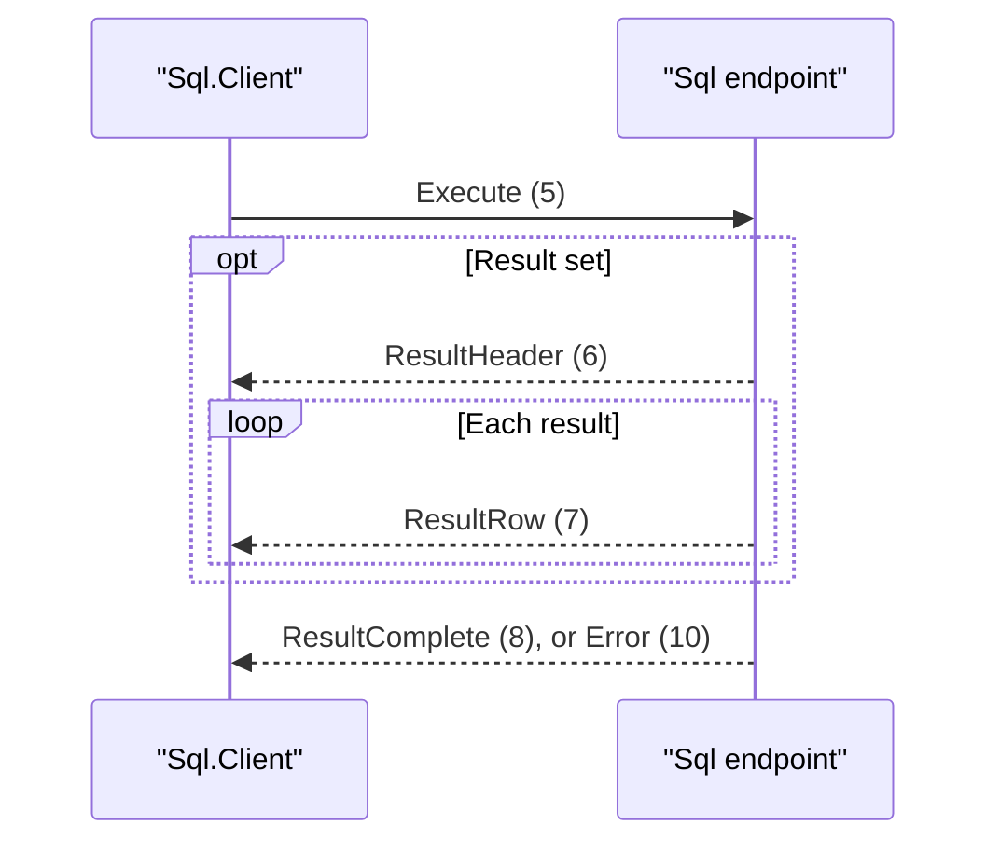

# Sql wire family

## Ownership and compatibility

`SqlProtocol.Family` is fixed when the endpoint accepts a connection. The model
owns `SqlProtocolMessageType`, ProtocolExecuteMessage, ProtocolResultHeaderMessage,
and ProtocolResultCompleteMessage. The frame, startup, error, and lifecycle formats
come from [Database.Protocol](../../Assimalign.Cohesion.Database.Protocol/docs/DESIGN.md).
The shared startup version is **2.1** since #1105's additive negotiation change;
incompatible majors are refused before authentication. SQL identifiers, payload bytes,
order, authentication and error codes are unchanged by that bump. The model's Client package owns
parameter encoding and result materialization; the shared Client only runs exchanges.

For source compatibility, this model exports C# static extension properties on the
core ProtocolMessageType for its legacy identifiers. They live in this assembly,
not the core enum. New code uses the model enum and casts to ProtocolMessageType at
the frame boundary. Code referencing both model namespaces should use qualified
model enum names. No registry can switch the family of an existing channel.

## Exchange

After the shared Startup/Authenticate/AuthenticateResponse/Ready handshake, execute
one statement at a time. Result-bearing statements return a header, zero or more
rows, and completion. Other statements return completion alone. Error ends the
current exchange without completion. ParseFailure and ExecutionFailure leave the
session ready; malformed payloads, unknown messages, and bad ordering close it.
Writing statements encode and size-check the header and every row before their commit or
explicit-transaction statement completion. DML enumeration and disposal finish inside its undo
bracket; DDL and transaction control prepare their fixed completion before execution/commit.
Result failures precede any committed write or result frame and roll back only the DML statement.
Read-only SELECT, EXPLAIN, system views and SHOW encode during delivery. A late result failure
ends even a partial exchange with ExecutionFailure; the client discards partial columns and rows.
Both paths keep the connection and explicit transaction usable on result failures.
COHSQLE045 identifies uncoded result failures and size refusals; already-coded failures retain
their diagnostics. Size refusals correspond to SQLSTATE 54000 and report encoded bytes and
ProtocolFrameHeader.MaxPayloadLength (currently 16 MiB) for each header/row. Neither path has an
aggregate result cap. Writes retain their prepared payloads for delivery without re-encoding;
reads retain only the current encoded frame. Diagnostics, when negotiated, immediately precede
Error. A transport failure during delivery is terminal; a committed write is never reported as
an ordinary statement failure (#1651).
Evaluation faults are ExecutionFailure: division by zero, numeric overflow and a
sign over a non-numeric operand carry messages that begin with `COHSQLE001:`,
`COHSQLE002:` and `COHSQLE003:`, and a statement whose parse or walk needs more
stack than the server's thread has left, such as one within a high configured
nesting limit or a `LIKE` match that backtracks through more wildcards than the
stack holds, carries `COHSQLE004:` (see the dialect's diagnostics table). A
statement nested deeper than the engine's expression nesting limit (256 levels by
default, configured per engine within 32..4096) is a ParseFailure whose message
carries `SQL0006`; it is refused before anything executes. A chain of `AND` or `OR`
terms counts one level however long it is, so a 10,000-term predicate executes (see
the dialect's expression nesting limit, #1151).
A column reference in an `INSERT ... VALUES` row or a `LIMIT` or `OFFSET` count,
a subquery's included, is an ExecutionFailure carrying `COHSQLE005:`, raised while
planning, so nothing executes and the session stays ready (#1165; a reference to a
target column in VALUES used to end the session with `Internal`, and one in a
subquery's count carried `COHDBL001:`).
A function call whose arguments its function does not accept, such as `ABS(1, 2)`,
`UPPER()`, `COALESCE()` or `COUNT(a, b)`, is an ExecutionFailure carrying
`COHSQLE006:`, raised while planning in every expression position, so nothing
executes and the session stays ready (#1189; such a call used to return NULL, and a
CHECK built on one was stored and never fired).
There is no pipelining or multiplexing. Terminate closes; Ping receives Pong while ready.

The model-owned exchange has this order.

## Payload layouts

All fixed integers below are big-endian. A `string` is an i32 nonnegative UTF-8 byte
length followed by that many bytes. The outer envelope is u32 payload length, u8
type, then payload; no payload exceeds 16,777,216 bytes. Counts are signed i32 and
must be nonnegative. Writers emit exactly the fields below with no padding.

| Byte | Direction | Payload |
| --- | --- | --- |
| 5 Execute | Client to server | string statement, i32 parameterCount, repeated (string name, i32 encodedLength, encoded scalar component) |
| 6 ResultHeader | Server to client | i32 format marker -2, i32 columnCount, repeated (string name, u8 DatabaseType, i32 MaxLength; -1 when unbounded) |
| 7 ResultRow | Server to client | Concatenated self-describing scalar components, in column order; no count prefix |
| 8 ResultComplete | Server to client | i64 affectedCount; -1 for queries, n for writes including RETURNING |
| 9 Transaction | Reserved model identifier | No implemented payload; send transaction commands through Execute where supported |

Parameter names are unique and values contain exactly one component. Returned rows
contain one component per header column; null carries its own type tag. SQL query completion uses -1; writes report their affected count. Explicit BEGIN/COMMIT/ROLLBACK are statement text on Execute, not type 9.

## Scalar component encoding

Each component begins with one u8 DatabaseType tag. Its payload follows immediately.
Fixed-width values have no length prefix. `signed(N)` below means the two's-complement
N-bit integer with its sign bit XORed, emitted most-significant byte first; reverse
that sign-bit XOR to decode. `escaped` replaces each 00 byte with 00 FF and appends
00 00. Strings on this wire use binary collation id 0 and exact UTF-8 bytes.

| Tag | Type | Payload after tag |
| --- | --- | --- |
| 0 | Null | Empty |
| 1 | Boolean | u8 0=false, 1=true |
| 2 | Int8 | signed(8) |
| 3 | Int16 | signed(16) |
| 4 | Int32 | signed(32) |
| 5 | Int64 | signed(64) |
| 6 | Float32 | Folded IEEE-754 32-bit bits, big-endian |
| 7 | Float64 | Folded IEEE-754 64-bit bits, big-endian |
| 8 | Decimal | Sign byte; normalized exponent and decimal digits as described below |
| 9 | String | u8 collation=0, escaped UTF-8 |
| 10 | Binary | escaped bytes |
| 11 | Date | signed(32) day number since 0001-01-01 (day zero) |
| 12 | Time | signed(64) ticks since midnight (100 ns/tick) |
| 13 | DateTime | signed(64) ticks since 0001-01-01, then u8 kind (0 unspecified, 1 UTC, 2 local) |
| 14 | DateTimeOffset | signed(64) UTC ticks since 0001-01-01, then signed(16) offset minutes |
| 15 | TimeSpan | signed(64) duration ticks |
| 16 | Guid | 16 RFC 4122 big-endian bytes |

Tags 17 and 18 are JSON identities in DatabaseType, but are not scalar components
supported by this family. Nested documents use their own family. Unknown tags reject.

For floats, canonicalize NaN to positive quiet NaN (7FC00000 / 7FF8000000000000),
then complement all bits for a negative IEEE bit pattern or set the high bit for a
nonnegative pattern. Decode by clearing a set high bit, otherwise complementing.
This preserves negative zero and infinities.

Decimal zero is the single sign byte 1. Nonzero values use sign 0 (negative) or 2
(positive), followed by u8 (base-10 exponent + 64), normalized significant digits
(each digit encoded as digit+1), and terminator 00. Remove leading/trailing zero
digits; the value is d1.d2... times 10^exponent. For negatives, complement every
byte after the sign, including the terminator (FF). This is System.Decimal's
96-bit coefficient / scale 0–28 value domain, not an IEEE floating-point decimal.

Golden payload examples (hex): Execute("X", no parameters) =
`00 00 00 01 58 00 00 00 00`; one header column ("id", Int64) =
`FF FF FF FE 00 00 00 01 00 00 00 02 69 64 05 FF FF FF FF`; completion(42) =
`00 00 00 00 00 00 00 2A`. The existing server tests exercise these model payloads;
ProtocolMessageTests additionally fixes these payload bytes.

## Negotiated statement diagnostics (#1105)

The shared protocol is 2.1. Startup optionally appends the client's capability names;
Ready returns the agreed version and the two-sided intersection. A negotiated 2.0
session retains empty Ready and the existing model and Error bytes. An empty Ready
from an older endpoint means 2.0 with no capabilities. Different majors are refused.
Capability names are ordinal and append-only; model names are scoped with the
lowercase endpoint family followed by a dot. The core owns `diagnostics` and frame 14.

SQL and Graph register `ProtocolCapability.Diagnostics`. When agreed, one Diagnostics
frame carries the bounded Warning/Error list immediately before Error on failure,
or immediately before ResultComplete (PathsComplete for graph paths) on success.
Information, including SQL0100, is never sent. Error and result payloads are unchanged.
Statement failures leave the server session ready. Model clients validate diagnostic
ordering and preserve every code, severity, message, nullable offset and source line.

Outbound SQL and Graph diagnostics are preflighted before any result or Error output.
If the filtered Warning/Error list exceeds 4,096 entries or 1,048,576 encoded bytes,
the endpoint retains the longest leading prefix that fits both limits with a final
Warning notice, code COHDBP001. The notice counts toward both limits and states the
retained count, original filtered count and omitted count. Once an entry does not fit,
it and every following entry are omitted, even if a later entry would fit. Entries
are never shortened. A 4,097-entry list of small diagnostics therefore keeps the first
4,095 and the notice; a first entry larger than the byte limit leaves only the notice.
The original failure still sends exactly one Error with its original error category
and message. Success still sends its result and normal completion with the bounded
warning list. Overflow alone never terminates the session or changes transaction state.
Malformed incoming diagnostic frames remain fatal protocol violations.

Null diagnostic codes and messages encode as zero-length strings; zero-length strings
decode as null. An empty diagnostic code is never a valid code. Unlocated offsets
remain null. Ready.Capabilities and Diagnostics.Entries reject null at construction
and through init/with assignment. Capability-name byte lengths are checked against
the 128-character ASCII bound before decoding or allocating a name string.

A write with RETURNING emits ResultHeader and ResultRow frames followed by
ResultComplete with its affected count n. Ordinary SELECT reports -1. Projection
failures roll back the statement before any result frame is sent.

## Offline diagnostic carriers (#1350)

Offline refusals and unconfirmed commits now supply the model code through the existing
exception Diagnostics carrier. Negotiated diagnostics use the existing frame and capability;
legacy handshake and error text keeps a single code prefix. The wire version and framing are
unchanged. Exception detail is unprefixed in process, and original causes remain attached.

## Record decode context (#1372)

Confirmed record decoding errors keep the existing execution-failure frame and corruption code.
Their message identifies the page and slot; the in-process nullable SlotIndex is not a new wire
field. Existing diagnostic negotiation, protocol version and session lifetime are unchanged.

## SELECT-only execution analysis (#1522)

EXPLAIN ANALYZE is ordinary Execute SQL text over SELECT query bodies. Plain EXPLAIN never
executes its data statement. Both return the existing eight-column plan result, with optional
Int64 estimated_rows/actual_rows values in the already nullable count columns. Detail identifies
exact probes, incomplete lower bounds and heuristic join estimates; actual counts describe
candidate work before residuals. A parent's count excludes correlated descendants; repeated child
invocations accumulate on the child's nodes. No new message type, frame shape or startup version is added.
Data-changing analysis normally fails COHSQLE057 (0A000); the earlier read-only catalog check
retains COHSQLE021 for system-relation mutations. Hash-build grant exhaustion fails COHSQLE067
(53200) through the ordinary diagnostic carrier; the resx message contains no repeated code prefix.
No standalone ANALYZE maintenance, persisted statistic or hash spill is introduced.
