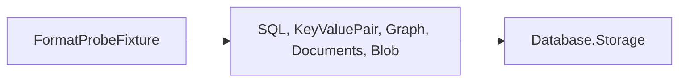

# Format-probe crash fixture design

The executable creates a real database with the selected engine, closes its initial setup, then
leaves committed catalog/root changes and stolen uncommitted physical pages in the journal.
Environment.Exit skips unwinding the live brackets. Engine tests invoke this process, preserve
all refused files byte for byte, or tear journal-covered pages and verify exact recovery.
Graph cases include format-4 entities and physical registrations (CG06017), catalog versions
(CG06019) and B-tree root stamps (CK06101).

The fixture depends on the model assemblies, which use Storage:

The fixture adds no shipped API or on-disk format. Each model test imports the common
FormatProbeTests.targets to build/copy the executable; its csproj explicitly links the test-only process helper.

The five engine test projects (SQL, Graph, Documents, KeyValuePair and Blob) drive this
fixture. It lives under Storage because its subject is the shared recovered page view, including
physical commit selection and restoration of stolen uncommitted bytes. This is the deliberate
exception to placing an executable under one driving test project. Storage.Tests excludes the
engine process launcher and does not compile Blob test sources. Each consuming engine csproj
links its own process support explicitly; the common targets only build and copy the executable.

The sentinel pages are allocated and checkpointed during setup, before the committed crash
workload. The uncommitted bracket first touches those pages, so its own full images are in the
journal and must overwrite the stolen 0x55 bytes with checkpointed 0x43 bytes. A separate newly
allocated page supplies committed crash work. The clean-legacy and clean-index modes checkpoint all
changes and close the physical stores, allowing refused clean opens to exercise the writable path.

The format34-owner mode commits SQL marker 34 and an invalid alternate root owner, then leaves
unclean journals. SQL must report its format-35 refusal from the recovered catalog before
physical-owner attachment, preserving every file byte for byte.
